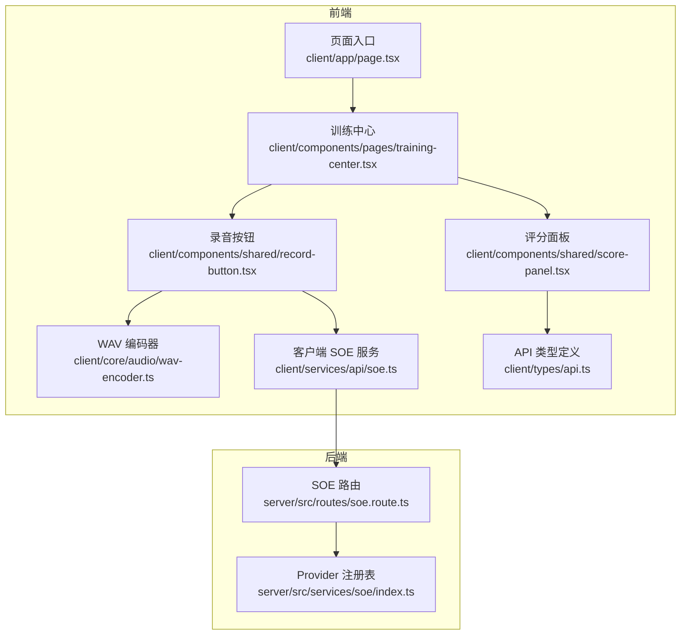
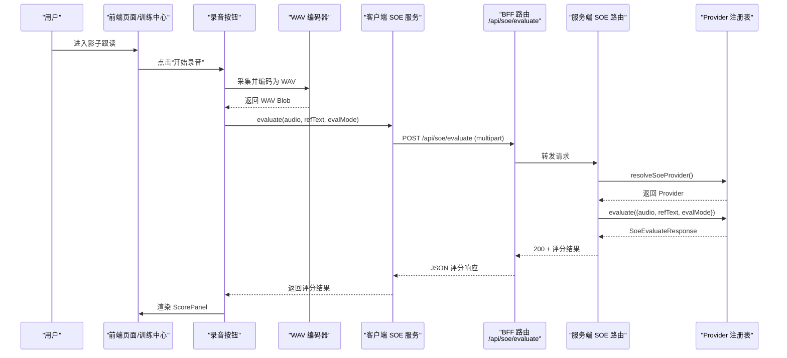
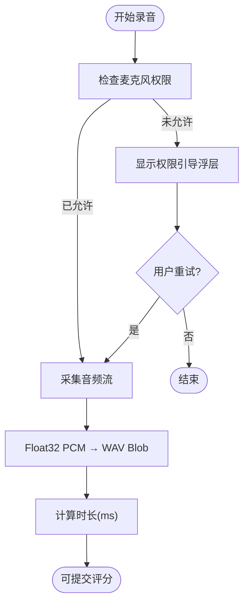
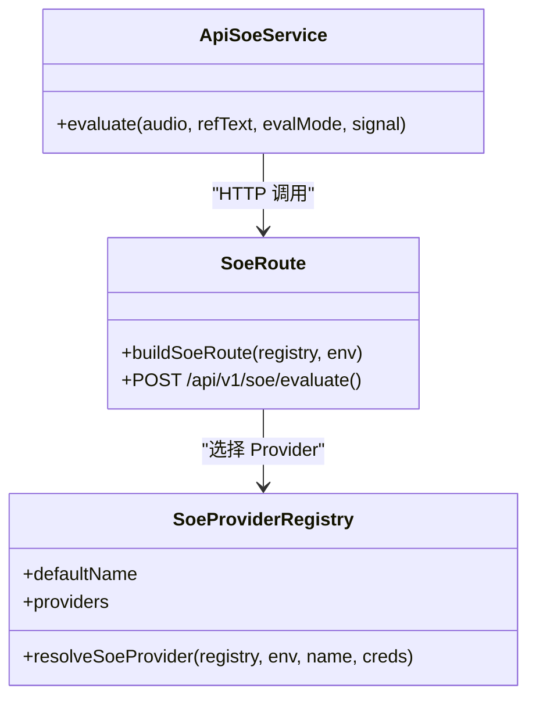
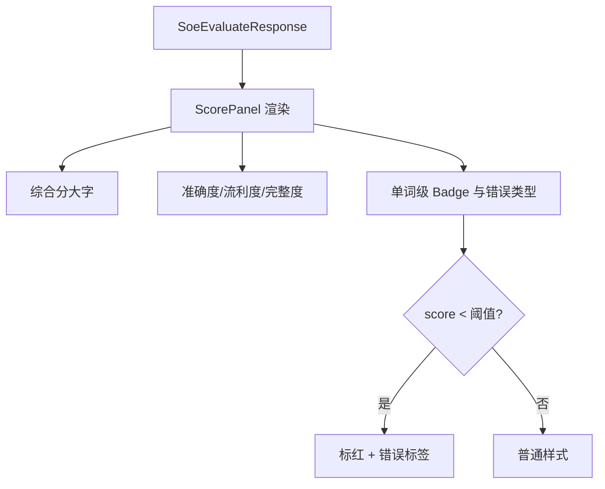
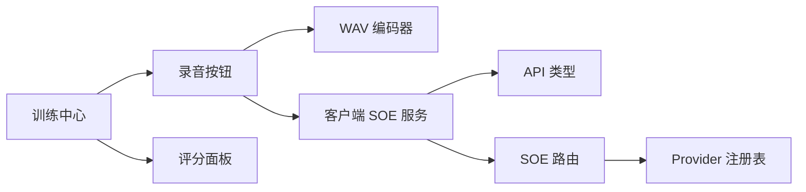

# 影子跟读

<cite>
**本文引用的文件**   
- [client/app/page.tsx](file://client/app/page.tsx)
- [client/components/pages/training-center.tsx](file://client/components/pages/training-center.tsx)
- [client/services/api/soe.ts](file://client/services/api/soe.ts)
- [server/src/routes/soe.route.ts](file://server/src/routes/soe.route.ts)
- [server/src/services/soe/index.ts](file://server/src/services/soe/index.ts)
- [client/components/shared/score-panel.tsx](file://client/components/shared/score-panel.tsx)
- [client/components/shared/record-button.tsx](file://client/components/shared/record-button.tsx)
- [client/core/audio/wav-encoder.ts](file://client/core/audio/wav-encoder.ts)
- [client/types/api.ts](file://client/types/api.ts)
</cite>

## 目录
1. [简介](#简介)
2. [项目结构](#项目结构)
3. [核心组件](#核心组件)
4. [架构总览](#架构总览)
5. [详细组件分析](#详细组件分析)
6. [依赖关系分析](#依赖关系分析)
7. [性能与稳定性](#性能与稳定性)
8. [故障排查指南](#故障排查指南)
9. [练习建议与技巧](#练习建议与技巧)
10. [结论](#结论)

## 简介
本文件为“影子跟读”功能的完整技术文档，覆盖从浏览器录音、音频格式转换、网络请求到发音评分结果展示的全链路实现。重点包括：
- 实时录音处理流程：权限获取、录制与音频流处理
- 发音评分系统集成：SOE API 调用、评分结果解析、即时反馈
- 界面设计要点：波形可视化、录音按钮、评分面板、对比显示
- 技术细节：Web Audio API、WAV 编码、网络请求与错误处理
- 练习方法与常见问题解决方案

## 项目结构
影子跟读功能横跨前端页面入口、训练中心导航、录音与评分 UI、音频编码、客户端 SOE 服务封装以及服务端路由与 Provider 注册。

**图表来源**
- [client/app/page.tsx:1-6](file://client/app/page.tsx#L1-L6)
- [client/components/pages/training-center.tsx:14-21](file://client/components/pages/training-center.tsx#L14-L21)
- [client/components/shared/record-button.tsx:1-22](file://client/components/shared/record-button.tsx#L1-L22)
- [client/components/shared/score-panel.tsx:1-95](file://client/components/shared/score-panel.tsx#L1-L95)
- [client/core/audio/wav-encoder.ts:1-59](file://client/core/audio/wav-encoder.ts#L1-L59)
- [client/services/api/soe.ts:1-30](file://client/services/api/soe.ts#L1-L30)
- [server/src/routes/soe.route.ts:1-110](file://server/src/routes/soe.route.ts#L1-L110)
- [server/src/services/soe/index.ts:1-82](file://server/src/services/soe/index.ts#L1-L82)

**章节来源**
- [client/app/page.tsx:1-6](file://client/app/page.tsx#L1-L6)
- [client/components/pages/training-center.tsx:14-21](file://client/components/pages/training-center.tsx#L14-L21)

## 核心组件
- 训练中心：提供“影子跟读”入口，并限制收藏句模式下全文类模式的使用范围。
- 录音按钮：统一开始/停止录音的交互入口。
- WAV 编码器：将 Float32 PCM 样本编码为标准 WAV Blob（16kHz 单声道 16bit）。
- 客户端 SOE 服务：封装 /api/soe/evaluate 请求，统一错误码与中止语义。
- 评分面板：综合分、准确度/流利度/完整度三维进度条，单词级得分与错误类型提示。
- 服务端 SOE 路由：校验 multipart 参数、选择 Provider、转发 evaluate 调用。
- Provider 注册表：按环境或请求级凭据构造具体评分 Provider。
- API 类型：SoeEvaluateResponse 等评分相关数据结构。

**章节来源**
- [client/components/pages/training-center.tsx:14-21](file://client/components/pages/training-center.tsx#L14-L21)
- [client/components/shared/record-button.tsx:1-22](file://client/components/shared/record-button.tsx#L1-L22)
- [client/core/audio/wav-encoder.ts:1-59](file://client/core/audio/wav-encoder.ts#L1-L59)
- [client/services/api/soe.ts:1-30](file://client/services/api/soe.ts#L1-L30)
- [client/components/shared/score-panel.tsx:1-95](file://client/components/shared/score-panel.tsx#L1-L95)
- [server/src/routes/soe.route.ts:1-110](file://server/src/routes/soe.route.ts#L1-L110)
- [server/src/services/soe/index.ts:1-82](file://server/src/services/soe/index.ts#L1-L82)
- [client/types/api.ts:21-48](file://client/types/api.ts#L21-L48)

## 架构总览
影子跟读的整体数据流如下：用户点击录音 → 浏览器采集音频 → 转换为标准 WAV → 通过 BFF 路由转发至 SOE 服务 → 返回结构化评分 → 在评分面板中展示。

**图表来源**
- [client/components/shared/record-button.tsx:1-22](file://client/components/shared/record-button.tsx#L1-L22)
- [client/core/audio/wav-encoder.ts:1-59](file://client/core/audio/wav-encoder.ts#L1-L59)
- [client/services/api/soe.ts:1-30](file://client/services/api/soe.ts#L1-L30)
- [server/src/routes/soe.route.ts:1-110](file://server/src/routes/soe.route.ts#L1-L110)
- [server/src/services/soe/index.ts:1-82](file://server/src/services/soe/index.ts#L1-L82)

## 详细组件分析

### 录音与音频处理
- 权限获取：首次录音需触发浏览器麦克风授权；若拒绝，通过权限引导浮层提示用户前往浏览器设置允许后重试。
- 录制与流处理：使用浏览器媒体接口采集音频流，采样率与通道数由 Web Audio API 处理；随后将 Float32 PCM 样本送入 WAV 编码器。
- 格式转换：WAV 编码器输出 16kHz 单声道 16bit 标准 WAV Blob，满足 SOE 与 Whisper 的统一输入要求。
- 时长计算：根据样本数量与采样率计算录音时长，便于上报与分析。

**图表来源**
- [client/components/shared/score-panel.tsx:65-92](file://client/components/shared/score-panel.tsx#L65-L92)
- [client/core/audio/wav-encoder.ts:1-59](file://client/core/audio/wav-encoder.ts#L1-L59)

**章节来源**
- [client/components/shared/score-panel.tsx:65-92](file://client/components/shared/score-panel.tsx#L65-L92)
- [client/core/audio/wav-encoder.ts:1-59](file://client/core/audio/wav-encoder.ts#L1-L59)

### 发音评分系统集成（SOE）
- 客户端调用：封装 FormData，包含 audio、refText、evalMode，POST 至 /api/soe/evaluate；支持 AbortSignal 取消。
- 错误处理：区分中止与上游不可达等错误，统一抛出 ApiError，便于上层静默分支或提示。
- 服务端路由：校验 refText 长度、evalMode、音频大小；可选 provider 与 creds 字段；连接断开时中止上游。
- Provider 选择：默认从注册表取实现；若携带请求级凭据且齐全，则现场构造对应 Provider。

**图表来源**
- [client/services/api/soe.ts:1-30](file://client/services/api/soe.ts#L1-L30)
- [server/src/routes/soe.route.ts:1-110](file://server/src/routes/soe.route.ts#L1-L110)
- [server/src/services/soe/index.ts:1-82](file://server/src/services/soe/index.ts#L1-L82)

**章节来源**
- [client/services/api/soe.ts:1-30](file://client/services/api/soe.ts#L1-L30)
- [server/src/routes/soe.route.ts:1-110](file://server/src/routes/soe.route.ts#L1-L110)
- [server/src/services/soe/index.ts:1-82](file://server/src/services/soe/index.ts#L1-L82)

### 评分结果展示与对比
- 综合分与维度分：ScorePanel 展示 total、accuracy、fluency、integrity，并以 Progress 条形呈现。
- 单词级评分：对 words 列表进行 Badge 展示，低于阈值标红，并标注 errorType（漏读/增读/误读）。
- 对比显示：结合原文与转写文本，突出差异词与错误位置，辅助用户定位问题。

**图表来源**
- [client/components/shared/score-panel.tsx:1-95](file://client/components/shared/score-panel.tsx#L1-L95)
- [client/types/api.ts:21-48](file://client/types/api.ts#L21-L48)

**章节来源**
- [client/components/shared/score-panel.tsx:1-95](file://client/components/shared/score-panel.tsx#L1-L95)
- [client/types/api.ts:21-48](file://client/types/api.ts#L21-L48)

### 界面设计与交互
- 训练中心入口：明确“影子跟读”为全文同步跟读与转写对比模式，并在收藏句模式下置灰以强制全文上下文。
- 录音按钮：统一的开始/停止交互，视觉状态清晰，适配多训练模式复用。
- 评分面板：三维度进度条与单词级 Badge，低分词高亮，配合错误类型提示提升可读性。
- 权限引导：当麦克风权限被拒绝时，弹出说明与操作指引，引导用户重新授权。

**章节来源**
- [client/components/pages/training-center.tsx:14-21](file://client/components/pages/training-center.tsx#L14-L21)
- [client/components/shared/record-button.tsx:1-22](file://client/components/shared/record-button.tsx#L1-L22)
- [client/components/shared/score-panel.tsx:1-95](file://client/components/shared/score-panel.tsx#L1-L95)

## 依赖关系分析
- 前端依赖：
  - 训练中心依赖录音按钮与评分面板，用于构建影子跟读主流程。
  - 录音按钮依赖 WAV 编码器完成音频格式标准化。
  - 客户端 SOE 服务依赖 API 类型定义，确保请求与响应的类型安全。
- 后端依赖：
  - SOE 路由依赖 Provider 注册表，按环境或请求级凭据动态选择 Provider。
  - Provider 注册表维护 mock 与第三方 Provider（Azure/Tencent/讯飞），并按凭据有效性决定是否可用。

**图表来源**
- [client/components/pages/training-center.tsx:14-21](file://client/components/pages/training-center.tsx#L14-L21)
- [client/components/shared/record-button.tsx:1-22](file://client/components/shared/record-button.tsx#L1-L22)
- [client/core/audio/wav-encoder.ts:1-59](file://client/core/audio/wav-encoder.ts#L1-L59)
- [client/services/api/soe.ts:1-30](file://client/services/api/soe.ts#L1-L30)
- [client/types/api.ts:21-48](file://client/types/api.ts#L21-L48)
- [server/src/routes/soe.route.ts:1-110](file://server/src/routes/soe.route.ts#L1-L110)
- [server/src/services/soe/index.ts:1-82](file://server/src/services/soe/index.ts#L1-L82)

**章节来源**
- [client/components/pages/training-center.tsx:14-21](file://client/components/pages/training-center.tsx#L14-L21)
- [client/services/api/soe.ts:1-30](file://client/services/api/soe.ts#L1-L30)
- [server/src/routes/soe.route.ts:1-110](file://server/src/routes/soe.route.ts#L1-L110)
- [server/src/services/soe/index.ts:1-82](file://server/src/services/soe/index.ts#L1-L82)

## 性能与稳定性
- 音频编码：WAV 编码器为纯函数，避免浏览器特有 API，保证确定性输出与可测试性。
- 网络请求：客户端 SOE 服务支持 AbortSignal，便于在用户取消或页面切换时及时中断请求。
- 服务端保护：路由层对 refText 长度、evalMode、音频大小进行严格校验，防止异常负载。
- Provider 选择：优先使用注册表默认实现；请求级凭据仅在齐全时现场构造，降低无效开销。

[本节为通用指导，不直接分析具体文件]

## 故障排查指南
- 麦克风权限被拒绝：
  - 现象：无法开始录音，出现权限引导浮层。
  - 处理：引导用户前往浏览器设置允许麦克风，然后重试。
- 评分服务不可达：
  - 现象：客户端抛出“评分服务不可达”错误。
  - 处理：检查代理地址与服务端健康状态；确认 Provider 配置是否生效。
- 请求参数错误：
  - 现象：服务端返回 BAD_REQUEST，如 refText 超长、evalMode 非法、缺少音频字段。
  - 处理：校验前端传入参数，确保符合契约要求。
- Provider 未配置：
  - 现象：服务端返回 PROVIDER_UNAVAILABLE。
  - 处理：检查环境变量或请求级凭据是否齐全；必要时启用 mock Provider 调试。

**章节来源**
- [client/components/shared/score-panel.tsx:65-92](file://client/components/shared/score-panel.tsx#L65-L92)
- [client/services/api/soe.ts:10-28](file://client/services/api/soe.ts#L10-L28)
- [server/src/routes/soe.route.ts:66-106](file://server/src/routes/soe.route.ts#L66-L106)
- [server/src/services/soe/index.ts:37-79](file://server/src/services/soe/index.ts#L37-L79)

## 练习建议与技巧
- 发音改善建议：
  - 关注准确度与流利度两个维度，优先纠正低分单词的错误类型（漏读/增读/误读）。
  - 利用单词级 Badge 的高亮提示，针对性重复弱项词汇。
- 练习技巧：
  - 先慢速跟读，再逐步提速，保持节奏稳定。
  - 分段练习：将长句拆分为短语，逐段对齐参考文本。
  - 对比转写：结合转写结果与原文，找出断句与连读问题。
- 常见问题解决：
  - 录音无声：检查设备权限与浏览器设置。
  - 评分延迟：在网络不稳定时减少单次录音时长，或分段提交。
  - 结果不一致：确保音频格式为 16kHz 单声道 WAV，避免采样率不匹配。

[本节为通用指导，不直接分析具体文件]

## 结论
影子跟读功能通过标准化的录音与音频编码、健壮的 SOE 集成与直观的评分面板，为用户提供了完整的口语练习闭环。借助训练中心的模式管理与权限引导，用户在真实场景中可高效提升发音准确度与口语表达流畅度。建议在后续迭代中持续优化波形可视化与对比显示，进一步提升用户体验与学习效果。

[本节为总结性内容，不直接分析具体文件]