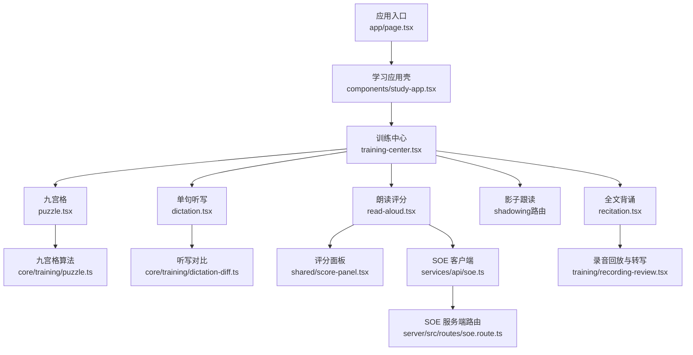
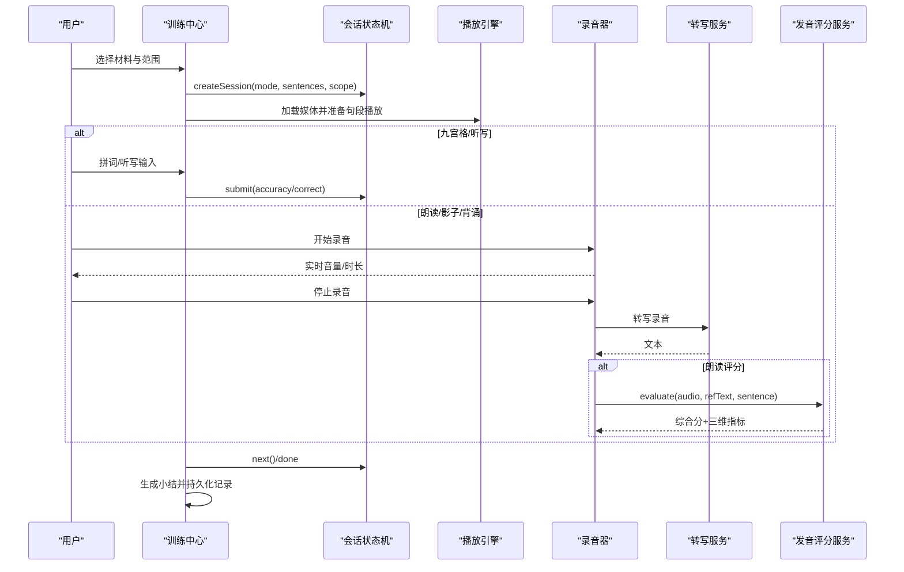
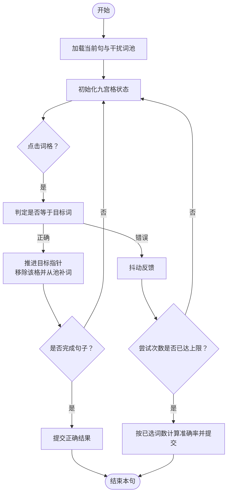
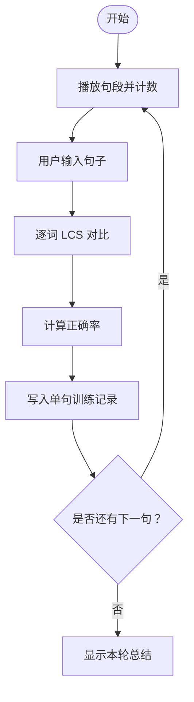
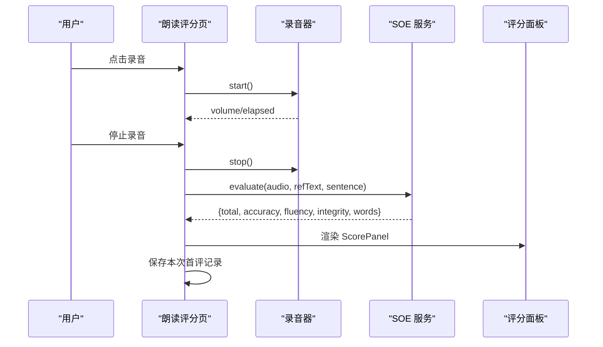
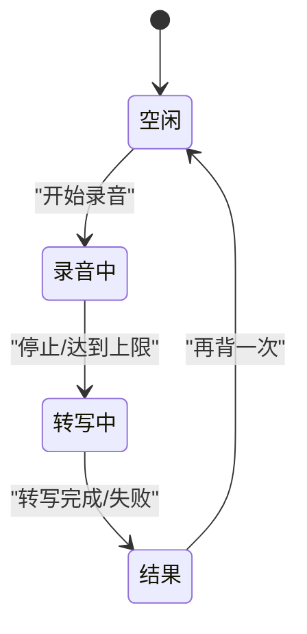
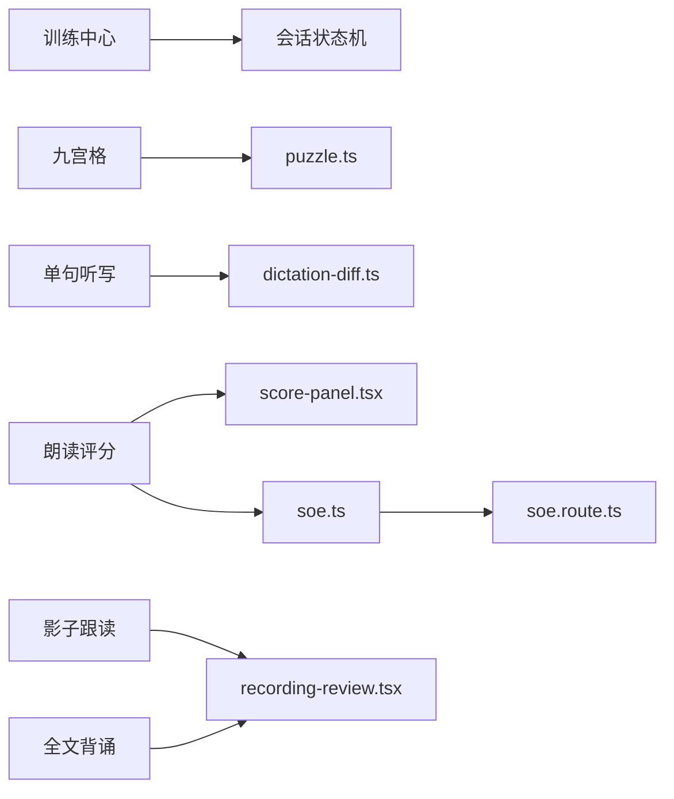

# 训练模式

<cite>
**本文引用的文件**   
- [client/app/page.tsx](file://client/app/page.tsx)
- [client/components/pages/training-center.tsx](file://client/components/pages/training-center.tsx)
- [client/components/pages/puzzle.tsx](file://client/components/pages/puzzle.tsx)
- [client/core/training/puzzle.ts](file://client/core/training/puzzle.ts)
- [client/components/pages/dictation.tsx](file://client/components/pages/dictation.tsx)
- [client/core/training/dictation-diff.ts](file://client/core/training/dictation-diff.ts)
- [client/components/pages/training/read-aloud.tsx](file://client/components/pages/training/read-aloud.tsx)
- [client/components/shared/score-panel.tsx](file://client/components/shared/score-panel.tsx)
- [client/services/api/soe.ts](file://client/services/api/soe.ts)
- [server/src/routes/soe.route.ts](file://server/src/routes/soe.route.ts)
- [client/components/pages/training/recitation.tsx](file://client/components/pages/training/recitation.tsx)
- [client/components/pages/training/recording-review.tsx](file://client/components/pages/training/recording-review.tsx)
- [client/core/training/session.ts](file://client/core/training/session.ts)
- [client/core/training/scoring.ts](file://client/core/training/scoring.ts)
- [README.md](file://README.md)
</cite>

## 目录
1. [简介](#简介)
2. [项目结构](#项目结构)
3. [核心组件](#核心组件)
4. [架构总览](#架构总览)
5. [详细组件分析](#详细组件分析)
6. [依赖关系分析](#依赖关系分析)
7. [性能与体验要点](#性能与体验要点)
8. [故障排查指南](#故障排查指南)
9. [结论](#结论)
10. [附录：不同水平用户训练策略](#附录不同水平用户训练策略)

## 简介
本指南面向所有训练模式，覆盖九宫格练习、单句听写、影子跟读、全文背诵与朗读评分。文档从界面说明、操作步骤、配置选项、评分标准与提升建议五个维度展开，并结合代码实现解释其内部逻辑，帮助用户根据自身英语水平选择合适的训练方式，形成“输入—输出—反馈—强化”的闭环。

## 项目结构
训练功能由前端页面组件驱动，核心算法集中在 core/training 下，录音与转写通过 platform 与 services 层对接后端服务。训练中心统一入口，按材料范围（全文/收藏句）组织题目队列。

**图表来源**
- [client/app/page.tsx:1-6](file://client/app/page.tsx#L1-L6)
- [client/components/pages/training-center.tsx:14-21](file://client/components/pages/training-center.tsx#L14-L21)
- [client/components/pages/puzzle.tsx:1-24](file://client/components/pages/puzzle.tsx#L1-L24)
- [client/components/pages/dictation.tsx:1-16](file://client/components/pages/dictation.tsx#L1-L16)
- [client/components/pages/training/read-aloud.tsx:1-30](file://client/components/pages/training/read-aloud.tsx#L1-L30)
- [client/components/pages/training/recitation.tsx:1-27](file://client/components/pages/training/recitation.tsx#L1-L27)
- [client/core/training/puzzle.ts:1-10](file://client/core/training/puzzle.ts#L1-L10)
- [client/core/training/dictation-diff.ts:1-7](file://client/core/training/dictation-diff.ts#L1-L7)
- [client/components/shared/score-panel.tsx:1-13](file://client/components/shared/score-panel.tsx#L1-L13)
- [client/services/api/soe.ts:1-8](file://client/services/api/soe.ts#L1-L8)
- [server/src/routes/soe.route.ts:1-12](file://server/src/routes/soe.route.ts#L1-L12)
- [client/components/pages/training/recording-review.tsx:1-9](file://client/components/pages/training/recording-review.tsx#L1-L9)

**章节来源**
- [README.md:92-152](file://README.md#L92-L152)

## 核心组件
- 训练中心：提供模式选择、材料范围切换（全文/收藏句）、上次成绩展示；对“仅全文”模式进行锁定提示。
- 会话状态机：抽象出题目队列、游标推进、提交/重试/提示/下一题等事件，供各模式复用。
- 小结汇总：计算正确率、用时、最弱句 TOP3 等。
- 录音与转写：统一封装本地优先转写、云端兜底、录音回放 URL 生命周期管理。
- 发音评分：客户端调用 SOE 接口，服务端转发至具体 provider，返回综合分与三维指标。

**章节来源**
- [client/components/pages/training-center.tsx:14-29](file://client/components/pages/training-center.tsx#L14-L29)
- [client/core/training/session.ts:1-32](file://client/core/training/session.ts#L1-L32)
- [client/core/training/scoring.ts:1-37](file://client/core/training/scoring.ts#L1-L37)
- [client/components/pages/training/recording-review.tsx:17-50](file://client/components/pages/training/recording-review.tsx#L17-L50)
- [client/services/api/soe.ts:9-29](file://client/services/api/soe.ts#L9-L29)

## 架构总览
训练流程贯穿“材料加载 → 范围过滤 → 会话初始化 → 交互 → 结果记录 → 小结”。

**图表来源**
- [client/components/pages/training-center.tsx:31-66](file://client/components/pages/training-center.tsx#L31-L66)
- [client/core/training/session.ts:44-62](file://client/core/training/session.ts#L44-L62)
- [client/components/pages/training/read-aloud.tsx:138-198](file://client/components/pages/training/read-aloud.tsx#L138-L198)
- [client/components/pages/training/recording-review.tsx:23-50](file://client/components/pages/training/recording-review.tsx#L23-L50)
- [client/services/api/soe.ts:10-28](file://client/services/api/soe.ts#L10-L28)

## 详细组件分析

### 九宫格练习（选词拼句）
- 界面说明
  - 顶部播放原音按钮，中间为已选词区域，下方为 3×3 九宫格词块。
  - 支持提示高亮答案词，每次扣 2 分；每句最多 2 次提交机会。
  - 完成后显示本轮小结：正确率、用时、得分、最弱句。
- 操作步骤
  1. 点击“播放句子”听原音。
  2. 按语序点击九宫格中的正确词，选错会抖动并消耗一次尝试次数。
  3. 需要帮助时点击“提示”，高亮下一个应选词。
  4. 全部选完自动提交；若尝试次数用尽则根据已选词数计算准确率并提交。
  5. 完成后可重听或进入下一句，最后查看小结。
- 配置选项
  - 范围：全文或收藏句（由训练中心传入）。
  - 难度调节：干扰词来自同材料其他句子的词表；短句不足 9 格时用干扰词补齐；长句（>15 词）按标点并块降低单屏认知负荷。
- 评分标准
  - 每句基础 10 分，每次提示 -2 分，下限 0。
  - 最终得分 = round((全对句数×10 − 提示次数×2) / (总句数×10) × 100)。
- 提升建议
  - 初学者：先多听原音，再逐步减少提示使用。
  - 进阶者：关闭提示，挑战首次即全对。
  - 易错点：注意大小写与专有名词精确匹配。

**图表来源**
- [client/components/pages/puzzle.tsx:134-190](file://client/components/pages/puzzle.tsx#L134-L190)
- [client/core/training/puzzle.ts:168-269](file://client/core/training/puzzle.ts#L168-L269)

**章节来源**
- [client/components/pages/puzzle.tsx:26-30](file://client/components/pages/puzzle.tsx#L26-L30)
- [client/components/pages/puzzle.tsx:103-125](file://client/components/pages/puzzle.tsx#L103-L125)
- [client/core/training/puzzle.ts:24-52](file://client/core/training/puzzle.ts#L24-L52)
- [client/core/training/puzzle.ts:90-93](file://client/core/training/puzzle.ts#L90-L93)
- [client/core/training/puzzle.ts:146-160](file://client/core/training/puzzle.ts#L146-L160)

### 单句听写（听音写句）
- 界面说明
  - 播放当前句段，输入框用于书写完整句子。
  - 核对后以逐词 diff 着色：正确不变色、错词红删并附正确词、漏词绿插、多词灰。
  - 底部显示本句正确率，可重听或下一句。
- 操作步骤
  1. 点击“播放句子”听原音，可多次播放。
  2. 在输入框中写下听到的句子。
  3. 点击“核对答案”，系统计算逐词差异与正确率。
  4. 继续下一句，完成后查看平均正确率、总播放次数与最弱句。
- 配置选项
  - 范围：全文或收藏句。
  - 播放次数计入统计，便于自我监控重复强度。
- 评分标准
  - 基于 LCS 的逐词 diff，正确率 = 正确词数 / max(目标词数, 输入词数)，避免“夹带多词也拿满分”的偏差。
- 提升建议
  - 初级：多听原音，关注连读弱读与标点停顿。
  - 中级：控制播放次数，尽量一次写出完整句。
  - 高级：关注错词与漏词的语义差异，针对性复习薄弱句。

**图表来源**
- [client/components/pages/dictation.tsx:84-117](file://client/components/pages/dictation.tsx#L84-L117)
- [client/core/training/dictation-diff.ts:36-108](file://client/core/training/dictation-diff.ts#L36-L108)

**章节来源**
- [client/components/pages/dictation.tsx:18-26](file://client/components/pages/dictation.tsx#L18-L26)
- [client/components/pages/dictation.tsx:91-117](file://client/components/pages/dictation.tsx#L91-L117)
- [client/core/training/dictation-diff.ts:20-34](file://client/core/training/dictation-diff.ts#L20-L34)
- [client/core/training/dictation-diff.ts:96-108](file://client/core/training/dictation-diff.ts#L96-L108)

### 朗读评分（逐句跟读 + SOE 评分）
- 界面说明
  - 显示当前句中英文，提供“听原音”和“录音”按钮。
  - 录音中显示声波振幅条与计时；评分中显示加载态。
  - 评分结果以综合分大字 + 准确度/流利度/完整度三维条形图呈现，单词级 Badge 低于阈值标红。
- 操作步骤
  1. 点击“听原音”熟悉句段。
  2. 点击“录音”开始跟读，结束后自动提交评分。
  3. 查看评分详情，可回听自己的录音。
  4. 点击“下一句”继续，全部完成后查看平均综合分与薄弱句数量。
- 配置选项
  - 范围：全文或收藏句。
  - 评分模型与服务端 provider 由设置决定，客户端每次评分动态解析。
- 评分标准
  - 综合分 total，以及 accuracy、fluency、integrity 三个维度。
  - 单词级 score < 60 标红，errorType 标注漏/增/误读。
- 提升建议
  - 初级：先模仿原音节奏，重点提升准确度。
  - 中级：关注流利度与完整度，减少卡顿与漏读。
  - 高级：针对低分单词专项纠音，结合影子跟读巩固。

**图表来源**
- [client/components/pages/training/read-aloud.tsx:144-198](file://client/components/pages/training/read-aloud.tsx#L144-L198)
- [client/components/shared/score-panel.tsx:21-62](file://client/components/shared/score-panel.tsx#L21-L62)
- [client/services/api/soe.ts:10-28](file://client/services/api/soe.ts#L10-L28)
- [server/src/routes/soe.route.ts:64-106](file://server/src/routes/soe.route.ts#L64-L106)

**章节来源**
- [client/components/pages/training/read-aloud.tsx:32-42](file://client/components/pages/training/read-aloud.tsx#L32-L42)
- [client/components/shared/score-panel.tsx:14-15](file://client/components/shared/score-panel.tsx#L14-L15)
- [client/services/api/soe.ts:1-8](file://client/services/api/soe.ts#L1-L8)
- [server/src/routes/soe.route.ts:1-12](file://server/src/routes/soe.route.ts#L1-L12)

### 影子跟读（全文同步跟读 + 转写对比）
- 界面说明
  - 全文逐句滚动跟随，边听边读；录音结束后展示回放、转写文本与原文对比。
  - 转写失败可重试，不重新录音。
- 操作步骤
  1. 点击“开始录音”，系统自动采集音频并限制 60 秒上限。
  2. 录音中观察波形与计时，随时停止。
  3. 系统自动转写并展示结果；如失败可点击“重新转写”。
  4. 查看与原文的逐词对比，绿色为读对，黑色为漏读，红色括号内为实际读出。
- 配置选项
  - 无额外参数，共享录音与转写链路。
- 评分标准
  - 不做评分，侧重完整性与准确性对比。
- 提升建议
  - 初级：放慢语速，确保每个词都清晰。
  - 中级：控制停顿与连读，贴近原音节奏。
  - 高级：追求零漏读与零多读，反复优化薄弱环节。

**章节来源**
- [client/components/pages/training/recording-review.tsx:74-90](file://client/components/pages/training/recording-review.tsx#L74-L90)
- [client/components/pages/training/recording-review.tsx:97-150](file://client/components/pages/training/recording-review.tsx#L97-L150)

### 全文背诵（凭记忆背诵全文 + 转写对比）
- 界面说明
  - 三种提示模式：显示中文、仅首词、无提示；无中文字幕时禁用“显示中文”。
  - 录音上限 60 秒，到达自动收尾进入转写。
  - 结果页包含录音回放、转写文本与原文对比。
- 操作步骤
  1. 选择提示模式（受材料字幕影响）。
  2. 点击“开始录音”，凭记忆背诵全文。
  3. 达到上限或主动停止后进入转写。
  4. 查看回放与对比，必要时“重新转写”。
  5. 可“再背一次”或返回训练中心。
- 配置选项
  - 提示模式：zh / first / none。
- 评分标准
  - 不做评分，评估完整度与准确性。
- 提升建议
  - 初级：先用“显示中文”建立语义框架，再过渡到“仅首词”。
  - 中级：尝试“无提示”，训练纯回忆能力。
  - 高级：追求逐词一致，减少漏读与多读。

**图表来源**
- [client/components/pages/training/recitation.tsx:28-36](file://client/components/pages/training/recitation.tsx#L28-L36)
- [client/components/pages/training/recitation.tsx:118-174](file://client/components/pages/training/recitation.tsx#L118-L174)
- [client/components/pages/training/recitation.tsx:198-276](file://client/components/pages/training/recitation.tsx#L198-L276)

**章节来源**
- [client/components/pages/training/recitation.tsx:1-12](file://client/components/pages/training/recitation.tsx#L1-L12)
- [client/components/pages/training/recitation.tsx:65-94](file://client/components/pages/training/recitation.tsx#L65-L94)
- [client/components/pages/training/recitation.tsx:137-174](file://client/components/pages/training/recitation.tsx#L137-L174)

## 依赖关系分析
- 训练中心依赖会话状态机与材料存储，负责范围切换与上次成绩读取。
- 九宫格与听写依赖各自算法模块（puzzle.ts、dictation-diff.ts）。
- 朗读评分依赖 SOE 客户端与服务端路由，评分面板为共享 UI。
- 影子跟读与全文背诵共享录音回放与转写组件。

**图表来源**
- [client/components/pages/training-center.tsx:14-21](file://client/components/pages/training-center.tsx#L14-L21)
- [client/core/training/session.ts:1-32](file://client/core/training/session.ts#L1-L32)
- [client/components/pages/puzzle.tsx:8-19](file://client/components/pages/puzzle.tsx#L8-L19)
- [client/components/pages/dictation.tsx:8-16](file://client/components/pages/dictation.tsx#L8-L16)
- [client/components/pages/training/read-aloud.tsx:17-30](file://client/components/pages/training/read-aloud.tsx#L17-L30)
- [client/components/pages/training/recitation.tsx:20-27](file://client/components/pages/training/recitation.tsx#L20-L27)

**章节来源**
- [client/core/training/session.ts:34-42](file://client/core/training/session.ts#L34-L42)
- [client/core/training/scoring.ts:39-50](file://client/core/training/scoring.ts#L39-L50)

## 性能与体验要点
- 播放引擎：SentencePlayer 按句段播放，避免全篇拖动带来的延迟与错位。
- 录音链路：16kHz mono WAV，适配 ASR/SOE 兼容性；60 秒上限防止过长录音导致转写失败。
- 对象 URL 管理：录音回放 URL 创建与释放严格配对，避免内存泄漏。
- 存储策略：每句首次核对该句只写一条 train: 记录，避免冗余数据。
- 小结聚合：正确率取句均，最弱句 TOP3 便于聚焦复习。

[本节为通用指导，不直接分析具体文件]

## 故障排查指南
- 麦克风权限拒绝
  - 现象：录音无法启动，弹出权限引导浮层。
  - 处理：在浏览器地址栏左侧站点图标中允许麦克风，然后重试。
- 转写失败
  - 现象：转写进度卡住或报错。
  - 处理：检查本机转写服务是否启动；或配置云端转写模型；可点击“重新转写”重试。
- 评分不可达
  - 现象：朗读评分请求失败。
  - 处理：检查代理地址与后端 SOE 服务；确认 provider 配置齐全。
- 无音频/无字幕
  - 现象：播放按钮置灰或提示无字幕。
  - 处理：导入真实材料；确保媒体与字幕均已就绪。

**章节来源**
- [client/components/shared/score-panel.tsx:65-91](file://client/components/shared/score-panel.tsx#L65-L91)
- [client/components/pages/training/recording-review.tsx:33-49](file://client/components/pages/training/recording-review.tsx#L33-L49)
- [client/services/api/soe.ts:18-27](file://client/services/api/soe.ts#L18-L27)
- [client/components/pages/dictation.tsx:119-122](file://client/components/pages/dictation.tsx#L119-L122)

## 结论
本训练体系围绕“输入—输出—反馈—强化”构建，九宫格与听写强化词汇与句型结构，朗读评分与影子跟读提升口语表达，全文背诵锻炼整体记忆与输出。通过范围选择、提示机制与多维评分，用户可按自身水平定制训练路径，持续迭代改进。

[本节为总结性内容，不直接分析具体文件]

## 附录：不同水平用户训练策略
- 入门级（听力与词汇基础较弱）
  - 推荐：九宫格（多用提示）→ 单句听写（多听原音）→ 朗读评分（先准确度）。
  - 目标：建立词形—词义—语音联系，减少漏读与错读。
- 进阶级（能听懂基本对话，表达不够流畅）
  - 推荐：影子跟读（控制节奏）→ 朗读评分（提升流利度与完整度）→ 单句听写（减少播放次数）。
  - 目标：提高连贯性与语感，减少卡顿与多余词。
- 高级（接近母语者表达，追求精准与地道）
  - 推荐：全文背诵（无提示）→ 朗读评分（单词级纠音）→ 影子跟读（零漏读/零多读）。
  - 目标：逼近原文精度，形成稳定输出习惯。

[本节为通用指导，不直接分析具体文件]