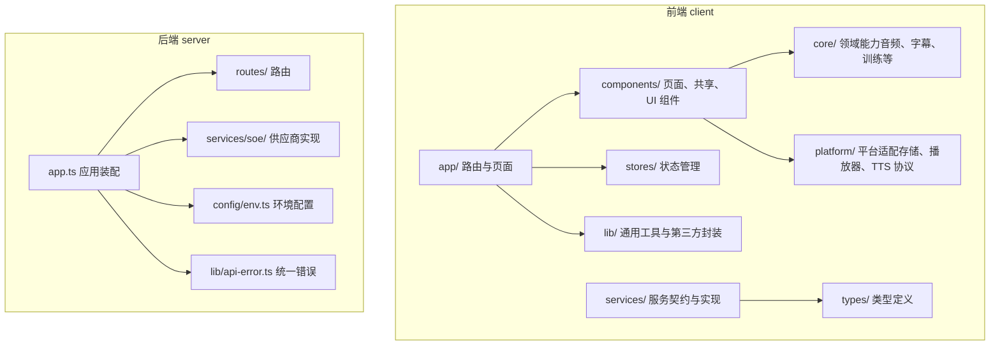
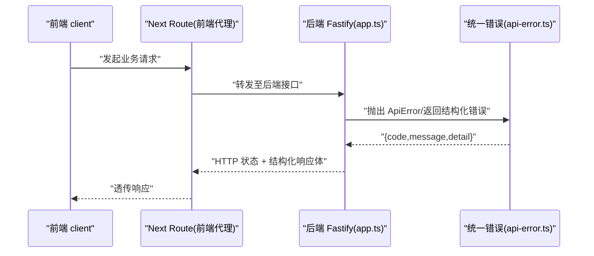
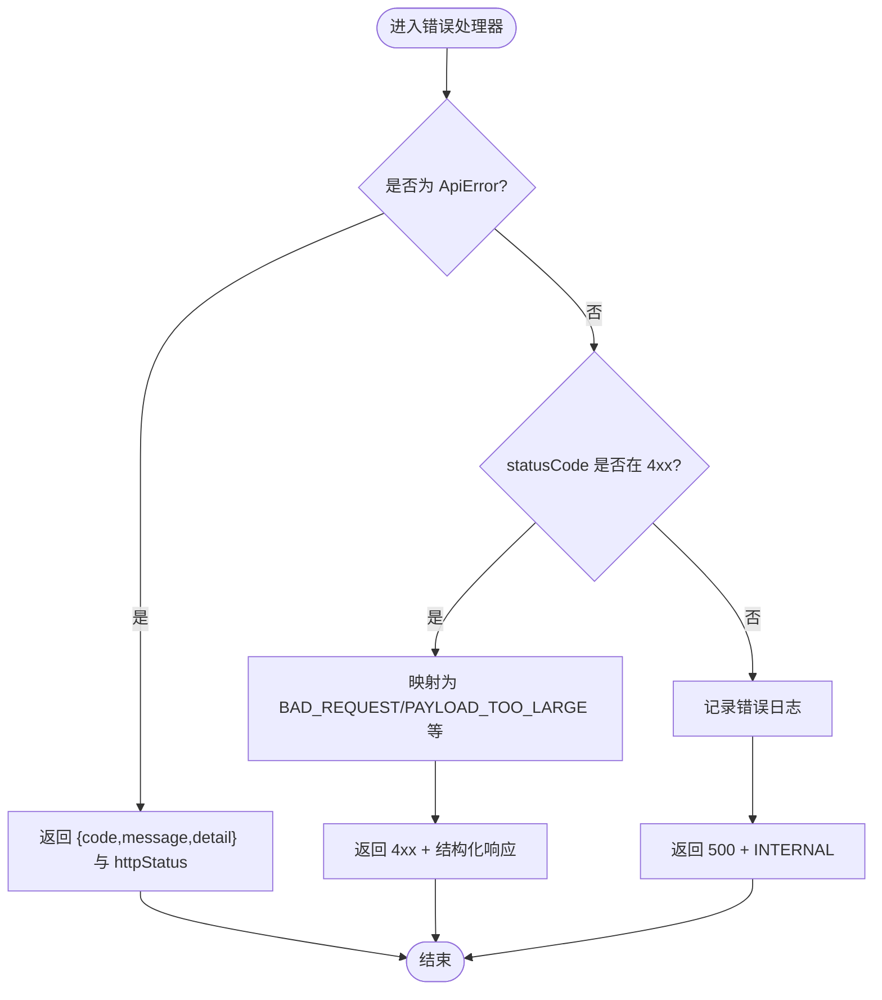
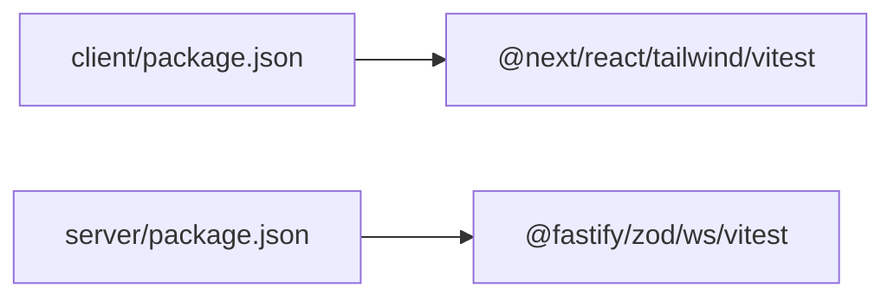

# 代码规范

<cite>
**本文引用的文件**   
- [client/tsconfig.json](file://client/tsconfig.json)
- [server/tsconfig.json](file://server/tsconfig.json)
- [client/package.json](file://client/package.json)
- [server/package.json](file://server/package.json)
- [client/components/pages/training-center.tsx](file://client/components/pages/training-center.tsx)
- [client/components/ui/button.tsx](file://client/components/ui/button.tsx)
- [client/stores/store.ts](file://client/stores/store.ts)
- [server/src/app.ts](file://server/src/app.ts)
- [server/src/lib/api-error.ts](file://server/src/lib/api-error.ts)
</cite>

## 目录
1. [引言](#引言)
2. [项目结构](#项目结构)
3. [核心组件](#核心组件)
4. [架构总览](#架构总览)
5. [详细组件分析](#详细组件分析)
6. [依赖分析](#依赖分析)
7. [性能考虑](#性能考虑)
8. [故障排查指南](#故障排查指南)
9. [结论](#结论)
10. [附录](#附录)

## 引言
本规范面向前端（Next.js + React）与后端（Fastify + TypeScript）双端，统一 TypeScript 配置、路径别名、命名约定、目录组织、函数长度、变量命名、注释标准、不可变模式编程、错误处理、日志记录、ESLint/Prettier/Git 提交规范。目标是降低协作成本、提升可维护性与一致性，同时保持对初学者友好。

## 项目结构
仓库采用前后端分离的 monorepo 风格：
- client：基于 Next.js 的前端应用，使用 React、Tailwind、Base UI 等生态；通过 @/* 路径别名访问同包内模块。
- server：基于 Fastify 的后端服务，提供 SOE 发音评分等接口，使用 zod 做运行时校验，统一错误格式。
- docs/page-prototype：原型参考，不纳入主构建。
- .claude/.worktrees：工具与工作树，不参与代码规范主体。

**图表来源**
- [client/tsconfig.json:21-23](file://client/tsconfig.json#L21-L23)
- [server/src/app.ts:14-45](file://server/src/app.ts#L14-L45)

**章节来源**
- [client/tsconfig.json:1-34](file://client/tsconfig.json#L1-L34)
- [server/tsconfig.json:1-17](file://server/tsconfig.json#L1-L17)

## 核心组件
本节从“代码规范”的角度，梳理关键工程化与实现要点，并给出对应源码位置。

- TypeScript 编译与路径别名
  - 前端启用严格模式、ESNext 模块解析、React JSX 支持，并通过 paths 将 @/* 映射到根目录，便于跨层引用。
  - 后端启用严格模式、noUncheckedIndexedAccess、noFallthroughCasesInSwitch、强制文件名大小写一致，目标 ES2022。
- 包脚本与运行环境
  - 前端：dev/build/start/test 脚本，依赖 Next、React、Tailwind、Vitest。
  - 后端：dev/start/check/test 脚本，Node >= 20，Fastify、zod、ws。
- 组件组织与样式
  - 组件按 pages/shared/ui 分层；按钮等基础组件使用 class-variance-authority 管理变体，配合 cn 工具合并类名。
- 状态管理
  - 使用 useSyncExternalStore 的最小 store 封装，零依赖替代 zustand/Pinia，SSR 安全。
- 后端应用装配与错误处理
  - Fastify 实例装配 CORS、multipart，统一错误处理器输出 { code, message, detail }，并提供 /healthz 探活。
  - 统一 ApiError 与 ERR 常量映射 HTTP 状态码。

**章节来源**
- [client/tsconfig.json:1-34](file://client/tsconfig.json#L1-L34)
- [server/tsconfig.json:1-17](file://server/tsconfig.json#L1-L17)
- [client/package.json:1-60](file://client/package.json#L1-L60)
- [server/package.json:1-31](file://server/package.json#L1-L31)
- [client/components/ui/button.tsx:1-59](file://client/components/ui/button.tsx#L1-L59)
- [client/stores/store.ts:1-34](file://client/stores/store.ts#L1-L34)
- [server/src/app.ts:1-47](file://server/src/app.ts#L1-L47)
- [server/src/lib/api-error.ts:1-36](file://server/src/lib/api-error.ts#L1-L36)

## 架构总览
下图展示一次典型请求在前后端的流转，以及错误如何被统一处理。

**图表来源**
- [server/src/app.ts:23-45](file://server/src/app.ts#L23-L45)
- [server/src/lib/api-error.ts:6-36](file://server/src/lib/api-error.ts#L6-L36)

## 详细组件分析

### TypeScript 配置与路径别名
- 前端 tsconfig
  - strict: true，target: ES6，moduleResolution: bundler，jsx: react-jsx，isolatedModules: true。
  - paths: "@/*": ["./*"]，允许以 @ 开头的绝对路径导入。
- 后端 tsconfig
  - strict: true，noUncheckedIndexedAccess: true，noFallthroughCasesInSwitch: true，forceConsistentCasingInFileNames: true。
  - target: ES2022，module: ESNext，lib: ES2023，types: ["node"]。

建议
- 所有新模块优先使用 @/* 路径别名，避免相对路径深层跳转。
- 新增类型或工具时，优先放入 types/ 或 lib/，并在 index 中导出，保持入口清晰。

**章节来源**
- [client/tsconfig.json:1-34](file://client/tsconfig.json#L1-L34)
- [server/tsconfig.json:1-17](file://server/tsconfig.json#L1-L17)

### 文件命名与目录结构规范
- 文件命名
  - 一律使用 kebab-case（如 training-center.tsx、api-error.ts）。
  - 测试文件与源文件同名，后缀 .test.ts，置于 __tests__/ 同级目录。
- 目录结构
  - 前端 components 下分 pages/shared/ui 三层：
    - ui：无业务逻辑的基础控件（Button、Card、Dialog 等）。
    - shared：跨页面复用的业务型组件（Shell、SubtitleEditDialog 等）。
    - pages：页面级组合组件（TrainingCenter、Dictation 等）。
  - core：领域能力（audio/subtitle/training/vocab-training），纯逻辑与算法。
  - platform：平台适配（storage/html-player/kokoro-*）。
  - services：对外服务契约与实现（api/mock）。
  - stores：状态管理（useSyncExternalStore 封装与各业务 store）。
  - types：全局类型定义。
  - app/api：Next Route 路由，按功能域划分。
- 组件组织模式
  - 原子/分子/组织分层：ui 为原子，shared 为分子，pages 为组织。
  - 样式策略：基础组件使用 cva 变体 + Tailwind 原子类；页面组件尽量组合而非内联复杂样式。

示例参考
- 页面组件：[client/components/pages/training-center.tsx](file://client/components/pages/training-center.tsx)
- 基础按钮组件：[client/components/ui/button.tsx](file://client/components/ui/button.tsx)

**章节来源**
- [client/components/pages/training-center.tsx:1-135](file://client/components/pages/training-center.tsx#L1-L135)
- [client/components/ui/button.tsx:1-59](file://client/components/ui/button.tsx#L1-L59)

### 函数长度限制与复杂度控制
- 单文件函数不超过 80 行；超过则拆分为更小的职责单一函数。
- 复杂分支逻辑应抽取为独立函数或常量表（如 MODES 枚举式配置）。
- 异步流程避免深层嵌套，使用 async/await 与早期返回。

参考
- 页面组件中的模式配置与渲染逻辑拆分：[client/components/pages/training-center.tsx:15-21](file://client/components/pages/training-center.tsx#L15-L21)、[client/components/pages/training-center.tsx:110-127](file://client/components/pages/training-center.tsx#L110-L127)

**章节来源**
- [client/components/pages/training-center.tsx:15-21](file://client/components/pages/training-center.tsx#L15-L21)
- [client/components/pages/training-center.tsx:110-127](file://client/components/pages/training-center.tsx#L110-L127)

### 变量命名规范
- 常量：全大写+下划线（如 CORS_ORIGIN、ERR_*）。
- 普通变量：camelCase。
- 布尔值：is/has/can 前缀（如 isActive、hasPermission）。
- 类型：PascalCase；泛型参数使用 T/U/V。
- 私有成员：以下划线开头（如 _cache）。

参考
- 后端错误码常量：[server/src/lib/api-error.ts:19-29](file://server/src/lib/api-error.ts#L19-L29)

**章节来源**
- [server/src/lib/api-error.ts:19-29](file://server/src/lib/api-error.ts#L19-L29)

### 注释标准
- 文件头注释说明用途、依赖与契约。
- 公共函数/类需 JSDoc 描述参数、返回值与异常。
- 复杂逻辑处添加行内注释解释“为什么”，而非“做了什么”。
- 对外暴露的类型与 API 必须附带契约说明。

参考
- 后端应用装配文件头注释：[server/src/app.ts:1-4](file://server/src/app.ts#L1-L4)
- 统一错误文件头注释：[server/src/lib/api-error.ts:1-4](file://server/src/lib/api-error.ts#L1-L4)

**章节来源**
- [server/src/app.ts:1-4](file://server/src/app.ts#L1-L4)
- [server/src/lib/api-error.ts:1-4](file://server/src/lib/api-error.ts#L1-L4)

### 不可变模式编程实践
- 状态更新使用函数式 set(next => ...)，避免直接修改原对象。
- 列表更新先复制再变更，禁止原地 push/splice。
- 配置与常量使用 const，避免运行时修改。
- 使用只读类型（Readonly、as const）约束输入。

参考
- Store 的 set 使用函数式更新：[client/stores/store.ts:19-22](file://client/stores/store.ts#L19-L22)
- 错误码映射使用 as const：[server/src/lib/api-error.ts:19-29](file://server/src/lib/api-error.ts#L19-L29)

**章节来源**
- [client/stores/store.ts:19-22](file://client/stores/store.ts#L19-L22)
- [server/src/lib/api-error.ts:19-29](file://server/src/lib/api-error.ts#L19-L29)

### 错误处理约定
- 后端统一抛出 ApiError，包含 code、message、httpStatus、detail。
- 全局错误处理器将 ApiError 映射为结构化响应；非 ApiError 的错误根据 statusCode 归一化处理。
- 客户端应消费 { code, message, detail } 进行提示与降级。

**图表来源**
- [server/src/app.ts:23-35](file://server/src/app.ts#L23-L35)
- [server/src/lib/api-error.ts:6-36](file://server/src/lib/api-error.ts#L6-L36)

**章节来源**
- [server/src/app.ts:23-35](file://server/src/app.ts#L23-L35)
- [server/src/lib/api-error.ts:6-36](file://server/src/lib/api-error.ts#L6-L36)

### 日志记录标准
- 服务端使用 Fastify 内置 logger，仅在必要时记录关键上下文（provider/model/endpoint）。
- 客户端调试日志使用 console.log/warn/error，但生产环境应关闭或替换为轻量日志器。
- 日志字段标准化：时间戳、模块名、请求 ID、用户标识（脱敏）、耗时。

参考
- 后端健康检查与 provider 注册：[server/src/app.ts:37-44](file://server/src/app.ts#L37-L44)

**章节来源**
- [server/src/app.ts:37-44](file://server/src/app.ts#L37-L44)

### ESLint 配置
- 当前仓库未检出 ESLint 配置文件。建议在 client 与 server 分别引入 eslint 与 next/eslint-plugin-next，并启用推荐规则集。
- 建议规则
  - strict-null-checks、no-unused-vars、prefer-const、import/order、react-hooks/exhaustive-deps。
  - 自定义规则：禁止 console.* 在生产构建中出现（可通过环境变量或插件过滤）。

**章节来源**
- [client/package.json:34-43](file://client/package.json#L34-L43)
- [server/package.json:23-29](file://server/package.json#L23-L29)

### Prettier 格式化规则
- 当前仓库未检出 Prettier 配置文件。建议统一配置
  - printWidth: 100，tabWidth: 2，semi: false，singleQuote: true，trailingComma: all，bracketSpacing: true，arrowParens: always。
  - 与 Tailwind 集成，确保类名顺序稳定。

**章节来源**
- [client/package.json:34-43](file://client/package.json#L34-L43)
- [server/package.json:23-29](file://server/package.json#L23-L29)

### Git 提交信息规范
- 建议使用 Conventional Commits：
  - feat: 新功能
  - fix: 修复缺陷
  - docs: 文档变更
  - style: 不影响逻辑的格式调整
  - refactor: 重构
  - perf: 性能优化
  - test: 测试相关
  - chore: 构建/工具链变更
- 提交范围 scope 可选：client/server/routes/services/core/platform 等。
- 示例：feat(client): 新增训练中心选择页

**章节来源**
- [无直接源码引用]

## 依赖分析
- 前端依赖
  - Next、React、Tailwind、Base UI、class-variance-authority、vitest。
  - 通过 pnpm overrides 固定 hono 版本。
- 后端依赖
  - Fastify、@fastify/cors、@fastify/multipart、ws、zod。
  - Node >= 20，TypeScript 5.x，Vitest。

**图表来源**
- [client/package.json:11-43](file://client/package.json#L11-L43)
- [server/package.json:16-29](file://server/package.json#L16-L29)

**章节来源**
- [client/package.json:1-60](file://client/package.json#L1-L60)
- [server/package.json:1-31](file://server/package.json#L1-L31)

## 性能考虑
- 前端
  - 组件样式使用 cva 预生成类名，减少运行时拼接开销。
  - 列表渲染使用 key 稳定标识，避免不必要的重渲染。
  - 大文件上传通过 multipart 限制文件大小（后端已配置 25MB）。
- 后端
  - Fastify 默认开启 logger，开发环境保留，生产环境可按需关闭。
  - 上游调用注意超时与限流，结合 ERR.UPSTREAM_RATE_LIMIT/UPSTREAM_TIMEOUT 处理。

**章节来源**
- [client/components/ui/button.tsx:6-41](file://client/components/ui/button.tsx#L6-L41)
- [server/src/app.ts:18-21](file://server/src/app.ts#L18-L21)
- [server/src/lib/api-error.ts:19-29](file://server/src/lib/api-error.ts#L19-L29)

## 故障排查指南
- 常见问题
  - 413 Payload Too Large：上传音频过大，检查前端分片或后端 limits.fileSize。
  - 429 Upstream Rate Limit：上游限流，增加重试与退避策略。
  - 502 Upstream Error：上游服务异常，检查凭据与网络连通性。
  - 503 Provider Unavailable：服务端未配置对应 provider，检查环境变量与注册表。
- 定位步骤
  - 查看后端错误日志与结构化响应体 { code, message, detail }。
  - 核对前端传入参数是否符合 zod 校验。
  - 确认 CORS 与 multipart 配置是否生效。

**章节来源**
- [server/src/app.ts:23-35](file://server/src/app.ts#L23-L35)
- [server/src/lib/api-error.ts:19-29](file://server/src/lib/api-error.ts#L19-L29)

## 结论
本规范围绕 TypeScript 配置、路径别名、命名与目录组织、函数长度、变量命名、注释、不可变模式、错误处理与日志、ESLint/Prettier/Git 提交等方面，提供了可落地的实践指引。遵循这些约定，可在保证可读性的同时提升团队协作效率与系统稳定性。

## 附录
- 快速清单
  - 使用 @/* 路径别名，避免深层相对路径。
  - 文件命名 kebab-case，测试文件 .test.ts。
  - 组件分层 ui/shared/pages，样式用 cva + Tailwind。
  - 状态更新使用函数式 set，禁止原地修改。
  - 错误统一 ApiError + ERR 映射，客户端消费结构化响应。
  - 日志标准化，生产环境关闭 verbose 日志。
  - 引入 ESLint/Prettier，统一代码风格。
  - 提交信息遵循 Conventional Commits。