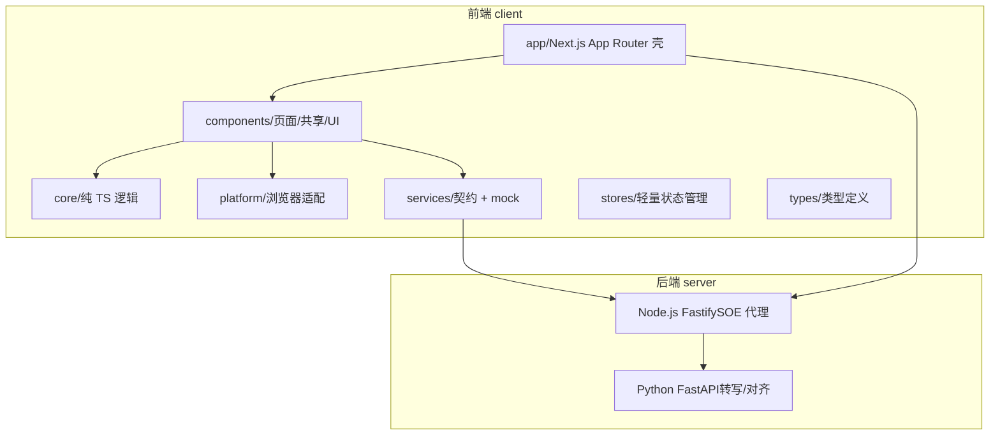
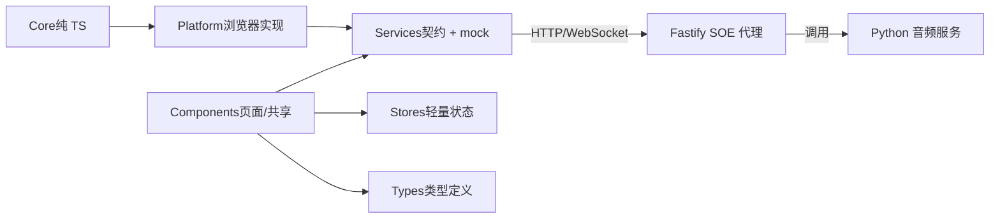
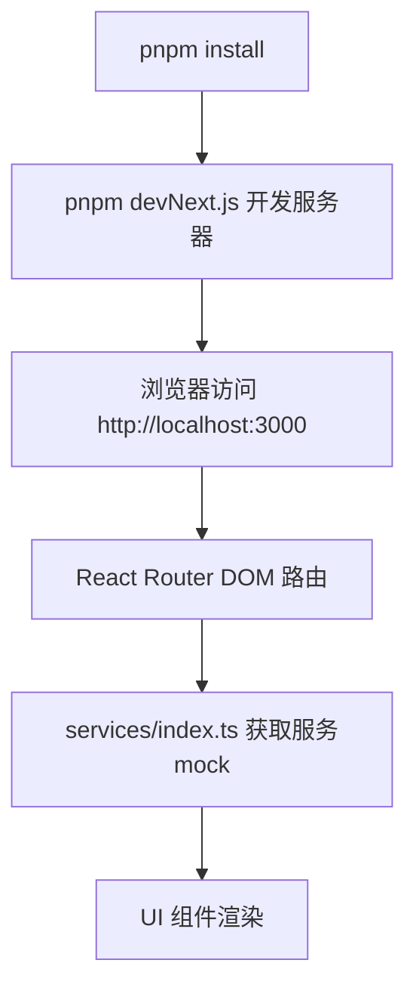
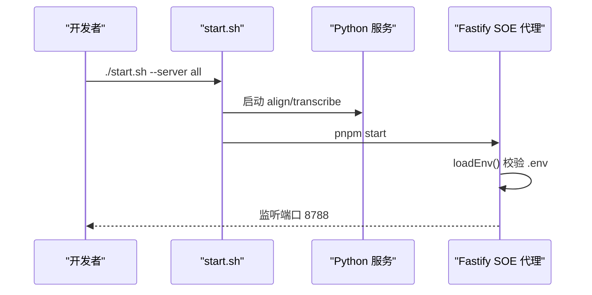
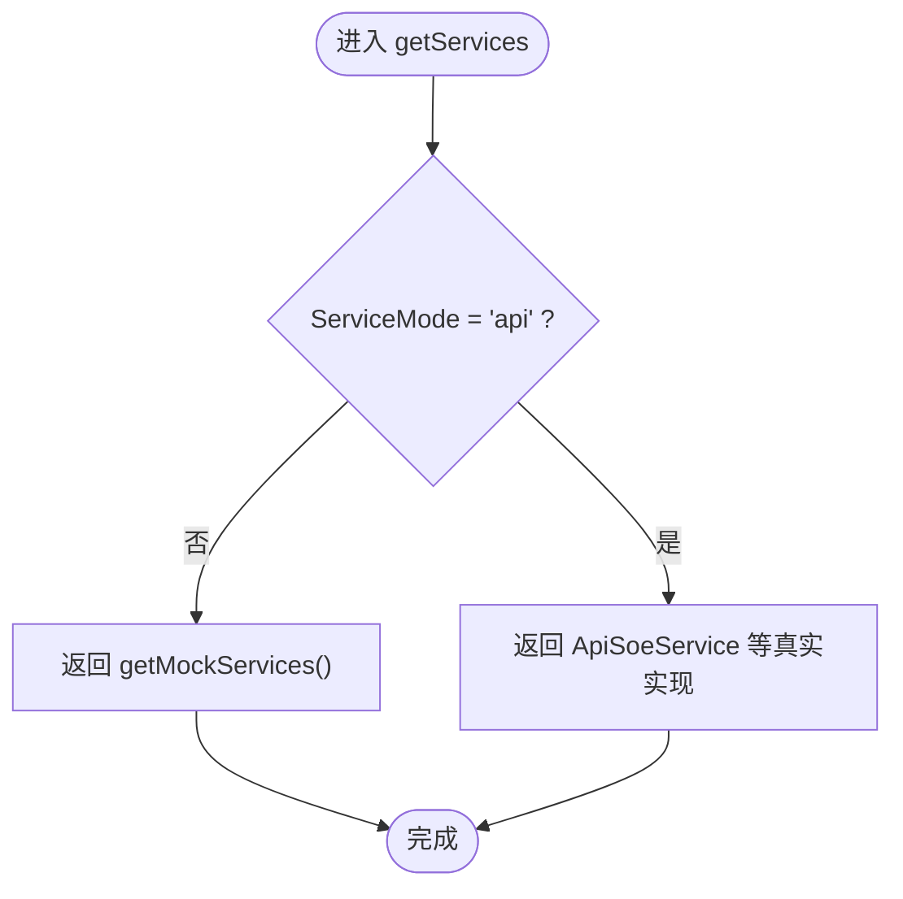
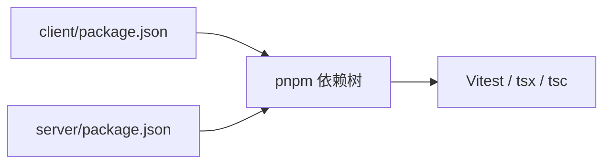
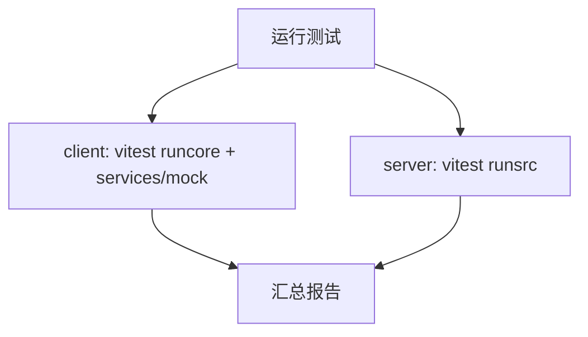
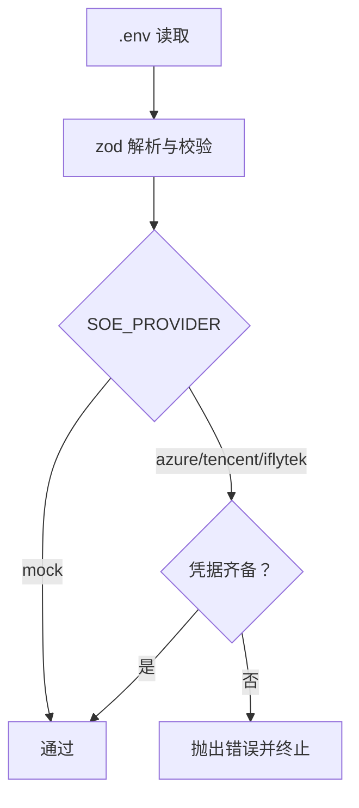

# 开发指南

<cite>
**本文引用的文件**   
- [README.md](file://README.md)
- [client/package.json](file://client/package.json)
- [server/package.json](file://server/package.json)
- [client/vitest.config.mts](file://client/vitest.config.mts)
- [server/vitest.config.mts](file://server/vitest.config.mts)
- [client/tsconfig.json](file://client/tsconfig.json)
- [server/tsconfig.json](file://server/tsconfig.json)
- [client/next.config.mjs](file://client/next.config.mjs)
- [server/src/config/env.ts](file://server/src/config/env.ts)
- [server/start.sh](file://server/start.sh)
- [client/services/index.ts](file://client/services/index.ts)
</cite>

## 目录
1. [简介](#简介)
2. [项目结构](#项目结构)
3. [核心组件](#核心组件)
4. [架构总览](#架构总览)
5. [详细组件分析](#详细组件分析)
6. [依赖关系分析](#依赖关系分析)
7. [性能与构建](#性能与构建)
8. [测试策略](#测试策略)
9. [调试技巧与常用命令](#调试技巧与常用命令)
10. [环境变量与部署](#环境变量与部署)
11. [贡献与代码审查](#贡献与代码审查)
12. [故障排查](#故障排查)
13. [结论](#结论)

## 简介
本指南面向开发者，覆盖从环境搭建、代码规范、测试、调试到构建部署与贡献流程的完整实践。项目采用前后端分离：前端为基于 Next.js 的 SPA（App Router 仅作为壳），后端包含 Python 音频服务与 Node.js Fastify SOE 评分代理；同时提供原型沙箱与设计文档。

## 项目结构
仓库采用多包结构：
- client：前端 SPA（Next.js + React + TypeScript）
- server：Node.js Fastify 后端（SOE 评分代理）+ Python 音频服务（转写/对齐）
- page-prototype：独立原型沙箱
- docs：设计文档与技术选型

图示来源
- [README.md:23-57](file://README.md#L23-L57)
- [client/package.json:11-42](file://client/package.json#L11-L42)
- [server/package.json:16-28](file://server/package.json#L16-L28)

章节来源
- [README.md:23-57](file://README.md#L23-L57)

## 核心组件
- 前端入口与路由壳：Next.js App Router 仅渲染 SPA 壳，实际路由由 react-router-dom 管理。
- 服务契约与实现：services/contracts.ts 定义接口，services/mock/* 提供离线 mock，预留 services/api/* 接入真实后端。
- 状态管理：自研 createStore + useStore，基于 useSyncExternalStore，无外部依赖。
- 本地存储：IndexedDB（Promise 封装）+ localStorage。
- 音频链路：getUserMedia → MediaRecorder → OfflineAudioContext（16kHz 单声道重采样）→ WAV Blob。
- 字幕解析：SRT/LRC 双语解析器，零依赖纯 TS。
- 播放器 Seek 校准：seek 后静默旧进度，等待原生 timeupdate 到达实际落点。

章节来源
- [README.md:102-127](file://README.md#L102-L127)

## 架构总览
系统采用“六层架构”：Core → Platform → Services → Stores ← Components ← Types。AI 服务通过契约抽象，当前返回 mock，未来可通过环境变量切换真实 API。

图示来源
- [README.md:102-127](file://README.md#L102-L127)
- [client/services/index.ts:1-68](file://client/services/index.ts#L1-L68)

## 详细组件分析

### 前端开发与配置
- 包管理与脚本：使用 pnpm，scripts 提供 dev/build/start/test。
- TypeScript 编译选项：strict、noEmit、moduleResolution bundler、paths 别名 @/*。
- Next.js 配置：关闭图片优化以兼容 SPA；允许局域网访问（allowedDevOrigins）。
- Vitest 配置：node 环境，仅覆盖 core/ 与 services/mock 的单测。

图示来源
- [client/package.json:5-10](file://client/package.json#L5-L10)
- [client/tsconfig.json:21-23](file://client/tsconfig.json#L21-L23)
- [client/next.config.mjs:1-15](file://client/next.config.mjs#L1-L15)
- [client/vitest.config.mts:1-18](file://client/vitest.config.mts#L1-L18)

章节来源
- [client/package.json:1-60](file://client/package.json#L1-L60)
- [client/tsconfig.json:1-34](file://client/tsconfig.json#L1-L34)
- [client/next.config.mjs:1-16](file://client/next.config.mjs#L1-L16)
- [client/vitest.config.mts:1-19](file://client/vitest.config.mts#L1-L19)

### 后端 SOE 代理（Node.js Fastify）
- 运行环境与脚本：Node >= 20，tsx watch 启动开发模式，tsc --noEmit 类型检查。
- 环境变量加载与校验：zod schema 校验，支持 .env 与进程环境变量，按 provider 校验凭据齐备性。
- 启动脚本 start.sh：统一拉起 Python 服务与 Node 服务，自动检测依赖与环境。

图示来源
- [server/start.sh:1-200](file://server/start.sh#L1-L200)
- [server/src/config/env.ts:1-116](file://server/src/config/env.ts#L1-L116)
- [server/package.json:10-14](file://server/package.json#L10-L14)

章节来源
- [server/package.json:1-31](file://server/package.json#L1-L31)
- [server/src/config/env.ts:1-116](file://server/src/config/env.ts#L1-L116)
- [server/start.sh:1-200](file://server/start.sh#L1-L200)

### 服务契约与 Mock 切换
- 服务工厂：getMockServices 返回 mock 实现；getServices 预留按环境变量切换 api 实现。
- getSoeService：根据设置中的 provider 决定使用 mock 或 ApiSoeService。

图示来源
- [client/services/index.ts:29-48](file://client/services/index.ts#L29-L48)

章节来源
- [client/services/index.ts:1-68](file://client/services/index.ts#L1-L68)

## 依赖关系分析
- 前端依赖：Next.js、React、react-router-dom、Tailwind CSS、shadcn/ui、Vitest、TypeScript。
- 后端依赖：Fastify、ws、zod、tsx、Vitest、TypeScript。
- 包管理器：pnpm（含 overrides 与 onlyBuiltDependencies 配置）。

图示来源
- [client/package.json:11-58](file://client/package.json#L11-L58)
- [server/package.json:16-29](file://server/package.json#L16-L29)

章节来源
- [client/package.json:1-60](file://client/package.json#L1-L60)
- [server/package.json:1-31](file://server/package.json#L1-L31)

## 性能与构建
- 前端构建：next build 生产构建；开发时 next dev 热重载。
- 图片优化：已关闭 images.unoptimized，避免 SPA 静态资源问题。
- 类型检查：npx tsc --noEmit（前端）、pnpm check（后端）。
- 性能建议：
  - 保持 core/ 纯函数与不可变数据，减少重渲染。
  - 音频处理在 Worker 或离线上下文中进行，避免阻塞主线程。
  - 合理拆分组件与懒加载页面。

章节来源
- [client/next.config.mjs:1-16](file://client/next.config.mjs#L1-L16)
- [README.md:59-70](file://README.md#L59-L70)

## 测试策略
- 工具与范围：Vitest 4.x，node 环境；前端仅测试 core/ 与 services/mock；后端测试 src/**/*.test.ts。
- 配置要点：
  - 前端 vitest.config.mts：alias @ 指向根目录，include 限定测试路径。
  - 后端 vitest.config.mts：environment node，include 限定 src 下测试。
- 编写规范：
  - 测试文件位于 __tests__/ 目录。
  - 优先对纯函数与确定性逻辑进行断言。
  - Mock 数据与固定输入输出，避免网络与随机性。

图示来源
- [client/vitest.config.mts:1-18](file://client/vitest.config.mts#L1-L18)
- [server/vitest.config.mts:1-9](file://server/vitest.config.mts#L1-L9)
- [client/package.json:9](file://client/package.json#L9)
- [server/package.json:14](file://server/package.json#L14)

章节来源
- [client/vitest.config.mts:1-19](file://client/vitest.config.mts#L1-L19)
- [server/vitest.config.mts:1-9](file://server/vitest.config.mts#L1-L9)
- [client/package.json:5-10](file://client/package.json#L5-L10)
- [server/package.json:10-15](file://server/package.json#L10-L15)

## 调试技巧与常用命令
- 前端开发：
  - pnpm dev：启动 Next.js 开发服务器（http://localhost:3000）。
  - npx tsc --noEmit：类型检查。
- 后端开发：
  - pnpm dev：tsx watch 热重载。
  - pnpm check：tsc --noEmit 类型检查。
- 启动脚本：
  - ./start.sh：默认启动对齐服务。
  - ./start.sh --server transcribe：启动转写服务。
  - ./start.sh --server both：同时启动对齐 + 转写。
  - ./start.sh --server soe：启动 SOE 代理（Node）。
  - ./start.sh --server all：同时启动对齐 + 转写 + SOE 代理。
- 调试建议：
  - 使用浏览器开发者工具观察 IndexedDB 与网络请求。
  - 在后端日志中定位 provider 凭据校验失败原因。
  - 通过环境变量快速切换 mock/api 模式（预留）。

章节来源
- [README.md:59-88](file://README.md#L59-L88)
- [server/start.sh:1-200](file://server/start.sh#L1-L200)
- [client/package.json:5-10](file://client/package.json#L5-L10)
- [server/package.json:10-14](file://server/package.json#L10-L14)

## 环境变量与部署
- 前端环境变量：
  - NEXT_PUBLIC_SERVICE_MODE：预留用于切换 mock/api（当前注释未启用）。
- 后端环境变量（server/.env 或进程环境变量）：
  - PORT/HOST/CORS_ORIGIN：服务监听与跨域。
  - SOE_PROVIDER：mock/azure/tencent/iflytek。
  - Azure/Tencent/Iflytek 凭据字段：按 provider 要求配置。
  - IFLYTEK_FRAME_INTERVAL_MS/SOE_TIMEOUT_MS/SOE_RETRY：上游超时与重试。
- 校验与错误：
  - zod schema 校验失败将抛出错误并列出具体字段问题。
  - 指定 provider 凭据缺失会直接报错阻止启动。
  - AZURE_SPEECH_HOST 必须以 http(s):// 开头。

图示来源
- [server/src/config/env.ts:36-115](file://server/src/config/env.ts#L36-L115)

章节来源
- [client/services/index.ts:41-48](file://client/services/index.ts#L41-L48)
- [server/src/config/env.ts:1-116](file://server/src/config/env.ts#L1-L116)

## 贡献与代码审查
- 代码风格与约定：
  - 路径别名：@/* 映射到 client/ 根目录。
  - 包管理：pnpm（lockfile 在 client/pnpm-lock.yaml）。
  - UI 库：shadcn/ui base-nova，Lucide 图标，Tailwind CSS 4。
  - 状态管理：自研 createStore + useStore，无 zustand/Pinia。
  - 测试：Vitest 4.x，node 环境，仅测试 core/ 与 services/mock/，测试文件位于 __tests__/。
  - 代码风格：函数 < 50 行，文件 < 800 行，不可变模式，无 ESLint/Prettier 配置。
  - 文档语言：代码注释和设计文档使用中文。
- Pull Request 流程建议：
  - 分支命名：feature/xxx、fix/xxx、refactor/xxx。
  - 提交信息：语义化（feat/fix/refactor/docs/style/test/chore）。
  - 变更说明：描述影响面、新增依赖、环境变量变化。
  - 审查标准：可读性、可测试性、向后兼容、性能与安全。
- 代码审查清单：
  - 是否遵循不可变模式与函数长度限制。
  - 是否补充/更新测试用例。
  - 是否更新相关文档与注释。
  - 是否存在潜在的性能瓶颈或安全风险。

章节来源
- [README.md:183-191](file://README.md#L183-L191)

## 故障排查
- 前端白屏（局域网 H5 访问）：
  - 现象：/_next/* 资源被拦截返回 403。
  - 解决：已在 allowedDevOrigins 中添加网段与 127.0.0.1。
- 后端启动失败（provider 凭据缺失）：
  - 现象：抛错提示缺少对应 provider 的凭据字段。
  - 解决：补齐 AZURE/TENCENT/IFLYTEK 对应字段，或切换 SOE_PROVIDER=mock。
- 音频格式解码失败：
  - 现象：部分音频无法播放或转写异常。
  - 解决：安装 ffmpeg。
- 类型检查失败：
  - 前端：npx tsc --noEmit。
  - 后端：pnpm check。

章节来源
- [client/next.config.mjs:9-13](file://client/next.config.mjs#L9-L13)
- [server/src/config/env.ts:85-115](file://server/src/config/env.ts#L85-L115)
- [server/start.sh:123-127](file://server/start.sh#L123-L127)

## 结论
本项目以本地优先与服务契约为核心，结合严格的代码约定与最小化依赖，确保可维护性与可扩展性。遵循本指南的环境搭建、测试与调试实践，可高效推进功能迭代与质量保障。