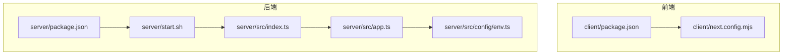
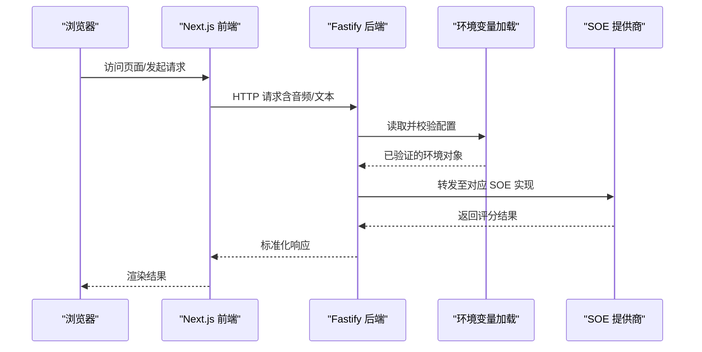
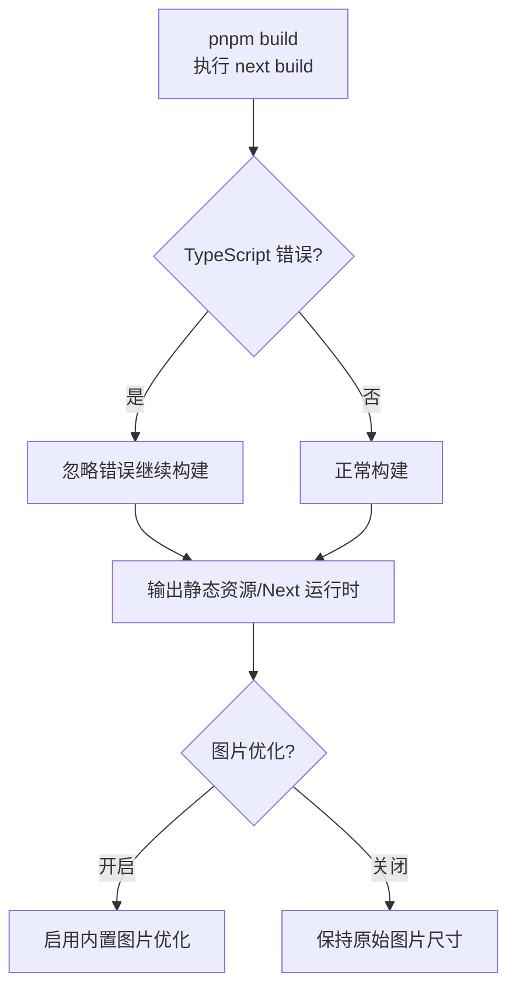
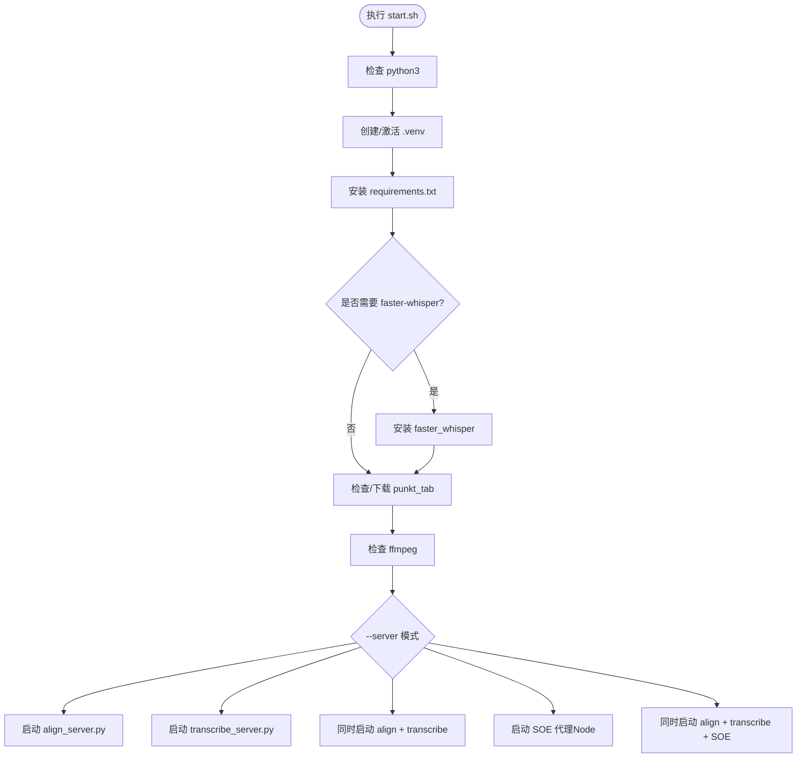
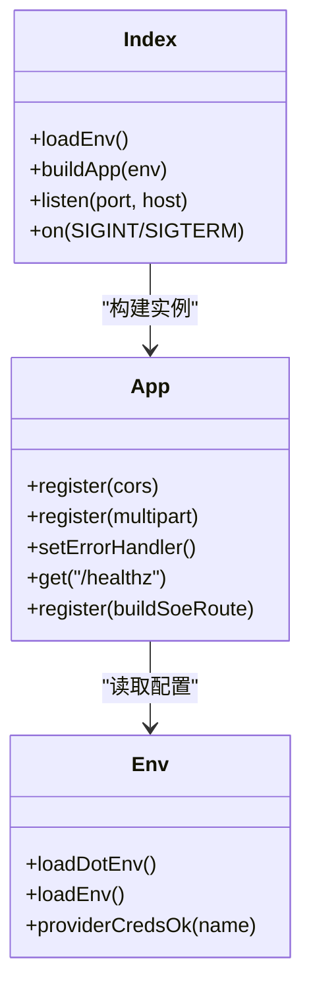
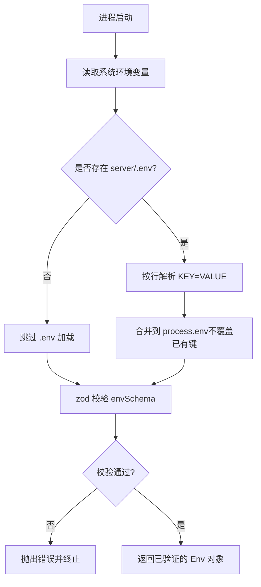
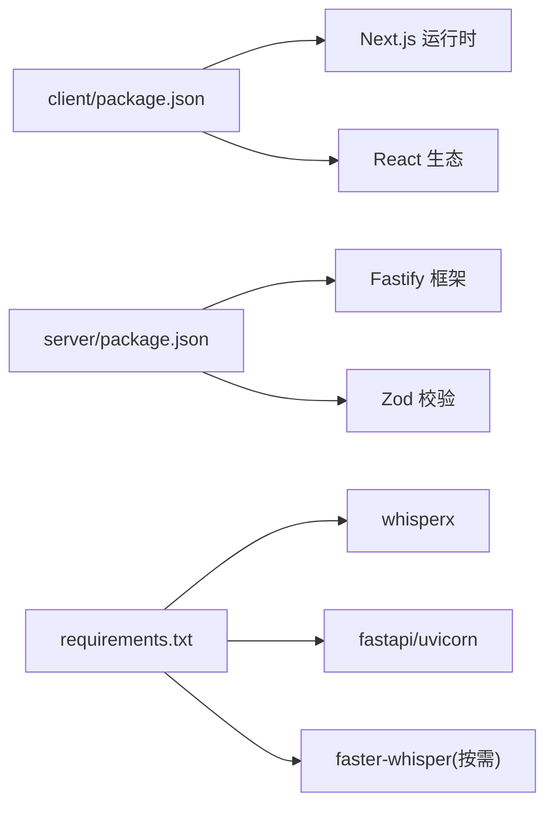

# 构建与部署

<cite>
**本文引用的文件**   
- [client/package.json](file://client/package.json)
- [client/next.config.mjs](file://client/next.config.mjs)
- [server/package.json](file://server/package.json)
- [server/start.sh](file://server/start.sh)
- [server/src/index.ts](file://server/src/index.ts)
- [server/src/app.ts](file://server/src/app.ts)
- [server/src/config/env.ts](file://server/src/config/env.ts)
</cite>

## 目录
1. [引言](#引言)
2. [项目结构](#项目结构)
3. [核心组件](#核心组件)
4. [架构总览](#架构总览)
5. [详细组件分析](#详细组件分析)
6. [依赖关系分析](#依赖关系分析)
7. [性能考虑](#性能考虑)
8. [故障排查指南](#故障排查指南)
9. [结论](#结论)
10. [附录](#附录)

## 引言
本文件面向运维与研发人员，系统化说明本仓库的构建流程与部署策略，覆盖：
- Next.js 前端构建配置、生产优化与静态资源处理
- Python 服务（对齐/转写）与 Node.js SOE 评分代理的打包与部署
- 环境变量管理、配置文件版本控制与多环境部署
- Docker 容器化方案、CI/CD 流水线建议、监控告警
- 回滚策略、健康检查与性能监控等运维最佳实践

## 项目结构
本项目采用前后端分离的多包结构：
- client：Next.js 前端应用，提供页面、API 路由与本地能力封装
- server：Fastify 后端（SOE 评分代理），同时通过脚本启动 Python 音频对齐/转写服务
- docs：技术文档与接入示例
- page-prototype：原型工程（非生产）

**图表来源**
- [client/package.json:5-9](file://client/package.json#L5-L9)
- [client/next.config.mjs:1-16](file://client/next.config.mjs#L1-L16)
- [server/package.json:10-14](file://server/package.json#L10-L14)
- [server/start.sh:155-199](file://server/start.sh#L155-L199)
- [server/src/index.ts:1-19](file://server/src/index.ts#L1-L19)
- [server/src/app.ts:14-45](file://server/src/app.ts#L14-L45)
- [server/src/config/env.ts:85-115](file://server/src/config/env.ts#L85-L115)

**章节来源**
- [client/package.json:5-9](file://client/package.json#L5-L9)
- [client/next.config.mjs:1-16](file://client/next.config.mjs#L1-L16)
- [server/package.json:10-14](file://server/package.json#L10-L14)
- [server/start.sh:155-199](file://server/start.sh#L155-L199)

## 核心组件
- Next.js 前端：负责页面渲染、客户端逻辑与 API 调用；构建产物用于静态托管或 Next 运行时。
- Fastify 后端：无状态 API 服务，统一错误格式、CORS、multipart 上传限制与健康检查。
- Python 服务：对齐服务与转写服务，由 start.sh 自动检测并安装依赖后启动。
- 启动脚本：统一管理 Python 虚拟环境、Node 依赖、参数透传与服务启停。

**章节来源**
- [client/package.json:5-9](file://client/package.json#L5-L9)
- [server/src/app.ts:14-45](file://server/src/app.ts#L14-L45)
- [server/start.sh:58-129](file://server/start.sh#L58-L129)

## 架构总览
整体运行链路如下：浏览器访问 Next.js 前端，必要时调用 Fastify 后端接口；后端根据配置选择 SOE 提供商（mock/azure/tencent/iflytek），并可对接上游语音评测服务。Python 服务作为可选依赖，由启动脚本按需拉起。

**图表来源**
- [server/src/index.ts:8-11](file://server/src/index.ts#L8-L11)
- [server/src/app.ts:14-45](file://server/src/app.ts#L14-L45)
- [server/src/config/env.ts:85-115](file://server/src/config/env.ts#L85-L115)

## 详细组件分析

### Next.js 构建与生产优化
- 构建脚本：使用 next build 生成生产构建产物；开发模式使用 next dev。
- 类型检查：构建时忽略 TypeScript 错误，便于快速迭代。
- 图片优化：关闭 Next 默认图片优化（unoptimized），避免在部分部署环境中出现图片处理问题。
- 开发跨域：允许局域网与本地地址访问，解决移动端调试时的跨源拦截。

**图表来源**
- [client/package.json:5-9](file://client/package.json#L5-L9)
- [client/next.config.mjs:1-16](file://client/next.config.mjs#L1-L16)

**章节来源**
- [client/package.json:5-9](file://client/package.json#L5-L9)
- [client/next.config.mjs:1-16](file://client/next.config.mjs#L1-L16)

### Python 服务打包与部署流程
- 依赖管理：首次运行自动创建 .venv，安装 requirements.txt；按需安装 faster-whisper。
- 数据准备：对齐服务需要 NLTK punkt_tab 分词器，脚本自动下载或从 GitHub 兜底获取。
- 外部工具：提示 ffmpeg 缺失警告，确保音频解码能力。
- 服务启动：支持 align/transcribe/both/soe/all 多种模式，参数透传给 Python 服务。

**图表来源**
- [server/start.sh:58-129](file://server/start.sh#L58-L129)
- [server/start.sh:155-199](file://server/start.sh#L155-L199)

**章节来源**
- [server/start.sh:58-129](file://server/start.sh#L58-L129)
- [server/start.sh:155-199](file://server/start.sh#L155-L199)

### Node.js SOE 评分代理
- 入口：加载环境变量 → 装配 Fastify 应用 → 监听端口 → 优雅关闭。
- 应用装配：注册 CORS、multipart、统一错误处理器、健康检查 /healthz、SOE 路由。
- 环境变量：基于 zod 校验，支持 .env 与系统环境变量，提供凭据齐备性检查。

**图表来源**
- [server/src/index.ts:1-19](file://server/src/index.ts#L1-L19)
- [server/src/app.ts:14-45](file://server/src/app.ts#L14-L45)
- [server/src/config/env.ts:36-115](file://server/src/config/env.ts#L36-L115)

**章节来源**
- [server/src/index.ts:1-19](file://server/src/index.ts#L1-L19)
- [server/src/app.ts:14-45](file://server/src/app.ts#L14-L45)
- [server/src/config/env.ts:36-115](file://server/src/config/env.ts#L36-L115)

### 环境变量管理与配置版本控制
- 加载顺序：优先使用系统环境变量；若不存在则从 server/.env 读取（不展开变量）。
- 校验规则：使用 zod schema 校验必填字段、取值范围与默认值；对 provider 凭据进行组合校验。
- 安全建议：敏感信息（密钥、区域、Host）应通过 CI/CD 注入或容器环境变量注入，不在代码库中提交明文。

**图表来源**
- [server/src/config/env.ts:36-54](file://server/src/config/env.ts#L36-L54)
- [server/src/config/env.ts:85-115](file://server/src/config/env.ts#L85-L115)

**章节来源**
- [server/src/config/env.ts:36-54](file://server/src/config/env.ts#L36-L54)
- [server/src/config/env.ts:85-115](file://server/src/config/env.ts#L85-L115)

## 依赖关系分析
- 前端依赖：Next.js、React、Tailwind、Vitest 等；构建脚本与依赖锁定文件（pnpm-lock.yaml）需纳入版本控制。
- 后端依赖：Fastify、CORS、Multipart、WS、Zod；Node 版本要求 >=20。
- Python 依赖：whisperx、fastapi、uvicorn、faster-whisper（按需）、NLTK punkt_tab（对齐服务）。

**图表来源**
- [client/package.json:11-42](file://client/package.json#L11-L42)
- [server/package.json:16-28](file://server/package.json#L16-L28)
- [server/start.sh:76-90](file://server/start.sh#L76-L90)

**章节来源**
- [client/package.json:11-42](file://client/package.json#L11-L42)
- [server/package.json:16-28](file://server/package.json#L16-L28)
- [server/start.sh:76-90](file://server/start.sh#L76-L90)

## 性能考虑
- 前端
  - 关闭图片优化可减少构建期开销，适合静态托管场景；如需进一步优化可结合 CDN 缓存与图片压缩。
  - 开发阶段允许局域网访问，便于移动端调试，但生产环境应严格限制 allowedDevOrigins。
- 后端
  - 设置 bodyLimit 与 multipart fileSize 上限，防止超大音频导致内存压力。
  - 合理配置上游超时与重试（SOE_TIMEOUT_MS、SOE_RETRY），平衡稳定性与延迟。
- Python 服务
  - 按需安装 faster-whisper，减少镜像体积与冷启动时间。
  - 预置 NLTK punkt_tab 数据，避免首次请求阻塞。

[本节为通用指导，不直接分析具体文件]

## 故障排查指南
- 环境变量校验失败
  - 现象：启动时报错提示缺少必填项或格式不正确。
  - 排查：检查 server/.env 与系统环境变量是否齐全；确认 AZURE_SPEECH_HOST 以 http(s):// 开头。
- 跨域问题
  - 现象：浏览器控制台报 CORS 错误。
  - 排查：确认 CORS_ORIGIN 包含前端域名；Next 开发模式允许局域网 IP。
- 大文件上传失败
  - 现象：上传音频报 413/400。
  - 排查：检查 multipart fileSize 限制与上游服务限制；调整配置或拆分音频。
- Python 依赖缺失
  - 现象：对齐/转写服务无法启动。
  - 排查：确认 .venv 已创建且 requirements.txt 安装成功；必要时手动安装 faster-whisper。
- 健康检查
  - 使用 GET /healthz 判断后端可用性，返回 soeProvider 与 soeProviders 列表。

**章节来源**
- [server/src/config/env.ts:85-115](file://server/src/config/env.ts#L85-L115)
- [client/next.config.mjs:9-12](file://client/next.config.mjs#L9-L12)
- [server/src/app.ts:18-35](file://server/src/app.ts#L18-L35)
- [server/start.sh:76-90](file://server/start.sh#L76-L90)

## 结论
本项目的构建与部署围绕 Next.js 前端与 Fastify 后端展开，配合 start.sh 统一管理 Python 服务与 Node 依赖。通过 zod 强校验的环境变量体系与标准化的错误处理，提升了可维护性与可观测性。在生产环境中，建议结合容器化、CI/CD、监控告警与回滚策略，形成完整的发布与运维闭环。

[本节为总结性内容，不直接分析具体文件]

## 附录

### 环境变量清单与建议
- 基础
  - PORT：服务监听端口（默认 8788）
  - HOST：监听地址（默认 0.0.0.0）
  - CORS_ORIGIN：前端来源，逗号分隔
- SOE 提供商
  - SOE_PROVIDER：mock/azure/tencent/iflytek
  - Azure：AZURE_SPEECH_REGION 或 AZURE_SPEECH_HOST + AZURE_SPEECH_KEY
  - 腾讯：TENCENT_APP_ID + TENCENT_SECRET_ID + TENCENT_SECRET_KEY
  - 讯飞：IFLYTEK_APP_ID + IFLYTEK_API_KEY + IFLYTEK_API_SECRET
- 行为控制
  - IFLYTEK_FRAME_INTERVAL_MS：帧发送间隔（毫秒）
  - SOE_TIMEOUT_MS：上游超时（毫秒）
  - SOE_RETRY：重试次数

**章节来源**
- [server/src/config/env.ts:9-32](file://server/src/config/env.ts#L9-L32)

### Docker 容器化方案（建议）
- 多阶段构建
  - 阶段一：构建 Next.js 前端（pnpm install && pnpm build）
  - 阶段二：仅拷贝构建产物与运行时依赖，减小镜像体积
- Python 服务
  - 使用官方 Python 镜像，复制 requirements.txt 并安装依赖
  - 预置 NLTK punkt_tab 数据与 ffmpeg
- 环境变量注入
  - 通过 docker-compose 或编排平台注入敏感信息，避免写入镜像
- 健康检查
  - 暴露 /healthz，供编排平台探测

[本节为概念性建议，不直接分析具体文件]

### CI/CD 流水线建议（建议）
- 触发条件：push/main 分支或 Pull Request
- 步骤
  - 安装 Node 与 pnpm，缓存依赖
  - 前端：lint/typecheck/test/build
  - 后端：lint/typecheck/test/build
  - Python：安装依赖并运行测试
  - 构建镜像并推送镜像仓库
  - 部署到目标环境（灰度/全量）
- 质量门禁
  - 单元测试覆盖率阈值
  - 安全扫描（依赖漏洞、镜像扫描）

[本节为概念性建议，不直接分析具体文件]

### 监控告警与性能指标（建议）
- 指标采集
  - QPS、P95/P99 延迟、错误率、上游调用耗时
  - Python 服务 CPU/内存、GPU 利用率（如有）
- 告警规则
  - 错误率突增、健康检查失败、上游超时比例过高
- 日志收集
  - 结构化日志（JSON），集中采集与检索

[本节为概念性建议，不直接分析具体文件]

### 回滚策略与健康检查
- 回滚策略
  - 保留上一版本镜像与配置；一键回滚到稳定版本
  - 数据库变更遵循向后兼容原则，避免破坏旧版本
- 健康检查
  - 应用层：/healthz 返回可用性与提供商列表
  - 系统层：进程存活、端口监听、磁盘/内存阈值

**章节来源**
- [server/src/app.ts:37-42](file://server/src/app.ts#L37-L42)