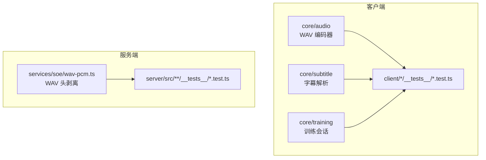
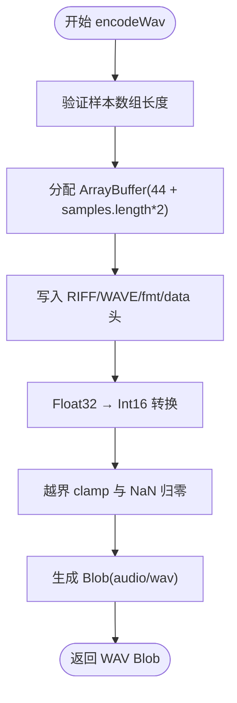
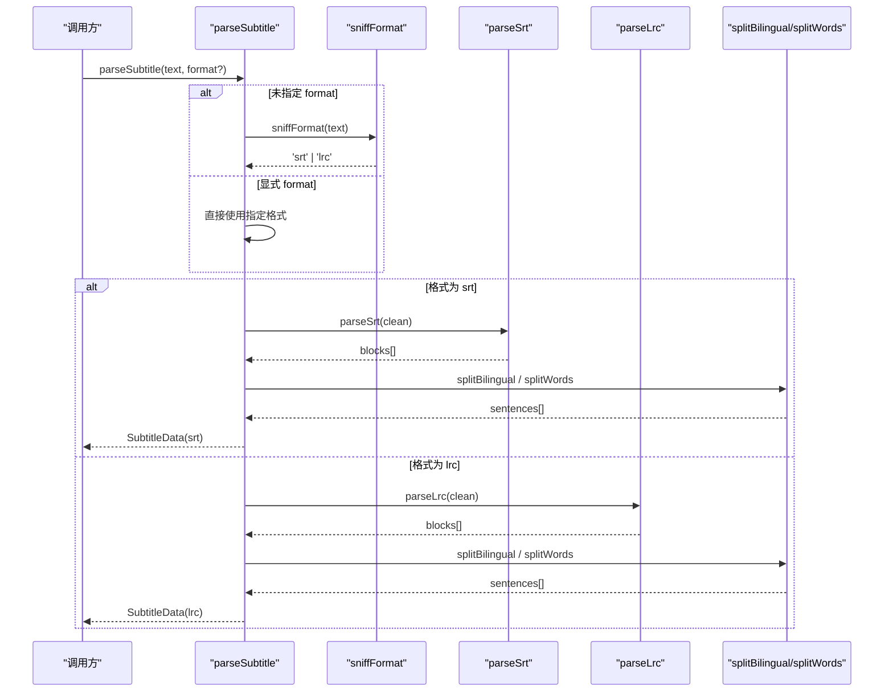
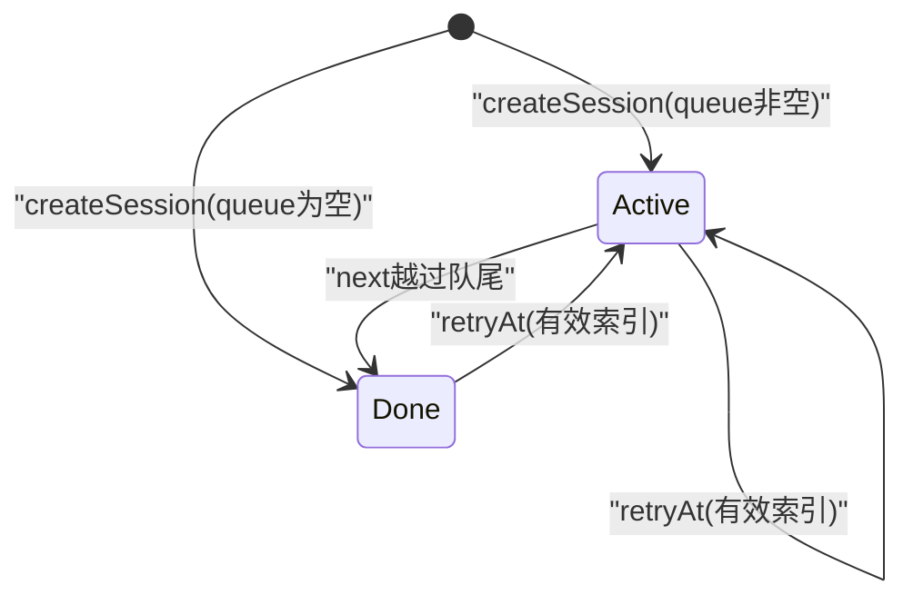
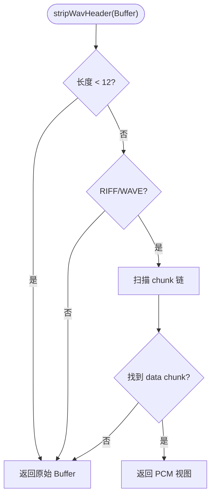
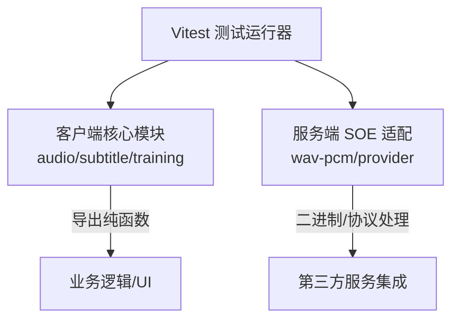
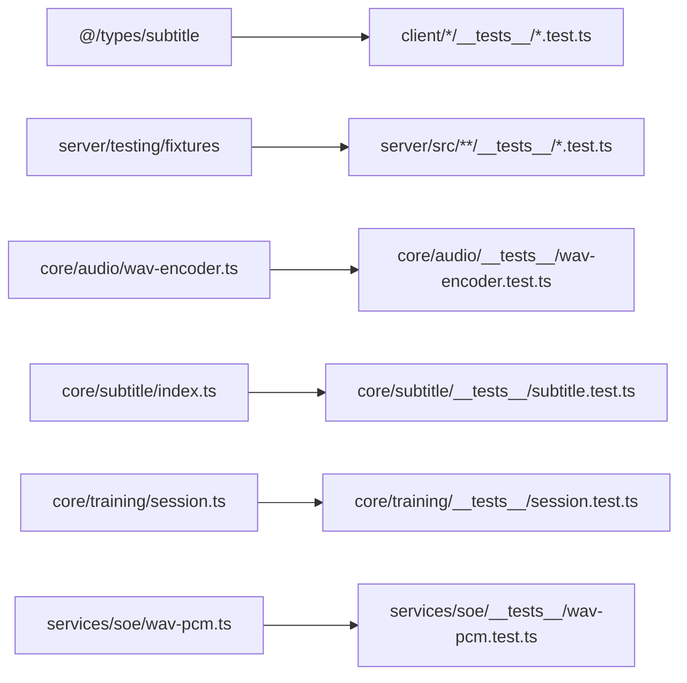

# 测试指南

<cite>
**本文引用的文件**   
- [client/vitest.config.mts](file://client/vitest.config.mts)
- [server/vitest.config.mts](file://server/vitest.config.mts)
- [client/core/audio/wav-encoder.ts](file://client/core/audio/wav-encoder.ts)
- [client/core/audio/__tests__/wav-encoder.test.ts](file://client/core/audio/__tests__/wav-encoder.test.ts)
- [client/core/subtitle/index.ts](file://client/core/subtitle/index.ts)
- [client/core/subtitle/__tests__/subtitle.test.ts](file://client/core/subtitle/__tests__/subtitle.test.ts)
- [client/core/training/session.ts](file://client/core/training/session.ts)
- [client/core/training/__tests__/session.test.ts](file://client/core/training/__tests__/session.test.ts)
- [server/src/services/soe/wav-pcm.ts](file://server/src/services/soe/wav-pcm.ts)
- [server/src/services/soe/__tests__/wav-pcm.test.ts](file://server/src/services/soe/__tests__/wav-pcm.test.ts)
</cite>

## 目录
1. [简介](#简介)
2. [项目结构与测试范围](#项目结构与测试范围)
3. [Vitest 配置与运行方式](#vitest-配置与运行方式)
4. [核心组件测试分析](#核心组件测试分析)
5. [架构总览与数据流](#架构总览与数据流)
6. [依赖关系分析](#依赖关系分析)
7. [性能与稳定性测试要点](#性能与稳定性测试要点)
8. [Mock 数据与外部依赖处理](#mock-数据与外部依赖处理)
9. [异步测试与音频测试注意事项](#异步测试与音频测试注意事项)
10. [测试编写最佳实践](#测试编写最佳实践)
11. [调试技巧与常见问题](#调试技巧与常见问题)
12. [结论](#结论)

## 简介
本测试指南面向本项目的前端客户端与服务端代码，目标是帮助开发者快速理解 Vitest 的配置、测试组织方式，以及针对音频处理、字幕解析、训练逻辑等核心功能的测试方法。文档同时给出 Mock 数据准备、异步测试、音频相关测试的特殊考虑，并总结命名约定、断言风格、覆盖率建议、调试技巧和常见问题解决方案。

## 项目结构与测试范围
仓库采用前后端分离结构：
- `client/`：前端应用，包含纯函数型核心模块（音频、字幕、训练）和服务层。
- `server/`：后端服务，包含语音评测（SOE）提供商适配、路由和测试夹具。

测试主要位于各功能模块的 `__tests__` 目录下，使用 `.test.ts` 后缀。当前仓库中已存在多组单元测试，覆盖 WAV 编码、字幕解析、训练会话状态机、WAV 头剥离等关键路径。

**图表来源**
- [client/vitest.config.mts:14-17](file://client/vitest.config.mts#L14-L17)
- [server/vitest.config.mts:4-7](file://server/vitest.config.mts#L4-L7)

**章节来源**
- [client/vitest.config.mts:1-19](file://client/vitest.config.mts#L1-L19)
- [server/vitest.config.mts:1-9](file://server/vitest.config.mts#L1-L9)

## Vitest 配置与运行方式
### 客户端 Vitest 配置
客户端 Vitest 配置为 Node 环境，仅包含 `core/**/*.test.ts` 与 `services/**/*.test.ts`，不启用浏览器或 React 测试。这符合原型阶段约束，聚焦纯 TypeScript 单测。

关键点：
- 测试环境：`node`
- 测试匹配规则：`core/**/*.test.ts`、`services/**/*.test.ts`
- 别名 `@` 指向项目根目录，便于绝对路径导入类型和工具模块

### 服务端 Vitest 配置
服务端 Vitest 配置同样为 Node 环境，匹配 `src/**/*.test.ts`，用于后端 SOE 提供商适配、路由及工具函数的单元测试。

建议的运行命令（以 pnpm 为例）：
- 客户端单测：`pnpm --filter client test`
- 服务端单测：`pnpm --filter server test`
- 全仓单测：在仓库根执行对应脚本或分别进入子包执行

**章节来源**
- [client/vitest.config.mts:1-19](file://client/vitest.config.mts#L1-L19)
- [server/vitest.config.mts:1-9](file://server/vitest.config.mts#L1-L9)

## 核心组件测试分析
本节从已有测试出发，说明如何围绕音频、字幕、训练三大核心能力编写高质量用例。

### 音频处理测试：WAV 编码器
WAV 编码器将 Float32 PCM 样本转换为标准 44 字节头的 WAV Blob，采样率默认 16kHz，单声道 16bit PCM。测试重点包括：
- 头部字段校验：RIFF/WAVE/fmt/data 标签、ChunkSize、ByteRate、BlockAlign、BitsPerSample
- 时长计算：按采样率换算毫秒
- 数值转换：float→int16 四舍五入、越界 clamp、NaN 归零
- 确定性：同输入产生相同字节输出
- 边界情况：空样本仍产出合法 44 字节头

**图表来源**
- [client/core/audio/wav-encoder.ts:19-53](file://client/core/audio/wav-encoder.ts#L19-L53)

**章节来源**
- [client/core/audio/wav-encoder.ts:1-59](file://client/core/audio/wav-encoder.ts#L1-L59)
- [client/core/audio/__tests__/wav-encoder.test.ts:1-100](file://client/core/audio/__tests__/wav-encoder.test.ts#L1-L100)

### 字幕解析测试：SRT/LRC 双语拆分
字幕解析入口支持自动嗅探 SRT/LRC，失败抛出带行号的 `SubtitleParseError`。测试重点包括：
- 时间戳解析：SRT `hh:mm:ss,mmm`、LRC `[mm:ss.xx]`
- 双语拆分：上英下中、上中下英、单行、多行合并
- 单词切分：剥首尾标点、保留内部撇号、过滤空串
- BOM/CRLF 兼容
- 乱序块排序与 index 重排
- 错误路径：空内容、无法识别格式、损坏时间戳、杂散文本
- 防御性：超长无空行文本、大量伪时间戳行，确保线性时间复杂度且不挂起

**图表来源**
- [client/core/subtitle/index.ts:22-69](file://client/core/subtitle/index.ts#L22-L69)

**章节来源**
- [client/core/subtitle/index.ts:1-80](file://client/core/subtitle/index.ts#L1-L80)
- [client/core/subtitle/__tests__/subtitle.test.ts:1-227](file://client/core/subtitle/__tests__/subtitle.test.ts#L1-L227)

### 训练逻辑测试：会话状态机
训练会话通过纯函数状态机管理题目队列、游标推进、提交/提示/跳过等行为，并收集每句结果。测试重点包括：
- 范围过滤：全文/收藏句保持原时间轴顺序
- 初始状态：active/done、cursor=0、注入 now
- 提交行为：collect results、hints/attempts、同句覆盖
- 推进行为：next/skip/retryAt、done 后空操作
- 汇总统计：summarize、formatElapsed

**图表来源**
- [client/core/training/session.ts:44-113](file://client/core/training/session.ts#L44-L113)

**章节来源**
- [client/core/training/session.ts:1-119](file://client/core/training/session.ts#L1-L119)
- [client/core/training/__tests__/session.test.ts:1-186](file://client/core/training/__tests__/session.test.ts#L1-L186)

### 服务端音频处理测试：WAV 头剥离
服务端 WAV 头剥离函数从 data chunk 取出纯 PCM 载荷，兼容 LIST chunk 奇数尺寸补齐、非 RIFF/WAVE 兜底裸 PCM。测试重点包括：
- 标准 44 字节头 → 精确返回 PCM 载荷
- LIST chunk 奇数尺寸补齐
- 非 RIFF/WAVE 输入 → 原样返回
- RIFF/WAVE 但无 data chunk → 原样返回

**图表来源**
- [server/src/services/soe/wav-pcm.ts:11-23](file://server/src/services/soe/wav-pcm.ts#L11-L23)

**章节来源**
- [server/src/services/soe/wav-pcm.ts:1-24](file://server/src/services/soe/wav-pcm.ts#L1-L24)
- [server/src/services/soe/__tests__/wav-pcm.test.ts:1-52](file://server/src/services/soe/__tests__/wav-pcm.test.ts#L1-L52)

## 架构总览与数据流
整体测试架构围绕“纯函数核心 + 服务适配”展开：
- 客户端核心模块（audio、subtitle、training）提供可独立测试的纯函数 API。
- 服务端服务层（SOE providers）提供协议适配与二进制数据处理。
- 测试用例通过构造输入、断言输出、模拟异常路径，确保核心逻辑稳定。

[此图为概念性架构图，不直接映射具体源码文件，故不提供图表来源]

## 依赖关系分析
- 客户端测试依赖 `@/types/subtitle` 等类型定义，通过别名 `@` 解析。
- 服务端测试依赖 `testing/fixtures` 构建 WAV 夹具，避免硬编码二进制数据。
- 核心模块之间耦合度低，测试易于隔离；例如 subtitle 解析与 training 会话相互独立。

**图表来源**
- [client/vitest.config.mts:9-13](file://client/vitest.config.mts#L9-L13)
- [server/src/services/soe/__tests__/wav-pcm.test.ts:3-3](file://server/src/services/soe/__tests__/wav-pcm.test.ts#L3-L3)

**章节来源**
- [client/vitest.config.mts:1-19](file://client/vitest.config.mts#L1-L19)
- [server/src/services/soe/__tests__/wav-pcm.test.ts:1-52](file://server/src/services/soe/__tests__/wav-pcm.test.ts#L1-L52)

## 性能与稳定性测试要点
- 字幕解析需保证线性时间复杂度，避免回溯型正则导致长文本卡死。测试中使用超长字符串与大量伪时间戳行验证性能上限（如 500ms 内完成）。
- WAV 编码与解码需保证确定性输出，避免随机性或平台差异影响测试结果。
- 训练会话状态机应保证 done 状态下所有事件为空操作，防止状态回退或无限循环。

**章节来源**
- [client/core/subtitle/__tests__/subtitle.test.ts:196-217](file://client/core/subtitle/__tests__/subtitle.test.ts#L196-L217)
- [client/core/audio/__tests__/wav-encoder.test.ts:75-89](file://client/core/audio/__tests__/wav-encoder.test.ts#L75-L89)
- [client/core/training/__tests__/session.test.ts:99-105](file://client/core/training/__tests__/session.test.ts#L99-L105)

## Mock 数据与外部依赖处理
- 服务端测试使用 `buildWav` 夹具生成标准 WAV Buffer，避免真实文件 I/O。
- 客户端测试通过构造 Float32Array、Uint8Array、Blob 等方式模拟音频数据。
- 对于外部服务（如 TTS、翻译 API），建议在 services/mock 下提供轻量 Mock 实现，便于单元测试隔离网络与第三方依赖。

建议的 Mock 策略：
- 使用工厂函数生成结构化数据（如句子、会话、WAV 片段）。
- 对异步接口使用 Promise.resolve/reject 模拟成功与失败路径。
- 对时间相关逻辑注入固定时间戳（如 `now` 参数），保证测试确定性。

**章节来源**
- [server/src/services/soe/__tests__/wav-pcm.test.ts:3-3](file://server/src/services/soe/__tests__/wav-pcm.test.ts#L3-L3)
- [client/core/audio/__tests__/wav-encoder.test.ts:7-16](file://client/core/audio/__tests__/wav-encoder.test.ts#L7-L16)

## 异步测试与音频测试注意事项
- 异步测试：使用 `async/await` 处理 Blob.arrayBuffer() 等异步 API，确保断言在数据就绪后进行。
- 音频测试：注意采样率、声道数、位深的一致性；校验 WAV 头字段时建议使用 DataView 读取小端整数。
- 数值边界：Float32→Int16 转换时需处理 NaN、越界值，确保输出在 [-32768, 32767] 范围内。
- 时间戳解析：SRT 与 LRC 的时间格式差异需在测试中覆盖，包括短毫秒、缺省毫秒、BOM/CRLF 兼容。

**章节来源**
- [client/core/audio/__tests__/wav-encoder.test.ts:7-16](file://client/core/audio/__tests__/wav-encoder.test.ts#L7-L16)
- [client/core/subtitle/__tests__/subtitle.test.ts:20-34](file://client/core/subtitle/__tests__/subtitle.test.ts#L20-L34)

## 测试编写最佳实践
### 命名约定
- 测试文件：`*.test.ts`
- 测试套件：`describe('模块名', ...)`
- 测试用例：`it('描述行为', ...)`，使用自然语言描述预期行为

### 断言风格
- 使用 `expect(...).toBe()` 进行严格相等比较
- 使用 `toMatchObject()` 进行对象部分匹配
- 使用 `toThrowError()` 捕获异常类型与消息
- 对异步断言使用 `async/await` 包裹

### 覆盖率要求
- 核心逻辑分支覆盖率 ≥ 80%
- 错误路径与边界条件覆盖率 ≥ 70%
- 音频/字幕等二进制处理需覆盖头部字段、数值转换、异常输入

### 示例参考
- 音频编码器：[client/core/audio/__tests__/wav-encoder.test.ts:18-73](file://client/core/audio/__tests__/wav-encoder.test.ts#L18-L73)
- 字幕解析：[client/core/subtitle/__tests__/subtitle.test.ts:62-194](file://client/core/subtitle/__tests__/subtitle.test.ts#L62-L194)
- 训练会话：[client/core/training/__tests__/session.test.ts:46-155](file://client/core/training/__tests__/session.test.ts#L46-L155)

**章节来源**
- [client/core/audio/__tests__/wav-encoder.test.ts:1-100](file://client/core/audio/__tests__/wav-encoder.test.ts#L1-L100)
- [client/core/subtitle/__tests__/subtitle.test.ts:1-227](file://client/core/subtitle/__tests__/subtitle.test.ts#L1-L227)
- [client/core/training/__tests__/session.test.ts:1-186](file://client/core/training/__tests__/session.test.ts#L1-L186)

## 调试技巧与常见问题
### 调试技巧
- 使用 `console.log` 输出中间状态（如 parsed sentences、session state）
- 在 Vitest 中启用 `--reporter=verbose` 查看详细输出
- 对异步测试添加超时保护，避免长时间挂起

### 常见问题
- **WAV 头解析失败**：检查 RIFF/WAVE 标签与 chunk 对齐，确认 LIST chunk 奇数尺寸补齐
- **字幕解析卡死**：检查正则表达式是否回溯型，确保线性时间复杂度
- **训练会话状态异常**：确认 done 状态下所有事件为空操作，避免状态回退
- **异步断言失败**：确保 await 在断言前完成，避免竞态条件

**章节来源**
- [server/src/services/soe/__tests__/wav-pcm.test.ts:12-50](file://server/src/services/soe/__tests__/wav-pcm.test.ts#L12-L50)
- [client/core/subtitle/__tests__/subtitle.test.ts:196-217](file://client/core/subtitle/__tests__/subtitle.test.ts#L196-L217)
- [client/core/training/__tests__/session.test.ts:99-105](file://client/core/training/__tests__/session.test.ts#L99-L105)

## 结论
本测试指南基于现有代码库中的 Vitest 配置与测试用例，系统梳理了音频处理、字幕解析、训练逻辑等核心功能的测试方法。通过遵循命名约定、断言风格、覆盖率要求，并结合 Mock 数据与异步测试最佳实践，可有效提升代码质量与稳定性。建议持续扩展测试覆盖范围，特别是服务层与外部依赖的集成测试，以确保端到端流程的可靠性。