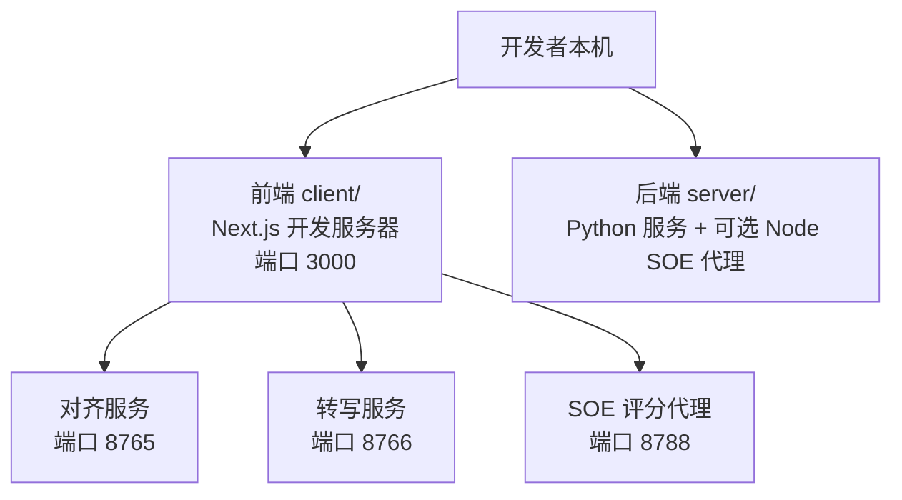
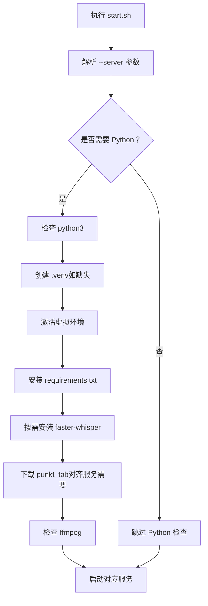
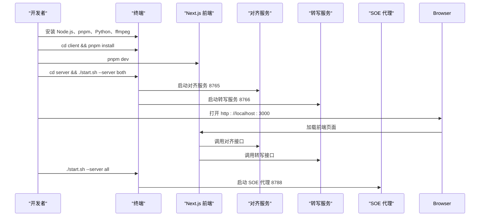

# 环境搭建

<cite>
**本文引用的文件**   
- [README.md](file://README.md)
- [client/package.json](file://client/package.json)
- [client/next.config.mjs](file://client/next.config.mjs)
- [server/package.json](file://server/package.json)
- [server/start.sh](file://server/start.sh)
- [server/requirements.txt](file://server/requirements.txt)
- [server/transcribe_server.py](file://server/transcribe_server.py)
- [server/align_server.py](file://server/align_server.py)
</cite>

## 目录
1. [简介](#简介)
2. [项目结构与运行边界](#项目结构与运行边界)
3. [全局环境与版本要求](#全局环境与版本要求)
4. [前端开发环境：Next.js + pnpm](#前端开发环境nextjs--pnpm)
5. [后端 Python 服务环境：转写与对齐服务](#后端-python-服务环境转写与对齐服务)
6. [SOE 评分代理（可选）](#soe-评分代理可选)
7. [VS Code 推荐扩展、调试与格式化](#vs-code-推荐扩展调试与格式化)
8. [环境变量与服务地址配置](#环境变量与服务地址配置)
9. [常见环境问题排查](#常见环境问题排查)
10. [本地启动总览流程](#本地启动总览流程)
11. [结论与建议](#结论与建议)

## 简介
本指南面向首次参与项目的开发者，目标是让你在本机快速完成以下工作：
- 安装并验证 Node.js 与 Python 环境。
- 使用 pnpm 管理前端依赖。
- 初始化 Next.js 前端开发服务器。
- 创建 Python 虚拟环境，安装 WhisperX、faster-whisper 等依赖。
- 通过统一脚本启动后端转写服务、对齐服务或 SOE 评分代理。
- 配置 VS Code 扩展、调试和代码风格。
- 解决常见的端口冲突、模型加载失败、网络下载失败等问题。

该项目采用前后端分离架构：
- 前端位于 `client/`，基于 Next.js App Router，作为 SPA shell 运行。
- 后端位于 `server/`，包含 Python FastAPI 服务和可选的 Node.js SOE 评分代理。
- 文档说明中明确给出了快速开始命令，包括前端 `pnpm dev` 和后端 `./start.sh`。

**章节来源**
- [README.md:59-90](file://README.md#L59-L90)

## 项目结构与运行边界
从仓库根目录看，本项目主要包含三个可运行部分：
- `client/`：前端 SPA，默认监听 `http://localhost:3000`。
- `server/`：后端服务，默认包含：
  - 对齐服务：WhisperX，默认端口 `8765`。
  - 转写服务：faster-whisper，默认端口 `8766`。
  - 可选 SOE 评分代理：Node.js Fastify，默认端口 `8788`。
- `page-prototype/`：独立原型沙箱，通常不用于主开发流程。

**图表来源**
- [README.md:49-53](file://README.md#L49-L53)
- [server/start.sh:156-191](file://server/start.sh#L156-L191)

**章节来源**
- [README.md:23-57](file://README.md#L23-L57)
- [README.md:128-134](file://README.md#L128-L134)

## 全局环境与版本要求
### Node.js 与 pnpm
- 前端 `client/` 使用 pnpm 管理依赖，并在 README 中明确要求“使用 pnpm，非 npm”。
- 前端依赖中包含 Next.js、React、TypeScript、Vitest 等，属于现代前端工程栈。
- 后端可选的 SOE 评分代理在 `server/package.json` 中声明 Node 引擎要求为 `>=20`。
- 启动脚本 `server/start.sh` 在 SOE 模式下也会检查 Node.js 版本，要求主版本不低于 20。

建议：
- 安装 Node.js 20 或更高版本，避免 SOE 代理出现版本不兼容。
- 安装 pnpm，推荐使用官方安装方式，例如通过 npm 全局安装 pnpm。
- 如果已有 Node.js 但 pnpm 不可用，优先安装 pnpm，而不是改用 npm 或 yarn。

**章节来源**
- [README.md:18-20](file://README.md#L18-L20)
- [README.md:61-70](file://README.md#L61-L70)
- [server/package.json:7-14](file://server/package.json#L7-L14)
- [server/start.sh:131-151](file://server/start.sh#L131-L151)

### Python 环境
- 后端 Python 服务需要 Python 3.9+。
- 启动脚本会检查 `python3` 是否存在，不存在则直接报错退出。
- 依赖列表包含 whisperx、torch、fastapi、uvicorn、python-multipart、numpy、faster-whisper。

建议：
- 确保系统存在 `python3` 命令，且版本满足 3.9+。
- 不要将 Python 依赖安装到系统全局环境中；应使用项目内虚拟环境。
- 如果使用 GPU，请提前安装 CUDA 驱动和对应版本的 PyTorch；否则服务会自动回退到 CPU。

**章节来源**
- [server/start.sh:58-64](file://server/start.sh#L58-L64)
- [server/requirements.txt:1-8](file://server/requirements.txt#L1-L8)

## 前端开发环境：Next.js + pnpm
### 前置条件
- 已安装 Node.js 20+。
- 已安装 pnpm。
- 进入 `client/` 目录操作。

### 依赖安装
在项目根目录或 `client/` 目录下执行依赖安装。根据 README，前端依赖安装命令是：
- `cd client`
- `pnpm install`

该命令会读取 `client/package.json` 中的依赖，并使用 pnpm 生成锁文件和依赖树。

### 开发服务器启动
安装完成后，启动前端开发服务器：
- `pnpm dev`

根据 README，该命令会启动 Next.js 开发服务器，默认访问地址为 `http://localhost:3000`。

### 构建与测试
- 生产构建：`pnpm build`
- 单元测试：`pnpm test`
- TypeScript 类型检查：`npx tsc --noEmit`

这些命令来自 README 的快速开始部分，分别对应 Next.js 构建、Vitest 测试和 TypeScript 类型检查。

### Next.js 配置注意事项
`client/next.config.mjs` 中启用了两个重要配置：
- `images.unoptimized = true`：关闭图片优化，便于本地开发和跨平台构建。
- `allowedDevOrigins`：允许局域网 IP 段和 `127.0.0.1` 访问 Next.js 静态资源，避免手机通过局域网访问时出现白屏。

如果你在手机或其他设备上访问本机开发服务器，请确认：
- 手机与电脑在同一局域网。
- 使用电脑的局域网 IP 访问，而不是 `127.0.0.1`。
- 防火墙未拦截 `3000` 端口。

**章节来源**
- [README.md:59-70](file://README.md#L59-L70)
- [client/package.json:5-10](file://client/package.json#L5-L10)
- [client/next.config.mjs:1-16](file://client/next.config.mjs#L1-L16)

## 后端 Python 服务环境：转写与对齐服务
### 进入后端目录
后端相关脚本和依赖定义位于 `server/` 目录：
- `transcribe_server.py`：faster-whisper 转写服务。
- `align_server.py`：WhisperX 强制对齐服务。
- `requirements.txt`：Python 依赖清单。
- `start.sh`：统一启动脚本。

### 创建并激活虚拟环境
推荐做法是使用项目内虚拟环境，避免污染系统 Python：
- `cd server`
- `python3 -m venv .venv`
- 激活虚拟环境：
  - Linux/macOS：`source .venv/bin/activate`
  - Windows PowerShell：`.venv\Scripts\Activate.ps1`

README 中也给出了相同的虚拟环境创建和激活步骤。

### 安装 Python 依赖
激活虚拟环境后，安装依赖：
- `pip install -r requirements.txt`

`requirements.txt` 中定义了 WhisperX、PyTorch、FastAPI、Uvicorn、faster-whisper 等核心依赖。

### 使用启动脚本
`server/start.sh` 是后端服务的统一入口，支持多种模式：
- 仅启动对齐服务：`./start.sh`
- 显式启动对齐服务：`./start.sh --server align`
- 启动转写服务：`./start.sh --server transcribe`
- 同时启动对齐和转写服务：`./start.sh --server both`
- 启动 SOE 评分代理：`./start.sh --server soe`
- 同时启动所有服务：`./start.sh --server all`

脚本内部会：
1. 解析 `--server` 参数。
2. 检查是否需要 Python 或 Node。
3. 检查 `python3` 是否存在。
4. 如缺失 `.venv`，自动创建虚拟环境。
5. 激活虚拟环境。
6. 按需安装 Python 依赖。
7. 按需下载 NLTK punkt_tab 分词器。
8. 检查 ffmpeg 是否可用。
9. 启动对应服务。

**图表来源**
- [server/start.sh:23-129](file://server/start.sh#L23-L129)
- [server/start.sh:155-199](file://server/start.sh#L155-L199)

**章节来源**
- [README.md:72-90](file://README.md#L72-L90)
- [server/start.sh:1-20](file://server/start.sh#L1-L20)
- [server/start.sh:58-129](file://server/start.sh#L58-L129)
- [server/requirements.txt:1-8](file://server/requirements.txt#L1-L8)

### 转写服务：faster-whisper
`server/transcribe_server.py` 提供语音转文字能力：
- 默认端口：`8766`
- 健康检查接口：`GET /health`
- 转写接口：`POST /transcribe`
- 支持自动语言检测。
- 支持设备选择：`cpu`、`cuda`、`auto`。
- 支持计算精度：`int8`、`float16`、`float32`。
- 支持模型大小：`tiny`、`base`、`small`、`medium`、`large-v2`、`large-v3`。

启动时，服务会：
- 根据 `--device auto` 判断是否使用 CUDA。
- 如果没有 CUDA，则回退到 CPU。
- 首次请求时懒加载模型，也可通过 `--preload` 在启动时预加载。
- 使用线程池执行阻塞的模型加载和转写任务，避免阻塞事件循环。

**章节来源**
- [server/transcribe_server.py:1-14](file://server/transcribe_server.py#L1-L14)
- [server/transcribe_server.py:32-46](file://server/transcribe_server.py#L32-L46)
- [server/transcribe_server.py:123-188](file://server/transcribe_server.py#L123-L188)
- [server/transcribe_server.py:195-259](file://server/transcribe_server.py#L195-L259)

### 对齐服务：WhisperX
`server/align_server.py` 提供强制对齐能力：
- 默认端口：`8765`
- 健康检查接口：`GET /health`
- 列出已加载模型接口：`GET /models`
- 对齐接口：`POST /align`
- 输入：音频文件 + 已有文本 + 语言代码。
- 输出：词级时间戳和分段信息。

对齐服务会为不同语言加载对应的对齐模型，并将结果缓存到内存中。它依赖 whisperx 提供的对齐模型映射表，支持英文、中文、日文等多种语言。

**章节来源**
- [server/align_server.py:1-15](file://server/align_server.py#L1-L15)
- [server/align_server.py:33-85](file://server/align_server.py#L33-L85)
- [server/align_server.py:118-207](file://server/align_server.py#L118-L207)
- [server/align_server.py:214-246](file://server/align_server.py#L214-L246)

## SOE 评分代理（可选）
SOE 发音评分代理是一个可选的 Node.js 服务：
- 由 `server/package.json` 描述。
- 使用 Fastify 作为后端框架。
- 默认端口为 `8788`。
- 可通过 `./start.sh --server soe` 单独启动。
- 也可通过 `./start.sh --server all` 与其他服务一起启动。

启动脚本会在 SOE 模式下检查：
- 是否安装了 Node.js。
- 是否安装了 pnpm。
- Node.js 主版本是否大于等于 20。
- 是否已安装依赖。

如果你只需要 Python 转写和对齐服务，可以忽略 SOE 代理。

**章节来源**
- [server/package.json:1-31](file://server/package.json#L1-L31)
- [server/start.sh:49-56](file://server/start.sh#L49-L56)
- [server/start.sh:131-151](file://server/start.sh#L131-L151)
- [server/start.sh:176-191](file://server/start.sh#L176-L191)

## VS Code 推荐扩展、调试与格式化
虽然仓库中没有提供 `.vscode` 配置文件，但可以根据当前技术栈合理配置开发体验。

### 推荐扩展
- **TypeScript 和 JavaScript Language Features**：原生支持 TS/JS。
- **ESLint**：用于代码质量检查（当前项目未启用 ESLint，可按需开启）。
- **Prettier**：用于代码格式化（当前项目未启用 Prettier，可按需开启）。
- **Python**：微软官方 Python 扩展，支持解释器选择、调试、linting。
- **Tailwind CSS IntelliSense**：前端样式智能提示。
- **DotENV**：方便查看和管理 `.env` 文件。
- **GitLens**：增强 Git 提交历史和行级变更查看。

### 调试配置
#### 前端调试
- 使用浏览器调试工具即可调试 Next.js 前端。
- 如需在 VS Code 中调试 Node 进程，可使用内置 Node.js 调试器，目标指向 `client/` 下的 Next.js 进程。

#### 后端 Python 调试
- 在 VS Code 中选择项目虚拟环境作为 Python 解释器。
- 使用 VS Code 的 Python 调试功能，启动 `server/transcribe_server.py` 或 `server/align_server.py`。
- 如需调试 SOE 代理，可启动 `server/package.json` 中的 `start` 脚本。

### 代码格式化
当前项目 README 明确说明“无 ESLint/Prettier 配置”，因此：
- 不建议强制引入 Prettier，除非团队决定统一格式规范。
- 如果引入 Prettier，建议仅在编辑器层面启用，避免与现有代码风格冲突。
- Python 侧建议使用 Black 或 Ruff，但同样应先与团队约定。

**章节来源**
- [README.md:183-191](file://README.md#L183-L191)

## 环境变量与服务地址配置
### 前端环境变量
当前仓库中没有发现 `.env` 或 `.env.local` 文件。根据 README，前端通过环境变量控制服务行为，例如：
- `NEXT_PUBLIC_SERVICE_MODE`：用于切换 mock 服务与真实 API。
- 其他客户端环境变量可能用于 LLM、翻译、TTS、SOE 等服务地址。

建议：
- 在 `client/` 下创建 `.env.local`，只保存本地敏感配置。
- 不要将 `.env.local` 提交到版本库。
- 如果需要连接后端服务，确保前端能访问 `localhost:8765`、`localhost:8766` 或 `localhost:8788`。

### 后端环境变量
当前仓库中没有发现后端 `.env` 文件。SOE 代理的启动脚本注释中提到“SOE 代理通过 `server/.env` 配置”，但实际仓库中未提供该文件。

建议：
- 如果 SOE 代理需要密钥或外部服务地址，请在 `server/.env` 中配置。
- 如果不需要 SOE 代理，可不创建该文件。
- 对于 Python 服务，如需配置模型路径、日志级别、GPU 选项，可通过命令行参数或环境变量注入。

### 服务地址对照
| 服务 | 默认地址 | 用途 |
|------|----------|------|
| 前端开发服务器 | `http://localhost:3000` | Next.js SPA 开发界面 |
| 对齐服务 | `http://localhost:8765` | WhisperX 强制对齐 |
| 转写服务 | `http://localhost:8766` | faster-whisper 语音转文字 |
| SOE 评分代理 | `http://localhost:8788` | 发音评分代理（可选） |

**章节来源**
- [README.md:90-90](file://README.md#L90-L90)
- [README.md:122-123](file://README.md#L122-L123)
- [server/start.sh:1-14](file://server/start.sh#L1-L14)

## 常见环境问题排查
### 问题一：找不到 python3
**现象**：执行 `./start.sh` 时报错提示未找到 `python3`。  
**原因**：系统未安装 Python，或 `python3` 不在 PATH 中。  
**解决**：
- 安装 Python 3.9+。
- 确保终端中 `python3 --version` 可正常输出。
- 如果使用 pyenv，请先激活所需版本。

**章节来源**
- [server/start.sh:58-64](file://server/start.sh#L58-L64)

### 问题二：找不到 Node.js 或 pnpm
**现象**：启动 SOE 代理时报错未找到 node 或 pnpm。  
**原因**：未安装 Node.js 或 pnpm，或版本过低。  
**解决**：
- 安装 Node.js 20+。
- 安装 pnpm。
- 使用 `node -v` 和 `pnpm -v` 验证版本。

**章节来源**
- [server/start.sh:131-151](file://server/start.sh#L131-L151)

### 问题三：NLTK punkt_tab 分词器下载失败
**现象**：启动对齐服务时报错，提示 punkt_tab 分词器缺失。  
**原因**：NLTK 下载器被网络策略拦截，无法下载 punkt_tab。  
**解决**：
- 启动脚本已提供 GitHub 手动下载兜底逻辑。
- 如果仍失败，可手动下载 punkt_tab.zip 并解压到 `$HOME/nltk_data/tokenizers/punkt_tab`。
- 确保目录结构中存在 `english` 子目录。

**章节来源**
- [server/start.sh:93-121](file://server/start.sh#L93-L121)

### 问题四：ffmpeg 未安装
**现象**：启动脚本输出警告，提示未找到 ffmpeg。  
**原因**：系统缺少 ffmpeg，导致部分音频格式解码失败。  
**解决**：
- Linux：`apt install ffmpeg`
- macOS：`brew install ffmpeg`
- Windows：安装 ffmpeg 并加入 PATH。

**章节来源**
- [server/start.sh:123-127](file://server/start.sh#L123-L127)

### 问题五：CUDA 不可用但仍请求 GPU
**现象**：转写服务启动时提示 CUDA 请求但不可用，自动回退到 CPU。  
**原因**：未安装 CUDA 驱动或 PyTorch CUDA 版本不匹配。  
**解决**：
- 安装匹配的 CUDA 驱动和 PyTorch CUDA 版本。
- 或者接受 CPU 模式，性能较低但可正常运行。
- 使用 `--device cpu` 显式指定 CPU 模式。

**章节来源**
- [server/transcribe_server.py:226-250](file://server/transcribe_server.py#L226-L250)

### 问题六：手机访问前端白屏
**现象**：手机通过局域网 IP 访问前端页面，出现白屏。  
**原因**：Next.js 默认拦截跨源 `/_next/*` 资源请求。  
**解决**：
- 使用电脑的局域网 IP 访问。
- 确认 `client/next.config.mjs` 中 `allowedDevOrigins` 包含你的网段。
- 检查防火墙是否放行 `3000` 端口。

**章节来源**
- [client/next.config.mjs:9-13](file://client/next.config.mjs#L9-L13)

### 问题七：端口被占用
**现象**：启动服务时报端口已被占用。  
**原因**：之前启动的服务未正常退出，或与其他程序冲突。  
**解决**：
- 查找占用端口的进程并结束。
- 重新执行 `./start.sh`。
- 如需修改端口，可在对应服务启动参数中指定。

**章节来源**
- [server/transcribe_server.py:198-200](file://server/transcribe_server.py#L198-L200)
- [server/align_server.py:215-218](file://server/align_server.py#L215-L218)

## 本地启动总览流程
以下是推荐的完整本地启动流程：

1. 安装 Node.js 20+ 和 pnpm。
2. 安装 Python 3.9+。
3. 安装 ffmpeg（可选，但推荐）。
4. 进入 `client/`，执行 `pnpm install`。
5. 启动前端：`pnpm dev`。
6. 进入 `server/`，执行 `./start.sh --server both`。
7. 如需 SOE 评分代理，执行 `./start.sh --server all`。
8. 在浏览器打开 `http://localhost:3000`。
9. 如需调试，分别在 VS Code 中配置前端和后端调试。

**图表来源**
- [README.md:59-90](file://README.md#L59-L90)
- [server/start.sh:155-199](file://server/start.sh#L155-L199)

## 结论与建议
- 本项目的前端依赖 pnpm，后端依赖 Python 虚拟环境，两者应分开管理。
- 推荐始终使用 `client/package.json` 和 `server/requirements.txt` 作为依赖来源。
- 使用 `server/start.sh` 统一管理后端服务启动，避免手动逐个启动 Python 脚本。
- 如果不需要 SOE 评分代理，可以只启动 Python 服务，减少环境复杂度。
- 遇到模型加载失败、网络下载失败、CUDA 不可用等问题时，优先检查日志、网络和硬件环境。
- 如果团队希望统一代码风格，建议在现有无 ESLint/Prettier 的基础上逐步引入规范，并先与团队达成共识。