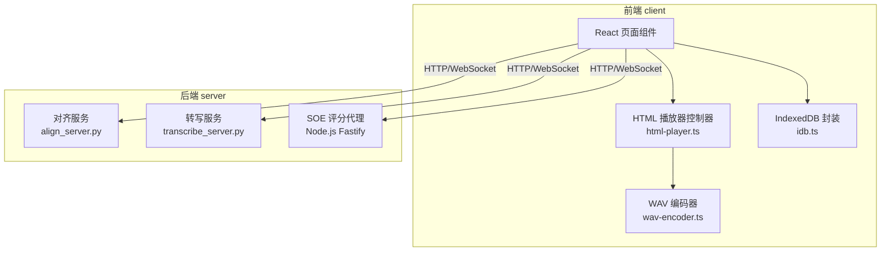
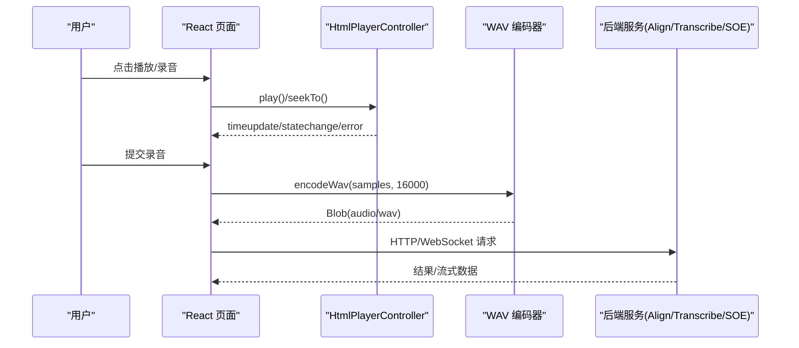
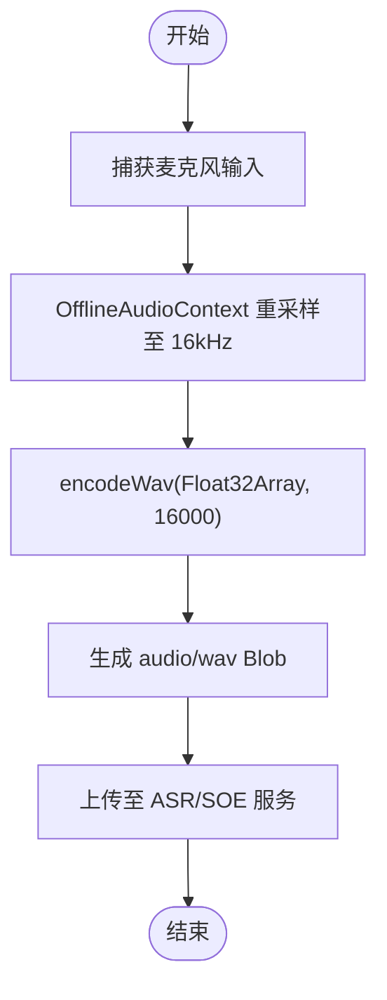
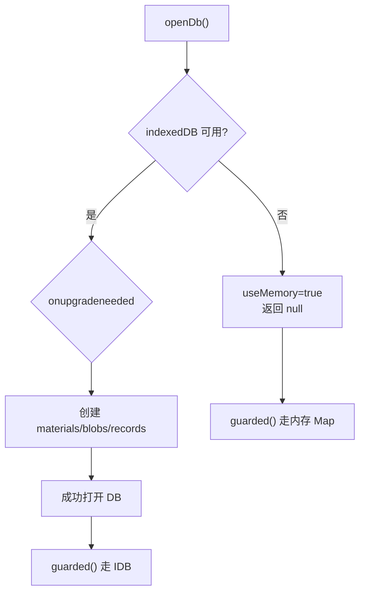
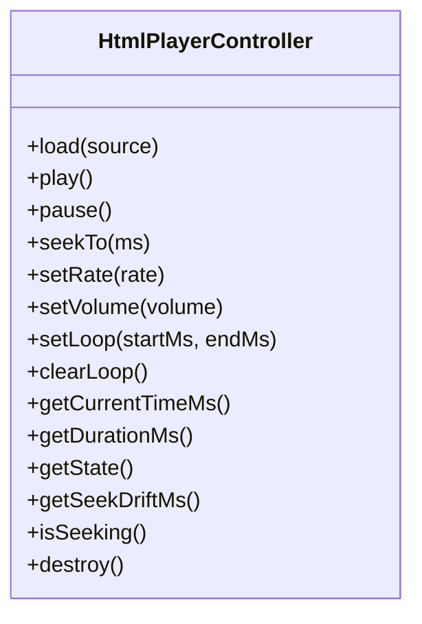
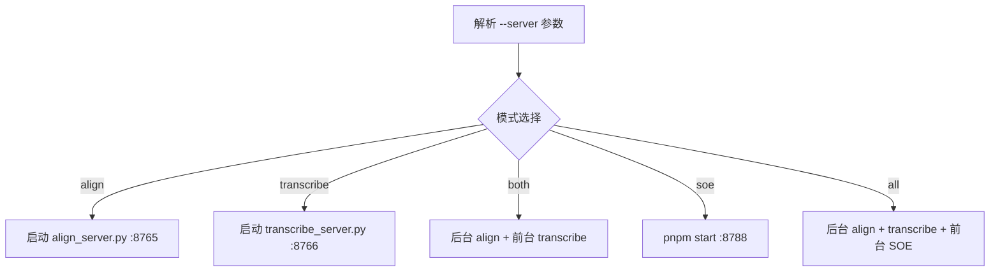
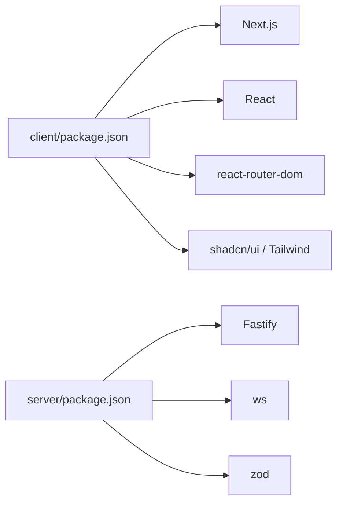

# 调试工具

<cite>
**本文引用的文件**   
- [README.md](file://README.md)
- [client/platform/storage/idb.ts](file://client/platform/storage/idb.ts)
- [client/core/audio/wav-encoder.ts](file://client/core/audio/wav-encoder.ts)
- [client/platform/html-player.ts](file://client/platform/html-player.ts)
- [server/start.sh](file://server/start.sh)
- [client/package.json](file://client/package.json)
- [server/package.json](file://server/package.json)
</cite>

## 目录
1. [引言](#引言)
2. [项目结构](#项目结构)
3. [核心组件](#核心组件)
4. [架构总览](#架构总览)
5. [详细组件分析](#详细组件分析)
6. [依赖关系分析](#依赖关系分析)
7. [性能注意事项](#性能注意事项)
8. [故障排查指南](#故障排查指南)
9. [结论](#结论)
10. [附录](#附录)

## 引言
本指南面向“英语精听助手”项目的调试与排障，覆盖浏览器开发者工具高级用法（Web Audio API、IndexedDB、网络请求）、VS Code 调试配置（前端 React/Next.js、Python FastAPI）、断点技巧、性能分析（内存泄漏、渲染性能、音频处理）以及常见问题定位方法。文档结合仓库中的实际代码路径，帮助你在真实项目中快速定位问题并优化体验。

## 项目结构
本项目采用前后端分离：
- 前端 client：Next.js + React SPA，使用 IndexedDB 本地持久化，包含音频编码、播放器控制等核心逻辑。
- 后端 server：Python FastAPI 服务（转写/对齐），另有 Node.js SOE 评分代理。

**图示来源**
- [client/platform/html-player.ts:1-272](file://client/platform/html-player.ts#L1-L272)
- [client/core/audio/wav-encoder.ts:1-59](file://client/core/audio/wav-encoder.ts#L1-L59)
- [client/platform/storage/idb.ts:1-117](file://client/platform/storage/idb.ts#L1-L117)
- [server/start.sh:156-199](file://server/start.sh#L156-L199)

**章节来源**
- [README.md:92-134](file://README.md#L92-L134)

## 核心组件
- 音频链路：录音 → OfflineAudioContext 重采样 → WAV 编码（16kHz 单声道 16bit）→ 上传 ASR/SOE。
- 播放器：基于 HTMLMediaElement 的控制器，提供 seek 校准、A-B 循环、进度平滑更新。
- 存储层：IndexedDB Promise 封装，支持 SSR/隐私模式降级到内存 Map。
- 后端启动脚本：一键启动 align/transcribe/SOE 服务，自动检查依赖与环境。

**章节来源**
- [client/core/audio/wav-encoder.ts:1-59](file://client/core/audio/wav-encoder.ts#L1-L59)
- [client/platform/html-player.ts:1-272](file://client/platform/html-player.ts#L1-L272)
- [client/platform/storage/idb.ts:1-117](file://client/platform/storage/idb.ts#L1-L117)
- [server/start.sh:1-200](file://server/start.sh#L1-L200)

## 架构总览
下图展示从用户交互到后端服务的端到端调用链，便于理解调试切入点。

**图示来源**
- [client/platform/html-player.ts:103-137](file://client/platform/html-player.ts#L103-L137)
- [client/core/audio/wav-encoder.ts:19-52](file://client/core/audio/wav-encoder.ts#L19-L52)
- [server/start.sh:156-199](file://server/start.sh#L156-L199)

## 详细组件分析

### Web Audio API 调试要点
- 录音与重采样：OfflineAudioContext 将麦克风输入重采样至 16kHz 单声道，再经 WAV 编码器生成标准 Blob。
- 关键参数：目标采样率 16000Hz，16bit PCM，单声道；时长可由样本数计算。
- 常见陷阱：
  - 采样率不匹配导致 ASR/SOE 解析失败或延迟异常。
  - Float32 样本越界未 clamp 导致爆音或解码错误。
  - Blob MIME 类型不正确导致服务端拒绝。

**图示来源**
- [client/core/audio/wav-encoder.ts:11-52](file://client/core/audio/wav-encoder.ts#L11-L52)

**章节来源**
- [client/core/audio/wav-encoder.ts:1-59](file://client/core/audio/wav-encoder.ts#L1-L59)

### IndexedDB 数据查看与降级策略
- 对象存储：materials/blobs/records 三个 store，键为 materialId 或带前缀的业务键。
- 降级机制：SSR/隐私模式打开失败时自动回退到内存 Map，保证应用不崩溃。
- 诊断建议：
  - 在 DevTools Application → IndexedDB 中观察数据库版本、对象存储与条目数量。
  - 通过 estimateUsage 与 isMemoryFallback 判断是否处于内存降级模式。
  - 关注 onupgradeneeded 与 onblocked 日志，排查多标签页连接冲突。

**图示来源**
- [client/platform/storage/idb.ts:27-50](file://client/platform/storage/idb.ts#L27-L50)
- [client/platform/storage/idb.ts:70-97](file://client/platform/storage/idb.ts#L70-L97)

**章节来源**
- [client/platform/storage/idb.ts:1-117](file://client/platform/storage/idb.ts#L1-L117)

### 播放器与 Seek 校准
- 进度更新：原生 timeupdate（约 4Hz）+ requestAnimationFrame（约 60Hz）双通道，确保进度条顺滑。
- Seek 校准：记录 pendingSeekMs，首个 timeupdate 到达后计算 drift，超过阈值记录 seekDriftMs 供上层修正循环容差。
- A-B 循环：控制器级区间循环，次数限制由上层 SentencePlayer 承担。
- 错误处理：play 拦截（AbortError）静默吞掉，避免 unhandled rejection；media error 上报具体 code。

**图示来源**
- [client/platform/html-player.ts:24-155](file://client/platform/html-player.ts#L24-L155)

**章节来源**
- [client/platform/html-player.ts:1-272](file://client/platform/html-player.ts#L1-L272)

### 后端服务启动与端口
- 启动脚本支持 align/transcribe/both/soe/all 多种模式，自动检测 Python/Node 环境并安装依赖。
- 默认端口：对齐服务 8765，转写服务 8766，SOE 评分代理 8788。
- 调试建议：
  - 先单独启动各服务确认端口占用与依赖完整性。
  - 使用 --device cuda 与 --compute-type float16 进行 GPU 加速测试。
  - 观察 ffmpeg 是否存在，缺失会影响部分音频格式解码。

**图示来源**
- [server/start.sh:23-56](file://server/start.sh#L23-L56)
- [server/start.sh:156-199](file://server/start.sh#L156-L199)

**章节来源**
- [server/start.sh:1-200](file://server/start.sh#L1-L200)

## 依赖关系分析
- 前端依赖：Next.js、React、react-router-dom、shadcn/ui、Tailwind CSS、Vitest 等。
- 后端依赖：Fastify、ws、zod（SOE 代理）；Python FastAPI + faster-whisper + WhisperX（转写/对齐）。
- 开发脚本：client/package.json 提供 dev/build/test；server/package.json 提供 dev/start/check/test。

**图示来源**
- [client/package.json:1-60](file://client/package.json#L1-L60)
- [server/package.json:1-31](file://server/package.json#L1-L31)

**章节来源**
- [client/package.json:1-60](file://client/package.json#L1-L60)
- [server/package.json:1-31](file://server/package.json#L1-L31)

## 性能注意事项
- 内存泄漏检测
  - 使用 Chrome Memory 面板录制 Heap Snapshot，比较不同时间点的 Retainers，定位未被释放的 DOM 引用或闭包引用。
  - 对 HtmlPlayerController.destroy 后的元素与事件监听器进行验证，确保无残留 rAF 与定时器。
- 渲染性能优化
  - 利用 Performance 面板观察长任务与主线程阻塞，减少同步计算与频繁状态更新。
  - 对进度条等高频率更新场景，优先使用 rAF 与节流策略。
- 音频处理性能调优
  - 确保 OfflineAudioContext 的 sampleRate 与 WAV 编码一致（16kHz），避免重复重采样。
  - 大段音频分块处理，避免一次性分配过大 Buffer。
  - 监控 MediaRecorder 与 Blob 大小，必要时压缩或分段上传。

[本节为通用指导，无需特定文件来源]

## 故障排查指南
- 浏览器开发者工具高级用法
  - Web Audio API：在 Sources 面板设置断点到 OfflineAudioContext 相关回调，检查节点图与实时波形。
  - IndexedDB：Application → IndexedDB 查看对象存储结构与数据量；Console 中打印 isMemoryFallback 与 estimateUsage 结果。
  - 网络请求：Network 面板过滤 XHR/Fetch，查看请求头、响应体与耗时瀑布图；对 SSE/WS 使用专门的协议面板。
- VS Code 调试配置
  - 前端 React/Next.js：使用 Chrome 调试器附加到 localhost:3000，或在 launch.json 配置 Chrome 调试；在组件生命周期与事件回调处设置条件断点。
  - Python FastAPI：使用内置调试器或 VS Code Python 扩展，attach 到 uvicorn 进程；在服务入口与路由函数设置断点。
  - 断点技巧：使用条件断点（如 error.code 匹配）、日志断点（仅输出变量不中断）、命中计数断点（避免频繁中断）。
- 常见问题与日志追踪
  - 播放被拦截：检查 Autoplay Policy 与用户手势；留意 AbortError 静默吞掉的逻辑。
  - 转写失败：核对 WAV 采样率与通道数；检查后端服务端口与模型加载状态。
  - 存储降级：当 isMemoryFallback 为 true 时，UI 应提示当前为内存模式，引导用户清理或迁移数据。

**章节来源**
- [client/platform/html-player.ts:85-97](file://client/platform/html-player.ts#L85-L97)
- [client/platform/storage/idb.ts:104-117](file://client/platform/storage/idb.ts#L104-L117)
- [server/start.sh:123-127](file://server/start.sh#L123-L127)

## 结论
通过浏览器开发者工具的高级能力、VS Code 的多语言调试配置以及对核心组件（音频编码、播放器、IndexedDB、后端服务）的深入理解，你可以高效定位问题并进行性能优化。建议在开发流程中常态化使用 Memory/Performance/Network 面板，并结合结构化日志与断点策略，形成稳定的调试闭环。

[本节为总结性内容，无需特定文件来源]

## 附录
- 常用命令
  - 前端：pnpm dev / pnpm build / pnpm test
  - 后端：./start.sh --server both --device auto
- 关键端口
  - 对齐服务：8765
  - 转写服务：8766
  - SOE 评分代理：8788

**章节来源**
- [README.md:59-90](file://README.md#L59-L90)
- [server/start.sh:156-199](file://server/start.sh#L156-L199)