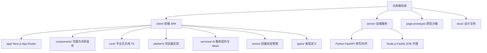
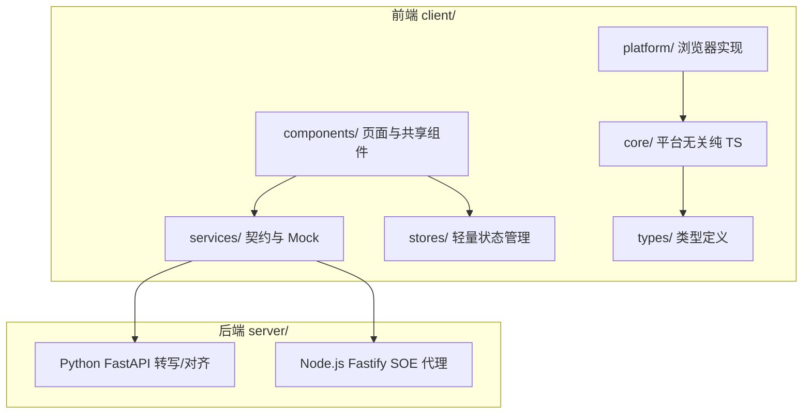
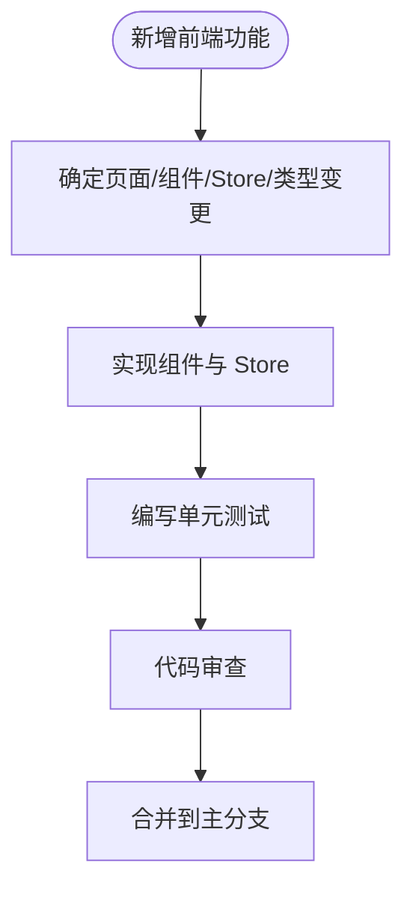
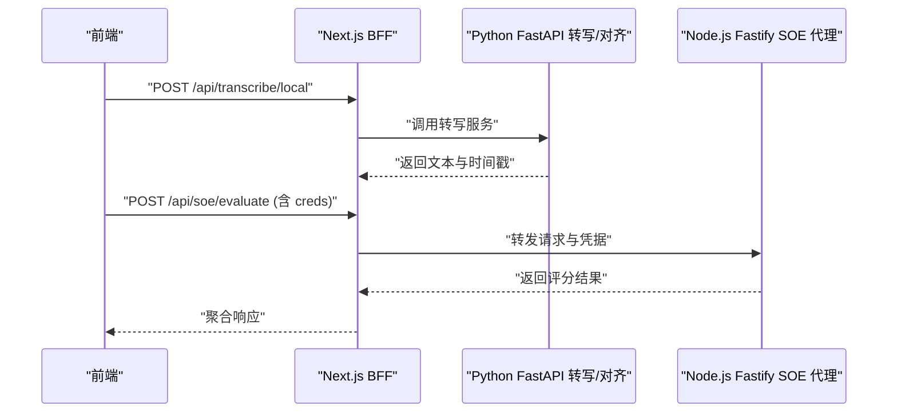
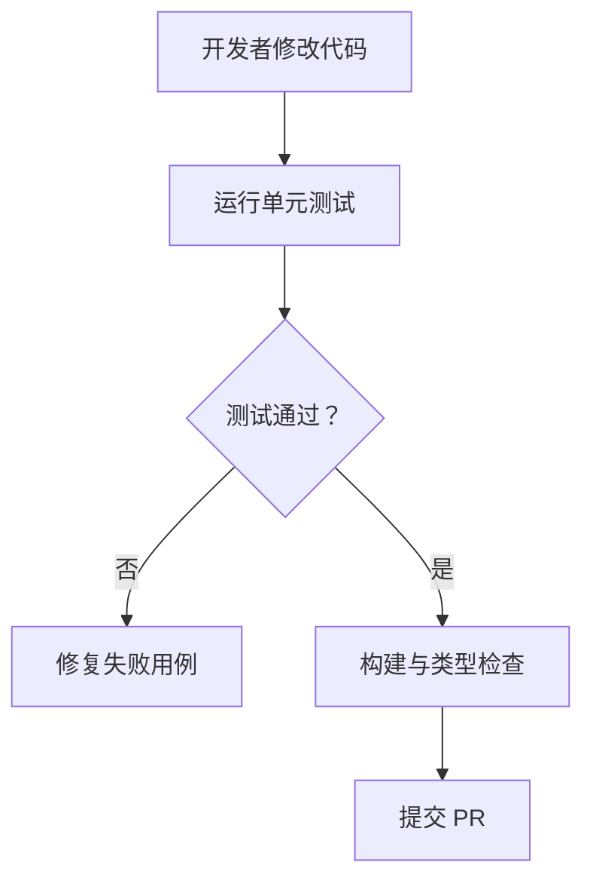
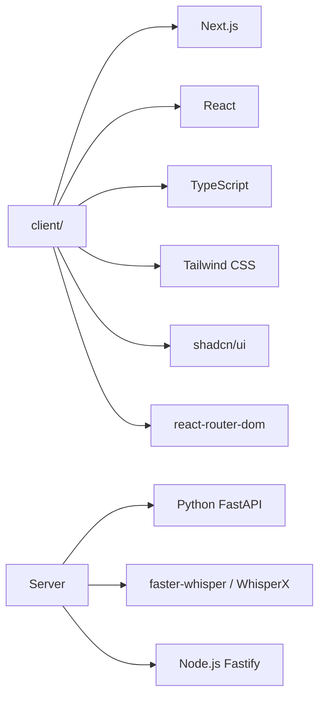
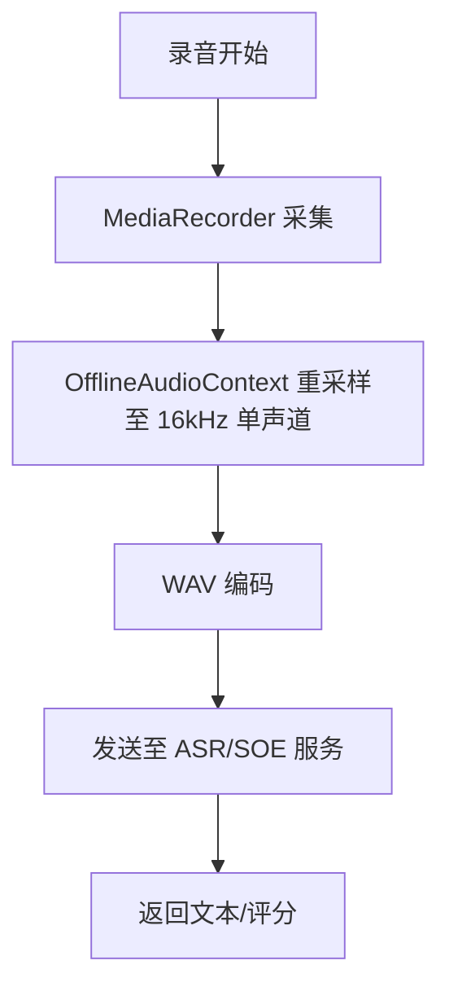
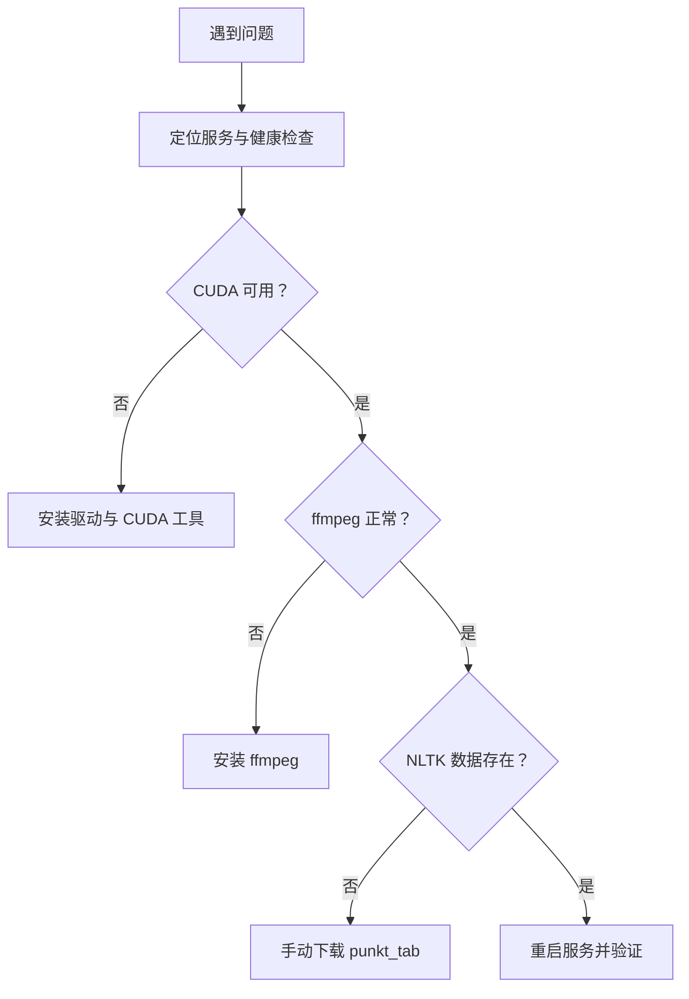

# 贡献指南

<cite>
**本文引用的文件**   
- [README.md](file://README.md)
- [client/README.md](file://client/README.md)
- [server/README.md](file://server/README.md)
- [AGENTS.md](file://AGENTS.md)
- [CLAUDE.md](file://CLAUDE.md)
- [.claude/skills/vercel-optimize/CONTRIBUTING.md](file://.claude/skills/vercel-optimize/CONTRIBUTING.md)
</cite>

## 目录
1. [引言](#引言)
2. [项目结构](#项目结构)
3. [核心贡献流程](#核心贡献流程)
4. [架构总览](#架构总览)
5. [详细组件与模块贡献要点](#详细组件与模块贡献要点)
6. [依赖关系分析](#依赖关系分析)
7. [性能与可维护性考量](#性能与可维护性考量)
8. [故障排查与常见问题](#故障排查与常见问题)
9. [结论](#结论)
10. [附录：模板与清单](#附录模板与清单)

## 引言
本贡献指南面向希望参与“英语精听助手”项目的开发者，目标是统一 Fork 工作流、分支命名、Pull Request 提交流程、代码审查标准、测试要求、文档更新规范，并覆盖新功能开发、Bug 修复、文档贡献流程，以及社区行为准则、问题报告模板、功能请求格式和法律相关事项（贡献者许可协议、版权声明、致谢方式）。

本项目采用本地优先的 SPA 架构，前端基于 Next.js + React + TypeScript，后端包含 Python FastAPI 转写/对齐服务与 Node.js SOE 发音评分代理。仓库根目录提供顶层 README，`client/` 与 `server/` 分别维护各自的技术栈说明；`AGENTS.md` 与 `CLAUDE.md` 描述命令、架构约定与注意事项；`.claude/skills/vercel-optimize/CONTRIBUTING.md` 提供了小型技能包的贡献示例，可作为 PR 粒度、测试与文档校验的参考风格。

**章节来源**
- [README.md:1-200](file://README.md#L1-L200)
- [client/README.md:1-231](file://client/README.md#L1-L231)
- [server/README.md:1-368](file://server/README.md#L1-L368)
- [AGENTS.md:1-128](file://AGENTS.md#L1-L128)
- [CLAUDE.md:1-80](file://CLAUDE.md#L1-L80)
- [.claude/skills/vercel-optimize/CONTRIBUTING.md:1-42](file://.claude/skills/vercel-optimize/CONTRIBUTING.md#L1-L42)

## 项目结构
仓库采用多包结构：
- `client/`：Next.js SPA 前端，包含页面、共享组件、UI 基础组件、平台适配层、AI 服务契约与 Mock、状态管理、类型定义等。
- `server/`：Python FastAPI 转写/对齐服务，以及 Node.js Fastify SOE 发音评分代理。
- `page-prototype/`：独立原型沙箱，用于设计迭代，不纳入主工程测试链。
- `docs/`：中文设计文档（技术选型、架构、原型等）。
- 根目录：项目级 README、AGENTS.md、CLAUDE.md 等协作与约定文件。

**图示来源**
- [README.md:23-57](file://README.md#L23-L57)
- [client/README.md:21-96](file://client/README.md#L21-L96)
- [server/README.md:1-33](file://server/README.md#L1-L33)

**章节来源**
- [README.md:23-57](file://README.md#L23-L57)
- [client/README.md:21-96](file://client/README.md#L21-L96)
- [server/README.md:1-33](file://server/README.md#L1-L33)

## 核心贡献流程
本节定义从 Fork 到合并的完整流程，包括分支命名、PR 提交、审查与合并策略。

### Fork 与克隆
- 在 GitHub 上 Fork 本仓库到你的个人账号。
- 克隆你的 Fork 到本地：
  - 前端开发在 `client/` 下执行安装与运行命令。
  - 后端服务在 `server/` 下执行 Python 或 Node.js 命令。

### 分支命名规范
建议遵循以下模式：
- 新功能：`feature/<简短描述>`，例如 `feature/add-dictation-mode`
- Bug 修复：`fix/<简短描述>`，例如 `fix/correct-subtitle-offset`
- 文档改进：`docs/<简短描述>`，例如 `docs/update-soe-setup`
- 重构：`refactor/<简短描述>`，例如 `refactor/subtitle-parser`
- 实验/探索：`experiment/<简短描述>`，例如 `experiment/new-tts-provider`

分支命名应简洁明确，避免过长路径名，便于 CI 日志与变更追踪。

### Pull Request 提交流程
- 创建分支后，提交小而集中的变更，每个 PR 聚焦一个目标（新增功能、修复 Bug、优化性能、更新文档）。
- PR 标题应清晰表达变更目的，正文包含：
  - 变更背景与动机
  - 主要改动点
  - 测试覆盖情况
  - 影响范围（前端/后端/文档）
  - 需要关注的风险与回滚方案
- 确保本地通过测试与构建后再提交 PR。

### 代码审查标准
- 可读性与职责单一：函数 < 50 行，文件 < 800 行，不可变模式。
- 无外部 lint/format 配置时，保持现有风格一致。
- 接口契约优先：新增或修改 API 需同步更新契约与类型定义。
- 安全与隐私：密钥不进浏览器，BFF 转发时使用 per-request creds 字段。
- 可测试性：为核心逻辑补充单元测试，Mock 与真实实现分离。

### 合并策略
- 所有检查通过后由维护者合并。
- 合并前确认测试通过、文档更新、变更日志（如有）已更新。
- 对高风险变更进行额外审查与灰度发布计划。

**章节来源**
- [README.md:183-191](file://README.md#L183-L191)
- [client/README.md:218-225](file://client/README.md#L218-L225)
- [AGENTS.md:102-113](file://AGENTS.md#L102-L113)
- [CLAUDE.md:34-35](file://CLAUDE.md#L34-L35)
- [.claude/skills/vercel-optimize/CONTRIBUTING.md:31-42](file://.claude/skills/vercel-optimize/CONTRIBUTING.md#L31-L42)

## 架构总览
系统采用六层架构：Core → Platform → Services → Stores → Components → Types。前端为 SPA，后端为无状态服务，用户数据本地优先存储在 IndexedDB。

**图示来源**
- [README.md:102-118](file://README.md#L102-L118)
- [client/README.md:126-166](file://client/README.md#L126-L166)
- [server/README.md:1-33](file://server/README.md#L1-L33)

**章节来源**
- [README.md:102-118](file://README.md#L102-L118)
- [client/README.md:126-166](file://client/README.md#L126-L166)
- [server/README.md:1-33](file://server/README.md#L1-L33)

## 详细组件与模块贡献要点

### 前端（client/）
- 页面路由集中在 `components/study-app.tsx`，新增页面需在路由表注册。
- 状态管理使用自研 `createStore` + `useSyncExternalStore`，避免引入外部状态库。
- 样式使用 Tailwind CSS 4 + shadcn/ui，组件命名 PascalCase，文件名 kebab-case。
- 测试位于 `__tests__/` 目录，仅 core/ 与 services/mock/ 的单元测试。

**图示来源**
- [client/README.md:21-96](file://client/README.md#L21-L96)
- [client/README.md:167-184](file://client/README.md#L167-L184)
- [client/README.md:218-225](file://client/README.md#L218-L225)

**章节来源**
- [client/README.md:21-96](file://client/README.md#L21-L96)
- [client/README.md:167-184](file://client/README.md#L167-L184)
- [client/README.md:218-225](file://client/README.md#L218-L225)

### 后端（server/）
- Python FastAPI 服务提供转写与对齐能力，Node.js Fastify 提供 SOE 发音评分代理。
- 环境变量与凭据通过 BFF 转发，SOE 代理支持 per-request creds。
- 健康检查 `/health` 与 `/healthz` 用于服务探活。

**图示来源**
- [server/README.md:252-274](file://server/README.md#L252-L274)
- [server/README.md:343-368](file://server/README.md#L343-L368)
- [AGENTS.md:85-92](file://AGENTS.md#L85-L92)

**章节来源**
- [server/README.md:1-33](file://server/README.md#L1-L33)
- [server/README.md:252-274](file://server/README.md#L252-L274)
- [server/README.md:343-368](file://server/README.md#L343-L368)
- [AGENTS.md:85-92](file://AGENTS.md#L85-L92)

### 测试与质量保障
- 前端测试：Vitest 4.x，node 环境，仅 core/ 与 services/mock/。
- 后端测试：Python 与 Node.js 单测分别在各自目录下运行。
- 输出契约：JSON 输出需稳定键序、排序与缩进，变更 schema 时需同步更新 fixture 测试。

**图示来源**
- [README.md:183-191](file://README.md#L183-L191)
- [client/README.md:120-124](file://client/README.md#L120-L124)
- [.claude/skills/vercel-optimize/CONTRIBUTING.md:39-42](file://.claude/skills/vercel-optimize/CONTRIBUTING.md#L39-L42)

**章节来源**
- [README.md:183-191](file://README.md#L183-L191)
- [client/README.md:120-124](file://client/README.md#L120-L124)
- [.claude/skills/vercel-optimize/CONTRIBUTING.md:39-42](file://.claude/skills/vercel-optimize/CONTRIBUTING.md#L39-L42)

## 依赖关系分析
- 前端依赖 Next.js、React、TypeScript、Tailwind CSS、shadcn/ui、Lucide、react-router-dom。
- 后端依赖 Python FastAPI、faster-whisper、WhisperX；Node.js Fastify 作为 SOE 代理。
- 包管理统一使用 pnpm，lockfile 位于 `client/pnpm-lock.yaml`。

**图示来源**
- [README.md:5-22](file://README.md#L5-L22)
- [client/README.md:5-20](file://client/README.md#L5-L20)
- [server/README.md:1-33](file://server/README.md#L1-L33)

**章节来源**
- [README.md:5-22](file://README.md#L5-L22)
- [client/README.md:5-20](file://client/README.md#L5-L20)
- [server/README.md:1-33](file://server/README.md#L1-L33)

## 性能与可维护性考量
- 录音链路：getUserMedia → MediaRecorder → OfflineAudioContext（16kHz mono）→ WAV Blob，专为 ASR/SOE 兼容性设计。
- 播放器 Seek 校准：seek 后静默旧进度，等待原生 timeupdate 到达实际落点（SEEK_DRIFT_THRESHOLD_MS = 300ms）。
- 字幕解析器：零依赖纯 TS，支持行号容错报错与句级时间轴对齐。
- 本地优先：用户数据存储在 IndexedDB，后端无状态无数据库。

**图示来源**
- [README.md:123-126](file://README.md#L123-L126)
- [client/README.md:144-166](file://client/README.md#L144-L166)

**章节来源**
- [README.md:123-126](file://README.md#L123-L126)
- [client/README.md:144-166](file://client/README.md#L144-L166)

## 故障排查与常见问题
- 首次请求慢：模型按需加载，可使用 `--preload` 预加载。
- CUDA 不可用：检查驱动与 PyTorch CUDA 支持。
- ffmpeg 错误：安装对应系统的 ffmpeg。
- NLTK 数据下载失败：手动下载 punkt_tab。
- 端口被占用：查看占用进程或使用其他端口启动服务。

**图示来源**
- [server/README.md:275-327](file://server/README.md#L275-L327)

**章节来源**
- [server/README.md:275-327](file://server/README.md#L275-L327)

## 结论
本贡献指南明确了 Fork 工作流、分支命名、PR 提交流程、代码审查标准、测试要求与文档更新规范，覆盖了新功能开发、Bug 修复与文档贡献流程。结合本地优先架构与服务契约模式，建议在每次变更中保持小步快跑、测试先行、契约优先，并确保文档与代码同步更新。

[本节为总结性内容，不直接分析具体文件]

## 附录：模板与清单

### 社区行为准则
- 尊重他人，理性讨论，避免人身攻击与歧视。
- 提出建设性反馈，关注问题本质而非个人。
- 遵守开源许可证与法律合规要求。

### 问题报告模板
- 标题：简明扼要描述问题
- 复现步骤：列出详细步骤与环境信息
- 期望行为：说明预期结果
- 实际行为：描述当前异常
- 附加信息：日志、截图、版本信息

### 功能请求格式
- 背景与动机：为什么需要该功能
- 需求描述：功能边界与交互细节
- 技术方案：可能的实现思路与影响范围
- 验收标准：如何判定功能完成

### 法律相关事项
- 贡献者许可协议：贡献代码即表示同意项目许可证条款。
- 版权声明：保留原有版权信息与许可证声明。
- 致谢方式：在变更说明中注明贡献者与关键帮助者。

[本节为通用模板与指导，不直接分析具体文件]