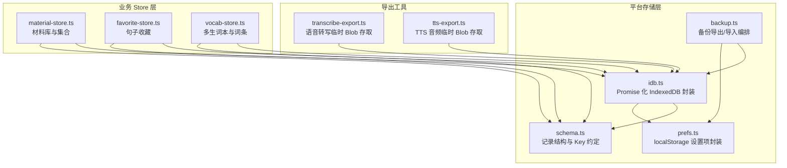
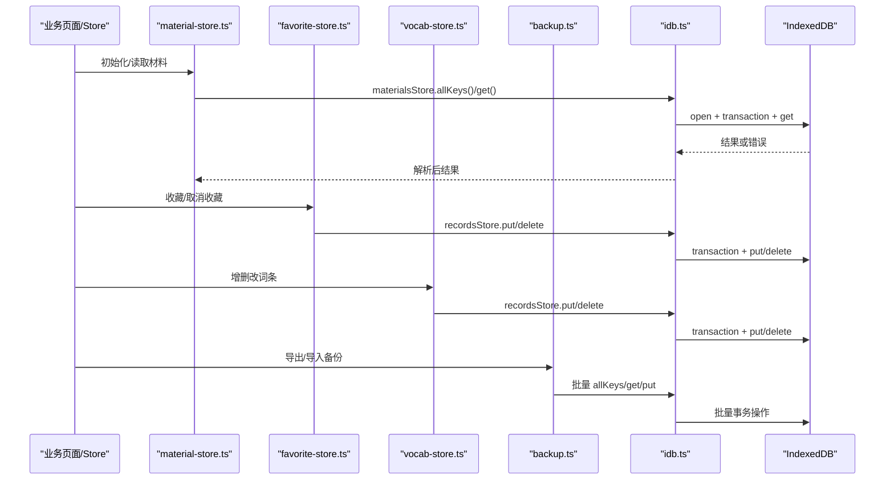
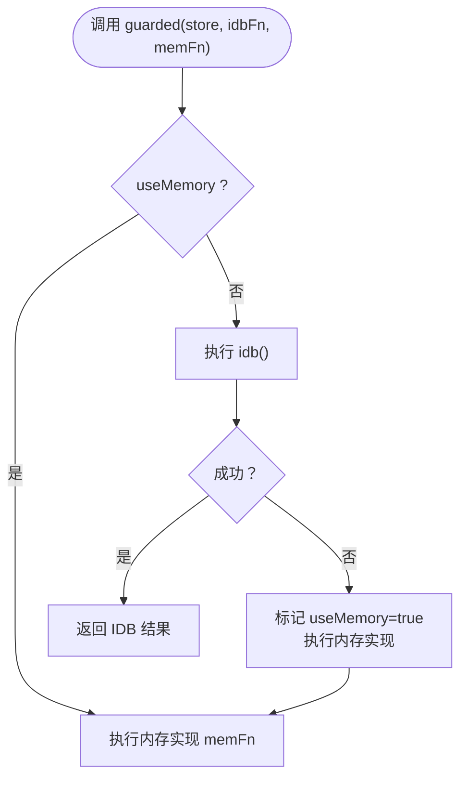
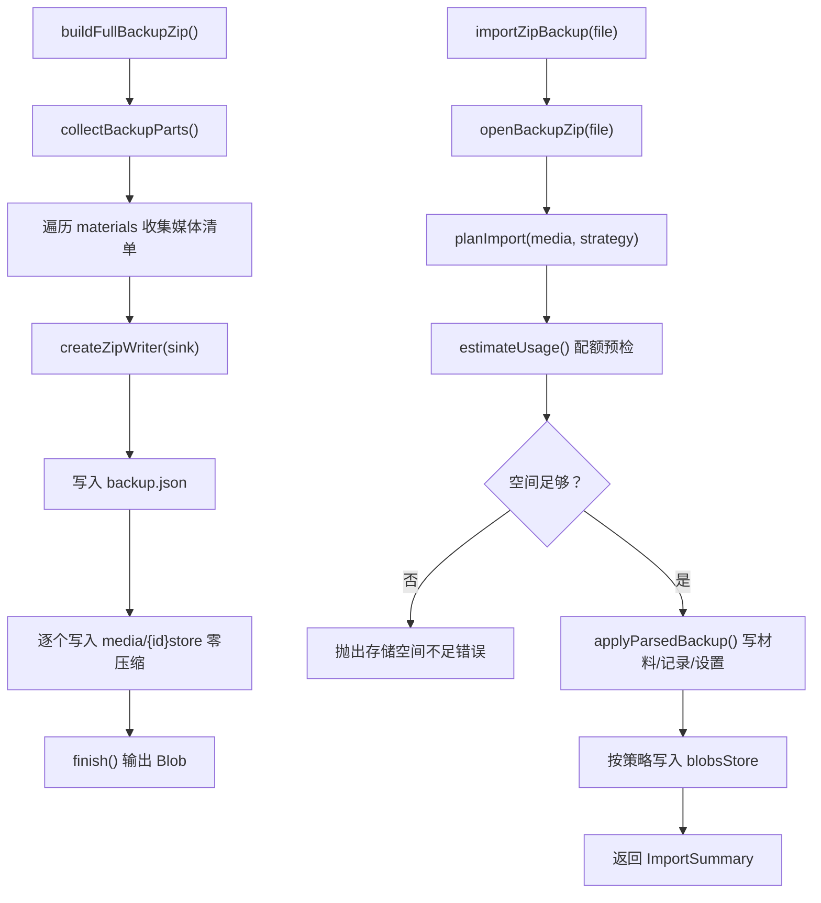
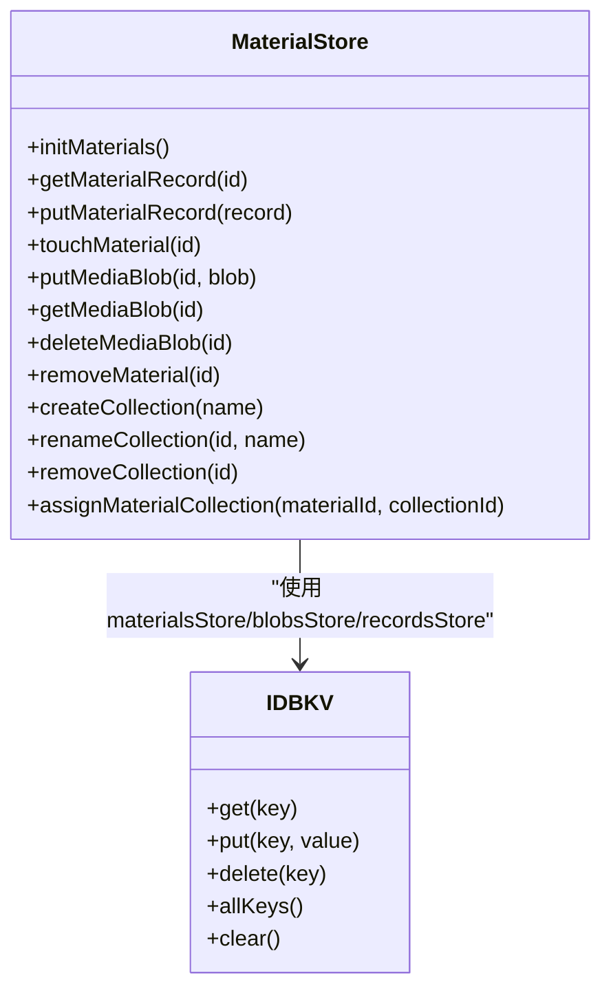
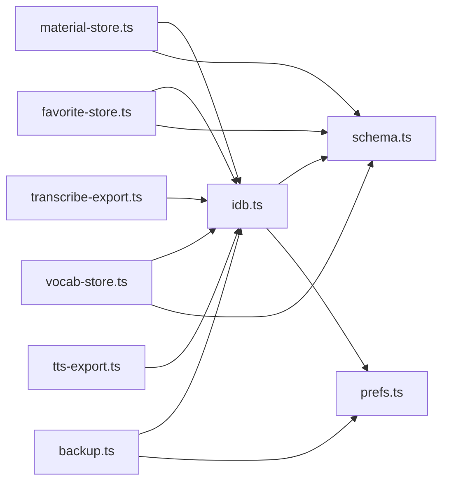

# IndexedDB 封装层

<cite>
**本文引用的文件**   
- [client/platform/storage/idb.ts](file://client/platform/storage/idb.ts)
- [client/platform/storage/schema.ts](file://client/platform/storage/schema.ts)
- [client/platform/storage/backup.ts](file://client/platform/storage/backup.ts)
- [client/platform/storage/prefs.ts](file://client/platform/storage/prefs.ts)
- [client/stores/material-store.ts](file://client/stores/material-store.ts)
- [client/stores/favorite-store.ts](file://client/stores/favorite-store.ts)
- [client/stores/vocab-store.ts](file://client/stores/vocab-store.ts)
- [client/lib/transcribe-export.ts](file://client/lib/transcribe-export.ts)
- [client/lib/tts-export.ts](file://client/lib/tts-export.ts)
</cite>

## 目录
1. [引言](#引言)
2. [项目结构](#项目结构)
3. [核心组件](#核心组件)
4. [架构总览](#架构总览)
5. [详细组件分析](#详细组件分析)
6. [依赖关系分析](#依赖关系分析)
7. [性能与容量规划](#性能与容量规划)
8. [调试、监控与排错指南](#调试监控与排错指南)
9. [结论](#结论)
10. [附录：使用示例与最佳实践](#附录使用示例与最佳实践)

## 引言
本技术文档围绕 IndexedDB 封装层展开，目标是帮助开发者理解并正确使用 Promise 化的本地持久化能力。该封装层在零新增运行时依赖的前提下，提供数据库连接管理、事务封装、错误降级、备份导入导出、以及面向业务的数据 Store（材料库、收藏、生词本等）。它同时兼顾 SSR 与隐私模式下的优雅降级，确保调用方不会因底层存储不可用而崩溃。

## 项目结构
IndexedDB 相关代码集中在 client/platform/storage 目录下，配合 stores 层的领域 Store 与 lib 层的导出工具共同构成完整的本地数据通路。

图表来源
- [client/platform/storage/idb.ts:1-117](file://client/platform/storage/idb.ts#L1-L117)
- [client/platform/storage/schema.ts:1-27](file://client/platform/storage/schema.ts#L1-L27)
- [client/platform/storage/backup.ts:1-243](file://client/platform/storage/backup.ts#L1-L243)
- [client/platform/storage/prefs.ts:1-52](file://client/platform/storage/prefs.ts#L1-L52)
- [client/stores/material-store.ts:1-163](file://client/stores/material-store.ts#L1-L163)
- [client/stores/favorite-store.ts:1-42](file://client/stores/favorite-store.ts#L1-L42)
- [client/stores/vocab-store.ts:1-193](file://client/stores/vocab-store.ts#L1-L193)
- [client/lib/transcribe-export.ts:1-70](file://client/lib/transcribe-export.ts#L1-L70)
- [client/lib/tts-export.ts:1-70](file://client/lib/tts-export.ts#L1-L70)

章节来源
- [client/platform/storage/idb.ts:1-117](file://client/platform/storage/idb.ts#L1-L117)
- [client/platform/storage/schema.ts:1-27](file://client/platform/storage/schema.ts#L1-L27)

## 核心组件
- Promise 化 IndexedDB 封装：提供 materials、blobs、records 三个 object store 的统一 KV 接口，包含连接打开、升级、事务封装、内存兜底与磁盘占用估算。
- 存储结构约定：定义 MaterialRecord 与 records 的 key 前缀规范，保证跨模块一致。
- 备份与导入：轻量 JSON 与完整 zip 两种格式，支持冲突策略、配额预检、媒体流式写入与回读。
- 设置项封装：基于 localStorage 的小数据读写，SSR 安全且可参与备份。
- 业务 Store：材料库、收藏、生词本等对上层暴露语义化 API，内部组合底层 KV 接口完成 CRUD 与级联清理。

章节来源
- [client/platform/storage/idb.ts:12-117](file://client/platform/storage/idb.ts#L12-L117)
- [client/platform/storage/schema.ts:9-26](file://client/platform/storage/schema.ts#L9-L26)
- [client/platform/storage/backup.ts:1-243](file://client/platform/storage/backup.ts#L1-L243)
- [client/platform/storage/prefs.ts:1-52](file://client/platform/storage/prefs.ts#L1-L52)
- [client/stores/material-store.ts:1-163](file://client/stores/material-store.ts#L1-L163)
- [client/stores/favorite-store.ts:1-42](file://client/stores/favorite-store.ts#L1-L42)
- [client/stores/vocab-store.ts:1-193](file://client/stores/vocab-store.ts#L1-L193)

## 架构总览
下图展示从业务 Store 到 IndexedDB 的调用链路，以及备份流程如何复用同一套存储抽象。

图表来源
- [client/stores/material-store.ts:40-121](file://client/stores/material-store.ts#L40-L121)
- [client/stores/favorite-store.ts:19-36](file://client/stores/favorite-store.ts#L19-L36)
- [client/stores/vocab-store.ts:22-148](file://client/stores/vocab-store.ts#L22-L148)
- [client/platform/storage/backup.ts:50-170](file://client/platform/storage/backup.ts#L50-L170)
- [client/platform/storage/idb.ts:27-97](file://client/platform/storage/idb.ts#L27-L97)

## 详细组件分析

### Promise 化 IndexedDB 封装（idb.ts）
- 数据库名称与版本：固定数据库名与版本号；首次打开时创建三个 object store。
- 连接管理：单例 Promise 缓存连接；onupgradeneeded 中按需创建 store；onerror/onblocked 触发内存降级。
- 事务封装：tx 函数将 IndexedDB 请求包装为 Promise，统一处理成功与错误回调。
- 降级机制：guarded 在 IDB 失败时永久切换到内存 Map，保证调用方永不崩溃。
- KV 接口：每个 object store 暴露 get/put/delete/allKeys/clear，类型安全且返回 Promise。
- 资源估算：estimateUsage 通过 navigator.storage.estimate 获取已用与配额，异常时返回默认值。
- 状态查询：isMemoryFallback 供 UI 提示当前是否处于内存降级模式。

图表来源
- [client/platform/storage/idb.ts:27-78](file://client/platform/storage/idb.ts#L27-L78)

章节来源
- [client/platform/storage/idb.ts:12-117](file://client/platform/storage/idb.ts#L12-L117)

### 存储结构约定（schema.ts）
- MaterialRecord：材料元数据与解析后的字幕数据合并存储，避免重复解析。
- RECORD_KEYS：统一生成 records store 的 key 前缀，包括进度、收藏、笔记、训练、生词本、词条、记忆法、集合等。

章节来源
- [client/platform/storage/schema.ts:9-26](file://client/platform/storage/schema.ts#L9-L26)

### 备份与导入（backup.ts）
- 轻量备份：materials + records + prefs，不含媒体；文件名带时间戳。
- 完整备份 zip：包含 backup.json 与 media/{materialId} 条目；导出时仅遍历 material ids，跳过 tts:/transcribe: 临时产物。
- 内存有界：zip 写入采用 sink 分片合并，避免 JS 堆峰值过高。
- 导入策略：planImport 根据冲突策略决定写入/跳过；先写材料/记录/设置，再写媒体。
- 配额预检：在写入媒体前估算所需空间，不足则抛出明确错误。
- 预览功能：prepareZipImport 用于确认弹窗，返回解析结果、媒体体积与缺失数。

图表来源
- [client/platform/storage/backup.ts:77-121](file://client/platform/storage/backup.ts#L77-L121)
- [client/platform/storage/backup.ts:138-170](file://client/platform/storage/backup.ts#L138-L170)
- [client/platform/storage/backup.ts:211-241](file://client/platform/storage/backup.ts#L211-L241)

章节来源
- [client/platform/storage/backup.ts:1-243](file://client/platform/storage/backup.ts#L1-L243)

### 设置项封装（prefs.ts）
- 键名前缀：所有设置项以统一前缀存储，便于备份导出。
- SSR 安全：仅在浏览器环境访问 localStorage，否则返回默认值或空对象。
- 容错：JSON 序列化失败或权限拒绝时静默降级，不抛错。
- 备份集成：exportAllPrefs 与 hasPref 参与备份导入冲突判断。

章节来源
- [client/platform/storage/prefs.ts:1-52](file://client/platform/storage/prefs.ts#L1-L52)

### 业务 Store：材料库（material-store.ts）
- 初始化：首次启动注入种子数据，随后加载 materials 与 collection 列表。
- 最近学习排序：按 lastOpenedAt 降序，从未学习按 createdAt 靠后。
- 媒体 Blob：提供 putMediaBlob/getMediaBlob/deleteMediaBlob 直接操作 blobs store。
- 级联删除：删除材料时同步清理 blob 与相关 records（进度、收藏、笔记、训练记录）。
- 集合管理：CRUD 集合，成员关系通过 material.collectionId 维护，删除集合仅解除归属。

图表来源
- [client/stores/material-store.ts:40-163](file://client/stores/material-store.ts#L40-L163)
- [client/platform/storage/idb.ts:89-102](file://client/platform/storage/idb.ts#L89-L102)

章节来源
- [client/stores/material-store.ts:1-163](file://client/stores/material-store.ts#L1-L163)

### 业务 Store：收藏（favorite-store.ts）
- 前缀过滤：通过 recordsStore.allKeys 筛选 fav: 前缀，支持按 materialId 过滤。
- 幂等收藏：重复收藏不刷新时间戳；取消收藏即删除对应 key。
- 句序号提取：返回升序句序号，用于训练范围过滤。

章节来源
- [client/stores/favorite-store.ts:1-42](file://client/stores/favorite-store.ts#L1-L42)

### 业务 Store：生词本（vocab-store.ts）
- 默认生词本：首次初始化自动创建默认书。
- 书籍 CRUD：创建、重命名、删除（禁止删除默认书），删除书时级联删除词条。
- 词条 CRUD：添加、删除、更新备注；批量清空某书词条。
- 频率统计：updateFrequencies 扫描字幕单词，累加词条 frequency，批量写回。

章节来源
- [client/stores/vocab-store.ts:1-193](file://client/stores/vocab-store.ts#L1-L193)

### 导出工具：语音转写与 TTS（transcribe-export.ts / tts-export.ts）
- 临时 Blob 存取：使用 blobsStore 暂存转写与 TTS 生成的音频，任务完成后删除。
- 键名约定：transcribe-export.ts 与 tts-export.ts 分别定义各自的任务键前缀。

章节来源
- [client/lib/transcribe-export.ts:1-70](file://client/lib/transcribe-export.ts#L1-L70)
- [client/lib/tts-export.ts:1-70](file://client/lib/tts-export.ts#L1-L70)

## 依赖关系分析
- 低耦合：业务 Store 仅依赖 idb.ts 暴露的 KV 接口与 schema.ts 的 key 约定，不直接操作 IndexedDB。
- 高内聚：备份逻辑集中处理 materials/records/blobs/prefs 的读写与冲突策略，复用同一存储抽象。
- 外部依赖：navigator.storage.estimate 用于配额估算；localStorage 用于设置项。
- 无循环依赖：idb.ts 不反向依赖业务 Store；stores 层单向依赖 platform 层。

图表来源
- [client/platform/storage/idb.ts:1-117](file://client/platform/storage/idb.ts#L1-L117)
- [client/platform/storage/schema.ts:1-27](file://client/platform/storage/schema.ts#L1-L27)
- [client/platform/storage/backup.ts:1-243](file://client/platform/storage/backup.ts#L1-L243)
- [client/platform/storage/prefs.ts:1-52](file://client/platform/storage/prefs.ts#L1-L52)
- [client/stores/material-store.ts:1-163](file://client/stores/material-store.ts#L1-L163)
- [client/stores/favorite-store.ts:1-42](file://client/stores/favorite-store.ts#L1-L42)
- [client/stores/vocab-store.ts:1-193](file://client/stores/vocab-store.ts#L1-L193)
- [client/lib/transcribe-export.ts:1-70](file://client/lib/transcribe-export.ts#L1-L70)
- [client/lib/tts-export.ts:1-70](file://client/lib/tts-export.ts#L1-L70)

章节来源
- [client/platform/storage/idb.ts:1-117](file://client/platform/storage/idb.ts#L1-L117)
- [client/platform/storage/backup.ts:1-243](file://client/platform/storage/backup.ts#L1-L243)

## 性能与容量规划
- 连接复用：dbPromise 缓存连接，避免重复打开开销。
- 批量优化：备份导出/导入使用 Promise.all 并行读取与写入，减少往返次数。
- 内存控制：完整备份 zip 写入采用分片合并，限制 JS 堆峰值；媒体条目一次仅一个进入内存。
- 配额预检：导入前估算所需空间，避免写入中途失败导致数据不一致。
- 降级策略：IDB 不可用时切换内存 Map，保障可用性但需注意非持久化。

[本节为通用指导，不涉及具体文件分析]

## 调试、监控与排错指南
- 查看降级状态：调用 isMemoryFallback() 判断是否处于内存降级模式；UI 可据此提示用户。
- 日志定位：IDB 打开失败、事务错误会输出控制台日志，便于快速定位问题。
- 配额检查：使用 estimateUsage() 获取 usage/quota，结合 importZipBackup 的错误信息排查空间不足。
- 常见错误
  - onblocked：其他标签页持有旧连接导致阻塞，建议关闭旧标签页或等待连接释放。
  - 隐私模式：Safari 私有模式下可能无法写入，自动降级为内存。
  - 存储空间不足：完整备份导入前进行配额预检，必要时清理空间或改用轻量备份。
  - 媒体缺失：zip 清单中有媒体条目但实际文件缺失，导入后会统计 mediaMissing。

章节来源
- [client/platform/storage/idb.ts:37-48](file://client/platform/storage/idb.ts#L37-L48)
- [client/platform/storage/idb.ts:59-66](file://client/platform/storage/idb.ts#L59-L66)
- [client/platform/storage/idb.ts:104-117](file://client/platform/storage/idb.ts#L104-L117)
- [client/platform/storage/backup.ts:218-223](file://client/platform/storage/backup.ts#L218-L223)

## 结论
该 IndexedDB 封装层以极简方式提供了稳定可靠的本地持久化能力，涵盖连接管理、事务封装、错误降级、备份导入导出与业务 Store 的 CRUD 操作。通过统一的 KV 接口与 key 前缀约定，系统实现了高内聚、低耦合的架构设计，并在性能与容量方面做了充分考量。建议在业务开发中优先使用各 Store 提供的语义化 API，避免直接操作底层 KV，以保证数据一致性与可维护性。

[本节为总结性内容，不涉及具体文件分析]

## 附录：使用示例与最佳实践
- 初始化材料库
  - 调用 initMaterials() 完成种子注入与首次加载。
  - 参考路径：[client/stores/material-store.ts:61-73](file://client/stores/material-store.ts#L61-L73)

- 读取与更新材料
  - 使用 getMaterialRecord(id) 读取材料记录。
  - 使用 putMaterialRecord(record) 覆盖写入并刷新列表。
  - 参考路径：[client/stores/material-store.ts:75-85](file://client/stores/material-store.ts#L75-L85)

- 收藏与取消收藏
  - 使用 setFavorite(materialId, sentenceIndex, favorited) 进行幂等操作。
  - 参考路径：[client/stores/favorite-store.ts:26-36](file://client/stores/favorite-store.ts#L26-L36)

- 生词本词条增删改
  - 使用 addEntry/updateEntry/removeEntry 管理词条。
  - 使用 updateFrequencies(words) 批量更新词条频率。
  - 参考路径：[client/stores/vocab-store.ts:103-193](file://client/stores/vocab-store.ts#L103-L193)

- 备份导出与导入
  - 轻量备份：buildBackup() 生成 JSON 文件。
  - 完整备份：buildFullBackupZip() 生成 zip 文件。
  - 导入：importBackup(json, strategy) 或 importZipBackup(file, strategy)。
  - 参考路径：[client/platform/storage/backup.ts:61-121](file://client/platform/storage/backup.ts#L61-L121), [client/platform/storage/backup.ts:176-180](file://client/platform/storage/backup.ts#L176-L180), [client/platform/storage/backup.ts:211-241](file://client/platform/storage/backup.ts#L211-L241)

- 临时媒体存取
  - 转写与 TTS 音频通过 blobsStore 存取，任务完成后及时删除。
  - 参考路径：[client/lib/transcribe-export.ts:42-66](file://client/lib/transcribe-export.ts#L42-L66), [client/lib/tts-export.ts:38-62](file://client/lib/tts-export.ts#L38-L62)

- 最佳实践
  - 始终通过 Store 提供的 API 进行数据操作，避免绕过事务与级联清理。
  - 在导入前调用 estimateUsage() 进行配额预检，避免写入失败。
  - 注意区分临时媒体（tts:/transcribe:）与持久媒体（material id），备份逻辑会自动排除临时媒体。
  - 在 SSR 环境下谨慎访问浏览器 API，确保仅在异步回调中使用 IndexedDB 与 localStorage。

[本节为使用示例与最佳实践，引用了具体文件路径但不包含代码片段]