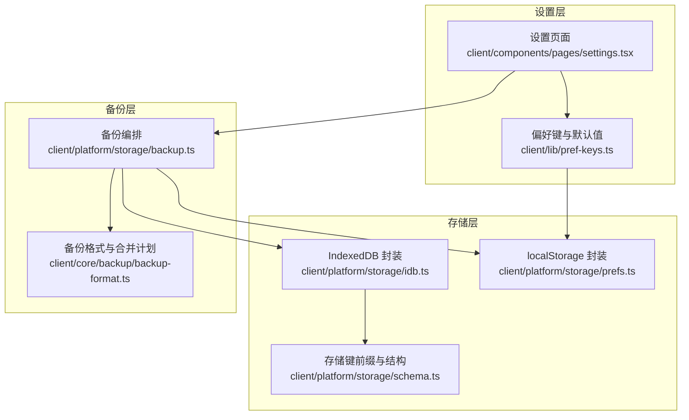
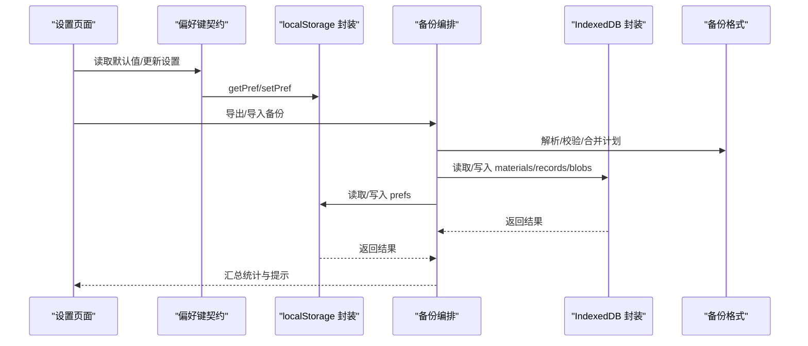
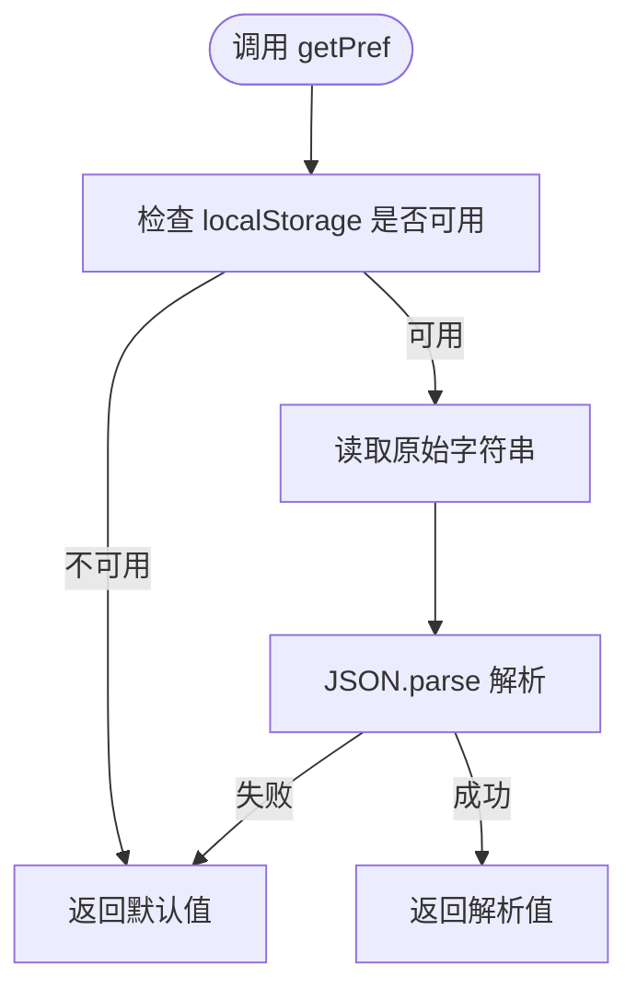
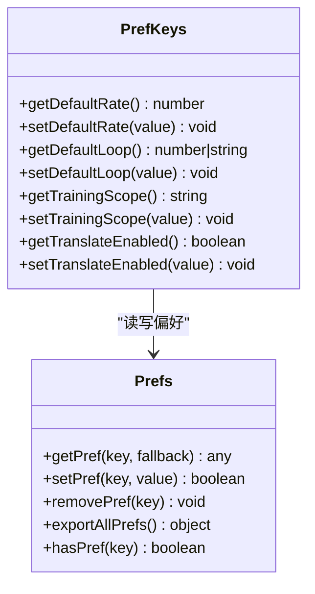
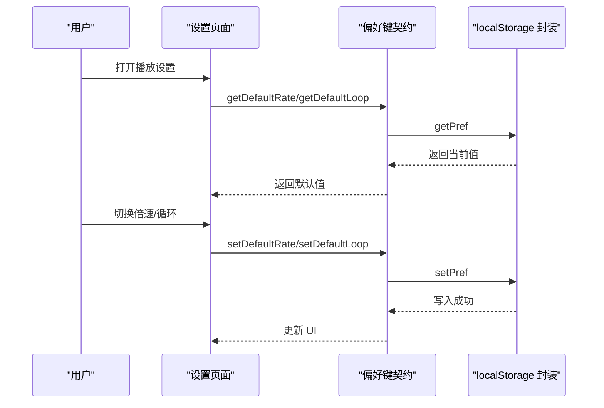
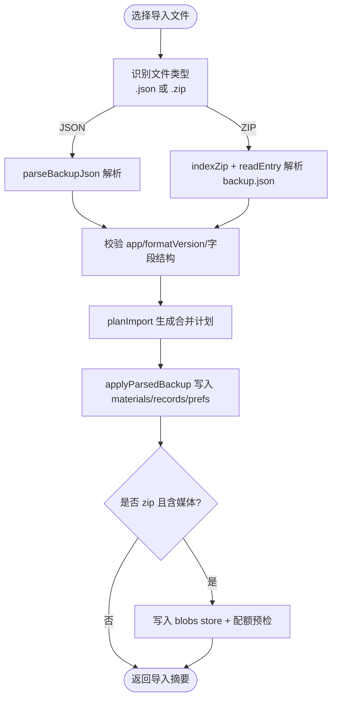
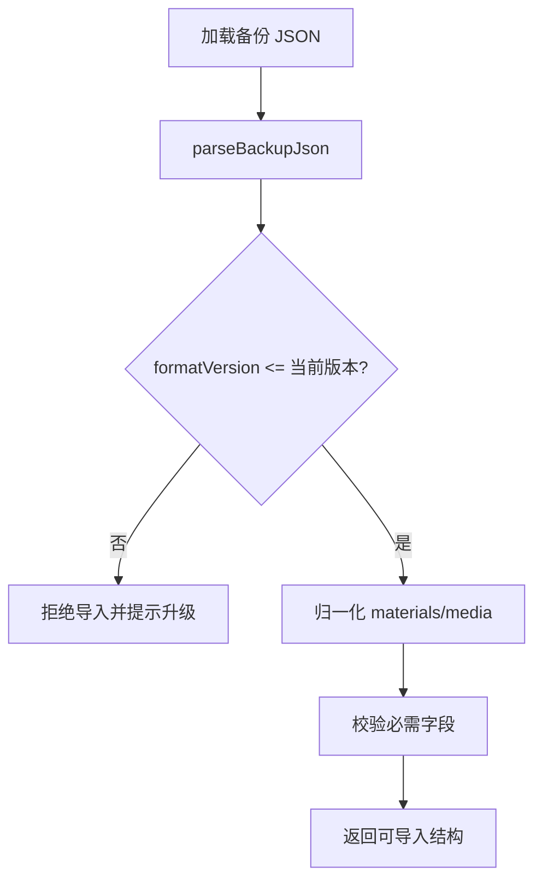
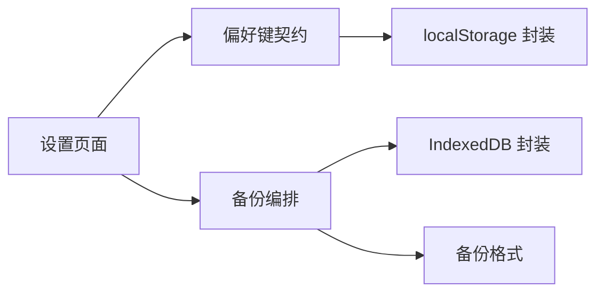

# 偏好设置存储

<cite>
**本文引用的文件**   
- [client/platform/storage/prefs.ts](file://client/platform/storage/prefs.ts)
- [client/lib/pref-keys.ts](file://client/lib/pref-keys.ts)
- [client/components/pages/settings.tsx](file://client/components/pages/settings.tsx)
- [client/platform/storage/idb.ts](file://client/platform/storage/idb.ts)
- [client/platform/storage/schema.ts](file://client/platform/storage/schema.ts)
- [client/platform/storage/backup.ts](file://client/platform/storage/backup.ts)
- [client/core/backup/backup-format.ts](file://client/core/backup/backup-format.ts)
</cite>

## 目录
1. [引言](#引言)
2. [项目结构](#项目结构)
3. [核心组件](#核心组件)
4. [架构总览](#架构总览)
5. [详细组件分析](#详细组件分析)
6. [依赖关系分析](#依赖关系分析)
7. [性能与容量特性](#性能与容量特性)
8. [故障排查指南](#故障排查指南)
9. [结论](#结论)
10. [附录：配置项清单与约定](#附录配置项清单与约定)

## 引言
本文件面向偏好设置存储系统，聚焦 localStorage 在应用中的使用方式、用户配置项的设计与管理、配置的序列化与反序列化、版本兼容、默认值与校验、导入导出备份恢复、运行时热重载以及历史数据迁移策略。该子系统位于客户端侧，负责将小体积、高频访问的用户偏好持久化到浏览器环境，并与 IndexedDB 中较大的材料、媒体与训练记录解耦。

## 项目结构
偏好设置相关代码主要分布在以下位置：
- 底层存储封装：`client/platform/storage/prefs.ts`
- 键名与默认值契约：`client/lib/pref-keys.ts`
- 设置页 UI 与备份入口：`client/components/pages/settings.tsx`
- 大对象存储（IndexedDB）与备份编排：`client/platform/storage/idb.ts`、`client/platform/storage/backup.ts`
- 备份格式与合并计划：`client/core/backup/backup-format.ts`
- 存储键前缀与记录结构约定：`client/platform/storage/schema.ts`

**图表来源**
- [client/components/pages/settings.tsx:1-593](file://client/components/pages/settings.tsx#L1-L593)
- [client/lib/pref-keys.ts:1-41](file://client/lib/pref-keys.ts#L1-L41)
- [client/platform/storage/prefs.ts:1-52](file://client/platform/storage/prefs.ts#L1-L52)
- [client/platform/storage/idb.ts:1-117](file://client/platform/storage/idb.ts#L1-L117)
- [client/platform/storage/schema.ts:1-27](file://client/platform/storage/schema.ts#L1-L27)
- [client/platform/storage/backup.ts:1-243](file://client/platform/storage/backup.ts#L1-L243)
- [client/core/backup/backup-format.ts:1-127](file://client/core/backup/backup-format.ts#L1-L127)

**章节来源**
- [client/platform/storage/prefs.ts:1-52](file://client/platform/storage/prefs.ts#L1-L52)
- [client/lib/pref-keys.ts:1-41](file://client/lib/pref-keys.ts#L1-L41)
- [client/components/pages/settings.tsx:1-593](file://client/components/pages/settings.tsx#L1-L593)
- [client/platform/storage/idb.ts:1-117](file://client/platform/storage/idb.ts#L1-L117)
- [client/platform/storage/schema.ts:1-27](file://client/platform/storage/schema.ts#L1-L27)
- [client/platform/storage/backup.ts:1-243](file://client/platform/storage/backup.ts#L1-L243)
- [client/core/backup/backup-format.ts:1-127](file://client/core/backup/backup-format.ts#L1-L127)

## 核心组件
- 偏好存储封装：提供 SSR 安全的 `getPref`、`setPref`、`removePref`、`exportAllPrefs`、`hasPref`，统一以 `ping-english:` 为前缀写入 localStorage，并对 JSON 解析失败或隐私模式不可写进行静默降级。
- 偏好键契约：集中定义播放器与训练相关的偏好键、取值类型、默认值与校验逻辑，如播放倍速、单句循环次数、训练范围、翻译开关等。
- 设置页 UI：聚合学习统计、播放/训练设置、模型配置、本地服务、存储管理；通过调用偏好键 API 实现运行时读写，并提供备份与导入流程。
- 备份编排：协调轻量 JSON 与完整 zip 两种备份格式的导出与导入，处理 materials、records、prefs 的合并策略与媒体清单。
- 备份格式：定义备份 JSON 结构、版本号、校验规则、冲突策略与合并计划。
- IndexedDB 封装：为大体积材料、媒体与训练记录提供 Promise 化 KV 接口，并在 SSR/隐私模式下回退内存 Map。
- 存储键约定：定义 records store 的 key 前缀，如进度、收藏、笔记、训练、生词本等。

**章节来源**
- [client/platform/storage/prefs.ts:1-52](file://client/platform/storage/prefs.ts#L1-L52)
- [client/lib/pref-keys.ts:1-41](file://client/lib/pref-keys.ts#L1-L41)
- [client/components/pages/settings.tsx:1-593](file://client/components/pages/settings.tsx#L1-L593)
- [client/platform/storage/backup.ts:1-243](file://client/platform/storage/backup.ts#L1-L243)
- [client/core/backup/backup-format.ts:1-127](file://client/core/backup/backup-format.ts#L1-L127)
- [client/platform/storage/idb.ts:1-117](file://client/platform/storage/idb.ts#L1-L117)
- [client/platform/storage/schema.ts:1-27](file://client/platform/storage/schema.ts#L1-L27)

## 架构总览
偏好设置存储采用“小数据走 localStorage、大数据走 IndexedDB”的分层设计：
- 小数据（偏好设置）：通过 `prefs.ts` 直接操作 localStorage，具备 SSR 安全与静默降级能力。
- 大数据（材料、媒体、训练记录）：通过 `idb.ts` 封装 IndexedDB，提供 Promise 化 KV 接口，并在不可用时回退内存 Map。
- 备份与迁移：`backup.ts` 协调 `prefs.ts` 与 `idb.ts`，结合 `backup-format.ts` 的格式校验与合并计划，完成跨设备的数据迁移。

**图表来源**
- [client/components/pages/settings.tsx:230-446](file://client/components/pages/settings.tsx#L230-L446)
- [client/lib/pref-keys.ts:1-41](file://client/lib/pref-keys.ts#L1-L41)
- [client/platform/storage/prefs.ts:1-52](file://client/platform/storage/prefs.ts#L1-L52)
- [client/platform/storage/backup.ts:50-170](file://client/platform/storage/backup.ts#L50-L170)
- [client/platform/storage/idb.ts:89-102](file://client/platform/storage/idb.ts#L89-L102)
- [client/core/backup/backup-format.ts:45-127](file://client/core/backup/backup-format.ts#L45-L127)

## 详细组件分析

### 偏好存储封装（localStorage）
- 功能要点：
  - 统一前缀 `ping-english:`，避免与其他应用键冲突。
  - `getPref` 在 SSR 环境下返回默认值；JSON 解析失败时静默降级。
  - `setPref` 对不可写场景返回 false，不抛错。
  - `removePref` 清理指定键。
  - `exportAllPrefs` 遍历 localStorage，过滤前缀并解析值，跳过损坏项。
  - `hasPref` 用于导入时的冲突判断。
- 错误处理：
  - 捕获 JSON.parse 异常与 localStorage 不可用异常，保证 UI 不崩溃。
- 性能考量：
  - 仅对小体积配置进行序列化/反序列化，避免阻塞主线程。

**图表来源**
- [client/platform/storage/prefs.ts:8-14](file://client/platform/storage/prefs.ts#L8-L14)

**章节来源**
- [client/platform/storage/prefs.ts:1-52](file://client/platform/storage/prefs.ts#L1-L52)

### 偏好键契约与默认值管理
- 已定义的偏好键与用途：
  - `pref:rate`：默认播放倍速，类型为受限数值枚举，默认值为 1。
  - `pref:loop`：单句循环次数档位，支持关闭、1、3、无限，默认关闭。
  - `pref:trainingScope`：训练范围，支持全部或仅收藏，默认全部。
  - `pref:translateEnabled`：是否启用翻译功能，默认关闭。
- 默认值与校验：
  - 读取时若值不在允许集合内，则回退到默认值。
  - 写入时使用受控类型，避免非法值进入存储。
- 热重载机制：
  - 设置页在用户切换选项后立即调用 setPref，其他模块通过 getDefault* 函数实时读取最新值，实现运行时行为动态更新。

**图表来源**
- [client/lib/pref-keys.ts:1-41](file://client/lib/pref-keys.ts#L1-L41)
- [client/platform/storage/prefs.ts:1-52](file://client/platform/storage/prefs.ts#L1-L52)

**章节来源**
- [client/lib/pref-keys.ts:1-41](file://client/lib/pref-keys.ts#L1-L41)

### 设置页与运行时交互
- 设置页包含多个标签：学习统计、播放设置、模型配置、本地服务、存储管理。
- 播放设置区域：
  - 初始加载时从偏好键读取默认值。
  - 用户点击按钮切换倍速或循环档位，立即写入偏好存储。
- 备份与迁移区域：
  - 导出轻量 JSON 或完整 zip。
  - 导入时根据冲突策略（保留本机 / 覆盖）合并数据。
  - 显示导入摘要并引导刷新页面使新配置生效。

**图表来源**
- [client/components/pages/settings.tsx:95-140](file://client/components/pages/settings.tsx#L95-L140)
- [client/lib/pref-keys.ts:16-26](file://client/lib/pref-keys.ts#L16-L26)
- [client/platform/storage/prefs.ts:16-22](file://client/platform/storage/prefs.ts#L16-L22)

**章节来源**
- [client/components/pages/settings.tsx:1-593](file://client/components/pages/settings.tsx#L1-L593)

### 备份与导入（JSON 与 zip）
- 轻量 JSON 备份：
  - 包含 materials、records、prefs，不含媒体。
  - 文件名带时间戳，便于区分不同备份。
- 完整 zip 备份：
  - 包含 backup.json（同上）与 media/{materialId} 媒体条目。
  - 媒体以 STORE 零压缩方式写入，减少解压开销。
- 导入流程：
  - 自动识别 .json 与 .zip（基于魔数）。
  - 解析 backup.json，校验 app 标识与 formatVersion。
  - 按冲突策略生成合并计划，批量写入 materials、records、prefs。
  - zip 导入额外写入 blobs store，并进行配额预检。

**图表来源**
- [client/platform/storage/backup.ts:138-243](file://client/platform/storage/backup.ts#L138-L243)
- [client/core/backup/backup-format.ts:45-127](file://client/core/backup/backup-format.ts#L45-L127)

**章节来源**
- [client/platform/storage/backup.ts:1-243](file://client/platform/storage/backup.ts#L1-L243)
- [client/core/backup/backup-format.ts:1-127](file://client/core/backup/backup-format.ts#L1-L127)

### 版本兼容与迁移策略
- 备份格式版本：
  - 当前 `BACKUP_FORMAT_VERSION = 1`。
  - 解析器拒绝高于当前版本的备份，提示升级应用。
- 向后兼容：
  - 解析器对缺失可选字段（如 media）容错处理。
  - materials 与 media 清单在解析阶段归一化并剔除无效项。
- 迁移脚本：
  - 当前仓库未提供显式迁移脚本；版本兼容性由解析器与合并计划保障。
  - 如需扩展字段或变更结构，应在解析器中增加版本分支与转换逻辑。

**图表来源**
- [client/core/backup/backup-format.ts:45-112](file://client/core/backup/backup-format.ts#L45-L112)

**章节来源**
- [client/core/backup/backup-format.ts:1-127](file://client/core/backup/backup-format.ts#L1-L127)

### 默认值管理与配置验证
- 默认值来源：
  - 播放器倍速默认 1。
  - 单句循环默认关闭。
  - 训练范围默认全部。
  - 翻译功能默认关闭。
- 验证规则：
  - 读取时若值不在允许集合内，则回退默认值。
  - 写入时使用受控类型，避免非法值污染存储。
- 建议扩展：
  - 新增偏好键时，应同时定义默认值与校验逻辑。
  - 对复杂对象（如主题配置）建议在解析层做结构化校验。

**章节来源**
- [client/lib/pref-keys.ts:1-41](file://client/lib/pref-keys.ts#L1-L41)

### 配置热重载机制
- 机制说明：
  - 设置页在用户操作后即时调用 setPref。
  - 其他模块通过 getDefault* 函数读取最新值，无需重启应用。
- 适用场景：
  - 播放倍速、循环次数、训练范围、翻译开关等运行时可调整的配置。
- 注意事项：
  - 对于需要重新初始化资源（如字幕解析、播放器实例）的配置，应在 UI 层触发相应刷新逻辑。

**章节来源**
- [client/components/pages/settings.tsx:95-140](file://client/components/pages/settings.tsx#L95-L140)
- [client/lib/pref-keys.ts:16-41](file://client/lib/pref-keys.ts#L16-L41)

### 配置分类结构与分组
- 当前已实现的偏好键集中在播放器与训练相关领域：
  - 播放器设置：默认倍速、单句循环次数。
  - 训练参数：训练范围（全部/收藏）、翻译开关。
- 可扩展分组：
  - 界面主题、字体大小、语言包、快捷键映射等可按相同模式新增键与默认值。
  - 建议在 `pref-keys.ts` 中按业务域组织函数与常量，保持可读性与可维护性。

**章节来源**
- [client/lib/pref-keys.ts:1-41](file://client/lib/pref-keys.ts#L1-L41)

## 依赖关系分析
- 组件耦合：
  - 设置页依赖偏好键契约与备份编排。
  - 偏好键契约依赖 localStorage 封装。
  - 备份编排依赖 IndexedDB 封装、localStorage 封装与备份格式。
- 外部依赖：
  - 浏览器 API：localStorage、IndexedDB、navigator.storage.estimate。
  - 无第三方库依赖，降低运行时风险。

**图表来源**
- [client/components/pages/settings.tsx:1-593](file://client/components/pages/settings.tsx#L1-L593)
- [client/lib/pref-keys.ts:1-41](file://client/lib/pref-keys.ts#L1-L41)
- [client/platform/storage/prefs.ts:1-52](file://client/platform/storage/prefs.ts#L1-L52)
- [client/platform/storage/backup.ts:1-243](file://client/platform/storage/backup.ts#L1-L243)
- [client/platform/storage/idb.ts:1-117](file://client/platform/storage/idb.ts#L1-L117)
- [client/core/backup/backup-format.ts:1-127](file://client/core/backup/backup-format.ts#L1-L127)

**章节来源**
- [client/components/pages/settings.tsx:1-593](file://client/components/pages/settings.tsx#L1-L593)
- [client/platform/storage/backup.ts:1-243](file://client/platform/storage/backup.ts#L1-L243)
- [client/platform/storage/idb.ts:1-117](file://client/platform/storage/idb.ts#L1-L117)
- [client/core/backup/backup-format.ts:1-127](file://client/core/backup/backup-format.ts#L1-L127)

## 性能与容量特性
- localStorage：
  - 适合小体积配置，序列化/反序列化开销低。
  - 在隐私模式或不可写环境下静默降级，不影响主流程。
- IndexedDB：
  - 支持大体积材料与媒体存储，Promise 化接口简化异步处理。
  - 在 SSR/隐私模式下回退内存 Map，保证调用方不崩溃。
- 备份导出：
  - 轻量 JSON 快速生成，适合跨设备迁移元数据。
  - 完整 zip 采用流式写入与分片合并，控制 JS 堆峰值。
- 导入预检：
  - zip 导入前估算所需空间，防止配额不足导致写入失败。

**章节来源**
- [client/platform/storage/prefs.ts:1-52](file://client/platform/storage/prefs.ts#L1-L52)
- [client/platform/storage/idb.ts:1-117](file://client/platform/storage/idb.ts#L1-L117)
- [client/platform/storage/backup.ts:73-121](file://client/platform/storage/backup.ts#L73-L121)
- [client/platform/storage/backup.ts:211-243](file://client/platform/storage/backup.ts#L211-L243)

## 故障排查指南
- 无法读取偏好设置：
  - 检查是否在 SSR 环境调用；确保仅在浏览器环境中访问 localStorage。
  - 确认键名前缀正确，避免与其他应用键冲突。
- 写入失败：
  - 可能在隐私模式下被拒绝；检查 `setPref` 返回值。
  - 检查存储空间是否已满（针对 zip 导入媒体）。
- 备份导入失败：
  - 确认文件格式正确（JSON 或 zip）。
  - 检查 app 标识与 formatVersion 是否匹配。
  - 查看冲突策略是否符合预期（保留本机 / 覆盖）。
- 数据不一致：
  - 使用 `exportAllPrefs` 导出当前偏好，对比备份中的 prefs 字段。
  - 检查 IndexedDB 中 materials/records/blobs 的键是否存在。

**章节来源**
- [client/platform/storage/prefs.ts:8-52](file://client/platform/storage/prefs.ts#L8-L52)
- [client/platform/storage/backup.ts:176-243](file://client/platform/storage/backup.ts#L176-L243)
- [client/core/backup/backup-format.ts:45-127](file://client/core/backup/backup-format.ts#L45-L127)

## 结论
偏好设置存储系统通过分层设计与严格校验，实现了小体积配置的可靠持久化与大体积数据的分离管理。localStorage 封装保证了 SSR 安全与静默降级，IndexedDB 封装提供了高性能的大对象存储，备份编排与格式校验确保了跨设备迁移的稳定性和兼容性。未来可在偏好键契约中扩展更多配置分组，并在解析器中增加版本迁移逻辑，以支撑更复杂的配置演进。

## 附录：配置项清单与约定
- 偏好键与默认值：
  - `pref:rate`：默认播放倍速，默认 1，取值来自受限枚举。
  - `pref:loop`：单句循环次数，默认关闭，取值来自受限枚举。
  - `pref:trainingScope`：训练范围，默认全部，取值来自受限枚举。
  - `pref:translateEnabled`：翻译开关，默认关闭。
- 存储键前缀：
  - 偏好键统一以 `ping-english:` 为前缀。
  - records store 键前缀包括 progress、favorite、note、training、vocabBook、vocabEntry、mnemonic、collection。
- 备份格式：
  - 轻量 JSON：materials、records、prefs。
  - 完整 zip：backup.json + media/{materialId}。
  - 版本号：当前为 1，解析器拒绝更高版本。

**章节来源**
- [client/lib/pref-keys.ts:1-41](file://client/lib/pref-keys.ts#L1-L41)
- [client/platform/storage/schema.ts:16-26](file://client/platform/storage/schema.ts#L16-L26)
- [client/core/backup/backup-format.ts:13-38](file://client/core/backup/backup-format.ts#L13-L38)