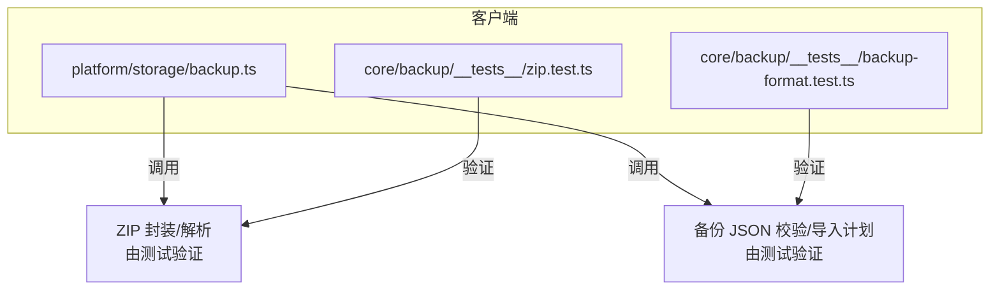
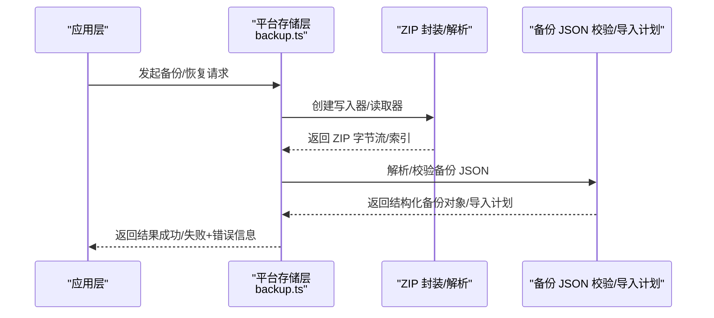
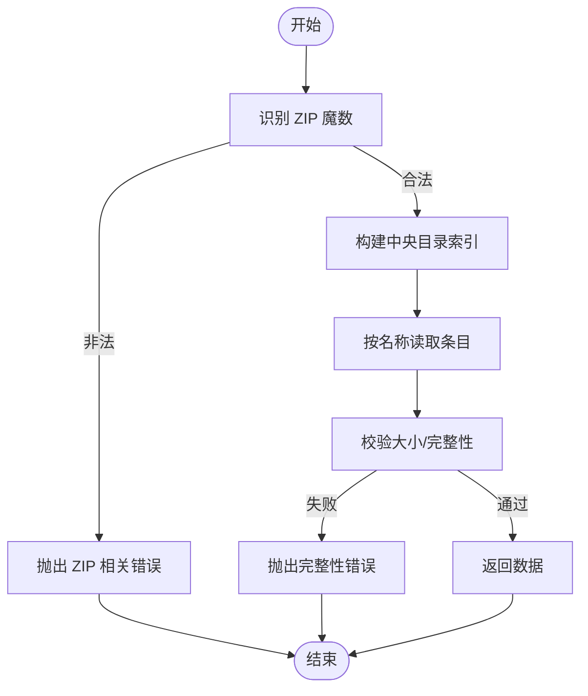
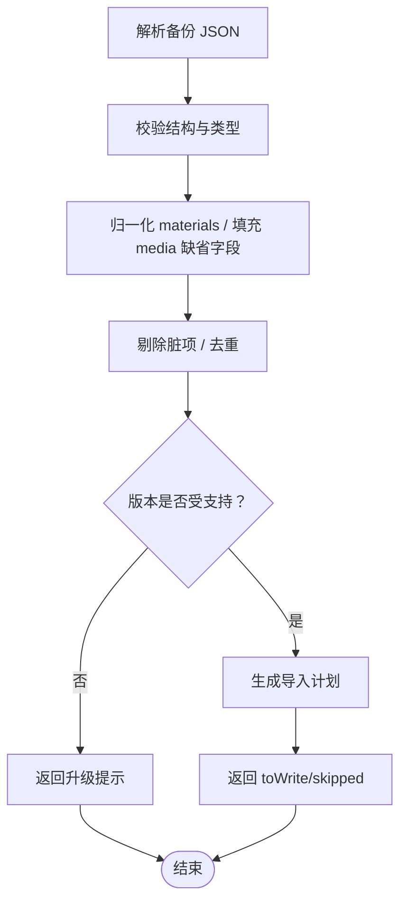
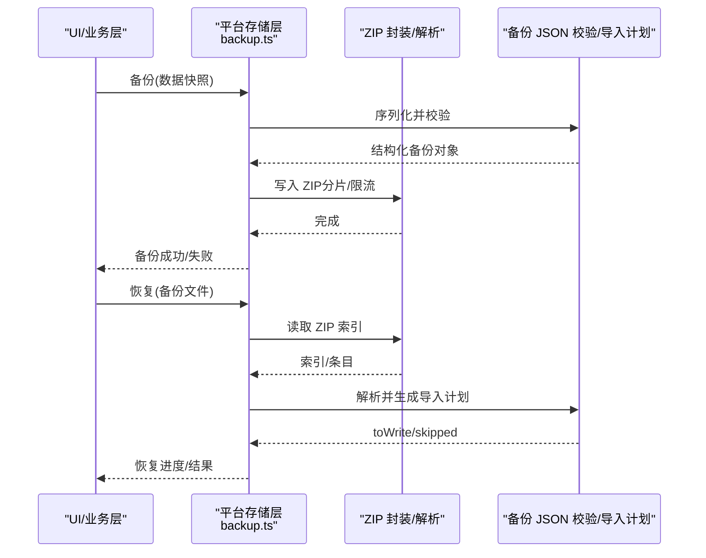
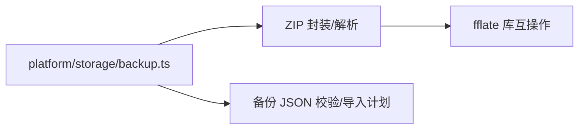

# 数据备份与恢复

<cite>
**本文引用的文件**   
- [backup.ts](file://client/platform/storage/backup.ts)
- [backup-format.test.ts](file://client/core/backup/__tests__/backup-format.test.ts)
- [zip.test.ts](file://client/core/backup/__tests__/zip.test.ts)
</cite>

## 目录
1. [简介](#简介)
2. [项目结构](#项目结构)
3. [核心组件](#核心组件)
4. [架构总览](#架构总览)
5. [详细组件分析](#详细组件分析)
6. [依赖关系分析](#依赖关系分析)
7. [性能考虑](#性能考虑)
8. [故障排查指南](#故障排查指南)
9. [结论](#结论)
10. [附录](#附录)

## 简介
本技术文档围绕“数据备份与恢复系统”展开，聚焦以下目标：
- ZIP 压缩算法实现：文件打包、压缩率优化与流式处理。
- 备份文件格式设计：元数据定义、版本控制与数据结构组织。
- 增量与全量备份策略：选择原则、冲突检测与解决机制。
- 恢复流程：数据校验、完整性检查与回滚机制。
- 数据迁移工具：不同版本间的格式转换。
- 加密与安全存储建议。
- 备份计划任务：定时自动备份能力。

本项目在客户端侧实现了备份的 ZIP 封装与解析、备份 JSON 格式的校验与导入计划生成，并在平台存储层提供备份入口。测试用例覆盖了 CRC32、ZIP 魔数识别、读写互操作、损坏路径、写入限制等关键场景。

## 项目结构
与备份与恢复相关的代码主要分布在以下位置：
- 平台存储层：提供备份 API 的调用入口与持久化集成。
- 核心备份逻辑：包含 ZIP 封装/解析、备份 JSON 格式校验与导入计划。
- 测试套件：覆盖 ZIP 编解码、格式解析与合并策略。

**图示来源**
- [backup.ts:1-200](file://client/platform/storage/backup.ts#L1-L200)
- [zip.test.ts:1-190](file://client/core/backup/__tests__/zip.test.ts#L1-L190)
- [backup-format.test.ts:1-136](file://client/core/backup/__tests__/backup-format.test.ts#L1-L136)

**章节来源**
- [backup.ts:1-200](file://client/platform/storage/backup.ts#L1-L200)
- [zip.test.ts:1-190](file://client/core/backup/__tests__/zip.test.ts#L1-L190)
- [backup-format.test.ts:1-136](file://client/core/backup/__tests__/backup-format.test.ts#L1-L136)

## 核心组件
- ZIP 封装与解析
  - 提供 ZIP 写入器、索引构建、条目读取、CRC32 校验、魔数识别、大小限制等能力。
  - 支持 STORE（不压缩）与 DEFLATE（压缩）两种方法；对媒体等大体积数据优先使用 STORE 以降低 CPU 消耗。
  - 通过中央目录与本地头进行索引，支持按名称快速查找与零拷贝切片（STORE 条目）。
- 备份 JSON 格式与导入计划
  - 定义应用标识、格式版本、导出时间、素材清单、记录映射、偏好设置与可选媒体清单。
  - 提供解析器，负责字段校验、类型归一化、脏项剔除、重复去重与向前兼容。
  - 提供导入计划生成器，支持 overwrite 与 skipExisting 两种策略，计算待写入集合与跳过计数。
- 平台存储备份接口
  - 对外暴露备份与恢复的调用点，对接底层存储与 UI/业务层。

**章节来源**
- [zip.test.ts:1-190](file://client/core/backup/__tests__/zip.test.ts#L1-L190)
- [backup-format.test.ts:1-136](file://client/core/backup/__tests__/backup-format.test.ts#L1-L136)
- [backup.ts:1-200](file://client/platform/storage/backup.ts#L1-L200)

## 架构总览
下图展示了备份与恢复的整体流程：从业务层触发，到平台存储层协调 ZIP 封装/解析与 JSON 校验，最终完成数据的落盘或还原。

**图示来源**
- [backup.ts:1-200](file://client/platform/storage/backup.ts#L1-L200)
- [zip.test.ts:1-190](file://client/core/backup/__tests__/zip.test.ts#L1-L190)
- [backup-format.test.ts:1-136](file://client/core/backup/__tests__/backup-format.test.ts#L1-L136)

## 详细组件分析

### ZIP 压缩与流式处理
- 写入器
  - 支持分片输出，便于流式写入大文件。
  - 累计字节上限保护，防止超出 ZIP 规范（约 4GB）。
  - 状态机约束：finish 后禁止继续 add/finish。
- 索引与读取
  - 扫描中央目录构建 entries 列表与 byName 映射。
  - 支持 STORE 条目的 dataOffset 零拷贝切片，减少内存复制。
  - 读取时校验 uncompressedSize/compressedSize 一致性。
- 校验与健壮性
  - CRC32 标准向量校验。
  - 魔数识别：本地头与 EOCD 签名。
  - 异常路径：截尾、EOCD 缺失、cdOffset 越界、本地头签名篡改、zip64 哨兵值拒绝、不完整读取等。

**图示来源**
- [zip.test.ts:31-46](file://client/core/backup/__tests__/zip.test.ts#L31-L46)
- [zip.test.ts:48-98](file://client/core/backup/__tests__/zip.test.ts#L48-L98)
- [zip.test.ts:126-173](file://client/core/backup/__tests__/zip.test.ts#L126-L173)
- [zip.test.ts:175-189](file://client/core/backup/__tests__/zip.test.ts#L175-L189)

**章节来源**
- [zip.test.ts:1-190](file://client/core/backup/__tests__/zip.test.ts#L1-L190)

### 备份文件格式与导入计划
- 元数据与版本控制
  - app：应用标识，用于隔离不同应用的备份。
  - formatVersion：格式版本号，支持向前兼容与未来版本拒绝。
  - exportedAt：导出时间戳。
  - materials：素材数组，统一归一化为 {id, value}。
  - records：键值记录映射。
  - prefs：偏好设置映射。
  - media：可选媒体清单，含 id、fileName、mediaType、mime、size 等字段，脏项剔除与重复 id 去重。
- 解析与容错
  - 非对象/非 JSON/app 不符/关键字段缺失均给出可读错误。
  - exportedAt 非数字降级为 0，避免崩溃。
  - 旧版本格式可被接受，未来版本明确提示升级。
- 导入计划
  - overwrite：全部写入，跳过值为 0 的项。
  - skipExisting：已有 key 跳过，新 key 写入，返回 toWrite 与 skipped 计数。

**图示来源**
- [backup-format.test.ts:16-62](file://client/core/backup/__tests__/backup-format.test.ts#L16-L62)
- [backup-format.test.ts:64-110](file://client/core/backup/__tests__/backup-format.test.ts#L64-L110)
- [backup-format.test.ts:112-135](file://client/core/backup/__tests__/backup-format.test.ts#L112-L135)

**章节来源**
- [backup-format.test.ts:1-136](file://client/core/backup/__tests__/backup-format.test.ts#L1-L136)

### 平台存储备份接口
- 职责
  - 作为上层业务与底层 ZIP/JSON 能力的桥接。
  - 管理备份文件的命名、路径、生命周期与权限。
  - 聚合错误信息并向上抛出，便于 UI 展示与重试。
- 典型交互
  - 备份：收集素材与记录 → 序列化 JSON → 封装 ZIP → 落盘。
  - 恢复：读取 ZIP → 解析 JSON → 校验 → 按导入计划写入。

**图示来源**
- [backup.ts:1-200](file://client/platform/storage/backup.ts#L1-L200)
- [zip.test.ts:1-190](file://client/core/backup/__tests__/zip.test.ts#L1-L190)
- [backup-format.test.ts:1-136](file://client/core/backup/__tests__/backup-format.test.ts#L1-L136)

**章节来源**
- [backup.ts:1-200](file://client/platform/storage/backup.ts#L1-L200)

## 依赖关系分析
- 模块耦合
  - 平台存储层依赖 ZIP 封装/解析与 JSON 校验/导入计划两个核心能力。
  - ZIP 与 JSON 模块相对独立，通过明确的输入输出契约协作。
- 外部依赖
  - ZIP 编解码与 fflate 库双向互操作，确保生态兼容性。
- 潜在风险
  - ZIP 文件大小接近 4GB 边界时需严格限制写入。
  - 媒体数据建议使用 STORE 以避免不必要的 CPU 开销。

**图示来源**
- [backup.ts:1-200](file://client/platform/storage/backup.ts#L1-L200)
- [zip.test.ts:100-124](file://client/core/backup/__tests__/zip.test.ts#L100-L124)

**章节来源**
- [backup.ts:1-200](file://client/platform/storage/backup.ts#L1-L200)
- [zip.test.ts:100-124](file://client/core/backup/__tests__/zip.test.ts#L100-L124)

## 性能考虑
- 压缩策略
  - 文本类数据使用 DEFLATE 以获得更高压缩比。
  - 媒体等大体积数据使用 STORE，避免解压/压缩带来的额外 CPU 成本。
- 流式处理
  - 写入器采用分片输出，降低峰值内存占用。
  - 读取器基于索引定位条目，必要时使用零拷贝切片提升吞吐。
- 容量限制
  - 累计字节上限保护，超过阈值立即报错，避免无效写入。
- 互操作
  - 与 fflate 的双向互操作保证与现有生态工具的兼容性，减少迁移成本。

[本节为通用性能指导，不直接分析具体文件]

## 故障排查指南
- ZIP 文件损坏
  - 现象：中央目录偏移越界、EOCD 缺失、本地头签名被篡改、zip64 哨兵值。
  - 处理：捕获 ZIP 相关错误，提示用户重新备份或更换备份文件。
- 数据不一致
  - 现象：uncompressedSize 与实际读取长度不符。
  - 处理：报告“大小不符”，中止恢复并提示校验失败。
- 备份格式错误
  - 现象：非对象、app 不符、关键字段缺失、media 字段类型不正确。
  - 处理：返回可读错误信息，引导用户修正或升级。
- 导入冲突
  - 现象：skipExisting 模式下大量 key 已存在。
  - 处理：根据 toWrite/skipped 统计，提示用户确认策略或清理冲突数据。

**章节来源**
- [zip.test.ts:126-173](file://client/core/backup/__tests__/zip.test.ts#L126-L173)
- [backup-format.test.ts:16-62](file://client/core/backup/__tests__/backup-format.test.ts#L16-L62)

## 结论
本系统通过独立的 ZIP 封装/解析与备份 JSON 校验/导入计划模块，提供了稳健的备份与恢复能力。测试覆盖了关键路径与异常场景，确保在复杂环境下仍可正确工作。建议在后续迭代中：
- 完善增量备份与冲突解决的策略配置界面。
- 引入加密选项与安全存储最佳实践。
- 增加计划任务调度，实现定时自动备份。

[本节为总结性内容，不直接分析具体文件]

## 附录

### 备份文件格式要点
- 必需字段
  - app：应用标识
  - formatVersion：格式版本
  - exportedAt：导出时间戳
  - materials：素材数组（归一化为 {id, value}）
  - records：记录映射
  - prefs：偏好设置映射
- 可选字段
  - media：媒体清单（id、fileName、mediaType、mime、size），脏项剔除与重复 id 去重

**章节来源**
- [backup-format.test.ts:16-62](file://client/core/backup/__tests__/backup-format.test.ts#L16-L62)
- [backup-format.test.ts:64-110](file://client/core/backup/__tests__/backup-format.test.ts#L64-L110)

### 导入策略说明
- overwrite：全部写入，跳过值为 0 的项。
- skipExisting：已有 key 跳过，新 key 写入，返回 toWrite 与 skipped 计数。

**章节来源**
- [backup-format.test.ts:112-135](file://client/core/backup/__tests__/backup-format.test.ts#L112-L135)

### 安全与加密建议
- 传输与存储加密
  - 在落盘前对 ZIP 内容进行对称加密（如 AES-GCM），密钥由用户口令派生。
  - 对敏感偏好设置与记录进行字段级加密。
- 访问控制
  - 限制备份文件的读写权限，仅允许应用进程访问。
- 完整性校验
  - 在 JSON 层附加 HMAC 或签名，结合 ZIP 层的 CRC32 双重校验。

[本节为通用安全建议，不直接分析具体文件]

### 计划任务与自动化
- 调度策略
  - 支持每日/每周/每月定时备份，或基于变更事件触发增量备份。
- 资源管理
  - 限制并发备份任务数量，避免与主业务流程争抢 I/O。
- 可观测性
  - 记录每次备份的开始/结束时间、数据量、压缩率与错误日志。

[本节为通用功能规划，不直接分析具体文件]