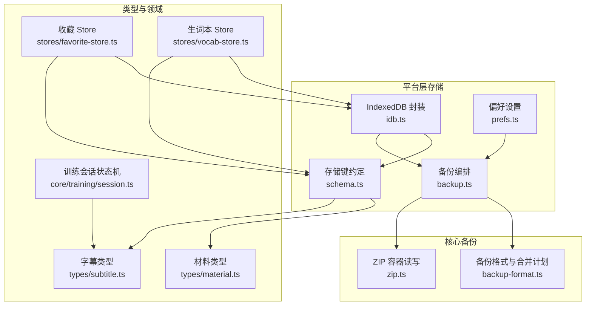
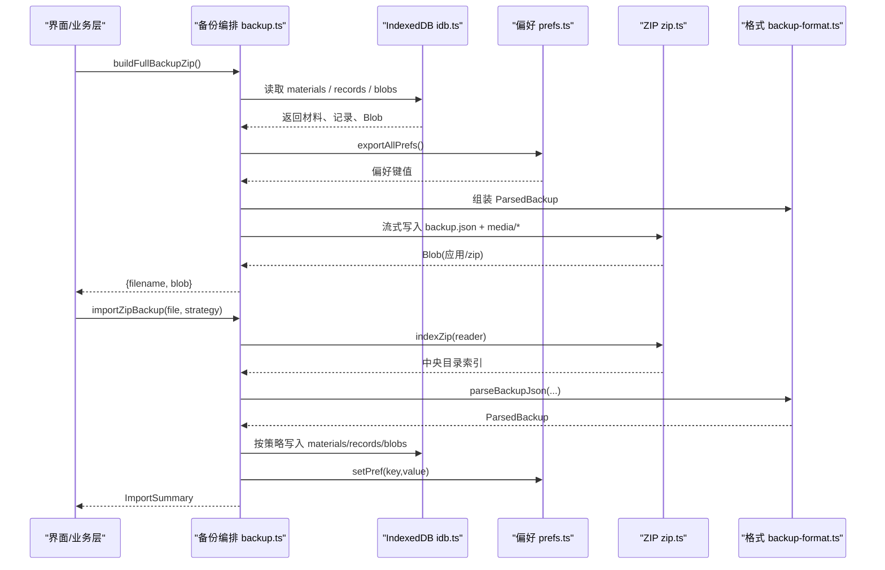
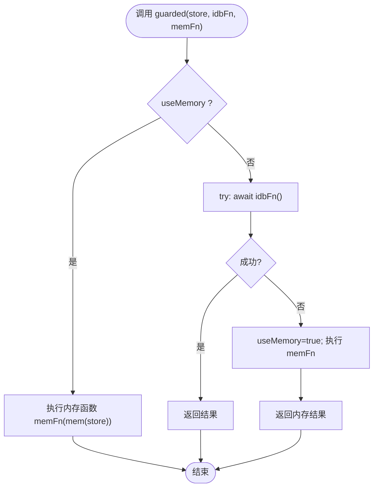
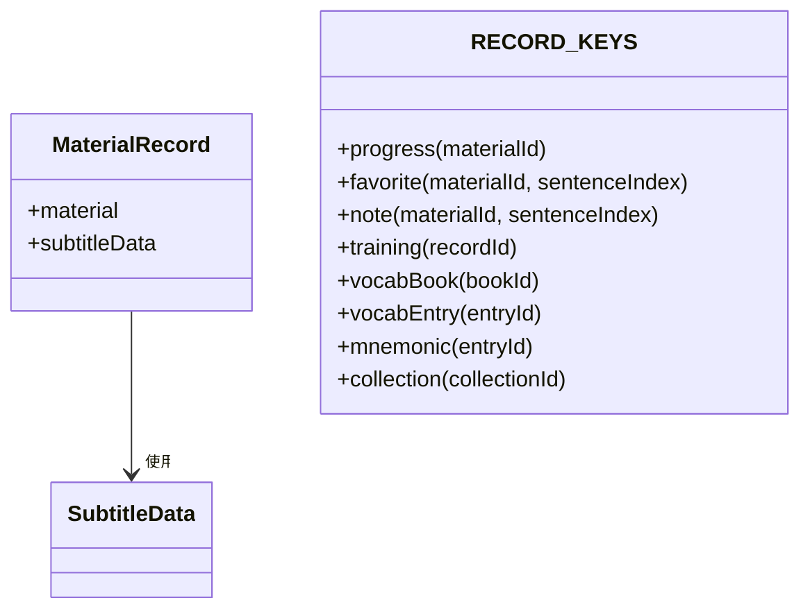
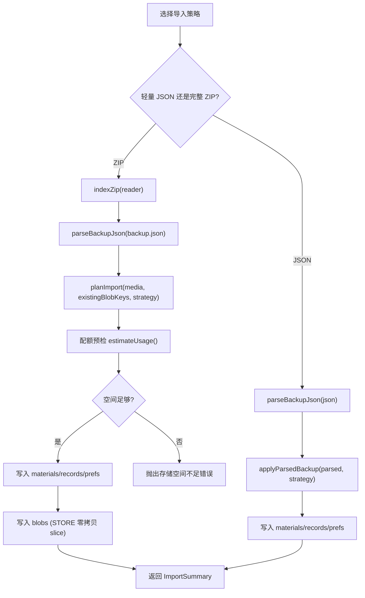
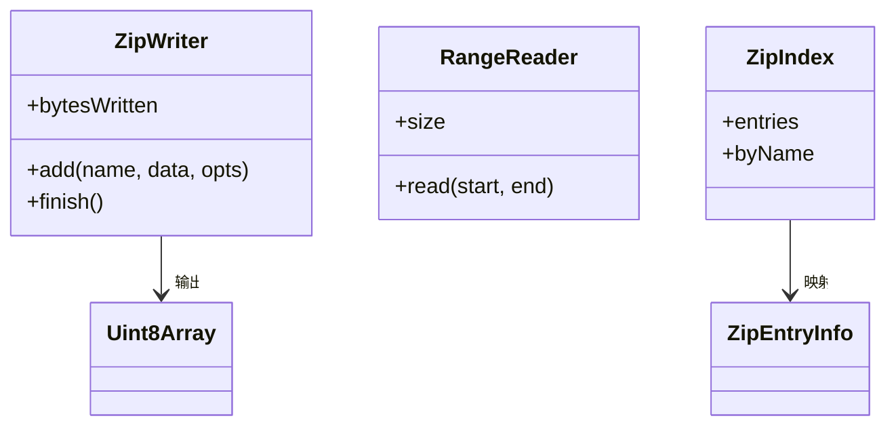
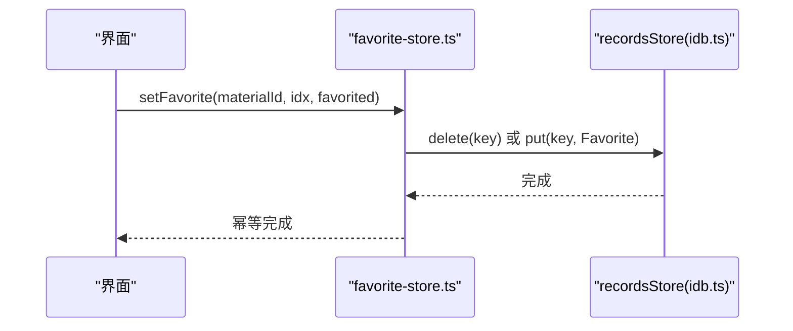
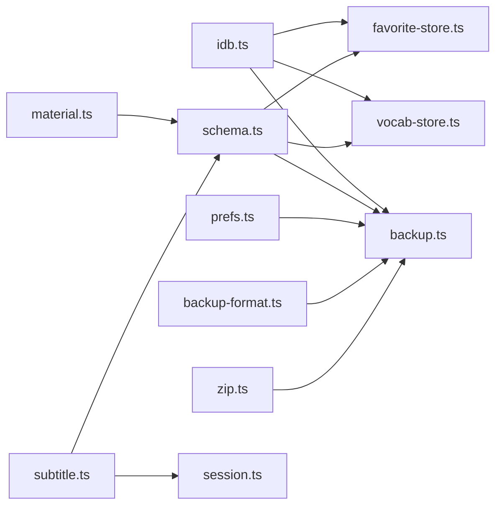

# 数据存储

<cite>
**本文引用的文件**   
- [client/platform/storage/idb.ts](file://client/platform/storage/idb.ts)
- [client/platform/storage/schema.ts](file://client/platform/storage/schema.ts)
- [client/platform/storage/prefs.ts](file://client/platform/storage/prefs.ts)
- [client/platform/storage/backup.ts](file://client/platform/storage/backup.ts)
- [client/core/backup/backup-format.ts](file://client/core/backup/backup-format.ts)
- [client/core/backup/zip.ts](file://client/core/backup/zip.ts)
- [client/types/material.ts](file://client/types/material.ts)
- [client/types/subtitle.ts](file://client/types/subtitle.ts)
- [client/core/training/session.ts](file://client/core/training/session.ts)
- [client/stores/favorite-store.ts](file://client/stores/favorite-store.ts)
- [client/stores/vocab-store.ts](file://client/stores/vocab-store.ts)
</cite>

## 目录
1. [引言](#引言)
2. [项目结构](#项目结构)
3. [核心组件](#核心组件)
4. [架构总览](#架构总览)
5. [详细组件分析](#详细组件分析)
6. [依赖关系分析](#依赖关系分析)
7. [性能与查询优化](#性能与查询优化)
8. [数据完整性、错误恢复与灾难恢复](#数据完整性错误恢复与灾难恢复)
9. [结论](#结论)
10. [附录：关键实体字段说明](#附录关键实体字段说明)

## 引言
本技术文档围绕前端本地存储子系统展开，重点解释 IndexedDB 的 Promise 封装、表结构与键约定、CRUD 抽象；详细说明 MaterialRecord、SubtitleSentence、SessionState 等核心实体的字段含义与约束；阐述 localStorage 在偏好设置中的职责边界；给出 IndexedDB 与 localStorage 的数据分工策略；并完整说明备份与恢复机制（轻量 JSON 与完整 ZIP）、版本迁移、冲突解决、数据完整性校验、错误恢复与灾难恢复方案。最后提供索引设计、查询优化与性能调优的最佳实践。

## 项目结构
本地存储相关代码集中在以下模块：
- 平台层存储抽象：IndexedDB 封装、偏好设置、备份编排、存储 schema 约定
- 核心备份格式与 ZIP 容器：纯 TS 实现，零业务耦合
- 类型定义：材料、字幕、训练会话等模型
- 领域 store：收藏、生词本等基于 records store 的业务封装

**图表来源**
- [client/platform/storage/idb.ts:1-117](file://client/platform/storage/idb.ts#L1-L117)
- [client/platform/storage/prefs.ts:1-52](file://client/platform/storage/prefs.ts#L1-L52)
- [client/platform/storage/schema.ts:1-27](file://client/platform/storage/schema.ts#L1-L27)
- [client/platform/storage/backup.ts:1-243](file://client/platform/storage/backup.ts#L1-L243)
- [client/core/backup/backup-format.ts:1-127](file://client/core/backup/backup-format.ts#L1-L127)
- [client/core/backup/zip.ts:1-283](file://client/core/backup/zip.ts#L1-L283)
- [client/types/material.ts:1-36](file://client/types/material.ts#L1-L36)
- [client/types/subtitle.ts:1-35](file://client/types/subtitle.ts#L1-L35)
- [client/core/training/session.ts:1-119](file://client/core/training/session.ts#L1-L119)
- [client/stores/favorite-store.ts:1-42](file://client/stores/favorite-store.ts#L1-L42)
- [client/stores/vocab-store.ts:1-193](file://client/stores/vocab-store.ts#L1-L193)

**章节来源**
- [client/platform/storage/idb.ts:1-117](file://client/platform/storage/idb.ts#L1-L117)
- [client/platform/storage/backup.ts:1-243](file://client/platform/storage/backup.ts#L1-L243)

## 核心组件
- IndexedDB Promise 封装：提供 materials、blobs、records 三个 object store 的统一 KV 接口，支持 SSR/隐私模式降级到内存 Map，保证调用方永不因存储层崩溃。
- 存储 schema 约定：定义 MaterialRecord 结构及 records store 的 key 前缀规范。
- 偏好设置封装：localStorage 的 get/set/remove/exportAll/hasPref 工具，SSR 安全且对损坏项静默降级。
- 备份编排：轻量 JSON 与完整 ZIP 两种导出格式；导入时按冲突策略合并；媒体流式写入与配额预检。
- ZIP 容器：手写 ZIP 读写，STORE 零拷贝读取媒体，避免整包解压进内存。
- 类型模型：Material、SubtitleData、SubtitleSentence、SessionState 等。
- 领域 Store：收藏、生词本等业务能力封装，统一使用 records store 与前缀键。

**章节来源**
- [client/platform/storage/idb.ts:1-117](file://client/platform/storage/idb.ts#L1-L117)
- [client/platform/storage/schema.ts:1-27](file://client/platform/storage/schema.ts#L1-L27)
- [client/platform/storage/prefs.ts:1-52](file://client/platform/storage/prefs.ts#L1-L52)
- [client/platform/storage/backup.ts:1-243](file://client/platform/storage/backup.ts#L1-L243)
- [client/core/backup/zip.ts:1-283](file://client/core/backup/zip.ts#L1-L283)
- [client/types/material.ts:1-36](file://client/types/material.ts#L1-L36)
- [client/types/subtitle.ts:1-35](file://client/types/subtitle.ts#L1-L35)
- [client/core/training/session.ts:1-119](file://client/core/training/session.ts#L1-L119)
- [client/stores/favorite-store.ts:1-42](file://client/stores/favorite-store.ts#L1-L42)
- [client/stores/vocab-store.ts:1-193](file://client/stores/vocab-store.ts#L1-L193)

## 架构总览
系统采用“小配置走 localStorage，大对象与媒体走 IndexedDB”的分层策略：
- localStorage：偏好设置、开关、UI 状态等小体积、易序列化数据。
- IndexedDB：
  - materials：材料元数据 + 解析后的字幕 JSON（避免重复解析）。
  - blobs：媒体 Blob（音频/视频），key 为 material.id。
  - records：训练记录、收藏、笔记、生词本、记忆卡片、集合等，使用统一前缀键。
- 备份：轻量 JSON（不含媒体）与完整 ZIP（含媒体清单与媒体本体）双通道；导入时按策略合并。

**图表来源**
- [client/platform/storage/backup.ts:62-121](file://client/platform/storage/backup.ts#L62-L121)
- [client/platform/storage/backup.ts:176-242](file://client/platform/storage/backup.ts#L176-L242)
- [client/platform/storage/idb.ts:89-102](file://client/platform/storage/idb.ts#L89-L102)
- [client/platform/storage/prefs.ts:31-43](file://client/platform/storage/prefs.ts#L31-L43)
- [client/core/backup/zip.ts:186-253](file://client/core/backup/zip.ts#L186-L253)
- [client/core/backup/backup-format.ts:45-112](file://client/core/backup/backup-format.ts#L45-L112)

## 详细组件分析

### IndexedDB Promise 封装
- 数据库名与版本：固定 DB_NAME 与 DB_VERSION，打开失败或 blocked 时自动切换到内存 Map 兜底。
- Object Store：materials、blobs、records，均通过 openDb 初始化并在 onupgradeneeded 中创建。
- 事务封装：tx 将 IDBRequest 包装为 Promise，统一错误处理。
- guarded 兜底：任何 IDB 操作失败后永久切换至内存模式，确保上层不崩溃。
- KvStore 接口：get/put/delete/allKeys/clear，暴露给各业务 store。
- 磁盘估算：estimateUsage 用于导入前空间预检。

**图表来源**
- [client/platform/storage/idb.ts:70-78](file://client/platform/storage/idb.ts#L70-L78)

**章节来源**
- [client/platform/storage/idb.ts:1-117](file://client/platform/storage/idb.ts#L1-L117)

### 存储 schema 与键约定
- MaterialRecord：包含 material 元数据与 subtitleData（解析后的句子级字幕），key 为 material.id。
- RECORD_KEYS：统一生成 records store 的 key 前缀，如 progress:/fav:/note:/train:/vocabbook:/vocabentry:/mnemonic:/collection:。

**图表来源**
- [client/platform/storage/schema.ts:9-26](file://client/platform/storage/schema.ts#L9-L26)
- [client/types/subtitle.ts:21-31](file://client/types/subtitle.ts#L21-L31)

**章节来源**
- [client/platform/storage/schema.ts:1-27](file://client/platform/storage/schema.ts#L1-L27)

### 偏好设置（localStorage）
- 功能：getPref/setPref/removePref/exportAllPrefs/hasPref。
- 特性：SSR 安全（检测 localStorage 是否存在）、JSON 序列化失败或隐私模式被拒时静默降级、导出时跳过损坏项。
- 用途：偏好开关、UI 状态、训练范围等小体积配置。

**章节来源**
- [client/platform/storage/prefs.ts:1-52](file://client/platform/storage/prefs.ts#L1-L52)

### 备份与恢复机制
- 轻量 JSON：包含 materials、records、prefs，不含媒体；文件名 ping-english-backup-YYYYMMDD-HHmm.json。
- 完整 ZIP：包含 backup.json（同上）+ media/{materialId}；媒体以 STORE 方式零压缩，避免解压进内存。
- 解析与校验：parseBackupJson 校验 app、formatVersion、字段类型；归一化 materials 与 media 清单。
- 冲突策略：skipExisting（保留本机已有）与 overwrite（以备份覆盖）。
- 导入流程：先写 materials/records/prefs，再写 blobs；导入前进行配额预检（usage + plannedBytes * 1.2 > quota 则拒绝）。
- 预览：prepareZipImport 可解析 zip 并统计媒体缺失数与总体积，供确认弹窗展示。

**图表来源**
- [client/platform/storage/backup.ts:138-170](file://client/platform/storage/backup.ts#L138-L170)
- [client/platform/storage/backup.ts:176-180](file://client/platform/storage/backup.ts#L176-L180)
- [client/platform/storage/backup.ts:187-242](file://client/platform/storage/backup.ts#L187-L242)
- [client/core/backup/backup-format.ts:45-126](file://client/core/backup/backup-format.ts#L45-L126)

**章节来源**
- [client/platform/storage/backup.ts:1-243](file://client/platform/storage/backup.ts#L1-L243)
- [client/core/backup/backup-format.ts:1-127](file://client/core/backup/backup-format.ts#L1-L127)

### ZIP 容器读写
- 写侧：createZipWriter 流式写出本地头、名称、数据；finish 时补中央目录与 EOCD；支持 store（method=0）与 deflate（level=6）。
- 读侧：indexZip 从 EOCD 倒序扫描定位中央目录，逐条解析并计算 dataOffset；readEntry 支持 STORE 原样与 deflate 解压+CRC 校验。
- 限制：不支持 zip64；单盘上限 4GiB-1；条目过多报错。

**图表来源**
- [client/core/backup/zip.ts:49-57](file://client/core/backup/zip.ts#L49-L57)
- [client/core/backup/zip.ts:157-176](file://client/core/backup/zip.ts#L157-L176)

**章节来源**
- [client/core/backup/zip.ts:1-283](file://client/core/backup/zip.ts#L1-L283)

### 领域 Store：收藏与生词本
- 收藏 Store：基于 records store 的 fav: 前缀，提供 listFavorites/setFavorite/favoriteSentenceIndexes。
- 生词本 Store：基于 vocabbook:/vocabentry: 前缀，支持多本、词条 CRUD、频率更新、默认本初始化。

**图表来源**
- [client/stores/favorite-store.ts:26-36](file://client/stores/favorite-store.ts#L26-L36)
- [client/platform/storage/idb.ts:89-102](file://client/platform/storage/idb.ts#L89-L102)

**章节来源**
- [client/stores/favorite-store.ts:1-42](file://client/stores/favorite-store.ts#L1-L42)
- [client/stores/vocab-store.ts:1-193](file://client/stores/vocab-store.ts#L1-L193)

## 依赖关系分析
- platform/storage/idb.ts 被 backup.ts、favorite-store.ts、vocab-store.ts 引用。
- platform/storage/schema.ts 被 favorite-store.ts、vocab-store.ts、backup.ts 引用。
- platform/storage/prefs.ts 被 backup.ts 引用。
- core/backup/backup-format.ts 被 backup.ts 引用。
- core/backup/zip.ts 被 backup.ts 引用。
- types/material.ts、types/subtitle.ts 被 schema.ts 与 session.ts 引用。

**图表来源**
- [client/platform/storage/idb.ts:1-117](file://client/platform/storage/idb.ts#L1-L117)
- [client/platform/storage/schema.ts:1-27](file://client/platform/storage/schema.ts#L1-L27)
- [client/platform/storage/prefs.ts:1-52](file://client/platform/storage/prefs.ts#L1-L52)
- [client/platform/storage/backup.ts:1-243](file://client/platform/storage/backup.ts#L1-L243)
- [client/core/backup/backup-format.ts:1-127](file://client/core/backup/backup-format.ts#L1-L127)
- [client/core/backup/zip.ts:1-283](file://client/core/backup/zip.ts#L1-L283)
- [client/types/material.ts:1-36](file://client/types/material.ts#L1-L36)
- [client/types/subtitle.ts:1-35](file://client/types/subtitle.ts#L1-L35)
- [client/core/training/session.ts:1-119](file://client/core/training/session.ts#L1-L119)
- [client/stores/favorite-store.ts:1-42](file://client/stores/favorite-store.ts#L1-L42)
- [client/stores/vocab-store.ts:1-193](file://client/stores/vocab-store.ts#L1-L193)

**章节来源**
- [client/platform/storage/idb.ts:1-117](file://client/platform/storage/idb.ts#L1-L117)
- [client/platform/storage/backup.ts:1-243](file://client/platform/storage/backup.ts#L1-L243)

## 性能与查询优化
- 批量读取：collectBackupParts 使用 Promise.all 并行拉取所有 keys 对应值，减少往返次数。
- 流式写入：buildFullBackupZip 使用 sink 分片合并 Blob，控制 JS 堆峰值；媒体以 STORE 方式零拷贝读取，避免解压。
- 配额预检：importZipBackup 在写入前估算所需空间，防止配额不足导致部分写入。
- 内存降级：IDB 不可用时自动切换内存 Map，保障可用性但牺牲持久性；UI 可通过 isMemoryFallback 提示用户。
- 查询优化建议：
  - 优先使用 allKeys + filter 前缀的方式筛选 records，避免全量遍历业务逻辑。
  - 对高频查询字段（如 materialId、sentenceIndex）在前端构建索引 Map，减少重复过滤。
  - 避免在循环中多次调用 IDB，尽量批量化 put/delete。
  - 对大媒体文件优先使用 Blob.slice 零拷贝路径，减少内存占用。
- 索引设计建议：
  - IndexedDB 未显式建索引，当前依赖键前缀与业务层过滤；如需复杂查询，可在 future 引入 IDBIndex（例如按 createdAt 排序）。
  - 对于 records store，建议保持键前缀稳定，便于快速前缀匹配。

[本节为通用性能指导，不直接分析具体文件]

## 数据完整性、错误恢复与灾难恢复
- 数据完整性：
  - ZIP 读侧对 deflate 条目进行 CRC 校验；STORE 条目不做 CRC 以避免破坏零拷贝优势。
  - parseBackupJson 严格校验 app、formatVersion、字段类型，并对脏数据做容错剔除。
- 错误恢复：
  - IDB 打开失败、blocked、事务异常均捕获并降级到内存模式，保证应用可用。
  - localStorage 访问与 JSON.parse 失败均静默降级，不抛崩溃。
- 灾难恢复：
  - 轻量 JSON 备份适合跨设备迁移基础数据；完整 ZIP 备份适合本地恢复媒体。
  - 导入冲突策略支持 skipExisting 与 overwrite，避免误覆盖。
  - 导入失败时抛出可读错误消息，调用方可提示用户并回滚 UI 状态。

**章节来源**
- [client/core/backup/zip.ts:255-273](file://client/core/backup/zip.ts#L255-L273)
- [client/core/backup/backup-format.ts:45-112](file://client/core/backup/backup-format.ts#L45-L112)
- [client/platform/storage/idb.ts:27-50](file://client/platform/storage/idb.ts#L27-L50)
- [client/platform/storage/prefs.ts:8-22](file://client/platform/storage/prefs.ts#L8-L22)

## 结论
该数据存储子系统以 IndexedDB 为核心，结合 localStorage 管理偏好设置，形成清晰的数据分层。通过 Promise 封装与内存降级保障稳定性；通过轻量 JSON 与完整 ZIP 双通道备份满足跨设备与本地恢复需求；通过严格的格式校验与冲突策略确保数据一致性。未来可在 IndexedDB 上引入索引以提升复杂查询性能，并扩展版本迁移策略以支持数据结构演进。

[本节为总结性内容，不直接分析具体文件]

## 附录：关键实体字段说明

### MaterialRecord
- material：材料元数据，包含 id、name、mediaType、mediaRef、mediaFileName、mediaSizeBytes、subtitle、durationMs、createdAt、lastOpenedAt、collectionId。
- subtitleData：解析后的字幕数据（SubtitleData），无字幕时为 null。

**章节来源**
- [client/platform/storage/schema.ts:9-14](file://client/platform/storage/schema.ts#L9-L14)
- [client/types/material.ts:7-28](file://client/types/material.ts#L7-L28)

### SubtitleSentence
- index：句子序号（从 0 开始）。
- startMs/endMs：起止时间（毫秒）。
- textEn/textZh：英文原文与中文译文（可为空）。
- words：按空格拆分的单词数组（已剥离标点）。

**章节来源**
- [client/types/subtitle.ts:5-19](file://client/types/subtitle.ts#L5-L19)

### SessionState
- mode：训练模式。
- queue：题目队列（按范围解析后的句子，保持原时间轴顺序）。
- cursor：当前题目游标。
- status：active/done。
- results：已收集结果（按提交顺序）。
- hintCount/attemptCount：当前句提示与提交计数。
- startedAt：会话开始时间戳。

**章节来源**
- [client/core/training/session.ts:18-32](file://client/core/training/session.ts#L18-L32)