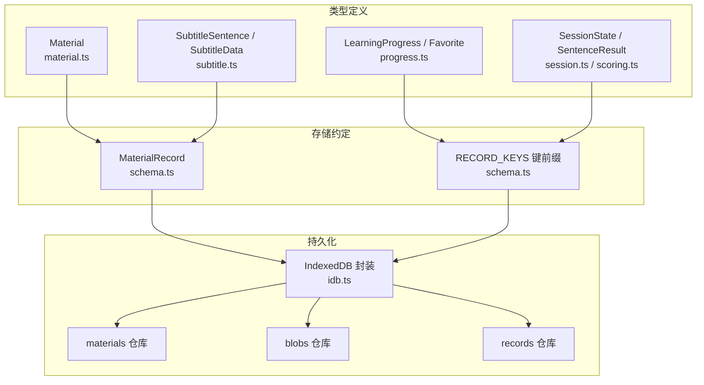
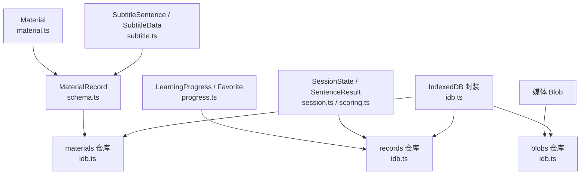
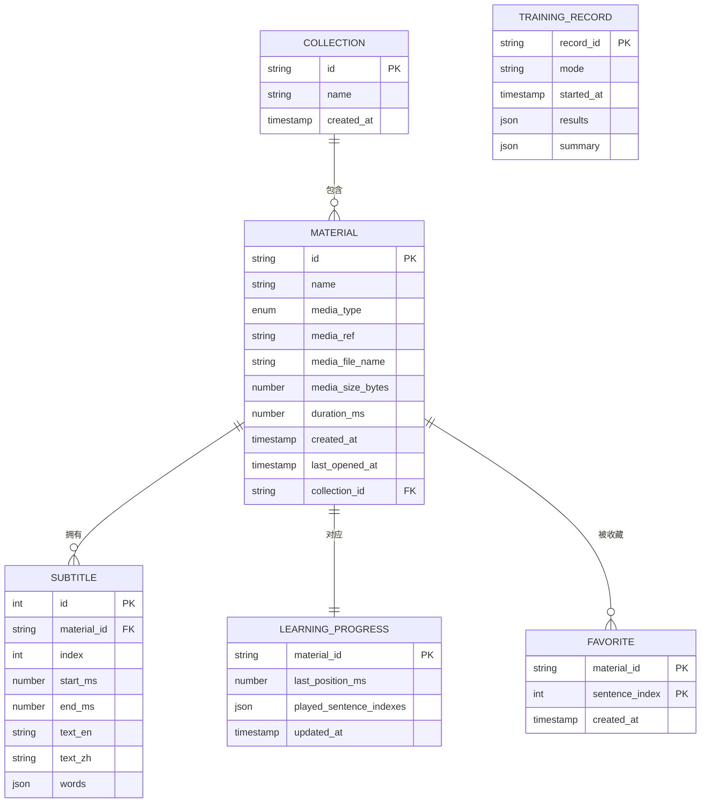
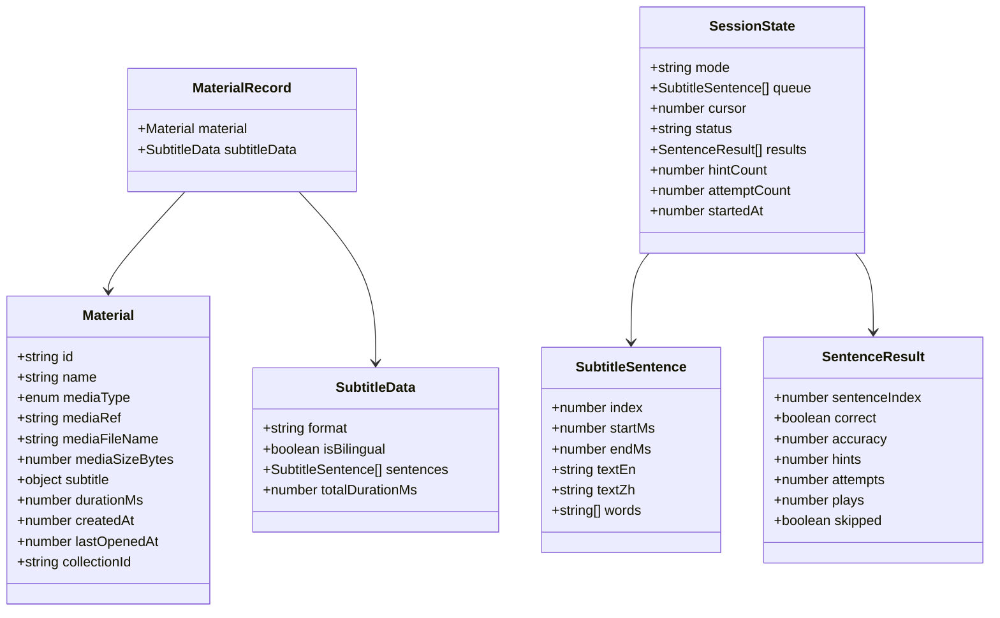

# 数据模型定义

<cite>
**本文引用的文件**   
- [client/platform/storage/schema.ts](file://client/platform/storage/schema.ts)
- [client/types/subtitle.ts](file://client/types/subtitle.ts)
- [client/types/material.ts](file://client/types/material.ts)
- [client/core/training/session.ts](file://client/core/training/session.ts)
- [client/core/training/scoring.ts](file://client/core/training/scoring.ts)
- [client/types/progress.ts](file://client/types/progress.ts)
- [client/platform/storage/idb.ts](file://client/platform/storage/idb.ts)
</cite>

## 目录
1. [引言](#引言)
2. [项目结构](#项目结构)
3. [核心组件](#核心组件)
4. [架构总览](#架构总览)
5. [详细组件分析](#详细组件分析)
6. [依赖关系分析](#依赖关系分析)
7. [性能考虑](#性能考虑)
8. [故障排查指南](#故障排查指南)
9. [结论](#结论)
10. [附录](#附录)

## 引言
本文件面向“学习材料、字幕句子、训练会话”等核心数据模型，提供从字段语义、数据类型、业务约束到持久化与索引策略的完整技术说明。文档同时覆盖实体间关系映射（一对多、多对多）、数据验证规则、默认值设置、迁移方案与完整性检查修复工具的实现思路，帮助读者在不深入代码的情况下理解并扩展系统的数据层设计。

## 项目结构
本项目在前端侧采用 TypeScript 类型定义作为“真源”，配合 IndexedDB 封装进行本地持久化。关键位置如下：
- 领域模型定义：types 目录下 Material、SubtitleSentence、LearningProgress、Favorite 等
- 存储记录约定：platform/storage/schema.ts 中 MaterialRecord 与键前缀约定
- 训练会话状态机：core/training/session.ts 中 SessionState 及相关操作
- 持久化实现：platform/storage/idb.ts 中 IndexedDB 封装与对象仓库划分

图表来源
- [client/types/material.ts:7-28](file://client/types/material.ts#L7-L28)
- [client/types/subtitle.ts:6-31](file://client/types/subtitle.ts#L6-L31)
- [client/types/progress.ts:6-19](file://client/types/progress.ts#L6-L19)
- [client/core/training/session.ts:18-32](file://client/core/training/session.ts#L18-L32)
- [client/core/training/scoring.ts:8-37](file://client/core/training/scoring.ts#L8-L37)
- [client/platform/storage/schema.ts:10-26](file://client/platform/storage/schema.ts#L10-L26)
- [client/platform/storage/idb.ts:12-15](file://client/platform/storage/idb.ts#L12-L15)

章节来源
- [client/platform/storage/schema.ts:1-27](file://client/platform/storage/schema.ts#L1-L27)
- [client/platform/storage/idb.ts:1-117](file://client/platform/storage/idb.ts#L1-L117)

## 核心组件
本节聚焦三个核心实体及其关联：
- MaterialRecord（学习材料记录）
- SubtitleSentence（字幕句子对象）
- SessionState（训练会话状态）

### MaterialRecord（学习材料记录）
- 组成
  - material: Material（材料元数据）
  - subtitleData: SubtitleData | null（解析后的句子级字幕；无字幕时为 null）
- 用途
  - 将“材料元数据 + 已解析字幕”作为一条缓存记录，避免每次启动重复解析字幕
- 键约定
  - materials 仓库以 material.id 为 key
- 业务约束
  - subtitleData 可为空，表示该材料未附带字幕或字幕不可用
  - material 内部字段遵循 Material 类型定义（见下节）

章节来源
- [client/platform/storage/schema.ts:10-14](file://client/platform/storage/schema.ts#L10-L14)
- [client/types/material.ts:7-28](file://client/types/material.ts#L7-L28)
- [client/types/subtitle.ts:22-31](file://client/types/subtitle.ts#L22-L31)

### SubtitleSentence（字幕句子对象）
- 字段含义
  - index: number（句子序号，从 0 开始）
  - startMs: number（起始时间毫秒）
  - endMs: number（结束时间毫秒）
  - textEn: string（英文原文）
  - textZh: string | null（中文译文，可为空）
  - words: string[]（按空格拆分且去标点的单词数组，用于九宫格训练）
- 组合类型
  - SubtitleData：包含 format、isBilingual、sentences、totalDurationMs
- 业务约束
  - sentences 按时间排序
  - isBilingual 指示是否双语字幕
  - totalDurationMs 为整段时长，便于播放器进度展示

章节来源
- [client/types/subtitle.ts:6-31](file://client/types/subtitle.ts#L6-L31)

### SessionState（训练会话状态）
- 关键字段
  - mode: TrainingMode（训练模式）
  - queue: SubtitleSentence[]（题目队列，保持原时间轴顺序）
  - cursor: number（当前句游标）
  - status: 'active' | 'done'
  - results: SentenceResult[]（提交结果序列）
  - hintCount: number（当前句提示次数）
  - attemptCount: number（当前句提交次数）
  - startedAt: number（会话开始时间戳）
- 行为要点
  - submit：收集当前句结果，同句重试会覆盖上一条
  - attempt/hint：分别累计提交与提示次数
  - next：推进游标，超出队尾则 done
  - skip：记 0 分并推进
  - retryAt：跳回指定句继续训练
- 小结聚合
  - SentenceResult：单句正确性、准确率、提示/提交/播放次数、是否跳过
  - SessionSummary：汇总正确率、用时、最弱句 TOP3、总播放次数

章节来源
- [client/core/training/session.ts:18-32](file://client/core/training/session.ts#L18-L32)
- [client/core/training/session.ts:64-118](file://client/core/training/session.ts#L64-L118)
- [client/core/training/scoring.ts:8-50](file://client/core/training/scoring.ts#L8-L50)

## 架构总览
下图展示了从类型定义到 IndexedDB 持久化的整体数据流与仓库划分。

图表来源
- [client/types/material.ts:7-28](file://client/types/material.ts#L7-L28)
- [client/types/subtitle.ts:6-31](file://client/types/subtitle.ts#L6-L31)
- [client/types/progress.ts:6-19](file://client/types/progress.ts#L6-L19)
- [client/core/training/session.ts:18-32](file://client/core/training/session.ts#L18-L32)
- [client/core/training/scoring.ts:8-37](file://client/core/training/scoring.ts#L8-L37)
- [client/platform/storage/schema.ts:10-26](file://client/platform/storage/schema.ts#L10-L26)
- [client/platform/storage/idb.ts:12-15](file://client/platform/storage/idb.ts#L12-L15)

## 详细组件分析

### 实体关系与数据库表示
- 一对多
  - Material 与 SubtitleSentence：一个材料对应多条字幕句子（通过 SubtitleData.sentences 表达）
  - LearningProgress 与 Material：每个材料一条进度记录（materialId 外键语义）
- 多对多
  - Material 与 Favorite：收藏关系通过 Favorite.materialId + sentenceIndex 表达，支持同一材料的多条收藏句
  - Material 与 Collection：通过 Material.collectionId 指向 MaterialCollection，形成扁平集合成员关系
- 数据库映射建议
  - materials 表：主键 id，含 name、mediaType、mediaRef、mediaFileName、mediaSizeBytes、durationMs、createdAt、lastOpenedAt、collectionId（可空）
  - subtitles 表：主键自增 id，material_id（外键），index、startMs、endMs、textEn、textZh、words（JSON 文本）
  - learning_progress 表：主键 material_id，lastPositionMs、playedSentenceIndexes（JSON 数组）、updatedAt
  - favorites 表：复合主键 (material_id, sentence_index)，createdAt
  - collections 表：主键 id，name、createdAt
  - training_records 表：主键 record_id（makeRecordId 生成），mode、startedAt、results（JSON 数组）、summary（JSON 对象）

图表来源
- [client/types/material.ts:7-35](file://client/types/material.ts#L7-L35)
- [client/types/subtitle.ts:6-31](file://client/types/subtitle.ts#L6-L31)
- [client/types/progress.ts:6-19](file://client/types/progress.ts#L6-L19)
- [client/core/training/session.ts:18-32](file://client/core/training/session.ts#L18-L32)
- [client/core/training/scoring.ts:8-37](file://client/core/training/scoring.ts#L8-L37)

章节来源
- [client/types/material.ts:7-35](file://client/types/material.ts#L7-L35)
- [client/types/subtitle.ts:6-31](file://client/types/subtitle.ts#L6-L31)
- [client/types/progress.ts:6-19](file://client/types/progress.ts#L6-L19)
- [client/core/training/session.ts:18-32](file://client/core/training/session.ts#L18-L32)
- [client/core/training/scoring.ts:8-37](file://client/core/training/scoring.ts#L8-L37)

### 数据验证规则、默认值与约束
- Material
  - id：使用 nanoid 风格字符串（唯一标识）
  - mediaType：枚举 video | audio
  - subtitle：可为 null；若存在，ref/format/isBilingual/sentenceCount 需一致
  - createdAt/lastOpenedAt：时间戳；lastOpenedAt 在打开时更新
  - collectionId：可为 null/undefined，视为未分组
- SubtitleSentence
  - index：非负整数，从 0 起
  - startMs/endMs：非负整数，endMs ≥ startMs
  - textEn：非空字符串
  - textZh：允许为空
  - words：由 textEn 派生，长度应与拆词逻辑一致
- SubtitleData
  - format：srt | lrc
  - isBilingual：布尔值
  - sentences：按时间排序
  - totalDurationMs：≥ 0
- SessionState
  - status：active | done
  - cursor：[0, queue.length]
  - results：按提交顺序追加，同句重试覆盖
  - hintCount/attemptCount：非负整数
  - startedAt：非负时间戳
- LearningProgress
  - playedSentenceIndexes：递增写入，建议去重与排序
- Favorite
  - (materialId, sentenceIndex) 唯一
- 校验建议
  - 入库前执行 schema 校验（如 zod/yup）
  - 对 JSON 字段（words、results、summary、playedSentenceIndexes）做结构校验
  - 对时间戳与区间（startMs ≤ endMs、totalDurationMs）做范围校验

章节来源
- [client/types/material.ts:7-28](file://client/types/material.ts#L7-L28)
- [client/types/subtitle.ts:6-31](file://client/types/subtitle.ts#L6-L31)
- [client/core/training/session.ts:18-32](file://client/core/training/session.ts#L18-L32)
- [client/types/progress.ts:6-19](file://client/types/progress.ts#L6-L19)

### 索引设计策略
- 主键选择
  - materials.id：nanoid 字符串，全局唯一
  - subtitles.id：自增整数，提高插入性能
  - learning_progress.material_id：一对一映射
  - favorites(material_id, sentence_index)：复合主键，保证收藏唯一性
  - collections.id：集合主键
  - training_records.record_id：makeRecordId 生成的短 ID
- 查询优化索引
  - materials.collection_id：按集合筛选材料
  - subtitles.material_id：按材料检索字幕
  - subtitles.index：按句子序号定位
  - learning_progress.updated_at：最近活跃排序
  - favorites.material_id：按材料查看收藏句
  - training_records.started_at：按时间倒序查看历史
- 复合索引
  - subtitles(material_id, index)：加速“某材料的第 N 句”查询
  - favorites(material_id, sentence_index)：天然复合主键
- 特殊场景
  - 全文搜索：可对 textEn/textZh 建立全文索引（视数据库能力）
  - 统计类查询：对 accuracy、correct 等字段建索引以提升报表性能

章节来源
- [client/types/material.ts:7-28](file://client/types/material.ts#L7-L28)
- [client/types/subtitle.ts:6-31](file://client/types/subtitle.ts#L6-L31)
- [client/types/progress.ts:6-19](file://client/types/progress.ts#L6-L19)
- [client/core/training/session.ts:115-118](file://client/core/training/session.ts#L115-L118)

### 数据迁移方案（版本升级与格式演进）
- IndexedDB 版本管理
  - DB_VERSION=2，onupgradeneeded 中创建对象仓库 materials/blobs/records
  - 未来升级时递增版本号，并在 onupgradeneeded 中执行增量迁移脚本
- 迁移步骤建议
  - v1→v2：新增 records 仓库，迁移旧 KV 数据至新结构
  - v2→v3：为 subtitles 增加索引列或规范化 words 字段
  - v3→v4：为 learning_progress 增加索引或变更 playedSentenceIndexes 结构
- 兼容性与回滚
  - 所有迁移脚本幂等，支持重复执行
  - 迁移失败时保留旧数据，提供回滚脚本
- 前端配置迁移
  - server-settings.ts 中存在自动迁移逻辑示例，可作为其他配置迁移参考

章节来源
- [client/platform/storage/idb.ts:32-35](file://client/platform/storage/idb.ts#L32-L35)
- [client/lib/server-settings.ts:127-154](file://client/lib/server-settings.ts#L127-L154)

### 数据完整性检查与修复工具
- 一致性检查项
  - 材料-字幕：每个 subtitles.material_id 必须存在于 materials.id
  - 进度-材料：learning_progress.material_id 必须存在于 materials.id
  - 收藏-材料：favorites.material_id 必须存在于 materials.id
  - 字幕时序：startMs ≤ endMs，sentences 按 index 升序
  - 会话结果：results 中的 sentenceIndex 必须在 queue 中存在
- 修复策略
  - 孤儿字幕删除或挂起待审
  - 缺失材料引用：清理或标记异常记录
  - 时序错误：修正或丢弃非法句子
  - 会话结果不一致：根据 session 状态重建或丢弃异常结果
- 工具形态
  - 后台脚本或管理面板功能，输出报告并提供一键修复

章节来源
- [client/types/subtitle.ts:6-31](file://client/types/subtitle.ts#L6-L31)
- [client/types/progress.ts:6-19](file://client/types/progress.ts#L6-L19)
- [client/core/training/session.ts:64-118](file://client/core/training/session.ts#L64-L118)

## 依赖关系分析
- 类型依赖
  - MaterialRecord 依赖 Material 与 SubtitleData
  - SessionState 依赖 SubtitleSentence 与 SentenceResult
- 存储依赖
  - materialsStore/blobsStore/recordsStore 统一通过 IndexedDB 封装访问
  - RECORD_KEYS 为 records 仓库的键前缀约定，确保跨模块一致性

图表来源
- [client/types/material.ts:7-28](file://client/types/material.ts#L7-L28)
- [client/types/subtitle.ts:6-31](file://client/types/subtitle.ts#L6-L31)
- [client/platform/storage/schema.ts:10-14](file://client/platform/storage/schema.ts#L10-L14)
- [client/core/training/session.ts:18-32](file://client/core/training/session.ts#L18-L32)
- [client/core/training/scoring.ts:8-37](file://client/core/training/scoring.ts#L8-L37)

章节来源
- [client/platform/storage/schema.ts:10-26](file://client/platform/storage/schema.ts#L10-L26)
- [client/platform/storage/idb.ts:12-15](file://client/platform/storage/idb.ts#L12-L15)

## 性能考虑
- 字幕解析缓存
  - 使用 MaterialRecord.subtitleData 缓存解析结果，减少启动开销
- IndexedDB 降级
  - SSR/隐私模式下自动回退内存 Map，保证可用性
- 批量写入
  - 对字幕句子、收藏句等批量写入时使用事务，降低 IO 次数
- 查询优化
  - 合理使用索引，避免全表扫描
  - 分页加载字幕与历史记录

章节来源
- [client/platform/storage/idb.ts:17-24](file://client/platform/storage/idb.ts#L17-L24)
- [client/platform/storage/idb.ts:53-68](file://client/platform/storage/idb.ts#L53-L68)

## 故障排查指南
- 常见问题
  - IndexedDB 打开失败：自动切换内存模式，UI 可提示用户
  - 事务错误：记录 store 名称与模式，定位具体仓库
  - 数据不一致：运行完整性检查脚本，依据报告修复
- 诊断信息
  - 使用 estimateUsage() 获取磁盘占用与配额
  - 使用 isMemoryFallback() 判断是否处于内存降级模式

章节来源
- [client/platform/storage/idb.ts:37-48](file://client/platform/storage/idb.ts#L37-L48)
- [client/platform/storage/idb.ts:53-68](file://client/platform/storage/idb.ts#L53-L68)
- [client/platform/storage/idb.ts:104-117](file://client/platform/storage/idb.ts#L104-L117)

## 结论
本数据模型以清晰的类型定义为核心，结合 IndexedDB 的轻量封装，实现了学习材料、字幕句子与训练会话的高效管理与持久化。通过合理的索引设计与迁移策略，系统在可扩展性与稳定性之间取得平衡。完整性检查与修复工具进一步保障了数据的可靠性。

## 附录
- 键前缀约定
  - progress:materialId
  - fav:materialId:sentenceIndex
  - note:materialId:sentenceIndex
  - train:recordId
  - vocabbook:bookId
  - vocabentry:entryId
  - mnemonic:entryId
  - collection:collectionId

章节来源
- [client/platform/storage/schema.ts:16-26](file://client/platform/storage/schema.ts#L16-L26)