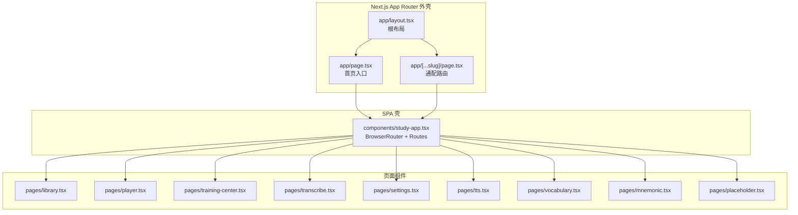
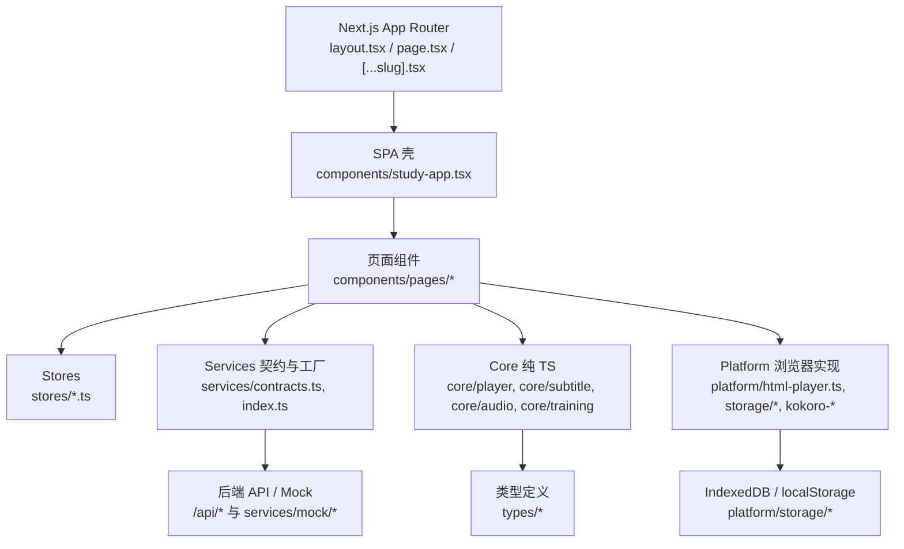
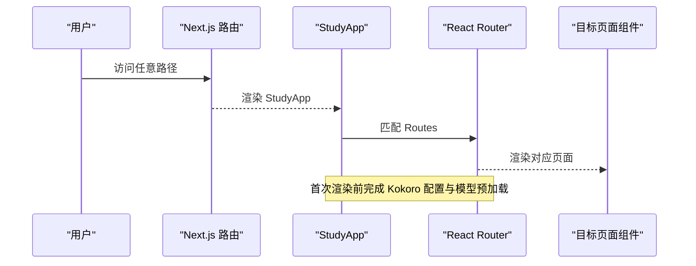
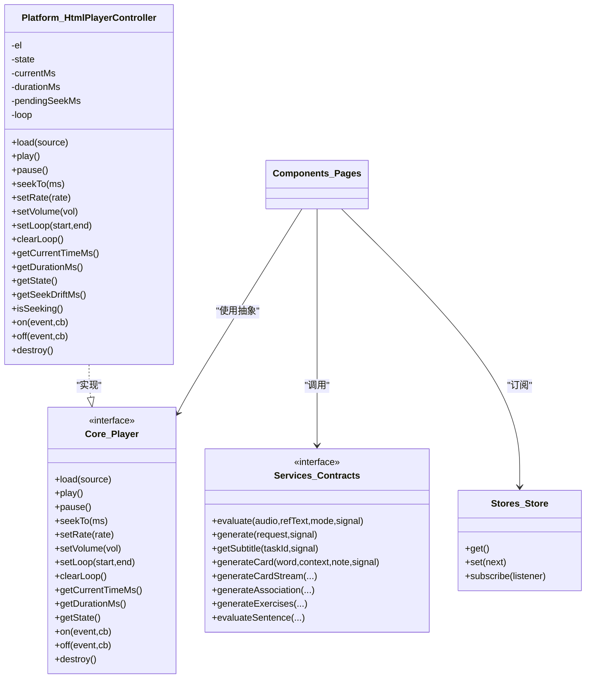
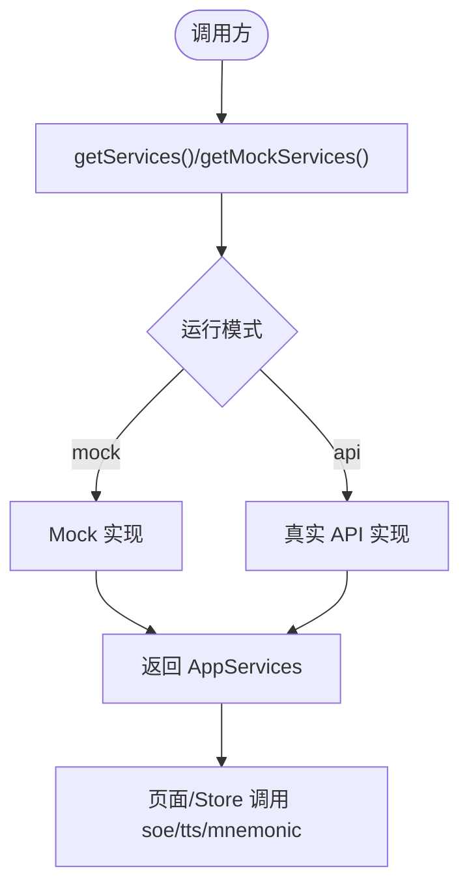
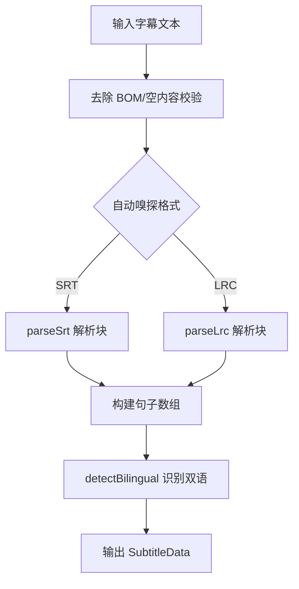
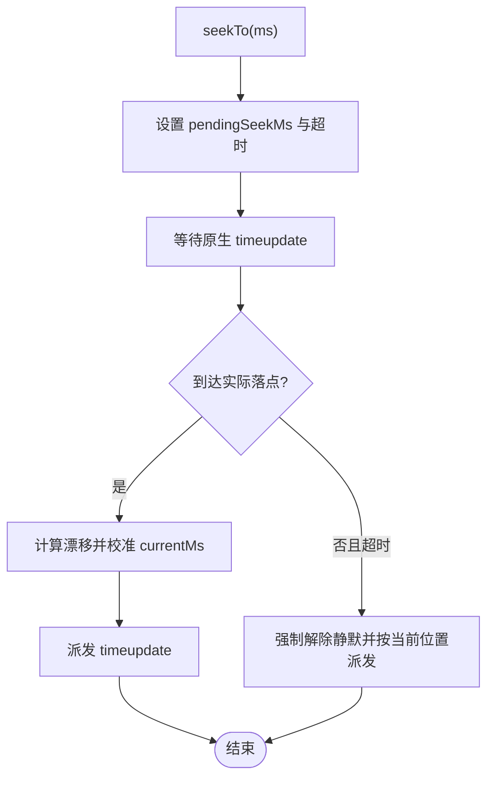
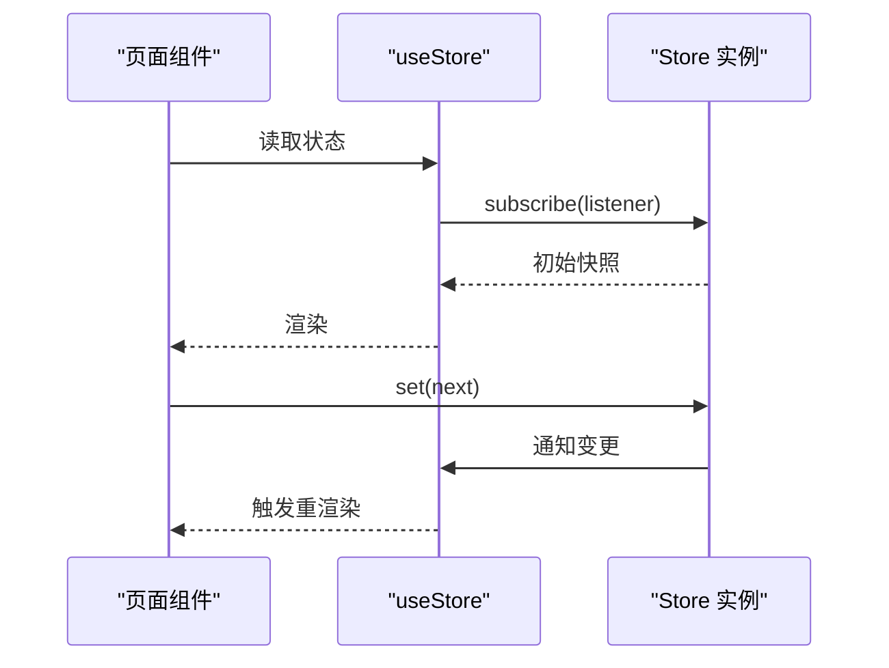
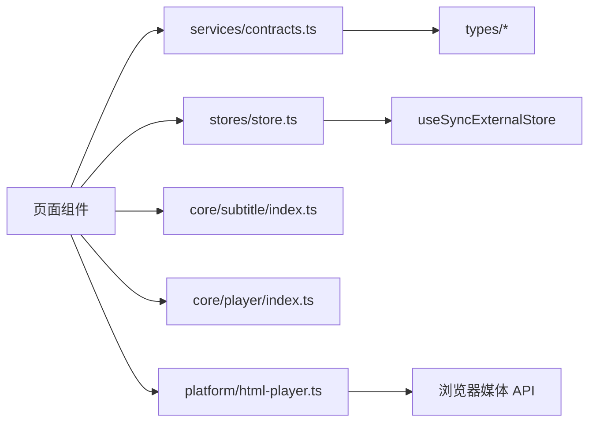

# 前端架构设计

<cite>
**本文引用的文件**   
- [client/README.md](file://client/README.md)
- [client/app/layout.tsx](file://client/app/layout.tsx)
- [client/app/page.tsx](file://client/app/page.tsx)
- [client/app/[...slug]/page.tsx](file://client/app/[...slug]/page.tsx)
- [client/components/study-app.tsx](file://client/components/study-app.tsx)
- [client/services/contracts.ts](file://client/services/contracts.ts)
- [client/services/index.ts](file://client/services/index.ts)
- [client/platform/html-player.ts](file://client/platform/html-player.ts)
- [client/core/player/index.ts](file://client/core/player/index.ts)
- [client/core/subtitle/index.ts](file://client/core/subtitle/index.ts)
- [client/stores/store.ts](file://client/stores/store.ts)
</cite>

## 目录
1. [简介](#简介)
2. [项目结构](#项目结构)
3. [核心组件](#核心组件)
4. [架构总览](#架构总览)
5. [详细组件分析](#详细组件分析)
6. [依赖关系分析](#依赖关系分析)
7. [性能考量](#性能考量)
8. [故障排查指南](#故障排查指南)
9. [结论](#结论)
10. [附录](#附录)

## 简介
本文件为“英语精听助手”前端架构的详细文档，聚焦于在 Next.js App Router 中嵌入 SPA 的实现方式、React Router DOM 的 14 条客户端路由设计模式，以及六层架构在前端的体现：Core（平台无关纯 TS）、Platform（浏览器实现）、Services（AI 服务契约）、Stores（状态管理）、Components（页面组件）、Types（类型定义）。文档同时阐述关键设计决策：本地优先存储策略、服务契约模式、录音链路处理、字幕解析器实现、播放器 seek 校准机制，并给出架构图与数据流图，帮助读者快速理解各层依赖与交互。

## 项目结构
前端位于 client 目录，采用 Next.js App Router 作为外壳，根布局负责元数据与主题色，入口页与通配路由均渲染同一个 StudyApp，StudyApp 内部使用 React Router DOM 管理全部客户端路由。业务代码按 Core / Platform / Services / Stores / Components / Types 分层组织，测试与工具函数分别位于 core/* 与 lib/*。

图表来源
- [client/app/layout.tsx:1-50](file://client/app/layout.tsx#L1-L50)
- [client/app/page.tsx:1-6](file://client/app/page.tsx#L1-L6)
- [client/app/[...slug]/page.tsx:1-6](file://client/app/[...slug]/page.tsx#L1-L6)
- [client/components/study-app.tsx:1-65](file://client/components/study-app.tsx#L1-L65)

章节来源
- [client/README.md:21-96](file://client/README.md#L21-L96)
- [client/app/layout.tsx:1-50](file://client/app/layout.tsx#L1-L50)
- [client/app/page.tsx:1-6](file://client/app/page.tsx#L1-L6)
- [client/app/[...slug]/page.tsx:1-6](file://client/app/[...slug]/page.tsx#L1-L6)
- [client/components/study-app.tsx:1-65](file://client/components/study-app.tsx#L1-L65)

## 核心组件
- App Router 外壳
  - 根布局设置站点标题、描述、图标与视口主题色，并在生产环境注入分析脚本。
  - 首页与通配路由统一渲染 StudyApp，使所有客户端路由由 React Router 接管。
- SPA 壳与路由
  - StudyApp 在启动时异步获取 Kokoro 模型配置并预加载模型，随后以 BrowserRouter + Routes 注册 14 条客户端路由，覆盖材料库、导入、精听播放器、训练中心、九宫格、听写、朗读评分、影子跟读、背诵、转写、TTS、词汇与助记等场景，并提供 404 占位页。
- 服务契约与工厂
  - services/contracts.ts 定义 SoeService、TtsService、MnemonicService 与 AppServices 聚合接口，并统一错误类型 ApiError 与中止语义；services/index.ts 提供 getServices/getMockServices 工厂与 SOE 动态选择逻辑。
- 播放器控制器
  - platform/html-player.ts 实现 HtmlPlayerController，封装原生媒体元素，提供播放、暂停、seek、倍速、音量、A-B 循环、事件订阅与销毁能力，内置 seek 落点校准与高频进度采样。
- 字幕解析器
  - core/subtitle/index.ts 提供 parseSubtitle 自动嗅探 SRT/LRC、双语识别、句级时间轴对齐与导出能力。
- 轻量状态管理
  - stores/store.ts 基于 useSyncExternalStore 提供 createStore/useStore，零外部依赖，SSR 安全。

章节来源
- [client/app/layout.tsx:1-50](file://client/app/layout.tsx#L1-L50)
- [client/components/study-app.tsx:1-65](file://client/components/study-app.tsx#L1-L65)
- [client/services/contracts.ts:1-144](file://client/services/contracts.ts#L1-L144)
- [client/services/index.ts:1-68](file://client/services/index.ts#L1-L68)
- [client/platform/html-player.ts:1-272](file://client/platform/html-player.ts#L1-L272)
- [client/core/subtitle/index.ts:1-80](file://client/core/subtitle/index.ts#L1-L80)
- [client/stores/store.ts:1-34](file://client/stores/store.ts#L1-L34)

## 架构总览
下图展示从 Next.js 外壳到 SPA 壳、再到 Core/Platform/Services/Stores 的分层依赖关系与数据流向。

图表来源
- [client/app/layout.tsx:1-50](file://client/app/layout.tsx#L1-L50)
- [client/app/page.tsx:1-6](file://client/app/page.tsx#L1-L6)
- [client/app/[...slug]/page.tsx:1-6](file://client/app/[...slug]/page.tsx#L1-L6)
- [client/components/study-app.tsx:1-65](file://client/components/study-app.tsx#L1-L65)
- [client/services/contracts.ts:1-144](file://client/services/contracts.ts#L1-L144)
- [client/services/index.ts:1-68](file://client/services/index.ts#L1-L68)
- [client/platform/html-player.ts:1-272](file://client/platform/html-player.ts#L1-L272)
- [client/core/subtitle/index.ts:1-80](file://client/core/subtitle/index.ts#L1-L80)
- [client/stores/store.ts:1-34](file://client/stores/store.ts#L1-L34)

## 详细组件分析

### SPA inside Next.js 与 14 条客户端路由
- 外壳职责
  - layout.tsx 设置站点元信息、图标与视口主题色，生产环境注入分析。
  - page.tsx 与 [...slug].tsx 仅渲染 StudyApp，将路由完全交给 React Router。
- StudyApp 初始化
  - 启动时调用 /api/settings/kokoro 获取模型 ID 并预加载 Kokoro 模型，失败不阻断渲染。
- 路由清单（14 条）
  - / → Library
  - /collection/:collectionId → CollectionDetail
  - /favorites → Favorites
  - /import → ImportPage
  - /player/:materialId → Player
  - /training/:materialId → TrainingCenter
  - /training/puzzle → Puzzle
  - /training/dictation → Dictation
  - /training/read-aloud → ReadAloud
  - /training/shadowing → Shadowing
  - /training/recitation → Recitation
  - /settings → SettingsPage
  - /transcribe → TranscribePage
  - /tts → TTS
  - /vocabulary → Vocabulary
  - /vocabulary/mnemonic/:entryId → MnemonicPage
  - * → Placeholder（页面未找到）

图表来源
- [client/app/layout.tsx:1-50](file://client/app/layout.tsx#L1-L50)
- [client/app/page.tsx:1-6](file://client/app/page.tsx#L1-L6)
- [client/app/[...slug]/page.tsx:1-6](file://client/app/[...slug]/page.tsx#L1-L6)
- [client/components/study-app.tsx:1-65](file://client/components/study-app.tsx#L1-L65)

章节来源
- [client/components/study-app.tsx:1-65](file://client/components/study-app.tsx#L1-L65)

### 六层架构在前端的体现
- Core（平台无关纯 TS）
  - player/types.ts 与 sentence-player（通过 core/player/index.ts 暴露）定义播放器抽象与句级播放能力。
  - subtitle/index.ts 提供 SRT/LRC 解析、双语识别与导出。
  - audio/wav-encoder.ts 提供 WAV 编码能力。
  - training/* 提供训练算法（拼句、听写差异、评分、会话）。
- Platform（浏览器实现）
  - html-player.ts 实现 HtmlPlayerController，封装原生媒体元素与 seek 校准。
  - storage/* 提供 IndexedDB 与 localStorage 适配。
  - kokoro-tts.ts / kokoro-worker.ts / kokoro-protocol.ts 提供 TTS 工作线程协议与模型加载。
- Services（AI 服务契约）
  - contracts.ts 定义 SoeService/TtsService/MnemonicService 与 AppServices，统一错误与中止语义。
  - index.ts 提供工厂与 SOE 动态选择（mock/api）。
- Stores（状态管理）
  - store.ts 提供 createStore/useStore，基于 useSyncExternalStore，无外部依赖。
- Components（页面组件）
  - components/pages/* 承载具体业务页面，组合 Store、Service、Core/Platform 能力。
- Types（类型定义）
  - types/* 集中定义 Material、Subtitle、TrainingRecord、API 契约等类型。

图表来源
- [client/platform/html-player.ts:1-272](file://client/platform/html-player.ts#L1-L272)
- [client/core/player/index.ts:1-5](file://client/core/player/index.ts#L1-L5)
- [client/services/contracts.ts:1-144](file://client/services/contracts.ts#L1-L144)
- [client/stores/store.ts:1-34](file://client/stores/store.ts#L1-L34)

章节来源
- [client/core/player/index.ts:1-5](file://client/core/player/index.ts#L1-L5)
- [client/platform/html-player.ts:1-272](file://client/platform/html-player.ts#L1-L272)
- [client/services/contracts.ts:1-144](file://client/services/contracts.ts#L1-L144)
- [client/stores/store.ts:1-34](file://client/stores/store.ts#L1-L34)

### 关键设计决策

#### 本地优先存储策略
- 所有用户数据（材料、进度、收藏、训练记录）存储在浏览器 IndexedDB，后端无状态无库；首次启动自动注入种子数据。
- 存储适配集中在 platform/storage/*，对外暴露统一的备份、偏好与 Schema。

章节来源
- [client/README.md:126-131](file://client/README.md#L126-L131)

#### 服务契约模式
- 通过 contracts.ts 定义 SoeService/TtsService/MnemonicService 与 AppServices，上层只依赖接口；services/index.ts 提供工厂与运行时切换（当前默认 mock）。
- 统一错误类型 ApiError 与中止语义（AbortSignal），便于跨层一致的错误处理。

图表来源
- [client/services/index.ts:1-68](file://client/services/index.ts#L1-L68)
- [client/services/contracts.ts:1-144](file://client/services/contracts.ts#L1-L144)

章节来源
- [client/services/contracts.ts:1-144](file://client/services/contracts.ts#L1-L144)
- [client/services/index.ts:1-68](file://client/services/index.ts#L1-L68)

#### 录音链路处理
- 流程：getUserMedia → MediaRecorder → AnalyserNode（声波动画）→ stop() → decodeAudioData → OfflineAudioContext（16kHz 单声道重采样）→ WAV Blob → ASR/SOE 服务。
- 该链路在 README 中以 ADR-5 形式说明，供训练与转写页面复用。

章节来源
- [client/README.md:144-152](file://client/README.md#L144-L152)

#### 字幕解析器实现
- parseSubtitle 支持 SRT/LRC 自动嗅探、双语识别、句级时间轴对齐与导出；LRC 末句 endMs 回填策略考虑媒体真实时长。
- 错误以 SubtitleParseError 抛出，包含行号信息，便于定位问题。

图表来源
- [client/core/subtitle/index.ts:1-80](file://client/core/subtitle/index.ts#L1-L80)

章节来源
- [client/core/subtitle/index.ts:1-80](file://client/core/subtitle/index.ts#L1-L80)

#### 播放器 seek 校准机制
- HtmlPlayerController 在 seekTo 后进入待校准态，静默旧进度，等待首个原生 timeupdate 到达实际落点；偏差超过阈值记录 seekDriftMs 供上层修正循环容差。
- 播放中使用 requestAnimationFrame 高频采样（~60Hz），timeupdate 兜底（~4Hz），保证进度条平滑。
- 提供 setLoop/clearLoop 实现 controller 级 A-B 区间循环。

图表来源
- [client/platform/html-player.ts:1-272](file://client/platform/html-player.ts#L1-L272)

章节来源
- [client/platform/html-player.ts:1-272](file://client/platform/html-player.ts#L1-L272)

### 组件层次结构与页面路由
- 页面组件位于 components/pages/*，每个路由对应一个页面组件；共享组件位于 components/shared/*，基础 UI 位于 components/ui/*。
- 路由表与功能映射见 README 中的“页面路由”表格，涵盖 P0-P11 的全部学习场景。

章节来源
- [client/README.md:167-184](file://client/README.md#L167-L184)
- [client/components/study-app.tsx:1-65](file://client/components/study-app.tsx#L1-L65)

### 状态管理流程
- 使用 createStore 创建 Store，useStore 在 React 侧订阅；Store 本体为纯 JS 对象，与框架解耦。
- 典型流程：页面组件订阅 Store → 用户操作触发 Store.set → 通知订阅者 → 组件重新渲染。

图表来源
- [client/stores/store.ts:1-34](file://client/stores/store.ts#L1-L34)

章节来源
- [client/stores/store.ts:1-34](file://client/stores/store.ts#L1-L34)

### 错误处理策略
- 服务层统一使用 ApiError，包含 code/message/detail；toApiError 将未知错误归一化，DOMException AbortError 映射为 ABORTED。
- throwIfAborted/abortableDelay 提供可中止的延迟与信号检查，确保长任务可取消。
- 播放器错误通过 error 事件上报，含 MEDIA_ERROR_* 等分类码。

章节来源
- [client/services/contracts.ts:1-144](file://client/services/contracts.ts#L1-L144)
- [client/platform/html-player.ts:1-272](file://client/platform/html-player.ts#L1-L272)

## 依赖关系分析
- 耦合与内聚
  - 页面组件对 Services 与 Stores 的依赖通过接口与工厂解耦；Core 与 Platform 分离，便于替换实现。
  - 播放器抽象（core/player）与 HtmlPlayerController（platform/html-player）形成清晰接口-实现边界。
- 直接/间接依赖
  - StudyApp 依赖 React Router DOM；页面组件依赖 Store、Service、Core/Platform。
  - Services 依赖 types/api.ts 与 mnemonic 类型；Platform 依赖浏览器 API。
- 外部依赖与集成点
  - Next.js App Router 提供外壳；IndexedDB/localStorage 用于本地持久化；Kokoro TTS 通过 Worker 与协议通信。

图表来源
- [client/components/study-app.tsx:1-65](file://client/components/study-app.tsx#L1-L65)
- [client/services/contracts.ts:1-144](file://client/services/contracts.ts#L1-L144)
- [client/stores/store.ts:1-34](file://client/stores/store.ts#L1-L34)
- [client/core/subtitle/index.ts:1-80](file://client/core/subtitle/index.ts#L1-L80)
- [client/core/player/index.ts:1-5](file://client/core/player/index.ts#L1-L5)
- [client/platform/html-player.ts:1-272](file://client/platform/html-player.ts#L1-L272)

章节来源
- [client/components/study-app.tsx:1-65](file://client/components/study-app.tsx#L1-L65)
- [client/services/contracts.ts:1-144](file://client/services/contracts.ts#L1-L144)
- [client/stores/store.ts:1-34](file://client/stores/store.ts#L1-L34)
- [client/core/subtitle/index.ts:1-80](file://client/core/subtitle/index.ts#L1-L80)
- [client/core/player/index.ts:1-5](file://client/core/player/index.ts#L1-L5)
- [client/platform/html-player.ts:1-272](file://client/platform/html-player.ts#L1-L272)

## 性能考量
- 进度采样
  - 使用 requestAnimationFrame 高频采样（~60Hz）与原生 timeupdate 兜底（~4Hz），平衡流畅度与资源消耗。
- 媒体控制
  - playbackRate 限制在 0.5–2 之间，避免极端倍速导致体验异常。
- 内存与资源
  - destroy 方法清理 rAF、事件监听与 src，防止内存泄漏。
- 首屏优化
  - StudyApp 启动时异步预加载 Kokoro 模型，不阻塞路由渲染。

[本节为通用性能建议，无需特定文件引用]

## 故障排查指南
- 播放被拦截或竞态
  - play() 可能因浏览器策略或竞态被拒绝，HtmlPlayerController 捕获 AbortError 并静默处理，其他错误以 PLAY_BLOCKED 上报。
- 进度回跳或卡顿
  - 若 seek 后长时间无 timeupdate，SEEK_CALIBRATE_TIMEOUT_MS 会强制解除静默；UI 可通过 isSeeking() 冻结进度显示。
- 字幕解析失败
  - 检查是否非 SRT/LRC 或内容为空；错误包含行号，便于定位。
- 服务调用中断
  - 使用 AbortSignal 配合 throwIfAborted/abortableDelay，确保取消请求及时释放资源。

章节来源
- [client/platform/html-player.ts:1-272](file://client/platform/html-player.ts#L1-L272)
- [client/core/subtitle/index.ts:1-80](file://client/core/subtitle/index.ts#L1-L80)
- [client/services/contracts.ts:1-144](file://client/services/contracts.ts#L1-L144)

## 结论
本项目以 Next.js App Router 作为外壳，StudyApp 作为 SPA 壳，通过 React Router DOM 管理 14 条客户端路由，形成清晰的“外壳 + 子应用”结构。六层架构在前端得到严格贯彻：Core 保持平台无关，Platform 封装浏览器能力，Services 以契约驱动，Stores 提供轻量状态，Components 组织页面，Types 统一类型。关键设计如本地优先存储、服务契约模式、录音链路、字幕解析与播放器 seek 校准，共同保障了离线可用、稳定可靠与良好用户体验。

[本节为总结性内容，无需特定文件引用]

## 附录
- 技术栈与目录结构参考 README 中的“技术栈”和“目录结构”。
- 开发约定包括路径别名、组件命名、状态管理、样式与代码风格规范。

章节来源
- [client/README.md:5-20](file://client/README.md#L5-L20)
- [client/README.md:21-96](file://client/README.md#L21-L96)
- [client/README.md:218-225](file://client/README.md#L218-L225)