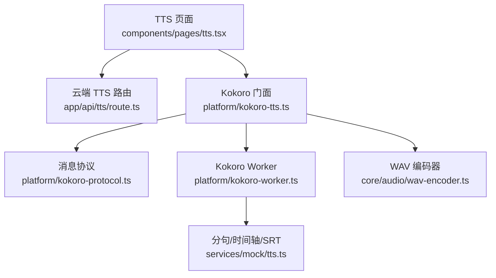
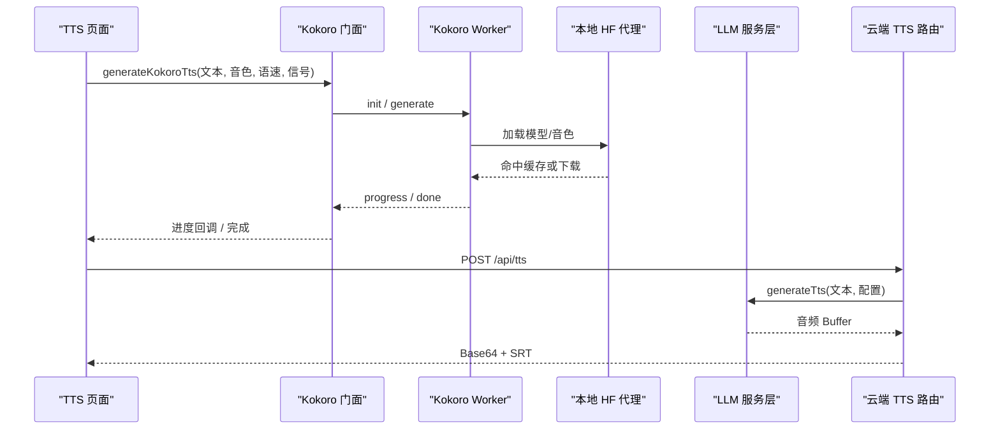
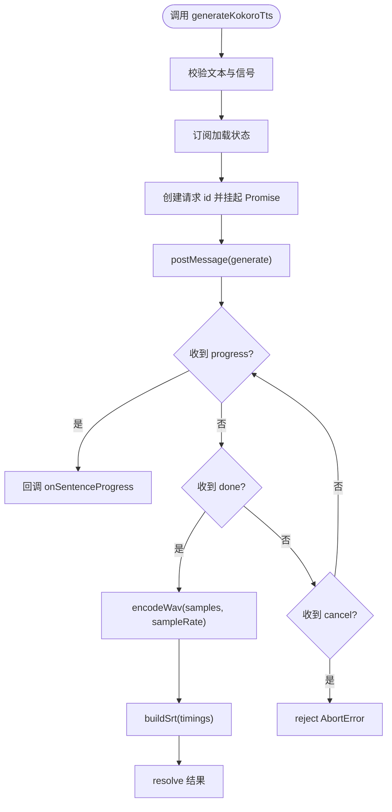
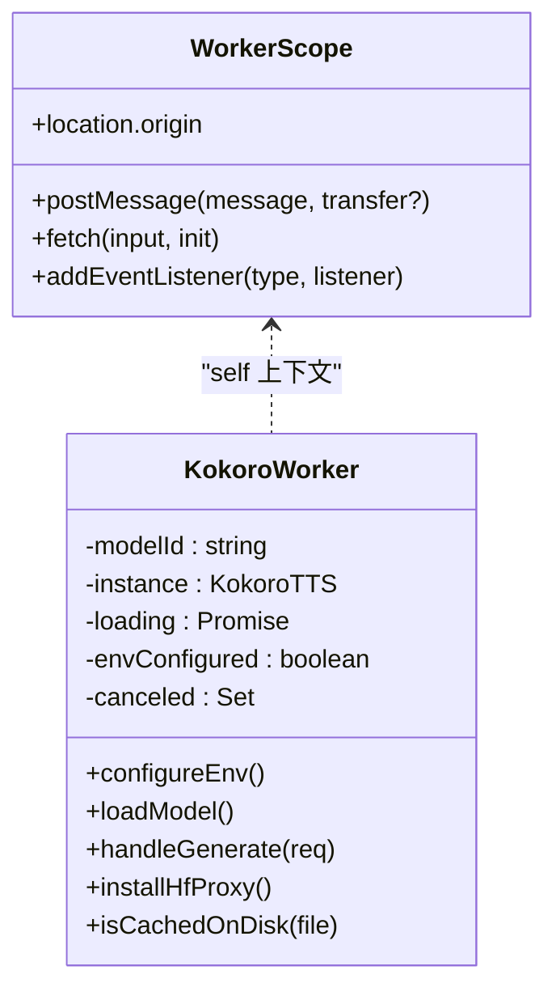
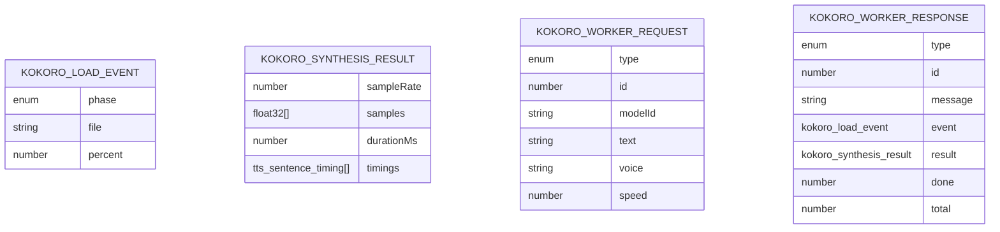
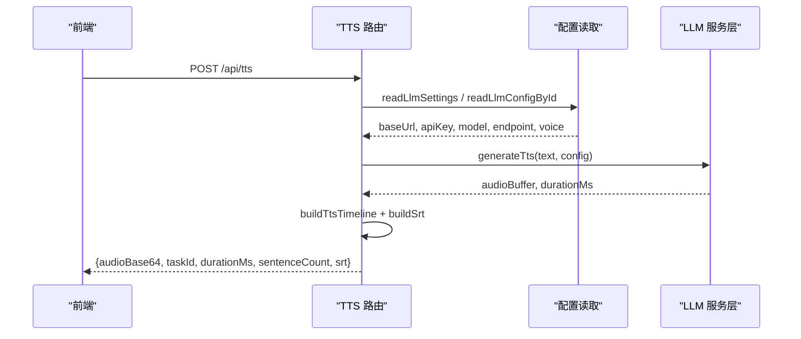
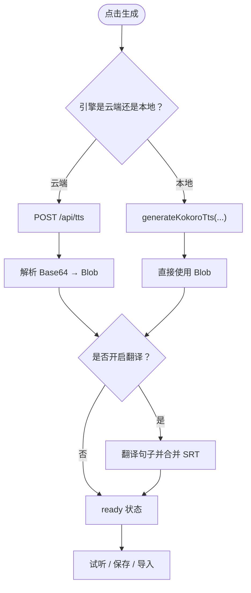
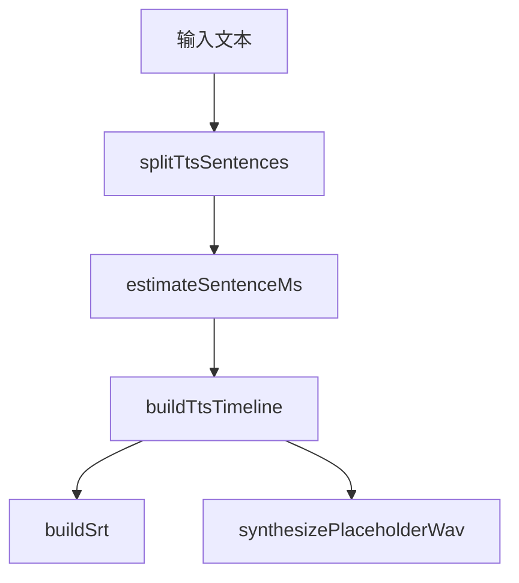
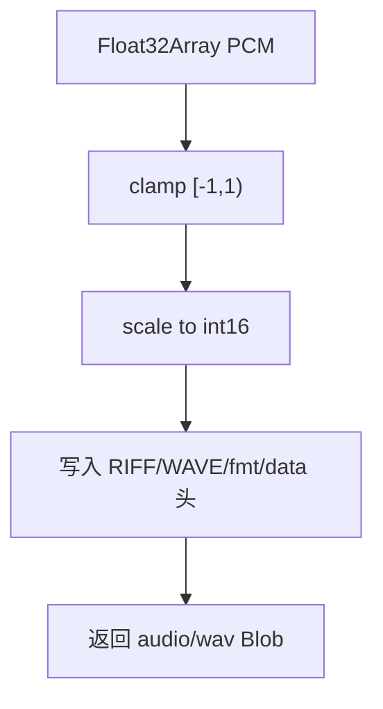
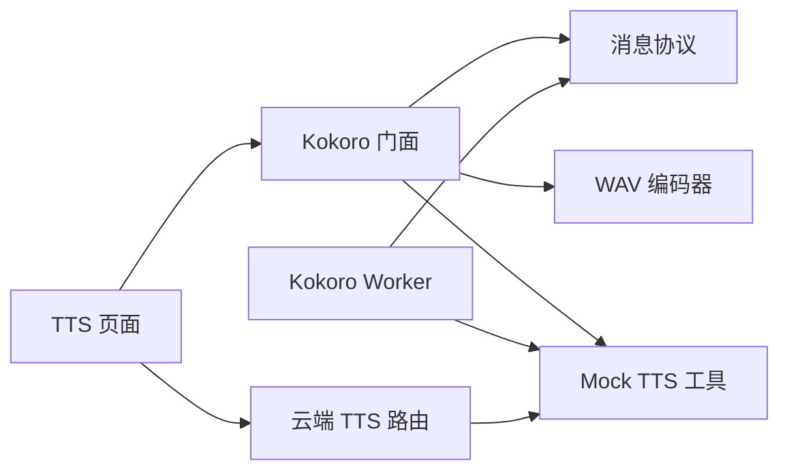

# TTS 引擎集成

<cite>
**本文引用的文件**   
- [client/platform/kokoro-tts.ts](file://client/platform/kokoro-tts.ts)
- [client/platform/kokoro-worker.ts](file://client/platform/kokoro-worker.ts)
- [client/platform/kokoro-protocol.ts](file://client/platform/kokoro-protocol.ts)
- [client/app/api/tts/route.ts](file://client/app/api/tts/route.ts)
- [client/components/pages/tts.tsx](file://client/components/pages/tts.tsx)
- [client/services/mock/tts.ts](file://client/services/mock/tts.ts)
- [client/core/audio/wav-encoder.ts](file://client/core/audio/wav-encoder.ts)
</cite>

## 目录
1. [引言](#引言)
2. [项目结构](#项目结构)
3. [核心组件](#核心组件)
4. [架构总览](#架构总览)
5. [详细组件分析](#详细组件分析)
6. [依赖关系分析](#依赖关系分析)
7. [性能与内存优化](#性能与内存优化)
8. [错误处理与降级策略](#错误处理与降级策略)
9. [配置选项与集成示例](#配置选项与集成示例)
10. [调试技巧](#调试技巧)
11. [结论](#结论)

## 引言
本文件面向 Kokoro 本地文字转语音引擎的集成与使用，重点解释以下方面：
- 本地推理如何通过 Web Worker 避免主线程阻塞。
- 模型与音色通过本地代理统一加载、落盘缓存。
- 句级时间轴与 SRT 字幕生成机制。
- 主线程与 Worker 的消息协议、取消语义和错误传播。
- 云端 TTS 与本地 Kokoro 的统一入口、切换与降级。
- 音频数据从 PCM 到 WAV 的处理链。
- 配置项、集成方式、常见问题排查与性能调优建议。

## 项目结构
围绕 TTS 的核心代码分布在客户端平台层、页面层、API 路由层以及通用工具模块中：
- 平台层：Kokoro 门面、Worker、消息协议。
- 页面层：TTS 交互页，负责选择引擎、参数、进度展示、试听与导出。
- API 层：云端 TTS 路由，封装 LLM 服务层并返回统一结果。
- 工具层：WAV 编码、Mock TTS 分句/时间轴/SRT 构建。

**图示来源**
- [client/components/pages/tts.tsx:193-254](file://client/components/pages/tts.tsx#L193-L254)
- [client/app/api/tts/route.ts:23-115](file://client/app/api/tts/route.ts#L23-L115)
- [client/platform/kokoro-tts.ts:184-237](file://client/platform/kokoro-tts.ts#L184-L237)
- [client/platform/kokoro-worker.ts:184-249](file://client/platform/kokoro-worker.ts#L184-L249)
- [client/services/mock/tts.ts:58-111](file://client/services/mock/tts.ts#L58-L111)
- [client/core/audio/wav-encoder.ts:19-53](file://client/core/audio/wav-encoder.ts#L19-L53)

**章节来源**
- [client/components/pages/tts.tsx:1-11](file://client/components/pages/tts.tsx#L1-L11)
- [client/platform/kokoro-tts.ts:1-17](file://client/platform/kokoro-tts.ts#L1-L17)

## 核心组件
- Kokoro 门面（kokoro-tts.ts）：对外暴露预加载、模型 ID 设置、订阅加载状态、生成本地 TTS 的 Promise API；负责把 Worker 返回的 PCM 转为 WAV Blob，并拼接 SRT。
- Kokoro Worker（kokoro-worker.ts）：在独立线程执行 ONNX 推理；管理模型实例、音色下载、句级合成、进度上报、取消与错误回传。
- 消息协议（kokoro-protocol.ts）：定义主线程与 Worker 的请求/响应类型、加载阶段、合成结果、进度与错误语义。
- 云端 TTS 路由（app/api/tts/route.ts）：校验输入、读取配置、调用 LLM 服务层、估算时间轴、构造 SRT、返回 Base64 音频与元信息。
- TTS 页面（components/pages/tts.tsx）：用户交互入口，支持云端与本地两种引擎，统一输出 WAV + SRT，提供试听、保存、导入学习材料等能力。
- Mock TTS 工具（services/mock/tts.ts）：提供分句、时长估算、时间轴构建、SRT 构建等纯函数，被本地与云端路径复用。
- WAV 编码器（core/audio/wav-encoder.ts）：将 Float32 PCM 样本编码为标准 WAV Blob。

**章节来源**
- [client/platform/kokoro-tts.ts:18-27](file://client/platform/kokoro-tts.ts#L18-L27)
- [client/platform/kokoro-worker.ts:12-18](file://client/platform/kokoro-worker.ts#L12-L18)
- [client/platform/kokoro-protocol.ts:1-50](file://client/platform/kokoro-protocol.ts#L1-L50)
- [client/app/api/tts/route.ts:1-22](file://client/app/api/tts/route.ts#L1-L22)
- [client/components/pages/tts.tsx:1-30](file://client/components/pages/tts.tsx#L1-L30)
- [client/services/mock/tts.ts:1-25](file://client/services/mock/tts.ts#L1-L25)
- [client/core/audio/wav-encoder.ts:1-12](file://client/core/audio/wav-encoder.ts#L1-L12)

## 架构总览
Kokoro 本地 TTS 采用“主线程门面 + Worker 推理”的架构：
- 主线程负责 UI、参数校验、进度回调、WAV 编码与 SRT 构建。
- Worker 负责 ONNX 推理、模型与音色加载、句级拼接、进度与取消控制。
- 模型与音色通过 `/api/hf/` 本地代理访问 HuggingFace，实现磁盘缓存与统一资源路径。
- 云端 TTS 走 `/api/tts`，返回 Base64 音频与 SRT；本地 Kokoro 直接返回 WAV Blob。

**图示来源**
- [client/platform/kokoro-tts.ts:184-237](file://client/platform/kokoro-tts.ts#L184-L237)
- [client/platform/kokoro-worker.ts:136-182](file://client/platform/kokoro-worker.ts#L136-L182)
- [client/app/api/tts/route.ts:23-115](file://client/app/api/tts/route.ts#L23-L115)

## 详细组件分析

### Kokoro 门面（kokoro-tts.ts）
职责与关键点：
- 暴露 `preloadKokoroModel`、`setKokoroModelId`、`subscribeKokoroLoad`、`generateKokoroTts`。
- 维护 Worker 单例与待处理请求队列，按 id 分发进度与结果。
- 收到 Worker 的 `load` 事件后广播给订阅者，用于 UI 显示首次下载、读缓存、初始化等阶段。
- 收到 `progress` 时转发给调用方 `onSentenceProgress`。
- 收到 `done` 后将 PCM 转为 WAV Blob，并基于时间轴构建 SRT。
- 支持 `AbortSignal` 取消：主线程立即 reject，并向 Worker 发送 `cancel`，Worker 在句间停止。

**图示来源**
- [client/platform/kokoro-tts.ts:184-237](file://client/platform/kokoro-tts.ts#L184-L237)

**章节来源**
- [client/platform/kokoro-tts.ts:43-63](file://client/platform/kokoro-tts.ts#L43-L63)
- [client/platform/kokoro-tts.ts:73-128](file://client/platform/kokoro-tts.ts#L73-L128)
- [client/platform/kokoro-tts.ts:130-160](file://client/platform/kokoro-tts.ts#L130-L160)
- [client/platform/kokoro-tts.ts:184-237](file://client/platform/kokoro-tts.ts#L184-L237)

### Kokoro Worker（kokoro-worker.ts）
职责与关键点：
- 懒加载模型实例，保持常驻，避免每次合成重新加载。
- 通过 `@huggingface/transformers.env.remoteHost` 与自定义 fetch 重写，将所有 HuggingFace 请求指向本地代理，确保模型与音色走磁盘缓存。
- 清理浏览器侧缓存，避免重复存储。
- 先 HEAD 探测磁盘缓存，区分“读缓存”和“真下载”，向主线程报告不同阶段。
- 逐句调用 `tts.generate`，记录每句时长，插入句间静音，累计时间轴。
- 使用 `Transferable` 零拷贝传输最终 PCM buffer。
- 取消语义：用 Set 记录已取消的 id，在句循环前检查，保证可中断但不中断当前句推理。

**图示来源**
- [client/platform/kokoro-worker.ts:36-56](file://client/platform/kokoro-worker.ts#L36-L56)
- [client/platform/kokoro-worker.ts:69-118](file://client/platform/kokoro-worker.ts#L69-L118)
- [client/platform/kokoro-worker.ts:136-182](file://client/platform/kokoro-worker.ts#L136-L182)
- [client/platform/kokoro-worker.ts:184-249](file://client/platform/kokoro-worker.ts#L184-L249)

**章节来源**
- [client/platform/kokoro-worker.ts:1-10](file://client/platform/kokoro-worker.ts#L1-L10)
- [client/platform/kokoro-worker.ts:69-118](file://client/platform/kokoro-worker.ts#L69-L118)
- [client/platform/kokoro-worker.ts:136-182](file://client/platform/kokoro-worker.ts#L136-L182)
- [client/platform/kokoro-worker.ts:184-249](file://client/platform/kokoro-worker.ts#L184-L249)
- [client/platform/kokoro-worker.ts:252-273](file://client/platform/kokoro-worker.ts#L252-L273)

### 消息协议（kokoro-protocol.ts）
协议要点：
- 加载阶段：`loading`（读缓存）、`downloading`（真下载）、`initializing`（建会话）。
- 加载事件包含文件名与下载百分比（仅 downloading）。
- 合成结果包含采样率、PCM 样本数组、总时长、句级时间轴。
- 请求类型：`init`（初始化模型）、`generate`（开始合成）、`cancel`（取消某次合成）。
- 响应类型：`load`、`progress`、`done`、`aborted`、`error`（id 为 null 表示全局加载错误）。

**图示来源**
- [client/platform/kokoro-protocol.ts:10-50](file://client/platform/kokoro-protocol.ts#L10-L50)

**章节来源**
- [client/platform/kokoro-protocol.ts:1-50](file://client/platform/kokoro-protocol.ts#L1-L50)

### 云端 TTS 路由（app/api/tts/route.ts）
职责与关键点：
- 校验文本长度与内容，拆分句子。
- 读取 LLM/TTS 配置，默认 provider 与模型由服务端默认值决定。
- 调用 LLM 服务层生成音频 Buffer，Base64 返回。
- 估算时间轴并按实际时长比例缩放，生成 SRT。
- 统一错误包装，区分 LLM 错误与普通异常。

**图示来源**
- [client/app/api/tts/route.ts:23-115](file://client/app/api/tts/route.ts#L23-L115)

**章节来源**
- [client/app/api/tts/route.ts:23-115](file://client/app/api/tts/route.ts#L23-L115)

### TTS 页面（components/pages/tts.tsx）
职责与关键点：
- 根据是否配置云端 TTS 模型，默认选择云端或本地 Kokoro。
- 支持切换引擎、音色、语速、翻译开关与翻译模型。
- 云端调用 `/api/tts`，本地调用 `generateKokoroTts`。
- 统一输出 `taskId`、WAV Blob、URL、时长、句数、SRT。
- 可选翻译流程：成功后合并双语字幕，失败保留单语字幕并提示。
- 试听播放、保存到设备、导入为学习材料。

**图示来源**
- [client/components/pages/tts.tsx:193-254](file://client/components/pages/tts.tsx#L193-L254)
- [client/components/pages/tts.tsx:263-318](file://client/components/pages/tts.tsx#L263-L318)

**章节来源**
- [client/components/pages/tts.tsx:1-30](file://client/components/pages/tts.tsx#L1-L30)
- [client/components/pages/tts.tsx:127-171](file://client/components/pages/tts.tsx#L127-L171)
- [client/components/pages/tts.tsx:193-254](file://client/components/pages/tts.tsx#L193-L254)
- [client/components/pages/tts.tsx:263-318](file://client/components/pages/tts.tsx#L263-L318)
- [client/components/pages/tts.tsx:325-361](file://client/components/pages/tts.tsx#L325-L361)

### Mock TTS 工具（services/mock/tts.ts）
职责与关键点：
- 分句规则：按 `.!?;:\n` 切分，标点归属前句，过滤纯标点片段。
- 时长估算：英文约 15 字符/秒，最小句长 400ms，按语速缩放。
- 时间轴：逐句累计，句间留 120ms 静音。
- SRT：序号 + HH:MM:SS,mmm 时间轴 + 句文本。
- 占位音 WAV：每句一个正弦基频，句间静音，便于测试播放器 seek。

**图示来源**
- [client/services/mock/tts.ts:58-111](file://client/services/mock/tts.ts#L58-L111)
- [client/services/mock/tts.ts:113-130](file://client/services/mock/tts.ts#L113-L130)

**章节来源**
- [client/services/mock/tts.ts:24-33](file://client/services/mock/tts.ts#L24-L33)
- [client/services/mock/tts.ts:58-111](file://client/services/mock/tts.ts#L58-L111)
- [client/services/mock/tts.ts:113-130](file://client/services/mock/tts.ts#L113-L130)

### WAV 编码器（core/audio/wav-encoder.ts）
职责与关键点：
- 将 Float32 PCM 样本编码为标准 WAV Blob（RIFF 头 + PCM 数据）。
- 目标采样率默认 16kHz，但 Kokoro 门面传入真实采样率。
- 对越界值 clamp，NaN 归零，保证输出稳定。

**图示来源**
- [client/core/audio/wav-encoder.ts:19-53](file://client/core/audio/wav-encoder.ts#L19-L53)

**章节来源**
- [client/core/audio/wav-encoder.ts:1-12](file://client/core/audio/wav-encoder.ts#L1-L12)
- [client/core/audio/wav-encoder.ts:19-53](file://client/core/audio/wav-encoder.ts#L19-L53)

## 依赖关系分析
- 门面依赖协议、WAV 编码器、Mock TTS 的分句与 SRT 构建。
- Worker 依赖协议、Mock TTS 的分句与时间轴，运行时动态引入 `kokoro-js` 与 `@huggingface/transformers`。
- 页面依赖门面与云端路由，同时复用 Mock TTS 的常量与工具。
- 云端路由依赖 LLM 服务层与 Mock TTS 的时间轴/SRT 构建。

**图示来源**
- [client/components/pages/tts.tsx:193-254](file://client/components/pages/tts.tsx#L193-L254)
- [client/platform/kokoro-tts.ts:18-27](file://client/platform/kokoro-tts.ts#L18-L27)
- [client/platform/kokoro-worker.ts:12-18](file://client/platform/kokoro-worker.ts#L12-L18)
- [client/app/api/tts/route.ts:12-17](file://client/app/api/tts/route.ts#L12-L17)

**章节来源**
- [client/platform/kokoro-tts.ts:18-27](file://client/platform/kokoro-tts.ts#L18-L27)
- [client/platform/kokoro-worker.ts:12-18](file://client/platform/kokoro-worker.ts#L12-L18)
- [client/app/api/tts/route.ts:12-17](file://client/app/api/tts/route.ts#L12-L17)
- [client/components/pages/tts.tsx:193-254](file://client/components/pages/tts.tsx#L193-L254)

## 性能与内存优化
- Worker 常驻模型实例：避免每次合成重新加载 ONNX 会话，减少首句延迟。
- 磁盘缓存优先：先 HEAD 探测磁盘缓存，命中则只读不下载，降低网络开销。
- 关闭浏览器侧缓存：避免同一份模型在浏览器与磁盘各存一份，简化缓存判断。
- 零拷贝传输：Worker 使用 `Transferable` 传递最终 PCM buffer，减少主线程复制。
- 句间静音固定 120ms：与云端估算口径一致，保证时间轴对齐。
- 进度反馈：逐句进度回调，UI 可即时更新，提升用户体验。
- 取消语义：主线程立即响应取消，Worker 在句间停止，避免长时间阻塞。

[本节为通用指导，不直接分析具体文件]

## 错误处理与降级策略
- 模型加载错误：Worker 抛出 `load` 错误事件（id 为 null），门面广播并记录日志。
- 生成错误：Worker 抛出 `error` 响应，门面 reject 对应 Promise。
- 网络错误：Worker 重写 fetch，若上游 HTTP 非 ok，抛出明确错误信息。
- 取消错误：主线程抛 `AbortError`，Worker 收到 `cancel` 后在句间停止并返回 `aborted`。
- 云端错误：路由捕获 LLM 错误与普通异常，返回结构化错误码与消息。
- 翻译降级：翻译失败不影响已有单语字幕，仅提示失败原因。

**章节来源**
- [client/platform/kokoro-tts.ts:82-113](file://client/platform/kokoro-tts.ts#L82-L113)
- [client/platform/kokoro-worker.ts:85-95](file://client/platform/kokoro-worker.ts#L85-L95)
- [client/platform/kokoro-worker.ts:246-249](file://client/platform/kokoro-worker.ts#L246-L249)
- [client/app/api/tts/route.ts:101-115](file://client/app/api/tts/route.ts#L101-L115)
- [client/components/pages/tts.tsx:285-318](file://client/components/pages/tts.tsx#L285-L318)

## 配置选项与集成示例
- 本地 Kokoro 配置：
  - 模型 ID：可通过 `setKokoroModelId` 设置，默认使用仓库默认模型。
  - 音色列表：`KOKORO_VOICES`，包含美式女/男音色。
  - 预加载：应用启动时可调用 `preloadKokoroModel`，失败不抛异常。
  - 加载状态订阅：`subscribeKokoroLoad` 获取 loading/downloading/initializing 阶段。
- 生成参数：
  - 文本：需非空且有效分句。
  - 音色：字符串，如 `af_heart`、`am_adam`。
  - 语速：0.5 ~ 2.0。
  - 信号：`AbortSignal` 支持取消。
  - 进度回调：`onSentenceProgress` 接收已完成句数与总句数。
  - 加载回调：`onLoad` 接收加载阶段事件。
- 云端 TTS 配置：
  - 需在设置页配置 Base URL、API Key、Provider、Model、Endpoint、Voice。
  - 页面自动拉取已配置模型列表，未配置时默认使用本地 Kokoro。
- 集成示例：
  - 本地：调用 `generateKokoroTts`，得到 `Blob`、`durationMs`、`timings`、`srt`。
  - 云端：POST `/api/tts`，得到 `audioBase64`、`taskId`、`durationMs`、`sentenceCount`、`srt`。

**章节来源**
- [client/platform/kokoro-tts.ts:30-41](file://client/platform/kokoro-tts.ts#L30-L41)
- [client/platform/kokoro-tts.ts:136-160](file://client/platform/kokoro-tts.ts#L136-L160)
- [client/platform/kokoro-tts.ts:173-182](file://client/platform/kokoro-tts.ts#L173-L182)
- [client/components/pages/tts.tsx:127-171](file://client/components/pages/tts.tsx#L127-L171)
- [client/app/api/tts/route.ts:48-75](file://client/app/api/tts/route.ts#L48-L75)

## 调试技巧
- 查看加载阶段：订阅 `subscribeKokoroLoad`，观察 `phase` 与 `percent`。
- 检查 Worker 错误：监听 Worker `error` 事件，门面会终止旧 Worker 并重建。
- 验证磁盘缓存：HEAD 请求 `/api/hf/{modelId}/resolve/main/{file}`，检查 `x-cache` 是否为 HIT。
- 确认 fetch 重写：Worker 内重写 fetch，确保 HuggingFace 地址被改写为本地代理。
- 进度调试：在 `onSentenceProgress` 中打印 `done/total`，确认句级进度。
- 云端错误定位：查看路由日志中的 `LlmError` 与 `code`，确认 Provider 配置是否正确。
- 翻译降级：开启翻译后若失败，页面会保留单语字幕并显示失败原因。

**章节来源**
- [client/platform/kokoro-tts.ts:43-63](file://client/platform/kokoro-tts.ts#L43-L63)
- [client/platform/kokoro-tts.ts:115-128](file://client/platform/kokoro-tts.ts#L115-L128)
- [client/platform/kokoro-worker.ts:120-134](file://client/platform/kokoro-worker.ts#L120-L134)
- [client/platform/kokoro-worker.ts:69-95](file://client/platform/kokoro-worker.ts#L69-L95)
- [client/app/api/tts/route.ts:101-115](file://client/app/api/tts/route.ts#L101-L115)
- [client/components/pages/tts.tsx:285-318](file://client/components/pages/tts.tsx#L285-L318)

## 结论
Kokoro 本地 TTS 通过门面与 Worker 分离，将同步 ONNX 推理移出主线程，保障 UI 流畅与取消响应。模型与音色经本地代理统一加载与缓存，避免重复下载与浏览器冗余存储。句级时间轴与 SRT 构建保持一致口径，便于与云端路径对齐。页面层统一接入云端与本地两种引擎，提供一致的试听、保存与导入体验。结合完善的错误处理与降级策略，系统在不同网络与配置条件下均能提供稳定可用的 TTS 能力。

[本节为总结性内容，不直接分析具体文件]