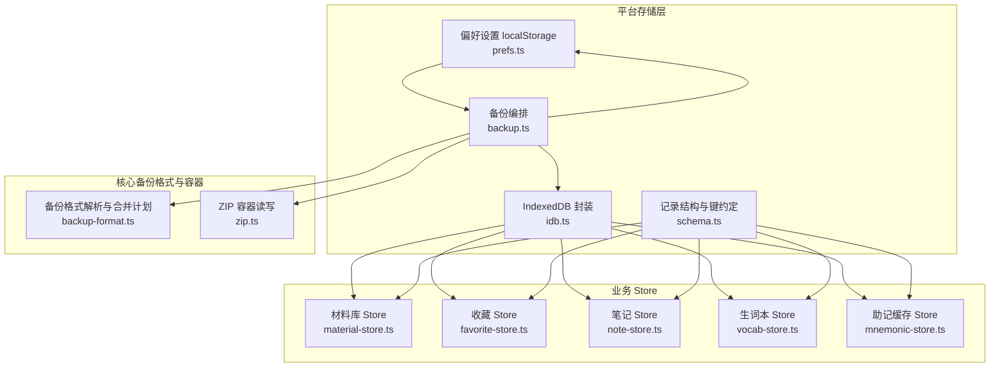
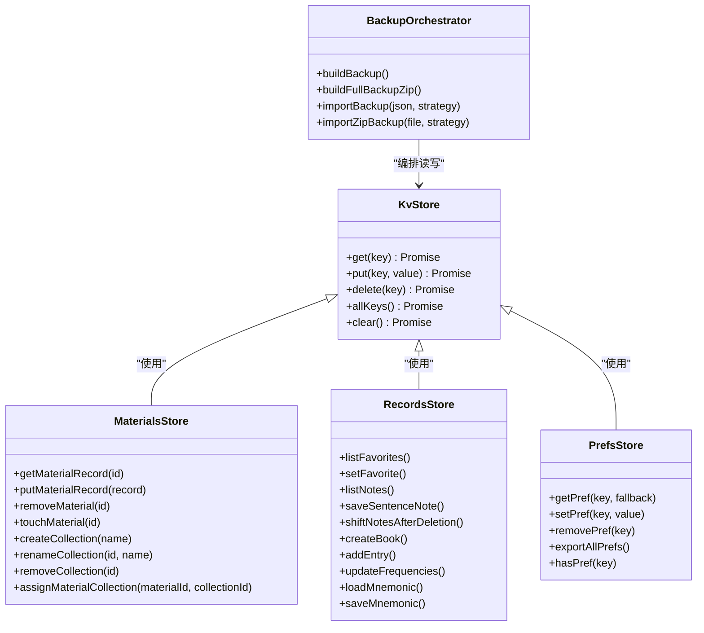
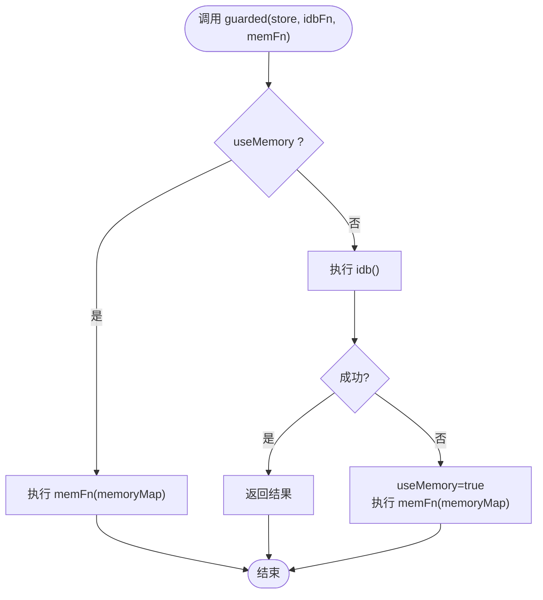
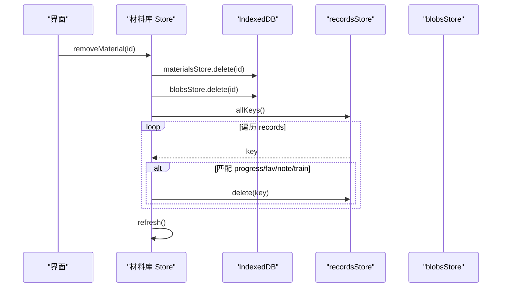
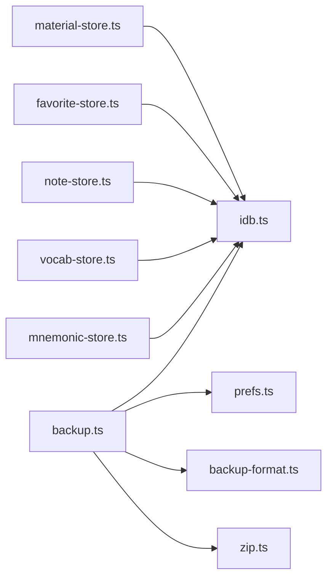
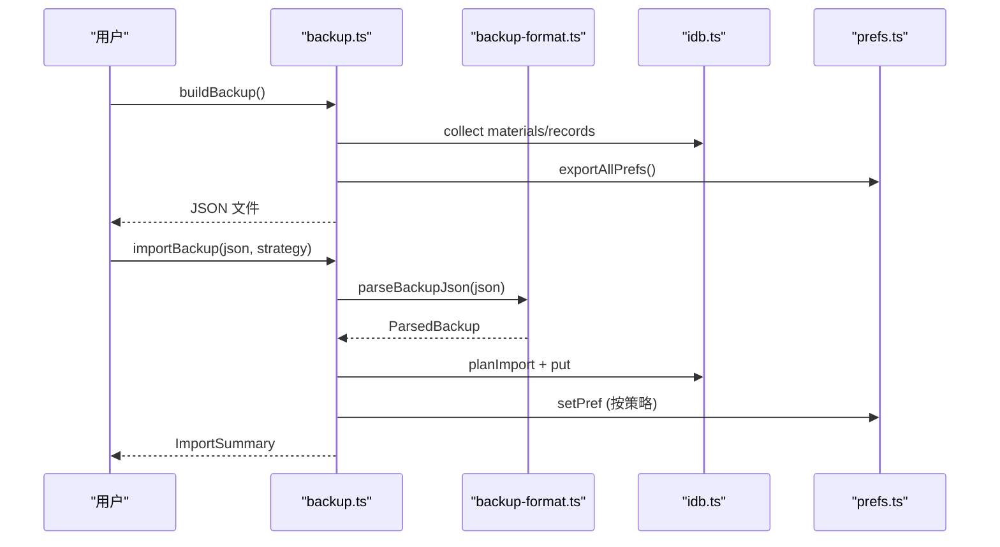
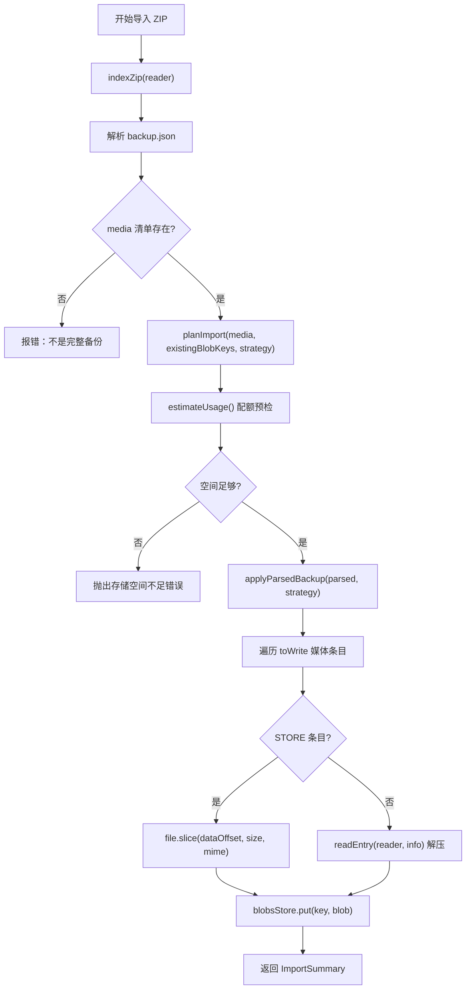
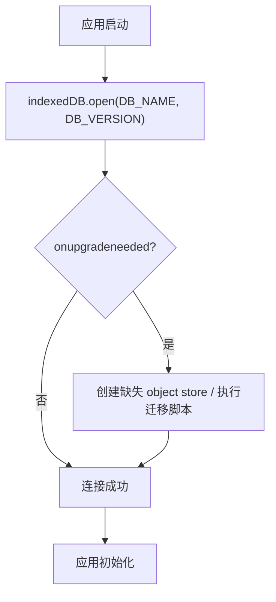

# 存储适配器

<cite>
**本文引用的文件**   
- [client/platform/storage/idb.ts](file://client/platform/storage/idb.ts)
- [client/platform/storage/prefs.ts](file://client/platform/storage/prefs.ts)
- [client/platform/storage/schema.ts](file://client/platform/storage/schema.ts)
- [client/platform/storage/backup.ts](file://client/platform/storage/backup.ts)
- [client/core/backup/backup-format.ts](file://client/core/backup/backup-format.ts)
- [client/core/backup/zip.ts](file://client/core/backup/zip.ts)
- [client/stores/material-store.ts](file://client/stores/material-store.ts)
- [client/stores/favorite-store.ts](file://client/stores/favorite-store.ts)
- [client/stores/note-store.ts](file://client/stores/note-store.ts)
- [client/stores/mnemonic-store.ts](file://client/stores/mnemonic-store.ts)
- [client/stores/vocab-store.ts](file://client/stores/vocab-store.ts)
</cite>

## 目录
1. [引言](#引言)
2. [项目结构](#项目结构)
3. [核心组件](#核心组件)
4. [架构总览](#架构总览)
5. [详细组件分析](#详细组件分析)
6. [依赖关系分析](#依赖关系分析)
7. [性能与索引优化](#性能与索引优化)
8. [备份与恢复流程](#备份与恢复流程)
9. [Schema 版本与数据迁移](#schema-版本与数据迁移)
10. [使用示例](#使用示例)
11. [故障排查指南](#故障排查指南)
12. [结论](#结论)

## 引言
本文件聚焦“存储适配器层”，系统性说明 IndexedDB 存储适配器的实现、用户偏好设置存储、数据备份与恢复机制、Schema 版本管理，以及存储抽象层的设计模式、错误处理策略和数据迁移方案。文档同时提供数据库架构图、数据流图、备份恢复流程图，并给出使用示例、性能调优建议与故障排查指南，帮助开发者快速理解并安全扩展该存储层。

## 项目结构
存储相关代码集中在 `client/platform/storage`，并与业务 store（如材料、收藏、笔记、生词本、助记缓存）和备份模块协同工作：

**图表来源**
- [client/platform/storage/idb.ts:1-117](file://client/platform/storage/idb.ts#L1-L117)
- [client/platform/storage/prefs.ts:1-52](file://client/platform/storage/prefs.ts#L1-L52)
- [client/platform/storage/schema.ts:1-27](file://client/platform/storage/schema.ts#L1-L27)
- [client/platform/storage/backup.ts:1-243](file://client/platform/storage/backup.ts#L1-L243)
- [client/core/backup/backup-format.ts:1-127](file://client/core/backup/backup-format.ts#L1-L127)
- [client/core/backup/zip.ts:1-283](file://client/core/backup/zip.ts#L1-L283)
- [client/stores/material-store.ts:1-163](file://client/stores/material-store.ts#L1-L163)
- [client/stores/favorite-store.ts:1-42](file://client/stores/favorite-store.ts#L1-L42)
- [client/stores/note-store.ts:1-72](file://client/stores/note-store.ts#L1-L72)
- [client/stores/vocab-store.ts:1-193](file://client/stores/vocab-store.ts#L1-L193)
- [client/stores/mnemonic-store.ts:1-70](file://client/stores/mnemonic-store.ts#L1-L70)

**章节来源**
- [client/platform/storage/idb.ts:1-117](file://client/platform/storage/idb.ts#L1-L117)
- [client/platform/storage/prefs.ts:1-52](file://client/platform/storage/prefs.ts#L1-L52)
- [client/platform/storage/schema.ts:1-27](file://client/platform/storage/schema.ts#L1-L27)
- [client/platform/storage/backup.ts:1-243](file://client/platform/storage/backup.ts#L1-L243)
- [client/core/backup/backup-format.ts:1-127](file://client/core/backup/backup-format.ts#L1-L127)
- [client/core/backup/zip.ts:1-283](file://client/core/backup/zip.ts#L1-L283)
- [client/stores/material-store.ts:1-163](file://client/stores/material-store.ts#L1-L163)
- [client/stores/favorite-store.ts:1-42](file://client/stores/favorite-store.ts#L1-L42)
- [client/stores/note-store.ts:1-72](file://client/stores/note-store.ts#L1-L72)
- [client/stores/vocab-store.ts:1-193](file://client/stores/vocab-store.ts#L1-L193)
- [client/stores/mnemonic-store.ts:1-70](file://client/stores/mnemonic-store.ts#L1-L70)

## 核心组件
- IndexedDB 适配器：提供 Promise 化的 KV 接口，自动降级到内存 Map，保证 SSR 与隐私模式下不崩溃。
- 偏好设置存储：基于 localStorage 的轻量 KV 封装，支持导出全部设置项供备份使用。
- Schema 约定：定义材料记录结构与 records 前缀键规范，统一各业务 store 的 key 生成。
- 备份编排：协调 materials、records、blobs 与 prefs 的导出/导入，支持轻量 JSON 与完整 zip 两种格式。
- 备份格式与 ZIP 容器：纯 TS 实现，负责校验、合并计划、ZIP 写入/读取与零拷贝媒体读取。
- 业务 Store：材料库、收藏、笔记、生词本、助记缓存等，均通过统一的 recordsStore 访问。

**章节来源**
- [client/platform/storage/idb.ts:1-117](file://client/platform/storage/idb.ts#L1-L117)
- [client/platform/storage/prefs.ts:1-52](file://client/platform/storage/prefs.ts#L1-L52)
- [client/platform/storage/schema.ts:1-27](file://client/platform/storage/schema.ts#L1-L27)
- [client/platform/storage/backup.ts:1-243](file://client/platform/storage/backup.ts#L1-L243)
- [client/core/backup/backup-format.ts:1-127](file://client/core/backup/backup-format.ts#L1-L127)
- [client/core/backup/zip.ts:1-283](file://client/core/backup/zip.ts#L1-L283)

## 架构总览
存储适配器采用“抽象层 + 具体实现”的分层设计：上层业务 store 仅依赖统一的 KV 接口与键约定；底层 IndexedDB 与 localStorage 被封装为可替换的具体实现，并通过内存兜底保障稳定性。

**图表来源**
- [client/platform/storage/idb.ts:80-102](file://client/platform/storage/idb.ts#L80-L102)
- [client/stores/material-store.ts:24-163](file://client/stores/material-store.ts#L24-L163)
- [client/stores/favorite-store.ts:12-42](file://client/stores/favorite-store.ts#L12-L42)
- [client/stores/note-store.ts:12-72](file://client/stores/note-store.ts#L12-L72)
- [client/stores/vocab-store.ts:14-193](file://client/stores/vocab-store.ts#L14-L193)
- [client/stores/mnemonic-store.ts:13-70](file://client/stores/mnemonic-store.ts#L13-L70)
- [client/platform/storage/prefs.ts:8-52](file://client/platform/storage/prefs.ts#L8-L52)
- [client/platform/storage/backup.ts:62-243](file://client/platform/storage/backup.ts#L62-L243)

## 详细组件分析

### IndexedDB 存储适配器
- 三个 object store：materials（材料元数据+字幕）、blobs（媒体 Blob）、records（训练/收藏/进度等）。
- 事务封装 tx：统一 onsuccess/onerror，失败时记录日志并拒绝 Promise。
- guarded 兜底：IDB 异常时永久切换到内存 Map，调用方永不崩溃。
- KV 接口：get/put/delete/allKeys/clear，屏蔽 IndexedDB 细节。
- 磁盘估算：estimateUsage 返回 usage/quota，用于导入前空间预检。

**图表来源**
- [client/platform/storage/idb.ts:70-97](file://client/platform/storage/idb.ts#L70-L97)

**章节来源**
- [client/platform/storage/idb.ts:1-117](file://client/platform/storage/idb.ts#L1-L117)

### 用户偏好设置存储
- 以 `ping-english:` 为前缀的 localStorage 键值对。
- getPref/setPref/removePref 提供类型安全的读写，SSR 安全且静默降级。
- exportAllPrefs 导出所有带前缀的设置项，跳过损坏项。
- hasPref 用于导入冲突判断。

**章节来源**
- [client/platform/storage/prefs.ts:1-52](file://client/platform/storage/prefs.ts#L1-L52)

### Schema 与键约定
- MaterialRecord：包含 material 与 subtitleData，避免重复解析。
- RECORD_KEYS：统一生成 records 的 key 前缀（progress:/fav:/note:/train:/vocabbook:/vocabentry:/mnemonic:/collection:），确保跨 store 一致性。

**章节来源**
- [client/platform/storage/schema.ts:1-27](file://client/platform/storage/schema.ts#L1-L27)

### 业务 Store 与 CRUD 封装
- 材料库 Store：首次种子注入、最近学习排序、级联删除（material/blob/records）、集合 CRUD。
- 收藏 Store：按 materialId 过滤、去重幂等、句序号升序。
- 笔记 Store：保存/删除、删句后平移笔记 index。
- 生词本 Store：默认书创建、词条频率统计更新、批量写入。
- 助记缓存 Store：本地缓存 LLM 结果，减少重复请求。

**图表来源**
- [client/stores/material-store.ts:107-121](file://client/stores/material-store.ts#L107-L121)

**章节来源**
- [client/stores/material-store.ts:1-163](file://client/stores/material-store.ts#L1-L163)
- [client/stores/favorite-store.ts:1-42](file://client/stores/favorite-store.ts#L1-L42)
- [client/stores/note-store.ts:1-72](file://client/stores/note-store.ts#L1-L72)
- [client/stores/vocab-store.ts:1-193](file://client/stores/vocab-store.ts#L1-L193)
- [client/stores/mnemonic-store.ts:1-70](file://client/stores/mnemonic-store.ts#L1-L70)

## 依赖关系分析
- 业务 Store 依赖统一的 KV 接口与 RECORD_KEYS，降低耦合。
- 备份编排依赖 backup-format（校验/合并计划）与 zip（容器读写），并协调 IDB 与 prefs。
- 无循环依赖：platform/storage 不反向依赖业务 stores；core/backup 不依赖 platform/storage 的实现细节（仅通过接口与类型）。

**图表来源**
- [client/stores/material-store.ts:19-20](file://client/stores/material-store.ts#L19-L20)
- [client/stores/favorite-store.ts:8-9](file://client/stores/favorite-store.ts#L8-L9)
- [client/stores/note-store.ts:8-9](file://client/stores/note-store.ts#L8-L9)
- [client/stores/vocab-store.ts:10-11](file://client/stores/vocab-store.ts#L10-L11)
- [client/stores/mnemonic-store.ts:9-10](file://client/stores/mnemonic-store.ts#L9-L10)
- [client/platform/storage/backup.ts:15-17](file://client/platform/storage/backup.ts#L15-L17)

**章节来源**
- [client/platform/storage/idb.ts:1-117](file://client/platform/storage/idb.ts#L1-L117)
- [client/platform/storage/backup.ts:1-243](file://client/platform/storage/backup.ts#L1-L243)
- [client/core/backup/backup-format.ts:1-127](file://client/core/backup/backup-format.ts#L1-L127)
- [client/core/backup/zip.ts:1-283](file://client/core/backup/zip.ts#L1-L283)

## 性能与索引优化
- IndexedDB 当前未显式创建索引，KV 操作复杂度近似 O(1)。若未来需要范围查询或条件筛选，建议在 records 上为常用前缀建立索引（例如按 materialId 或类型前缀）。
- 批量写入：在导入时使用 Promise.all 并行 put，提升吞吐；注意浏览器并发限制与主线程阻塞风险。
- 内存控制：完整备份 zip 构建时定期将已写分片合并为 Blob，避免 JS 堆峰值过高；媒体条目使用 STORE 零压缩，避免解压开销。
- 预估配额：导入前调用 estimateUsage 进行空间检查，防止写入失败。

[本节为通用性能建议，不直接分析具体文件]

## 备份与恢复流程

### 轻量 JSON 备份/导入
- 收集 materials、records、prefs，组装为 JSON 文件。
- 导入时解析校验，按策略（skipExisting/overwrite）合并。

**图表来源**
- [client/platform/storage/backup.ts:50-71](file://client/platform/storage/backup.ts#L50-L71)
- [client/platform/storage/backup.ts:138-180](file://client/platform/storage/backup.ts#L138-L180)
- [client/core/backup/backup-format.ts:45-127](file://client/core/backup/backup-format.ts#L45-L127)

### 完整 ZIP 备份/导入
- 清单阶段：遍历 material ids，收集 media 清单（不含音视频本体）。
- 写入阶段：先写材料/记录/设置，再写媒体；STORE 条目零拷贝 slice，保留 MIME。
- 预检阶段：根据 zip 中央目录估算体积，结合 estimateUsage 做配额检查。

**图表来源**
- [client/platform/storage/backup.ts:77-121](file://client/platform/storage/backup.ts#L77-L121)
- [client/platform/storage/backup.ts:187-243](file://client/platform/storage/backup.ts#L187-L243)
- [client/core/backup/zip.ts:190-274](file://client/core/backup/zip.ts#L190-L274)

**章节来源**
- [client/platform/storage/backup.ts:1-243](file://client/platform/storage/backup.ts#L1-L243)
- [client/core/backup/backup-format.ts:1-127](file://client/core/backup/backup-format.ts#L1-L127)
- [client/core/backup/zip.ts:1-283](file://client/core/backup/zip.ts#L1-L283)

## Schema 版本与数据迁移
- IndexedDB 版本号：当前 DB_VERSION=2，openDb 中 onupgradeneeded 会确保三个 object store 存在。
- 备份格式版本：BACKUP_FORMAT_VERSION=1，解析时校验 app 标识与版本兼容性，拒绝来自更高版本的备份。
- 迁移策略：
  - 若需新增字段或改变结构，应在 onupgradeneeded 中执行迁移脚本（例如遍历 records 前缀并转换旧结构）。
  - 备份导入时通过 planImport 与 ImportStrategy 控制冲突处理，避免覆盖用户已有数据。

**图表来源**
- [client/platform/storage/idb.ts:27-51](file://client/platform/storage/idb.ts#L27-L51)
- [client/core/backup/backup-format.ts:45-63](file://client/core/backup/backup-format.ts#L45-L63)

**章节来源**
- [client/platform/storage/idb.ts:1-117](file://client/platform/storage/idb.ts#L1-L117)
- [client/core/backup/backup-format.ts:1-127](file://client/core/backup/backup-format.ts#L1-L127)

## 使用示例
以下为常见用法路径（不展示代码内容，仅提供引用位置）：

- 初始化材料库并加载列表：
  - [initMaterials:70-73](file://client/stores/material-store.ts#L70-L73)
- 添加/更新材料记录：
  - [putMaterialRecord:82-85](file://client/stores/material-store.ts#L82-L85)
- 删除材料并级联清理：
  - [removeMaterial:107-121](file://client/stores/material-store.ts#L107-L121)
- 收藏/取消收藏句子：
  - [setFavorite:27-36](file://client/stores/favorite-store.ts#L27-L36)
- 保存句子笔记：
  - [saveSentenceNote:35-50](file://client/stores/note-store.ts#L35-L50)
- 创建生词本并添加词条：
  - [createBook:60-72](file://client/stores/vocab-store.ts#L60-L72)
  - [addEntry:104-116](file://client/stores/vocab-store.ts#L104-L116)
- 构建轻量备份并下载：
  - [buildBackup:62-71](file://client/platform/storage/backup.ts#L62-L71)
  - [downloadJsonBackup:134-136](file://client/platform/storage/backup.ts#L134-L136)
- 导入 ZIP 备份：
  - [importZipBackup:211-243](file://client/platform/storage/backup.ts#L211-L243)

**章节来源**
- [client/stores/material-store.ts:70-121](file://client/stores/material-store.ts#L70-L121)
- [client/stores/favorite-store.ts:27-36](file://client/stores/favorite-store.ts#L27-L36)
- [client/stores/note-store.ts:35-50](file://client/stores/note-store.ts#L35-L50)
- [client/stores/vocab-store.ts:60-116](file://client/stores/vocab-store.ts#L60-L116)
- [client/platform/storage/backup.ts:62-71](file://client/platform/storage/backup.ts#L62-L71)
- [client/platform/storage/backup.ts:134-136](file://client/platform/storage/backup.ts#L134-L136)
- [client/platform/storage/backup.ts:211-243](file://client/platform/storage/backup.ts#L211-L243)

## 故障排查指南
- IndexedDB 打开失败或被阻塞：
  - 现象：控制台输出 “[IDB] open failed...” 或 “[IDB] open blocked...”，自动切换内存模式。
  - 排查：检查多标签页占用、隐私模式、权限限制；确认 isMemoryFallback 状态。
  - 参考：[openDb:27-51](file://client/platform/storage/idb.ts#L27-L51)、[guarded:70-78](file://client/platform/storage/idb.ts#L70-L78)
- 事务错误：
  - 现象：transaction error on “store” (mode)，Promise 被拒绝。
  - 排查：确认 store 名称与 mode 正确；检查是否存在非法 key 或值。
  - 参考：[tx:53-68](file://client/platform/storage/idb.ts#L53-L68)
- 备份导入失败：
  - 轻量 JSON：parseBackupJson 返回错误信息（非有效 JSON、结构不正确、版本不兼容）。
  - ZIP：缺少 backup.json、zip64 不支持、条目损坏、空间不足。
  - 参考：[parseBackupJson:45-112](file://client/core/backup/backup-format.ts#L45-L112)、[openBackupZip:187-199](file://client/platform/storage/backup.ts#L187-L199)、[importZipBackup:211-243](file://client/platform/storage/backup.ts#L211-L243)
- 偏好设置读写失败：
  - 现象：localStorage 不可用或写入被拒，函数返回 false 或忽略。
  - 排查：确认运行环境为浏览器；检查隐私模式与配额。
  - 参考：[getPref/setPref:8-22](file://client/platform/storage/prefs.ts#L8-L22)

**章节来源**
- [client/platform/storage/idb.ts:27-78](file://client/platform/storage/idb.ts#L27-L78)
- [client/core/backup/backup-format.ts:45-112](file://client/core/backup/backup-format.ts#L45-L112)
- [client/platform/storage/backup.ts:187-243](file://client/platform/storage/backup.ts#L187-L243)
- [client/platform/storage/prefs.ts:8-22](file://client/platform/storage/prefs.ts#L8-L22)

## 结论
存储适配器层通过 IndexedDB 与 localStorage 的统一抽象，提供了稳定、可扩展的数据持久化能力。其内存兜底、备份格式校验与 ZIP 零拷贝媒体读取，显著提升了鲁棒性与性能。业务 store 遵循统一的键约定与 KV 接口，便于维护与扩展。未来可在 records 上引入索引以提升查询效率，并在 onupgradeneeded 中完善数据迁移逻辑，以支撑 Schema 演进。