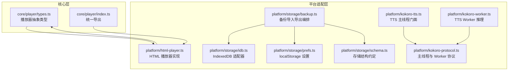
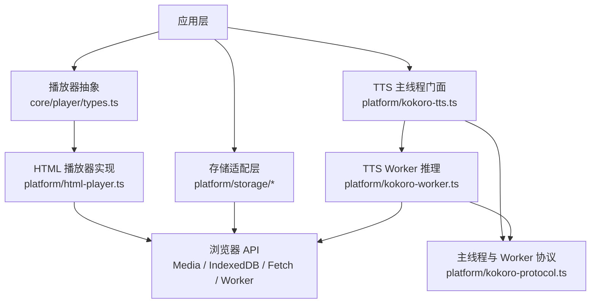
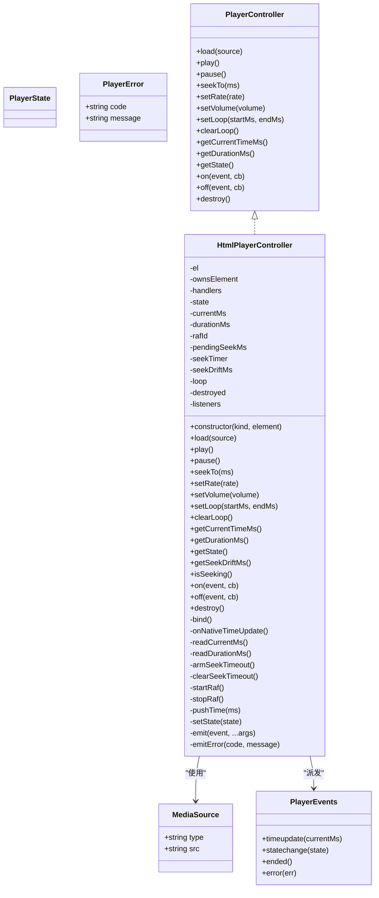
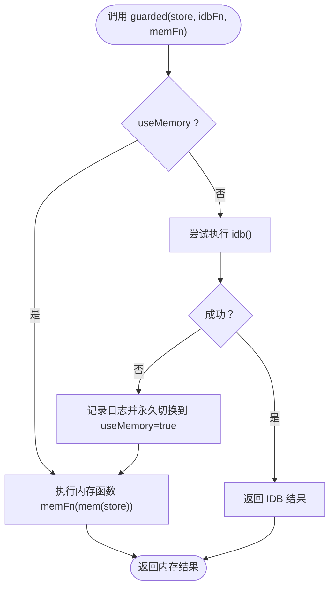
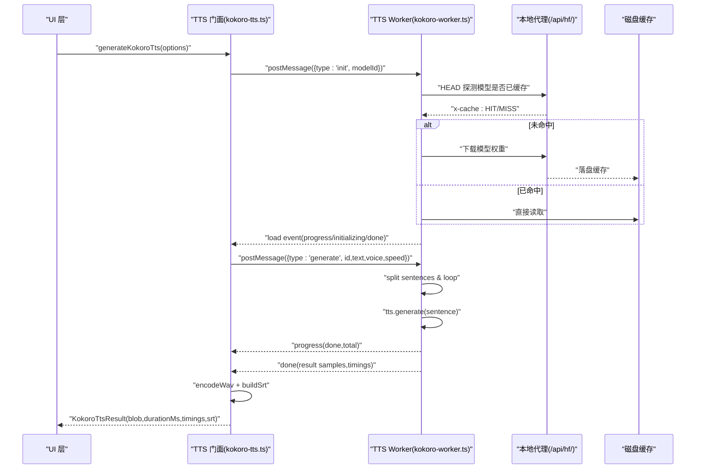
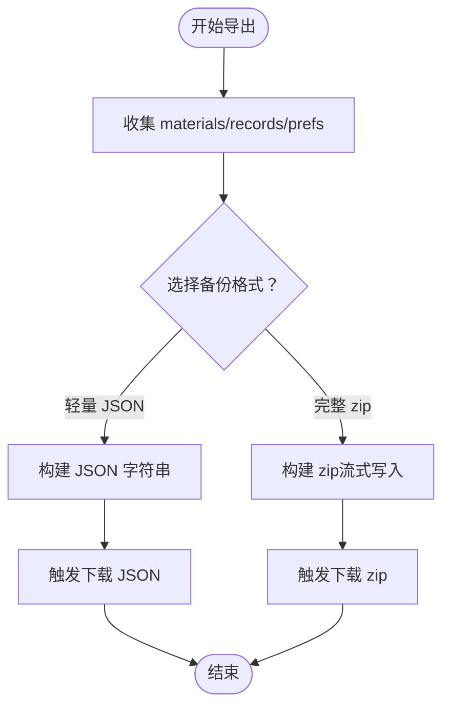
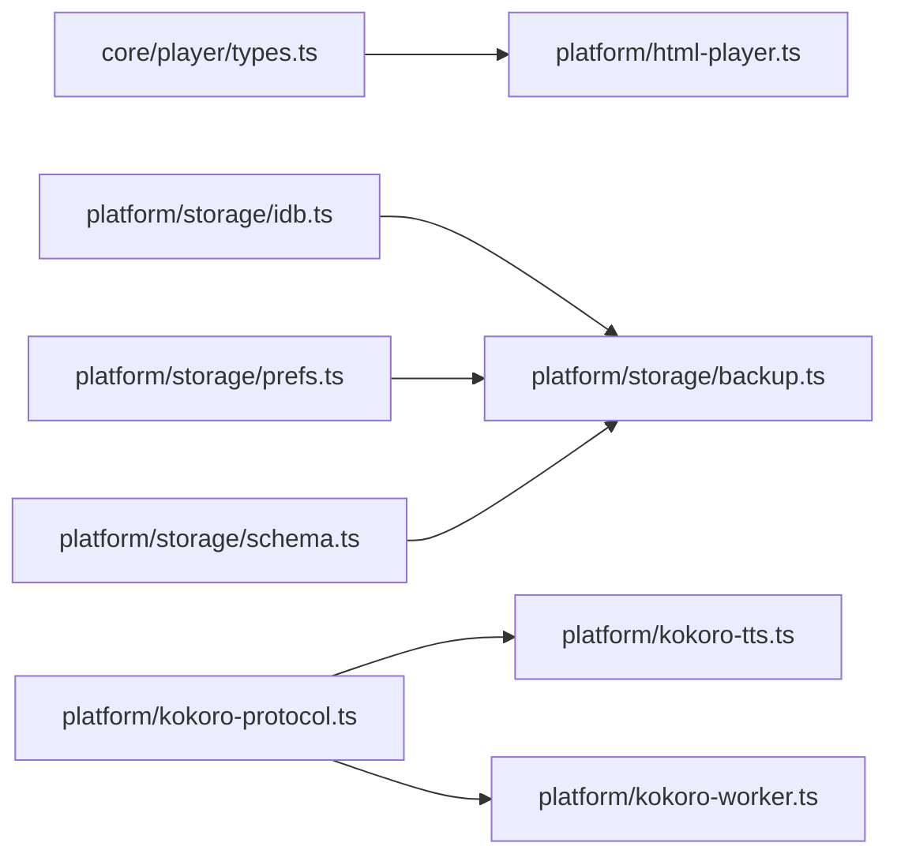

# 平台适配层

<cite>
**本文引用的文件**   
- [html-player.ts](file://client/platform/html-player.ts)
- [idb.ts](file://client/platform/storage/idb.ts)
- [prefs.ts](file://client/platform/storage/prefs.ts)
- [backup.ts](file://client/platform/storage/backup.ts)
- [schema.ts](file://client/platform/storage/schema.ts)
- [kokoro-tts.ts](file://client/platform/kokoro-tts.ts)
- [kokoro-worker.ts](file://client/platform/kokoro-worker.ts)
- [kokoro-protocol.ts](file://client/platform/kokoro-protocol.ts)
- [types.ts](file://client/core/player/types.ts)
- [index.ts](file://client/core/player/index.ts)
</cite>

## 目录
1. [引言](#引言)
2. [项目结构](#项目结构)
3. [核心组件](#核心组件)
4. [架构总览](#架构总览)
5. [关键组件详解](#关键组件详解)
6. [依赖关系分析](#依赖关系分析)
7. [性能与内存优化](#性能与内存优化)
8. [故障排查指南](#故障排查指南)
9. [新增平台支持指南](#新增平台支持指南)
10. [测试策略](#测试策略)
11. [结论](#结论)

## 引言
本文件面向“平台适配层”的设计与实现，目标是把平台相关能力（浏览器媒体播放、IndexedDB 存储、本地 TTS 推理、Web Worker 异步处理）封装为稳定、可替换的接口，使上层业务逻辑无需关心具体运行环境。文档重点覆盖：
- 平台抽象层设计理念与边界
- HTML 音频播放器封装
- IndexedDB 存储适配器与降级策略
- Kokoro TTS 引擎集成与 Worker 异步推理
- 平台检测机制、功能降级与错误处理
- 架构图、API 映射表与兼容性矩阵
- 新增平台支持与测试策略
- 浏览器特性检测、性能优化与内存管理最佳实践

## 项目结构
平台适配层主要位于 `client/platform` 与 `client/core/player` 两个区域：
- `core/player`：纯 TypeScript 的播放器抽象类型与统一出口，不依赖浏览器 API。
- `platform`：平台相关实现，包括 HTML 播放器、IndexedDB 存储、偏好设置、备份编排、Kokoro TTS 门面与 Worker。

**图表来源**
- [types.ts:1-56](file://client/core/player/types.ts#L1-L56)
- [index.ts:1-5](file://client/core/player/index.ts#L1-L5)
- [html-player.ts:1-272](file://client/platform/html-player.ts#L1-L272)
- [idb.ts:1-117](file://client/platform/storage/idb.ts#L1-L117)
- [prefs.ts:1-52](file://client/platform/storage/prefs.ts#L1-L52)
- [backup.ts:1-243](file://client/platform/storage/backup.ts#L1-L243)
- [schema.ts:1-27](file://client/platform/storage/schema.ts#L1-L27)
- [kokoro-tts.ts:1-237](file://client/platform/kokoro-tts.ts#L1-L237)
- [kokoro-worker.ts:1-273](file://client/platform/kokoro-worker.ts#L1-L273)
- [kokoro-protocol.ts:1-50](file://client/platform/kokoro-protocol.ts#L1-L50)

**章节来源**
- [types.ts:1-56](file://client/core/player/types.ts#L1-L56)
- [index.ts:1-5](file://client/core/player/index.ts#L1-L5)
- [html-player.ts:1-20](file://client/platform/html-player.ts#L1-L20)
- [idb.ts:1-15](file://client/platform/storage/idb.ts#L1-L15)

## 核心组件
- 播放器抽象与 HTML 实现：定义跨平台播放器控制器接口，并提供基于 HTMLAudioElement/HTMLVideoElement 的实现，包含进度采样、seek 校准、A-B 循环、销毁清理等。
- IndexedDB 存储适配器：零依赖 Promise 化封装，提供 materials/blobs/records 三个 object store，并在 SSR/隐私模式/打开失败时优雅降级到内存 Map。
- 偏好设置：轻量配置走 localStorage，具备 SSR 安全与 JSON 序列化失败的静默降级。
- 备份编排：组合 IDB 与 prefs，支持轻量 JSON 与完整 zip 两种格式，含配额预检、冲突策略、媒体流式写入与下载。
- Kokoro TTS：主线程门面负责 UI 交互、WAV 编码与 SRT 生成；Worker 内完成 ONNX 推理、模型加载、音色缓存与句级时间轴拼接。
- 协议与类型：主线程与 Worker 通过消息协议通信，避免将 DOM 代码拖入 Worker bundle。

**章节来源**
- [html-player.ts:24-63](file://client/platform/html-player.ts#L24-L63)
- [idb.ts:12-24](file://client/platform/storage/idb.ts#L12-L24)
- [prefs.ts:6-14](file://client/platform/storage/prefs.ts#L6-L14)
- [backup.ts:6-11](file://client/platform/storage/backup.ts#L6-L11)
- [kokoro-tts.ts:1-17](file://client/platform/kokoro-tts.ts#L1-L17)
- [kokoro-worker.ts:1-10](file://client/platform/kokoro-worker.ts#L1-L10)
- [kokoro-protocol.ts:1-6](file://client/platform/kokoro-protocol.ts#L1-L6)

## 架构总览
平台适配层采用“核心抽象 + 平台实现”的分层设计：
- 核心层仅暴露稳定的接口与类型，不包含平台细节。
- 平台层针对浏览器能力进行实现，并通过降级策略保证在受限环境下可用。
- Kokoro TTS 通过 Worker 隔离同步计算，避免阻塞 UI。
- 存储层以 IndexedDB 为主，localStorage 为辅，并内置内存兜底。

**图表来源**
- [types.ts:32-55](file://client/core/player/types.ts#L32-L55)
- [html-player.ts:24-63](file://client/platform/html-player.ts#L24-L63)
- [idb.ts:12-24](file://client/platform/storage/idb.ts#L12-L24)
- [kokoro-tts.ts:18-27](file://client/platform/kokoro-tts.ts#L18-L27)
- [kokoro-worker.ts:12-18](file://client/platform/kokoro-worker.ts#L12-L18)
- [kokoro-protocol.ts:37-50](file://client/platform/kokoro-protocol.ts#L37-L50)

## 关键组件详解

### 播放器抽象与 HTML 实现
- 抽象接口：定义媒体源、状态机、事件集与控制器方法，确保不同平台可替换实现。
- HTML 实现要点：
  - 进度采样：原生 timeupdate 兜底（约 4Hz），播放中用 requestAnimationFrame 高频采样（约 60Hz）。
  - seek 落点校准：记录目标值，首个 timeupdate 到达后校准 currentMs，偏差超过阈值记录漂移量供上层修正。
  - A-B 循环：控制器维护区间，达到 endMs 自动回跳 startMs。
  - 资源清理：destroy 停止 rAF、解绑监听、卸载 src、清空事件表与引用。

**图表来源**
- [types.ts:7-55](file://client/core/player/types.ts#L7-L55)
- [html-player.ts:24-63](file://client/platform/html-player.ts#L24-L63)
- [html-player.ts:157-265](file://client/platform/html-player.ts#L157-L265)

**章节来源**
- [types.ts:7-55](file://client/core/player/types.ts#L7-L55)
- [html-player.ts:19-22](file://client/platform/html-player.ts#L19-L22)
- [html-player.ts:66-137](file://client/platform/html-player.ts#L66-L137)
- [html-player.ts:157-265](file://client/platform/html-player.ts#L157-L265)

### IndexedDB 存储适配器
- 对象存储：materials（材料元数据）、blobs（媒体 Blob）、records（训练记录/收藏/进度）。
- 降级策略：SSR/无 indexedDB/打开失败/被占用时切换到内存 Map，调用方永不崩溃。
- KV 接口：get/put/delete/allKeys/clear，统一 guarded 包装，异常时永久切换内存模式。
- 容量查询：estimateUsage 返回 usage/quota，不可用时返回 0。

**图表来源**
- [idb.ts:70-78](file://client/platform/storage/idb.ts#L70-L78)
- [idb.ts:89-97](file://client/platform/storage/idb.ts#L89-L97)

**章节来源**
- [idb.ts:12-24](file://client/platform/storage/idb.ts#L12-L24)
- [idb.ts:26-51](file://client/platform/storage/idb.ts#L26-L51)
- [idb.ts:53-68](file://client/platform/storage/idb.ts#L53-L68)
- [idb.ts:70-78](file://client/platform/storage/idb.ts#L70-L78)
- [idb.ts:89-102](file://client/platform/storage/idb.ts#L89-L102)
- [idb.ts:104-117](file://client/platform/storage/idb.ts#L104-L117)

### Kokoro TTS 引擎集成与 Worker 异步处理
- 主线程门面：
  - 订阅模型加载状态，支持动态设置模型 ID。
  - 合成入口 generateKokoroTts，按句分词、进度回调、取消信号、WAV 编码与 SRT 生成。
- Worker 推理：
  - 通过 @huggingface/transformers 与 kokoro-js 加载 ONNX 模型，dtype=q8，device=wasm。
  - 模型与音色请求统一重写至本地代理 /api/hf/，磁盘缓存成为唯一真源。
  - 句间插入 120ms 静音，拼接 PCM 并输出句级时间轴。
  - 取消仅在句间生效，单句推理无法中断但 UI 立即响应。

**图表来源**
- [kokoro-tts.ts:184-237](file://client/platform/kokoro-tts.ts#L184-L237)
- [kokoro-worker.ts:136-182](file://client/platform/kokoro-worker.ts#L136-L182)
- [kokoro-worker.ts:184-249](file://client/platform/kokoro-worker.ts#L184-L249)
- [kokoro-worker.ts:252-273](file://client/platform/kokoro-worker.ts#L252-L273)

**章节来源**
- [kokoro-tts.ts:30-41](file://client/platform/kokoro-tts.ts#L30-L41)
- [kokoro-tts.ts:43-63](file://client/platform/kokoro-tts.ts#L43-L63)
- [kokoro-tts.ts:115-160](file://client/platform/kokoro-tts.ts#L115-L160)
- [kokoro-tts.ts:184-237](file://client/platform/kokoro-tts.ts#L184-L237)
- [kokoro-worker.ts:20-34](file://client/platform/kokoro-worker.ts#L20-L34)
- [kokoro-worker.ts:69-96](file://client/platform/kokoro-worker.ts#L69-L96)
- [kokoro-worker.ts:98-118](file://client/platform/kokoro-worker.ts#L98-L118)
- [kokoro-worker.ts:120-134](file://client/platform/kokoro-worker.ts#L120-L134)
- [kokoro-worker.ts:136-182](file://client/platform/kokoro-worker.ts#L136-L182)
- [kokoro-worker.ts:184-249](file://client/platform/kokoro-worker.ts#L184-L249)
- [kokoro-worker.ts:252-273](file://client/platform/kokoro-worker.ts#L252-L273)

### 偏好设置与备份编排
- 偏好设置：getPref/setPref/removePref/exportAllPrefs/hasPref，SSR 安全且对 JSON 解析失败静默降级。
- 备份编排：
  - 轻量 JSON：materials + records + prefs，不含媒体。
  - 完整 zip：backup.json + media/{materialId}，STORE 零压缩，内存有界（定期合并 Blob）。
  - 导入：校验、冲突策略、配额预检、媒体写入与缺失计数。

**图表来源**
- [backup.ts:50-71](file://client/platform/storage/backup.ts#L50-L71)
- [backup.ts:77-121](file://client/platform/storage/backup.ts#L77-L121)
- [backup.ts:123-136](file://client/platform/storage/backup.ts#L123-L136)

**章节来源**
- [prefs.ts:6-52](file://client/platform/storage/prefs.ts#L6-L52)
- [backup.ts:6-11](file://client/platform/storage/backup.ts#L6-L11)
- [backup.ts:50-71](file://client/platform/storage/backup.ts#L50-L71)
- [backup.ts:77-121](file://client/platform/storage/backup.ts#L77-L121)
- [backup.ts:138-180](file://client/platform/storage/backup.ts#L138-L180)
- [backup.ts:211-242](file://client/platform/storage/backup.ts#L211-L242)

## 依赖关系分析
- 播放器抽象与实现：core/player/types.ts 定义接口，platform/html-player.ts 实现。
- 存储层：platform/storage/idb.ts 提供 KV 接口，backup.ts 组合 materials/blobs/records 与 prefs。
- TTS：platform/kokoro-tts.ts 门面依赖 platform/kokoro-protocol.ts 与 platform/kokoro-worker.ts；worker 通过本地代理访问模型与音色。
- 类型共享：TTS 的时间轴类型来自 services/mock/tts，但协议模块避免引入 DOM 代码。

**图表来源**
- [types.ts:32-55](file://client/core/player/types.ts#L32-L55)
- [html-player.ts:17-17](file://client/platform/html-player.ts#L17-L17)
- [idb.ts:100-102](file://client/platform/storage/idb.ts#L100-L102)
- [backup.ts:13-17](file://client/platform/storage/backup.ts#L13-L17)
- [kokoro-protocol.ts:37-50](file://client/platform/kokoro-protocol.ts#L37-L50)
- [kokoro-tts.ts:21-27](file://client/platform/kokoro-tts.ts#L21-L27)
- [kokoro-worker.ts:14-18](file://client/platform/kokoro-worker.ts#L14-L18)

**章节来源**
- [html-player.ts:17-17](file://client/platform/html-player.ts#L17-L17)
- [idb.ts:100-102](file://client/platform/storage/idb.ts#L100-L102)
- [backup.ts:13-17](file://client/platform/storage/backup.ts#L13-L17)
- [kokoro-protocol.ts:37-50](file://client/platform/kokoro-protocol.ts#L37-L50)

## 性能与内存优化
- 播放器进度采样：
  - 使用 requestAnimationFrame 高频采样提升进度条平滑度，原生 timeupdate 作为兜底。
  - seek 校准超时防止进度派发永久卡死。
- TTS 推理：
  - 模型与音色请求经本地代理与磁盘缓存，减少重复下载。
  - 句间静音固定 120ms，时间轴由真实句长累计，避免估算误差。
  - 合成产物在 Worker 内拼接，主线程只接收最终 buffer，降低主线程压力。
- 备份导出：
  - zip 写入采用流式 sink，每 32MB 合并一次 Blob，控制 JS 堆峰值。
  - 导入前进行配额预检，避免空间不足导致写入失败。
- 存储降级：
  - IndexedDB 打开失败或隐私模式自动切换到内存 Map，保证调用方稳定性。

[本节为通用性能讨论，不直接分析具体文件]

## 故障排查指南
- 播放器错误：
  - 加载失败：LOAD_FAILED；媒体错误：MEDIA_ERROR_{code}；播放被拦截：PLAY_BLOCKED。
  - destroy 后调用会拒绝或忽略，避免未定义行为。
- IndexedDB 错误：
  - open 失败或被占用时记录日志并切换到内存模式；事务错误记录 store 名与模式。
  - estimateUsage 不可用时返回 0，不抛错。
- TTS 错误：
  - 模型加载失败：emitLoad(null) 并记录警告；Worker 异常终止后重建。
  - 文本为空：抛出错误提示；取消生成抛出 AbortError。
- 备份导入：
  - 轻量 JSON 校验失败抛出错误；zip 缺少 backup.json 或媒体缺失给出明确信息。
  - 存储空间不足时抛出错误，建议清理空间或改用轻量备份。

**章节来源**
- [html-player.ts:66-97](file://client/platform/html-player.ts#L66-L97)
- [html-player.ts:171-175](file://client/platform/html-player.ts#L171-L175)
- [html-player.ts:142-155](file://client/platform/html-player.ts#L142-L155)
- [idb.ts:37-48](file://client/platform/storage/idb.ts#L37-L48)
- [idb.ts:53-68](file://client/platform/storage/idb.ts#L53-L68)
- [idb.ts:104-117](file://client/platform/storage/idb.ts#L104-L117)
- [kokoro-tts.ts:101-110](file://client/platform/kokoro-tts.ts#L101-L110)
- [kokoro-tts.ts:119-125](file://client/platform/kokoro-tts.ts#L119-L125)
- [kokoro-tts.ts:184-189](file://client/platform/kokoro-tts.ts#L184-L189)
- [backup.ts:176-180](file://client/platform/storage/backup.ts#L176-L180)
- [backup.ts:188-199](file://client/platform/storage/backup.ts#L188-L199)
- [backup.ts:218-223](file://client/platform/storage/backup.ts#L218-L223)

## 新增平台支持指南
若需新增平台（如小程序、Electron、React Native Web 等），建议遵循以下步骤：
1. 定义平台无关的播放器控制器接口（已在 core/player/types.ts 中定义）。
2. 实现新的 PlayerController（例如 MiniProgramPlayerController），复用 MediaSource、PlayerState、PlayerEvents 类型。
3. 在平台工厂中注册新实现（参考 createHtmlPlayer 的 H5 分支）。
4. 对于存储层，若平台不支持 IndexedDB，可在 idb.ts 中扩展降级策略（当前已支持内存 Map）。
5. 对于 TTS，若平台不支持 Worker 或 ONNX Runtime，可在 kokoro-tts.ts 中增加替代路径（如云端 TTS 或平台原生语音合成）。
6. 更新平台检测与功能开关，确保 UI 根据能力展示相应选项。
7. 编写单元测试与集成测试，覆盖加载、播放、seek、循环、错误、销毁等场景。

[本节为概念性指导，不直接分析具体文件]

## 测试策略
- 播放器：
  - 单元测试：验证 load/play/pause/seekTo/setRate/setVolume/setLoop/clearLoop/getCurrentTimeMs/getDurationMs/getState/on/off/destroy 的行为。
  - 集成测试：模拟 timeupdate 与 rAF 回调，验证进度派发与 seek 校准逻辑。
- IndexedDB：
  - 单元测试：验证 get/put/delete/allKeys/clear 在 IDB 与内存模式下的行为。
  - 降级测试：模拟 indexedDB 不可用或打开失败，确认 useMemory 切换与 guarded 行为。
- TTS：
  - 单元测试：验证 splitTtsSentences、encodeWav、buildSrt 的输出。
  - Worker 测试：模拟 postMessage 与 handleMessage，验证 init/generate/cancel/error 流程。
  - 进度与取消：验证 onSentenceProgress 与 AbortError 行为。
- 备份：
  - 单元测试：验证轻量 JSON 与完整 zip 的构建、解析、导入策略与配额预检。
  - 集成测试：模拟 blobsStore 与 materialsStore，验证媒体写入与缺失计数。

[本节为概念性测试指导，不直接分析具体文件]

## 结论
平台适配层通过清晰的抽象与实现分离，提供了稳定的播放器接口、健壮的存储适配、高效的 TTS 推理与完善的错误处理与降级策略。该设计既保证了浏览器环境的优秀体验，也为未来扩展到其他平台奠定了坚实基础。建议在新增平台支持时严格遵循接口契约，完善测试覆盖，并持续关注性能与内存优化。

[本节为总结性内容，不直接分析具体文件]