# 音频播放器适配器

<cite>
**本文引用的文件**   
- [html-player.ts](file://client/platform/html-player.ts)
- [types.ts](file://client/core/player/types.ts)
- [index.ts](file://client/core/player/index.ts)
- [player.tsx](file://client/components/pages/player.tsx)
- [player-parts.tsx](file://client/components/shared/player-parts.tsx)
</cite>

## 目录
1. [引言](#引言)
2. [项目结构](#项目结构)
3. [核心组件](#核心组件)
4. [架构总览](#架构总览)
5. [详细组件分析](#详细组件分析)
6. [依赖关系分析](#依赖关系分析)
7. [性能考量](#性能考量)
8. [故障排查指南](#故障排查指南)
9. [结论](#结论)
10. [附录：集成示例与常见问题](#附录集成示例与常见问题)

## 引言
本文围绕 HTML 音频/视频播放器适配器展开，重点解析基于原生 HTMLAudioElement / HTMLVideoElement 的 HtmlPlayerController 实现。该控制器对外暴露统一的 PlayerController 接口，屏蔽平台差异，向上层 SentencePlayer 与 React UI 提供一致的播放、进度、倍速、A-B 循环、错误与状态事件能力。文档将深入说明以下关键机制：
- 进度采样策略：timeupdate 兜底 + requestAnimationFrame 高频采样
- seek 落点校准算法与漂移容差
- A-B 循环实现（控制器级区间循环）
- 倍速播放控制
- 错误处理、内存管理与 SSR 安全性设计
- 播放器状态机、事件流图与性能优化技巧
- 集成示例与常见问题解决方案

## 项目结构
本项目采用“核心类型 + 平台实现 + 上层业务”的分层组织方式：
- core/player：纯 TypeScript 抽象类型与统一出口，不依赖浏览器 DOM
- platform/html-player.ts：H5 平台的 HtmlPlayerController 实现
- components/pages/player.tsx：React 页面装配 SentencePlayer 与 HtmlPlayerController
- components/shared/player-parts.tsx：播放控制条与字幕列表等 UI 组件

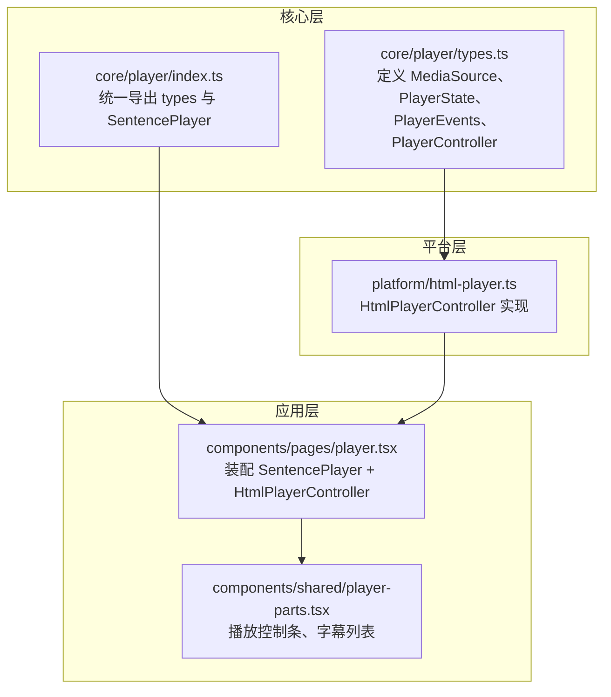

图示来源
- [types.ts:1-56](file://client/core/player/types.ts#L1-L56)
- [index.ts:1-5](file://client/core/player/index.ts#L1-L5)
- [html-player.ts:1-272](file://client/platform/html-player.ts#L1-L272)
- [player.tsx:1-535](file://client/components/pages/player.tsx#L1-L535)
- [player-parts.tsx:1-234](file://client/components/shared/player-parts.tsx#L1-L234)

章节来源
- [types.ts:1-56](file://client/core/player/types.ts#L1-L56)
- [index.ts:1-5](file://client/core/player/index.ts#L1-L5)
- [html-player.ts:1-272](file://client/platform/html-player.ts#L1-L272)
- [player.tsx:1-535](file://client/components/pages/player.tsx#L1-L535)
- [player-parts.tsx:1-234](file://client/components/shared/player-parts.tsx#L1-L234)

## 核心组件
- PlayerController 接口：定义 load/play/pause/seekTo/setRate/setVolume/setLoop/clearLoop/getCurrentTimeMs/getDurationMs/getState/on/off/destroy 等统一方法，以及 timeupdate/statechange/ended/error 事件模型。
- HtmlPlayerController：基于 HTMLAudioElement/HTMLVideoElement 的具体实现，负责媒体加载、播放控制、进度采样、seek 校准、A-B 循环、事件派发与资源清理。
- SentencePlayer：句子级播放器（由 core/player/index.ts 导出），在页面中装配并驱动 UI；其内部使用 HtmlPlayerController 作为底层引擎。
- React 页面 player.tsx：负责数据获取、UI 状态管理、键盘快捷键、笔记与收藏、字幕导入/导出、AI 转字幕等，并通过 SentencePlayer 调用播放器能力。
- 播放控制条 player-parts.tsx：提供进度拖拽、倍速切换、A-B 循环模式切换、音量调节、字幕模式切换等交互。

章节来源
- [types.ts:1-56](file://client/core/player/types.ts#L1-L56)
- [html-player.ts:1-272](file://client/platform/html-player.ts#L1-L272)
- [index.ts:1-5](file://client/core/player/index.ts#L1-L5)
- [player.tsx:1-535](file://client/components/pages/player.tsx#L1-L535)
- [player-parts.tsx:1-234](file://client/components/shared/player-parts.tsx#L1-L234)

## 架构总览
整体架构遵循“接口抽象 + 平台实现 + 上层编排”的模式：
- 抽象层：core/player/types.ts 定义跨平台接口与事件模型
- 平台层：platform/html-player.ts 提供 H5 端具体实现
- 上层编排：components/pages/player.tsx 组合 SentencePlayer 与 HtmlPlayerController，绑定 UI 与业务逻辑

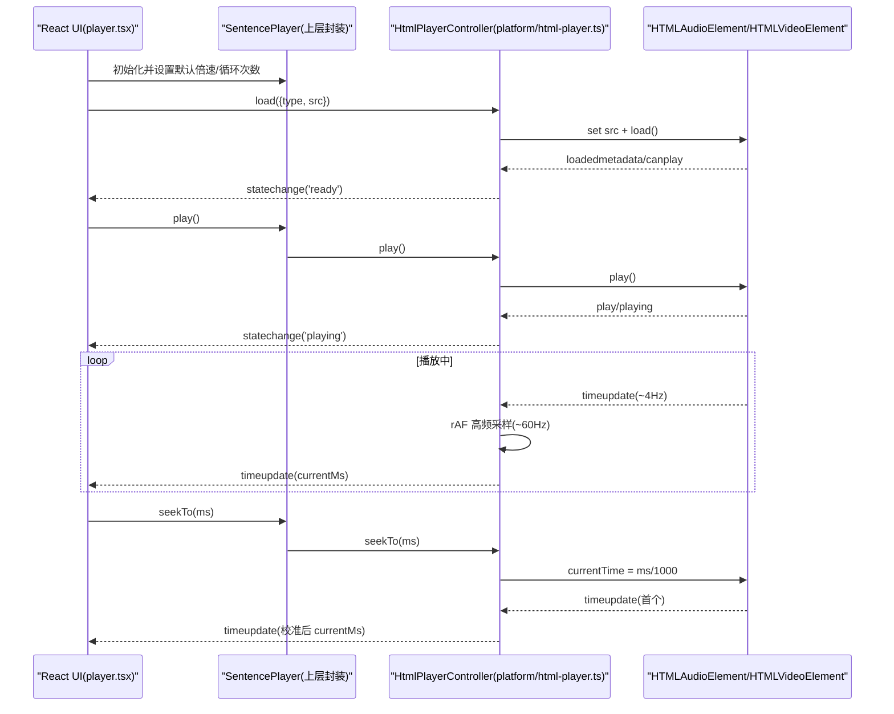

图示来源
- [player.tsx:180-245](file://client/components/pages/player.tsx#L180-L245)
- [html-player.ts:66-113](file://client/platform/html-player.ts#L66-L113)
- [html-player.ts:158-176](file://client/platform/html-player.ts#L158-L176)
- [html-player.ts:178-251](file://client/platform/html-player.ts#L178-L251)

## 详细组件分析

### HtmlPlayerController 类分析
该类是 HTML 音频/视频播放器的核心适配器，职责包括：
- 构造与元素管理：支持传入已有 audio/video 元素或内部创建；SSR 安全，仅在浏览器环境访问 DOM
- 生命周期：load/play/pause/destroy；事件监听绑定与解绑
- 进度采样：timeupdate 兜底 + rAF 高频采样，保证进度条平滑
- seek 校准：记录目标值，首个 timeupdate 时计算漂移量，必要时强制超时解除静默
- A-B 循环：控制器级区间循环，endMs 到达即回跳 startMs
- 倍速与音量：setRate/setVolume 限制范围
- 错误处理：统一派发 error 事件，包含 code/message
- 内存管理：destroy 时停止 rAF、清定时器、移除监听、卸载 src、清空事件表与引用

```mermaid
classDiagram
class HtmlPlayerController {
-el : HTMLAudioElement|HTMLVideoElement
-ownsElement : boolean
-handlers : Map<PlayerEvents, Set<Listener>>
-state : PlayerState
-currentMs : number
-durationMs : number
-rafId : number|null
-pendingSeekMs : number|null
-seekTimer : number|null
-seekDriftMs : number
-loop : {startMs,endMs}|null
-destroyed : boolean
-listeners : Array<[string,EventListener]>
+constructor(kind, element?)
+load(source) Promise~void~
+play() Promise~void~
+pause() void
+seekTo(ms) void
+setRate(rate) void
+setVolume(volume) void
+setLoop(startMs,endMs) void
+clearLoop() void
+getCurrentTimeMs() number
+getDurationMs() number
+getState() PlayerState
+getSeekDriftMs() number
+isSeeking() boolean
+on(event, cb) void
+off(event, cb) void
+destroy() void
-bind() void
-onNativeTimeUpdate() void
-readCurrentMs() number
-readDurationMs() number
-armSeekTimeout() void
-clearSeekTimeout() void
-startRaf() void
-stopRaf() void
-pushTime(ms) void
-setState(state) void
-emit(event,...args) void
-emitError(code,message) void
}
```

图示来源
- [html-player.ts:24-46](file://client/platform/html-player.ts#L24-L46)
- [html-player.ts:66-155](file://client/platform/html-player.ts#L66-L155)
- [html-player.ts:158-265](file://client/platform/html-player.ts#L158-L265)

#### 进度采样策略
- 原生 timeupdate 频率约 ~4Hz，用于兜底与 seek 校准
- 播放中启动 requestAnimationFrame 高频读取 currentTime，约 ~60Hz，确保进度条与句级定位平滑
- pushTime 在 pendingSeekMs 存在时静默旧值，避免进度条回跳闪烁

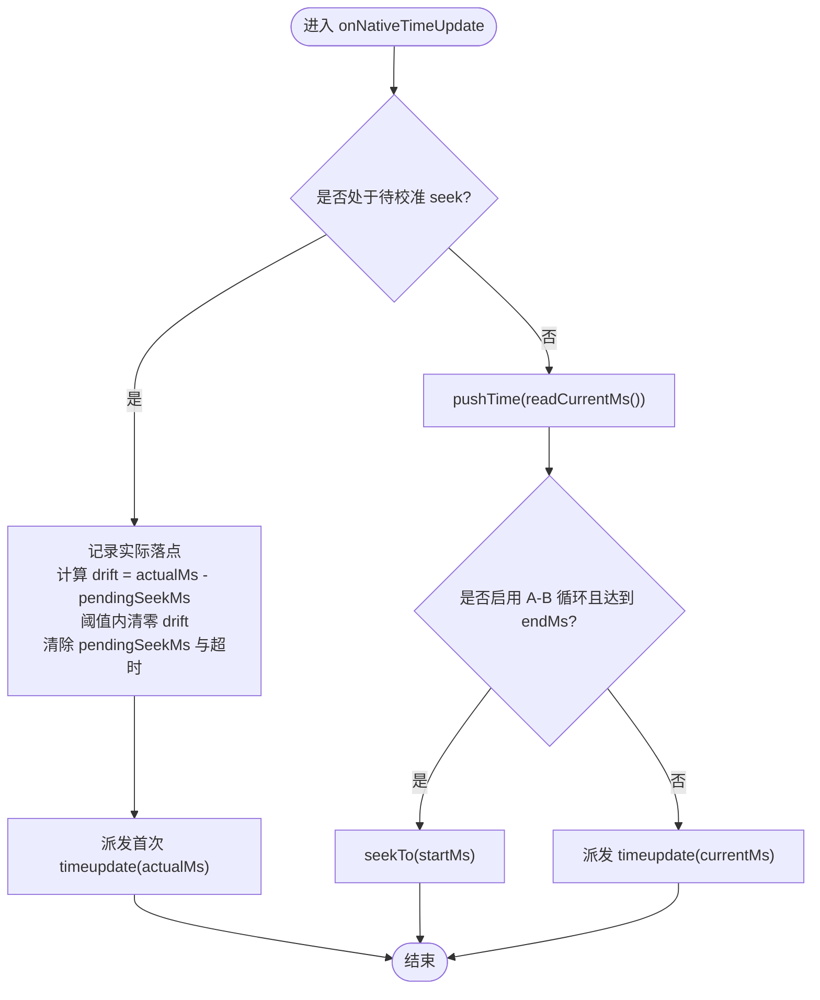

图示来源
- [html-player.ts:178-192](file://client/platform/html-player.ts#L178-L192)
- [html-player.ts:242-251](file://client/platform/html-player.ts#L242-L251)

#### seek 落点校准算法
- seekTo 设置 el.currentTime 后记录 pendingSeekMs 并启动超时保护
- 首个 timeupdate 到来时计算 seekDriftMs，若偏差超过阈值则保留供上层修正循环边界容差
- 若超时仍未收到 timeupdate，强制解除静默并按当前位置派发，防止进度永久卡死

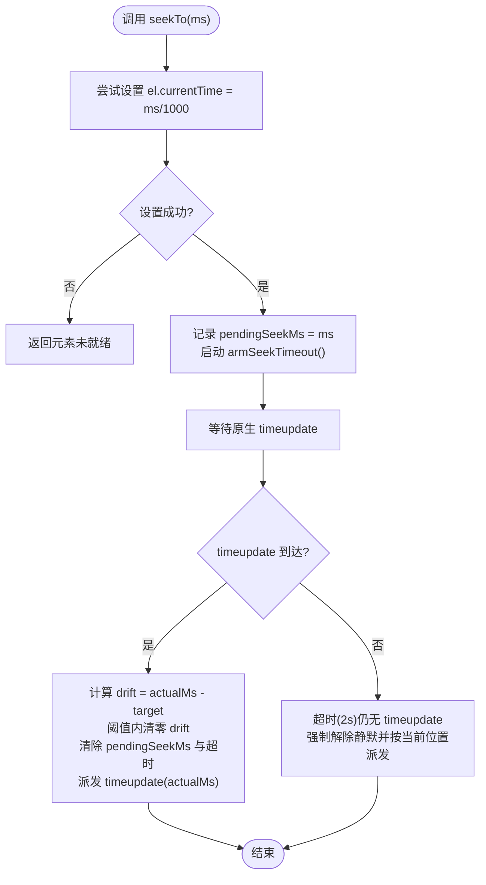

图示来源
- [html-player.ts:103-113](file://client/platform/html-player.ts#L103-L113)
- [html-player.ts:178-221](file://client/platform/html-player.ts#L178-L221)

#### A-B 循环实现
- setLoop(startMs, endMs) 设置控制器级区间循环
- pushTime 检测到当前时间 >= endMs 时自动 seekTo(startMs)，形成无限循环
- 上层 SentencePlayer 可结合次数限制完成更复杂的循环语义

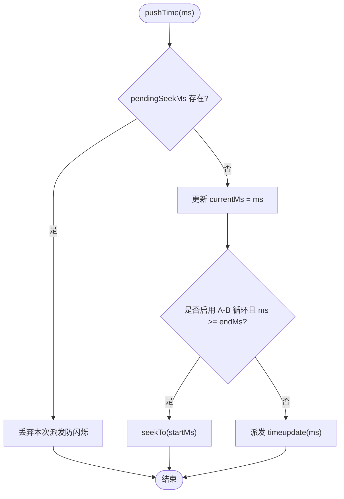

图示来源
- [html-player.ts:123-129](file://client/platform/html-player.ts#L123-L129)
- [html-player.ts:242-251](file://client/platform/html-player.ts#L242-L251)

#### 倍速播放控制
- setRate(rate) 将 rate 限制在 [0.5, 2.0] 范围内并设置 playbackRate
- 上层 UI 通过按钮切换预设倍速序列（如 0.75/1/1.25）

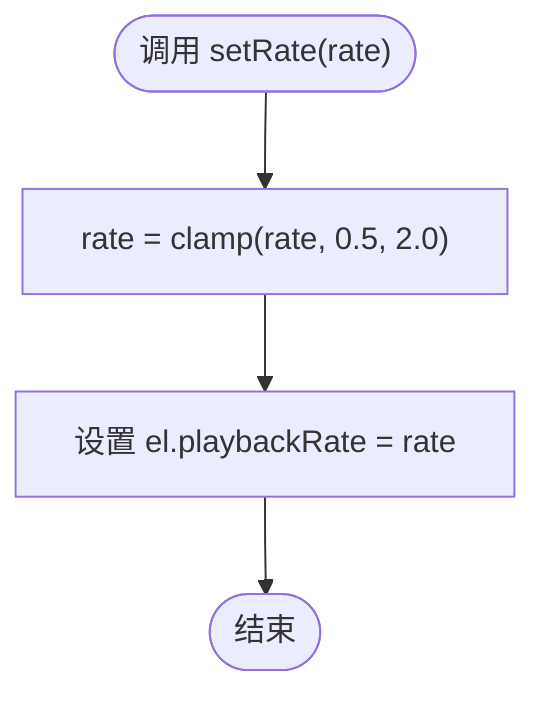

图示来源
- [html-player.ts:115-117](file://client/platform/html-player.ts#L115-L117)

#### 错误处理机制
- load 失败：派发 error 事件，code 为 LOAD_FAILED
- 原生 media error：派发 MEDIA_ERROR_{code}，携带 message
- play 被拦截：捕获 AbortError 以外的错误，派发 PLAY_BLOCKED 并抛出
- destroy 后操作：直接拒绝或忽略，避免无效调用

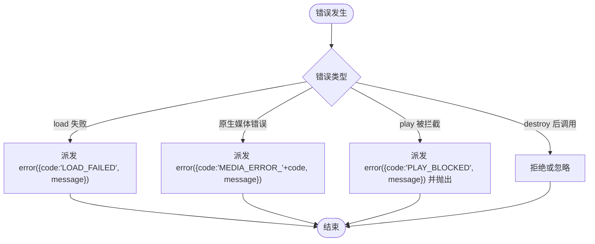

图示来源
- [html-player.ts:66-83](file://client/platform/html-player.ts#L66-L83)
- [html-player.ts:85-97](file://client/platform/html-player.ts#L85-L97)
- [html-player.ts:171-175](file://client/platform/html-player.ts#L171-L175)

#### 内存管理策略
- destroy 时：
  - 停止 rAF 循环
  - 清除 seek 超时定时器
  - 遍历 listeners 数组逐一 removeEventListener
  - pause 元素、移除 src、触发 load 以释放资源
  - 清空 handlers 事件表与引用，避免闭包泄漏

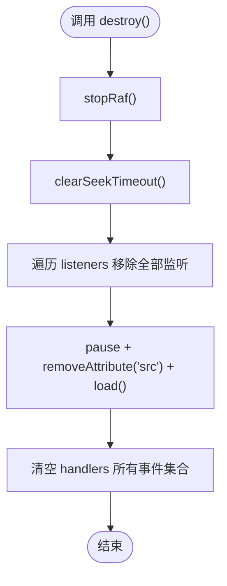

图示来源
- [html-player.ts:142-155](file://client/platform/html-player.ts#L142-L155)
- [html-player.ts:237-240](file://client/platform/html-player.ts#L237-L240)
- [html-player.ts:218-221](file://client/platform/html-player.ts#L218-L221)

#### SSR 安全性设计
- 构造函数中检测 typeof document !== 'undefined'，非浏览器环境抛错
- 模块顶层不触碰 DOM，实例化由调用方在 useEffect 中进行
- window.setTimeout/clearTimeout 调用前检查 window 是否存在

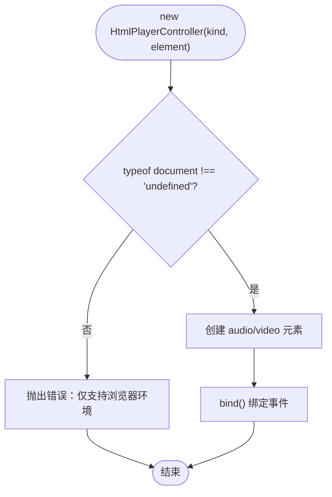

图示来源
- [html-player.ts:52-63](file://client/platform/html-player.ts#L52-L63)
- [html-player.ts:207-221](file://client/platform/html-player.ts#L207-L221)

#### 播放器状态机
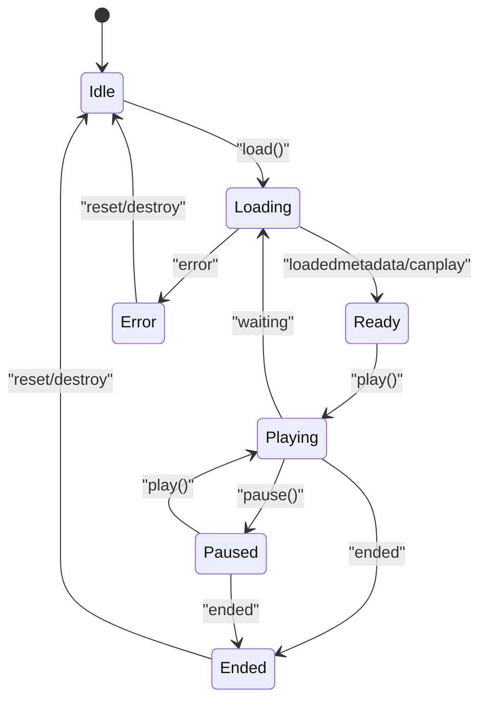

图示来源
- [types.ts:14-15](file://client/core/player/types.ts#L14-L15)
- [html-player.ts:158-176](file://client/platform/html-player.ts#L158-L176)

#### 事件流图
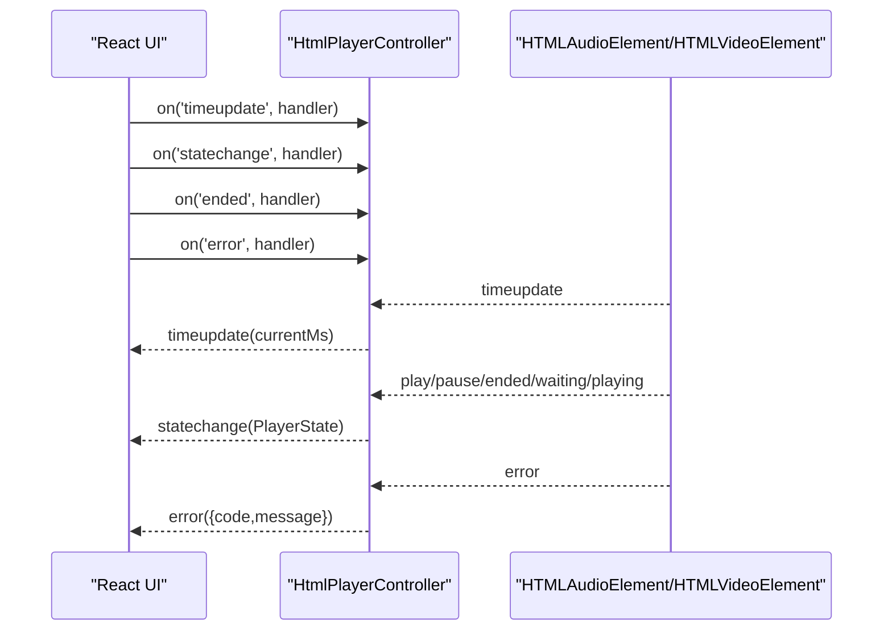

图示来源
- [html-player.ts:158-176](file://client/platform/html-player.ts#L158-L176)
- [html-player.ts:259-265](file://client/platform/html-player.ts#L259-L265)

章节来源
- [html-player.ts:24-265](file://client/platform/html-player.ts#L24-L265)
- [types.ts:1-56](file://client/core/player/types.ts#L1-L56)

## 依赖关系分析
- HtmlPlayerController 依赖 core/player/types.ts 中的 PlayerController、PlayerState、PlayerEvents、MediaSource、PlayerError
- React 页面 player.tsx 依赖 platform/html-player.ts 的 HtmlPlayerController 与 core/player/index.ts 导出的 SentencePlayer
- 播放控制条 player-parts.tsx 通过 props 与页面交互，间接依赖播放器能力

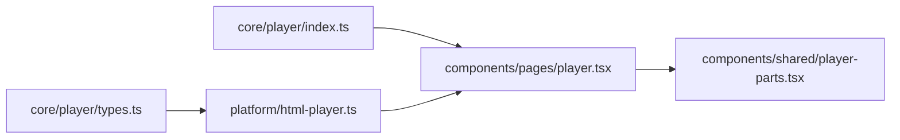

图示来源
- [types.ts:1-56](file://client/core/player/types.ts#L1-L56)
- [index.ts:1-5](file://client/core/player/index.ts#L1-L5)
- [html-player.ts:1-272](file://client/platform/html-player.ts#L1-L272)
- [player.tsx:1-535](file://client/components/pages/player.tsx#L1-L535)
- [player-parts.tsx:1-234](file://client/components/shared/player-parts.tsx#L1-L234)

章节来源
- [types.ts:1-56](file://client/core/player/types.ts#L1-L56)
- [index.ts:1-5](file://client/core/player/index.ts#L1-L5)
- [html-player.ts:1-272](file://client/platform/html-player.ts#L1-L272)
- [player.tsx:1-535](file://client/components/pages/player.tsx#L1-L535)
- [player-parts.tsx:1-234](file://client/components/shared/player-parts.tsx#L1-L234)

## 性能考量
- 进度更新节流：React 层对 timeupdate 回调进行节流（每 100ms 最多一次 setCurrentMs），降低渲染压力
- rAF 高频采样：播放中通过 requestAnimationFrame 高频读取 currentTime，提升进度条流畅度
- 原生 timeupdate 低频兜底：约 ~4Hz，减少频繁事件开销
- 视频播放主线程阻塞缓解：节流策略解决返回按钮无响应问题
- 播放进度持久化节流：playedSentenceIndexes 增量收集 + 5s 节流写 IDB，避免频繁存储
- 背景图片随机打乱：进入播放器时一次性洗牌，减少重复计算

章节来源
- [player.tsx:209-225](file://client/components/pages/player.tsx#L209-L225)
- [player.tsx:254-271](file://client/components/pages/player.tsx#L254-L271)
- [player.tsx:107-108](file://client/components/pages/player.tsx#L107-L108)
- [html-player.ts:223-240](file://client/platform/html-player.ts#L223-L240)

## 故障排查指南
- 播放被拦截（PLAY_BLOCKED）
  - 现象：调用 play() 抛出错误或 UI 显示错误
  - 排查：检查用户手势策略、浏览器自动播放策略；确认是否在有效交互上下文中触发
  - 参考：[html-player.ts:85-97](file://client/platform/html-player.ts#L85-L97)
- 媒体加载失败（LOAD_FAILED）
  - 现象：load() 失败，状态变为 error
  - 排查：检查 src 有效性、网络状态、CORS、文件格式
  - 参考：[html-player.ts:66-83](file://client/platform/html-player.ts#L66-L83)
- 原生媒体错误（MEDIA_ERROR_{code}）
  - 现象：error 事件携带 code 与 message
  - 排查：根据 code 定位具体错误（解码失败、格式不支持等）
  - 参考：[html-player.ts:171-175](file://client/platform/html-player.ts#L171-L175)
- 进度条卡顿或回跳
  - 现象：seek 后进度条闪烁或长时间不更新
  - 排查：检查 pendingSeekMs 与 SEEK_CALIBRATE_TIMEOUT_MS 配置；确认首个 timeupdate 是否正常到达
  - 参考：[html-player.ts:103-113](file://client/platform/html-player.ts#L103-L113), [html-player.ts:206-221](file://client/platform/html-player.ts#L206-L221)
- 内存泄漏
  - 现象：组件卸载后仍有定时器或监听器残留
  - 排查：确保 destroy() 被调用；检查 listeners 数组与 handlers 是否清空
  - 参考：[html-player.ts:142-155](file://client/platform/html-player.ts#L142-L155)

章节来源
- [html-player.ts:66-97](file://client/platform/html-player.ts#L66-L97)
- [html-player.ts:171-175](file://client/platform/html-player.ts#L171-L175)
- [html-player.ts:103-113](file://client/platform/html-player.ts#L103-L113)
- [html-player.ts:206-221](file://client/platform/html-player.ts#L206-L221)
- [html-player.ts:142-155](file://client/platform/html-player.ts#L142-L155)

## 结论
HtmlPlayerController 通过原生 HTMLAudioElement/HTMLVideoElement 提供了稳定、高性能的播放器适配层。其关键优势包括：
- 统一的 PlayerController 接口，便于多平台扩展
- 双轨进度采样（timeupdate + rAF）兼顾准确性与流畅性
- seek 落点校准与漂移容差提升循环与切句体验
- 完善的错误处理与内存管理，保障稳定性
- SSR 安全设计，适合现代前端框架

## 附录：集成示例与常见问题

### 集成示例
- 在 React 页面中装配 SentencePlayer 与 HtmlPlayerController：
  - 从 core/player/index.ts 导入 SentencePlayer
  - 从 platform/html-player.ts 导入 HtmlPlayerController
  - 在 useEffect 中创建 controller 与 sp，调用 load/play/pause/seekTo 等方法
  - 订阅 timeupdate/statechange/sentencechange/error 事件驱动 UI
- 播放控制条通过 props 传递 currentMs/durationMs/onSeek/rate/volume 等参数

章节来源
- [index.ts:1-5](file://client/core/player/index.ts#L1-L5)
- [player.tsx:180-245](file://client/components/pages/player.tsx#L180-L245)
- [player-parts.tsx:113-119](file://client/components/shared/player-parts.tsx#L113-L119)

### 常见问题解决方案
- 如何开启 A-B 循环？
  - 调用 sp.setLoopTimes(n) 或控制器 setLoop(startMs, endMs)
  - 切换句子后重新设置循环区间
- 如何调整倍速？
  - 调用 sp.setRate(rate)，UI 提供预设档位切换
- 如何处理播放进度持久化？
  - 使用 playedRef 收集已播放句索引，定时 flushProgress 写入 IDB
- 如何在视频播放时避免主线程阻塞？
  - 对 timeupdate 回调进行节流，降低 React 渲染频率

章节来源
- [player.tsx:209-225](file://client/components/pages/player.tsx#L209-L225)
- [player.tsx:254-271](file://client/components/pages/player.tsx#L254-L271)
- [html-player.ts:115-129](file://client/platform/html-player.ts#L115-L129)