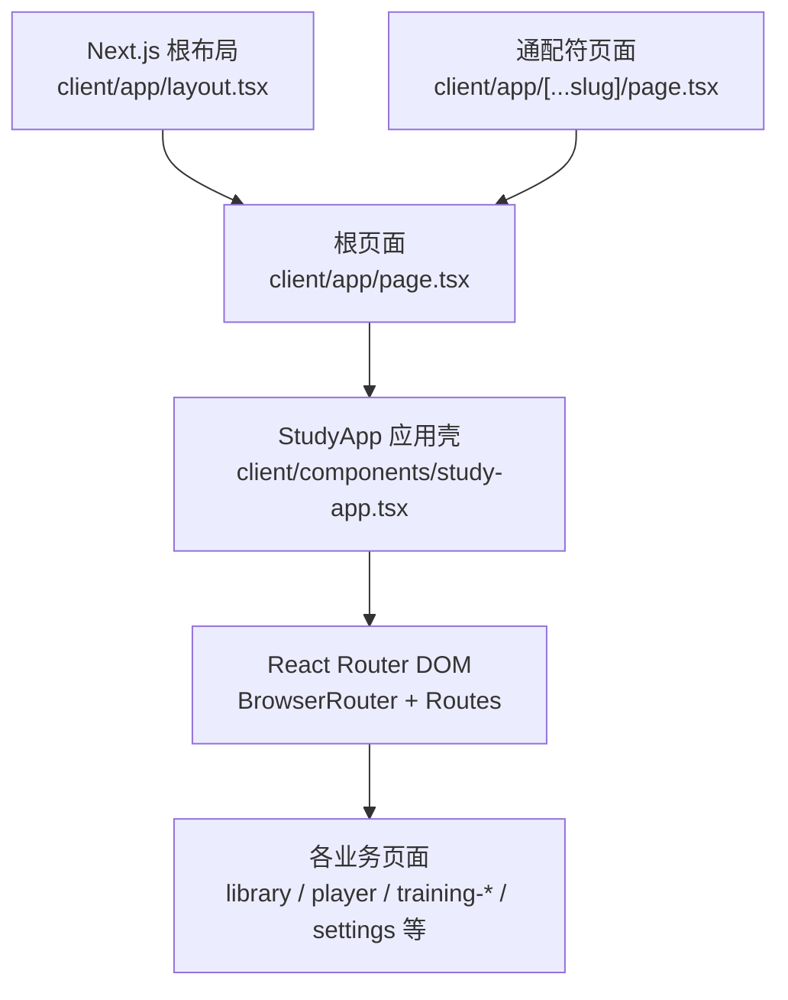
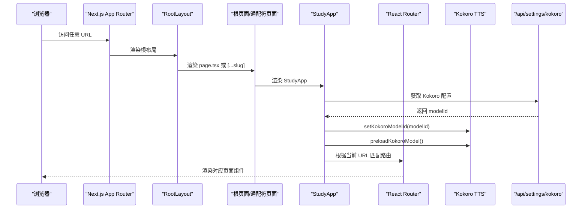
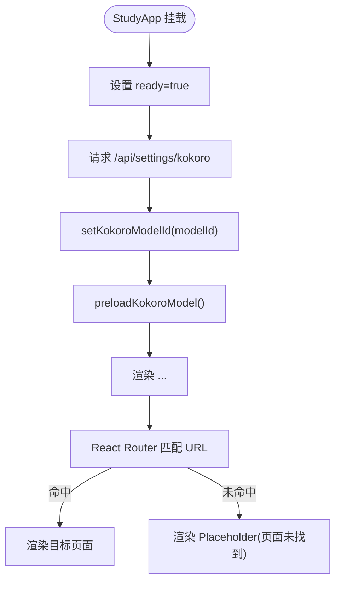
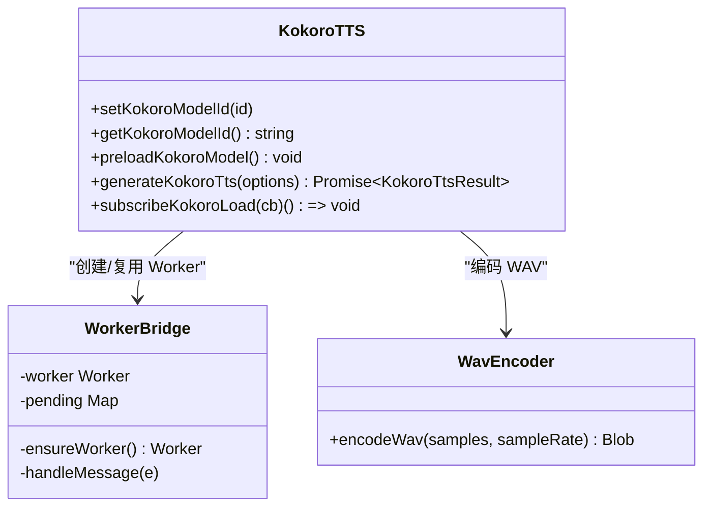
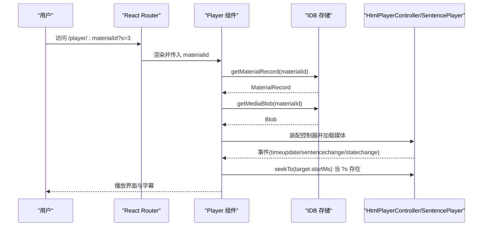
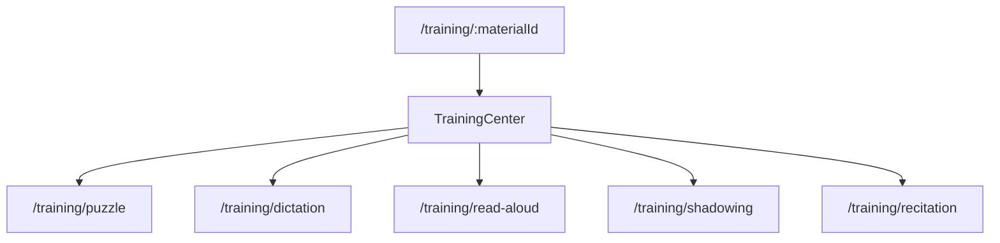
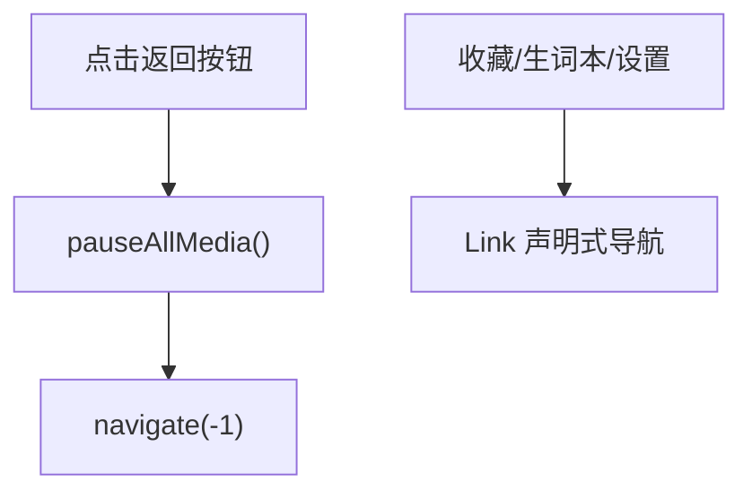
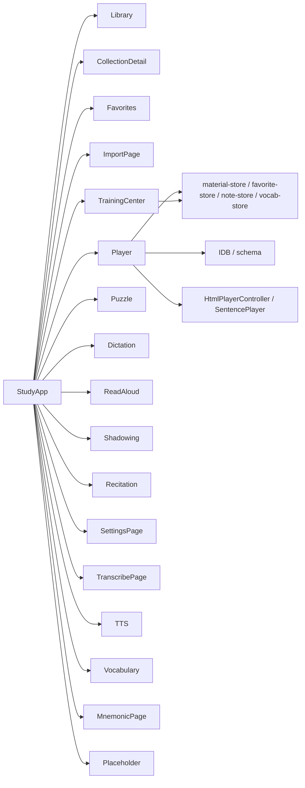

# 应用入口与路由系统

<cite>
**本文引用的文件**   
- [client/app/layout.tsx](file://client/app/layout.tsx)
- [client/app/page.tsx](file://client/app/page.tsx)
- [client/app/[...slug]/page.tsx](file://client/app/[...slug]/page.tsx)
- [client/components/study-app.tsx](file://client/components/study-app.tsx)
- [client/platform/kokoro-tts.ts](file://client/platform/kokoro-tts.ts)
- [client/components/pages/player.tsx](file://client/components/pages/player.tsx)
- [client/components/pages/training-center.tsx](file://client/components/pages/training-center.tsx)
- [client/components/shared/shell.tsx](file://client/components/shared/shell.tsx)
</cite>

## 目录
1. [引言](#引言)
2. [项目结构](#项目结构)
3. [核心组件](#核心组件)
4. [架构总览](#架构总览)
5. [详细组件分析](#详细组件分析)
6. [依赖关系分析](#依赖关系分析)
7. [性能考虑](#性能考虑)
8. [故障排查指南](#故障排查指南)
9. [结论](#结论)

## 引言
本文聚焦英语精听助手在 Next.js App Router 下的单页应用（SPA）实现，重点说明：
- App Router 作为外壳的作用
- React Router DOM 的客户端路由配置
- 14 条客户端路由的设计模式
- StudyApp 组件初始化流程与 Kokoro TTS 模型预加载机制
- 路由参数传递、URL 状态管理与数据流
- 动态路由、嵌套式导航与错误页面处理
- 路由架构图与导航流程图

## 项目结构
该项目的 SPA 入口位于 Next.js App Router 中，根布局负责站点元信息与应用外壳；根页面与通配符页面统一渲染 StudyApp，StudyApp 内部使用 BrowserRouter + Routes 管理所有客户端路由。

图表来源
- [client/app/layout.tsx:36-49](file://client/app/layout.tsx#L36-L49)
- [client/app/page.tsx:1-5](file://client/app/page.tsx#L1-L5)
- [client/app/[...slug]/page.tsx:1-5](file://client/app/[...slug]/page.tsx#L1-L5)
- [client/components/study-app.tsx:24-64](file://client/components/study-app.tsx#L24-L64)

章节来源
- [client/app/layout.tsx:1-50](file://client/app/layout.tsx#L1-L50)
- [client/app/page.tsx:1-6](file://client/app/page.tsx#L1-L6)
- [client/app/[...slug]/page.tsx:1-6](file://client/app/[...slug]/page.tsx#L1-L6)
- [client/components/study-app.tsx:1-65](file://client/components/study-app.tsx#L1-L65)

## 核心组件
- Next.js 根布局：定义站点标题、图标、视口与生产环境埋点，包裹 children。
- 根页面与通配符页面：统一渲染 StudyApp，使任意 URL 都进入 SPA 路由。
- StudyApp：应用级初始化（Kokoro TTS 配置与模型预加载），并集中声明 14 条客户端路由。
- Shell：全局头部、返回按钮、收藏/生词本/设置快捷入口，封装媒体暂停逻辑。
- Player：动态路由 /player/:materialId 的实现，承载播放、字幕、收藏、笔记、翻译等能力。
- TrainingCenter：训练中心入口，按材料维度组织训练模式。

章节来源
- [client/app/layout.tsx:1-50](file://client/app/layout.tsx#L1-L50)
- [client/components/study-app.tsx:1-65](file://client/components/study-app.tsx#L1-L65)
- [client/components/shared/shell.tsx:1-24](file://client/components/shared/shell.tsx#L1-L24)
- [client/components/pages/player.tsx:1-120](file://client/components/pages/player.tsx#L1-L120)
- [client/components/pages/training-center.tsx:1-40](file://client/components/pages/training-center.tsx#L1-L40)

## 架构总览
下图展示从浏览器请求到 SPA 渲染的关键路径，以及 Kokoro TTS 预加载与路由分发。

图表来源
- [client/app/layout.tsx:36-49](file://client/app/layout.tsx#L36-L49)
- [client/app/page.tsx:1-5](file://client/app/page.tsx#L1-L5)
- [client/app/[...slug]/page.tsx:1-5](file://client/app/[...slug]/page.tsx#L1-L5)
- [client/components/study-app.tsx:24-37](file://client/components/study-app.tsx#L24-L37)
- [client/platform/kokoro-tts.ts:136-160](file://client/platform/kokoro-tts.ts#L136-L160)

## 详细组件分析

### StudyApp 初始化与路由配置
StudyApp 是 SPA 的启动器与路由中枢：
- 初始化流程
  - 设置 ready 为 true，确保首次渲染后显示路由。
  - 调用 /api/settings/kokoro 获取 modelId，并通过 setKokoroModelId 更新当前模型。
  - 调用 preloadKokoroModel 启动 Worker 预加载模型，避免首用卡顿。
- 路由配置
  - 使用 BrowserRouter 包裹 Routes。
  - 声明 14 条客户端路由，包括静态路由、动态路由与兜底 404。

图表来源
- [client/components/study-app.tsx:24-64](file://client/components/study-app.tsx#L24-L64)

章节来源
- [client/components/study-app.tsx:1-65](file://client/components/study-app.tsx#L1-L65)

### Kokoro TTS 预加载机制
- 主线程门面：kokoro-tts.ts 暴露 setKokoroModelId、preloadKokoroModel、generateKokoroTts 等接口。
- Worker 推理：真正的 ONNX 推理在 kokoro-worker.ts 中执行，避免阻塞 UI。
- 模型缓存：通过 /api/hf/ 代理加载模型，优先读取磁盘缓存，未命中再下载。
- 进度订阅：subscribeKokoroLoad 支持页面订阅加载状态，便于展示进度。

图表来源
- [client/platform/kokoro-tts.ts:19-237](file://client/platform/kokoro-tts.ts#L19-L237)

章节来源
- [client/platform/kokoro-tts.ts:1-237](file://client/platform/kokoro-tts.ts#L1-L237)

### 动态路由 /player/:materialId
Player 组件实现材料播放器，关键行为：
- 路由参数
  - 使用 useParams 获取 materialId。
  - 使用 useSearchParams 读取 ?s=N 跳转指定句。
- 数据流
  - 根据 materialId 从 IDB 读取材料与字幕、收藏、笔记、学习进度。
  - 将媒体 Blob 转为 ObjectURL 供 <audio>/<video> 播放。
  - 装配 HtmlPlayerController + SentencePlayer，驱动逐句高亮、循环、倍速。
- 导航与守卫
  - 若找不到材料，使用 Navigate 重定向回首页。
  - 点击“进入训练”跳转到 /training/:materialId。
- URL 状态
  - ?s=N 用于收藏夹跳转定位到某一句，不自动播放但会 seek 到该句。

图表来源
- [client/components/pages/player.tsx:79-175](file://client/components/pages/player.tsx#L79-L175)
- [client/components/pages/player.tsx:180-245](file://client/components/pages/player.tsx#L180-L245)
- [client/components/pages/player.tsx:521-531](file://client/components/pages/player.tsx#L521-L531)

章节来源
- [client/components/pages/player.tsx:1-535](file://client/components/pages/player.tsx#L1-L535)

### 训练中心与嵌套式导航
TrainingCenter 提供训练入口，按材料维度组织训练模式：
- 从 params 读取 materialId，并写入本地偏好 training-material。
- 根据收藏句数量与模式限制（如影子跟读/全文背诵需全文）控制可选项。
- 通过 Link 跳转到具体训练页，形成“材料 → 训练中心 → 训练模式”的嵌套式导航。

图表来源
- [client/components/pages/training-center.tsx:14-21](file://client/components/pages/training-center.tsx#L14-L21)
- [client/components/pages/training-center.tsx:31-66](file://client/components/pages/training-center.tsx#L31-L66)
- [client/components/pages/training-center.tsx:109-127](file://client/components/pages/training-center.tsx#L109-L127)

章节来源
- [client/components/pages/training-center.tsx:1-135](file://client/components/pages/training-center.tsx#L1-L135)

### 全局导航与返回行为
Shell 提供统一的顶部导航栏：
- 返回按钮：调用 navigate(-1)，并在返回前暂停所有音视频，避免主线程占用导致无响应。
- 快捷入口：收藏、生词本、设置均通过 Link 进行声明式导航。

图表来源
- [client/components/shared/shell.tsx:1-24](file://client/components/shared/shell.tsx#L1-L24)

章节来源
- [client/components/shared/shell.tsx:1-24](file://client/components/shared/shell.tsx#L1-L24)

### 14 条客户端路由设计模式
StudyApp 内集中声明了以下路由：
- 静态路由
  - / → Library
  - /favorites → Favorites
  - /import → ImportPage
  - /settings → SettingsPage
  - /transcribe → TranscribePage
  - /tts → TTS
  - /vocabulary → Vocabulary
  - /training/puzzle → Puzzle
  - /training/dictation → Dictation
  - /training/read-aloud → ReadAloud
  - /training/shadowing → Shadowing
  - /training/recitation → Recitation
- 动态路由
  - /collection/:collectionId → CollectionDetail
  - /player/:materialId → Player
  - /training/:materialId → TrainingCenter
  - /vocabulary/mnemonic/:entryId → MnemonicPage
- 兜底路由
  - * → Placeholder(title="页面未找到")

这些路由体现了“功能域分组 + 资源型动态段”的模式：
- 以 /training/* 聚合训练相关子页面
- 以 /vocabulary/* 聚合词汇与记忆卡片
- 以 /player/:materialId 和 /training/:materialId 共享材料上下文

章节来源
- [client/components/study-app.tsx:41-64](file://client/components/study-app.tsx#L41-L64)

### 路由守卫与错误处理
- 数据缺失守卫
  - Player 在找不到材料时，使用 Navigate 重定向回首页。
- 兜底 404
  - StudyApp 的 * 路由渲染 Placeholder，提示“页面未找到”。
- 媒体安全
  - Shell 在返回前暂停所有媒体，避免导航冲突。

章节来源
- [client/components/pages/player.tsx:521-522](file://client/components/pages/player.tsx#L521-L522)
- [client/components/study-app.tsx:60-60](file://client/components/study-app.tsx#L60-L60)
- [client/components/shared/shell.tsx:9-15](file://client/components/shared/shell.tsx#L9-L15)

## 依赖关系分析
StudyApp 作为路由中枢，依赖多个页面组件与平台能力；Player 与 TrainingCenter 则依赖存储层与播放引擎。

图表来源
- [client/components/study-app.tsx:4-22](file://client/components/study-app.tsx#L4-L22)
- [client/components/pages/player.tsx:14-28](file://client/components/pages/player.tsx#L14-L28)
- [client/components/pages/training-center.tsx:6-12](file://client/components/pages/training-center.tsx#L6-L12)

章节来源
- [client/components/study-app.tsx:1-65](file://client/components/study-app.tsx#L1-L65)
- [client/components/pages/player.tsx:1-535](file://client/components/pages/player.tsx#L1-L535)
- [client/components/pages/training-center.tsx:1-135](file://client/components/pages/training-center.tsx#L1-L135)

## 性能考虑
- 路由渲染
  - 根布局仅做最小化包装，SPA 路由由 StudyApp 在客户端完成，减少服务端渲染开销。
- 模型预加载
  - 启动即预加载 Kokoro 模型，避免首次合成卡顿；Worker 承担重型计算，保持 UI 流畅。
- 播放节流
  - Player 对 timeupdate 状态更新进行节流（约 100ms），降低 React 重渲染频率。
- 进度落盘
  - 播放进度增量收集并以 5s 节流写盘，减少频繁 I/O。
- 媒体暂停
  - 返回前统一暂停音视频，避免主线程被媒体事件占用导致交互无响应。

[本节为通用性能建议，不直接分析具体代码文件]

## 故障排查指南
- 无法进入 SPA
  - 检查 Next.js 根页面与通配符页面是否正确渲染 StudyApp。
- 路由不生效
  - 确认 StudyApp 已包裹 BrowserRouter 且 Routes 正确声明。
- 404 页面出现
  - 检查是否访问了未声明的路径；如需新增页面，请在 StudyApp 中添加 Route。
- 播放器空白或无法播放
  - 检查 materialId 是否存在；Player 会在找不到材料时重定向到首页。
- Kokoro 模型加载失败
  - 查看控制台日志；确认 /api/settings/kokoro 返回 modelId；必要时重启应用重新触发预加载。
- 返回按钮无响应
  - 检查是否在视频播放中；Shell 会在返回前暂停媒体，确保交互可用。

章节来源
- [client/app/page.tsx:1-5](file://client/app/page.tsx#L1-L5)
- [client/app/[...slug]/page.tsx:1-5](file://client/app/[...slug]/page.tsx#L1-L5)
- [client/components/study-app.tsx:24-64](file://client/components/study-app.tsx#L24-L64)
- [client/components/pages/player.tsx:521-522](file://client/components/pages/player.tsx#L521-L522)
- [client/platform/kokoro-tts.ts:101-110](file://client/platform/kokoro-tts.ts#L101-L110)
- [client/components/shared/shell.tsx:9-15](file://client/components/shared/shell.tsx#L9-L15)

## 结论
本项目采用 Next.js App Router 作为外壳，StudyApp 作为 SPA 启动器与路由中枢，结合 React Router DOM 实现了 14 条客户端路由。Kokoro TTS 在应用启动时预加载，显著改善首次合成体验。Player 与 TrainingCenter 分别承担材料播放与训练入口职责，配合 Shell 的全局导航与返回保护，形成了清晰、可扩展的导航体系。未来可在 StudyApp 中引入更细粒度的路由守卫与权限校验，并继续优化模型加载与播放性能。