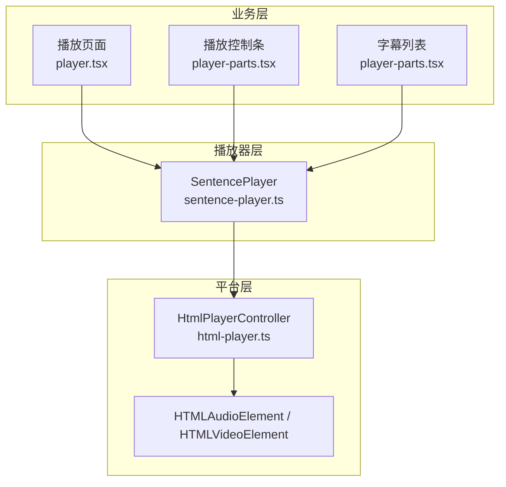
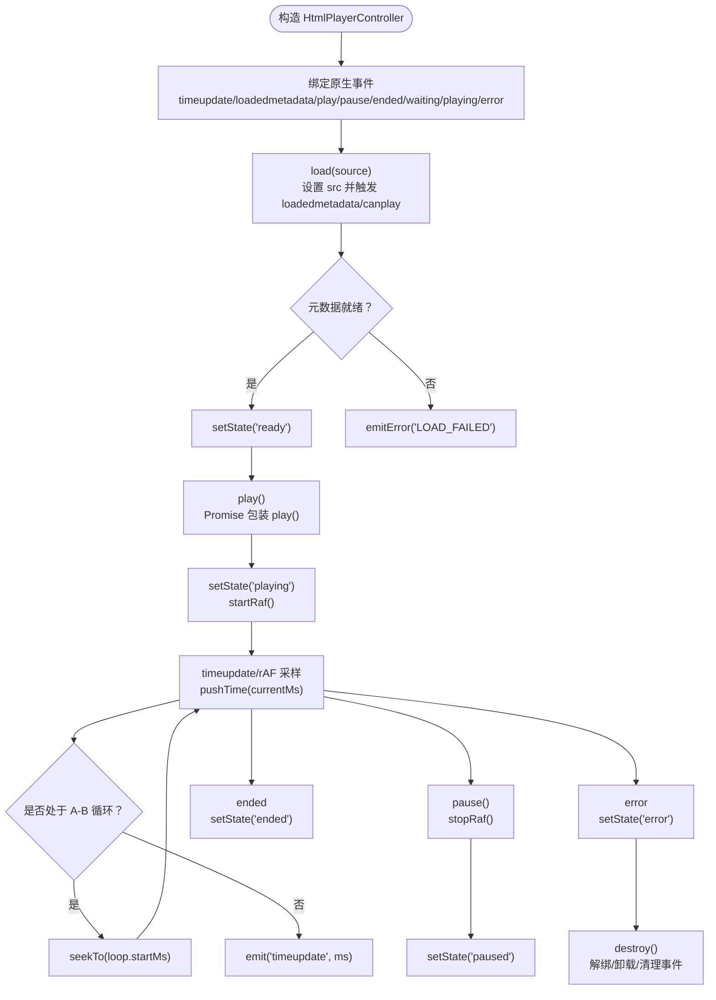
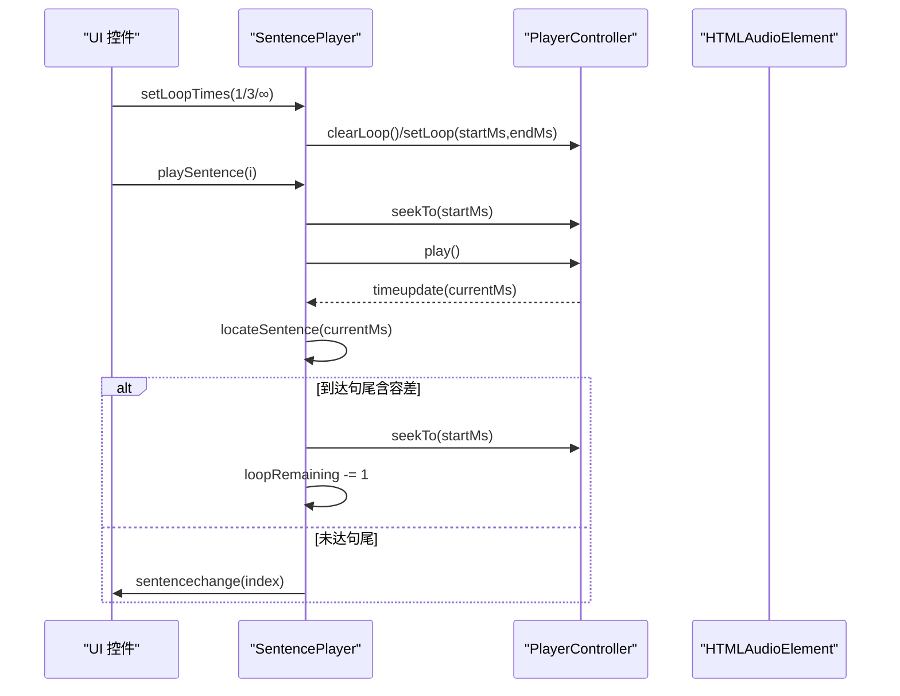
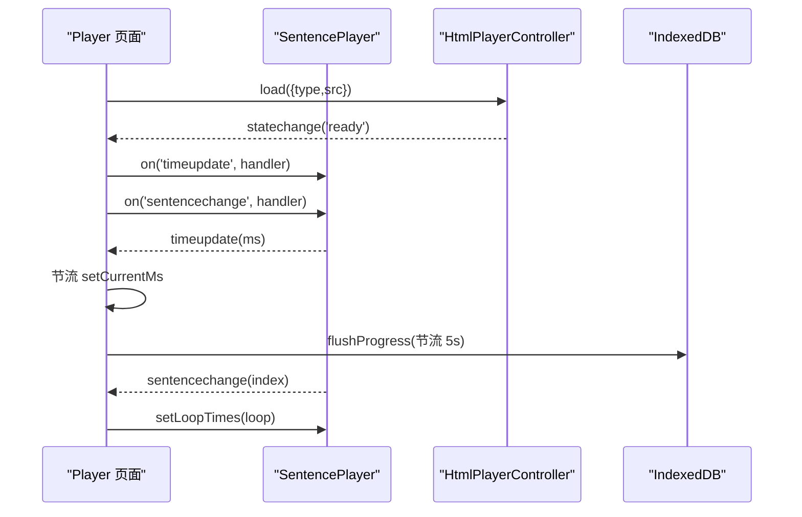
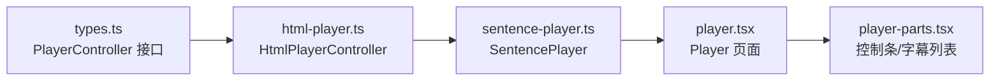

# 句子级播放器引擎

<cite>
**本文引用的文件**   
- [sentence-player.ts](file://client/core/player/sentence-player.ts)
- [html-player.ts](file://client/platform/html-player.ts)
- [types.ts](file://client/core/player/types.ts)
- [index.ts（core/player）](file://client/core/player/index.ts)
- [player.tsx（播放页）](file://client/components/pages/player.tsx)
- [player-parts.tsx（播放控件与字幕列表）](file://client/components/shared/player-parts.tsx)
</cite>

## 目录
1. [引言](#引言)
2. [项目结构](#项目结构)
3. [核心组件](#核心组件)
4. [架构总览](#架构总览)
5. [详细组件分析](#详细组件分析)
6. [依赖关系分析](#依赖关系分析)
7. [性能考虑](#性能考虑)
8. [故障排查指南](#故障排查指南)
9. [结论](#结论)
10. [附录：API 使用示例](#附录api-使用示例)

## 引言
本文面向“句子级播放器引擎”，围绕以下目标展开：
- 深入解释 `SentencePlayer` 的播放控制逻辑，包括 A-B 循环、倍速播放、逐句跳转、区间播放等高级能力。
- 详细说明 HTMLAudioElement 封装层 `HtmlPlayerController` 的实现，包括音频事件监听、时间轴同步、播放状态管理、seek 落点校准。
- 阐述播放器与字幕系统的集成方式、进度追踪机制、性能优化策略。
- 提供播放器架构图、事件流程图和核心 API 使用示例。
- 说明如何适配不同音频格式与浏览器兼容性处理。

该引擎由三层组成：
- 抽象接口层：`PlayerController` 定义平台无关的播放器控制器契约。
- 平台实现层：`HtmlPlayerController` 基于原生 `HTMLAudioElement` / `HTMLVideoElement` 实现。
- 业务编排层：`SentencePlayer` 组合控制器与句子时间轴，对外暴露句子粒度的播放 API。

## 项目结构
播放器相关代码主要分布在以下路径：
- `client/core/player/`：播放器抽象类型与句子级播放器逻辑。
- `client/platform/html-player.ts`：H5 媒体元素封装。
- `client/components/pages/player.tsx`：播放页面，装配播放器、绑定 UI 与进度持久化。
- `client/components/shared/player-parts.tsx`：播放控制条与字幕列表 UI。



**图表来源**
- [player.tsx:180-245](file://client/components/pages/player.tsx#L180-L245)
- [sentence-player.ts:35-62](file://client/core/player/sentence-player.ts#L35-L62)
- [html-player.ts:24-63](file://client/platform/html-player.ts#L24-L63)

**章节来源**
- [player.tsx:180-245](file://client/components/pages/player.tsx#L180-L245)
- [sentence-player.ts:1-219](file://client/core/player/sentence-player.ts#L1-L219)
- [html-player.ts:1-272](file://client/platform/html-player.ts#L1-L272)

## 核心组件
- `PlayerController`：平台无关的播放器控制器接口，定义加载、播放、暂停、跳转、倍速、音量、A-B 循环、事件订阅等能力。
- `HtmlPlayerController`：基于 H5 原生媒体元素的实现，负责真实媒体生命周期、事件监听、进度采样、seek 校准、状态机派发。
- `SentencePlayer`：句子级播放控制器，组合 `PlayerController` 与句子时间轴，提供按句定位、A-B 单句循环、区间播放、逐句跳转、字幕高亮联动等能力。
- 播放页面 `Player`：装配 `HtmlPlayerController` 与 `SentencePlayer`，绑定 UI 控件、字幕列表、学习进度持久化、快捷键、收藏与笔记等。

**章节来源**
- [types.ts:7-55](file://client/core/player/types.ts#L7-L55)
- [html-player.ts:24-155](file://client/platform/html-player.ts#L24-L155)
- [sentence-player.ts:35-169](file://client/core/player/sentence-player.ts#L35-L169)
- [player.tsx:180-245](file://client/components/pages/player.tsx#L180-L245)

## 架构总览
播放器整体采用“抽象接口 + 平台实现 + 业务编排”的分层设计：
- 抽象接口层保证上层不依赖具体平台；
- 平台实现层屏蔽 H5 媒体差异；
- 业务编排层聚焦句子级交互与字幕联动。

```mermaid
classDiagram
class PlayerController {
+load(source) Promise~void~
+play() Promise~void~
+pause() void
+seekTo(ms) void
+setRate(rate) void
+setVolume(volume) void
+setLoop(startMs, endMs) void
+clearLoop() void
+getCurrentTimeMs() number
+getDurationMs() number
+getState() PlayerState
+on(event, cb) void
+off(event, cb) void
+destroy() void
}
class HtmlPlayerController {
-el : HTMLAudioElement | HTMLVideoElement
-state : PlayerState
-currentMs : number
-durationMs : number
-loop : {startMs,endMs} | null
+load(source) Promise~void~
+play() Promise~void~
+pause() void
+seekTo(ms) void
+setRate(rate) void
+setVolume(volume) void
+setLoop(startMs, endMs) void
+clearLoop() void
+getCurrentTimeMs() number
+getDurationMs() number
+getState() PlayerState
+on(event, cb) void
+off(event, cb) void
+destroy() void
}
class SentencePlayer {
-controller : PlayerController
-sentences : SentenceRange[]
-lastIndex : number
-loopIndex : number
-loopRemaining : number
-rangeEndMs : number | null
+play() Promise~void~
+pause() void
+seekTo(ms) void
+setRate(rate) void
+setVolume(volume) void
+playSentence(i) void
+next() void
+prev() void
+playRange(startMs, endMs) void
+setLoopTimes(times) void
+locateSentence(currentMs) number
+setSentences(sentences) void
+on(event, cb) void
+off(event, cb) void
+destroy() void
}
PlayerController <|.. HtmlPlayerController
SentencePlayer --> PlayerController : "组合"
```

**图表来源**
- [types.ts:36-55](file://client/core/player/types.ts#L36-L55)
- [html-player.ts:24-155](file://client/platform/html-player.ts#L24-L155)
- [sentence-player.ts:35-169](file://client/core/player/sentence-player.ts#L35-L169)

## 详细组件分析

### HtmlPlayerController：HTMLAudioElement 封装层
职责与关键点：
- 媒体加载：监听 `loadedmetadata` / `canplay` 完成加载，统一转换为 `ready` 状态。
- 播放控制：`play()` 返回 Promise，兼容浏览器自动拦截策略；`pause()` 直接调用原生方法。
- 时间轴同步：
  - 原生 `timeupdate` 作为兜底（约 4Hz）。
  - 播放中启动 `requestAnimationFrame` 高频采样（约 60Hz），驱动更平滑的进度条。
- Seek 落点校准：
  - 设置 `pendingSeekMs`，首个 `timeupdate` 到达后计算漂移量 `seekDriftMs`。
  - 若偏差超过阈值（默认 300ms），记录供上层修正循环边界容差。
  - 超时兜底（默认 2000ms）强制解除静默，防止进度派发永久卡死。
- A-B 循环：在控制器级别维护无次数限制的区间循环；带次数的循环由 `SentencePlayer` 承担。
- 状态机：idle → loading → ready → playing/paused → ended/error，通过 `statechange` 事件派发。
- 资源清理：销毁时停止 rAF、解绑全部监听、卸载 src、清空事件表与引用。



**图表来源**
- [html-player.ts:158-176](file://client/platform/html-player.ts#L158-L176)
- [html-player.ts:178-251](file://client/platform/html-player.ts#L178-L251)
- [html-player.ts:253-265](file://client/platform/html-player.ts#L253-L265)

**章节来源**
- [html-player.ts:1-272](file://client/platform/html-player.ts#L1-L272)

### SentencePlayer：句子级播放控制
职责与关键点：
- 组合 `PlayerController` 与句子时间轴，对外暴露句子粒度 API。
- 句定位：按 `startMs` 二分查找当前句 index，首句之前返回 -1，末句之后归属末句。
- 句切换：`playSentence(i)` 立即 seek 到句首并播放，同时派发 `sentencechange`。
- 上一句/下一句：`prev()/next()` 基于当前句 index 安全边界跳转。
- 区间播放：`playRange(startMs, endMs)` 用于训练页单句试听，到达 `endMs` 自动暂停。
- A-B 单句循环：
  - `setLoopTimes(times)`：0=关闭；1/3=有限次；Infinity=无限。
  - 开启时对当前句设置循环区间；播放到句尾（含 ±120ms 容差）自动回跳句首。
  - 次数用尽后清除循环，自然越过句尾继续播放。
- 事件透传：将底层 `timeupdate/statechange/ended/error` 透传给上层，仅当句 index 变化时派发 `sentencechange`，避免高频渲染。



**图表来源**
- [sentence-player.ts:114-129](file://client/core/player/sentence-player.ts#L114-L129)
- [sentence-player.ts:139-151](file://client/core/player/sentence-player.ts#L139-L151)
- [sentence-player.ts:172-201](file://client/core/player/sentence-player.ts#L172-L201)

**章节来源**
- [sentence-player.ts:1-219](file://client/core/player/sentence-player.ts#L1-L219)

### 播放页面与 UI 集成
播放页面负责：
- 装配 `HtmlPlayerController` 与 `SentencePlayer`，传入媒体 URL 与句子时间轴。
- 应用默认倍速与循环次数（来自用户偏好）。
- 订阅 `timeupdate` 更新进度条，节流 React 状态更新（每 100ms 最多一次）。
- 订阅 `sentencechange` 高亮当前句，并在切换句子时重新设置 A-B 循环区间。
- 订阅 `statechange` 同步播放按钮状态。
- 学习进度持久化：增量收集已播放句 index，5s 节流写库，包含最后位置与去重后的已播句集合。
- 字幕数据变更（导入/AI 转换/纠错/删句）时同步句列表到已装配引擎，确保循环/切句功能正常。



**图表来源**
- [player.tsx:180-245](file://client/components/pages/player.tsx#L180-L245)
- [player.tsx:254-271](file://client/components/pages/player.tsx#L254-L271)
- [player.tsx:247-252](file://client/components/pages/player.tsx#L247-L252)

**章节来源**
- [player.tsx:180-245](file://client/components/pages/player.tsx#L180-L245)
- [player.tsx:254-271](file://client/components/pages/player.tsx#L254-L271)
- [player-parts.tsx:113-119](file://client/components/shared/player-parts.tsx#L113-L119)

## 依赖关系分析
- `SentencePlayer` 依赖 `PlayerController` 抽象接口，不感知具体平台实现。
- `HtmlPlayerController` 实现 `PlayerController`，依赖 DOM 媒体元素。
- 播放页面 `Player` 同时依赖 `HtmlPlayerController` 与 `SentencePlayer`，并集成字幕解析、存储、收藏、笔记等功能。
- 控制条与字幕列表通过 props 与 `SentencePlayer` 交互，不直接操作底层媒体元素。



**图表来源**
- [types.ts:36-55](file://client/core/player/types.ts#L36-L55)
- [html-player.ts:24-155](file://client/platform/html-player.ts#L24-L155)
- [sentence-player.ts:35-169](file://client/core/player/sentence-player.ts#L35-L169)
- [player.tsx:180-245](file://client/components/pages/player.tsx#L180-L245)
- [player-parts.tsx:113-119](file://client/components/shared/player-parts.tsx#L113-L119)

**章节来源**
- [index.ts（core/player）:1-5](file://client/core/player/index.ts#L1-L5)
- [types.ts:7-55](file://client/core/player/types.ts#L7-L55)

## 性能考虑
- 进度采样双通道：
  - 原生 `timeupdate` 作为兜底（约 4Hz）。
  - 播放中启用 `requestAnimationFrame` 高频采样（约 60Hz），提升进度条与句级定位平滑度。
- React 状态更新节流：
  - 播放页面每 100ms 最多更新一次 `currentMs`，减少主线程阻塞与重渲染频率。
- 学习进度节流写库：
  - 已播放句 index 增量收集，5s 节流合并写 IndexedDB，避免频繁 I/O。
- Seek 校准与防抖：
  - seek 后静默旧进度，直到首个 `timeupdate` 到达再派发，防止进度条回跳闪烁。
  - 超时无回调则强制解除静默，避免进度派发永久卡死。
- A-B 循环容差：
  - 句尾判断使用 ±120ms 容差，防止因回调间隔越过边界漏触发。

[本节为通用性能建议，不直接分析具体文件]

## 故障排查指南
常见问题与定位要点：
- 播放被浏览器拦截：
  - `play()` Promise 可能因用户手势要求被拒绝；代码对 `AbortError` 做良性竞态处理，其他错误上报 `PLAY_BLOCKED`。
- 媒体加载失败：
  - 监听 `error` 事件，统一映射为 `MEDIA_ERROR_${code}`，便于上层展示错误信息。
- 进度不更新或卡顿：
  - 检查 seek 校准超时是否触发；确认 `pendingSeekMs` 是否被正确清空。
  - 确认 rAF 是否在播放中启动、暂停时停止。
- A-B 循环不生效：
  - 确认 `setLoopTimes` 参数是否正确（0=关，正数=有限次，Infinity=无限）。
  - 检查句子时间轴是否有效（`endMs > startMs`），open-ended 句会跳过循环判断。
- 字幕高亮不同步：
  - 确认 `sentencechange` 事件是否派发；检查 `locateSentence` 二分查找逻辑与句列表是否同步。

**章节来源**
- [html-player.ts:85-96](file://client/platform/html-player.ts#L85-L96)
- [html-player.ts:171-175](file://client/platform/html-player.ts#L171-L175)
- [html-player.ts:206-221](file://client/platform/html-player.ts#L206-L221)
- [sentence-player.ts:182-197](file://client/core/player/sentence-player.ts#L182-L197)

## 结论
本播放器引擎以清晰的三层架构实现了句子级播放控制：
- 抽象接口保证跨平台可替换性；
- H5 实现层提供稳健的媒体生命周期、事件监听、进度采样与 seek 校准；
- 句子级编排层提供 A-B 循环、倍速、逐句跳转、区间播放等高级能力，并与字幕系统深度集成。
通过节流、rAF 高频采样、容差判断等优化手段，系统在复杂交互场景下仍保持流畅体验。

[本节为总结性内容，不直接分析具体文件]

## 附录：API 使用示例

### 初始化与装配
- 创建 `HtmlPlayerController`：
  - 传入媒体类型 `'audio'` 或 `'video'`，可选复用页面隐藏媒体元素。
- 创建 `SentencePlayer`：
  - 传入 `PlayerController` 与句子时间轴数组（每个句子包含 `startMs`、`endMs`）。
- 加载媒体：
  - 调用 `controller.load({ type, src })`，等待 `ready` 状态。

**章节来源**
- [html-player.ts:52-83](file://client/platform/html-player.ts#L52-L83)
- [sentence-player.ts:55-62](file://client/core/player/sentence-player.ts#L55-L62)
- [player.tsx:180-207](file://client/components/pages/player.tsx#L180-L207)

### 播放控制
- 基础控制：
  - `play()` / `pause()` / `seekTo(ms)` / `setRate(rate)` / `setVolume(volume)`。
- 句子级控制：
  - `playSentence(i)` / `next()` / `prev()` / `playRange(startMs, endMs)`。
- A-B 循环：
  - `setLoopTimes(times)`：0=关闭；1/3=有限次；Infinity=无限。
  - 获取当前循环句：`getLoopIndex()`。
  - 获取当前句 index：`getCurrentSentenceIndex()`。

**章节来源**
- [sentence-player.ts:75-133](file://client/core/player/sentence-player.ts#L75-L133)

### 事件订阅
- 进度事件：
  - `timeupdate(currentMs)`：驱动进度条。
- 状态事件：
  - `statechange(state)`：同步播放按钮状态。
- 句切换事件：
  - `sentencechange(index)`：高亮当前句，必要时重新设置 A-B 循环区间。
- 结束与错误：
  - `ended()`：播放结束。
  - `error(err)`：媒体错误或加载失败。

**章节来源**
- [sentence-player.ts:64-73](file://client/core/player/sentence-player.ts#L64-L73)
- [sentence-player.ts:172-211](file://client/core/player/sentence-player.ts#L172-L211)

### 字幕系统集成
- 句定位：
  - `locateSentence(currentMs)`：二分查找当前句 index。
- 句列表同步：
  - `setSentences(sentences)`：换材料或字幕更新时同步句列表。
- 高亮联动：
  - 播放页面订阅 `sentencechange`，更新活跃句并滚动字幕列表至可视区域。

**章节来源**
- [sentence-player.ts:139-159](file://client/core/player/sentence-player.ts#L139-L159)
- [player-parts.tsx:121-150](file://client/components/shared/player-parts.tsx#L121-L150)

### 音频格式与浏览器兼容性
- 媒体类型：
  - 支持 `audio` 与 `video`，通过 `mediaType` 决定内部创建 `Audio` 或 `video` 元素。
- 格式支持：
  - 依赖浏览器原生解码能力；常见 MP3/M4A/OGG/WAV 等由浏览器决定。
- 自动播放策略：
  - `play()` 返回 Promise，捕获 `AbortError` 等良性竞态；其他错误上报 `PLAY_BLOCKED`。
- SSR 安全：
  - 仅在浏览器环境内实例化，模块顶层不触碰 DOM。

**章节来源**
- [html-player.ts:52-63](file://client/platform/html-player.ts#L52-L63)
- [html-player.ts:85-96](file://client/platform/html-player.ts#L85-L96)