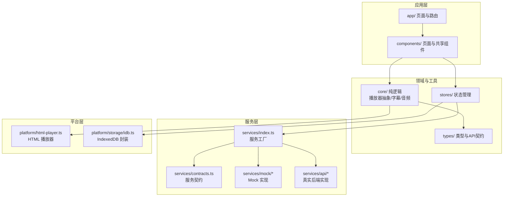
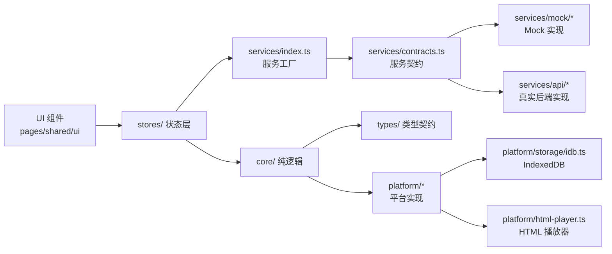
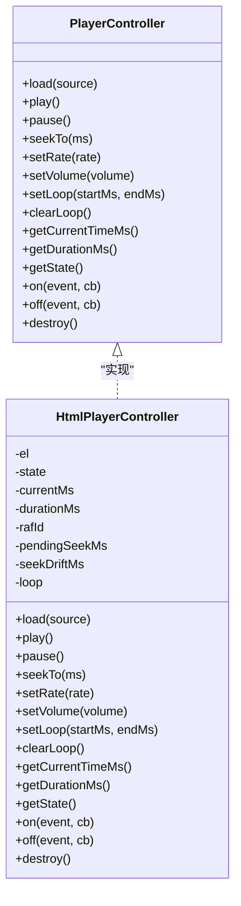
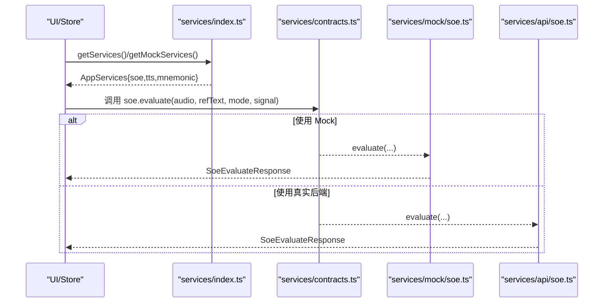
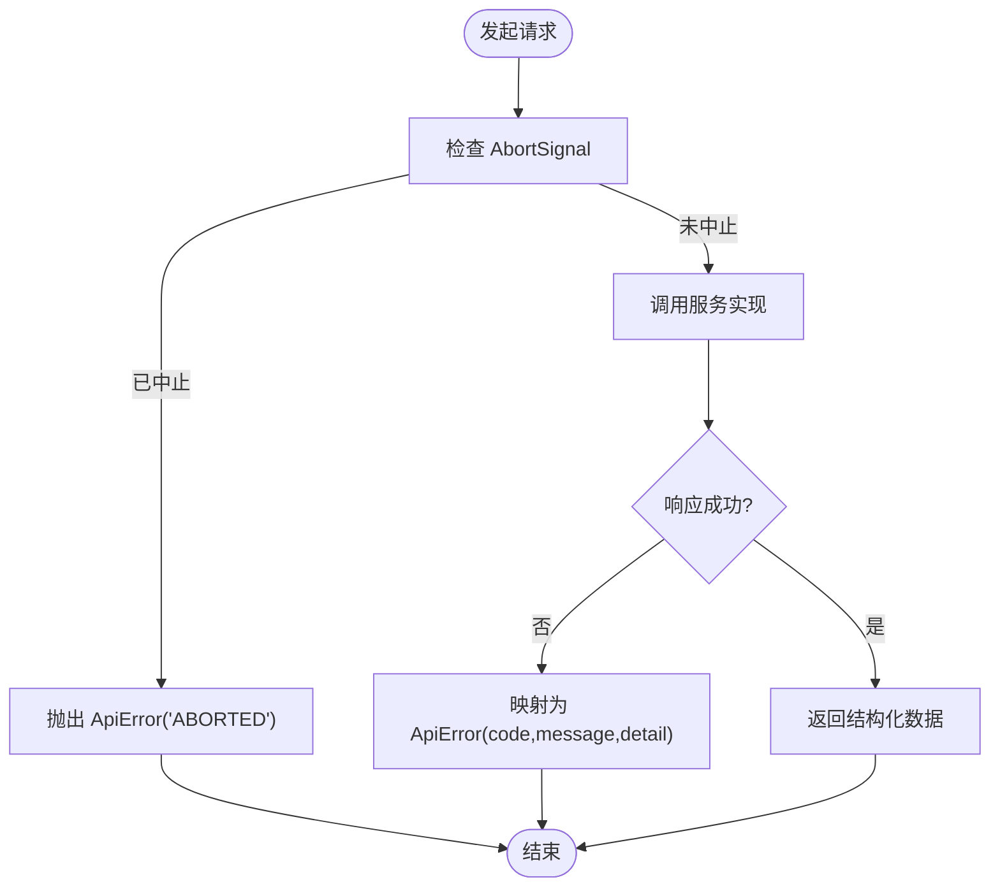
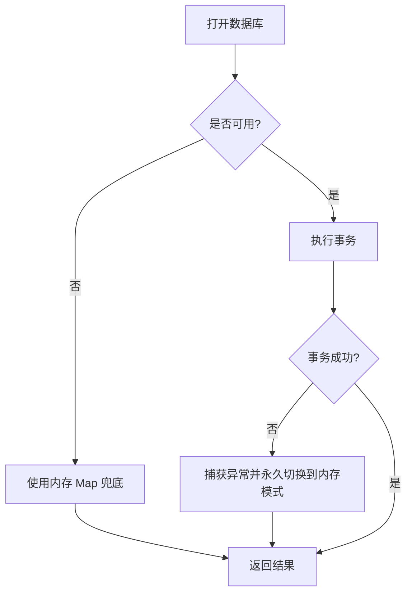
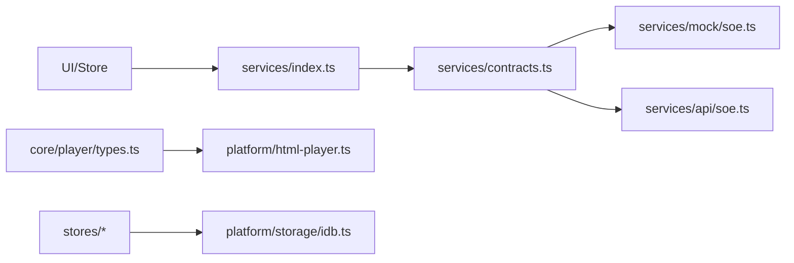

# 核心架构模式

<cite>
**本文引用的文件**   
- [client/README.md](file://client/README.md)
- [client/services/contracts.ts](file://client/services/contracts.ts)
- [client/services/index.ts](file://client/services/index.ts)
- [client/types/api.ts](file://client/types/api.ts)
- [client/core/player/types.ts](file://client/core/player/types.ts)
- [client/core/player/index.ts](file://client/core/player/index.ts)
- [client/platform/html-player.ts](file://client/platform/html-player.ts)
- [client/platform/storage/idb.ts](file://client/platform/storage/idb.ts)
- [client/services/mock/soe.ts](file://client/services/mock/soe.ts)
- [client/services/api/soe.ts](file://client/services/api/soe.ts)
</cite>

## 目录
1. [引言](#引言)
2. [项目结构](#项目结构)
3. [核心组件](#核心组件)
4. [架构总览](#架构总览)
5. [详细组件分析](#详细组件分析)
6. [依赖关系分析](#依赖关系分析)
7. [性能与可测性](#性能与可测性)
8. [故障排查指南](#故障排查指南)
9. [结论](#结论)
10. [附录：新功能开发与维护实践](#附录新功能开发与维护实践)

## 引言
本文件面向“六层架构在前端的具体体现”，聚焦以下目标：
- Core 层的纯函数与平台无关设计
- Platform 层的平台抽象与实现分离
- Services 层的契约模式与服务工厂
- Types 层的类型安全与统一错误模型
- 依赖注入、接口隔离、单一职责的应用
- 模块解耦、扩展点与插件化策略
- 架构图、设计模式示例与最佳实践

该前端采用 Next.js + React + TypeScript，遵循本地优先（IndexedDB）与“服务抽象层”的架构原则。AI 能力（ASR/SOE/TTS/LLM）通过接口抽象，当前以 Mock 实现为主，预留真实后端切换入口。

**章节来源**
- [client/README.md:126-166](file://client/README.md#L126-L166)

## 项目结构
客户端代码按职责分层组织：
- app：Next.js App Router 页面与路由
- components：UI 与业务页面组件
- core：平台无关的纯 TS 逻辑（播放器抽象、字幕解析、音频处理等）
- platform：平台适配（HTML 媒体播放、存储、录音等）
- services：服务契约与实现（Mock/Api），对外暴露统一入口
- stores：轻量状态管理（基于 useSyncExternalStore）
- types：全局类型定义与 API 契约类型

**图表来源**
- [client/README.md:21-96](file://client/README.md#L21-L96)
- [client/services/contracts.ts:1-144](file://client/services/contracts.ts#L1-L144)
- [client/services/index.ts:1-68](file://client/services/index.ts#L1-L68)
- [client/core/player/types.ts:1-56](file://client/core/player/types.ts#L1-L56)
- [client/platform/html-player.ts:1-272](file://client/platform/html-player.ts#L1-L272)
- [client/platform/storage/idb.ts:1-117](file://client/platform/storage/idb.ts#L1-L117)

**章节来源**
- [client/README.md:21-96](file://client/README.md#L21-L96)

## 核心组件
本节从“六层架构”视角拆解关键组件及其职责边界。

- Core 层（纯函数与平台无关）
  - 播放器抽象：定义跨平台的 PlayerController 接口与事件模型，不依赖浏览器 DOM；具体由 platform 层提供 HtmlPlayerController 实现。
  - 字幕解析器与音频处理：纯 TS 实现，零运行时依赖，便于单元测试与跨环境复用。

- Platform 层（平台抽象与实现）
  - HTML 播放器：封装原生 audio/video 元素，提供 seek 落点校准、rAF 高频进度采样、A-B 循环等能力。
  - 存储适配：IndexedDB Promise 封装，支持 SSR/隐私模式降级到内存 Map，保证调用方永不崩溃。

- Services 层（契约模式与工厂）
  - 契约：SOE/TTS/Mnemonic 等服务接口集中定义，统一错误模型 ApiError，支持 AbortSignal 中止。
  - 工厂：getServices/getMockServices 聚合服务实例，预留环境变量切换 mock/api 实现。

- Types 层（类型安全）
  - API 契约类型：SOE/TTS/LTM/Translate 的请求、响应、SSE 事件类型集中维护，确保前后端一致。
  - 统一错误格式：ApiError(code, message, detail?) 贯穿服务层与上层。

- 依赖注入与接口隔离
  - 上层（stores/页面）仅依赖 contracts 中的接口，不感知具体实现；通过服务工厂注入实例。
  - 每个服务接口职责单一，符合接口隔离原则。

- 单一职责
  - 播放器控制器只负责媒体控制与事件派发；
  - SOE/TTS/Mnemonic 各自独立；
  - IndexedDB 封装仅提供最小 KV 能力。

**章节来源**
- [client/core/player/types.ts:1-56](file://client/core/player/types.ts#L1-L56)
- [client/platform/html-player.ts:1-272](file://client/platform/html-player.ts#L1-L272)
- [client/platform/storage/idb.ts:1-117](file://client/platform/storage/idb.ts#L1-L117)
- [client/services/contracts.ts:1-144](file://client/services/contracts.ts#L1-L144)
- [client/services/index.ts:1-68](file://client/services/index.ts#L1-L68)
- [client/types/api.ts:1-154](file://client/types/api.ts#L1-L154)

## 架构总览
下图展示“Core / Platform / Services / Types”的分层协作与数据流向。

**图表来源**
- [client/services/index.ts:1-68](file://client/services/index.ts#L1-L68)
- [client/services/contracts.ts:1-144](file://client/services/contracts.ts#L1-L144)
- [client/core/player/types.ts:1-56](file://client/core/player/types.ts#L1-L56)
- [client/platform/html-player.ts:1-272](file://client/platform/html-player.ts#L1-L272)
- [client/platform/storage/idb.ts:1-117](file://client/platform/storage/idb.ts#L1-L117)

## 详细组件分析

### 播放器抽象与 HTML 实现（Core vs Platform）
- Core 层定义 PlayerController 接口与事件模型，屏蔽平台差异；Platform 层提供 HtmlPlayerController 实现。
- 关键机制：
  - Seek 落点校准：记录 pendingSeekMs，首个 timeupdate 作为实际落点，偏差超阈值记录 drift 供上层容差修正。
  - 高频进度采样：timeupdate 兜底（~4Hz），播放中用 requestAnimationFrame 补偿至 ~60Hz。
  - A-B 循环：controller 级区间循环，无次数限制；带次数的循环由 SentencePlayer 承担。
  - destroy 清理：停止 rAF、解绑监听、卸载 src、清空事件表。

**图表来源**
- [client/core/player/types.ts:1-56](file://client/core/player/types.ts#L1-L56)
- [client/platform/html-player.ts:1-272](file://client/platform/html-player.ts#L1-L272)

**章节来源**
- [client/core/player/types.ts:1-56](file://client/core/player/types.ts#L1-L56)
- [client/platform/html-player.ts:1-272](file://client/platform/html-player.ts#L1-L272)

### 服务契约与工厂（Services 层）
- 契约集中定义 SoeService/TtsService/MnemonicService，统一错误模型 ApiError，所有方法接受可选 AbortSignal。
- 工厂 getServices/getMockServices 聚合服务实例，预留 ServiceMode 切换（mock/api）。
- 典型流程：SOE 发音评分（Mock 与真实实现并存）。

**图表来源**
- [client/services/index.ts:1-68](file://client/services/index.ts#L1-L68)
- [client/services/contracts.ts:1-144](file://client/services/contracts.ts#L1-L144)
- [client/services/mock/soe.ts:1-138](file://client/services/mock/soe.ts#L1-L138)
- [client/services/api/soe.ts:1-30](file://client/services/api/soe.ts#L1-L30)

**章节来源**
- [client/services/contracts.ts:1-144](file://client/services/contracts.ts#L1-L144)
- [client/services/index.ts:1-68](file://client/services/index.ts#L1-L68)
- [client/services/mock/soe.ts:1-138](file://client/services/mock/soe.ts#L1-L138)
- [client/services/api/soe.ts:1-30](file://client/services/api/soe.ts#L1-L30)

### 类型契约与统一错误（Types 层）
- 统一错误格式 ApiError(code, message, detail?) 贯穿服务层与上层。
- SOE/TTS/LTM/Translate 的请求、响应、SSE 事件类型集中维护，确保前后端一致。
- SSE 事件序列：status → token → result → done/error。

**图表来源**
- [client/types/api.ts:1-154](file://client/types/api.ts#L1-L154)
- [client/services/contracts.ts:1-144](file://client/services/contracts.ts#L1-L144)

**章节来源**
- [client/types/api.ts:1-154](file://client/types/api.ts#L1-L154)
- [client/services/contracts.ts:1-144](file://client/services/contracts.ts#L1-L144)

### 本地持久化（Platform 层）
- IndexedDB Promise 封装，三个 object store：materials/blobs/records。
- SSR/隐私模式打开失败时优雅降级为内存 Map，绝不抛崩溃。
- 提供 KvStore 最小 KV API：get/put/delete/allKeys/clear。

**图表来源**
- [client/platform/storage/idb.ts:1-117](file://client/platform/storage/idb.ts#L1-L117)

**章节来源**
- [client/platform/storage/idb.ts:1-117](file://client/platform/storage/idb.ts#L1-L117)

## 依赖关系分析
- 耦合与内聚
  - services/index.ts 仅依赖 contracts 与具体实现类，保持低耦合；
  - core/player/types.ts 与 platform/html-player.ts 通过接口解耦；
  - platform/storage/idb.ts 对上层提供稳定 KV 接口，内部实现变更不影响调用方。
- 直接/间接依赖
  - 上层（stores/页面）→ services/index.ts → contracts → mock/api 实现；
  - core 层 → platform 层（HTML 播放器）与 types 层（类型契约）。
- 外部依赖与集成点
  - 浏览器 API：Audio/Video、requestAnimationFrame、IndexedDB；
  - 网络：fetch（SOE/BFF 中转）、SSE（TTS/LLM 流式）。

**图表来源**
- [client/services/index.ts:1-68](file://client/services/index.ts#L1-L68)
- [client/services/contracts.ts:1-144](file://client/services/contracts.ts#L1-L144)
- [client/services/mock/soe.ts:1-138](file://client/services/mock/soe.ts#L1-L138)
- [client/services/api/soe.ts:1-30](file://client/services/api/soe.ts#L1-L30)
- [client/core/player/types.ts:1-56](file://client/core/player/types.ts#L1-L56)
- [client/platform/html-player.ts:1-272](file://client/platform/html-player.ts#L1-L272)
- [client/platform/storage/idb.ts:1-117](file://client/platform/storage/idb.ts#L1-L117)

**章节来源**
- [client/services/index.ts:1-68](file://client/services/index.ts#L1-L68)
- [client/services/contracts.ts:1-144](file://client/services/contracts.ts#L1-L144)
- [client/core/player/types.ts:1-56](file://client/core/player/types.ts#L1-L56)
- [client/platform/html-player.ts:1-272](file://client/platform/html-player.ts#L1-L272)
- [client/platform/storage/idb.ts:1-117](file://client/platform/storage/idb.ts#L1-L117)

## 性能与可测性
- 播放器性能
  - rAF 高频采样避免进度条卡顿；
  - seek 落点校准减少 UI 闪烁；
  - A-B 循环在 controller 层实现，避免额外开销。
- 存储性能
  - IndexedDB 异步事务，避免阻塞主线程；
  - 内存降级保证极端场景可用性。
- 可测性
  - Mock SOE 支持延迟注入与随机数注入，便于断言与回归测试；
  - 服务契约与类型集中在 types/contracts，利于端到端校验。

[本节为通用指导，不直接分析具体文件]

## 故障排查指南
- 播放相关
  - 播放被拦截：HtmlPlayerController 捕获 play() 拒绝，区分 AbortError 与 PLAY_BLOCKED；
  - seek 漂移：当实际落点与目标偏差超过阈值，记录 drift 供上层修正循环容差。
- 服务相关
  - 上游不可达：ApiSoeService 将网络异常映射为 ApiError('SOE_UPSTREAM_ERROR')；
  - 操作取消：统一通过 ApiError('ABORTED') 表达，上层可按 code 静默分支处理。
- 存储相关
  - IDB 打开失败或 blocked：自动切换到内存模式，日志输出告警；
  - 事务错误：包装为统一错误，调用方可根据错误码判断。

**章节来源**
- [client/platform/html-player.ts:85-113](file://client/platform/html-player.ts#L85-L113)
- [client/platform/html-player.ts:178-216](file://client/platform/html-player.ts#L178-L216)
- [client/services/api/soe.ts:10-28](file://client/services/api/soe.ts#L10-L28)
- [client/platform/storage/idb.ts:27-50](file://client/platform/storage/idb.ts#L27-L50)
- [client/platform/storage/idb.ts:53-78](file://client/platform/storage/idb.ts#L53-L78)

## 结论
本项目在前端实现了清晰的六层架构：
- Core 层纯函数与平台无关，保障可移植性与可测性；
- Platform 层屏蔽浏览器差异，提供稳定的媒体与存储能力；
- Services 层以契约为中心，Mock/Api 双实现无缝切换；
- Types 层统一错误与数据结构，提升类型安全与前后端一致性。
配合依赖注入、接口隔离与单一职责，模块间高度解耦，扩展点清晰，适合持续演进与插件化扩展。

[本节为总结性内容，不直接分析具体文件]

## 附录：新功能开发与维护实践
- 新增服务
  - 在 services/contracts.ts 中定义新接口（如 NewService），并在 AppServices 中聚合；
  - 在 services/mock 与 services/api 分别提供实现；
  - 在 services/index.ts 的 getServices/getMockServices 中注册实例；
  - 上层通过依赖注入使用，无需感知具体实现。
- 新增平台能力
  - 在 core 层定义抽象接口（如新的 Controller 接口）；
  - 在 platform 层提供具体实现（如 Web/小程序/Node 适配）；
  - 保持 core 层无框架与 DOM 依赖。
- 类型与错误
  - 新增 API 契约类型于 types/api.ts；
  - 统一使用 ApiError(code, message, detail?) 表达错误；
  - 对 SSE 流式交互，沿用 status/token/result/done/error 事件序列。
- 可测性
  - Mock 实现支持延迟与随机注入，便于断言与回归；
  - 对关键路径编写 Vitest 单测，覆盖正常与异常分支。
- 最佳实践
  - 严格遵循接口隔离与单一职责，避免跨层耦合；
  - 所有外部副作用（网络、DOM、存储）下沉至 platform/services；
  - 保持 core 层纯函数与确定性，便于测试与复用。

[本节为通用指导，不直接分析具体文件]