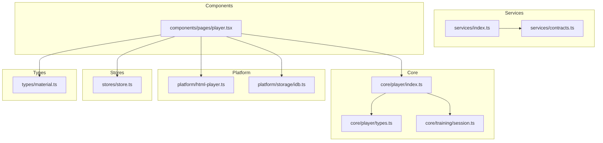
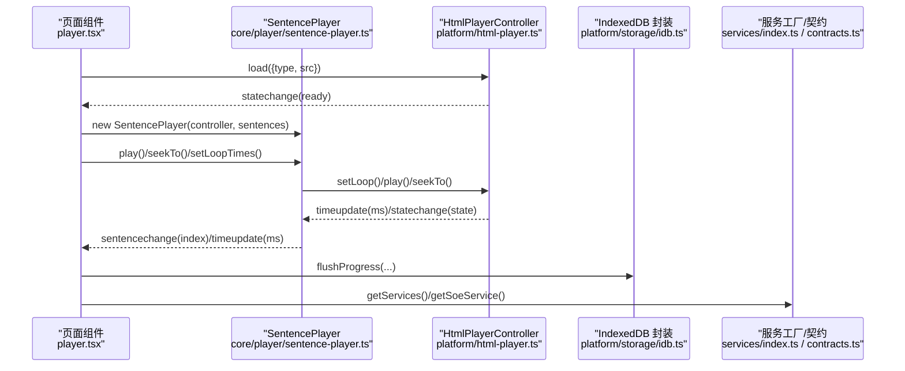
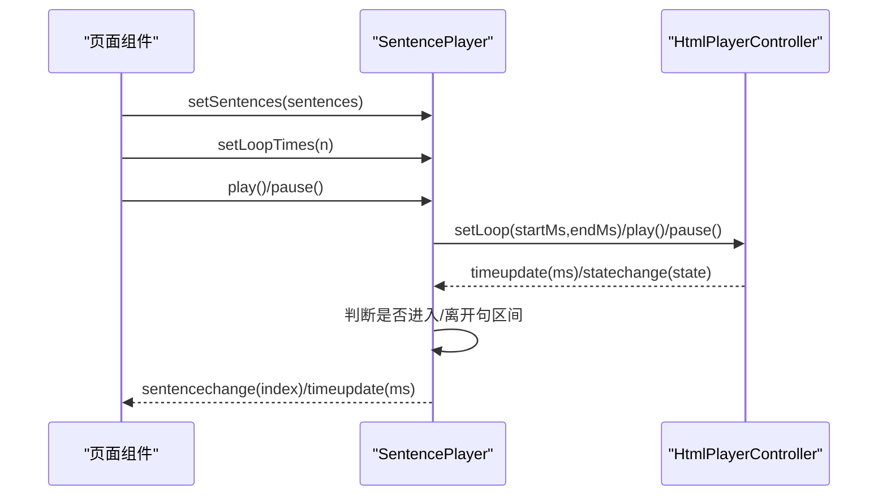
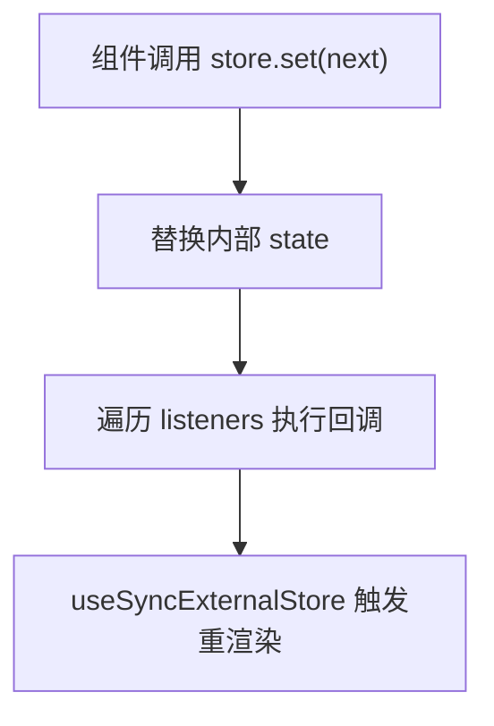
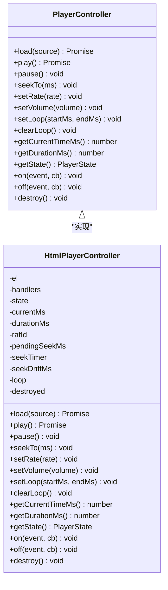
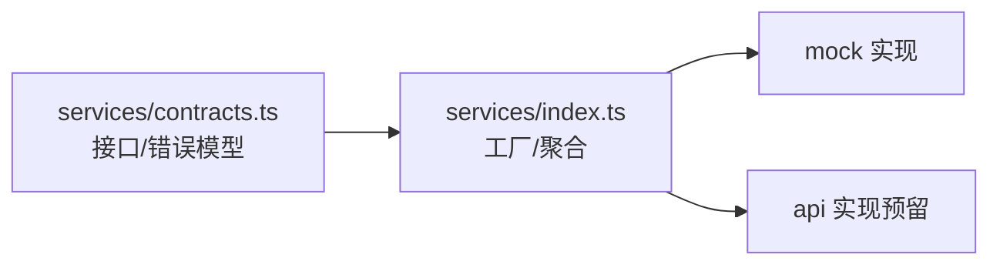
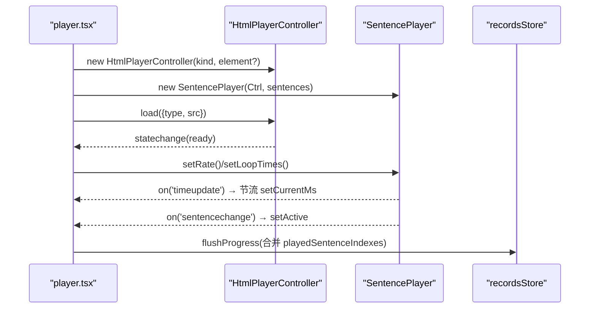
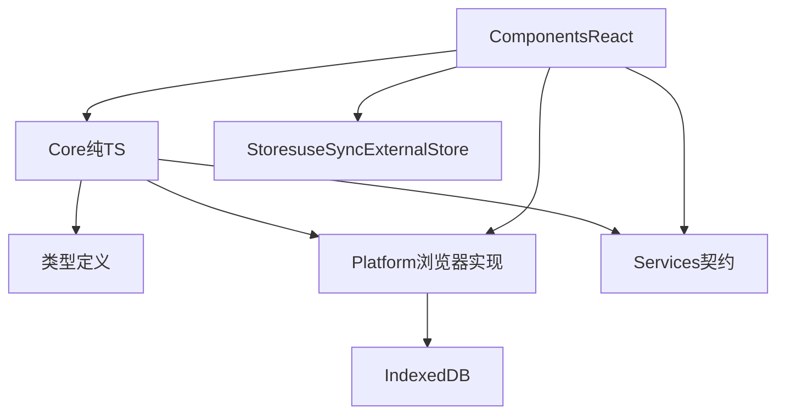

# 核心模块架构

<cite>
**本文引用的文件**   
- [client/core/training/session.ts](file://client/core/training/session.ts)
- [client/platform/html-player.ts](file://client/platform/html-player.ts)
- [client/stores/store.ts](file://client/stores/store.ts)
- [client/services/contracts.ts](file://client/services/contracts.ts)
- [client/services/index.ts](file://client/services/index.ts)
- [client/types/material.ts](file://client/types/material.ts)
- [client/components/pages/player.tsx](file://client/components/pages/player.tsx)
- [client/core/player/types.ts](file://client/core/player/types.ts)
- [client/core/player/index.ts](file://client/core/player/index.ts)
- [client/platform/storage/idb.ts](file://client/platform/storage/idb.ts)
</cite>

## 目录
1. [引言](#引言)
2. [项目结构](#项目结构)
3. [核心组件](#核心组件)
4. [架构总览](#架构总览)
5. [详细组件分析](#详细组件分析)
6. [依赖分析](#依赖分析)
7. [性能考虑](#性能考虑)
8. [故障排查指南](#故障排查指南)
9. [结论](#结论)
10. [附录：扩展与最佳实践](#附录扩展与最佳实践)

## 引言
本文件围绕前端“六层架构”展开，聚焦核心模块的职责分离、依赖注入模式与纯函数设计原则。重点覆盖：
- Core（平台无关纯 TS 逻辑）：训练会话状态机、播放器抽象类型与统一出口。
- Platform（浏览器实现）：HTML 媒体控制器、IndexedDB 持久化封装。
- Services（AI 服务契约）：SOE/TTS/Mnemonic 接口与错误模型。
- Stores（状态管理）：useSyncExternalStore 极简订阅封装。
- Components（页面组件）：播放器页面装配与交互。
- Types（类型定义）：材料业务模型等。

目标是帮助读者理解数据流、事件流与控制流，并给出扩展新功能的指导原则。

## 项目结构
本项目采用分层组织方式：
- core：平台无关的纯 TS 逻辑（播放器抽象、训练会话、字幕解析、音频编码等）。
- platform：浏览器端实现（HTML 播放器、Kokoro TTS、IndexedDB 存储等）。
- services：AI 服务契约与工厂（mock/api 可切换）。
- stores：基于 useSyncExternalStore 的状态容器。
- components：React 页面与共享 UI 组件。
- types：跨层共享的类型定义。



图表来源
- [client/core/player/types.ts:1-56](file://client/core/player/types.ts#L1-L56)
- [client/core/player/index.ts:1-5](file://client/core/player/index.ts#L1-L5)
- [client/core/training/session.ts:1-119](file://client/core/training/session.ts#L1-L119)
- [client/platform/html-player.ts:1-272](file://client/platform/html-player.ts#L1-L272)
- [client/platform/storage/idb.ts:1-117](file://client/platform/storage/idb.ts#L1-L117)
- [client/services/contracts.ts:1-144](file://client/services/contracts.ts#L1-L144)
- [client/services/index.ts:1-68](file://client/services/index.ts#L1-L68)
- [client/stores/store.ts:1-34](file://client/stores/store.ts#L1-L34)
- [client/components/pages/player.tsx:1-535](file://client/components/pages/player.tsx#L1-L535)
- [client/types/material.ts:1-36](file://client/types/material.ts#L1-L36)

章节来源
- [client/core/player/types.ts:1-56](file://client/core/player/types.ts#L1-L56)
- [client/core/player/index.ts:1-5](file://client/core/player/index.ts#L1-L5)
- [client/core/training/session.ts:1-119](file://client/core/training/session.ts#L1-L119)
- [client/platform/html-player.ts:1-272](file://client/platform/html-player.ts#L1-L272)
- [client/platform/storage/idb.ts:1-117](file://client/platform/storage/idb.ts#L1-L117)
- [client/services/contracts.ts:1-144](file://client/services/contracts.ts#L1-L144)
- [client/services/index.ts:1-68](file://client/services/index.ts#L1-L68)
- [client/stores/store.ts:1-34](file://client/stores/store.ts#L1-L34)
- [client/components/pages/player.tsx:1-535](file://client/components/pages/player.tsx#L1-L535)
- [client/types/material.ts:1-36](file://client/types/material.ts#L1-L36)

## 核心组件
本节聚焦六大层次中的关键构件及其职责边界。

- Core（平台无关纯 TS 逻辑）
  - 播放器抽象类型：定义 PlayerController 接口、事件与状态，确保上层不感知底层实现。
  - 训练会话状态机：以纯函数驱动状态迁移，UI 仅消费结果。
  - 播放器统一出口：对外暴露 SentencePlayer 与常量。

- Platform（浏览器实现）
  - HTML 播放器控制器：封装原生 audio/video，提供 seek 校准、rAF 高频进度采样、A-B 循环等能力。
  - IndexedDB 封装：Promise 化 KV API，支持 SSR/隐私模式内存降级。

- Services（AI 服务契约）
  - 统一错误模型 ApiError、中止信号处理工具。
  - SOE/TTS/Mnemonic 服务接口；服务工厂按环境返回 mock 或 api 实现。

- Stores（状态管理）
  - 基于 useSyncExternalStore 的最小状态容器，解耦 React 与状态源。

- Components（页面组件）
  - 播放器页面装配 HtmlPlayerController + SentencePlayer，绑定事件、节流更新、持久化进度。

- Types（类型定义）
  - 学习材料业务模型 Material 等，作为跨层共享的数据契约。

章节来源
- [client/core/player/types.ts:1-56](file://client/core/player/types.ts#L1-L56)
- [client/core/training/session.ts:1-119](file://client/core/training/session.ts#L1-L119)
- [client/core/player/index.ts:1-5](file://client/core/player/index.ts#L1-L5)
- [client/platform/html-player.ts:1-272](file://client/platform/html-player.ts#L1-L272)
- [client/platform/storage/idb.ts:1-117](file://client/platform/storage/idb.ts#L1-L117)
- [client/services/contracts.ts:1-144](file://client/services/contracts.ts#L1-L144)
- [client/services/index.ts:1-68](file://client/services/index.ts#L1-L68)
- [client/stores/store.ts:1-34](file://client/stores/store.ts#L1-L34)
- [client/components/pages/player.tsx:1-535](file://client/components/pages/player.tsx#L1-L535)
- [client/types/material.ts:1-36](file://client/types/material.ts#L1-L36)

## 架构总览
下图展示从页面到核心、平台、服务的整体调用关系与数据流向。



图表来源
- [client/components/pages/player.tsx:180-245](file://client/components/pages/player.tsx#L180-L245)
- [client/platform/html-player.ts:66-137](file://client/platform/html-player.ts#L66-L137)
- [client/platform/storage/idb.ts:89-102](file://client/platform/storage/idb.ts#L89-L102)
- [client/services/index.ts:29-48](file://client/services/index.ts#L29-L48)
- [client/services/contracts.ts:33-64](file://client/services/contracts.ts#L33-L64)

## 详细组件分析

### 训练会话状态机（session.ts）
训练会话以纯函数状态机形式存在，所有迁移函数接收当前状态并返回新状态，无副作用、无 DOM/框架依赖。

- 状态字段
  - mode：训练模式
  - queue：题目队列（按范围过滤后的句子）
  - cursor：当前句游标
  - status：active | done
  - results：已收集结果（按提交顺序）
  - hintCount/attemptCount：当前句提示/提交计数
  - startedAt：开始时间戳

- 关键行为
  - createSession：初始化会话，根据范围构建队列，设置初始状态。
  - submit：记录当前句结果（同句重试覆盖上一条），不推进游标。
  - attempt/hint：分别累计提交次数与提示次数。
  - next：推进游标；超出队尾则置 done。
  - skip：记一条 0 分结果并推进。
  - retryAt：回跳至指定句位置并激活。
  - makeRecordId：生成训练记录 id。

```mermaid
flowchart TD
Start(["createSession"]) --> Init["构建队列<br/>设置 cursor=0/status=active|done"]
Init --> Event{"收到事件"}
Event --> |submit| Submit["记录结果<br/>不推进游标"]
Event --> |attempt| IncAttempt["attemptCount+1"]
Event --> |hint| IncHint["hintCount+1"]
Event --> |next| Next["cursor+1<br/>若越界→status=done"]
Event --> |skip| Skip["提交0分结果并next"]
Event --> |retryAt(i)| Retry["定位i并cursor=i,status=active"]
Submit --> Event
IncAttempt --> Event
IncHint --> Event
Next --> Event
Skip --> Event
Retry --> Event
```

图表来源
- [client/core/training/session.ts:44-113](file://client/core/training/session.ts#L44-L113)

章节来源
- [client/core/training/session.ts:1-119](file://client/core/training/session.ts#L1-L119)

### 句子播放器（sentence-player.ts）播放控制逻辑
说明：该文件未在仓库中直接列出，但通过 core/player/index.ts 导出 SentencePlayer 与 LOOP_TOLERANCE_MS，且 player.tsx 使用其 API（play/pause/seekTo/setLoopTimes/on 事件等）。结合播放器抽象与 HTML 实现，可推断其职责为：
- 将句子时间轴与媒体控制器解耦，负责句级播放控制、A-B 循环、句切换事件派发。
- 监听底层 timeupdate/statechange，向上派发自定义事件（如 sentencechange）。
- 维护句级播放区间与容差（LOOP_TOLERANCE_MS），在接近句末时触发下一句或结束。



图表来源
- [client/core/player/index.ts:1-5](file://client/core/player/index.ts#L1-L5)
- [client/components/pages/player.tsx:180-245](file://client/components/pages/player.tsx#L180-L245)
- [client/platform/html-player.ts:178-251](file://client/platform/html-player.ts#L178-L251)

章节来源
- [client/core/player/index.ts:1-5](file://client/core/player/index.ts#L1-L5)
- [client/components/pages/player.tsx:180-245](file://client/components/pages/player.tsx#L180-L245)
- [client/platform/html-player.ts:178-251](file://client/platform/html-player.ts#L178-L251)

### 状态管理系统（store.ts）数据流设计
- 最小 Store 抽象：get/set/subscribe，内部用 Set 管理监听器。
- React 集成：useStore 基于 useSyncExternalStore，SSR 安全（getServerSnapshot 返回 store.get）。
- 数据流：组件通过 useStore 订阅，store.set 触发通知，组件重渲染。



图表来源
- [client/stores/store.ts:14-33](file://client/stores/store.ts#L14-L33)

章节来源
- [client/stores/store.ts:1-34](file://client/stores/store.ts#L1-L34)

### 播放器抽象与浏览器实现
- 抽象层（core/player/types.ts）：定义 MediaSource、PlayerState、PlayerEvents、PlayerController 接口，确保 Core 层零依赖。
- 浏览器实现（platform/html-player.ts）：
  - 进度采样：原生 timeupdate 兜底（~4Hz）+ rAF 高频补偿（~60Hz）。
  - seek 落点校准：记录 pendingSeekMs，首个 timeupdate 校准 currentMs，偏差 >300ms 记录 drift 供上层修正。
  - 倍速/音量：限制范围后设置原生属性。
  - A-B 循环：controller 级循环区间由 SentencePlayer 组合带次数的循环。
  - destroy：停 rAF、解绑监听、卸载 src、清空事件表与引用。



图表来源
- [client/core/player/types.ts:1-56](file://client/core/player/types.ts#L1-L56)
- [client/platform/html-player.ts:24-155](file://client/platform/html-player.ts#L24-L155)

章节来源
- [client/core/player/types.ts:1-56](file://client/core/player/types.ts#L1-L56)
- [client/platform/html-player.ts:1-272](file://client/platform/html-player.ts#L1-L272)

### AI 服务契约与服务工厂
- 契约（services/contracts.ts）：
  - 统一错误模型 ApiError，toApiError/throwIfAborted/abortableDelay 工具。
  - SoeService/TtsService/MnemonicService 接口，方法签名稳定，便于 mock/api 切换。
- 工厂（services/index.ts）：
  - getMockServices 返回完整 AppServices（含 tts）。
  - getServices 预留 ServiceMode 切换（当前默认 mock）。
  - getSoeService 根据后端配置动态返回 mock 或 api 实现。



图表来源
- [client/services/contracts.ts:33-144](file://client/services/contracts.ts#L33-L144)
- [client/services/index.ts:29-68](file://client/services/index.ts#L29-L68)

章节来源
- [client/services/contracts.ts:1-144](file://client/services/contracts.ts#L1-L144)
- [client/services/index.ts:1-68](file://client/services/index.ts#L1-L68)

### 页面组件装配（player.tsx）
- 装配流程：
  - 读取材料与媒体 Blob → 创建 ObjectURL。
  - 根据 mediaType 选择复用隐藏 <audio>/<video> 元素或新建。
  - 构造 HtmlPlayerController → 构造 SentencePlayer → 绑定事件（timeupdate/statechange/sentencechange/error）。
  - 应用默认倍速/循环次数，必要时 seek 到收藏跳转目标。
- 数据持久化：
  - 播放过的句子增量收集 + 5s 节流写 progress。
  - 卸载时同步捕获最后位置再异步落盘。
- 字幕数据同步：
  - 字幕变化时调用 setSentences 同步到引擎，避免控件失效。



图表来源
- [client/components/pages/player.tsx:180-245](file://client/components/pages/player.tsx#L180-L245)
- [client/components/pages/player.tsx:254-271](file://client/components/pages/player.tsx#L254-L271)
- [client/platform/storage/idb.ts:89-102](file://client/platform/storage/idb.ts#L89-L102)

章节来源
- [client/components/pages/player.tsx:1-535](file://client/components/pages/player.tsx#L1-L535)
- [client/platform/storage/idb.ts:1-117](file://client/platform/storage/idb.ts#L1-L117)

## 依赖分析
- 耦合与内聚
  - Core 层对 Platform/Services/Components 无依赖，仅暴露类型与纯函数。
  - Platform 实现依赖浏览器全局（document/window），由调用方在浏览器环境实例化。
  - Services 契约与工厂位于中间层，解耦上层与具体网络实现。
  - Stores 与 React 解耦，仅通过 useSyncExternalStore 桥接。
- 外部依赖
  - 媒体：HTMLAudioElement/HTMLVideoElement。
  - 存储：IndexedDB（失败自动降级内存 Map）。
  - React：useSyncExternalStore。



图表来源
- [client/core/player/types.ts:1-56](file://client/core/player/types.ts#L1-L56)
- [client/platform/html-player.ts:1-272](file://client/platform/html-player.ts#L1-L272)
- [client/services/contracts.ts:1-144](file://client/services/contracts.ts#L1-L144)
- [client/stores/store.ts:1-34](file://client/stores/store.ts#L1-L34)
- [client/platform/storage/idb.ts:1-117](file://client/platform/storage/idb.ts#L1-L117)
- [client/components/pages/player.tsx:1-535](file://client/components/pages/player.tsx#L1-L535)

章节来源
- [client/core/player/types.ts:1-56](file://client/core/player/types.ts#L1-L56)
- [client/platform/html-player.ts:1-272](file://client/platform/html-player.ts#L1-L272)
- [client/services/contracts.ts:1-144](file://client/services/contracts.ts#L1-L144)
- [client/stores/store.ts:1-34](file://client/stores/store.ts#L1-L34)
- [client/platform/storage/idb.ts:1-117](file://client/platform/storage/idb.ts#L1-L117)
- [client/components/pages/player.tsx:1-535](file://client/components/pages/player.tsx#L1-L535)

## 性能考虑
- 进度更新节流
  - 播放器 timeupdate 每 100ms 最多一次 setState，降低 React 重渲染频率，缓解视频播放卡顿。
- 高频进度采样
  - HtmlPlayerController 在播放中使用 requestAnimationFrame 高频读取 currentTime，弥补原生 timeupdate 低频问题。
- 进度持久化节流
  - 播放过的句子集合每 5s 合并写入 progress，减少频繁 IO。
- 资源释放
  - 组件卸载时销毁 controller 与 player，清理 rAF、事件监听与对象 URL，避免内存泄漏。

[本节为通用性能建议，无需特定文件引用]

## 故障排查指南
- 播放加载失败
  - HtmlPlayerController.load 在 canplay/loadedmetadata 成功时 resolve，error 时 emit error 并 reject。检查媒体 URL 与权限。
- 播放被拦截
  - play() 可能因浏览器策略抛出 AbortError 或 PLAY_BLOCKED。确认用户手势触发或自动播放策略。
- seek 漂移
  - 当 seek 后首个 timeupdate 与实际目标偏差 >300ms，会记录 seekDriftMs。上层可据此调整循环容差。
- 存储降级
  - 若 IndexedDB 打开失败或被阻塞，idb.ts 自动切换到内存 Map，功能可用但数据不持久。可通过 isMemoryFallback 检测。
- 服务中断
  - 使用 toApiError/throwIfAborted 统一处理中止与异常，注意 ABORTED 分支。

章节来源
- [client/platform/html-player.ts:66-137](file://client/platform/html-player.ts#L66-L137)
- [client/platform/html-player.ts:178-251](file://client/platform/html-player.ts#L178-L251)
- [client/platform/storage/idb.ts:27-50](file://client/platform/storage/idb.ts#L27-L50)
- [client/platform/storage/idb.ts:104-117](file://client/platform/storage/idb.ts#L104-L117)
- [client/services/contracts.ts:33-64](file://client/services/contracts.ts#L33-L64)

## 结论
本核心模块通过清晰的六层划分与严格的职责边界，实现了：
- 平台无关的核心逻辑（Core）与浏览器实现（Platform）解耦。
- 稳定的 AI 服务契约（Services）与可插拔实现（mock/api）。
- 轻量状态管理（Stores）与 React 解耦。
- 页面组件（Components）专注装配与交互，核心算法与状态迁移保持纯函数与无副作用。
这种设计提升了可测试性、可维护性与可扩展性，为后续功能扩展提供了清晰路径。

[本节为总结性内容，无需特定文件引用]

## 附录：扩展与最佳实践
- 新增 AI 服务
  - 在 services/contracts.ts 中定义接口与方法签名。
  - 在 services/mock 或 services/api 下实现对应类。
  - 在 services/index.ts 的 getMockServices/getServices 中注册。
  - 上层通过 AppServices 注入，避免硬编码依赖。
- 新增播放器能力
  - 在 core/player/types.ts 扩展 PlayerController 接口。
  - 在 platform/html-player.ts 实现具体逻辑（遵循 seek 校准、rAF 采样、destroy 规范）。
  - 在 SentencePlayer（core/player/sentence-player.ts）中组合新能力并向上派发事件。
- 新增状态域
  - 使用 stores/store.ts 的 createStore/useStore 创建独立 store。
  - 组件通过 useStore 订阅，避免直接操作 DOM 或全局变量。
- 纯函数优先
  - 状态迁移、数据处理尽量写成纯函数（参考 session.ts），便于单元测试与并行推理。
- 错误与中止
  - 统一使用 ApiError/throwIfAborted/abortableDelay，保证可取消与可观测的错误语义。
- 资源管理
  - 任何持有原生资源（media element、rAF、定时器、事件监听）的对象必须提供 destroy 并在组件卸载时调用。

[本节为通用指导，无需特定文件引用]