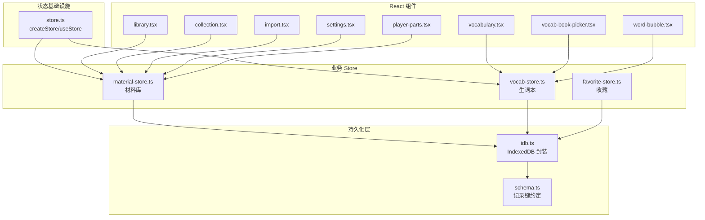
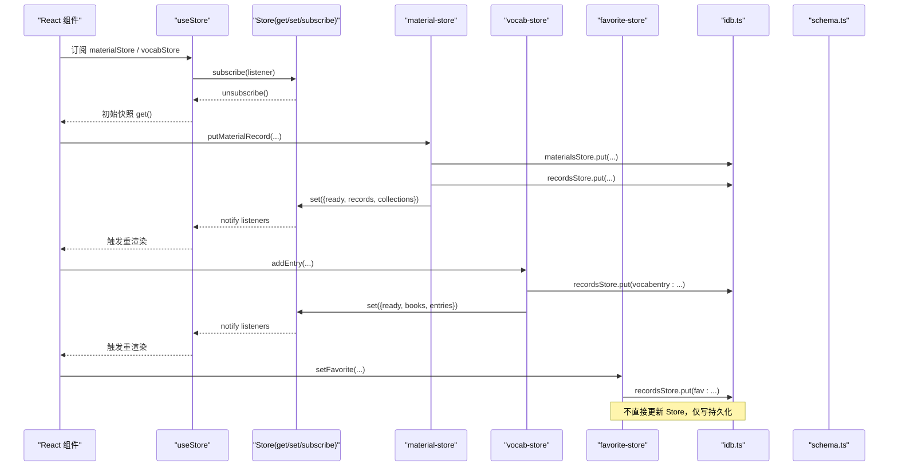
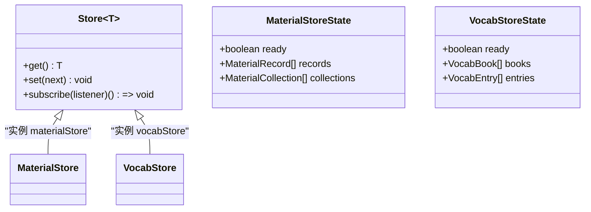
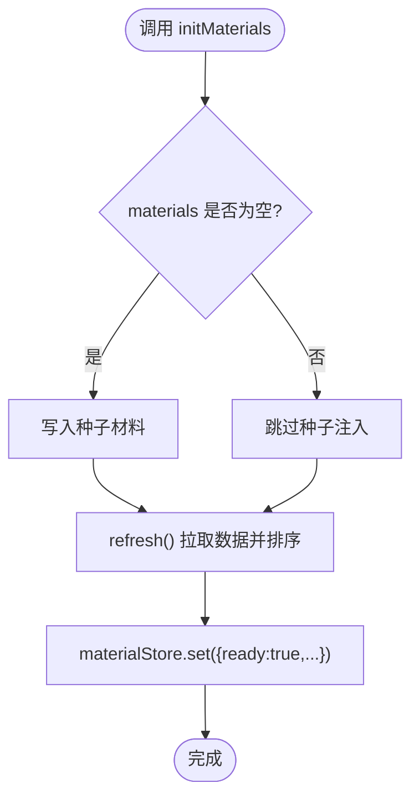
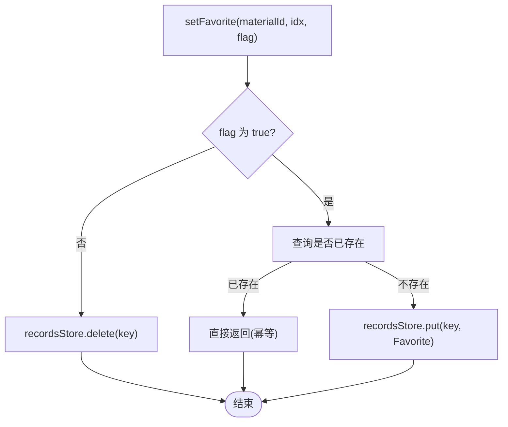
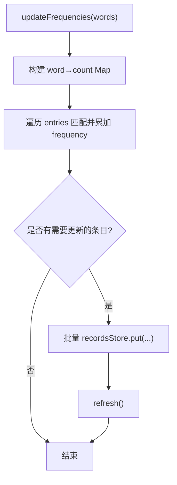
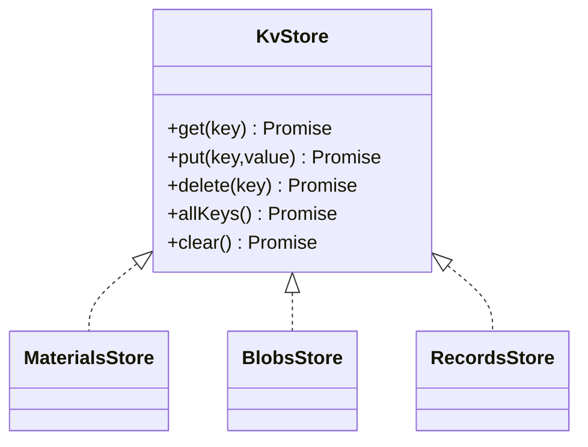
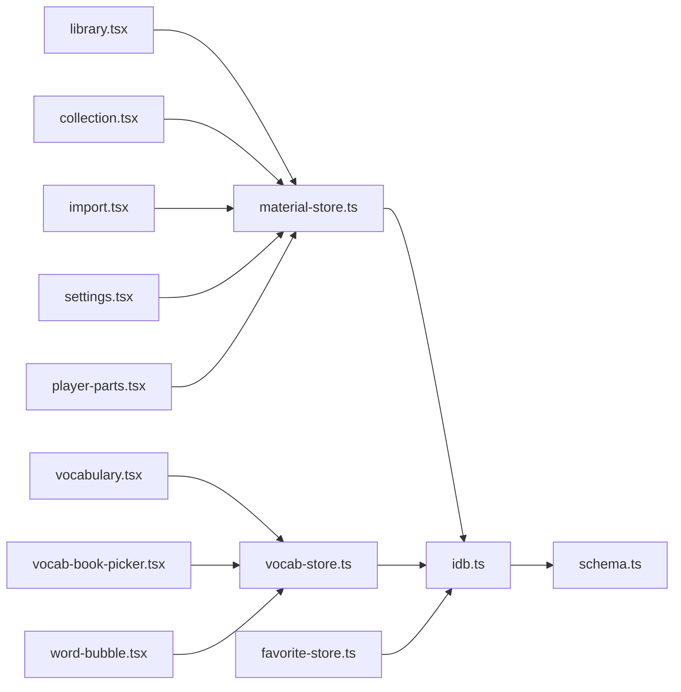

# 状态管理系统

<cite>
**本文引用的文件**   
- [client/stores/store.ts](file://client/stores/store.ts)
- [client/stores/material-store.ts](file://client/stores/material-store.ts)
- [client/stores/favorite-store.ts](file://client/stores/favorite-store.ts)
- [client/stores/vocab-store.ts](file://client/stores/vocab-store.ts)
- [client/platform/storage/idb.ts](file://client/platform/storage/idb.ts)
- [client/platform/storage/schema.ts](file://client/platform/storage/schema.ts)
- [client/components/pages/library.tsx](file://client/components/pages/library.tsx)
- [client/components/pages/collection.tsx](file://client/components/pages/collection.tsx)
- [client/components/pages/import.tsx](file://client/components/pages/import.tsx)
- [client/components/pages/settings.tsx](file://client/components/pages/settings.tsx)
- [client/components/pages/vocabulary.tsx](file://client/components/pages/vocabulary.tsx)
- [client/components/shared/player-parts.tsx](file://client/components/shared/player-parts.tsx)
- [client/components/shared/vocab-book-picker.tsx](file://client/components/shared/vocab-book-picker.tsx)
- [client/components/shared/word-bubble.tsx](file://client/components/shared/word-bubble.tsx)
</cite>

## 目录
1. [引言](#引言)
2. [项目结构](#项目结构)
3. [核心组件](#核心组件)
4. [架构总览](#架构总览)
5. [详细组件分析](#详细组件分析)
6. [依赖关系分析](#依赖关系分析)
7. [性能与优化](#性能与优化)
8. [故障排查指南](#故障排查指南)
9. [结论](#结论)
10. [附录：新增 Store 与跨 Store 依赖管理](#附录新增-store-与跨-store-依赖管理)

## 引言
本仓库采用基于 React `useSyncExternalStore` 的轻量级状态管理方案，替代传统全局状态库。其核心思想是：
- 将“状态容器”与“React 订阅层”解耦；
- Store 本体为纯 JS 对象，提供 `get/set/subscribe` 三件套；
- React 组件通过 `useStore` 订阅，实现最小化重渲染；
- 持久化由 IndexedDB 封装承担，并在不可用时优雅降级到内存 Map；
- 业务 Store（材料、收藏、生词本）按领域拆分，职责清晰、数据流单向。

该设计在 SSR 环境下同样安全，因为 `getServerSnapshot` 直接返回当前值，避免服务端/客户端不一致。

## 项目结构
与状态管理相关的代码主要位于以下路径：
- 状态基础设施：`client/stores/store.ts`
- 业务 Store：
  - 材料库：`client/stores/material-store.ts`
  - 收藏：`client/stores/favorite-store.ts`
  - 生词本：`client/stores/vocab-store.ts`
- 持久化层：
  - IndexedDB 封装：`client/platform/storage/idb.ts`
  - 记录键约定：`client/platform/storage/schema.ts`
- 使用方（示例）：
  - 材料库页面：`client/components/pages/library.tsx`
  - 集合页：`client/components/pages/collection.tsx`
  - 导入页：`client/components/pages/import.tsx`
  - 设置页：`client/components/pages/settings.tsx`
  - 生词本页：`client/components/pages/vocabulary.tsx`
  - 播放器部件：`client/components/shared/player-parts.tsx`
  - 生词书选择器：`client/components/shared/vocab-book-picker.tsx`
  - 单词气泡：`client/components/shared/word-bubble.tsx`

图示来源
- [client/stores/store.ts:1-34](file://client/stores/store.ts#L1-L34)
- [client/stores/material-store.ts:1-163](file://client/stores/material-store.ts#L1-L163)
- [client/stores/favorite-store.ts:1-42](file://client/stores/favorite-store.ts#L1-L42)
- [client/stores/vocab-store.ts:1-193](file://client/stores/vocab-store.ts#L1-L193)
- [client/platform/storage/idb.ts:1-117](file://client/platform/storage/idb.ts#L1-L117)
- [client/platform/storage/schema.ts:1-27](file://client/platform/storage/schema.ts#L1-L27)

章节来源
- [client/stores/store.ts:1-34](file://client/stores/store.ts#L1-L34)
- [client/platform/storage/idb.ts:1-117](file://client/platform/storage/idb.ts#L1-L117)
- [client/platform/storage/schema.ts:1-27](file://client/platform/storage/schema.ts#L1-L27)

## 核心组件
本节聚焦状态管理的核心抽象与三个业务 Store 的职责边界。

- 状态容器抽象
  - `Store<T>`：定义 `get/set/subscribe` 接口，保证与框架无关。
  - `createStore(initial)`：创建 Store，内部维护 state 与监听器集合，变更时通知所有订阅者。
  - `useStore(store)`：React Hook，基于 `useSyncExternalStore` 订阅 Store，SSR 安全。

- 材料库 Store（material-store）
  - 负责材料列表、集合、媒体 Blob、学习进度等数据的加载、排序、CRUD 与级联清理。
  - 首次启动注入种子数据，并按“最近学习”排序。
  - 暴露初始化函数 `initMaterials()`，确保幂等。

- 收藏 Store（favorite-store）
  - 对 records store 中收藏记录的读写封装，统一 key 前缀与排序逻辑。
  - 提供按材料过滤、批量获取句序号等能力。

- 生词本 Store（vocab-store）
  - 支持多生词本 + 词条 CRUD，默认生词本自动创建。
  - 提供频率统计更新、去重检查、按书筛选等能力。

章节来源
- [client/stores/store.ts:1-34](file://client/stores/store.ts#L1-L34)
- [client/stores/material-store.ts:1-163](file://client/stores/material-store.ts#L1-L163)
- [client/stores/favorite-store.ts:1-42](file://client/stores/favorite-store.ts#L1-L42)
- [client/stores/vocab-store.ts:1-193](file://client/stores/vocab-store.ts#L1-L193)

## 架构总览
下图展示从 React 组件到持久化的完整调用链，以及 Store 之间的职责分离。

图示来源
- [client/stores/store.ts:14-33](file://client/stores/store.ts#L14-L33)
- [client/stores/material-store.ts:40-85](file://client/stores/material-store.ts#L40-L85)
- [client/stores/vocab-store.ts:22-34](file://client/stores/vocab-store.ts#L22-L34)
- [client/stores/favorite-store.ts:19-36](file://client/stores/favorite-store.ts#L19-L36)
- [client/platform/storage/idb.ts:89-102](file://client/platform/storage/idb.ts#L89-L102)
- [client/platform/storage/schema.ts:16-26](file://client/platform/storage/schema.ts#L16-L26)

## 详细组件分析

### 状态容器：store.ts
- 设计要点
  - 使用闭包保存 state 与 listeners，避免外部污染。
  - `set` 支持函数式更新，便于基于旧状态派生新状态。
  - `subscribe` 返回取消订阅函数，防止内存泄漏。
  - `useStore` 同时传入 `getServerSnapshot`，保障 SSR 一致性。

图示来源
- [client/stores/store.ts:8-28](file://client/stores/store.ts#L8-L28)
- [client/stores/material-store.ts:24-30](file://client/stores/material-store.ts#L24-L30)
- [client/stores/vocab-store.ts:14-20](file://client/stores/vocab-store.ts#L14-L20)

章节来源
- [client/stores/store.ts:1-34](file://client/stores/store.ts#L1-L34)

### 材料库 Store：material-store.ts
- 职责
  - 首次启动种子注入与数据刷新；
  - 材料 CRUD、媒体 Blob 存取、学习进度读取；
  - 删除材料时的级联清理（blob、records）；
  - 材料集 CRUD，成员关系通过 `material.collectionId` 维护。

- 关键流程
  - 初始化：`initMaterials()` 幂等执行种子注入与刷新；
  - 刷新：`refresh()` 从 IndexedDB 拉取材料、集合并排序；
  - 打开材料：`touchMaterial(id)` 更新 `lastOpenedAt` 驱动“最近学习”排序；
  - 删除材料：`removeMaterial(id)` 级联清理相关数据后刷新；
  - 集合操作：创建、重命名、删除、分配材料到集合。

图示来源
- [client/stores/material-store.ts:61-73](file://client/stores/material-store.ts#L61-L73)
- [client/stores/material-store.ts:40-52](file://client/stores/material-store.ts#L40-L52)

章节来源
- [client/stores/material-store.ts:1-163](file://client/stores/material-store.ts#L1-L163)

### 收藏 Store：favorite-store.ts
- 职责
  - 统一收藏记录的 key 前缀与排序；
  - 提供按材料过滤、批量获取句序号的能力；
  - 幂等的收藏/取消收藏逻辑。

- 数据流
  - 读：`listFavorites(materialId?)` 扫描 records store 中 `fav:` 前缀的记录；
  - 写：`setFavorite(materialId, sentenceIndex, favorited)` 根据布尔值决定 put/delete；
  - 辅助：`favoriteSentenceIndexes(materialId)` 返回升序句序号，供训练范围过滤。

图示来源
- [client/stores/favorite-store.ts:26-36](file://client/stores/favorite-store.ts#L26-L36)

章节来源
- [client/stores/favorite-store.ts:1-42](file://client/stores/favorite-store.ts#L1-L42)

### 生词本 Store：vocab-store.ts
- 职责
  - 多生词本 + 词条 CRUD；
  - 默认生词本自动创建；
  - 频率统计更新、去重检查、按书筛选。

- 关键流程
  - 初始化：`initVocab()` 确保默认生词本存在并刷新；
  - 刷新：`refresh()` 拉取 books/entries 并排序；
  - 词条频率更新：`updateFrequencies(words)` 扫描字幕单词并累加 frequency。

图示来源
- [client/stores/vocab-store.ts:167-192](file://client/stores/vocab-store.ts#L167-L192)

章节来源
- [client/stores/vocab-store.ts:1-193](file://client/stores/vocab-store.ts#L1-L193)

### 持久化层：idb.ts 与 schema.ts
- idb.ts
  - 手写 Promise 化 IndexedDB 封装，提供 `materials/blobs/records` 三个 object store；
  - 在 SSR/隐私模式/打开失败时优雅降级到内存 Map，永不崩溃；
  - 提供 `estimateUsage` 与 `isMemoryFallback` 用于 UI 提示。

- schema.ts
  - 定义 `MaterialRecord` 结构与 `RECORD_KEYS` 前缀约定，统一 records store 的 key 生成。

图示来源
- [client/platform/storage/idb.ts:80-102](file://client/platform/storage/idb.ts#L80-L102)
- [client/platform/storage/schema.ts:9-26](file://client/platform/storage/schema.ts#L9-L26)

章节来源
- [client/platform/storage/idb.ts:1-117](file://client/platform/storage/idb.ts#L1-L117)
- [client/platform/storage/schema.ts:1-27](file://client/platform/storage/schema.ts#L1-L27)

### 与 React 组件的集成方式
- 订阅模式
  - 组件通过 `useStore(materialStore)` 或 `useStore(vocabStore)` 订阅状态；
  - 当 Store 的 `set` 被调用时，所有订阅组件会收到更新并触发最小化重渲染。

- 典型用法
  - 材料库页面：订阅 `ready/records/collections`，展示材料列表与集合；
  - 集合页：订阅 `collections`，进行集合管理与材料分组；
  - 导入页：订阅 `collections`，在导入流程中选择目标集合；
  - 设置页：订阅 `records/collections`，进行材料与集合的设置；
  - 生词本页：订阅 `books/entries/ready`，管理生词本与词条；
  - 播放器部件：订阅 `collections`，在播放界面显示集合信息；
  - 生词书选择器：订阅 `books`，提供生词书选择；
  - 单词气泡：订阅 `vocabStore`，以触发频率统计更新后的 UI 刷新。

章节来源
- [client/components/pages/library.tsx:16-16](file://client/components/pages/library.tsx#L16-L16)
- [client/components/pages/collection.tsx:21-21](file://client/components/pages/collection.tsx#L21-L21)
- [client/components/pages/import.tsx:138-138](file://client/components/pages/import.tsx#L138-L138)
- [client/components/pages/settings.tsx:53-53](file://client/components/pages/settings.tsx#L53-L53)
- [client/components/pages/settings.tsx:451-451](file://client/components/pages/settings.tsx#L451-L451)
- [client/components/pages/vocabulary.tsx:78-78](file://client/components/pages/vocabulary.tsx#L78-L78)
- [client/components/shared/player-parts.tsx:69-69](file://client/components/shared/player-parts.tsx#L69-L69)
- [client/components/shared/vocab-book-picker.tsx:34-34](file://client/components/shared/vocab-book-picker.tsx#L34-L34)
- [client/components/shared/word-bubble.tsx:52-52](file://client/components/shared/word-bubble.tsx#L52-L52)

## 依赖关系分析
- 组件 → Store
  - library.tsx、collection.tsx、import.tsx、settings.tsx、player-parts.tsx 依赖 material-store；
  - vocabulary.tsx、vocab-book-picker.tsx、word-bubble.tsx 依赖 vocab-store；
  - favorite-store 被其他模块间接使用（如材料删除级联清理）。

- Store → 持久化
  - material-store 依赖 materialsStore、blobsStore、recordsStore；
  - vocab-store 依赖 recordsStore；
  - favorite-store 依赖 recordsStore。

- 持久化 → Schema
  - 所有 records store 的 key 均通过 RECORD_KEYS 生成，保证一致性。

图示来源
- [client/components/pages/library.tsx:16-16](file://client/components/pages/library.tsx#L16-L16)
- [client/components/pages/collection.tsx:21-21](file://client/components/pages/collection.tsx#L21-L21)
- [client/components/pages/import.tsx:138-138](file://client/components/pages/import.tsx#L138-L138)
- [client/components/pages/settings.tsx:53-53](file://client/components/pages/settings.tsx#L53-L53)
- [client/components/pages/settings.tsx:451-451](file://client/components/pages/settings.tsx#L451-L451)
- [client/components/pages/vocabulary.tsx:78-78](file://client/components/pages/vocabulary.tsx#L78-L78)
- [client/components/shared/player-parts.tsx:69-69](file://client/components/shared/player-parts.tsx#L69-L69)
- [client/components/shared/vocab-book-picker.tsx:34-34](file://client/components/shared/vocab-book-picker.tsx#L34-L34)
- [client/components/shared/word-bubble.tsx:52-52](file://client/components/shared/word-bubble.tsx#L52-L52)
- [client/stores/material-store.ts:19-22](file://client/stores/material-store.ts#L19-L22)
- [client/stores/vocab-store.ts:8-12](file://client/stores/vocab-store.ts#L8-L12)
- [client/stores/favorite-store.ts:8-10](file://client/stores/favorite-store.ts#L8-L10)
- [client/platform/storage/idb.ts:99-102](file://client/platform/storage/idb.ts#L99-L102)
- [client/platform/storage/schema.ts:16-26](file://client/platform/storage/schema.ts#L16-L26)

## 性能与优化
- 最小化重渲染
  - 每个 Store 只暴露必要字段（如 `ready/records/collections`），组件按需解构订阅，减少无关更新。
- 批量更新
  - 刷新逻辑集中到 `refresh()`，一次 `set` 推送最新快照，避免多次重渲染。
- 幂等初始化
  - `initMaterials()` 与 `initVocab()` 使用 Promise 缓存，重复调用共享同一初始化过程，避免重复 IO。
- 排序优化
  - “最近学习”排序优先按 `lastOpenedAt` 降序，未学习项按 `createdAt` 降序；
  - 生词本词条按 `addedAt` 降序，集合按 `createdAt` 升序，符合常见浏览习惯。
- 存储降级
  - IndexedDB 不可用时自动回退到内存 Map，保证功能可用；UI 可通过 `isMemoryFallback()` 提示用户。
- 级联清理
  - 删除材料时一次性清理 blob 与相关 records，避免悬挂引用与脏数据。

[本节为通用性能建议，不直接分析具体文件]

## 故障排查指南
- 常见问题
  - 数据未刷新：确认是否调用了 Store 的写方法（如 `putMaterialRecord`、`addEntry`），并确保其后有 `refresh()`。
  - 订阅无响应：检查组件是否正确通过 `useStore` 订阅，且 Store 的 `set` 被调用。
  - 持久化失败：查看控制台错误日志，确认是否进入内存降级模式；必要时检查浏览器隐私模式或权限。
  - 数据不一致：确认 key 生成是否通过 `RECORD_KEYS`，避免硬编码导致前后端不一致。

- 定位步骤
  - 在 Store 的 `set` 处添加日志，观察状态变更时机；
  - 在 IndexedDB 封装的 `guarded` 中捕获异常，确认是否发生降级；
  - 使用 `isMemoryFallback()` 判断当前是否处于内存模式。

章节来源
- [client/platform/storage/idb.ts:70-78](file://client/platform/storage/idb.ts#L70-L78)
- [client/platform/storage/idb.ts:115-117](file://client/platform/storage/idb.ts#L115-L117)

## 结论
该状态管理系统以极简的 `useSyncExternalStore` 模式为核心，结合领域驱动的 Store 拆分与统一的持久化封装，实现了：
- 清晰的职责分离与数据流向；
- 安全的 SSR 支持与优雅降级；
- 高效的订阅与批量更新机制；
- 可扩展的 Store 体系与一致的 key 约定。

对于后续扩展，建议遵循现有模式：新增 Store 时明确职责边界、使用 `createStore` 创建实例、通过 `refresh()` 集中更新、并通过 `RECORD_KEYS` 统一管理持久化 key。

[本节为总结性内容，不直接分析具体文件]

## 附录：新增 Store 与跨 Store 依赖管理
- 新增 Store 的步骤
  - 在 `client/stores/` 下新建文件，使用 `createStore` 创建实例；
  - 定义状态类型与刷新逻辑 `refresh()`；
  - 提供初始化函数（如 `initXxx()`），确保幂等；
  - 在写操作后调用 `refresh()` 推送最新快照；
  - 在组件中通过 `useStore(xxxStore)` 订阅所需字段。

- 跨 Store 依赖管理
  - 避免循环依赖：Store 之间尽量通过持久化层交互，而非直接互相调用；
  - 若必须跨 Store 读取，建议在组件层组合多个 `useStore`，或在 Store 内通过持久化层间接获取；
  - 使用 `RECORD_KEYS` 统一 key 生成，确保不同 Store 的数据关联一致。

- 示例：添加新的“笔记 Store”
  - 新建 `note-store.ts`，定义 `NoteStoreState` 与 `refresh()`；
  - 提供 `initNotes()`、`addNote(...)`、`updateNote(...)`、`deleteNote(...)`；
  - 在材料删除时级联清理笔记记录（参考 `removeMaterial` 中的逻辑）；
  - 在组件中通过 `useStore(noteStore)` 订阅并展示。

[本节为概念性指导，不直接分析具体文件]