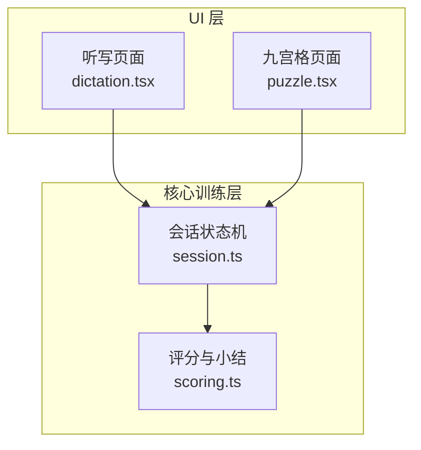
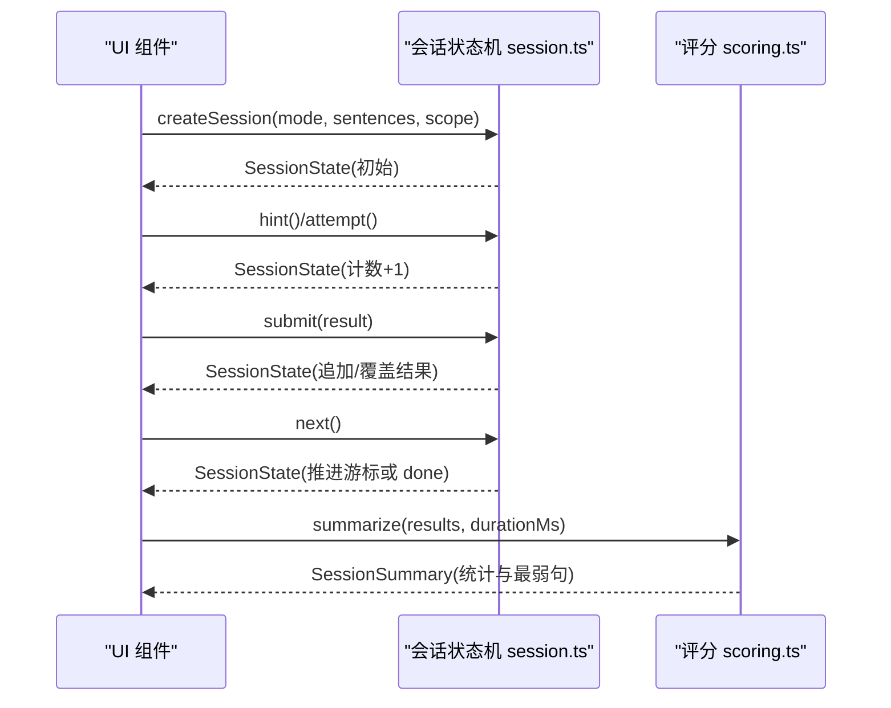
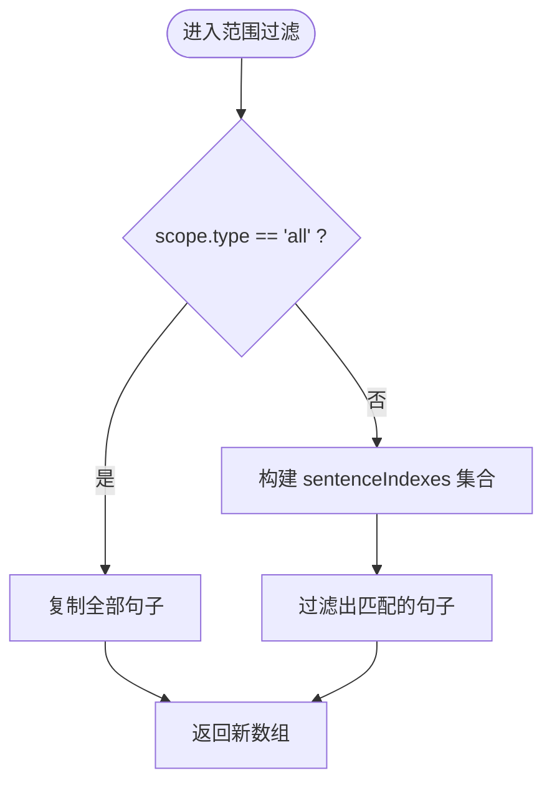
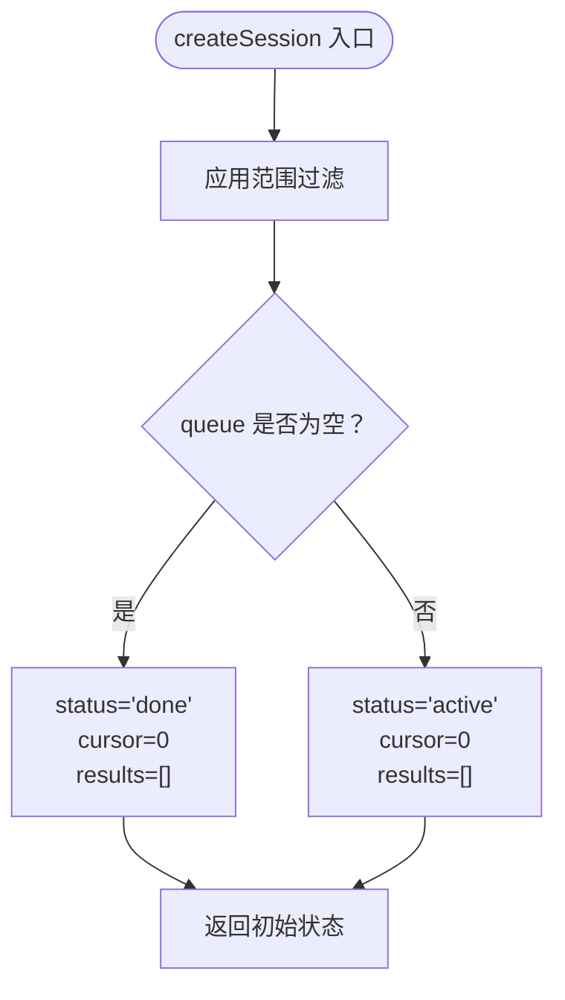
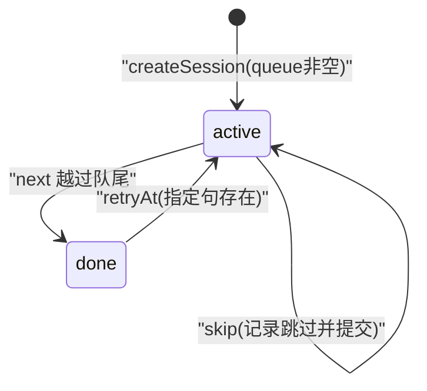
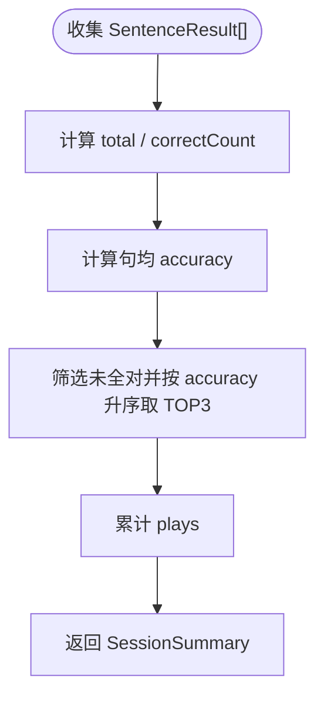
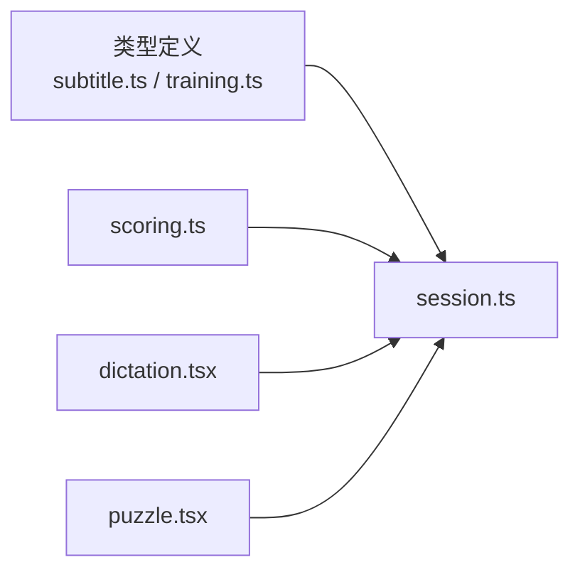

# 训练会话状态机

<cite>
**本文引用的文件**   
- [session.ts](file://client/core/training/session.ts)
- [scoring.ts](file://client/core/training/scoring.ts)
- [session.test.ts](file://client/core/training/__tests__/session.test.ts)
- [dictation.tsx](file://client/components/pages/dictation.tsx)
- [puzzle.tsx](file://client/components/pages/puzzle.tsx)
</cite>

## 目录
1. [引言](#引言)
2. [项目结构定位](#项目结构定位)
3. [核心组件总览](#核心组件总览)
4. [架构概览](#架构概览)
5. [详细组件分析](#详细组件分析)
6. [依赖关系分析](#依赖关系分析)
7. [性能与复杂度](#性能与复杂度)
8. [扩展指南：新增训练模式](#扩展指南新增训练模式)
9. [测试最佳实践](#测试最佳实践)
10. [故障排查](#故障排查)
11. [结论](#结论)

## 引言
本文件为“训练会话状态机”的完整技术文档，聚焦于 `client/core/training/session.ts` 中的纯函数状态机设计。该状态机负责训练会话的生命周期管理、题目队列推进、事件驱动的状态迁移以及结果收集；它与 UI 框架解耦，所有迁移函数均返回新状态对象，遵循不可变性原则。同时，本文还涵盖范围控制、状态转换图、数据流图、核心 API 使用示例、扩展策略与测试方法。

## 项目结构定位
训练会话状态机位于前端客户端的 `core/training` 模块中，属于无 UI 依赖的核心逻辑层。它被听写、九宫格等训练页面通过 React 组件调用，用于驱动训练流程并汇总结果。

**图表来源** 
- [dictation.tsx:10-117](file://client/components/pages/dictation.tsx#L10-L117)
- [puzzle.tsx:19-195](file://client/components/pages/puzzle.tsx#L19-L195)
- [session.ts:1-119](file://client/core/training/session.ts#L1-L119)
- [scoring.ts:1-58](file://client/core/training/scoring.ts#L1-L58)

**章节来源**
- [session.ts:1-119](file://client/core/training/session.ts#L1-L119)
- [scoring.ts:1-58](file://client/core/training/scoring.ts#L1-L58)
- [dictation.tsx:10-117](file://client/components/pages/dictation.tsx#L10-L117)
- [puzzle.tsx:19-195](file://client/components/pages/puzzle.tsx#L19-L195)

## 核心组件总览
- 会话状态结构 `SessionState`：描述当前训练会话的全部可观察状态，包括模式、题目队列、游标、状态、结果列表、提示次数、提交次数和开始时间。
- 范围控制 `TrainingScope`：支持全文或收藏句两种范围，统一由 `sentencesInScope` 过滤。
- 状态枚举 `SessionStatus`：仅包含 `active`（进行中）与 `done`（已结束）。
- 初始化入口 `createSession`：根据模式、句子集合与范围创建初始状态。
- 事件迁移函数：`submit`、`attempt`、`hint`、`next`、`skip`、`retryAt`。
- 辅助工具：`currentSentence`、`makeRecordId`。
- 结果与小结：`SentenceResult`、`SessionSummary`、`summarize`、`formatElapsed`。

**章节来源**
- [session.ts:13-32](file://client/core/training/session.ts#L13-L32)
- [session.ts:38-62](file://client/core/training/session.ts#L38-L62)
- [session.ts:64-113](file://client/core/training/session.ts#L64-L113)
- [scoring.ts:7-57](file://client/core/training/scoring.ts#L7-L57)

## 架构概览
状态机采用纯函数式事件驱动模型：UI 层触发事件（如提交、下一题），调用对应迁移函数，得到新的状态对象后更新 UI。状态本身不可变，避免副作用与竞态。

**图表来源** 
- [session.ts:44-113](file://client/core/training/session.ts#L44-L113)
- [scoring.ts:39-57](file://client/core/training/scoring.ts#L39-L57)
- [dictation.tsx:44-117](file://client/components/pages/dictation.tsx#L44-L117)
- [puzzle.tsx:49-195](file://client/components/pages/puzzle.tsx#L49-L195)

## 详细组件分析

### 状态结构与范围控制
- `SessionState`
  - `mode`: 训练模式（例如听写、九宫格等）。
  - `queue`: 按范围解析后的句子队列，保持原时间轴顺序。
  - `cursor`: 当前题目游标。
  - `status`: `active` 或 `done`。
  - `results`: 已收集的结果列表，按提交顺序保存。
  - `hintCount`: 当前句已用提示次数。
  - `attemptCount`: 当前句提交次数。
  - `startedAt`: 会话开始时间戳。
- `TrainingScope`
  - `all`: 全文范围。
  - `favorites`: 收藏句范围，附带 `sentenceIndexes` 数组。
- `sentencesInScope`
  - 对输入句子进行范围过滤，返回新数组，不共享引用。
  - 收藏范围按原时间轴顺序保留匹配的句子。

**图表来源** 
- [session.ts:38-42](file://client/core/training/session.ts#L38-L42)

**章节来源**
- [session.ts:13-32](file://client/core/training/session.ts#L13-L32)
- [session.ts:38-42](file://client/core/training/session.ts#L38-L42)

### 初始化流程 createSession
- 参数：`mode`、`sentences`、`scope`（默认全文）、`now`（注入便于测试）。
- 行为：
  - 通过 `sentencesInScope` 生成 `queue`。
  - 若队列为空，直接设置 `status = 'done'`；否则 `status = 'active'`。
  - 初始化 `cursor=0`、`results=[]`、`hintCount=0`、`attemptCount=0`、`startedAt=now`。
- 特点：纯函数，无副作用；`now` 注入使时间相关逻辑可测。

**图表来源** 
- [session.ts:44-62](file://client/core/training/session.ts#L44-L62)

**章节来源**
- [session.ts:44-62](file://client/core/training/session.ts#L44-L62)

### 事件迁移函数
- `currentSentence(state)`
  - 当 `status === 'active'` 时返回当前句；否则返回 `undefined`。
- `submit(state, result)`
  - 若无可提交句则返回原状态。
  - 构造 `SentenceResult`，附加 `sentenceIndex`、`hints`、`attempts`。
  - 同句重复提交会覆盖上一条结果，而非追加。
- `attempt(state)`
  - 仅在 `active` 状态下增加 `attemptCount`。
- `hint(state)`
  - 仅在 `active` 状态下增加 `hintCount`。
- `next(state)`
  - 仅在 `active` 状态下推进 `cursor`。
  - 超出队尾时设置 `status='done'`。
  - 每句开始时重置 `hintCount` 与 `attemptCount`。
- `skip(state)`
  - 记录一条 `correct=false`、`accuracy=0`、`skipped=true` 的结果。
  - 然后调用 `next` 推进。
- `retryAt(state, sentenceIndex)`
  - 在队列中查找目标句位置；不存在则返回原状态。
  - 将 `cursor` 跳回该位置，恢复 `status='active'`，并重置提示与提交计数。

**图表来源** 
- [session.ts:64-113](file://client/core/training/session.ts#L64-L113)

**章节来源**
- [session.ts:64-113](file://client/core/training/session.ts#L64-L113)

### 结果收集与小结
- `SentenceResult`
  - 字段包括 `sentenceIndex`、`correct`、`accuracy`、可选的 `hints`、`attempts`、`plays`、`skipped`。
- `SessionSummary`
  - 字段包括 `total`、`correctCount`、`accuracy`（句均正确率）、`durationMs`、`weakest`（最弱句 TOP3 索引）、`totalPlays`。
- `summarize(results, durationMs)`
  - 计算总数、全对数、平均正确率。
  - 筛选未全对的句子，按正确率升序排序取前 3。
  - 累计播放次数。
- `formatElapsed(durationMs)`
  - 将毫秒格式化为 `mm:ss`，负值显示为 `00:00`。

**图表来源** 
- [scoring.ts:39-57](file://client/core/training/scoring.ts#L39-L57)

**章节来源**
- [scoring.ts:7-57](file://client/core/training/scoring.ts#L7-L57)

### 核心 API 使用示例（概念性说明）
- 初始化会话
  - 调用 `createSession('dictation', sentences, { type: 'all' }, now)` 获取初始状态。
  - 在听写页面中，通常从字幕数据中读取句子并传入。
- 提示与尝试
  - 每次点击提示按钮调用 `hint(session)`，每次提交前调用 `attempt(session)`。
- 提交结果
  - 根据用户答案计算 `correct` 与 `accuracy`，调用 `submit(session, entry)`。
- 推进与跳过
  - 点击“下一题”调用 `next(session)`；点击“跳过”调用 `skip(session)`。
- 重练最弱句
  - 在小结中选择最弱句索引，调用 `retryAt(session, idx)` 回到该句。
- 生成记录 ID
  - 使用 `makeRecordId(now)` 生成零依赖的记录标识符。

这些用法在听写与九宫格页面中被实际调用，作为状态机的集成示例。

**章节来源**
- [dictation.tsx:44-117](file://client/components/pages/dictation.tsx#L44-L117)
- [puzzle.tsx:49-195](file://client/components/pages/puzzle.tsx#L49-L195)

## 依赖关系分析
- 类型依赖
  - `SubtitleSentence`：来自字幕类型定义，作为题目队列元素。
  - `TrainingMode`：来自训练模式类型定义，用于区分不同训练模式。
  - `SentenceResult`：来自评分模块，作为结果收集的最小集。
- 运行时依赖
  - `Date.now()`：用于时间戳与记录 ID 生成；可通过 `now` 参数注入以利于测试。
- UI 集成
  - 听写与九宫格页面分别导入状态机 API，并在交互中调用迁移函数。

**图表来源** 
- [session.ts:9-11](file://client/core/training/session.ts#L9-L11)
- [dictation.tsx:10-117](file://client/components/pages/dictation.tsx#L10-L117)
- [puzzle.tsx:19-195](file://client/components/pages/puzzle.tsx#L19-L195)

**章节来源**
- [session.ts:9-11](file://client/core/training/session.ts#L9-L11)
- [dictation.tsx:10-117](file://client/components/pages/dictation.tsx#L10-L117)
- [puzzle.tsx:19-195](file://client/components/pages/puzzle.tsx#L19-L195)

## 性能与复杂度
- 范围过滤 `sentencesInScope`
  - 时间复杂度：O(n)，n 为句子数量；收藏范围使用 Set 加速查找。
  - 空间复杂度：O(k)，k 为匹配句子数量。
- 提交 `submit`
  - 过滤已有同句结果 O(m)，m 为结果数量；整体 O(m)。
- 推进 `next`
  - 常数时间操作。
- 跳转 `retryAt`
  - 线性查找队列 O(n)。
- 小结 `summarize`
  - 遍历结果 O(p)，p 为结果数量；排序最弱句 O(q log q)，q ≤ p。

总体来看，状态机迁移函数均为轻量级纯函数，适合高频 UI 交互场景。

**章节来源**
- [session.ts:38-42](file://client/core/training/session.ts#L38-L42)
- [session.ts:70-113](file://client/core/training/session.ts#L70-L113)
- [scoring.ts:39-57](file://client/core/training/scoring.ts#L39-L57)

## 扩展指南：新增训练模式
要新增一种训练模式到状态机中，建议遵循以下步骤：
1. 扩展 `TrainingMode` 类型（在训练模式类型定义文件中），加入新模式标识。
2. 在 UI 层创建对应的训练页面或复用现有页面，调用 `createSession(newMode, sentences, scope)`。
3. 在该模式中实现自己的计分逻辑，产出 `SentenceResult`（包含 `correct`、`accuracy`，可选 `hints`、`attempts`、`plays`、`skipped`）。
4. 在交互流程中调用状态机 API：
   - 提示：`hint(session)`
   - 尝试计数：`attempt(session)`
   - 提交：`submit(session, entry)`
   - 推进：`next(session)`
   - 跳过：`skip(session)`
   - 重练：`retryAt(session, idx)`
5. 在小结阶段调用 `summarize(results, durationMs)` 生成 `SessionSummary`。
6. 编写单元测试，覆盖边界情况（空队列、done 状态下的空操作、同句覆盖等）。

注意：状态机本身不关心具体训练模式的内部规则，只负责生命周期与结果收集；模式差异应在 UI 层与评分逻辑中实现。

**章节来源**
- [session.ts:44-113](file://client/core/training/session.ts#L44-L113)
- [scoring.ts:7-57](file://client/core/training/scoring.ts#L7-L57)

## 测试最佳实践
- 使用 `vitest` 单测框架，参考 `session.test.ts`。
- 关键断言点：
  - 范围过滤：全文返回副本且顺序不变；收藏范围按原时间轴顺序过滤。
  - 初始化：空队列直接 `done`；注入 `now` 生效。
  - 提交与计数：同句重复提交覆盖；未 attempt 时 attempts ≥ 1。
  - 推进与跳过：next 推进并重置计数；越过队尾 → done；skip 记录跳过结果。
  - 重练：retryAt 跳回指定句并恢复 active；不存在句为空操作。
  - 记录 ID：带时间戳前缀且两次不同。
  - 小结：正确率、用时、最弱句 TOP3、总播放次数。
- 建议补充：
  - 多模式切换的行为一致性。
  - 大样本性能基准（队列长度较大时的迁移耗时）。
  - 边界条件：负时长、异常结果字段缺失等。

**章节来源**
- [session.test.ts:22-185](file://client/core/training/__tests__/session.test.ts#L22-L185)

## 故障排查
- 现象：提交后结果未更新
  - 检查是否在当前句上调用 `submit`；若 `status !== 'active'` 或无可提交句，迁移函数会返回原状态。
- 现象：next 无法推进
  - 确认 `status === 'active'`；若已是 `done`，next 为空操作。
- 现象：重试无效
  - 检查 `retryAt` 传入的 `sentenceIndex` 是否存在于队列；不存在则返回原状态。
- 现象：小结为空或错误
  - 确保 `results` 已正确收集；检查 `summarize` 的输入与时长参数。
- 现象：时间戳不正确
  - 在测试中注入 `now`；在生产环境确认 `Date.now()` 可用。

**章节来源**
- [session.ts:64-113](file://client/core/training/session.ts#L64-L113)
- [scoring.ts:39-57](file://client/core/training/scoring.ts#L39-L57)

## 结论
训练会话状态机以纯函数与不可变状态为核心，提供稳定、可测试的训练生命周期管理能力。通过 `createSession` 初始化、事件迁移函数驱动状态变化、以及结果收集与小结算账，形成清晰的职责分离。UI 层只需关注交互与计分逻辑，无需处理复杂的状态同步。扩展新训练模式时，应遵循现有接口约定，在 UI 与评分层实现差异化逻辑，并通过完善的单测保障稳定性。