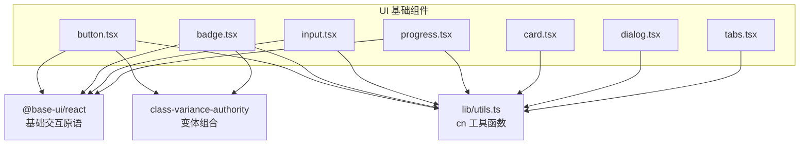
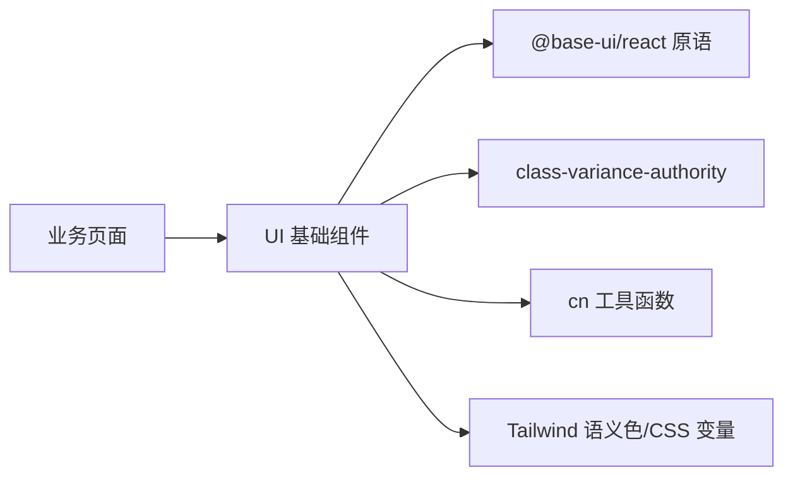
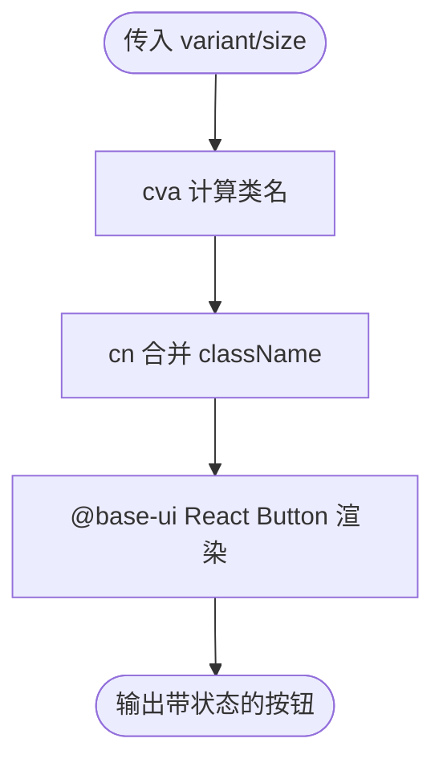
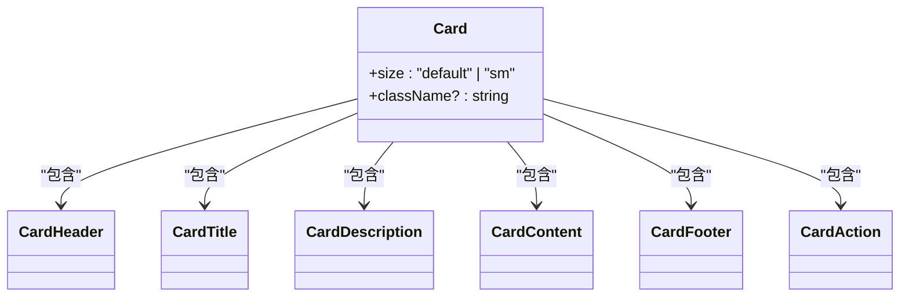
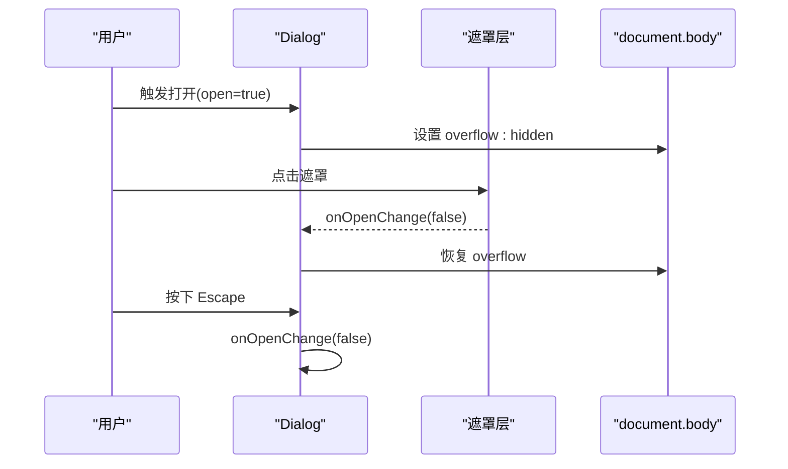
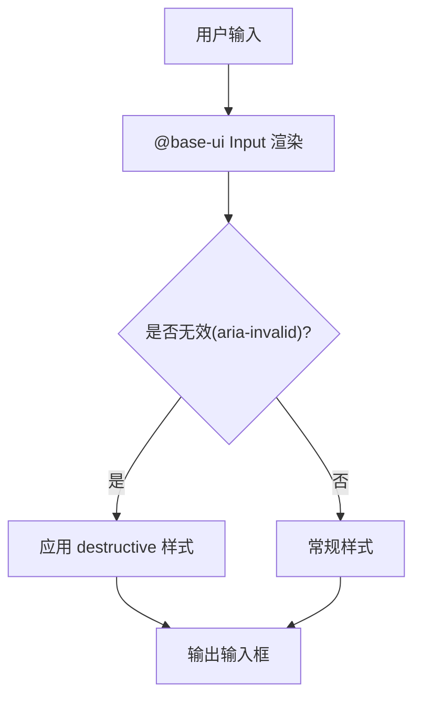
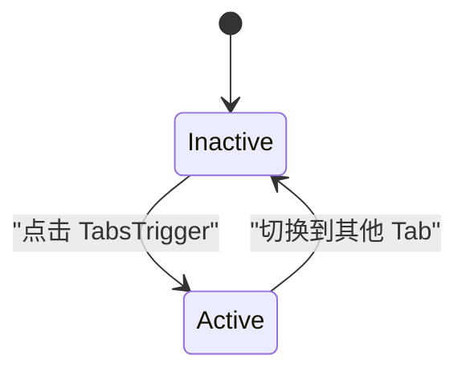
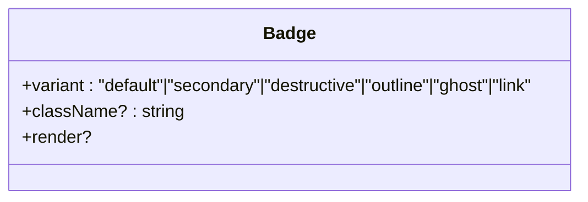
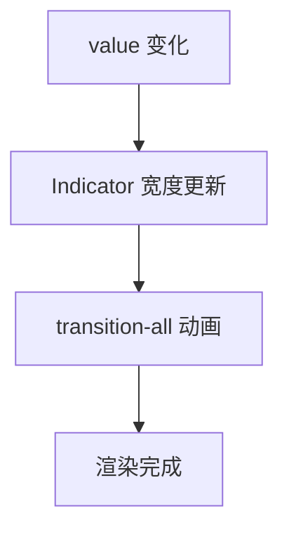
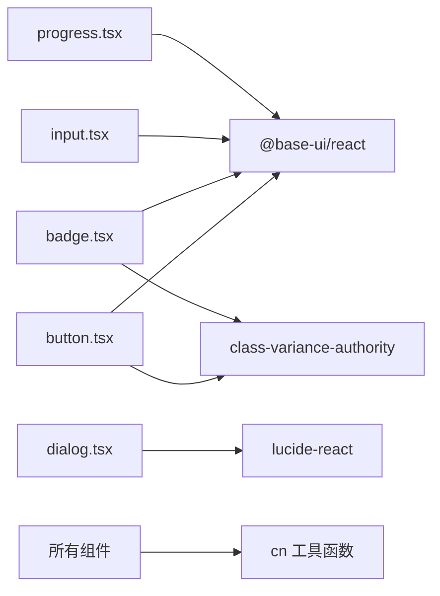

# UI 基础组件

<cite>
**本文引用的文件**   
- [button.tsx](file://client/components/ui/button.tsx)
- [card.tsx](file://client/components/ui/card.tsx)
- [dialog.tsx](file://client/components/ui/dialog.tsx)
- [input.tsx](file://client/components/ui/input.tsx)
- [tabs.tsx](file://client/components/ui/tabs.tsx)
- [badge.tsx](file://client/components/ui/badge.tsx)
- [progress.tsx](file://client/components/ui/progress.tsx)
</cite>

## 目录
1. [简介](#简介)
2. [项目结构](#项目结构)
3. [核心组件](#核心组件)
4. [架构总览](#架构总览)
5. [详细组件分析](#详细组件分析)
6. [依赖关系分析](#依赖关系分析)
7. [性能与可访问性](#性能与可访问性)
8. [样式系统与主题集成](#样式系统与主题集成)
9. [API 参考](#api-参考)
10. [常见问题排查](#常见问题排查)
11. [结论](#结论)

## 简介
本文件为 UI 基础组件库的权威文档，聚焦以下组件：按钮、卡片、对话框、输入、标签页、徽章、进度条。内容涵盖实现细节、设计原则、状态管理、变体支持、无障碍访问、样式系统（Tailwind CSS）、主题支持、自定义覆盖、性能优化与浏览器兼容性建议，并提供 API 说明与集成示例路径。

## 项目结构
UI 基础组件位于 client/components/ui 目录下，采用“按功能拆分”的组织方式，每个组件独立文件，便于复用与维护。

**图表来源**
- [button.tsx:1-59](file://client/components/ui/button.tsx#L1-L59)
- [badge.tsx:1-53](file://client/components/ui/badge.tsx#L1-L53)
- [input.tsx:1-21](file://client/components/ui/input.tsx#L1-L21)
- [progress.tsx:1-84](file://client/components/ui/progress.tsx#L1-L84)
- [card.tsx:1-104](file://client/components/ui/card.tsx#L1-L104)
- [dialog.tsx:1-79](file://client/components/ui/dialog.tsx#L1-L79)
- [tabs.tsx:1-106](file://client/components/ui/tabs.tsx#L1-L106)

**章节来源**
- [button.tsx:1-59](file://client/components/ui/button.tsx#L1-L59)
- [card.tsx:1-104](file://client/components/ui/card.tsx#L1-L104)
- [dialog.tsx:1-79](file://client/components/ui/dialog.tsx#L1-L79)
- [input.tsx:1-21](file://client/components/ui/input.tsx#L1-L21)
- [tabs.tsx:1-106](file://client/components/ui/tabs.tsx#L1-L106)
- [badge.tsx:1-53](file://client/components/ui/badge.tsx#L1-L53)
- [progress.tsx:1-84](file://client/components/ui/progress.tsx#L1-L84)

## 核心组件
本节概述各组件的职责与设计要点，后续章节展开实现细节与 API。

- 按钮（Button）：基于 @base-ui/react 的 Button 原语，使用 class-variance-authority 定义多尺寸与多风格变体，提供焦点环、禁用态、无效态等无障碍样式。
- 卡片（Card）：布局容器组件，包含 Header/Title/Description/Content/Footer/Action 子组件，通过 CSS 变量控制间距与圆角，适配图片首尾圆角。
- 对话框（Dialog）：模态框实现，支持 ESC 关闭、遮罩点击关闭、打开时禁止页面滚动，提供 Header/Title/Description/Content 子组件。
- 输入（Input）：基于 @base-ui/react 的 Input 原语，统一边框、焦点环、禁用态、无效态样式，支持多种 input type。
- 标签页（Tabs）：自实现 Context 驱动的状态切换，支持受控与非受控模式，内容默认按需渲染（懒加载）。
- 徽章（Badge）：轻量标签，支持多风格变体，结合 useRender 与 mergeProps 提供灵活渲染。
- 进度条（Progress）：基于 @base-ui/react 的 Progress 原语，封装 Track/Indicator/Label/Value 子组件，支持值更新动画。

**章节来源**
- [button.tsx:6-59](file://client/components/ui/button.tsx#L6-L59)
- [card.tsx:5-103](file://client/components/ui/card.tsx#L5-L103)
- [dialog.tsx:17-78](file://client/components/ui/dialog.tsx#L17-L78)
- [input.tsx:6-20](file://client/components/ui/input.tsx#L6-L20)
- [tabs.tsx:25-105](file://client/components/ui/tabs.tsx#L25-L105)
- [badge.tsx:7-52](file://client/components/ui/badge.tsx#L7-L52)
- [progress.tsx:7-83](file://client/components/ui/progress.tsx#L7-L83)

## 架构总览
所有 UI 组件遵循统一的构建范式：
- 样式层：Tailwind CSS + class-variance-authority 变体系统 + cn 工具合并类名。
- 交互层：@base-ui/react 提供语义化、可访问的基础原语；部分组件（如 Tabs）自行实现状态与上下文。
- 主题层：通过 CSS 变量与 Tailwind 语义色（primary、destructive、muted 等）实现暗色模式与主题扩展。

**图表来源**
- [button.tsx:1-59](file://client/components/ui/button.tsx#L1-L59)
- [badge.tsx:1-53](file://client/components/ui/badge.tsx#L1-L53)
- [input.tsx:1-21](file://client/components/ui/input.tsx#L1-L21)
- [progress.tsx:1-84](file://client/components/ui/progress.tsx#L1-L84)

## 详细组件分析

### 按钮组件（Button）
- 状态管理
  - 通过 props 传递 variant 与 size，内部由 cva 生成最终 className。
  - 支持 focus-visible、aria-invalid、disabled 等状态样式。
- 变体支持
  - 风格：default、outline、secondary、ghost、destructive、link。
  - 尺寸：default、xs、sm、lg、icon、icon-xs、icon-sm、icon-lg。
- 无障碍访问
  - 使用 @base-ui/react 的 Button 原语，确保键盘与屏幕阅读器行为正确。
  - 焦点环、无效态视觉提示、禁用态不可操作。
- 性能与可访问性
  - 仅渲染一个原生 button，无额外 DOM 层级。
  - 图标尺寸通过属性选择器统一处理，避免重复样式。

**图表来源**
- [button.tsx:6-59](file://client/components/ui/button.tsx#L6-L59)

**章节来源**
- [button.tsx:6-59](file://client/components/ui/button.tsx#L6-L59)

### 卡片组件（Card）
- 布局容器
  - Card 作为外层容器，CardHeader/CardTitle/CardDescription/CardContent/CardFooter/CardAction 组成结构化布局。
  - 使用 data-slot 与 data-size 进行样式定位与响应式调整。
- 阴影与边框
  - 外边框 ring-1 + 背景色 bg-card，圆角 rounded-xl。
  - 首图自动圆角处理，底部 Footer 带分隔线与背景。
- 响应式设计
  - 通过 CSS 变量 --card-spacing 控制内边距与间距，data-size=sm 缩小间距。
  - 头部网格布局自适应 Action 区域。
- 无障碍访问
  - 语义化 div 组合，配合标题与描述文本，利于辅助技术理解。

**图表来源**
- [card.tsx:5-103](file://client/components/ui/card.tsx#L5-L103)

**章节来源**
- [card.tsx:5-103](file://client/components/ui/card.tsx#L5-L103)

### 对话框组件（Dialog）
- 模态框行为
  - open 控制显示，onOpenChange 回调更新状态。
  - 遮罩点击关闭，但打开后短时间内忽略首次遮罩点击，避免双击误关。
- 焦点管理与键盘导航
  - 监听 Escape 键关闭对话框。
  - 打开时禁用 body 滚动，关闭时恢复。
- 子组件
  - DialogHeader/DialogTitle/DialogDescription/DialogContent 提供结构化布局。
- 无障碍访问
  - 关闭按钮具备 aria-label，提升可访问性。

**图表来源**
- [dialog.tsx:17-59](file://client/components/ui/dialog.tsx#L17-L59)

**章节来源**
- [dialog.tsx:17-78](file://client/components/ui/dialog.tsx#L17-L78)

### 输入组件（Input）
- 表单验证与错误提示
  - 支持 aria-invalid 状态，结合 destructive 语义色与焦点环提示错误。
- 格式化
  - 不内置格式化逻辑，保持通用输入能力；可在上层业务组件中处理格式化。
- 无障碍访问
  - 使用 @base-ui/react 的 Input 原语，保证键盘与屏幕阅读器行为。
  - 禁用态与无效态均有明确的视觉反馈。

**图表来源**
- [input.tsx:6-20](file://client/components/ui/input.tsx#L6-L20)

**章节来源**
- [input.tsx:6-20](file://client/components/ui/input.tsx#L6-L20)

### 标签页组件（Tabs）
- 切换逻辑
  - 使用 React Context 维护 activeTab，支持受控(value/onValueChange)与非受控(defaultValue)两种模式。
  - TabsTrigger 根据 activeTab 切换激活态，并更新 data-state。
- 内容懒加载
  - TabsContent 仅在 activeTab 匹配时渲染，未匹配则返回 null，达到按需渲染效果。
- 无障碍访问
  - 列表 role="tablist"，触发器 role="tab"，aria-selected 标识选中状态，内容区 role="tabpanel"。

**图表来源**
- [tabs.tsx:25-105](file://client/components/ui/tabs.tsx#L25-L105)

**章节来源**
- [tabs.tsx:25-105](file://client/components/ui/tabs.tsx#L25-L105)

### 徽章组件（Badge）
- 样式变体
  - 支持 default、secondary、destructive、outline、ghost、link 六种风格。
- 尺寸控制
  - 固定高度 h-5，宽度自适应 w-fit，适合短文本标签。
- 渲染机制
  - 使用 @base-ui/react 的 useRender 与 mergeProps，支持自定义渲染与 slot/state 暴露。

**图表来源**
- [badge.tsx:7-52](file://client/components/ui/badge.tsx#L7-L52)

**章节来源**
- [badge.tsx:7-52](file://client/components/ui/badge.tsx#L7-L52)

### 进度条组件（Progress）
- 动画效果
  - Indicator 使用 transition-all 平滑过渡，Track 提供轨道背景。
- 状态指示
  - 通过 value 控制进度，ProgressLabel/ProgressValue 展示标签与数值。
- 组合结构
  - Root 包裹 Track 与 Indicator，同时允许 children 插入额外内容。

**图表来源**
- [progress.tsx:7-83](file://client/components/ui/progress.tsx#L7-L83)

**章节来源**
- [progress.tsx:7-83](file://client/components/ui/progress.tsx#L7-L83)

## 依赖关系分析
- 外部依赖
  - @base-ui/react：提供 Button/Input/Progress 等可访问的原语。
  - class-variance-authority：用于 Button/Badge 的变体系统。
  - lucide-react：Dialog 中的关闭图标。
- 内部依赖
  - lib/utils.ts 的 cn 工具函数：合并类名，统一样式策略。

**图表来源**
- [button.tsx:1-59](file://client/components/ui/button.tsx#L1-L59)
- [badge.tsx:1-53](file://client/components/ui/badge.tsx#L1-L53)
- [input.tsx:1-21](file://client/components/ui/input.tsx#L1-L21)
- [progress.tsx:1-84](file://client/components/ui/progress.tsx#L1-L84)
- [dialog.tsx:1-79](file://client/components/ui/dialog.tsx#L1-L79)

**章节来源**
- [button.tsx:1-59](file://client/components/ui/button.tsx#L1-L59)
- [badge.tsx:1-53](file://client/components/ui/badge.tsx#L1-L53)
- [input.tsx:1-21](file://client/components/ui/input.tsx#L1-L21)
- [progress.tsx:1-84](file://client/components/ui/progress.tsx#L1-L84)
- [dialog.tsx:1-79](file://client/components/ui/dialog.tsx#L1-L79)

## 性能与可访问性
- 性能优化
  - 按钮、输入、进度条使用最小 DOM 层级，减少重绘与回流。
  - 标签页内容按需渲染，避免不必要的初始化成本。
  - 对话框在打开时禁用 body 滚动，避免布局抖动。
- 可访问性
  - 使用语义化角色（tablist/tab/tabpanel），ARIA 属性（aria-selected、aria-invalid、aria-label）。
  - 键盘交互：Escape 关闭对话框；焦点可见性与焦点环。
- 浏览器兼容性
  - 依赖现代 CSS 特性（focus-visible、CSS 变量、grid/container 查询），建议在现代浏览器环境中使用。
  - 暗色模式通过 dark: 前缀，需 Tailwind 配置支持。

[本节为通用指导，不直接分析具体文件]

## 样式系统与主题集成
- Tailwind CSS 集成
  - 所有组件通过 Tailwind 原子类组合样式，支持 hover/focus/disabled 等状态。
  - 使用语义色（primary、secondary、destructive、muted、foreground、background）实现主题一致性。
- 主题支持
  - 暗色模式：dark: 前缀类名覆盖颜色与透明度。
  - CSS 变量：Card 使用 --card-spacing 控制间距，便于主题定制。
- 自定义样式覆盖
  - 通过 className 参数覆盖默认样式。
  - 使用 data-slot/data-state 选择器进行精准样式扩展。

[本节为通用指导，不直接分析具体文件]

## API 参考

### Button
- 属性
  - variant: "default" | "outline" | "secondary" | "ghost" | "destructive" | "link"
  - size: "default" | "xs" | "sm" | "lg" | "icon" | "icon-xs" | "icon-sm" | "icon-lg"
  - className?: string
  - 其余透传至 @base-ui/react Button
- 用法要点
  - 通过 variant 与 size 控制外观。
  - 支持 disabled、aria-invalid 等状态。

**章节来源**
- [button.tsx:6-59](file://client/components/ui/button.tsx#L6-L59)

### Card
- 组件
  - Card(size?: "default" | "sm", className?)
  - CardHeader(className?)
  - CardTitle(className?)
  - CardDescription(className?)
  - CardContent(className?)
  - CardFooter(className?)
  - CardAction(className?)
- 用法要点
  - 使用 data-size 控制间距。
  - 首尾图片自动圆角。

**章节来源**
- [card.tsx:5-103](file://client/components/ui/card.tsx#L5-L103)

### Dialog
- 属性
  - open: boolean
  - onOpenChange: (open: boolean) => void
  - children: ReactNode
- 子组件
  - DialogHeader(children)
  - DialogTitle(children, className?)
  - DialogDescription(children)
  - DialogContent(children)
- 用法要点
  - 使用 ESC 或遮罩点击关闭。
  - 打开时禁用页面滚动。

**章节来源**
- [dialog.tsx:17-78](file://client/components/ui/dialog.tsx#L17-L78)

### Input
- 属性
  - type?: string
  - className?: string
  - 其余透传至 @base-ui/react Input
- 用法要点
  - 支持 invalid 状态（aria-invalid）。
  - 禁用态与无效态有明确视觉反馈。

**章节来源**
- [input.tsx:6-20](file://client/components/ui/input.tsx#L6-L20)

### Tabs
- 属性
  - defaultValue: string
  - value?: string
  - onValueChange?: (value: string) => void
  - children: ReactNode
  - className?: string
- 子组件
  - TabsList(children, className?)
  - TabsTrigger(value: string, children, className?)
  - TabsContent(value: string, children, className?)
- 用法要点
  - 支持受控与非受控模式。
  - 内容按需渲染。

**章节来源**
- [tabs.tsx:25-105](file://client/components/ui/tabs.tsx#L25-L105)

### Badge
- 属性
  - variant: "default" | "secondary" | "destructive" | "outline" | "ghost" | "link"
  - className?: string
  - render?: function
  - 其余透传给 span
- 用法要点
  - 使用 useRender 与 mergeProps 进行灵活渲染。

**章节来源**
- [badge.tsx:7-52](file://client/components/ui/badge.tsx#L7-L52)

### Progress
- 属性
  - value?: number
  - children?: ReactNode
  - className?: string
- 子组件
  - ProgressTrack(className?)
  - ProgressIndicator(className?)
  - ProgressLabel(className?)
  - ProgressValue(className?)
- 用法要点
  - 通过 value 控制进度，Indicator 自动过渡动画。

**章节来源**
- [progress.tsx:7-83](file://client/components/ui/progress.tsx#L7-L83)

## 常见问题排查
- 对话框打开后立即被遮罩关闭
  - 原因：双击打开按钮时，第二次点击落在遮罩上，触发关闭。
  - 解决：组件已内置短时间内的遮罩点击忽略逻辑（打开后 300ms 内忽略）。
- 输入框无效状态未生效
  - 检查是否设置了 aria-invalid 或父级表单校验逻辑是否正确传递该属性。
- 标签页内容不显示
  - 确认 TabsContent 的 value 与当前 activeTab 一致。
- 进度条动画卡顿
  - 检查 value 更新频率，避免高频更新导致频繁重排。
- 暗色模式下颜色异常
  - 确认 Tailwind 已启用 dark 模式，且使用了正确的 dark: 前缀类名。

**章节来源**
- [dialog.tsx:17-59](file://client/components/ui/dialog.tsx#L17-L59)
- [input.tsx:6-20](file://client/components/ui/input.tsx#L6-L20)
- [tabs.tsx:25-105](file://client/components/ui/tabs.tsx#L25-L105)
- [progress.tsx:7-83](file://client/components/ui/progress.tsx#L7-L83)

## 结论
本 UI 基础组件库以 @base-ui/react 为基础交互原语，结合 Tailwind CSS 与 class-variance-authority 构建一致的视觉与交互体验。组件在设计上强调可访问性、主题可扩展性与性能优化，适用于现代 Web 应用的界面搭建。通过统一的 API 与灵活的样式覆盖机制，开发者可以快速集成并扩展这些基础组件以满足业务需求。

[本节为总结性内容，不直接分析具体文件]