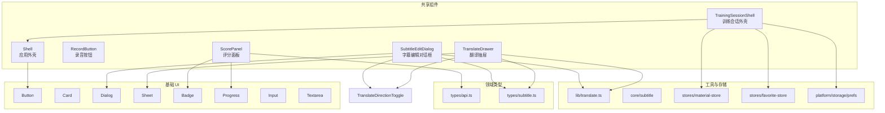
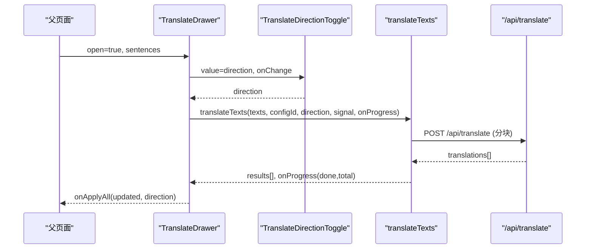
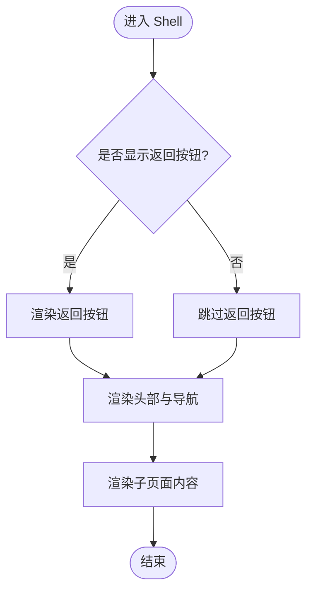
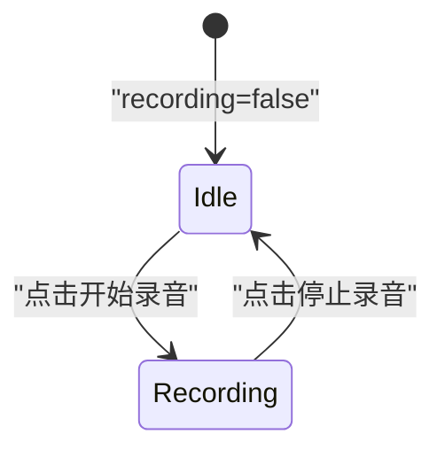
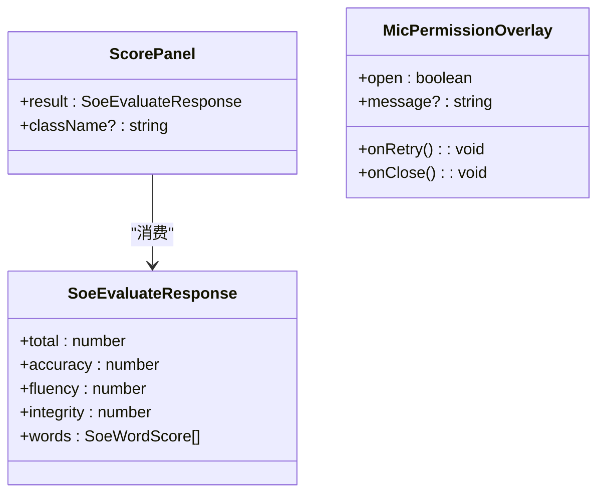
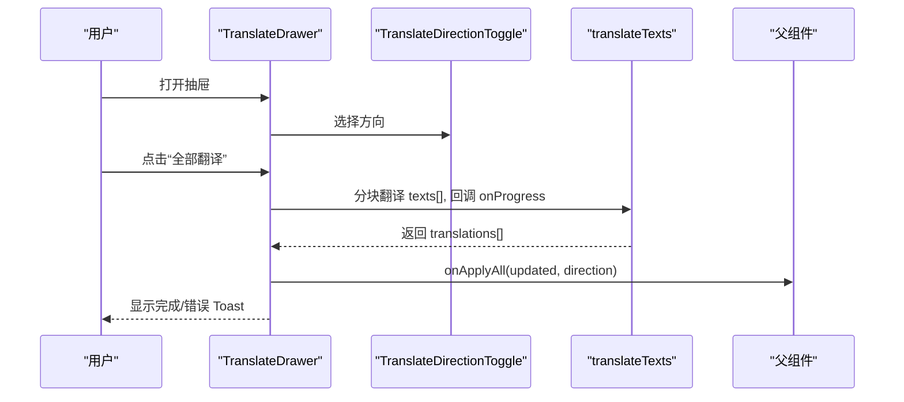
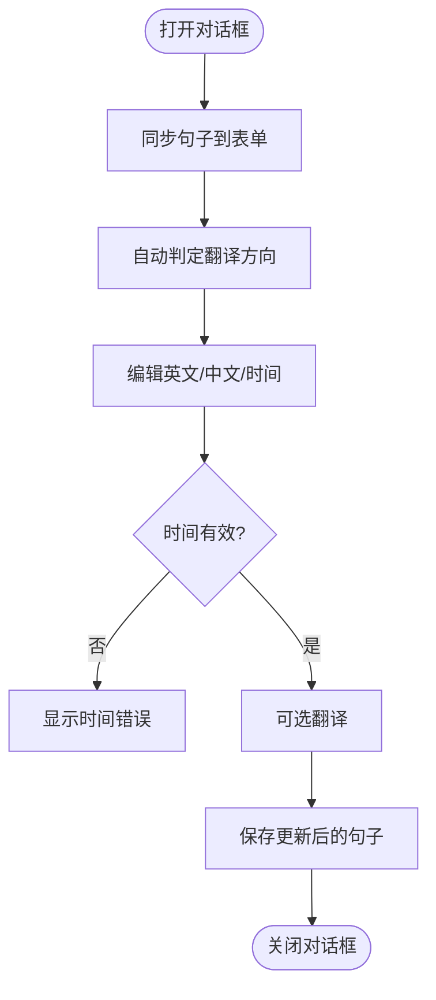
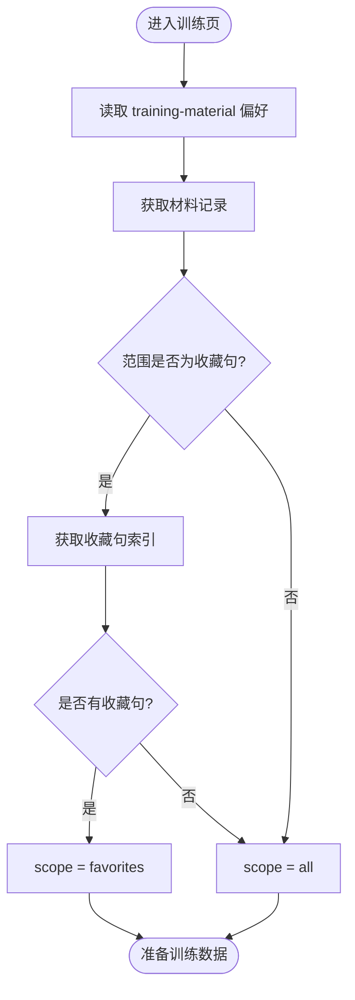
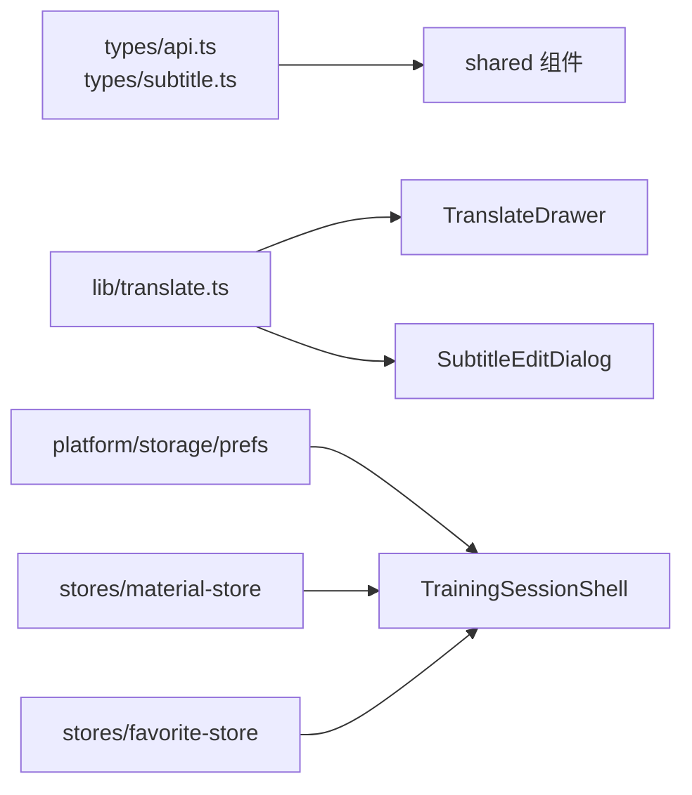

# 共享组件

<cite>
**本文引用的文件**   
- [shell.tsx](file://client/components/shared/shell.tsx)
- [record-button.tsx](file://client/components/shared/record-button.tsx)
- [score-panel.tsx](file://client/components/shared/score-panel.tsx)
- [translate-drawer.tsx](file://client/components/shared/translate-drawer.tsx)
- [subtitle-edit-dialog.tsx](file://client/components/shared/subtitle-edit-dialog.tsx)
- [training-session-shell.tsx](file://client/components/shared/training-session-shell.tsx)
- [translate-direction-toggle.tsx](file://client/components/shared/translate-direction-toggle.tsx)
- [translate.ts](file://client/lib/translate.ts)
- [subtitle.ts](file://client/types/subtitle.ts)
- [api.ts](file://client/types/api.ts)
</cite>

## 目录
1. [引言](#引言)
2. [项目结构定位](#项目结构定位)
3. [核心组件总览](#核心组件总览)
4. [架构与交互关系](#架构与交互关系)
5. [组件详细分析](#组件详细分析)
6. [依赖与数据流分析](#依赖与数据流分析)
7. [性能与可维护性](#性能与可维护性)
8. [主题与样式定制](#主题与样式定制)
9. [常见问题排查](#常见问题排查)
10. [结论](#结论)

## 引言
本文件面向“共享组件”这一组可复用前端模块，目标是帮助开发者快速理解并正确使用以下组件：应用外壳、录音按钮、评分面板、翻译抽屉、字幕编辑对话框、训练会话外壳。文档从职责边界、Props 接口、事件回调、状态管理、样式定制、组合模式、主题适配和 API 参考等维度展开，并提供代码级架构图和数据流图，便于在现有 Next.js + React 项目中安全扩展。

## 项目结构定位
这些共享组件集中在 `client/components/shared` 目录下，属于页面级功能（如听写、背诵、朗读、转写、TTS）的公共 UI 与流程封装。它们普遍依赖：
- 基础 UI 组件：Button、Card、Dialog、Sheet、Badge、Progress、Input、Textarea。
- 类型定义：`SubtitleSentence`、`SoeEvaluateResponse`、`TranslateDirection`。
- 工具库：翻译基础设施 `lib/translate.ts`、字幕解析工具 `core/subtitle`、偏好存储 `platform/storage/prefs`、材料记录 `stores/material-store`、收藏句索引 `stores/favorite-store`。

**图表来源**
- [shell.tsx:17-23](file://client/components/shared/shell.tsx#L17-L23)
- [training-session-shell.tsx:21-31](file://client/components/shared/training-session-shell.tsx#L21-L31)
- [score-panel.tsx:21-63](file://client/components/shared/score-panel.tsx#L21-L63)
- [translate-drawer.tsx:11-16](file://client/components/shared/translate-drawer.tsx#L11-L16)
- [subtitle-edit-dialog.tsx:14-19](file://client/components/shared/subtitle-edit-dialog.tsx#L14-L19)
- [translate-direction-toggle.tsx:3-7](file://client/components/shared/translate-direction-toggle.tsx#L3-L7)
- [translate.ts:26-68](file://client/lib/translate.ts#L26-L68)
- [subtitle.ts:6-19](file://client/types/subtitle.ts#L6-L19)
- [api.ts:42-48](file://client/types/api.ts#L42-L48)

**章节来源**
- [shell.tsx:1-24](file://client/components/shared/shell.tsx#L1-L24)
- [training-session-shell.tsx:1-67](file://client/components/shared/training-session-shell.tsx#L1-L67)
- [score-panel.tsx:1-95](file://client/components/shared/score-panel.tsx#L1-L95)
- [translate-drawer.tsx:1-330](file://client/components/shared/translate-drawer.tsx#L1-L330)
- [subtitle-edit-dialog.tsx:1-244](file://client/components/shared/subtitle-edit-dialog.tsx#L1-L244)
- [translate-direction-toggle.tsx:1-36](file://client/components/shared/translate-direction-toggle.tsx#L1-L36)
- [translate.ts:1-114](file://client/lib/translate.ts#L1-L114)
- [subtitle.ts:1-35](file://client/types/subtitle.ts#L1-L35)
- [api.ts:1-154](file://client/types/api.ts#L1-L154)

## 核心组件总览
- 应用外壳（Shell）：提供全局头部、品牌入口、收藏/生词本/设置快捷入口，以及可选返回按钮；内置媒体暂停逻辑，避免视频播放时导航无响应。
- 录音按钮（RecordButton）：极简录音开关，通过受控 props 切换开始/停止，文案与视觉随状态变化。
- 评分面板（ScorePanel）：展示综合分与准确度/流利度/完整度三维进度条，并按阈值对单词得分进行标红提示；附带麦克风权限引导浮层。
- 翻译抽屉（TranslateDrawer）：侧边栏批量翻译字幕，支持方向切换、模型选择、逐句状态、进度、错误提示、完成通知 Toast，以及“全部应用”回填译文。
- 字幕编辑对话框（SubtitleEditDialog）：单句纠错与翻译，支持时间输入校验、方向切换、模型选择、翻译结果写入目标文本框，保存时落盘更新。
- 训练会话外壳（TrainingSessionShell）：统一训练页头、进度徽标与真实进度条；提供完成小结浮层与训练材料与范围加载 Hook。

**章节来源**
- [shell.tsx:5-23](file://client/components/shared/shell.tsx#L5-L23)
- [record-button.tsx:1-22](file://client/components/shared/record-button.tsx#L1-L22)
- [score-panel.tsx:1-95](file://client/components/shared/score-panel.tsx#L1-L95)
- [translate-drawer.tsx:11-330](file://client/components/shared/translate-drawer.tsx#L11-L330)
- [subtitle-edit-dialog.tsx:14-244](file://client/components/shared/subtitle-edit-dialog.tsx#L14-L244)
- [training-session-shell.tsx:1-67](file://client/components/shared/training-session-shell.tsx#L1-L67)

## 架构与交互关系
共享组件之间通过明确的 Props 与回调解耦，关键交互如下：
- TrainingSessionShell 组合 Shell，负责训练页的统一布局与进度。
- TranslateDrawer 与 SubtitleEditDialog 共用 TranslateDirectionToggle 与 translateTexts，保证翻译方向与模型配置一致。
- ScorePanel 消费 SoeEvaluateResponse，将结构化评分映射为可视化进度与单词标签。
- 所有异步操作均支持取消信号，避免组件卸载或状态切换后残留请求。

**图表来源**
- [translate-drawer.tsx:135-179](file://client/components/shared/translate-drawer.tsx#L135-L179)
- [translate-direction-toggle.tsx:19-35](file://client/components/shared/translate-direction-toggle.tsx#L19-L35)
- [translate.ts:26-68](file://client/lib/translate.ts#L26-L68)

## 组件详细分析

### 应用外壳（Shell）
- 职责：提供应用级头部、品牌入口、收藏/生词本/设置快捷入口；可选返回按钮；封装媒体暂停逻辑，解决视频播放时主线程占用导致返回无响应的问题。
- Props：
  - children：页面主体内容。
  - back：是否显示返回按钮。
- 行为：
  - 点击返回按钮时先暂停所有音视频元素，再执行路由后退。
  - 使用 Tailwind 语义化颜色（background、foreground、card、primary）。
- 导出：Shell、PageIntro、pauseAllMedia。

**图表来源**
- [shell.tsx:9-15](file://client/components/shared/shell.tsx#L9-L15)
- [shell.tsx:17-23](file://client/components/shared/shell.tsx#L17-L23)

**章节来源**
- [shell.tsx:5-23](file://client/components/shared/shell.tsx#L5-L23)

### 录音按钮（RecordButton）
- 职责：提供受控的录音开关，文案与视觉根据 recording 状态切换。
- Props：
  - recording：当前是否正在录音。
  - setRecording：切换录音状态的回调。
- 行为：
  - 点击按钮调用 setRecording(!recording)。
  - 根据 recording 切换边框、背景色与图标。
- 无障碍：aria-label 动态设置为“开始录音”或“停止录音”。

**图表来源**
- [record-button.tsx:6-18](file://client/components/shared/record-button.tsx#L6-L18)

**章节来源**
- [record-button.tsx:1-22](file://client/components/shared/record-button.tsx#L1-L22)

### 评分面板（ScorePanel）
- 职责：展示发音评分的综合分与三维指标（准确度/流利度/完整度），并以 Badge 展示单词级得分，低于阈值的单词标红。
- Props：
  - result：SoeEvaluateResponse，包含 total、accuracy、fluency、integrity、words。
  - className：额外样式类名。
- 行为：
  - 使用 Progress 组件展示三维指标。
  - 单词得分低于 LOW_SCORE_THRESHOLD（默认 60）时，Badge variant 设为 destructive。
  - 若 words 存在 errorType，则显示“漏/增/误”提示。
- 附加组件：MicPermissionOverlay，用于麦克风权限拒绝时的引导与重试。

**图表来源**
- [score-panel.tsx:21-63](file://client/components/shared/score-panel.tsx#L21-L63)
- [score-panel.tsx:70-92](file://client/components/shared/score-panel.tsx#L70-L92)
- [api.ts:42-48](file://client/types/api.ts#L42-L48)

**章节来源**
- [score-panel.tsx:1-95](file://client/components/shared/score-panel.tsx#L1-L95)
- [api.ts:42-48](file://client/types/api.ts#L42-L48)

### 翻译抽屉（TranslateDrawer）
- 职责：侧边栏批量翻译字幕，支持方向切换、模型选择、逐句状态、进度、错误提示、完成通知 Toast，以及“全部应用”回填译文。
- Props：
  - open：控制抽屉显隐。
  - onOpenChange：显隐变化回调。
  - sentences：待翻译字幕句子数组。
  - onApplyAll：应用译文回调，传入更新后的句子数组与方向。
- 内部状态：
  - direction：翻译方向。
  - translations：每句译文。
  - sentenceStatuses：每句状态（pending/translating/done/error）。
  - globalStatus：全局状态（idle/translating/done/error）。
  - error：错误信息。
  - progress：进度 done/total。
  - toastVisible/toastFading：Toast 可见性与淡出状态。
- 行为要点：
  - 自动检测语言方向，仅当句子内容真正变化时重置状态。
  - 使用 AbortController 支持取消翻译任务。
  - 关闭抽屉不中断翻译，但会在关闭期间以 Toast 通知完成/出错。
  - “全部应用”按方向将译文写入 textZh 或 textEn，并关闭抽屉。

**图表来源**
- [translate-drawer.tsx:135-179](file://client/components/shared/translate-drawer.tsx#L135-L179)
- [translate-drawer.tsx:181-184](file://client/components/shared/translate-drawer.tsx#L181-L184)
- [translate-drawer.tsx:190-218](file://client/components/shared/translate-drawer.tsx#L190-L218)
- [translate.ts:26-68](file://client/lib/translate.ts#L26-L68)

**章节来源**
- [translate-drawer.tsx:11-330](file://client/components/shared/translate-drawer.tsx#L11-L330)
- [translate-direction-toggle.tsx:1-36](file://client/components/shared/translate-direction-toggle.tsx#L1-L36)
- [translate.ts:26-68](file://client/lib/translate.ts#L26-L68)

### 字幕编辑对话框（SubtitleEditDialog）
- 职责：单句纠错与翻译，支持时间输入校验、方向切换、模型选择、翻译结果写入目标文本框，保存时落盘更新。
- Props：
  - open：对话框显隐。
  - onOpenChange：显隐变化回调。
  - sentence：当前编辑的句子对象。
  - onSave：保存回调，传入更新后的句子。
- 内部状态：
  - textEn/textZh：英文原文与中文译文。
  - startInput/endInput：时间输入值。
  - timeError：时间校验错误。
  - direction：翻译方向。
  - translating/translateError：翻译中状态与错误信息。
- 行为要点：
  - 打开时同步表单并自动判定翻译方向（兼容只有中文素材）。
  - 时间输入实时校验，确保开始时间早于结束时间。
  - 翻译结果写入目标文本框，用户可继续修改后保存。
  - 关闭或卸载时取消进行中的翻译。

**图表来源**
- [subtitle-edit-dialog.tsx:55-79](file://client/components/shared/subtitle-edit-dialog.tsx#L55-L79)
- [subtitle-edit-dialog.tsx:94-111](file://client/components/shared/subtitle-edit-dialog.tsx#L94-L111)
- [subtitle-edit-dialog.tsx:119-138](file://client/components/shared/subtitle-edit-dialog.tsx#L119-L138)
- [subtitle-edit-dialog.tsx:140-150](file://client/components/shared/subtitle-edit-dialog.tsx#L140-L150)

**章节来源**
- [subtitle-edit-dialog.tsx:14-244](file://client/components/shared/subtitle-edit-dialog.tsx#L14-L244)
- [translate-direction-toggle.tsx:1-36](file://client/components/shared/translate-direction-toggle.tsx#L1-L36)
- [translate.ts:26-68](file://client/lib/translate.ts#L26-L68)

### 训练会话外壳（TrainingSessionShell）
- 职责：统一训练页头（eyebrow/title/n/total）、真实进度条；提供完成小结浮层；加载训练材料与范围（全文/收藏句）。
- 组件：
  - TrainingSessionShell：组合 Shell，渲染页头与进度。
  - SessionSummaryOverlay：固定全屏遮罩的小结浮层。
  - SummaryStat：统计行（label/value）。
- Hook：useTrainingMaterial：
  - 从偏好存储读取最近训练材料 ID，回退到 mock-001。
  - 若范围为收藏句且存在收藏句索引，则返回收藏句范围；否则回落全文。
  - 返回 record/loading/scope。

**图表来源**
- [training-session-shell.tsx:43-64](file://client/components/shared/training-session-shell.tsx#L43-L64)

**章节来源**
- [training-session-shell.tsx:21-31](file://client/components/shared/training-session-shell.tsx#L21-L31)
- [training-session-shell.tsx:43-64](file://client/components/shared/training-session-shell.tsx#L43-L64)

## 依赖与数据流分析
- 类型契约：
  - SoeEvaluateResponse：评分面板消费的结构化评分。
  - SubtitleSentence：字幕编辑与翻译的数据载体。
  - TranslateDirection：翻译方向枚举。
- 工具库：
  - translateTexts：分块串行调用 /api/translate，支持取消与进度回调。
  - detectDirection：基于 CJK 占比判定方向。
- 存储与偏好：
  - getPref/getTrainingScope：读取训练材料与范围。
  - getMaterialRecord/favoriteSentenceIndexes：加载材料与收藏句索引。

**图表来源**
- [api.ts:42-48](file://client/types/api.ts#L42-L48)
- [subtitle.ts:6-19](file://client/types/subtitle.ts#L6-L19)
- [translate.ts:26-68](file://client/lib/translate.ts#L26-L68)
- [training-session-shell.tsx:43-64](file://client/components/shared/training-session-shell.tsx#L43-L64)

**章节来源**
- [api.ts:1-154](file://client/types/api.ts#L1-L154)
- [subtitle.ts:1-35](file://client/types/subtitle.ts#L1-L35)
- [translate.ts:1-114](file://client/lib/translate.ts#L1-L114)
- [training-session-shell.tsx:1-67](file://client/components/shared/training-session-shell.tsx#L1-L67)

## 性能与可维护性
- 分块翻译：translateTexts 以 50 句为一块串行调用，避免单次请求过大，同时提供进度回调，提升用户体验。
- 取消机制：所有异步翻译均支持 AbortController，组件卸载或状态切换时可及时清理请求。
- 状态稳定：TranslateDrawer 的状态声明在顶层，即使 Sheet 子树卸载也不丢失，避免重复初始化。
- 条件渲染：TranslateDrawer 仅在 open 时渲染 Sheet，减少不必要的 DOM 开销。
- 类型安全：广泛使用 TypeScript 类型，降低运行时错误风险。

[本节为通用指导，不直接分析具体文件]

## 主题与样式定制
- 语义化颜色：组件大量使用 Tailwind 语义类（bg-background、text-foreground、bg-card、bg-primary、text-destructive 等），便于通过主题变量统一调整。
- 卡片与进度：ScorePanel 使用 Card + Progress，结合 bg-primary/5 营造轻量视觉层次。
- 按钮与徽章：Badge variant 根据分数阈值切换 destructive/secondary，直观传达错误程度。
- 自定义类名：ScorePanel 暴露 className 以便外层覆盖容器样式。

[本节为通用指导，不直接分析具体文件]

## 常见问题排查
- 录音按钮无响应：确认父组件正确传递 recording 与 setRecording，并确保上层未阻止 onClick。
- 评分面板无数据：检查 SoeEvaluateResponse 字段是否齐全，尤其是 words 数组与 errorType。
- 翻译失败：查看 translateTexts 抛出的错误消息；确认服务端 /api/translate 返回格式与条数一致；检查网络与模型配置。
- 翻译方向异常：确认 detectDirection 的输入文本是否符合预期；双语字幕默认按 textEn 判定方向。
- 时间校验失败：确保开始时间早于结束时间，输入格式符合 mm:ss,mmm 或 hh:mm:ss,mmm。
- 抽屉关闭后无通知：检查 globalStatus 与 open 的变化时序，确保 Toast 触发条件满足。

**章节来源**
- [translate.ts:51-61](file://client/lib/translate.ts#L51-L61)
- [translate-drawer.tsx:163-167](file://client/components/shared/translate-drawer.tsx#L163-L167)
- [subtitle-edit-dialog.tsx:94-111](file://client/components/shared/subtitle-edit-dialog.tsx#L94-L111)

## 结论
共享组件围绕“布局框架、音频录制、评分展示、翻译交互、字幕编辑、训练流程”六大能力构建，采用受控 Props、明确回调、类型契约与工具库解耦的方式，形成高内聚、低耦合的可复用模块。建议在后续开发中：
- 优先复用 Shell 与 TrainingSessionShell 统一页面骨架。
- 使用 RecordButton 与 ScorePanel 标准化录音与评分体验。
- 通过 TranslateDrawer 与 SubtitleEditDialog 实现一致的翻译工作流。
- 遵循类型契约与取消机制，确保稳定性与可维护性。

[本节为总结性内容，不直接分析具体文件]