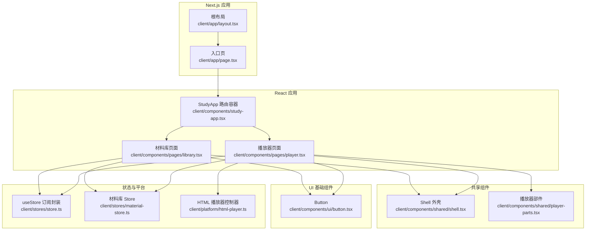
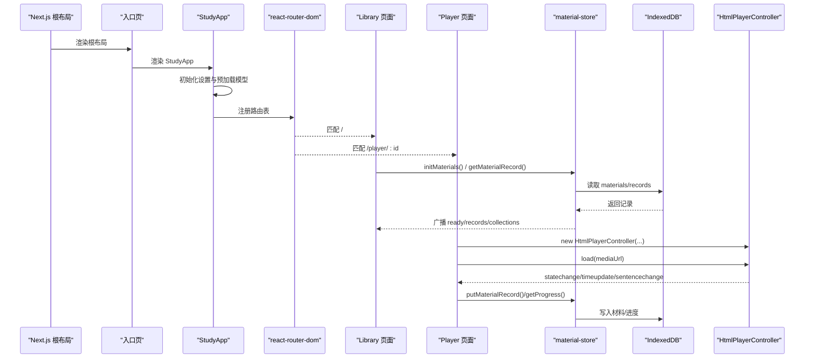
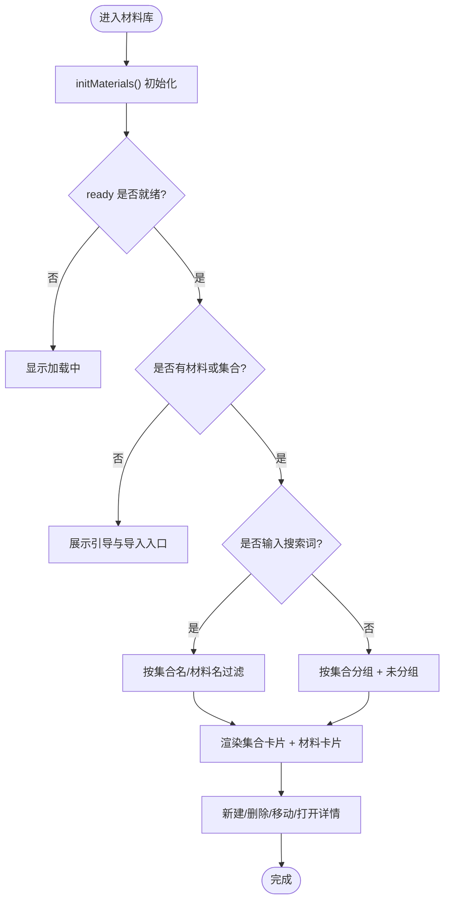
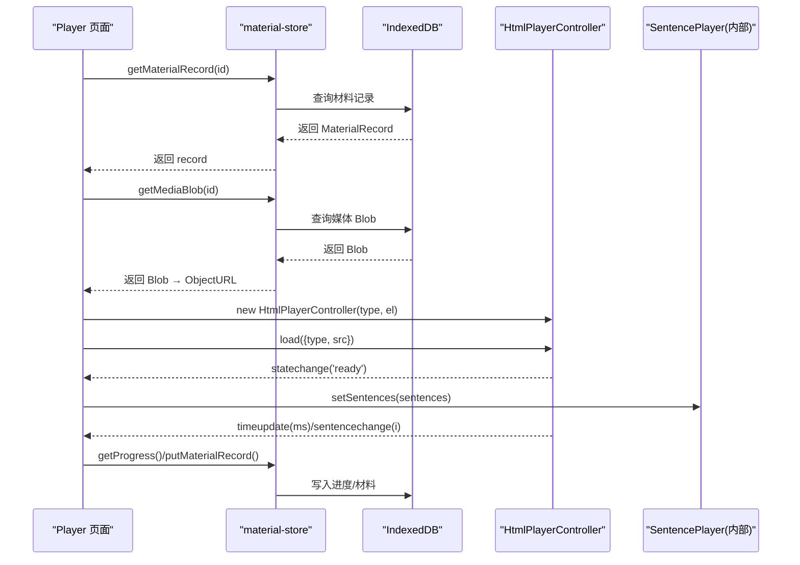
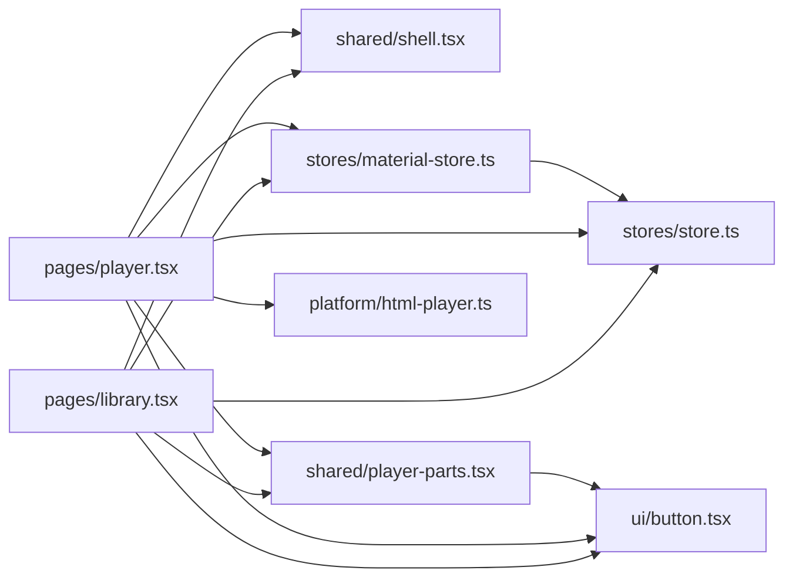

# 组件系统设计

<cite>
**本文引用的文件**   
- [client/app/layout.tsx](file://client/app/layout.tsx)
- [client/app/page.tsx](file://client/app/page.tsx)
- [client/components/study-app.tsx](file://client/components/study-app.tsx)
- [client/components/pages/library.tsx](file://client/components/pages/library.tsx)
- [client/components/pages/player.tsx](file://client/components/pages/player.tsx)
- [client/components/shared/shell.tsx](file://client/components/shared/shell.tsx)
- [client/components/shared/player-parts.tsx](file://client/components/shared/player-parts.tsx)
- [client/components/ui/button.tsx](file://client/components/ui/button.tsx)
- [client/stores/store.ts](file://client/stores/store.ts)
- [client/stores/material-store.ts](file://client/stores/material-store.ts)
- [client/platform/html-player.ts](file://client/platform/html-player.ts)
- [client/core/player/index.ts](file://client/core/player/index.ts)
- [client/lib/utils.ts](file://client/lib/utils.ts)
</cite>

## 目录
1. [引言](#引言)
2. [项目结构](#项目结构)
3. [核心组件](#核心组件)
4. [架构总览](#架构总览)
5. [详细组件分析](#详细组件分析)
6. [依赖关系分析](#依赖关系分析)
7. [性能考量](#性能考量)
8. [故障排查指南](#故障排查指南)
9. [结论](#结论)
10. [附录：开发规范与最佳实践](#附录开发规范与最佳实践)

## 引言
本文件面向“英语精听助手”的 React 前端，系统化梳理三层组件架构与数据流：页面组件（pages/）、共享组件（shared/）、UI 基础组件（ui/）。重点说明：
- 页面组件的数据获取、状态管理、用户交互处理；
- 共享组件的可复用性设计、props 接口、事件机制；
- UI 基础组件的样式系统、主题支持、无障碍访问；
- 组件通信模式（props、context、自定义事件）与组合模式；
- 性能优化策略与可维护性建议。

## 项目结构
前端采用 Next.js App Router + React Router 的双层路由：
- Next.js 根布局负责站点元信息、全局样式与主题色；
- 应用入口 StudyApp 使用 react-router-dom 进行页面级路由；
- 页面组件位于 components/pages，承载业务场景；
- 共享组件位于 components/shared，封装跨页面复用的能力；
- UI 基础组件位于 components/ui，提供原子化控件与样式变体；
- 状态层通过 stores 提供轻量 store 与 useStore hook；
- 媒体播放由 platform/html-player.ts 抽象为控制器，供页面与共享组件调用。

图表来源
- [client/app/layout.tsx:1-50](file://client/app/layout.tsx#L1-L50)
- [client/app/page.tsx:1-6](file://client/app/page.tsx#L1-L6)
- [client/components/study-app.tsx:1-65](file://client/components/study-app.tsx#L1-L65)
- [client/components/pages/library.tsx:1-143](file://client/components/pages/library.tsx#L1-L143)
- [client/components/pages/player.tsx:1-535](file://client/components/pages/player.tsx#L1-L535)
- [client/components/shared/shell.tsx:1-24](file://client/components/shared/shell.tsx#L1-L24)
- [client/components/shared/player-parts.tsx:1-234](file://client/components/shared/player-parts.tsx#L1-L234)
- [client/components/ui/button.tsx:1-59](file://client/components/ui/button.tsx#L1-L59)
- [client/stores/store.ts:1-34](file://client/stores/store.ts#L1-L34)
- [client/stores/material-store.ts:1-163](file://client/stores/material-store.ts#L1-L163)
- [client/platform/html-player.ts:1-272](file://client/platform/html-player.ts#L1-L272)

章节来源
- [client/app/layout.tsx:1-50](file://client/app/layout.tsx#L1-L50)
- [client/app/page.tsx:1-6](file://client/app/page.tsx#L1-L6)
- [client/components/study-app.tsx:1-65](file://client/components/study-app.tsx#L1-L65)

## 核心组件
- 页面组件（pages/）
  - library.tsx：材料库列表、集合分组、搜索、新建集合、删除与移动材料；通过 material-store 读取/更新数据，结合 useStore 订阅刷新。
  - player.tsx：播放器主流程，含媒体加载、字幕解析与应用、收藏/笔记、翻译、导出、键盘快捷键、进度节流落盘等。
- 共享组件（shared/）
  - shell.tsx：全局头部、返回按钮、快捷入口，并提供 pauseAllMedia 统一暂停媒体。
  - player-parts.tsx：播放器控制条、字幕列表、材料卡片、集合卡片、移动材料弹窗等。
- UI 基础组件（ui/）
  - button.tsx：基于 class-variance-authority 的变体与尺寸系统，结合 Tailwind 类名合并工具 cn。

章节来源
- [client/components/pages/library.tsx:1-143](file://client/components/pages/library.tsx#L1-L143)
- [client/components/pages/player.tsx:1-535](file://client/components/pages/player.tsx#L1-L535)
- [client/components/shared/shell.tsx:1-24](file://client/components/shared/shell.tsx#L1-L24)
- [client/components/shared/player-parts.tsx:1-234](file://client/components/shared/player-parts.tsx#L1-L234)
- [client/components/ui/button.tsx:1-59](file://client/components/ui/button.tsx#L1-L59)

## 架构总览
整体数据流与控制流如下：
- 启动阶段：Next.js 渲染根布局 → 渲染 Page → 渲染 StudyApp → 初始化 Kokoro TTS 配置并预加载模型 → 注册路由。
- 页面数据：Library 与 Player 通过 material-store 从 IndexedDB 拉取材料与进度；useStore 订阅变更触发重渲染。
- 播放链路：Player 装配 HtmlPlayerController 与 SentencePlayer，监听 timeupdate/statechange/sentencechange 等事件，驱动 UI 与持久化。
- 共享协作：Shell 提供全局导航与媒体暂停；player-parts 提供可复用控件。

图表来源
- [client/app/layout.tsx:1-50](file://client/app/layout.tsx#L1-L50)
- [client/app/page.tsx:1-6](file://client/app/page.tsx#L1-L6)
- [client/components/study-app.tsx:1-65](file://client/components/study-app.tsx#L1-L65)
- [client/components/pages/library.tsx:1-143](file://client/components/pages/library.tsx#L1-L143)
- [client/components/pages/player.tsx:1-535](file://client/components/pages/player.tsx#L1-L535)
- [client/stores/material-store.ts:1-163](file://client/stores/material-store.ts#L1-L163)
- [client/platform/html-player.ts:1-272](file://client/platform/html-player.ts#L1-L272)

## 详细组件分析

### 页面组件：library.tsx（材料库）
职责与实现要点：
- 数据获取：initMaterials 首次注入种子并刷新列表；根据 ready 与 records 渲染空态、加载中、搜索结果与分组视图。
- 状态管理：useStore(materialStore) 订阅 ready/records/collections；本地 query、createOpen、moveTarget 等 UI 状态。
- 用户交互：新建集合校验（去空白、去重）、删除确认、移动到集合/未分组、搜索过滤。
- 组合模式：使用 Shell/PageIntro 作为页面骨架；使用 shared/player-parts 中的 CollectionCard/MaterialCard/MaterialMoveDialog。

图表来源
- [client/components/pages/library.tsx:1-143](file://client/components/pages/library.tsx#L1-L143)
- [client/stores/material-store.ts:1-163](file://client/stores/material-store.ts#L1-L163)

章节来源
- [client/components/pages/library.tsx:1-143](file://client/components/pages/library.tsx#L1-L143)
- [client/stores/material-store.ts:1-163](file://client/stores/material-store.ts#L1-L163)

### 页面组件：player.tsx（播放器）
职责与实现要点：
- 数据侧：按 :materialId 读取 MaterialRecord、媒体 Blob、收藏集合、句子笔记、学习进度；不存在则跳转回首页。
- 播放引擎：装配 HtmlPlayerController + SentencePlayer；根据 mediaType 复用隐藏 audio/video；设置默认倍速/循环；监听 timeupdate/statechange/sentencechange/error。
- 进度持久化：playedRef 收集已播句索引，PROGRESS_FLUSH_MS 节流写 progress；卸载时 flush 最终位置。
- 字幕处理：导入 SRT/LRC、AI 转字幕、整篇翻译、单句纠错、删除句子、导出 SRT；同步更新 subtitleData 与 isBilingual。
- 交互增强：键盘快捷键（空格/方向键/N）、复制原文/译文回执、背景轮播、控制栏自动显隐。
- 性能优化：时间戳更新节流（100ms）、播放进度节流（5s）、避免频繁 re-render。

图表来源
- [client/components/pages/player.tsx:1-535](file://client/components/pages/player.tsx#L1-L535)
- [client/stores/material-store.ts:1-163](file://client/stores/material-store.ts#L1-L163)
- [client/platform/html-player.ts:1-272](file://client/platform/html-player.ts#L1-L272)

章节来源
- [client/components/pages/player.tsx:1-535](file://client/components/pages/player.tsx#L1-L535)
- [client/stores/material-store.ts:1-163](file://client/stores/material-store.ts#L1-L163)
- [client/platform/html-player.ts:1-272](file://client/platform/html-player.ts#L1-L272)

### 共享组件：shell.tsx（外壳与全局行为）
- 提供全局头部、品牌标识、收藏/生词本/设置快捷入口。
- 暴露 pauseAllMedia，用于切换页面时统一暂停音视频，避免主线程阻塞导致返回无响应。
- 通过 react-router-dom 的 Link/useNavigate 实现导航。

章节来源
- [client/components/shared/shell.tsx:1-24](file://client/components/shared/shell.tsx#L1-L24)

### 共享组件：player-parts.tsx（播放器部件）
- PlayerControlBar：播放/暂停、上一句/下一句、A-B 循环、倍速、音量滑块、字幕模式切换；对 disabled 状态做全量禁用。
- SubtitleList：字幕项滚动跟随 active、收藏标记、笔记入口、导入/导出/AI 转字幕/翻译入口；键盘可达性与 aria 属性完善。
- MaterialCard/CollectionCard：材料/集合展示卡片，进度与最近学习文案派生。
- MaterialMoveDialog：移动材料到集合/未分组/新建集合，含陈旧 ID 防护。

章节来源
- [client/components/shared/player-parts.tsx:1-234](file://client/components/shared/player-parts.tsx#L1-L234)

### UI 基础组件：button.tsx（原子按钮）
- 基于 @base-ui/react/button 与 class-variance-authority 定义 variant/size 变体。
- 使用 cn 工具合并 Tailwind 类名，支持 dark 模式与 focus-visible/aria-invalid 等无障碍状态。
- 提供 xs/sm/lg/icon/icon-sm/icon-lg 等多尺寸，适配不同密度布局。

章节来源
- [client/components/ui/button.tsx:1-59](file://client/components/ui/button.tsx#L1-L59)
- [client/lib/utils.ts:1-7](file://client/lib/utils.ts#L1-L7)

## 依赖关系分析
- 页面组件依赖：
  - pages/library.tsx → shared/shell.tsx、shared/player-parts.tsx、stores/material-store.ts、stores/store.ts、ui/button.tsx。
  - pages/player.tsx → shared/shell.tsx、shared/player-parts.tsx、platform/html-player.ts、stores/material-store.ts、stores/store.ts、ui/button.tsx。
- 共享组件依赖：
  - shared/player-parts.tsx → ui/*（badge/button/card/dialog/input/progress）、stores/material-store.ts、stores/store.ts。
- 状态层：
  - stores/store.ts 提供 createStore/useStore，被 material-store 与页面组件使用。
- 平台层：
  - platform/html-player.ts 实现 PlayerController 接口，被 Player 页面装配。

图表来源
- [client/components/pages/library.tsx:1-143](file://client/components/pages/library.tsx#L1-L143)
- [client/components/pages/player.tsx:1-535](file://client/components/pages/player.tsx#L1-L535)
- [client/components/shared/shell.tsx:1-24](file://client/components/shared/shell.tsx#L1-L24)
- [client/components/shared/player-parts.tsx:1-234](file://client/components/shared/player-parts.tsx#L1-L234)
- [client/components/ui/button.tsx:1-59](file://client/components/ui/button.tsx#L1-L59)
- [client/stores/store.ts:1-34](file://client/stores/store.ts#L1-L34)
- [client/stores/material-store.ts:1-163](file://client/stores/material-store.ts#L1-L163)
- [client/platform/html-player.ts:1-272](file://client/platform/html-player.ts#L1-L272)

章节来源
- [client/components/pages/library.tsx:1-143](file://client/components/pages/library.tsx#L1-L143)
- [client/components/pages/player.tsx:1-535](file://client/components/pages/player.tsx#L1-L535)
- [client/components/shared/player-parts.tsx:1-234](file://client/components/shared/player-parts.tsx#L1-L234)
- [client/stores/store.ts:1-34](file://client/stores/store.ts#L1-L34)
- [client/stores/material-store.ts:1-163](file://client/stores/material-store.ts#L1-L163)
- [client/platform/html-player.ts:1-272](file://client/platform/html-player.ts#L1-L272)

## 性能考量
- 播放进度节流：timeupdate 回调中每 100ms 最多一次 setCurrentMs，降低高频重渲染压力。
- 进度落盘节流：playedRef.dirty 在 PROGRESS_FLUSH_MS（5s）内批量合并并写入 IndexedDB，减少 IO 频率。
- 媒体元素复用：Player 复用页面隐藏的 audio/video 元素，避免重复创建销毁。
- 对象 URL 生命周期：进入页面创建 ObjectURL，卸载时 revoke，防止内存泄漏。
- 背景图片随机打乱：每次进入播放器时 shuffleArray 打乱顺序，提升视觉多样性且避免固定缓存命中瓶颈。
- 控制栏显隐延迟：鼠标移出后 2s 隐藏，减少不必要的状态切换。

[本节为通用性能指导，不直接分析具体文件]

## 故障排查指南
- 播放器无法播放
  - 检查 HtmlPlayerController.load 是否成功，state 是否为 'ready'；若 error 事件触发，查看 code/message。
  - 确认媒体类型与元素匹配（audio/video），ObjectURL 是否正确创建与释放。
- 进度不更新
  - 检查 timeupdate 事件是否派发；确认 seekTo 后 pendingSeekMs 校准逻辑是否超时解除。
  - 确认 flushProgress 节流条件与 lastFlush 时间戳。
- 字幕不生效
  - 确认 applySubtitleToRecord 已将 subtitleData 写入 material-store；SentencePlayer 是否通过 setSentences 同步。
- 收藏/笔记丢失
  - 检查 favoriteSentenceIndexes/note 前缀 key 是否正确；组件卸载时是否 flush 待保存笔记。
- 页面返回卡顿
  - 确保通过 Shell.pauseAllMedia 统一暂停音视频；避免主线程被 rAF 循环阻塞。

章节来源
- [client/platform/html-player.ts:1-272](file://client/platform/html-player.ts#L1-L272)
- [client/components/pages/player.tsx:1-535](file://client/components/pages/player.tsx#L1-L535)
- [client/components/shared/shell.tsx:1-24](file://client/components/shared/shell.tsx#L1-L24)

## 结论
本项目以清晰的三层组件架构组织代码：页面组件聚焦业务与数据流，共享组件沉淀跨页面能力，UI 基础组件提供一致的样式与无障碍体验。通过轻量 store 与 useSyncExternalStore 订阅，实现了低耦合的状态管理；通过 HtmlPlayerController 抽象媒体控制器，解耦了播放细节与上层 UI。整体方案兼顾可维护性、可扩展性与性能表现。

[本节为总结性内容，不直接分析具体文件]

## 附录：开发规范与最佳实践
- 组件分层
  - 页面组件：仅编排数据与交互，不实现底层 UI 细节；复杂逻辑下沉至 shared 或 core。
  - 共享组件：对外暴露 props 接口与事件回调；内部状态最小化，尽量受控于父组件。
  - UI 基础组件：保持纯展示与基础交互，遵循变体/尺寸/无障碍规范。
- 数据流
  - 优先使用 stores/store.ts 提供的 createStore/useStore；异步操作集中在 store 层，页面只订阅。
  - 所有浏览器 API（如 IndexedDB、DOM）仅在 useEffect/事件回调中访问，保证 SSR 安全。
- 事件与通信
  - 父子通信：props + 回调；跨层级：useContext 或 store；跨组件：自定义事件（如 HtmlPlayerController.on/off）。
- 样式与主题
  - 使用 Tailwind 与 cn 工具合并类名；通过 CSS 变量与 dark 模式支持主题切换。
- 无障碍访问
  - 为交互元素添加 aria-label/aria-pressed/role/slider 等语义；键盘可达性（Tab/Enter/Space）。
- 性能优化
  - 高频更新节流（时间戳、进度落盘）；避免在 render 中执行昂贵计算；合理使用 useRef 缓存 DOM 引用与定时器。
- 错误处理
  - 网络/存储失败静默降级；播放器 error 事件统一上报；关键路径保留日志与兜底 UI。
- 测试建议
  - 对 store 方法、字幕解析、进度合并、洗牌算法等进行单元测试；UI 组件关注交互与无障碍断言。

[本节为通用指导，不直接分析具体文件]