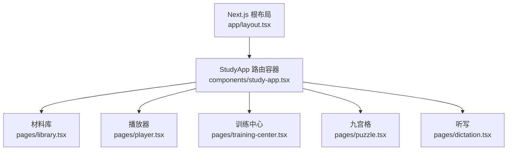
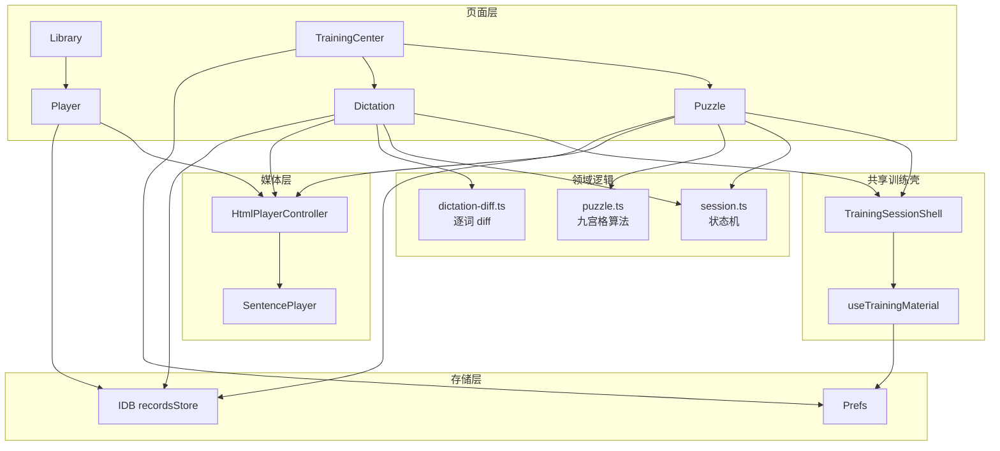
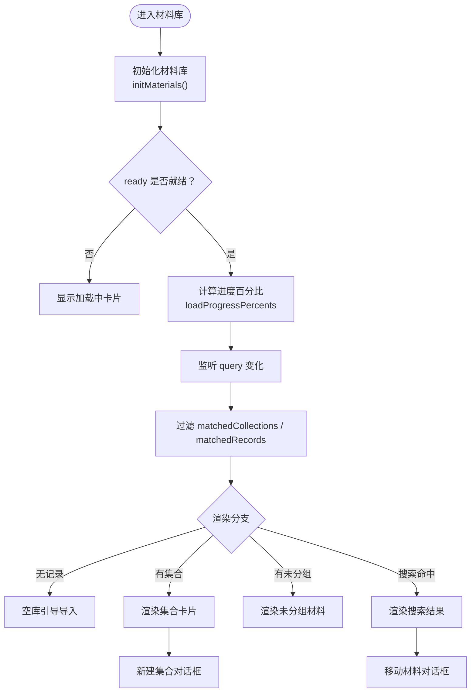
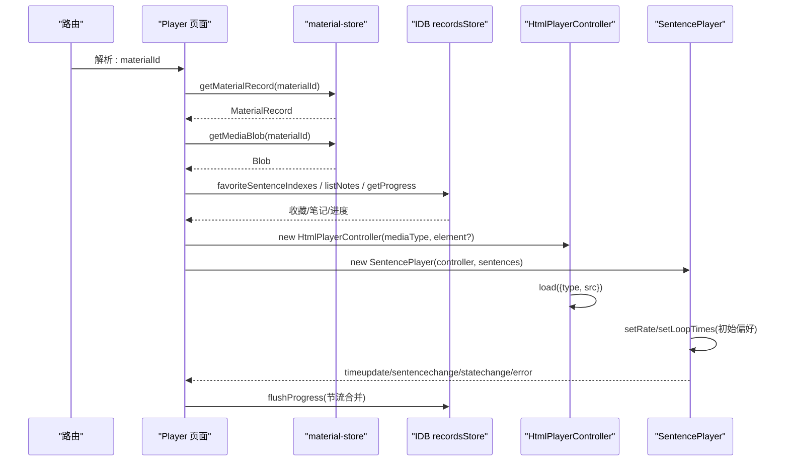
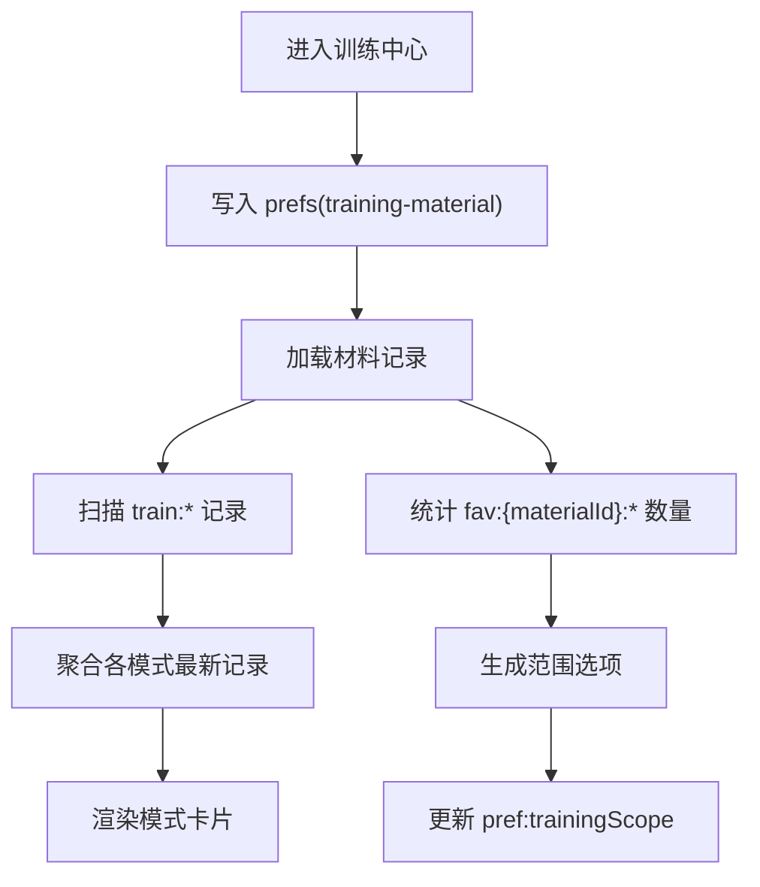
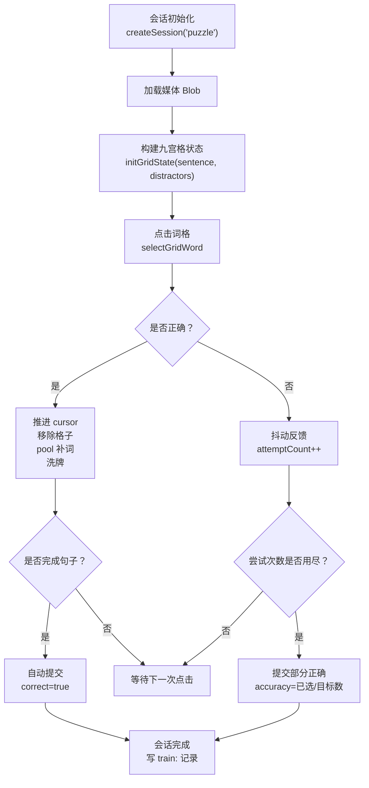
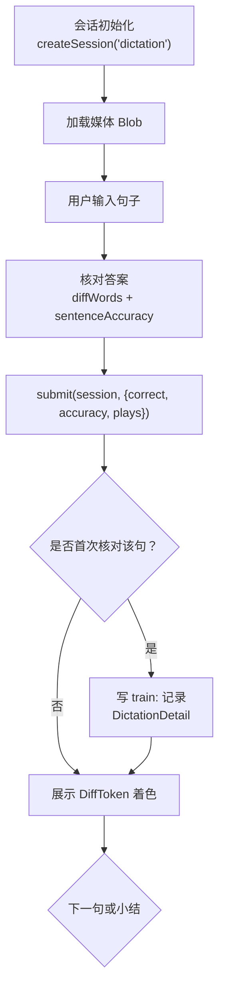
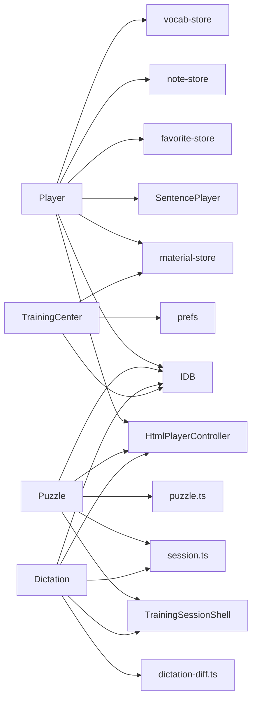

# 页面组件

<cite>
**本文引用的文件**   
- [study-app.tsx](file://client/components/study-app.tsx)
- [library.tsx](file://client/components/pages/library.tsx)
- [player.tsx](file://client/components/pages/player.tsx)
- [training-center.tsx](file://client/components/pages/training-center.tsx)
- [puzzle.tsx](file://client/components/pages/puzzle.tsx)
- [dictation.tsx](file://client/components/pages/dictation.tsx)
- [training-session-shell.tsx](file://client/components/shared/training-session-shell.tsx)
- [session.ts](file://client/core/training/session.ts)
- [puzzle.ts](file://client/core/training/puzzle.ts)
- [dictation-diff.ts](file://client/core/training/dictation-diff.ts)
- [html-player.ts](file://client/platform/html-player.ts)
- [sentence-player.ts](file://client/core/player/sentence-player.ts)
</cite>

## 目录
1. [引言](#引言)
2. [项目结构与路由](#项目结构与路由)
3. [核心页面组件总览](#核心页面组件总览)
4. [架构总览与数据流](#架构总览与数据流)
5. [材料库页面分析](#材料库页面分析)
6. [播放器页面分析](#播放器页面分析)
7. [训练中心页面分析](#训练中心页面分析)
8. [九宫格练习实现分析](#九宫格练习实现分析)
9. [听写练习实现分析](#听写练习实现分析)
10. [依赖关系分析](#依赖关系分析)
11. [性能与体验优化](#性能与体验优化)
12. [错误处理与健壮性](#错误处理与健壮性)
13. [使用示例与最佳实践](#使用示例与最佳实践)
14. [结论](#结论)

## 引言
本文件面向“英语精听助手”前端中的页面级业务组件，重点覆盖以下页面：
- 材料库页面：材料展示、搜索、分组管理。
- 播放器页面：音频/视频控制、字幕同步、进度追踪、收藏与笔记。
- 训练中心页面：训练模式选择、范围设置（全文/收藏句）。
- 具体训练模式：九宫格拼句、单句听写。

文档从系统架构、组件职责、数据流、状态机、用户交互、错误处理、性能特征等维度展开，并给出可追溯的代码片段路径和架构图示，帮助开发者快速理解现有实现，也为后续扩展提供规范参考。

## 项目结构与路由
应用入口通过 Next.js 根布局渲染 `StudyApp`，由 `BrowserRouter + Routes` 声明式配置页面路由。关键路由包括：
- `/`：材料库
- `/player/:materialId`：播放器
- `/training/:materialId`：训练中心
- `/training/puzzle`、`/training/dictation`：具体训练模式
- 其他功能页：TTS、转写、收藏、导入、设置、词汇等

**图示来源**
- [study-app.tsx:41-61](file://client/components/study-app.tsx#L41-L61)

**章节来源**
- [study-app.tsx:1-65](file://client/components/study-app.tsx#L1-L65)

## 核心页面组件总览
| 页面 | 主要职责 | 关键状态 | 主要外部依赖 |
|---|---|---|---|
| 材料库 | 展示材料与集合、搜索、新建集合、移动材料到集合 | ready、records、collections、query、percents | material-store、store、UI 组件 |
| 播放器 | 播放音视频、字幕高亮、收藏/笔记、翻译/AI 转字幕、进度持久化 | record、mediaUrl、playing、active、currentMs、favSet、noteMap | HtmlPlayerController、SentencePlayer、IDB、各 store |
| 训练中心 | 选择训练模式、设置训练范围（全文/收藏句）、显示上次成绩 | record、lastByMode、scope、favCount | material-store、prefs、IDB |
| 九宫格 | 按语序点击词块完成句子、提示与提交、会话结算 | session、gridState、selected、resolved | training-session-shell、puzzle 算法、session 状态机 |
| 听写 | 听音写句、逐词 diff 对比、正确率统计 | session、value、tokens、plays | training-session-shell、dictation-diff、session 状态机 |

**章节来源**
- [library.tsx:14-142](file://client/components/pages/library.tsx#L14-L142)
- [player.tsx:79-534](file://client/components/pages/player.tsx#L79-L534)
- [training-center.tsx:31-134](file://client/components/pages/training-center.tsx#L31-L134)
- [puzzle.tsx:31-292](file://client/components/pages/puzzle.tsx#L31-L292)
- [dictation.tsx:28-146](file://client/components/pages/dictation.tsx#L28-L146)

## 架构总览与数据流
整体数据流遵循“页面组件 → 领域逻辑/状态机 → 存储层/媒体控制器”的分层结构：
- 页面组件负责 UI 与用户交互。
- 训练模式共享 `TrainingSessionShell` 与 `useTrainingMaterial` 加载材料与范围。
- 训练会话状态机 `session.ts` 统一维护题目队列、游标、结果收集。
- 播放能力由 `HtmlPlayerController` 封装原生媒体元素，`SentencePlayer` 提供句子级控制与 A-B 循环。
- 数据持久化通过 IDB（`recordsStore`）与本地偏好（`prefs`）完成。

**图示来源**
- [training-session-shell.tsx:1-67](file://client/components/shared/training-session-shell.tsx#L1-L67)
- [session.ts:1-119](file://client/core/training/session.ts#L1-L119)
- [puzzle.ts:1-284](file://client/core/training/puzzle.ts#L1-L284)
- [dictation-diff.ts:1-109](file://client/core/training/dictation-diff.ts#L1-L109)
- [html-player.ts:1-272](file://client/platform/html-player.ts#L1-L272)
- [sentence-player.ts:1-219](file://client/core/player/sentence-player.ts#L1-L219)

## 材料库页面分析
### 功能要点
- 初始化材料库：异步 `initMaterials()`，失败时静默兜底。
- 进度百分比：基于 `loadProgressPercents(records)` 计算，避免阻塞渲染。
- 搜索：支持材料名称与集合名模糊匹配；搜索结果分为“材料集”和“材料”两个区块。
- 分组管理：按现存集合派生分组；无归属或陈旧 ID 归入“未分组”。
- 新建集合：校验非空且唯一；重复时禁用创建按钮并提示。
- 删除材料：二次确认，调用 `removeMaterial(id)`。
- 移动材料：打开 `MaterialMoveDialog` 将材料移动到目标集合。

### 数据流与状态
- 读取 `materialStore` 的 `ready`、`records`、`collections`。
- 本地状态：`query`、`percents`、`createOpen`、`createName`、`moveTarget`。
- 派生视图：`ungrouped`、`matchedCollections`、`matchedRecords`。

**图示来源**
- [library.tsx:21-56](file://client/components/pages/library.tsx#L21-L56)
- [library.tsx:74-118](file://client/components/pages/library.tsx#L74-L118)
- [library.tsx:119-137](file://client/components/pages/library.tsx#L119-L137)

**章节来源**
- [library.tsx:14-142](file://client/components/pages/library.tsx#L14-L142)

## 播放器页面分析
### 功能要点
- 材料加载：根据 URL 参数 `:materialId` 获取 `MaterialRecord`、媒体 Blob、收藏句索引、句子笔记、学习进度。
- 媒体播放：根据 `mediaType` 复用隐藏 `<audio>` 或 `<video>`，构造 `HtmlPlayerController` 与 `SentencePlayer`。
- 字幕同步：基于 `SentencePlayer` 的 `timeupdate` 与 `sentencechange` 事件驱动当前句高亮。
- 进度追踪：节流更新 `currentMs`，增量标记已播放句子，每 5 秒合并写入 progress 记录。
- 收藏与笔记：收藏切换、句子笔记编辑（防抖落盘）、删除笔记、定位到带笔记的句子。
- 字幕操作：导入字幕、AI 转字幕、纠错保存、批量翻译、导出 SRT。
- 快捷键：空格播放/暂停，左右箭头切句，N 键打开笔记抽屉。
- 背景轮播：非视频内容自动轮播背景图。

### 状态与生命周期
- 进入页面：加载材料、Blob、收藏、笔记、进度；若不存在则导航回首页。
- 装配播放引擎：仅在真实媒体材料下创建 controller 与 player，并在卸载时销毁。
- 字幕更新：不重建引擎，仅同步句列表到已装配引擎。
- 键盘事件：绑定/解绑全局快捷键。
- 卸载清理：撤销 ObjectURL、flush 笔记与进度、销毁播放器。

**图示来源**
- [player.tsx:129-245](file://client/components/pages/player.tsx#L129-L245)
- [html-player.ts:66-137](file://client/platform/html-player.ts#L66-L137)
- [sentence-player.ts:55-102](file://client/core/player/sentence-player.ts#L55-L102)

**章节来源**
- [player.tsx:79-534](file://client/components/pages/player.tsx#L79-L534)

## 训练中心页面分析
### 功能要点
- 设置训练材料：进入训练中心时将 `materialId` 写入 `prefs('training-material')`。
- 范围选择：支持“全文”与“收藏句”，当选择收藏句但无收藏时置灰并提示。
- 上次成绩：扫描 `train:` 前缀记录，取该材料各模式最新一条，显示分数/平均分/综合分。
- 模式列表：九宫格、单句听写、跟读评分、影子跟读、全文背诵；收藏句范围下全文类模式置灰。

### 数据流
- 读取 `getMaterialRecord(materialId)`。
- 遍历 `recordsStore.allKeys()` 筛选 `train:*`，聚合最新记录。
- 统计收藏句数量：`fav:{materialId}:*` 前缀计数。
- 更新 `prefs('pref:trainingScope')` 以影响训练页范围。

**图示来源**
- [training-center.tsx:31-66](file://client/components/pages/training-center.tsx#L31-L66)
- [training-center.tsx:71-107](file://client/components/pages/training-center.tsx#L71-L107)

**章节来源**
- [training-center.tsx:31-134](file://client/components/pages/training-center.tsx#L31-L134)

## 九宫格练习实现分析
### 功能要点
- 会话初始化：基于 `useTrainingMaterial` 提供的 `record` 与 `scope`，调用 `createSession('puzzle', sentences, scope)`。
- 媒体加载：获取 Blob 并创建 ObjectURL，构造 `HtmlPlayerController` 与 `SentencePlayer`。
- 九宫格状态：根据当前句构建 `PuzzleGridState`，包含目标序列、滑窗池、网格、答案锚点。
- 交互流程：点击词格 → `selectGridWord` 判定 → 正确推进 cursor 并从 pool 补词洗牌；错误抖动反馈并累计 attempt。
- 提示机制：每次提示高亮下一个应选词文本，累计 hintCount，扣 2 分。
- 提交与结算：全对自动提交；尝试次数用尽后按已选比例计算准确率并提交；完成后写 `train:` 记录。
- 小结展示：正确率、用时、得分、最弱句 TOP。

**图示来源**
- [puzzle.tsx:47-99](file://client/components/pages/puzzle.tsx#L47-L99)
- [puzzle.tsx:134-171](file://client/components/pages/puzzle.tsx#L134-L171)
- [puzzle.tsx:103-125](file://client/components/pages/puzzle.tsx#L103-L125)
- [puzzle.ts:168-269](file://client/core/training/puzzle.ts#L168-L269)

**章节来源**
- [puzzle.tsx:31-292](file://client/components/pages/puzzle.tsx#L31-L292)
- [puzzle.ts:1-284](file://client/core/training/puzzle.ts#L1-L284)

## 听写练习实现分析
### 功能要点
- 会话初始化：基于 `useTrainingMaterial` 提供的 `record` 与 `scope`，调用 `createSession('dictation', sentences, scope)`。
- 媒体加载：同上，构造播放引擎用于区间播放。
- 输入与核对：用户输入句子 → `diffWords(value, target)` 生成 DiffToken → `sentenceAccuracy` 计算正确率 → `submit(session, entry)`。
- 首次核对写记录：每个句只写一次 `train:` 记录，detail 包含 accuracy 与 sentenceIndex。
- 重练弱项：小结中点击最弱句 → `retryAt(session, idx)` 回到该句位置。
- 结果展示：DiffView 着色渲染（正确不变色、错词红删附正确词、漏词绿插、多词灰）。

**图示来源**
- [dictation.tsx:41-74](file://client/components/pages/dictation.tsx#L41-L74)
- [dictation.tsx:91-117](file://client/components/pages/dictation.tsx#L91-L117)
- [dictation-diff.ts:51-108](file://client/core/training/dictation-diff.ts#L51-L108)

**章节来源**
- [dictation.tsx:28-146](file://client/components/pages/dictation.tsx#L28-L146)
- [dictation-diff.ts:1-109](file://client/core/training/dictation-diff.ts#L1-L109)

## 依赖关系分析
### 组件耦合与内聚
- 页面组件与领域逻辑解耦：训练模式通过 `session.ts` 纯函数状态机管理题目与结果，避免在 UI 中直接维护复杂状态。
- 播放能力抽象：`HtmlPlayerController` 屏蔽原生媒体差异，`SentencePlayer` 提供句子级 API，播放器与训练页均复用。
- 训练壳复用：`TrainingSessionShell` 与 `useTrainingMaterial` 被九宫格与听写共用，减少重复代码。

### 直接依赖链
- `Player` → `HtmlPlayerController`、`SentencePlayer`、`material-store`、`favorite-store`、`note-store`、`vocab-store`、`idb`。
- `Puzzle`、`Dictation` → `training-session-shell`、`session.ts`、`puzzle.ts`/`dictation-diff.ts`、`html-player.ts`、`idb`。
- `TrainingCenter` → `material-store`、`idb`、`prefs`。

**图示来源**
- [player.tsx:15-27](file://client/components/pages/player.tsx#L15-L27)
- [puzzle.tsx:6-24](file://client/components/pages/puzzle.tsx#L6-L24)
- [dictation.tsx:8-16](file://client/components/pages/dictation.tsx#L8-L16)
- [training-center.tsx:7-12](file://client/components/pages/training-center.tsx#L7-L12)

**章节来源**
- [player.tsx:15-27](file://client/components/pages/player.tsx#L15-L27)
- [puzzle.tsx:6-24](file://client/components/pages/puzzle.tsx#L6-L24)
- [dictation.tsx:8-16](file://client/components/pages/dictation.tsx#L8-L16)
- [training-center.tsx:7-12](file://client/components/pages/training-center.tsx#L7-L12)

## 性能与体验优化
- 进度更新节流：播放器每秒最多更新约 10 次 `currentMs`，避免高频 setState 阻塞主线程。
- 播放过的句子增量持久化：每 5 秒合并已播放句索引并写入 IDB，降低 I/O 频率。
- 背景图片随机打乱：进入播放器时一次性打乱背景图顺序，减少运行时开销。
- 控制栏延迟隐藏：鼠标移出区域 2 秒后隐藏控制栏，提升沉浸感。
- 九宫格与听写：区间播放（playRange）避免整段重复播放，减少不必要的解码与渲染。
- 训练会话状态机：纯函数迁移，避免 UI 层复杂状态导致重渲染。

[本节为通用指导，不直接分析具体文件]

## 错误处理与健壮性
- 材料缺失：播放器与训练中心在找不到材料时返回空状态或导航回首页。
- 媒体加载失败：播放器与训练页捕获加载错误，保持 UI 可用但控件置灰。
- 存储失败：进度与训练记录写入失败时静默忽略，不影响训练流程。
- 播放竞态：`HtmlPlayerController.play()` 捕获 `AbortError` 静默处理，避免 unhandled rejection。
- 字幕解析失败：导入或 AI 生成的字幕解析失败时静默处理，不中断用户流程。
- 键盘事件防护：快捷键在输入框聚焦时不触发，避免干扰用户输入。

**章节来源**
- [player.tsx:177-207](file://client/components/pages/player.tsx#L177-L207)
- [player.tsx:254-271](file://client/components/pages/player.tsx#L254-L271)
- [player.tsx:388-414](file://client/components/pages/player.tsx#L388-L414)
- [html-player.ts:85-96](file://client/platform/html-player.ts#L85-L96)
- [puzzle.tsx:103-125](file://client/components/pages/puzzle.tsx#L103-L125)
- [dictation.tsx:99-113](file://client/components/pages/dictation.tsx#L99-L113)

## 使用示例与最佳实践
### 页面路由与参数传递
- 材料库跳转到播放器：`/player/:materialId`，携带材料 ID。
- 播放器跳转到训练中心：`/training/:materialId`，携带材料 ID。
- 训练中心跳转到具体模式：`/training/puzzle`、`/training/dictation`，通过 `useTrainingMaterial` 读取最近材料。

**章节来源**
- [study-app.tsx:41-61](file://client/components/study-app.tsx#L41-L61)
- [training-center.tsx:31-39](file://client/components/pages/training-center.tsx#L31-L39)

### 生命周期管理
- 播放器：进入时加载材料、Blob、收藏、笔记、进度；装配播放引擎；卸载时销毁控制器与播放器、撤销 ObjectURL、flush 笔记与进度。
- 训练模式：进入时初始化会话与媒体；会话完成时写训练记录；卸载时销毁播放器。

**章节来源**
- [player.tsx:129-245](file://client/components/pages/player.tsx#L129-L245)
- [puzzle.tsx:47-78](file://client/components/pages/puzzle.tsx#L47-L78)
- [dictation.tsx:41-74](file://client/components/pages/dictation.tsx#L41-L74)

### 最佳实践建议
- 使用 `useTrainingMaterial` 统一加载训练材料与范围，避免在各模式中重复实现。
- 通过 `session.ts` 的状态机管理训练流程，UI 仅负责渲染与触发事件。
- 媒体播放统一通过 `HtmlPlayerController` 与 `SentencePlayer`，避免直接操作原生元素。
- 所有 I/O 操作（IDB、prefs）失败时静默降级，保证用户体验连贯。
- 高频状态更新（如进度、时间）采用节流策略，减少 React 重渲染压力。

[本节为通用指导，不直接分析具体文件]

## 结论
本仓库的页面组件围绕“材料库—播放器—训练中心—具体训练模式”的主线展开，采用清晰的分层架构：页面层负责交互与展示，领域逻辑通过纯函数状态机与算法模块解耦，媒体能力通过控制器抽象统一，数据存储通过 IDB 与 prefs 持久化。播放器与训练模式共享播放引擎与会话外壳，提升了复用性与一致性。整体设计兼顾了性能优化与错误容错，适合进一步扩展新的训练模式与媒体源。

[本节为总结性内容，不直接分析具体文件]