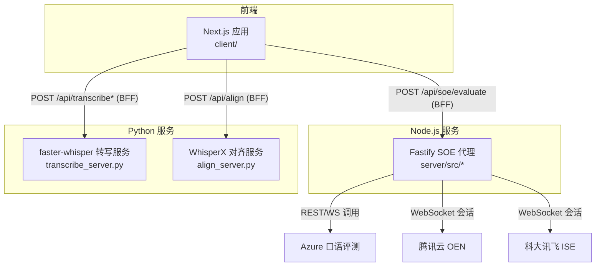
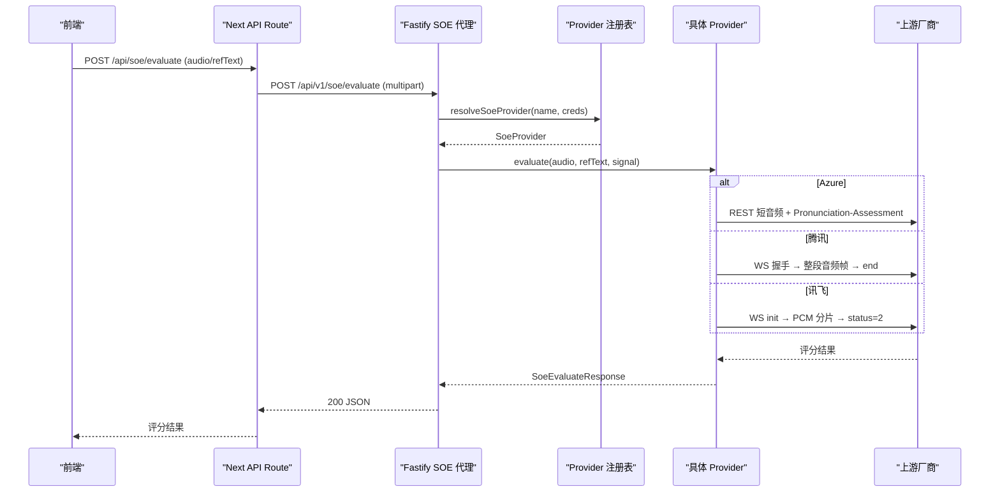
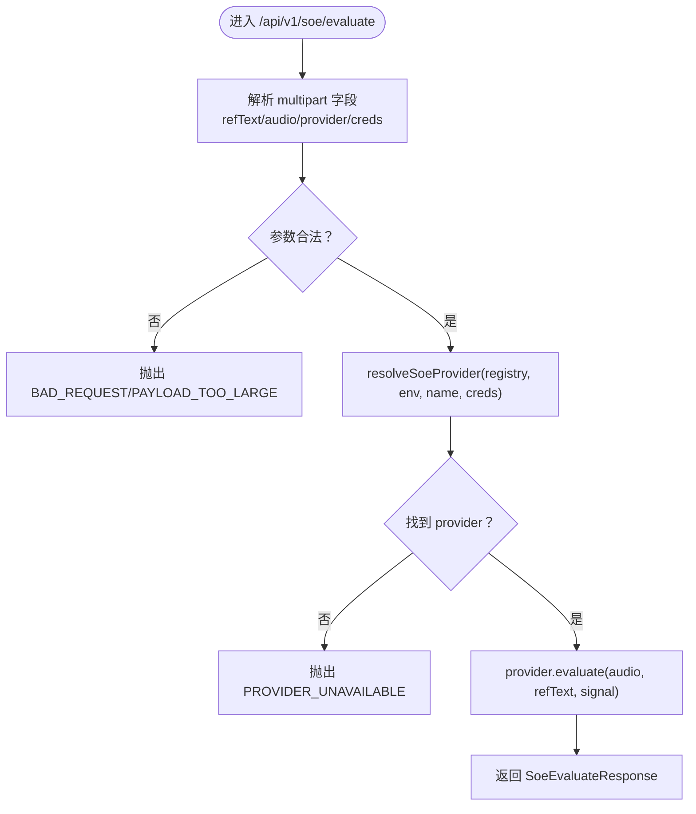
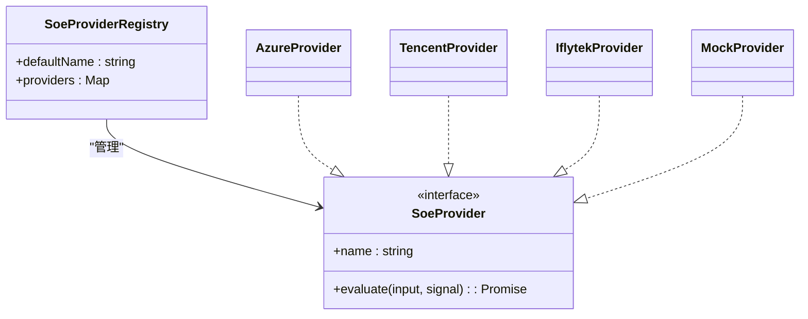
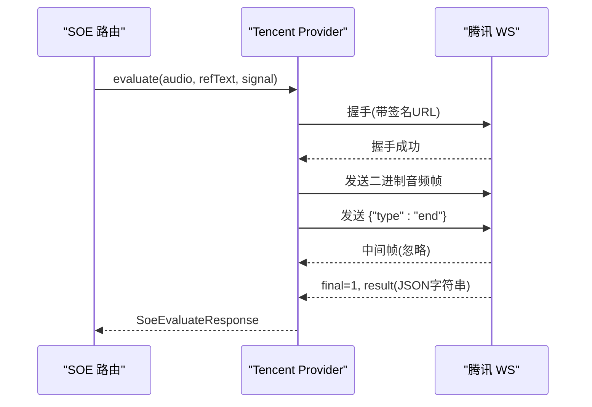
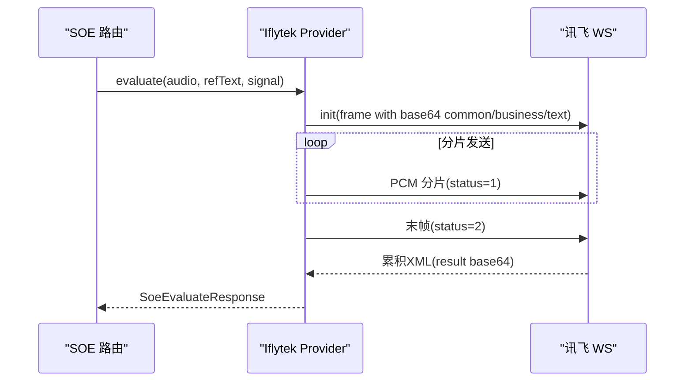
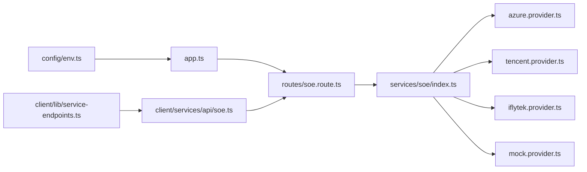

# 后端架构设计

<cite>
**本文引用的文件**   
- [server/src/app.ts](file://server/src/app.ts)
- [server/src/index.ts](file://server/src/index.ts)
- [server/src/routes/soe.route.ts](file://server/src/routes/soe.route.ts)
- [server/src/services/soe/index.ts](file://server/src/services/soe/index.ts)
- [server/src/services/soe/soe-provider.ts](file://server/src/services/soe/soe-provider.ts)
- [server/src/services/soe/azure.provider.ts](file://server/src/services/soe/azure.provider.ts)
- [server/src/services/soe/tencent.provider.ts](file://server/src/services/soe/tencent.provider.ts)
- [server/src/services/soe/iflytek.provider.ts](file://server/src/services/soe/iflytek.provider.ts)
- [server/src/services/soe/mock.provider.ts](file://server/src/services/soe/mock.provider.ts)
- [server/src/config/env.ts](file://server/src/config/env.ts)
- [server/src/lib/api-error.ts](file://server/src/lib/api-error.ts)
- [server/transcribe_server.py](file://server/transcribe_server.py)
- [server/align_server.py](file://server/align_server.py)
- [client/lib/service-endpoints.ts](file://client/lib/service-endpoints.ts)
- [client/services/api/soe.ts](file://client/services/api/soe.ts)
- [client/types/api.ts](file://client/types/api.ts)
</cite>

## 目录
1. [引言](#引言)
2. [项目结构](#项目结构)
3. [核心组件](#核心组件)
4. [架构总览](#架构总览)
5. [详细组件分析](#详细组件分析)
6. [依赖关系分析](#依赖关系分析)
7. [性能与扩展性](#性能与扩展性)
8. [故障排查指南](#故障排查指南)
9. [结论](#结论)

## 引言
本文件面向“英语精听助手”的后端架构，聚焦以下目标：
- 解释 Python FastAPI 微服务（转写、对齐）与 Node.js Fastify SOE 代理的职责分离。
- 说明多厂商 ASR/发音评测（Azure、腾讯云、科大讯飞）的统一接口抽象与注册机制。
- 阐述前后端通信协议：HTTP multipart 评分请求、BFF 中转、以及实时反馈的 SSE/WS 语义。
- 提供系统架构图、数据流图、错误处理策略、性能优化方案与扩展点设计。

## 项目结构
后端由三类服务组成：
- Node.js Fastify SOE 代理：统一对外暴露 /api/v1/soe/evaluate，聚合 Azure、腾讯、讯飞等发音评测能力，并提供 mock 降级。
- Python FastAPI 转写服务：基于 faster-whisper 的离线语音转文本。
- Python FastAPI 对齐服务：基于 WhisperX 的对齐服务，输出词级时间戳。



图表来源
- [server/src/app.ts:14-45](file://server/src/app.ts#L14-L45)
- [server/src/routes/soe.route.ts:64-109](file://server/src/routes/soe.route.ts#L64-L109)
- [server/transcribe_server.py:136-188](file://server/transcribe_server.py#L136-L188)
- [server/align_server.py:131-207](file://server/align_server.py#L131-L207)
- [client/lib/service-endpoints.ts:61-68](file://client/lib/service-endpoints.ts#L61-L68)

章节来源
- [server/src/app.ts:14-45](file://server/src/app.ts#L14-L45)
- [server/src/index.ts:1-19](file://server/src/index.ts#L1-L19)
- [server/transcribe_server.py:1-260](file://server/transcribe_server.py#L1-L260)
- [server/align_server.py:1-247](file://server/align_server.py#L1-L247)
- [client/lib/service-endpoints.ts:61-68](file://client/lib/service-endpoints.ts#L61-L68)

## 核心组件
- Fastify 应用装配：CORS、multipart、统一错误处理器、健康检查、SOE 路由挂载。
- SOE Provider 注册表：按环境变量动态注册 Azure/腾讯/讯飞；mock 恒在；支持请求级凭据覆盖。
- Provider 实现：Azure REST、腾讯 WS、讯飞 WS、Mock 确定性评分。
- 配置与环境：zod 校验 .env，默认值、跨字段约束、启动期校验。
- 统一错误模型：ApiError + ERR 映射，HTTP 状态与业务 code 一致。
- Python 转写/对齐服务：独立 FastAPI 进程，分别承担离线转写与强制对齐。

章节来源
- [server/src/app.ts:14-45](file://server/src/app.ts#L14-L45)
- [server/src/services/soe/index.ts:21-28](file://server/src/services/soe/index.ts#L21-L28)
- [server/src/services/soe/soe-provider.ts:43-46](file://server/src/services/soe/soe-provider.ts#L43-L46)
- [server/src/config/env.ts:9-32](file://server/src/config/env.ts#L9-L32)
- [server/src/lib/api-error.ts:6-35](file://server/src/lib/api-error.ts#L6-L35)

## 架构总览
SOE 代理作为 BFF 层，屏蔽多厂商差异，对外暴露稳定契约；Python 服务专注本地推理任务。



图表来源
- [client/services/api/soe.ts:9-29](file://client/services/api/soe.ts#L9-L29)
- [server/src/routes/soe.route.ts:64-109](file://server/src/routes/soe.route.ts#L64-L109)
- [server/src/services/soe/index.ts:37-79](file://server/src/services/soe/index.ts#L37-L79)
- [server/src/services/soe/azure.provider.ts:24-109](file://server/src/services/soe/azure.provider.ts#L24-L109)
- [server/src/services/soe/tencent.provider.ts:50-192](file://server/src/services/soe/tencent.provider.ts#L50-L192)
- [server/src/services/soe/iflytek.provider.ts:54-235](file://server/src/services/soe/iflytek.provider.ts#L54-L235)

## 详细组件分析

### Fastify 应用与路由
- 应用装配：启用 CORS、multipart（限制 25MB）、统一错误处理器（将 ApiError 映射为 {code,message,detail}）。
- 健康检查：返回默认 provider 名与已注册 provider 列表。
- SOE 路由：解析 multipart，校验 refText/audio/provider/creds，选择 provider 并调用 evaluate，客户端断开时中止上游。



图表来源
- [server/src/app.ts:14-45](file://server/src/app.ts#L14-L45)
- [server/src/routes/soe.route.ts:64-109](file://server/src/routes/soe.route.ts#L64-L109)
- [server/src/services/soe/index.ts:37-79](file://server/src/services/soe/index.ts#L37-L79)

章节来源
- [server/src/app.ts:14-45](file://server/src/app.ts#L14-L45)
- [server/src/routes/soe.route.ts:64-109](file://server/src/routes/soe.route.ts#L64-L109)

### Provider 注册表与统一接口
- 注册表：mock 恒在；其余按凭据是否齐全构造；默认 provider 来自 SOE_PROVIDER。
- 请求级凭据：multipart 中 creds 可覆盖 env，合并后若齐全则现场构造 provider，否则回退注册表。
- 统一接口：SoeProvider.evaluate(input, signal) → SoeEvaluateResponse。



图表来源
- [server/src/services/soe/index.ts:14-28](file://server/src/services/soe/index.ts#L14-L28)
- [server/src/services/soe/soe-provider.ts:43-46](file://server/src/services/soe/soe-provider.ts#L43-L46)

章节来源
- [server/src/services/soe/index.ts:21-79](file://server/src/services/soe/index.ts#L21-L79)
- [server/src/services/soe/soe-provider.ts:8-46](file://server/src/services/soe/soe-provider.ts#L8-L46)

### Azure Provider（REST 短音频）
- 调用方式：REST POST 短音频 + Pronunciation-Assessment 头（base64 JSON），Dimension=Comprehensive，IPA 音素。
- 重试策略：超时/网络错/429/5xx 可重试；无语音状态映射为 4xx 语义。
- 错误映射：鉴权失败、限流、格式不符、未知状态均转为统一 ApiError。

```mermaid
sequenceDiagram
participant SOE as "SOE 路由"
participant AZ as "Azure Provider"
participant API as "Azure Speech REST"
SOE->>AZ : evaluate(audio, refText, signal)
AZ->>API : POST audio/wav; codecs=pcm; samplerate=16000<br/>Pronunciation-Assessment(base64)
API-->>AZ : 200 JSON(NBest)
AZ-->>SOE : SoeEvaluateResponse
Note over AZ,API : 超时/网络错/429/5xx 可重试
```

图表来源
- [server/src/services/soe/azure.provider.ts:24-109](file://server/src/services/soe/azure.provider.ts#L24-L109)

章节来源
- [server/src/services/soe/azure.provider.ts:24-109](file://server/src/services/soe/azure.provider.ts#L24-L109)

### 腾讯云 Provider（WS 录音模式）
- 连接流程：WS 握手 → 发送整段 WAV 二进制帧 → 发送结束标记 → 接收 final 文本帧 → 解析 result JSON。
- 错误码映射：鉴权失败、并发超限、分片等待超时、无人声等映射到统一错误。
- 重试策略：每次重试重建会话与签名。



图表来源
- [server/src/services/soe/tencent.provider.ts:50-192](file://server/src/services/soe/tencent.provider.ts#L50-L192)

章节来源
- [server/src/services/soe/tencent.provider.ts:50-192](file://server/src/services/soe/tencent.provider.ts#L50-L192)

### 科大讯飞 Provider（WS 流式 ISE）
- 连接流程：init 帧（common/business/text base64）→ 裸 PCM 分片（1280B）→ 末帧 status=2 → 累积 XML 结果 → 解析。
- 帧间隔：可按 IFLYTEK_FRAME_INTERVAL_MS 控制发送节奏。
- 错误处理：鉴权族错误附加提示；未识别内容映射为无语音。



图表来源
- [server/src/services/soe/iflytek.provider.ts:54-235](file://server/src/services/soe/iflytek.provider.ts#L54-L235)

章节来源
- [server/src/services/soe/iflytek.provider.ts:54-235](file://server/src/services/soe/iflytek.provider.ts#L54-L235)

### Mock Provider（确定性伪评分）
- 目的：联调与降级；与前端 mock 算法一致，同输入必得同输出。
- 行为：从 WAV 估算时长，FNV-1a 哈希种子，生成 total/accuracy/fluency/integrity 与词级 phoneme 分数。

章节来源
- [server/src/services/soe/mock.provider.ts:1-83](file://server/src/services/soe/mock.provider.ts#L1-L83)

### Python 转写服务（faster-whisper）
- 职责：接收音频文件，返回全文、分段时间戳与检测语言。
- 关键特性：线程池执行阻塞推理；GPU/CPU 自动选择；模型懒加载或预加载。
- 接口：POST /transcribe，GET /health。

章节来源
- [server/transcribe_server.py:1-260](file://server/transcribe_server.py#L1-L260)

### Python 对齐服务（WhisperX）
- 职责：给定音频与已有文本，进行强制对齐，输出词级时间戳与段落。
- 关键特性：按语言缓存对齐模型；支持多语言默认模型映射。
- 接口：POST /align，GET /health，GET /models。

章节来源
- [server/align_server.py:1-247](file://server/align_server.py#L1-L247)

### 前后端通信协议
- 前端通过 Next API Route 转发至 SOE 代理：POST /api/soe/evaluate，携带 FormData(audio/refText/evalMode)。
- SOE 代理对外暴露：POST /api/v1/soe/evaluate，支持可选 provider 与请求级 creds。
- 统一响应体：{total, accuracy, fluency, integrity, words}。
- 错误体：{code, message, detail?}，HTTP 状态语义化（400/413/429/502/503/504）。

章节来源
- [client/services/api/soe.ts:9-29](file://client/services/api/soe.ts#L9-L29)
- [server/src/routes/soe.route.ts:64-109](file://server/src/routes/soe.route.ts#L64-L109)
- [client/types/api.ts:21-48](file://client/types/api.ts#L21-L48)
- [server/src/lib/api-error.ts:18-35](file://server/src/lib/api-error.ts#L18-L35)

## 依赖关系分析
- 配置依赖：Env 定义与校验，决定默认 provider 与各厂商凭据是否齐全。
- 路由依赖：SOE 路由依赖注册表与 Provider 实现。
- Provider 依赖：Azure/腾讯/讯飞各自依赖认证模块与映射器。
- 前端依赖：service-endpoints 定义默认服务地址；soe.ts 封装 HTTP 调用。



图表来源
- [server/src/config/env.ts:9-32](file://server/src/config/env.ts#L9-L32)
- [server/src/app.ts:14-45](file://server/src/app.ts#L14-L45)
- [server/src/routes/soe.route.ts:64-109](file://server/src/routes/soe.route.ts#L64-L109)
- [server/src/services/soe/index.ts:21-28](file://server/src/services/soe/index.ts#L21-L28)
- [client/services/api/soe.ts:9-29](file://client/services/api/soe.ts#L9-L29)
- [client/lib/service-endpoints.ts:61-68](file://client/lib/service-endpoints.ts#L61-L68)

章节来源
- [server/src/config/env.ts:9-116](file://server/src/config/env.ts#L9-L116)
- [server/src/app.ts:14-45](file://server/src/app.ts#L14-L45)
- [server/src/routes/soe.route.ts:64-109](file://server/src/routes/soe.route.ts#L64-L109)
- [server/src/services/soe/index.ts:21-79](file://server/src/services/soe/index.ts#L21-L79)
- [client/services/api/soe.ts:9-29](file://client/services/api/soe.ts#L9-L29)
- [client/lib/service-endpoints.ts:61-68](file://client/lib/service-endpoints.ts#L61-L68)

## 性能与扩展性
- 性能要点
  - 上游超时与重试：SOE_TIMEOUT_MS 与 SOE_RETRY 控制整体稳定性；各 Provider 内部对可重试错误进行有限次重试。
  - 音频大小限制：multipart 上限 25MB；腾讯 WS 录音模式整段约 60s（~1.92MB）需提前拒绝。
  - 计算卸载：Python 服务使用线程池执行阻塞推理；GPU/CPU 自动选择，支持模型预加载。
  - 资源清理：客户端断开时通过 AbortSignal 中止上游请求，避免资源泄漏。
- 扩展点
  - 新增 Provider：实现 SoeProvider 接口并在 createSoeProviderRegistry 中按凭据注册；如需请求级凭据，完善 resolveSoeProvider 合并逻辑。
  - 新增环境项：在 envSchema 中添加字段，并在对应 provider 中消费。
  - 新增上游服务：复用 Provider 模式，封装认证、传输与错误映射。

章节来源
- [server/src/config/env.ts:27-32](file://server/src/config/env.ts#L27-L32)
- [server/src/routes/soe.route.ts:78-80](file://server/src/routes/soe.route.ts#L78-L80)
- [server/src/services/soe/tencent.provider.ts:22-24](file://server/src/services/soe/tencent.provider.ts#L22-L24)
- [server/transcribe_server.py:44-83](file://server/transcribe_server.py#L44-L83)
- [server/src/routes/soe.route.ts:98-105](file://server/src/routes/soe.route.ts#L98-L105)

## 故障排查指南
- 常见错误码与定位
  - BAD_REQUEST：缺少必填字段或参数非法（如 evalMode 非 sentence）。
  - PAYLOAD_TOO_LARGE：音频超过 25MB 或腾讯 WS 整段上限。
  - SOE_NO_SPEECH：未检测到语音（Azure 无语音状态、腾讯 4105、讯飞未识别）。
  - UPSTREAM_RATE_LIMIT：上游限流（Azure 429、腾讯 4006）。
  - UPSTREAM_TIMEOUT：上游超时（SOE_TIMEOUT_MS 触发）。
  - SOE_UPSTREAM_ERROR：上游内部错误或连接异常（鉴权失败、握手失败、解析失败等）。
  - PROVIDER_UNAVAILABLE：请求指定了未配置的 provider。
  - INTERNAL：服务器内部错误。
- 排查建议
  - 检查环境变量：SOE_PROVIDER 与对应厂商凭据是否齐全。
  - 检查请求级 creds：JSON 结构与字段是否合法。
  - 检查音频格式：16kHz mono PCM/WAV，长度合理。
  - 观察上游状态码：401/403/429/400 等，结合错误消息定位。
  - 日志：SOE 路由记录 soe/name/requestCreds/bytes/refText 摘要，便于追踪。

章节来源
- [server/src/lib/api-error.ts:18-35](file://server/src/lib/api-error.ts#L18-L35)
- [server/src/routes/soe.route.ts:71-96](file://server/src/routes/soe.route.ts#L71-L96)
- [server/src/services/soe/azure.provider.ts:78-100](file://server/src/services/soe/azure.provider.ts#L78-L100)
- [server/src/services/soe/tencent.provider.ts:36-48](file://server/src/services/soe/tencent.provider.ts#L36-L48)
- [server/src/services/soe/iflytek.provider.ts:157-170](file://server/src/services/soe/iflytek.provider.ts#L157-L170)

## 结论
本架构通过 Node.js Fastify SOE 代理统一多厂商发音评测能力，并以清晰的 Provider 接口与注册表机制实现可扩展性；Python FastAPI 服务专注本地推理任务，形成职责清晰、松耦合的微服务体系。统一的错误模型、超时重试、凭据管理与资源清理策略保障了系统的稳定性与可维护性。未来可通过新增 Provider、扩展环境变量与上游服务进一步丰富能力边界。