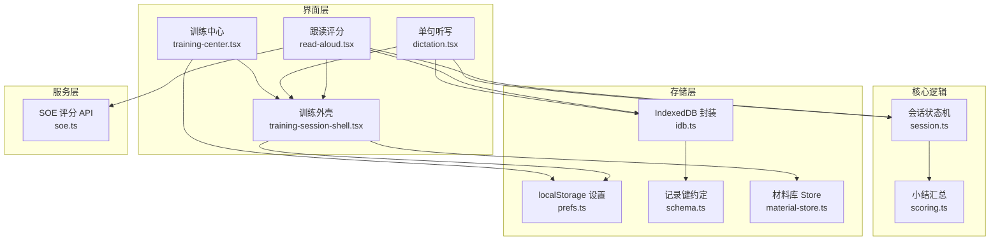
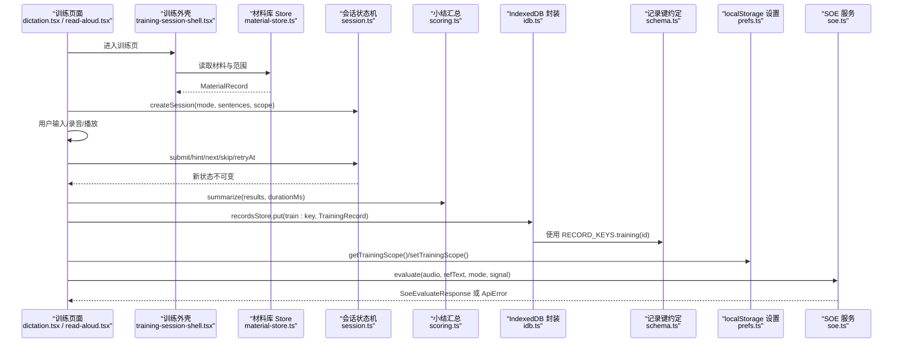
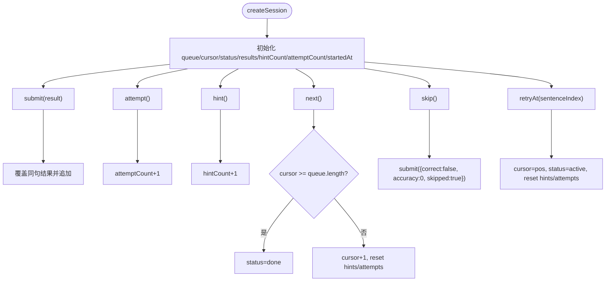
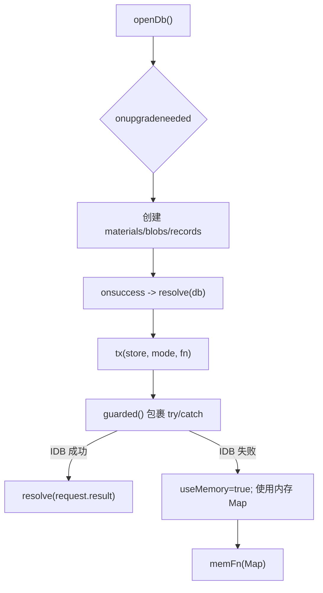
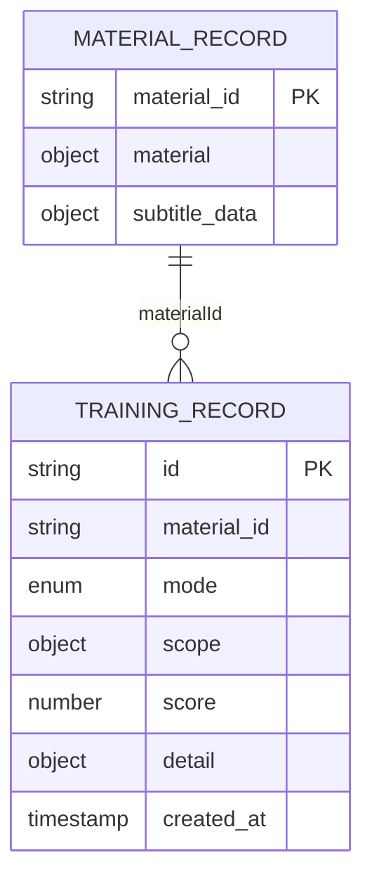
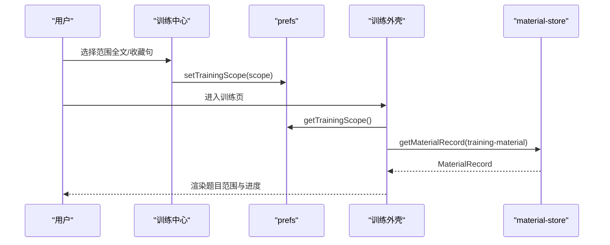
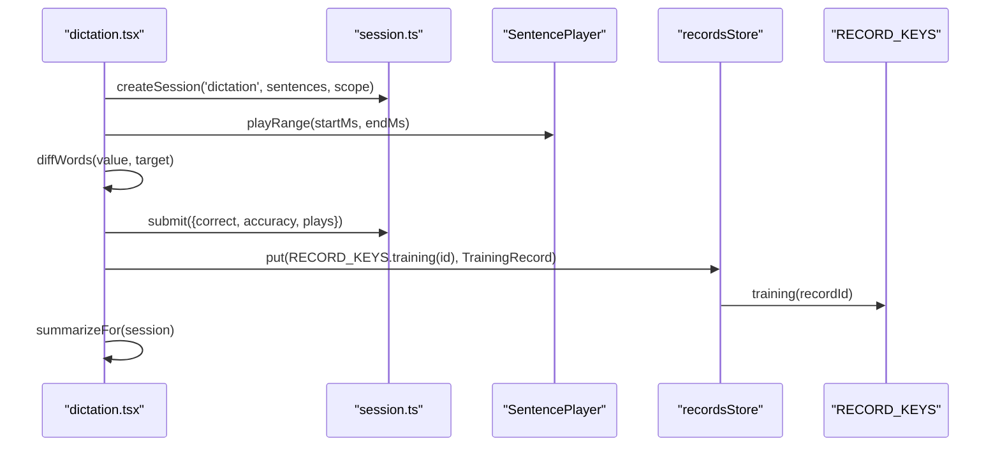
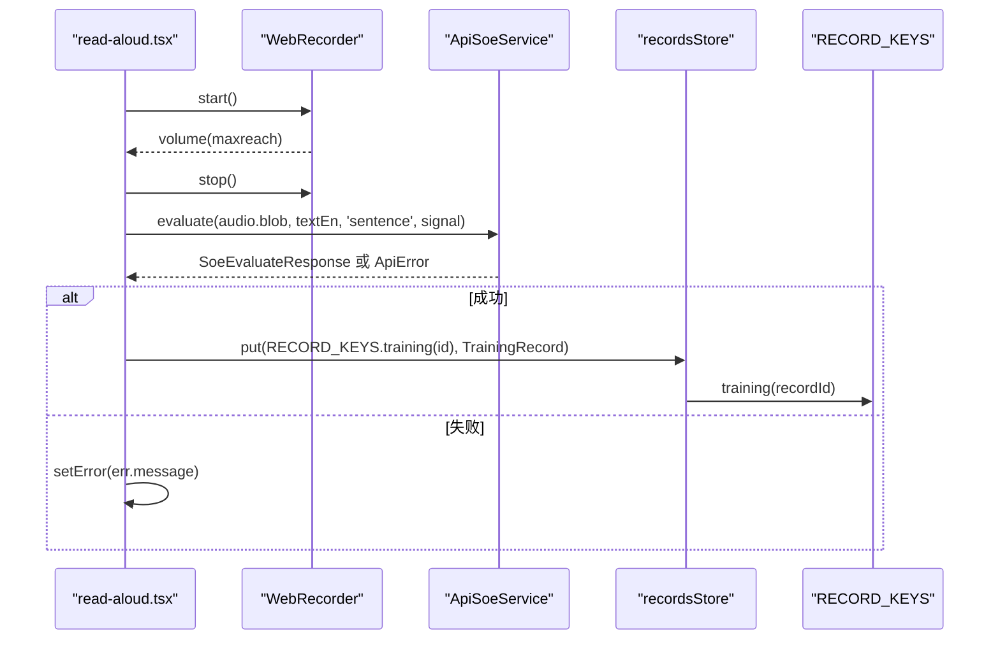
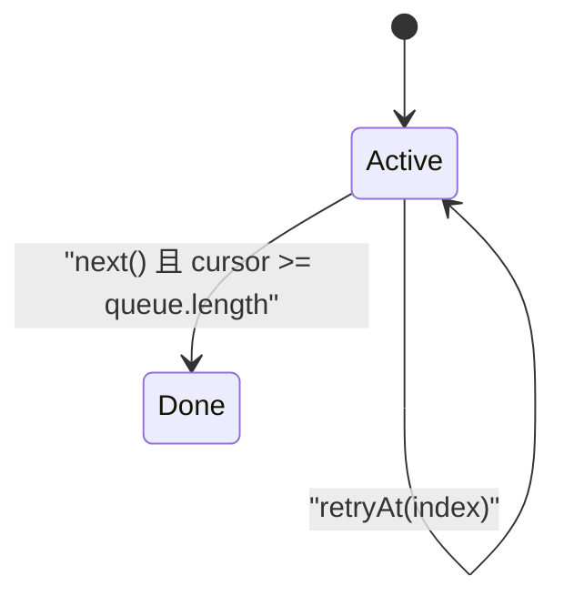
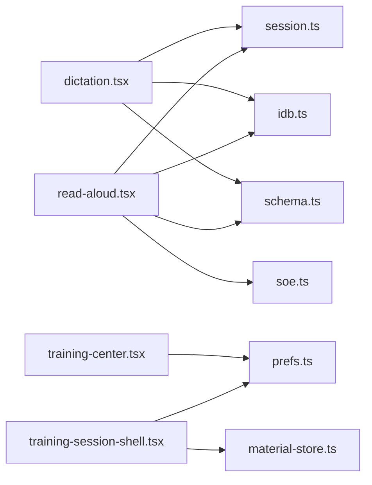

# 数据流设计

<cite>
**本文引用的文件**   
- [session.ts](file://client/core/training/session.ts)
- [scoring.ts](file://client/core/training/scoring.ts)
- [idb.ts](file://client/platform/storage/idb.ts)
- [schema.ts](file://client/platform/storage/schema.ts)
- [prefs.ts](file://client/platform/storage/prefs.ts)
- [pref-keys.ts](file://client/lib/pref-keys.ts)
- [material-store.ts](file://client/stores/material-store.ts)
- [training-center.tsx](file://client/components/pages/training-center.tsx)
- [training-session-shell.tsx](file://client/components/shared/training-session-shell.tsx)
- [dictation.tsx](file://client/components/pages/dictation.tsx)
- [read-aloud.tsx](file://client/components/pages/training/read-aloud.tsx)
- [soe.ts](file://client/services/api/soe.ts)
- [training.ts](file://client/types/training.ts)
</cite>

## 目录
1. [引言](#引言)
2. [项目结构](#项目结构)
3. [核心组件](#核心组件)
4. [架构总览](#架构总览)
5. [详细组件分析](#详细组件分析)
6. [依赖关系分析](#依赖关系分析)
7. [性能与缓存策略](#性能与缓存策略)
8. [调试与排错指南](#调试与排错指南)
9. [结论](#结论)

## 引言
本文件面向“英语精听助手”的数据流设计，重点围绕以下目标展开：
- 训练会话状态机的纯函数实现与状态迁移模式。
- IndexedDB 本地存储从用户操作到持久化的完整数据流向。
- AI 服务（SOE 发音评分）请求构建、响应处理与错误中止机制。
- 数据流图与状态转换图，说明组件间数据传递与状态同步。
- 数据验证规则、缓存策略、性能优化技巧与调试方法。

该文档既适合开发者深入理解实现细节，也适合非技术读者把握整体流程。

## 项目结构
本项目采用前端 Next.js + React 应用，核心数据流集中在客户端：
- 训练逻辑与状态机位于 `core/training`。
- 本地持久化通过 `platform/storage` 封装 IndexedDB 与 localStorage。
- 业务页面在 `components/pages`，共享外壳在 `components/shared`。
- 外部服务调用在 `services/api`，类型定义在 `types`。

**图表来源**
- [training-center.tsx:31-135](file://client/components/pages/training-center.tsx#L31-L135)
- [training-session-shell.tsx:21-67](file://client/components/shared/training-session-shell.tsx#L21-L67)
- [dictation.tsx:28-147](file://client/components/pages/dictation.tsx#L28-L147)
- [read-aloud.tsx:57-280](file://client/components/pages/training/read-aloud.tsx#L57-L280)
- [session.ts:44-119](file://client/core/training/session.ts#L44-L119)
- [scoring.ts:40-58](file://client/core/training/scoring.ts#L40-L58)
- [idb.ts:12-117](file://client/platform/storage/idb.ts#L12-L117)
- [schema.ts:16-27](file://client/platform/storage/schema.ts#L16-L27)
- [prefs.ts:6-52](file://client/platform/storage/prefs.ts#L6-L52)
- [material-store.ts:75-121](file://client/stores/material-store.ts#L75-L121)
- [soe.ts:9-30](file://client/services/api/soe.ts#L9-L30)

**章节来源**
- [training-center.tsx:31-135](file://client/components/pages/training-center.tsx#L31-L135)
- [training-session-shell.tsx:21-67](file://client/components/shared/training-session-shell.tsx#L21-L67)
- [dictation.tsx:28-147](file://client/components/pages/dictation.tsx#L28-L147)
- [read-aloud.tsx:57-280](file://client/components/pages/training/read-aloud.tsx#L57-L280)
- [session.ts:44-119](file://client/core/training/session.ts#L44-L119)
- [scoring.ts:40-58](file://client/core/training/scoring.ts#L40-L58)
- [idb.ts:12-117](file://client/platform/storage/idb.ts#L12-L117)
- [schema.ts:16-27](file://client/platform/storage/schema.ts#L16-L27)
- [prefs.ts:6-52](file://client/platform/storage/prefs.ts#L6-L52)
- [material-store.ts:75-121](file://client/stores/material-store.ts#L75-L121)
- [soe.ts:9-30](file://client/services/api/soe.ts#L9-L30)

## 核心组件
- 训练会话状态机：提供纯函数式状态管理，包括创建会话、提交结果、提示、跳过、下一句、重试等事件迁移。
- 小结汇总：基于每句结果计算正确率、用时、最弱句 TOP3 等统计指标。
- IndexedDB 封装：Promise 化 KV 接口，支持 materials/blobs/records 三个对象存储，并提供内存降级兜底。
- 材料库 Store：负责材料记录加载、媒体 Blob 读写、集合管理与级联清理。
- 训练中心与训练外壳：选择训练模式、范围（全文/收藏句），展示进度与完成小结。
- 具体训练页：听写与跟读评分分别实现各自交互与数据写入。
- SOE 服务：构造表单请求，统一错误契约，支持中止信号。

**章节来源**
- [session.ts:44-119](file://client/core/training/session.ts#L44-L119)
- [scoring.ts:40-58](file://client/core/training/scoring.ts#L40-L58)
- [idb.ts:12-117](file://client/platform/storage/idb.ts#L12-L117)
- [material-store.ts:75-121](file://client/stores/material-store.ts#L75-L121)
- [training-center.tsx:31-135](file://client/components/pages/training-center.tsx#L31-L135)
- [training-session-shell.tsx:21-67](file://client/components/shared/training-session-shell.tsx#L21-L67)
- [dictation.tsx:28-147](file://client/components/pages/dictation.tsx#L28-L147)
- [read-aloud.tsx:57-280](file://client/components/pages/training/read-aloud.tsx#L57-L280)
- [soe.ts:9-30](file://client/services/api/soe.ts#L9-L30)

## 架构总览
下图展示了从用户操作到持久化与服务调用的端到端数据流。

**图表来源**
- [dictation.tsx:28-147](file://client/components/pages/dictation.tsx#L28-L147)
- [read-aloud.tsx:57-280](file://client/components/pages/training/read-aloud.tsx#L57-L280)
- [training-session-shell.tsx:21-67](file://client/components/shared/training-session-shell.tsx#L21-L67)
- [material-store.ts:75-121](file://client/stores/material-store.ts#L75-L121)
- [session.ts:44-119](file://client/core/training/session.ts#L44-L119)
- [scoring.ts:40-58](file://client/core/training/scoring.ts#L40-L58)
- [idb.ts:12-117](file://client/platform/storage/idb.ts#L12-L117)
- [schema.ts:16-27](file://client/platform/storage/schema.ts#L16-L27)
- [prefs.ts:6-52](file://client/platform/storage/prefs.ts#L6-L52)
- [soe.ts:9-30](file://client/services/api/soe.ts#L9-L30)

## 详细组件分析

### 训练会话状态机（纯函数状态管理）
- 设计要点：
  - 所有状态迁移函数返回新状态对象，不修改原状态，便于测试与时间旅行调试。
  - 当前句由游标 cursor 控制；status 为 active/done；results 按提交顺序收集。
  - hintCount/attemptCount 用于统计提示与提交次数，并在提交时并入 SentenceResult。
  - next 推进游标并重置 hintCount/attemptCount；超出队尾则置 done。
  - skip 记一条 0 分结果并推进；retryAt 跳回指定句位置并激活会话。
  - makeRecordId 生成零依赖的训练记录 id。

**图表来源**
- [session.ts:44-119](file://client/core/training/session.ts#L44-L119)

**章节来源**
- [session.ts:44-119](file://client/core/training/session.ts#L44-L119)

### IndexedDB 本地存储数据流
- 设计要点：
  - 三个对象存储：materials（材料元数据）、blobs（媒体 Blob）、records（训练记录/收藏/进度）。
  - 统一 KV 接口：get/put/delete/allKeys/clear，内部以事务包装。
  - 失败保护：open 失败、blocked、transaction 异常均触发内存降级 Map，保证调用方不崩溃。
  - estimateUsage/isMemoryFallback 暴露磁盘用量与降级状态。

**图表来源**
- [idb.ts:27-78](file://client/platform/storage/idb.ts#L27-L78)

**章节来源**
- [idb.ts:12-117](file://client/platform/storage/idb.ts#L12-L117)

### 训练记录与键约定
- 设计要点：
  - MaterialRecord 包含 material 与解析后的 subtitleData，避免重复解析。
  - RECORD_KEYS 提供 progress/favorite/note/training/vocabBook/vocabEntry/mnemonic/collection 的 key 前缀生成器。
  - TrainingRecord 联合 detail 类型对齐各模式字段口径。

**图表来源**
- [schema.ts:9-27](file://client/platform/storage/schema.ts#L9-L27)
- [training.ts:57-68](file://client/types/training.ts#L57-L68)

**章节来源**
- [schema.ts:9-27](file://client/platform/storage/schema.ts#L9-L27)
- [training.ts:57-68](file://client/types/training.ts#L57-L68)

### 训练中心与训练外壳
- 训练中心：
  - 根据 materialId 读取材料记录与收藏句数量。
  - 维护训练范围（全文/收藏句），并持久化到 prefs。
  - 显示各模式的“上次成绩”，从 records store 中按 createdAt 取最新。
- 训练外壳：
  - 提供页头标题、n/total 徽标与真实进度条。
  - useTrainingMaterial 从 prefs 读取最近训练材料与范围，若收藏句为空则回落全文。

**图表来源**
- [training-center.tsx:31-135](file://client/components/pages/training-center.tsx#L31-L135)
- [training-session-shell.tsx:38-67](file://client/components/shared/training-session-shell.tsx#L38-L67)
- [pref-keys.ts:28-34](file://client/lib/pref-keys.ts#L28-L34)
- [prefs.ts:6-52](file://client/platform/storage/prefs.ts#L6-L52)
- [material-store.ts:75-79](file://client/stores/material-store.ts#L75-L79)

**章节来源**
- [training-center.tsx:31-135](file://client/components/pages/training-center.tsx#L31-L135)
- [training-session-shell.tsx:38-67](file://client/components/shared/training-session-shell.tsx#L38-L67)
- [pref-keys.ts:28-34](file://client/lib/pref-keys.ts#L28-L34)
- [prefs.ts:6-52](file://client/platform/storage/prefs.ts#L6-L52)
- [material-store.ts:75-79](file://client/stores/material-store.ts#L75-L79)

### 单句听写数据流
- 关键流程：
  - 使用 useTrainingMaterial 获取材料与范围，createSession('dictation', sentences, scope)。
  - 播放引擎 SentencePlayer 播放句段，plays 计数。
  - 核对答案：diffWords/sentenceAccuracy 计算准确率，submit 更新状态。
  - 首次核对该句时，写入 train: 记录（DictationDetail），key 使用 RECORD_KEYS.training(id)。
  - 完成时展示小结，支持最弱句重练。

**图表来源**
- [dictation.tsx:41-117](file://client/components/pages/dictation.tsx#L41-L117)
- [session.ts:44-119](file://client/core/training/session.ts#L44-L119)
- [schema.ts:16-27](file://client/platform/storage/schema.ts#L16-L27)

**章节来源**
- [dictation.tsx:41-117](file://client/components/pages/dictation.tsx#L41-L117)
- [session.ts:44-119](file://client/core/training/session.ts#L44-L119)
- [schema.ts:16-27](file://client/platform/storage/schema.ts#L16-L27)

### 跟读评分数据流与 AI 服务调用
- 关键流程：
  - 使用 useTrainingMaterial 获取材料与范围，按 scope 过滤句子。
  - 录音阶段：WebRecorder 启动录音，volume 事件驱动波形条，maxreach 自动停止。
  - 评分阶段：stopRecording 调用 getSoeService().evaluate(audio.blob, sentence.textEn, 'sentence', abort.signal)。
  - 响应处理：成功则显示 ScorePanel，失败则捕获 ApiError（含 ABORTED 静默分支）。
  - 首评写入 train: 记录（ReadAloudDetail），key 使用 RECORD_KEYS.training(id)。

**图表来源**
- [read-aloud.tsx:116-197](file://client/components/pages/training/read-aloud.tsx#L116-L197)
- [soe.ts:9-30](file://client/services/api/soe.ts#L9-L30)
- [schema.ts:16-27](file://client/platform/storage/schema.ts#L16-L27)

**章节来源**
- [read-aloud.tsx:116-197](file://client/components/pages/training/read-aloud.tsx#L116-L197)
- [soe.ts:9-30](file://client/services/api/soe.ts#L9-L30)
- [schema.ts:16-27](file://client/platform/storage/schema.ts#L16-L27)

### 小结汇总与状态转换
- 小结汇总：
  - summarize(results, durationMs) 计算 total/correctCount/accuracy/durationMs/weakest/totalPlays。
  - formatElapsed(durationMs) 格式化 mm:ss。
- 状态转换：
  - SessionStatus: active → done（当 cursor 超出队列长度）。
  - 各事件迁移：submit/attempt/hint/next/skip/retryAt 返回新状态。

**图表来源**
- [scoring.ts:40-58](file://client/core/training/scoring.ts#L40-L58)
- [session.ts:92-113](file://client/core/training/session.ts#L92-L113)

**章节来源**
- [scoring.ts:40-58](file://client/core/training/scoring.ts#L40-L58)
- [session.ts:92-113](file://client/core/training/session.ts#L92-L113)

## 依赖关系分析
- 组件耦合：
  - 训练页面依赖会话状态机与材料库 Store。
  - 训练外壳依赖 prefs 与材料库 Store。
  - 听写与跟读页面依赖 IndexedDB 与 schema 键约定。
  - 跟读页面依赖 SOE 服务与录音器。
- 外部依赖：
  - IndexedDB 作为主存储，localStorage 作为小数据设置项。
  - 同源 BFF 路由 `/api/soe/evaluate` 转发至上游评分服务。

**图表来源**
- [dictation.tsx:28-147](file://client/components/pages/dictation.tsx#L28-L147)
- [read-aloud.tsx:57-280](file://client/components/pages/training/read-aloud.tsx#L57-L280)
- [training-center.tsx:31-135](file://client/components/pages/training-center.tsx#L31-L135)
- [training-session-shell.tsx:21-67](file://client/components/shared/training-session-shell.tsx#L21-L67)
- [session.ts:44-119](file://client/core/training/session.ts#L44-L119)
- [idb.ts:12-117](file://client/platform/storage/idb.ts#L12-L117)
- [schema.ts:16-27](file://client/platform/storage/schema.ts#L16-L27)
- [prefs.ts:6-52](file://client/platform/storage/prefs.ts#L6-L52)
- [material-store.ts:75-121](file://client/stores/material-store.ts#L75-L121)
- [soe.ts:9-30](file://client/services/api/soe.ts#L9-L30)

**章节来源**
- [dictation.tsx:28-147](file://client/components/pages/dictation.tsx#L28-L147)
- [read-aloud.tsx:57-280](file://client/components/pages/training/read-aloud.tsx#L57-L280)
- [training-center.tsx:31-135](file://client/components/pages/training-center.tsx#L31-L135)
- [training-session-shell.tsx:21-67](file://client/components/shared/training-session-shell.tsx#L21-L67)
- [session.ts:44-119](file://client/core/training/session.ts#L44-L119)
- [idb.ts:12-117](file://client/platform/storage/idb.ts#L12-L117)
- [schema.ts:16-27](file://client/platform/storage/schema.ts#L16-L27)
- [prefs.ts:6-52](file://client/platform/storage/prefs.ts#L6-L52)
- [material-store.ts:75-121](file://client/stores/material-store.ts#L75-L121)
- [soe.ts:9-30](file://client/services/api/soe.ts#L9-L30)

## 性能与缓存策略
- 材料字幕预解析：
  - MaterialRecord 内联 subtitleData，避免每次启动重复解析，减少 CPU 开销。
- IndexedDB 降级：
  - open/transaction 失败时切换内存 Map，保证 UI 不崩溃；isMemoryFallback 可用于提示。
- 批量与并发：
  - 材料库 refresh 使用 Promise.all 并行加载 materials 与 collections，提升加载速度。
- 媒体资源：
  - 使用 URL.createObjectURL 临时绑定 Blob，卸载时 revokeObjectURL 释放内存。
- 训练记录写入：
  - 每句仅首次核对/评分时写入一次 train: 记录，避免重复 I/O。
- 设置项：
  - localStorage 读写带 try/catch，JSON 序列化失败或隐私模式被拒时静默降级。

[本节为通用指导，无需特定文件引用]

## 调试与排错指南
- 常见错误与处理：
  - IndexedDB 打开失败或被阻塞：控制台输出错误日志，自动切换到内存模式；可通过 isMemoryFallback 检测。
  - SOE 服务不可达：抛出 ApiError，code 为 SOE_UPSTREAM_ERROR；中止场景 code 为 ABORTED，UI 应静默处理。
  - 权限拒绝（录音）：捕获 RecorderPermissionError，展示权限引导弹窗。
- 调试建议：
  - 在 session.ts 的状态迁移处添加日志，观察状态变化与边界条件。
  - 在 idb.ts 的 guarded/tx 中添加错误日志，确认是否命中内存降级。
  - 在 soe.ts 的 evaluate 中打印请求体与响应码，定位上游问题。
  - 使用浏览器开发者工具查看 IndexedDB 内容，确认 records store 中的 train: 记录是否正确写入。

**章节来源**
- [idb.ts:27-78](file://client/platform/storage/idb.ts#L27-L78)
- [soe.ts:9-30](file://client/services/api/soe.ts#L9-L30)
- [read-aloud.tsx:144-197](file://client/components/pages/training/read-aloud.tsx#L144-L197)

## 结论
本数据流设计通过纯函数状态机确保训练会话的可预测性与可测试性；IndexedDB 封装提供健壮的本地持久化能力，并在异常情况下优雅降级；AI 服务调用统一错误契约并支持中止信号，保障用户体验。结合材料预解析、并发加载与最小化 I/O 的策略，系统在性能与稳定性之间取得平衡。未来可进一步扩展缓存策略（如 LRU 缓存常用材料）、引入重试与退避算法以提升服务调用的鲁棒性。