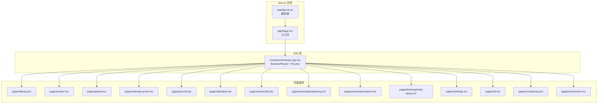
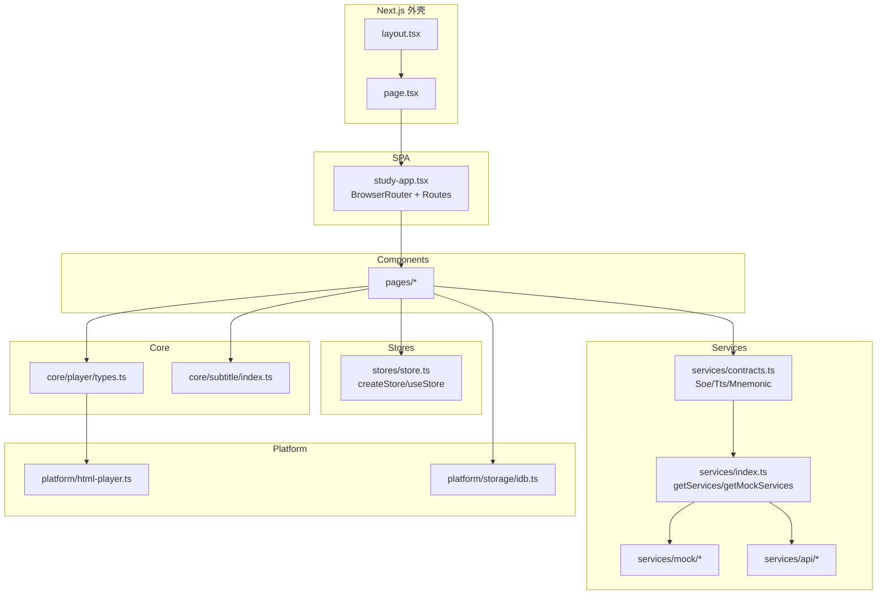
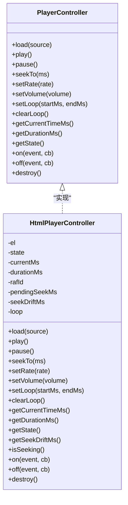
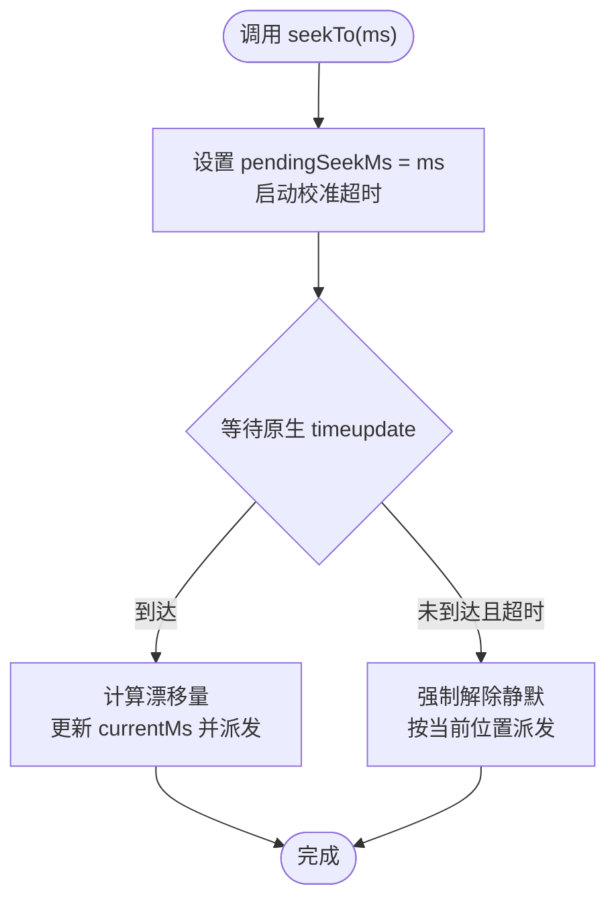
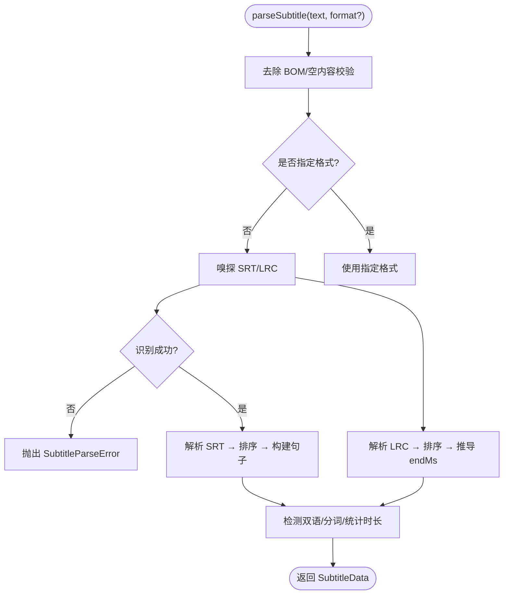
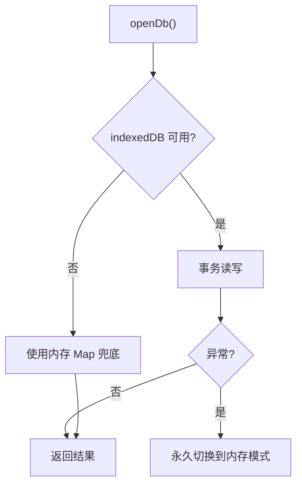
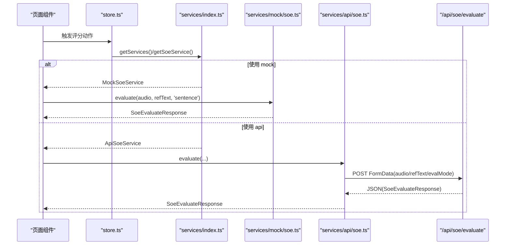
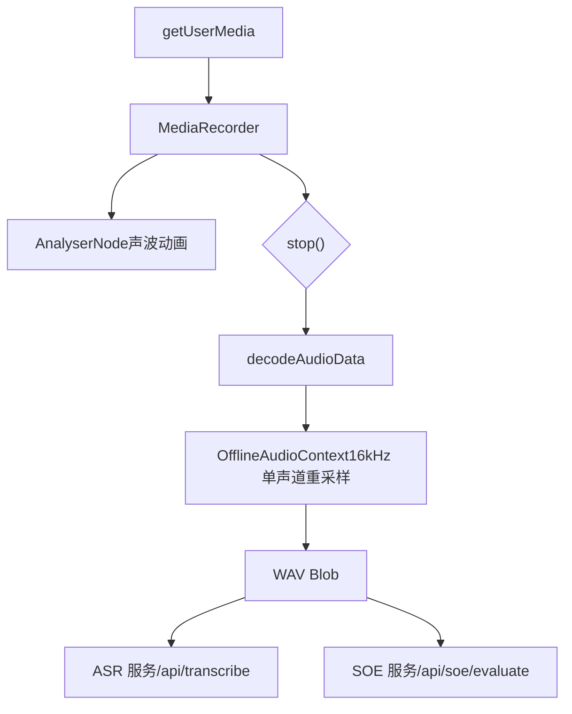
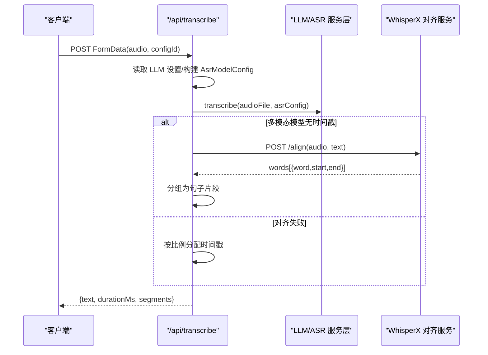
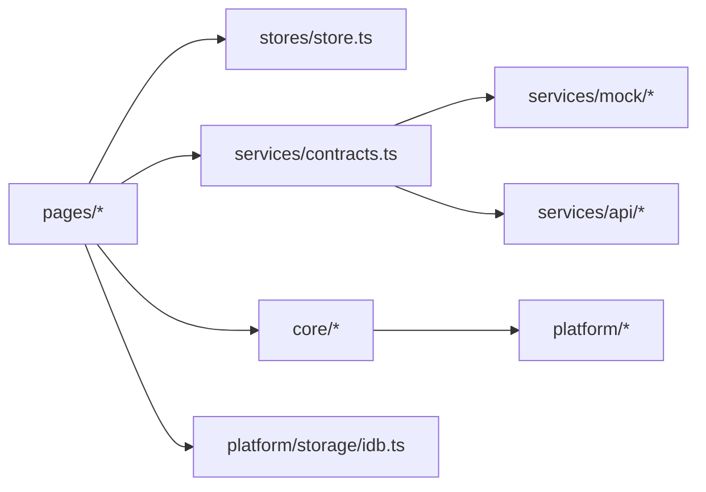

# 架构设计

<cite>
**本文引用的文件**   
- [client/README.md](file://client/README.md)
- [client/app/layout.tsx](file://client/app/layout.tsx)
- [client/app/page.tsx](file://client/app/page.tsx)
- [client/components/study-app.tsx](file://client/components/study-app.tsx)
- [client/services/contracts.ts](file://client/services/contracts.ts)
- [client/services/index.ts](file://client/services/index.ts)
- [client/services/mock/soe.ts](file://client/services/mock/soe.ts)
- [client/services/api/soe.ts](file://client/services/api/soe.ts)
- [client/stores/store.ts](file://client/stores/store.ts)
- [client/platform/html-player.ts](file://client/platform/html-player.ts)
- [client/core/player/types.ts](file://client/core/player/types.ts)
- [client/core/subtitle/index.ts](file://client/core/subtitle/index.ts)
- [client/platform/storage/idb.ts](file://client/platform/storage/idb.ts)
- [client/app/api/transcribe/route.ts](file://client/app/api/transcribe/route.ts)
</cite>

## 目录
1. [引言](#引言)
2. [项目结构](#项目结构)
3. [核心组件](#核心组件)
4. [架构总览](#架构总览)
5. [详细组件分析](#详细组件分析)
6. [依赖关系分析](#依赖关系分析)
7. [性能与体验优化](#性能与体验优化)
8. [故障排查指南](#故障排查指南)
9. [结论](#结论)
10. [附录：路由与服务契约清单](#附录路由与服务契约清单)

## 引言
本架构文档面向“英语精听助手”的前端工程，围绕六层架构模式展开：Core（平台无关纯 TS）、Platform（浏览器实现）、Services（AI 服务契约）、Stores（状态管理）、Components（页面组件）、Types（类型定义）。同时说明 SPA inside Next.js 的实现方式、App Router 作为外壳、React Router DOM 负责客户端路由、以及 14 条客户端路由的设计。重点解释本地优先存储、服务契约模式、录音链路处理、字幕解析器实现、播放器 seek 校准机制等关键设计决策，并给出系统架构图和数据流图，说明各层之间的依赖关系和交互模式。

## 项目结构
本项目采用 Next.js App Router 作为应用外壳，在根布局中注入元数据与主题色，入口页挂载 React SPA；SPA 内部使用 React Router DOM 管理 14 条客户端路由，覆盖材料库、导入、精听播放器、训练中心、九宫格、听写、录音转写、影子跟读、全文背诵、朗读评分、分析报告、设置、TTS、词汇与记忆卡片等场景。

图表来源
- [client/app/layout.tsx:1-50](file://client/app/layout.tsx#L1-L50)
- [client/app/page.tsx:1-6](file://client/app/page.tsx#L1-L6)
- [client/components/study-app.tsx:24-64](file://client/components/study-app.tsx#L24-L64)

章节来源
- [client/README.md:21-96](file://client/README.md#L21-L96)
- [client/app/layout.tsx:1-50](file://client/app/layout.tsx#L1-L50)
- [client/app/page.tsx:1-6](file://client/app/page.tsx#L1-L6)
- [client/components/study-app.tsx:24-64](file://client/components/study-app.tsx#L24-L64)

## 核心组件
- Core 层（纯 TS）
  - 播放器抽象：PlayerController 接口定义媒体加载、播放、暂停、seek、倍速、音量、A-B 循环、事件与销毁等能力。
  - 字幕解析：自动嗅探 SRT/LRC，双语识别，句级时间轴对齐，导出 SRT。
  - 音频工具：WAV 编码器等。
- Platform 层（浏览器实现）
  - HtmlPlayerController：基于 HTMLAudioElement/HTMLVideoElement 的播放器实现，含 seek 落点校准、rAF 高频采样、A-B 循环。
  - IndexedDB 存储封装：materials/blobs/records 三表，内存降级兜底。
  - Kokoro TTS 适配：模型预加载与协议封装。
- Services 层（AI 服务契约）
  - contracts.ts 定义 SoeService/TtsService/MnemonicService 及统一 ApiError/SSE 事件约定。
  - services/index.ts 提供工厂 getServices/getMockServices，预留 mock/api 切换。
  - mock 与 api 两套实现：SOE 评测当前以 mock 为主，api 走 BFF /api/soe/evaluate。
- Stores 层（状态管理）
  - createStore/useStore：基于 useSyncExternalStore 的轻量 store，零外部依赖。
- Components 层（页面组件）
  - 14 条客户端路由对应页面组件，通过 study-app.tsx 集中注册。
- Types 层（类型定义）
  - types/api.ts、types/material.ts、types/subtitle.ts 等，为服务契约与业务模型提供强类型约束。

章节来源
- [client/core/player/types.ts:1-56](file://client/core/player/types.ts#L1-L56)
- [client/core/subtitle/index.ts:1-80](file://client/core/subtitle/index.ts#L1-L80)
- [client/platform/html-player.ts:1-272](file://client/platform/html-player.ts#L1-L272)
- [client/platform/storage/idb.ts:1-117](file://client/platform/storage/idb.ts#L1-L117)
- [client/services/contracts.ts:1-144](file://client/services/contracts.ts#L1-L144)
- [client/services/index.ts:1-68](file://client/services/index.ts#L1-L68)
- [client/stores/store.ts:1-34](file://client/stores/store.ts#L1-L34)

## 架构总览
下图展示六层架构与 Next.js 外壳的关系，以及主要数据流向：页面组件通过 stores 订阅状态，调用 services 契约，services 选择 mock 或 api 实现；core 提供平台无关逻辑，platform 提供浏览器实现；IndexedDB 承担本地持久化。

图表来源
- [client/app/layout.tsx:1-50](file://client/app/layout.tsx#L1-L50)
- [client/app/page.tsx:1-6](file://client/app/page.tsx#L1-L6)
- [client/components/study-app.tsx:24-64](file://client/components/study-app.tsx#L24-L64)
- [client/services/contracts.ts:1-144](file://client/services/contracts.ts#L1-L144)
- [client/services/index.ts:1-68](file://client/services/index.ts#L1-L68)
- [client/core/player/types.ts:1-56](file://client/core/player/types.ts#L1-L56)
- [client/core/subtitle/index.ts:1-80](file://client/core/subtitle/index.ts#L1-L80)
- [client/platform/html-player.ts:1-272](file://client/platform/html-player.ts#L1-L272)
- [client/platform/storage/idb.ts:1-117](file://client/platform/storage/idb.ts#L1-L117)

## 详细组件分析

### 播放器抽象与 H5 实现
- PlayerController 接口定义了跨平台的播放器能力，包括 load/play/pause/seekTo/setRate/setVolume/setLoop/clearLoop/getCurrentTimeMs/getDurationMs/getState/on/off/destroy。
- HtmlPlayerController 实现上述接口，关键点：
  - 进度采样：原生 timeupdate 兜底（约 4Hz），播放中使用 requestAnimationFrame 高频采样（约 60Hz）保证进度条平滑。
  - Seek 落点校准：seekTo 后记录目标值并静默旧进度，直到首个原生 timeupdate 到达实际落点；偏差超过阈值记录 drift，供上层修正循环容差。
  - A-B 循环：controller 级区间循环，无次数限制；更复杂的次数控制由 SentencePlayer 承担。
  - destroy：停 rAF、解绑监听、卸载 src、清空事件表与引用。

图表来源
- [client/core/player/types.ts:1-56](file://client/core/player/types.ts#L1-L56)
- [client/platform/html-player.ts:1-272](file://client/platform/html-player.ts#L1-L272)

章节来源
- [client/core/player/types.ts:1-56](file://client/core/player/types.ts#L1-L56)
- [client/platform/html-player.ts:1-272](file://client/platform/html-player.ts#L1-L272)

#### Seek 校准流程

图表来源
- [client/platform/html-player.ts:103-137](file://client/platform/html-player.ts#L103-L137)
- [client/platform/html-player.ts:178-221](file://client/platform/html-player.ts#L178-L221)

### 字幕解析器
- 自动嗅探 SRT/LRC，失败抛出带行号的 SubtitleParseError。
- 支持双语字幕自动识别，句级时间轴对齐；LRC 末句 endMs 回填策略：优先已知媒体时长，否则退化为末句 startMs。
- 提供 exportSrt 将句子导出为标准 SRT。

图表来源
- [client/core/subtitle/index.ts:22-69](file://client/core/subtitle/index.ts#L22-L69)

章节来源
- [client/core/subtitle/index.ts:1-80](file://client/core/subtitle/index.ts#L1-L80)

### 本地优先存储（IndexedDB）
- 三个 object store：materials（材料元数据）、blobs（媒体 Blob）、records（训练记录/收藏/进度）。
- SSR/隐私模式打开失败时优雅降级为内存 Map，绝不抛崩溃；所有操作通过 guarded 统一兜底。
- 暴露 KvStore 最小 KV API，并提供 estimateUsage 与 isMemoryFallback 辅助方法。

图表来源
- [client/platform/storage/idb.ts:26-78](file://client/platform/storage/idb.ts#L26-L78)
- [client/platform/storage/idb.ts:89-117](file://client/platform/storage/idb.ts#L89-L117)

章节来源
- [client/platform/storage/idb.ts:1-117](file://client/platform/storage/idb.ts#L1-L117)

### 服务契约与工厂
- contracts.ts 定义 SoeService/TtsService/MnemonicService 接口，统一错误类型 ApiError，并提供 toApiError/throwIfAborted/abortableDelay 等工具。
- services/index.ts 提供 getMockServices/getServices，当前默认返回 mock；预留 ServiceMode 环境变量切换真实后端。
- SOE 评测：mock 实现确定性伪评分（FNV-1a 种子派生分数），可配置延迟与失败率；api 实现通过 FormData POST 到 /api/soe/evaluate。

图表来源
- [client/services/contracts.ts:33-87](file://client/services/contracts.ts#L33-L87)
- [client/services/index.ts:29-57](file://client/services/index.ts#L29-L57)
- [client/services/mock/soe.ts:88-137](file://client/services/mock/soe.ts#L88-L137)
- [client/services/api/soe.ts:9-29](file://client/services/api/soe.ts#L9-L29)

章节来源
- [client/services/contracts.ts:1-144](file://client/services/contracts.ts#L1-L144)
- [client/services/index.ts:1-68](file://client/services/index.ts#L1-L68)
- [client/services/mock/soe.ts:1-138](file://client/services/mock/soe.ts#L1-L138)
- [client/services/api/soe.ts:1-30](file://client/services/api/soe.ts#L1-L30)

### 录音链路处理
根据 README 中的录音链路说明，前端从麦克风采集到 ASR/SOE 服务的完整路径如下：

图表来源
- [client/README.md:144-152](file://client/README.md#L144-L152)

章节来源
- [client/README.md:144-152](file://client/README.md#L144-L152)

### 前后端通信与转录后处理
- 转录路由 /api/transcribe：接收 audio File，读取 LLM 设置，调用统一 transcribe 服务；若多模态模型未返回时间戳，则尝试 WhisperX 对齐，失败再回退为按比例分配时间戳。
- 错误处理：LlmError 映射为统一错误响应；其他异常返回通用错误信息。

图表来源
- [client/app/api/transcribe/route.ts:180-289](file://client/app/api/transcribe/route.ts#L180-L289)

章节来源
- [client/app/api/transcribe/route.ts:1-289](file://client/app/api/transcribe/route.ts#L1-L289)

## 依赖关系分析
- 组件依赖顺序：Next.js 外壳 → SPA 壳 → 页面组件 → stores/services/core/platform。
- 耦合与内聚：
  - Core 层不依赖框架与浏览器全局，仅通过 platform 层实现具体能力，提升内聚与可测试性。
  - Services 层通过 contracts.ts 解耦上层对具体实现的依赖，便于 mock/api 切换。
  - Stores 层使用 useSyncExternalStore，避免引入外部状态库，降低耦合。
- 外部依赖：
  - 浏览器 API：MediaRecorder、AudioContext、IndexedDB、requestAnimationFrame。
  - Next.js 路由与 BFF：/api/transcribe、/api/soe/evaluate、/api/settings/*。

图表来源
- [client/components/study-app.tsx:24-64](file://client/components/study-app.tsx#L24-L64)
- [client/stores/store.ts:1-34](file://client/stores/store.ts#L1-L34)
- [client/services/contracts.ts:1-144](file://client/services/contracts.ts#L1-L144)
- [client/services/index.ts:1-68](file://client/services/index.ts#L1-L68)
- [client/core/player/types.ts:1-56](file://client/core/player/types.ts#L1-L56)
- [client/platform/storage/idb.ts:1-117](file://client/platform/storage/idb.ts#L1-L117)

章节来源
- [client/components/study-app.tsx:24-64](file://client/components/study-app.tsx#L24-L64)
- [client/stores/store.ts:1-34](file://client/stores/store.ts#L1-L34)
- [client/services/contracts.ts:1-144](file://client/services/contracts.ts#L1-L144)
- [client/services/index.ts:1-68](file://client/services/index.ts#L1-L68)
- [client/core/player/types.ts:1-56](file://client/core/player/types.ts#L1-L56)
- [client/platform/storage/idb.ts:1-117](file://client/platform/storage/idb.ts#L1-L117)

## 性能与体验优化
- 播放器进度平滑：原生 timeupdate 兜底 + rAF 高频采样，避免进度条卡顿。
- Seek 校准：避免 seek 后进度闪烁，必要时记录 drift 用于上层容差修正。
- 本地优先：IndexedDB 持久化，SSR/隐私模式降级内存，保障可用性。
- 服务契约：mock 离线演示，api 按需接入，减少网络依赖。
- 转录后处理：WhisperX 对齐失败回退比例分配，确保用户体验稳定。

[本节为通用指导，无需列出具体文件来源]

## 故障排查指南
- 播放器错误
  - 现象：播放被拦截或媒体错误。
  - 排查：检查 play() promise reject 分支与 error 事件；确认元素已就绪、权限允许。
  - 参考：HtmlPlayerController 的 play/error 分支。
- 存储降级
  - 现象：数据丢失或不持久。
  - 排查：检查 isMemoryFallback 与 console 日志；确认 indexedDB 可用性与配额。
  - 参考：idb.ts 的 openDb/guarded 逻辑。
- 服务错误
  - 现象：SOE/TTS/Mnemonic 调用失败。
  - 排查：查看 ApiError code（如 ABORTED/SOE_UPSTREAM_ERROR/TEXT_TOO_LONG/SUBTITLE_NOT_FOUND）；检查 BFF 路由与上游服务。
  - 参考：contracts.ts 的错误工具与 soe.ts 的 fetch 分支。
- 转录失败
  - 现象：无时间戳或对齐失败。
  - 排查：检查 LLM 设置、WhisperX 地址、网络超时；查看路由错误日志。
  - 参考：transcribe route.ts 的对齐与回退逻辑。

章节来源
- [client/platform/html-player.ts:85-97](file://client/platform/html-player.ts#L85-L97)
- [client/platform/html-player.ts:171-175](file://client/platform/html-player.ts#L171-L175)
- [client/platform/storage/idb.ts:26-78](file://client/platform/storage/idb.ts#L26-L78)
- [client/services/contracts.ts:33-87](file://client/services/contracts.ts#L33-L87)
- [client/services/api/soe.ts:10-29](file://client/services/api/soe.ts#L10-L29)
- [client/app/api/transcribe/route.ts:277-289](file://client/app/api/transcribe/route.ts#L277-L289)

## 结论
本架构通过六层分层与本地优先策略，实现了高内聚、低耦合、可扩展的英语学习工具前端。Core 与 Platform 分离使播放器与字幕解析具备跨平台潜力；Services 契约与工厂模式为未来接入真实后端提供无缝切换；IndexedDB 与内存降级保障稳定性；SPA inside Next.js 的组合兼顾 SEO/元数据与客户端路由灵活性。整体设计在保证用户体验的同时，为后续扩展（更多 AI 服务、训练模式、报告分析）预留了清晰的扩展点。

[本节为总结性内容，无需列出具体文件来源]

## 附录：路由与服务契约清单

### 客户端路由（14 条）
- `/` → Library（材料库）
- `/collection/:collectionId` → CollectionDetail（合集详情）
- `/favorites` → Favorites（收藏）
- `/import` → ImportPage（导入材料）
- `/player/:materialId` → Player（精听播放器）
- `/training/:materialId` → TrainingCenter（训练中心）
- `/training/puzzle` → Puzzle（九宫格）
- `/training/dictation` → Dictation（听写）
- `/training/read-aloud` → ReadAloud（朗读评分）
- `/training/shadowing` → Shadowing（影子跟读）
- `/training/recitation` → Recitation（全文背诵）
- `/settings` → SettingsPage（设置）
- `/transcribe` → TranscribePage（录音转写）
- `/tts` → TTS（文字转语音）
- `/vocabulary` → Vocabulary（词汇）
- `/vocabulary/mnemonic/:entryId` → MnemonicPage（记忆卡片）
- `*` → Placeholder（占位页）

章节来源
- [client/components/study-app.tsx:42-61](file://client/components/study-app.tsx#L42-L61)

### 服务契约要点
- SoeService.evaluate：输入 wav/pcm 16kHz mono、参考原文、evalMode='sentence'，返回总分与词级分数。
- TtsService.generate/getSubtitle：生成音频二进制与字幕任务查询。
- MnemonicService：卡片生成、联想、练习、造句批改（支持流式 SSE）。
- 统一错误：ApiError(code/message/detail)，ABORTED/INTERNAL/BAD_REQUEST 等。

章节来源
- [client/services/contracts.ts:89-144](file://client/services/contracts.ts#L89-L144)