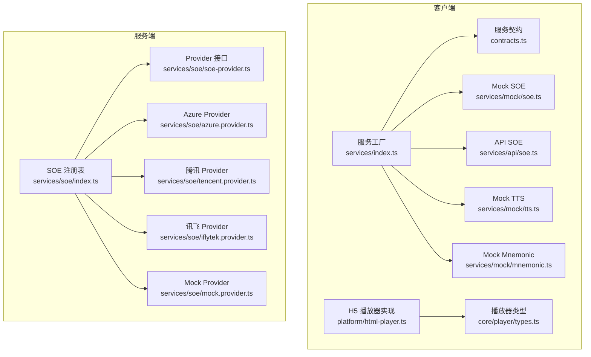
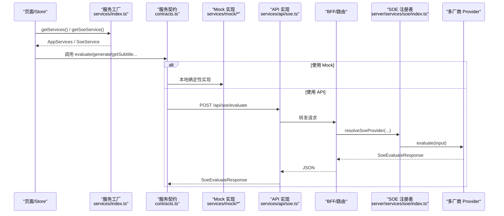
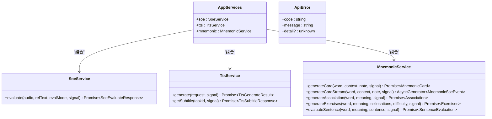
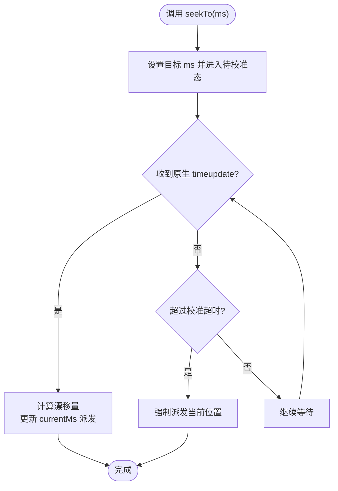
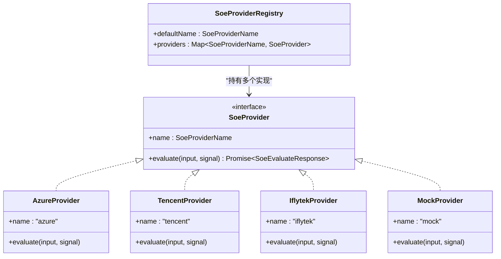
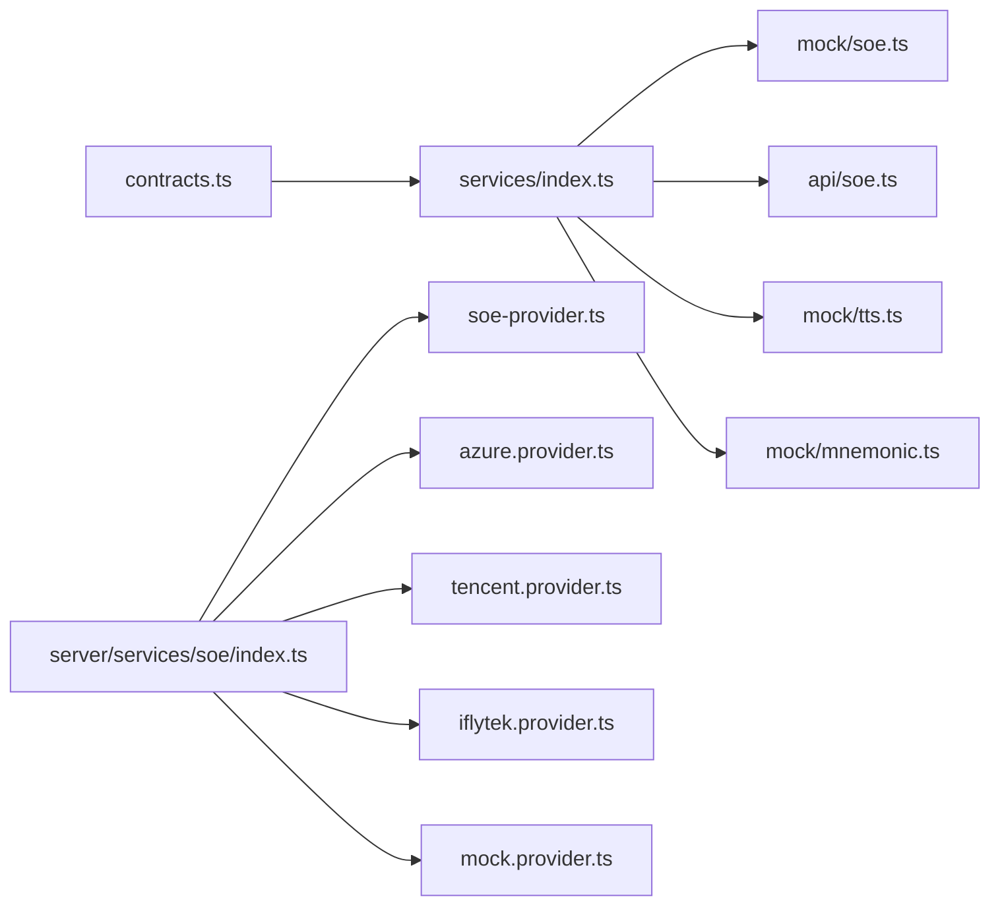

# 核心设计模式

<cite>
**本文引用的文件**   
- [client/services/contracts.ts](file://client/services/contracts.ts)
- [client/services/index.ts](file://client/services/index.ts)
- [client/services/api/soe.ts](file://client/services/api/soe.ts)
- [client/services/mock/soe.ts](file://client/services/mock/soe.ts)
- [client/services/mock/tts.ts](file://client/services/mock/tts.ts)
- [client/services/mock/mnemonic.ts](file://client/services/mock/mnemonic.ts)
- [client/core/player/types.ts](file://client/core/player/types.ts)
- [client/platform/html-player.ts](file://client/platform/html-player.ts)
- [server/src/services/soe/index.ts](file://server/src/services/soe/index.ts)
- [server/src/services/soe/soe-provider.ts](file://server/src/services/soe/soe-provider.ts)
- [server/src/services/soe/mock.provider.ts](file://server/src/services/soe/mock.provider.ts)
- [server/src/services/soe/azure.provider.ts](file://server/src/services/soe/azure.provider.ts)
- [server/src/services/soe/tencent.provider.ts](file://server/src/services/soe/tencent.provider.ts)
- [server/src/services/soe/iflytek.provider.ts](file://server/src/services/soe/iflytek.provider.ts)
</cite>

## 目录
1. [引言](#引言)
2. [项目结构](#项目结构)
3. [核心组件](#核心组件)
4. [架构总览](#架构总览)
5. [详细组件分析](#详细组件分析)
6. [依赖关系分析](#依赖关系分析)
7. [性能考量](#性能考量)
8. [故障排查指南](#故障排查指南)
9. [结论](#结论)
10. [附录：扩展与最佳实践](#附录扩展与最佳实践)

## 引言
本文件聚焦英语精听助手的核心设计模式，围绕三类关键抽象展开：
- 服务契约模式：SOE（发音评测）、TTS（语音合成）、Mnemonic（生词助记）的统一接口抽象。
- 平台抽象模式：播放器控制器 PlayerController 的跨平台实现，当前以 HTMLAudioElement/HTMLVideoElement 为 H5 实现。
- 插件化设计模式：服务端 SOE Provider 注册表与多厂商支持（Azure、腾讯云、讯飞），以及客户端 mock/api 双实现切换。

文档将结合代码级图示，解释各模式的动机、实现细节、优缺点、扩展方式与最佳实践。

## 项目结构
本项目采用“前端 client + 后端 server”的分层组织：
- client/services：定义服务契约与具体实现（mock/api）。
- client/platform：平台相关实现（如 H5 播放器）。
- client/core：纯 TS 类型与工具（播放器抽象类型等）。
- server/src/services/soe：SOE 服务提供者注册与多厂商实现。

**图表来源**
- [client/services/index.ts:1-68](file://client/services/index.ts#L1-L68)
- [client/services/contracts.ts:1-144](file://client/services/contracts.ts#L1-L144)
- [client/platform/html-player.ts:1-272](file://client/platform/html-player.ts#L1-L272)
- [client/core/player/types.ts:1-56](file://client/core/player/types.ts#L1-L56)
- [server/src/services/soe/index.ts:1-82](file://server/src/services/soe/index.ts#L1-L82)
- [server/src/services/soe/soe-provider.ts:1-47](file://server/src/services/soe/soe-provider.ts#L1-L47)
- [server/src/services/soe/azure.provider.ts:1-110](file://server/src/services/soe/azure.provider.ts#L1-L110)
- [server/src/services/soe/tencent.provider.ts:1-193](file://server/src/services/soe/tencent.provider.ts#L1-L193)
- [server/src/services/soe/iflytek.provider.ts:1-236](file://server/src/services/soe/iflytek.provider.ts#L1-L236)
- [server/src/services/soe/mock.provider.ts:1-83](file://server/src/services/soe/mock.provider.ts#L1-L83)

**章节来源**
- [client/services/index.ts:1-68](file://client/services/index.ts#L1-L68)
- [client/services/contracts.ts:1-144](file://client/services/contracts.ts#L1-L144)
- [client/platform/html-player.ts:1-272](file://client/platform/html-player.ts#L1-L272)
- [client/core/player/types.ts:1-56](file://client/core/player/types.ts#L1-L56)
- [server/src/services/soe/index.ts:1-82](file://server/src/services/soe/index.ts#L1-L82)

## 核心组件
本节从三个维度梳理核心组件及其职责：
- 服务契约：SoeService、TtsService、MnemonicService、AppServices。
- 平台抽象：PlayerController 与 HtmlPlayerController。
- 插件化注册：SoeProviderRegistry 与 SoeProvider 接口。

**章节来源**
- [client/services/contracts.ts:92-143](file://client/services/contracts.ts#L92-L143)
- [client/core/player/types.ts:32-55](file://client/core/player/types.ts#L32-L55)
- [server/src/services/soe/soe-provider.ts:40-46](file://server/src/services/soe/soe-provider.ts#L40-L46)

## 架构总览
下图展示“客户端服务契约 → 工厂注入 → 具体实现”，以及“服务端 Provider 注册 → 多厂商实现”的双向解耦。

**图表来源**
- [client/services/index.ts:29-57](file://client/services/index.ts#L29-L57)
- [client/services/contracts.ts:92-143](file://client/services/contracts.ts#L92-L143)
- [client/services/api/soe.ts:9-29](file://client/services/api/soe.ts#L9-L29)
- [server/src/services/soe/index.ts:21-28](file://server/src/services/soe/index.ts#L21-L28)
- [server/src/services/soe/soe-provider.ts:40-46](file://server/src/services/soe/soe-provider.ts#L40-L46)

## 详细组件分析

### 服务契约模式（SOE/TTS/Mnemonic）
- 统一接口：SoeService.evaluate、TtsService.generate/getSubtitle、MnemonicService.*。
- 错误模型：统一 ApiError，含 code/message/detail；AbortSignal 中止统一为 'ABORTED'。
- 工厂注入：getServices()/getMockServices() 返回 AppServices，便于上层通过依赖注入使用。

**图表来源**
- [client/services/contracts.ts:33-44](file://client/services/contracts.ts#L33-L44)
- [client/services/contracts.ts:92-143](file://client/services/contracts.ts#L92-L143)

实现要点与场景：
- Mock 实现用于离线演示与测试，具备确定性输出与可配置延迟/失败率。
- API 实现负责将请求转发到同源 BFF，统一错误归一化。
- Mnemonic 走 /api/mnemonic，支持流式 SSE 事件解析。

**章节来源**
- [client/services/contracts.ts:33-87](file://client/services/contracts.ts#L33-L87)
- [client/services/contracts.ts:92-143](file://client/services/contracts.ts#L92-L143)
- [client/services/mock/soe.ts:88-137](file://client/services/mock/soe.ts#L88-L137)
- [client/services/api/soe.ts:9-29](file://client/services/api/soe.ts#L9-L29)
- [client/services/mock/tts.ts:148-189](file://client/services/mock/tts.ts#L148-L189)
- [client/services/mock/mnemonic.ts:42-124](file://client/services/mock/mnemonic.ts#L42-L124)

### 平台抽象模式（HTMLAudioElement 控制器）
- 抽象：PlayerController 定义 load/play/pause/seekTo/setRate/setVolume/setLoop/clearLoop/on/off/destroy 等能力。
- 实现：HtmlPlayerController 基于原生媒体元素，提供：
  - 进度采样：timeupdate 兜底 + requestAnimationFrame 高频补偿。
  - seek 落点校准：pendingSeekMs + drift 阈值 + 超时兜底。
  - A-B 循环：controller 级区间循环。
  - 生命周期：destroy 清理 rAF、监听器、src、事件表。

**图表来源**
- [client/platform/html-player.ts:103-138](file://client/platform/html-player.ts#L103-L138)
- [client/platform/html-player.ts:178-216](file://client/platform/html-player.ts#L178-L216)

**章节来源**
- [client/core/player/types.ts:32-55](file://client/core/player/types.ts#L32-L55)
- [client/platform/html-player.ts:24-63](file://client/platform/html-player.ts#L24-L63)
- [client/platform/html-player.ts:103-138](file://client/platform/html-player.ts#L103-L138)
- [client/platform/html-player.ts:157-176](file://client/platform/html-player.ts#L157-L176)
- [client/platform/html-player.ts:178-216](file://client/platform/html-player.ts#L178-L216)
- [client/platform/html-player.ts:223-251](file://client/platform/html-player.ts#L223-L251)
- [client/platform/html-player.ts:268-271](file://client/platform/html-player.ts#L268-L271)

### 插件化设计模式（SOE Provider 注册与多厂商支持）
- 接口：SoeProvider 暴露 name 与 evaluate(input, signal)。
- 注册表：createSoeProviderRegistry 按环境变量与凭据可用性注册 mock/azure/tencent/iflytek。
- 动态解析：resolveSoeProvider 支持请求级 creds 覆盖 env，现场构造 provider。

**图表来源**
- [server/src/services/soe/soe-provider.ts:40-46](file://server/src/services/soe/soe-provider.ts#L40-L46)
- [server/src/services/soe/index.ts:21-28](file://server/src/services/soe/index.ts#L21-L28)
- [server/src/services/soe/azure.provider.ts:24-109](file://server/src/services/soe/azure.provider.ts#L24-L109)
- [server/src/services/soe/tencent.provider.ts:50-192](file://server/src/services/soe/tencent.provider.ts#L50-L192)
- [server/src/services/soe/iflytek.provider.ts:54-235](file://server/src/services/soe/iflytek.provider.ts#L54-L235)
- [server/src/services/soe/mock.provider.ts:80-82](file://server/src/services/soe/mock.provider.ts#L80-L82)

流程说明（请求级密钥覆盖）：
- 若 name=mock 或无 creds：直接取注册表实现。
- 否则合并 env 与请求 creds，校验齐全后现场构造对应 provider。

**章节来源**
- [server/src/services/soe/index.ts:21-79](file://server/src/services/soe/index.ts#L21-L79)
- [server/src/services/soe/soe-provider.ts:40-46](file://server/src/services/soe/soe-provider.ts#L40-L46)

## 依赖关系分析
- 耦合度：
  - 客户端 services/index.ts 仅依赖 contracts 与具体实现类，低耦合。
  - 服务端 registry 仅依赖 provider 接口与具体实现，新增厂商无需改动调用方。
- 外部依赖：
  - Azure REST、腾讯 WS、讯飞 WS 均封装在各自 provider 内，统一错误映射。
- 潜在环依赖：
  - 未见循环引用；契约与实现分离清晰。

**图表来源**
- [client/services/index.ts:1-68](file://client/services/index.ts#L1-L68)
- [client/services/contracts.ts:1-144](file://client/services/contracts.ts#L1-L144)
- [server/src/services/soe/index.ts:1-82](file://server/src/services/soe/index.ts#L1-L82)
- [server/src/services/soe/soe-provider.ts:1-47](file://server/src/services/soe/soe-provider.ts#L1-L47)

**章节来源**
- [client/services/index.ts:1-68](file://client/services/index.ts#L1-L68)
- [server/src/services/soe/index.ts:1-82](file://server/src/services/soe/index.ts#L1-L82)

## 性能考量
- 播放进度：
  - 原生 timeupdate 频率较低（约 4Hz），通过 requestAnimationFrame 高频采样提升 UI 流畅度。
  - seek 校准避免进度回跳闪烁，漂移阈值与超时兜底保证稳定性。
- 网络与重试：
  - Azure/腾讯/讯飞 provider 均实现超时与有限重试策略，区分可重试与不可重试错误。
- 资源释放：
  - HtmlPlayerController.destroy 清理 rAF、事件监听、src，防止内存泄漏。

[本节为通用指导，不直接分析具体文件]

## 故障排查指南
- 统一错误：
  - 客户端统一抛出 ApiError(code, message, detail)，中止操作统一为 'ABORTED'。
  - 上游错误（如评分服务不可达、认证失败、限流）由 provider 映射为明确 code。
- 常见问题定位：
  - 播放被拦截：play() 捕获 AbortError 时静默处理，避免未处理拒绝。
  - 字幕缓存未命中：TTS mock 中 taskId 不存在抛 'SUBTITLE_NOT_FOUND'。
  - 未检测到语音：Azure/腾讯/讯飞 provider 对“无人声”状态进行专门错误映射。

**章节来源**
- [client/services/contracts.ts:33-87](file://client/services/contracts.ts#L33-L87)
- [client/platform/html-player.ts:85-97](file://client/platform/html-player.ts#L85-L97)
- [client/services/mock/tts.ts:183-188](file://client/services/mock/tts.ts#L183-L188)
- [server/src/services/soe/azure.provider.ts:78-100](file://server/src/services/soe/azure.provider.ts#L78-L100)
- [server/src/services/soe/tencent.provider.ts:36-48](file://server/src/services/soe/tencent.provider.ts#L36-L48)
- [server/src/services/soe/iflytek.provider.ts:157-170](file://server/src/services/soe/iflytek.provider.ts#L157-L170)

## 结论
- 服务契约模式将 SOE/TTS/Mnemonic 的能力抽象为稳定接口，屏蔽实现差异，便于 mock/api 切换与测试。
- 平台抽象模式通过 PlayerController 隔离浏览器 DOM 细节，使上层播放器逻辑可移植。
- 插件化设计模式通过 SoeProvider 接口与注册表，实现多厂商无缝接入与请求级密钥覆盖。
- 这些模式共同提升了系统的可测试性、可扩展性与可维护性。

[本节为总结性内容，不直接分析具体文件]

## 附录：扩展与最佳实践
- 新增 TTS 真实实现：
  - 在 client/services 下新增 api/tts.ts，实现 TtsService 接口；
  - 在 services/index.ts 的 getServices 中按环境切换返回 api 实现。
- 新增 SOE 厂商：
  - 新增 provider 文件实现 SoeProvider；
  - 在 createSoeProviderRegistry 中按凭据条件注册；
  - 如需请求级密钥，完善 resolveSoeProvider 的合并逻辑。
- 最佳实践：
  - 所有异步调用接受可选 AbortSignal，并在入口处 throwIfAborted。
  - 对外错误统一为 ApiError，保持 code/message/detail 三件套。
  - 对敏感凭据仅在服务端注入，客户端仅传必要业务参数。
  - 对长耗时任务（WS/REST）增加超时与有限重试，区分可重试错误。
  - 对 UI 交互（播放 seek、进度）做防抖与校准，避免抖动与卡顿。

[本节为通用指导，不直接分析具体文件]