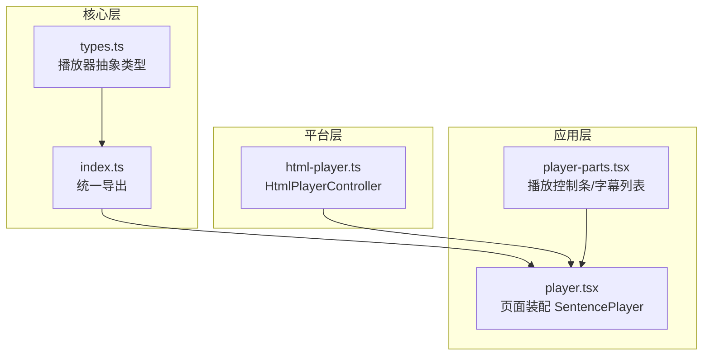
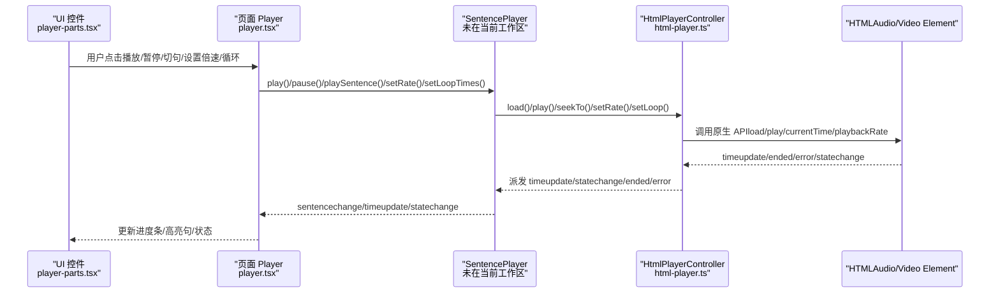
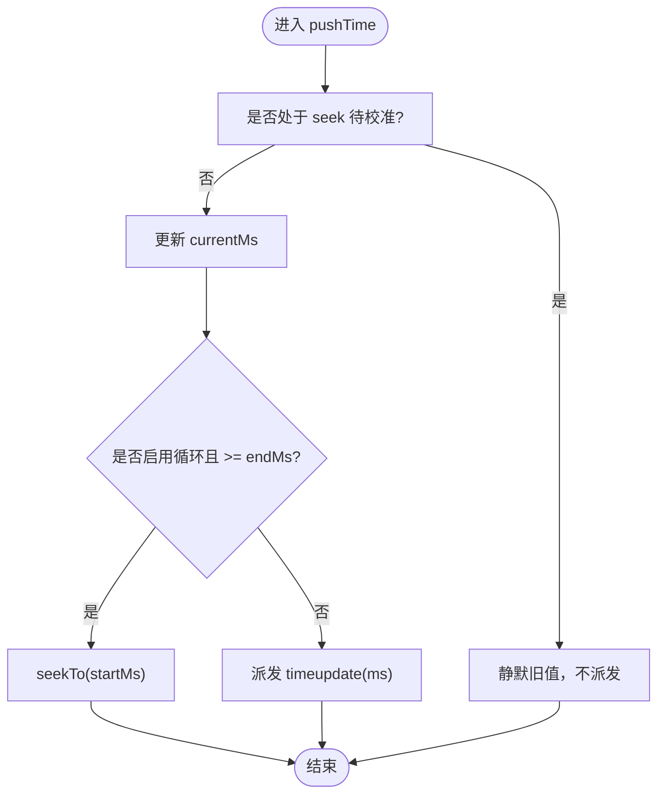
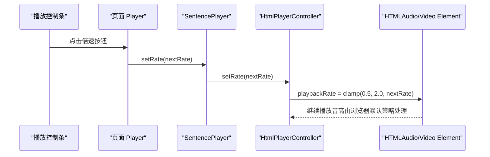
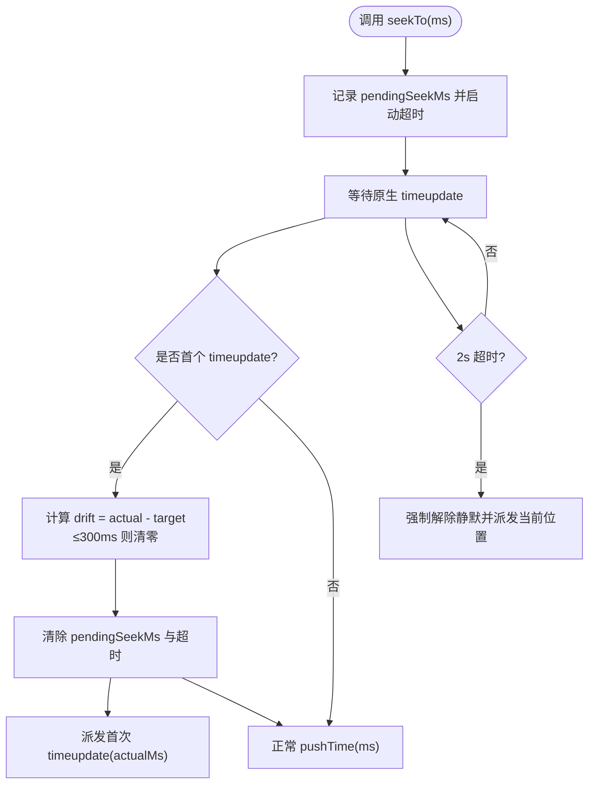
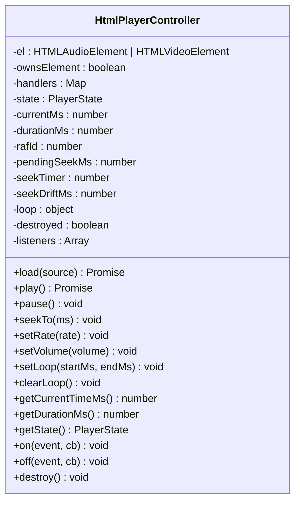
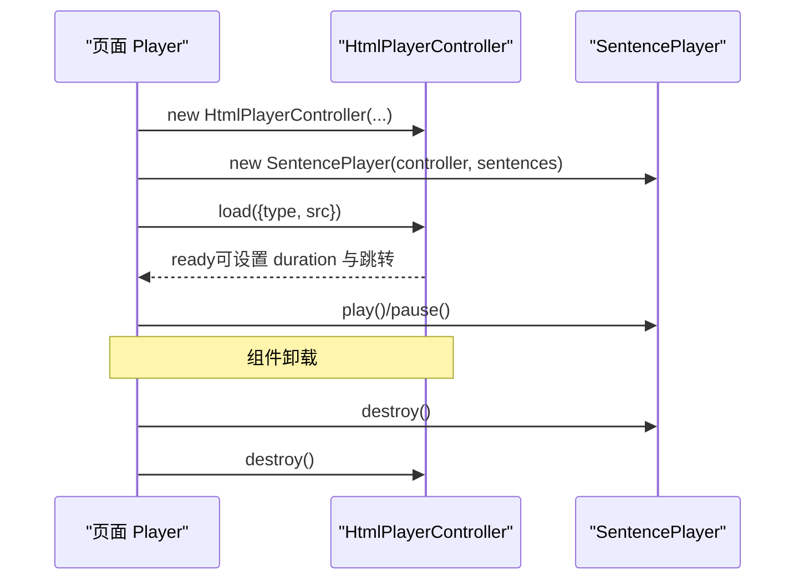
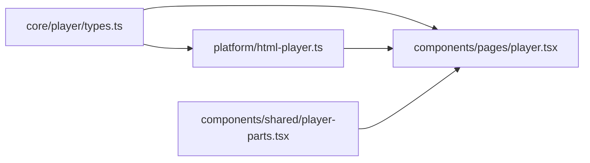

# 句子级播放器

<cite>
**本文引用的文件**   
- [client/core/player/index.ts](file://client/core/player/index.ts)
- [client/core/player/types.ts](file://client/core/player/types.ts)
- [client/platform/html-player.ts](file://client/platform/html-player.ts)
- [client/components/pages/player.tsx](file://client/components/pages/player.tsx)
- [client/components/shared/player-parts.tsx](file://client/components/shared/player-parts.tsx)
</cite>

## 目录
1. [引言](#引言)
2. [项目结构](#项目结构)
3. [核心组件](#核心组件)
4. [架构总览](#架构总览)
5. [详细组件分析](#详细组件分析)
6. [依赖关系分析](#依赖关系分析)
7. [性能与内存优化](#性能与内存优化)
8. [故障排查指南](#故障排查指南)
9. [API 接口文档](#api-接口文档)
10. [结论](#结论)

## 引言
本技术文档围绕“句子级播放器”展开，重点解释以下能力：
- A-B 循环播放：起始位置标记、循环边界控制、播放进度监听机制。
- 倍速播放：基于原生 playbackRate 的 0.5x-2.0x 变速方案，默认保留音高（不改变音调）。
- seek 校准算法：确保字幕与音频精确同步的时间轴对齐逻辑。
- HTMLAudioElement 封装层：错误处理、事件监听、状态管理。
- 播放器生命周期：初始化、暂停、恢复、销毁等。
- 兼容性、内存泄漏防护与性能优化策略。
- 完整 API 接口说明与使用示例。

需要特别说明的是：当前仓库中 `SentencePlayer` 的具体实现文件尚未出现在工作区，但通过类型定义、HTML 播放器实现以及页面集成代码，可以完整推导其职责边界与行为契约。

## 项目结构
与句子级播放器直接相关的代码分布在以下路径：
- 抽象类型与统一出口：`client/core/player/`
- H5 平台实现：`client/platform/html-player.ts`
- 页面集成与 UI 控件：`client/components/pages/player.tsx`、`client/components/shared/player-parts.tsx`

**图表来源**
- [client/core/player/types.ts:7-55](file://client/core/player/types.ts#L7-L55)
- [client/core/player/index.ts:1-5](file://client/core/player/index.ts#L1-L5)
- [client/platform/html-player.ts:1-20](file://client/platform/html-player.ts#L1-L20)
- [client/components/pages/player.tsx:180-245](file://client/components/pages/player.tsx#L180-L245)
- [client/components/shared/player-parts.tsx:113-119](file://client/components/shared/player-parts.tsx#L113-L119)

**章节来源**
- [client/core/player/types.ts:7-55](file://client/core/player/types.ts#L7-L55)
- [client/core/player/index.ts:1-5](file://client/core/player/index.ts#L1-L5)
- [client/platform/html-player.ts:1-20](file://client/platform/html-player.ts#L1-L20)
- [client/components/pages/player.tsx:180-245](file://client/components/pages/player.tsx#L180-L245)
- [client/components/shared/player-parts.tsx:113-119](file://client/components/shared/player-parts.tsx#L113-L119)

## 核心组件
- PlayerController 抽象接口：定义媒体加载、播放、暂停、seek、倍速、音量、A-B 循环、事件订阅与销毁等能力。
- HtmlPlayerController：H5 平台的 PlayerController 实现，封装 HTMLAudioElement/HTMLVideoElement，提供 seek 校准、rAF 高频进度采样、循环控制、错误与状态派发。
- SentencePlayer（未在当前工作区出现）：由页面装配，负责句级时间轴、A-B 循环次数控制、句切换、与字幕系统联动。
- 页面 Player：装配 HtmlPlayerController 与 SentencePlayer，绑定 UI 控件、字幕滚动、收藏、笔记、进度持久化等。

**章节来源**
- [client/core/player/types.ts:7-55](file://client/core/player/types.ts#L7-L55)
- [client/platform/html-player.ts:24-155](file://client/platform/html-player.ts#L24-L155)
- [client/components/pages/player.tsx:180-245](file://client/components/pages/player.tsx#L180-L245)

## 架构总览
播放器采用“抽象接口 + 平台实现 + 业务编排”的分层设计：
- 抽象层（core/player/types.ts）：定义跨平台一致的控制器接口与事件模型。
- 平台层（platform/html-player.ts）：用 HTMLAudioElement/HTMLVideoElement 实现具体播放、seek 校准、事件分发。
- 业务层（components/pages/player.tsx）：组合 HtmlPlayerController 与 SentencePlayer，驱动 UI 与数据流。

**图表来源**
- [client/components/shared/player-parts.tsx:113-119](file://client/components/shared/player-parts.tsx#L113-L119)
- [client/components/pages/player.tsx:180-245](file://client/components/pages/player.tsx#L180-L245)
- [client/platform/html-player.ts:158-176](file://client/platform/html-player.ts#L158-L176)

## 详细组件分析

### 1) A-B 循环播放原理
- 边界控制：
  - HtmlPlayerController 维护 controller 级循环区间 `[startMs, endMs]`，当进度到达 `endMs` 时自动 `seekTo(startMs)`，形成无次数限制的底层循环。
  - SentencePlayer 承担“带次数的循环”语义（例如 1 次、3 次、∞），并在每次切句后重新设置循环区间，保证 A-B 跟随新句。
- 起始位置标记：
  - 由上层（SentencePlayer）根据当前句起止时间计算并调用 `setLoop(startMs, endMs)`。
- 播放进度监听：
  - 原生 `timeupdate` 作为兜底（约 4Hz），播放中另起 `requestAnimationFrame` 高频读取 `currentTime`（约 60Hz），保证进度条与句级定位平滑。
  - 在 `pushTime` 中检测是否超过 `endMs`，若超过则回跳至 `startMs`。

**图表来源**
- [client/platform/html-player.ts:242-251](file://client/platform/html-player.ts#L242-L251)
- [client/platform/html-player.ts:223-240](file://client/platform/html-player.ts#L223-L240)

**章节来源**
- [client/platform/html-player.ts:43-44](file://client/platform/html-player.ts#L43-L44)
- [client/platform/html-player.ts:123-129](file://client/platform/html-player.ts#L123-L129)
- [client/platform/html-player.ts:223-251](file://client/platform/html-player.ts#L223-L251)
- [client/components/pages/player.tsx:227-232](file://client/components/pages/player.tsx#L227-L232)

### 2) 倍速播放与音高保持
- 实现方式：
  - 通过原生 `playbackRate` 设置倍速，范围限制为 0.5-2.0。
  - 默认保留音高（preservesPitch 行为由浏览器决定；此处未显式关闭该特性）。
- 界面交互：
  - 播放控制条提供倍速循环按钮，按固定序列切换（如 0.75x → 1x → 1.25x）。
- 注意：
  - 当前实现未引入 Web Audio API 重采样或变调器；如需严格“变速不变调”，需扩展平台层以接入更精细的音频处理管线。

**图表来源**
- [client/platform/html-player.ts:115-117](file://client/platform/html-player.ts#L115-L117)
- [client/components/shared/player-parts.tsx:113-119](file://client/components/shared/player-parts.tsx#L113-L119)
- [client/components/pages/player.tsx:348-352](file://client/components/pages/player.tsx#L348-L352)

**章节来源**
- [client/platform/html-player.ts:8-9](file://client/platform/html-player.ts#L8-L9)
- [client/platform/html-player.ts:115-117](file://client/platform/html-player.ts#L115-L117)
- [client/components/shared/player-parts.tsx:113-119](file://client/components/shared/player-parts.tsx#L113-L119)
- [client/components/pages/player.tsx:29-30](file://client/components/pages/player.tsx#L29-L30)

### 3) seek 校准算法与字幕同步
- 目标：
  - 解决不同浏览器/设备下 `currentTime` 落点偏差，确保字幕与音频精确对齐。
- 关键机制：
  - `seekTo(ms)` 设置 `pendingSeekMs` 并启动 2s 超时保护。
  - 首个原生 `timeupdate` 视为实际落点，计算漂移量 `seekDriftMs = actualMs - pendingSeekMs`，绝对值 ≤300ms 时归零。
  - 在待校准期间，`pushTime` 静默旧值，避免进度条闪烁回跳。
  - 若 2s 内仍无 `timeupdate`，强制解除静默并按当前位置派发，防止卡死。
- 对上层的影响：
  - 暴露 `getSeekDriftMs()` 供 SentencePlayer 调整循环容差，提升 A-B 循环稳定性。

**图表来源**
- [client/platform/html-player.ts:103-113](file://client/platform/html-player.ts#L103-L113)
- [client/platform/html-player.ts:178-192](file://client/platform/html-player.ts#L178-L192)
- [client/platform/html-player.ts:206-221](file://client/platform/html-player.ts#L206-L221)
- [client/platform/html-player.ts:242-251](file://client/platform/html-player.ts#L242-L251)

**章节来源**
- [client/platform/html-player.ts:19-22](file://client/platform/html-player.ts#L19-L22)
- [client/platform/html-player.ts:103-113](file://client/platform/html-player.ts#L103-L113)
- [client/platform/html-player.ts:178-192](file://client/platform/html-player.ts#L178-L192)
- [client/platform/html-player.ts:206-221](file://client/platform/html-player.ts#L206-L221)
- [client/platform/html-player.ts:242-251](file://client/platform/html-player.ts#L242-L251)

### 4) HTMLAudioElement 封装层：错误处理、事件监听、状态管理
- 事件监听：
  - 绑定 `loadedmetadata/canplay/waiting/playing/pause/ended/error` 等事件，统一转换为内部状态与事件派发。
- 错误处理：
  - 加载失败、媒体错误、播放被拦截等场景均派发 `error` 事件，附带错误码与消息。
  - 对 `play()` 返回 Promise 的竞态（AbortError）进行良性吞掉，避免 unhandled rejection。
- 状态管理：
  - 内部维护 `idle/loading/ready/playing/paused/ended/error` 状态机，并通过 `statechange` 事件通知上层。
- 资源清理：
  - `destroy()` 停止 rAF、解绑全部监听、移除 src 并触发 load，清空事件表与引用，防止内存泄漏。

**图表来源**
- [client/platform/html-player.ts:24-155](file://client/platform/html-player.ts#L24-L155)

**章节来源**
- [client/platform/html-player.ts:66-101](file://client/platform/html-player.ts#L66-L101)
- [client/platform/html-player.ts:158-176](file://client/platform/html-player.ts#L158-L176)
- [client/platform/html-player.ts:253-265](file://client/platform/html-player.ts#L253-L265)

### 5) 播放器生命周期管理
- 初始化：
  - 页面创建 `HtmlPlayerController`，再创建 `SentencePlayer`，传入字幕数组。
  - 调用 `controller.load({type, src})` 加载媒体，成功后设置时长并可选跳转到指定句。
- 暂停/恢复：
  - 通过 `sp.pause()` / `sp.play()` 控制；UI 按钮与键盘快捷键均可触发。
- 销毁：
  - 组件卸载时先 flush 播放进度，再调用 `sp.destroy()` 与 `controller.destroy()`，释放资源。

**图表来源**
- [client/components/pages/player.tsx:180-245](file://client/components/pages/player.tsx#L180-L245)

**章节来源**
- [client/components/pages/player.tsx:180-245](file://client/components/pages/player.tsx#L180-L245)

## 依赖关系分析
- core/player/types.ts 定义跨平台接口，供 platform 与 page 共同依赖。
- platform/html-player.ts 实现 PlayerController，被 page 直接使用。
- components/pages/player.tsx 组合 HtmlPlayerController 与 SentencePlayer，并消费 player-parts.tsx 提供的 UI 控件。

**图表来源**
- [client/core/player/types.ts:7-55](file://client/core/player/types.ts#L7-L55)
- [client/platform/html-player.ts:17-17](file://client/platform/html-player.ts#L17-L17)
- [client/components/pages/player.tsx:21-22](file://client/components/pages/player.tsx#L21-L22)
- [client/components/shared/player-parts.tsx:113-119](file://client/components/shared/player-parts.tsx#L113-L119)

**章节来源**
- [client/core/player/types.ts:7-55](file://client/core/player/types.ts#L7-L55)
- [client/platform/html-player.ts:17-17](file://client/platform/html-player.ts#L17-L17)
- [client/components/pages/player.tsx:21-22](file://client/components/pages/player.tsx#L21-L22)
- [client/components/shared/player-parts.tsx:113-119](file://client/components/shared/player-parts.tsx#L113-L119)

## 性能与内存优化
- 进度更新节流：
  - 页面侧将 `setCurrentMs` 节流到每 100ms 一次，降低 React 渲染频率，避免视频播放时主线程阻塞导致返回按钮无响应。
- 播放进度持久化节流：
  - 播放过的句子集合每 5s 合并写盘一次，减少 IDB 写入压力。
- rAF 高频采样：
  - 播放中通过 `requestAnimationFrame` 高频读取 `currentTime`，弥补原生 `timeupdate` 低频问题，使进度条与句级定位更平滑。
- 资源清理：
  - `destroy()` 停 rAF、解绑监听、移除 src、清空事件表与引用，避免内存泄漏。
- 兼容性与降级：
  - SSR 安全：仅在浏览器环境创建 DOM 元素；非浏览器环境抛出明确错误。
  - 媒体元数据缺失或直播流：长度读取回退为 0，避免异常。

**章节来源**
- [client/components/pages/player.tsx:209-225](file://client/components/pages/player.tsx#L209-L225)
- [client/components/pages/player.tsx:254-271](file://client/components/pages/player.tsx#L254-L271)
- [client/platform/html-player.ts:223-240](file://client/platform/html-player.ts#L223-L240)
- [client/platform/html-player.ts:142-155](file://client/platform/html-player.ts#L142-L155)
- [client/platform/html-player.ts:52-63](file://client/platform/html-player.ts#L52-L63)
- [client/platform/html-player.ts:200-204](file://client/platform/html-player.ts#L200-L204)

## 故障排查指南
- 播放被拦截：
  - 现象：控制台报错或 UI 显示播放失败。
  - 原因：浏览器策略阻止自动播放或用户手势不足。
  - 处理：封装层捕获 `AbortError` 并静默处理其他异常，同时派发 `error` 事件；调用方应监听 error 并提示用户。
- 进度条闪烁或回跳：
  - 现象：seek 后进度条短暂回跳。
  - 原因：seek 后首个 timeupdate 前派发旧值。
  - 处理：封装层在 pendingSeekMs 期间静默旧值，直至首个 timeupdate 校准完成。
- 循环不生效或越界：
  - 现象：A-B 循环未按预期回跳。
  - 原因：SentencePlayer 未在切句后重新设置循环区间。
  - 处理：在 `sentencechange` 回调中重新调用 `setLoopTimes(loop)`。
- 内存泄漏：
  - 现象：长时间使用后内存持续增长。
  - 原因：未正确销毁播放器或未清理 rAF/监听。
  - 处理：组件卸载时调用 `sp.destroy()` 与 `controller.destroy()`。

**章节来源**
- [client/platform/html-player.ts:85-97](file://client/platform/html-player.ts#L85-L97)
- [client/platform/html-player.ts:171-175](file://client/platform/html-player.ts#L171-L175)
- [client/platform/html-player.ts:242-251](file://client/platform/html-player.ts#L242-L251)
- [client/components/pages/player.tsx:227-232](file://client/components/pages/player.tsx#L227-L232)
- [client/components/pages/player.tsx:235-245](file://client/components/pages/player.tsx#L235-L245)

## API 接口文档

### 抽象接口：PlayerController
- 媒体加载
  - `load(source: MediaSource): Promise<void>`
- 播放控制
  - `play(): Promise<void>`
  - `pause(): void`
- 时间与定位
  - `seekTo(ms: number): void`
  - `getCurrentTimeMs(): number`
  - `getDurationMs(): number`
- 播放参数
  - `setRate(rate: number): void`（支持 0.5-2.0）
  - `setVolume(volume: number): void`（0-1）
- 循环控制
  - `setLoop(startMs: number, endMs: number): void`
  - `clearLoop(): void`
- 状态与事件
  - `getState(): PlayerState`
  - `on<E>(event: E, cb: PlayerEvents[E]): void`
  - `off<E>(event: E, cb: PlayerEvents[E]): void`
- 生命周期
  - `destroy(): void`

**章节来源**
- [client/core/player/types.ts:7-55](file://client/core/player/types.ts#L7-L55)

### 平台实现：HtmlPlayerController
- 构造
  - `new HtmlPlayerController(kind: 'audio' | 'video', element?: HTMLAudioElement | HTMLVideoElement)`
- 关键方法
  - `load`, `play`, `pause`, `seekTo`, `setRate`, `setVolume`, `setLoop`, `clearLoop`, `getCurrentTimeMs`, `getDurationMs`, `getState`, `on`, `off`, `destroy`
- 辅助方法
  - `getSeekDriftMs(): number`
  - `isSeeking(): boolean`

**章节来源**
- [client/platform/html-player.ts:52-155](file://client/platform/html-player.ts#L52-L155)
- [client/platform/html-player.ts:131-137](file://client/platform/html-player.ts#L131-L137)

### 页面集成：SentencePlayer（契约）
- 装配
  - `new SentencePlayer(controller, sentences)`
- 常用方法（从页面调用推断）
  - `play()`
  - `pause()`
  - `playSentence(index)`
  - `seekTo(ms)`
  - `setRate(rate)`
  - `setLoopTimes(times)`
  - `setSentences(sentences)`
  - `getCurrentTimeMs()`
  - `getCurrentSentenceIndex()`
  - `getState()`
  - `on(event, cb)`
  - `destroy()`

**章节来源**
- [client/components/pages/player.tsx:180-245](file://client/components/pages/player.tsx#L180-L245)
- [client/components/pages/player.tsx:247-252](file://client/components/pages/player.tsx#L247-L252)
- [client/components/pages/player.tsx:337-360](file://client/components/pages/player.tsx#L337-L360)

### 使用示例（步骤说明）
- 初始化
  - 创建 `HtmlPlayerController('audio'|'video')`。
  - 创建 `SentencePlayer(controller, sentences)`。
  - 调用 `controller.load({type, src})` 加载媒体。
- 播放与暂停
  - 调用 `sp.play()` / `sp.pause()`。
- 切句与循环
  - 调用 `sp.playSentence(index)` 切换到某句。
  - 调用 `sp.setLoopTimes(n)` 设置循环次数（n=∞ 表示无限）。
- 倍速与音量
  - 调用 `sp.setRate(rate)`（0.5-2.0）。
  - 调用 `sp.setVolume(v)`（0-1）。
- 事件监听
  - 监听 `timeupdate` 更新进度条。
  - 监听 `sentencechange` 高亮当前句。
  - 监听 `statechange` 同步播放状态。
  - 监听 `error` 处理异常。
- 销毁
  - 组件卸载时调用 `sp.destroy()` 与 `controller.destroy()`。

**章节来源**
- [client/components/pages/player.tsx:180-245](file://client/components/pages/player.tsx#L180-L245)
- [client/components/pages/player.tsx:337-360](file://client/components/pages/player.tsx#L337-L360)

## 结论
本项目通过清晰的抽象接口与平台实现分离，构建了稳定可扩展的句子级播放器体系。HtmlPlayerController 提供了可靠的 seek 校准、高频进度采样与完善的错误处理；页面层通过 SentencePlayer 将句级时间轴、A-B 循环与字幕系统紧密耦合，配合 UI 控件实现了流畅的学习体验。尽管当前未包含 SentencePlayer 源码，但其契约与用法已在页面层得到充分验证。未来可在平台层引入 Web Audio API 以实现更严格的“变速不变调”，进一步提升音质体验。