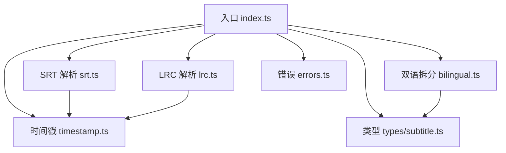
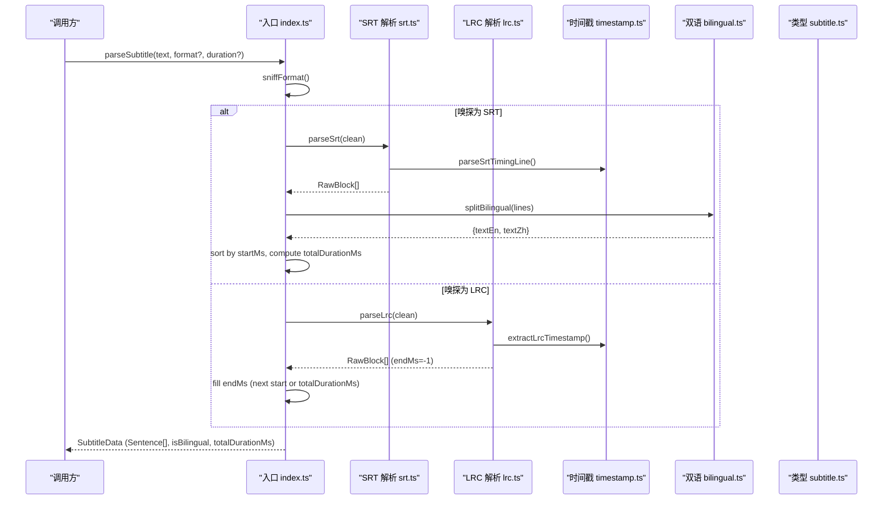
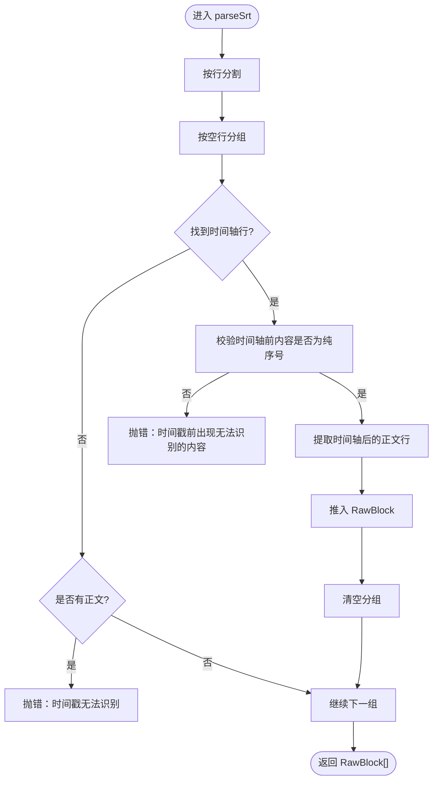
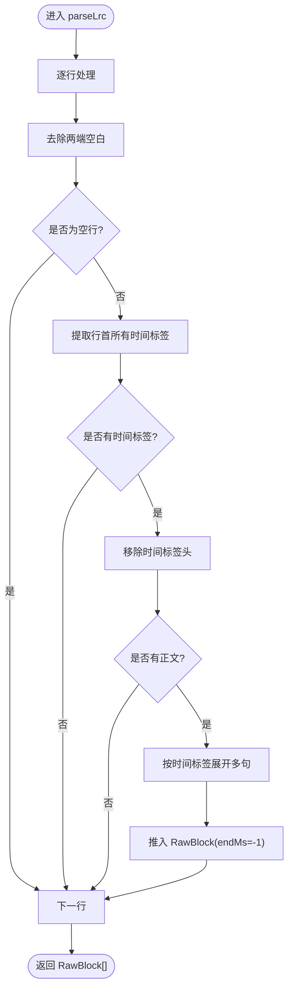
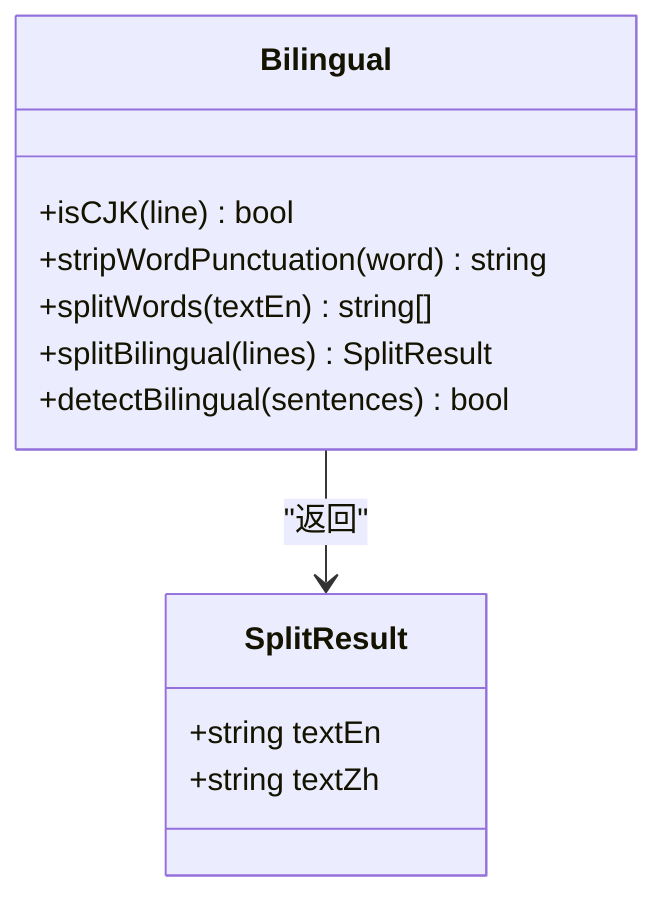
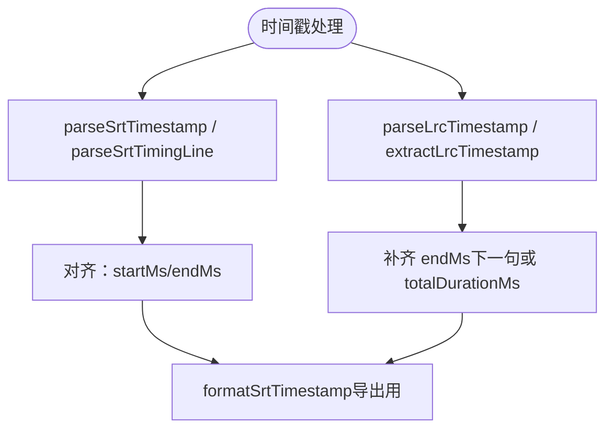
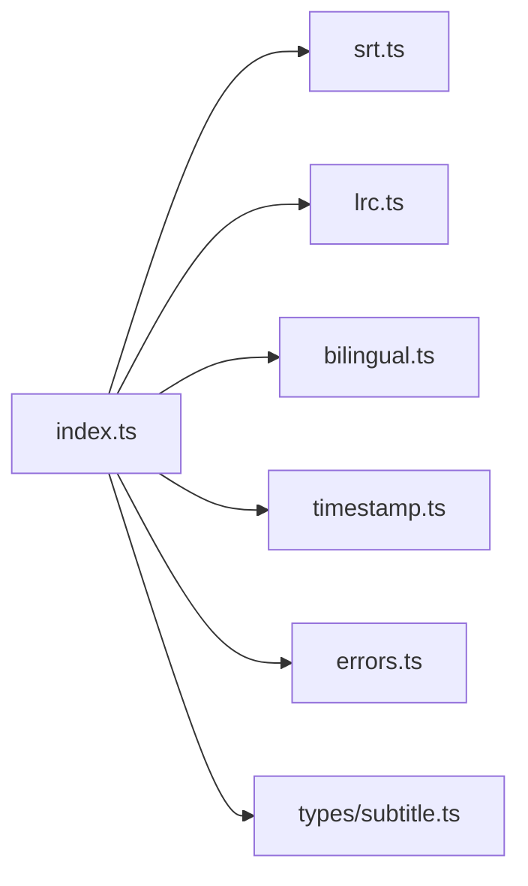

# 字幕解析器

<cite>
**本文引用的文件**   
- [client/core/subtitle/index.ts](file://client/core/subtitle/index.ts)
- [client/core/subtitle/srt.ts](file://client/core/subtitle/srt.ts)
- [client/core/subtitle/lrc.ts](file://client/core/subtitle/lrc.ts)
- [client/core/subtitle/bilingual.ts](file://client/core/subtitle/bilingual.ts)
- [client/core/subtitle/timestamp.ts](file://client/core/subtitle/timestamp.ts)
- [client/core/subtitle/errors.ts](file://client/core/subtitle/errors.ts)
- [client/types/subtitle.ts](file://client/types/subtitle.ts)
- [client/core/subtitle/__tests__/subtitle.test.ts](file://client/core/subtitle/__tests__/subtitle.test.ts)
</cite>

## 目录
1. [引言](#引言)
2. [项目结构](#项目结构)
3. [核心组件](#核心组件)
4. [架构总览](#架构总览)
5. [详细组件分析](#详细组件分析)
6. [依赖关系分析](#依赖关系分析)
7. [性能与容错](#性能与容错)
8. [导入导出与编码处理](#导入导出与编码处理)
9. [类型定义与 API 文档](#类型定义与-api-文档)
10. [测试用例分析](#测试用例分析)
11. [故障排查指南](#故障排查指南)
12. [结论](#结论)

## 引言
本技术文档围绕“字幕解析器”展开，聚焦以下目标：
- SRT 格式语法解析：时间戳、序号识别、文本内容提取的正则匹配规则。
- LRC 歌词格式解析：时间标签 `[mm:ss.xx]` 处理、多行歌词合并策略。
- 双语字幕混合解析机制：中英文对照的结构化数据模型与启发式拆分。
- 时间轴对齐算法：浮点毫秒级时间计算，确保字幕与音频播放精确定位。
- 字幕导入导出：格式转换、BOM/CRLF 兼容、特殊字符转义与往返无损。
- 编辑工具集成接口：实时修改、批量操作、版本管理（基于统一数据结构）。
- 完整类型定义、API 文档与测试用例分析。

该实现为纯 TypeScript，零 React 依赖，可在 Node 环境中运行和测试。

## 项目结构
字幕解析相关代码集中在 `client/core/subtitle` 目录，配合 `client/types/subtitle.ts` 提供统一的数据模型。关键文件职责如下：
- `index.ts`：入口模块，负责自动嗅探格式、编排解析流程、导出 SRT。
- `srt.ts`：SRT 块解析，含序号/时间轴/正文的容错处理。
- `lrc.ts`：LRC 歌词解析，支持一行多时间标签与元数据跳过。
- `bilingual.ts`：中英双语启发式拆分、单词切分、双语检测。
- `timestamp.ts`：SRT/LRC 时间戳解析与格式化。
- `errors.ts`：带行号的解析错误类型。
- `types/subtitle.ts`：对外暴露的字幕数据结构。
- `__tests__/subtitle.test.ts`：覆盖解析、双语拆分、错误路径与性能防御的用例。

**图表来源**
- [client/core/subtitle/index.ts:1-80](file://client/core/subtitle/index.ts#L1-L80)
- [client/core/subtitle/srt.ts:1-61](file://client/core/subtitle/srt.ts#L1-L61)
- [client/core/subtitle/lrc.ts:1-29](file://client/core/subtitle/lrc.ts#L1-L29)
- [client/core/subtitle/bilingual.ts:1-62](file://client/core/subtitle/bilingual.ts#L1-L62)
- [client/core/subtitle/timestamp.ts:1-53](file://client/core/subtitle/timestamp.ts#L1-L53)
- [client/core/subtitle/errors.ts:1-15](file://client/core/subtitle/errors.ts#L1-L15)
- [client/types/subtitle.ts:1-35](file://client/types/subtitle.ts#L1-L35)

**章节来源**
- [client/core/subtitle/index.ts:1-80](file://client/core/subtitle/index.ts#L1-L80)
- [client/types/subtitle.ts:1-35](file://client/types/subtitle.ts#L1-L35)

## 核心组件
- 入口解析器 `parseSubtitle(text, format?, knownDurationMs?)`：
  - 自动嗅探 SRT/LRC；失败抛出带行号错误。
  - 对 SRT：排序后生成句子，计算总时长，标记是否双语。
  - 对 LRC：补齐 endMs（下一句起点或末句 totalDurationMs），支持传入媒体真实时长回填。
- SRT 解析器 `parseSrt(text)`：
  - 按空行分组，识别时间轴行，校验序号前内容，提取正文行。
  - 容错：允许缺失序号、忽略多余空行、严格校验时间轴格式。
- LRC 解析器 `parseLrc(text)`：
  - 跳过元数据行，提取行首多个时间标签并展开为多句。
  - 返回 endMs=-1 占位，由上层补齐。
- 双语拆分 `splitBilingual(lines)`：
  - 两行时判断上英下中或上中下英；单行视为英文；多行按语言连续合并，保留换行。
  - 单词切分 `splitWords`：空白切分、剥离首尾标点、保留内部撇号。
  - 双语检测 `detectBilingual`：中文句占比 >30% 判定双语。
- 时间戳工具：
  - `parseSrtTimestamp` / `parseSrtTimingLine`：SRT 时间戳与时间轴行解析。
  - `parseLrcTimestamp` / `extractLrcTimestamp`：LRC 时间戳与行首多标签提取。
  - `formatSrtTimestamp`：毫秒到 SRT 时间字符串格式化。
- 错误类型 `SubtitleParseError`：携带行号，便于 UI 就地提示。

**章节来源**
- [client/core/subtitle/index.ts:22-79](file://client/core/subtitle/index.ts#L22-L79)
- [client/core/subtitle/srt.ts:22-60](file://client/core/subtitle/srt.ts#L22-L60)
- [client/core/subtitle/lrc.ts:12-28](file://client/core/subtitle/lrc.ts#L12-L28)
- [client/core/subtitle/bilingual.ts:14-61](file://client/core/subtitle/bilingual.ts#L14-L61)
- [client/core/subtitle/timestamp.ts:7-52](file://client/core/subtitle/timestamp.ts#L7-L52)
- [client/core/subtitle/errors.ts:5-14](file://client/core/subtitle/errors.ts#L5-L14)

## 架构总览
整体解析流程从入口开始，根据输入文本自动嗅探格式，调用对应解析器生成原始块，再转换为结构化句子，最后输出统一数据模型。

**图表来源**
- [client/core/subtitle/index.ts:22-69](file://client/core/subtitle/index.ts#L22-L69)
- [client/core/subtitle/srt.ts:24-60](file://client/core/subtitle/srt.ts#L24-L60)
- [client/core/subtitle/lrc.ts:14-28](file://client/core/subtitle/lrc.ts#L14-L28)
- [client/core/subtitle/timestamp.ts:12-52](file://client/core/subtitle/timestamp.ts#L12-L52)
- [client/core/subtitle/bilingual.ts:37-61](file://client/core/subtitle/bilingual.ts#L37-L61)
- [client/types/subtitle.ts:6-31](file://client/types/subtitle.ts#L6-L31)

## 详细组件分析

### SRT 解析器
- 正则与匹配：
  - 时间轴行匹配：`hh:mm:ss,mmm --> hh:mm:ss,mmm`，兼容逗号或点分隔毫秒。
  - 序号行仅允许纯数字，否则抛错。
  - 正文行为时间轴之后的非空行集合。
- 容错策略：
  - 块间空行数量不敏感。
  - 序号缺失时按出现顺序解析（忽略序号行本身）。
  - 时间轴前出现非序号内容直接抛错。
- 复杂度：
  - 线性扫描 O(n)，无回溯型块正则，避免恶意输入卡死。

**图表来源**
- [client/core/subtitle/srt.ts:24-60](file://client/core/subtitle/srt.ts#L24-L60)
- [client/core/subtitle/timestamp.ts:19-27](file://client/core/subtitle/timestamp.ts#L19-L27)

**章节来源**
- [client/core/subtitle/srt.ts:22-60](file://client/core/subtitle/srt.ts#L22-L60)
- [client/core/subtitle/timestamp.ts:19-27](file://client/core/subtitle/timestamp.ts#L19-L27)

### LRC 解析器
- 时间标签处理：
  - 支持 `[mm:ss.xx]`，分钟段允许 1-3 位，毫秒可选。
  - 一行可含多个时间标签，按顺序展开为多句。
- 元数据跳过：
  - 如 `[ti:Demo]` 等非数字标签自动跳过。
- endMs 补齐：
  - 解析阶段 endMs 置 -1，由上层按“下一句 startMs 或末句 totalDurationMs”补齐。

**图表来源**
- [client/core/subtitle/lrc.ts:14-28](file://client/core/subtitle/lrc.ts#L14-L28)
- [client/core/subtitle/timestamp.ts:47-52](file://client/core/subtitle/timestamp.ts#L47-L52)

**章节来源**
- [client/core/subtitle/lrc.ts:12-28](file://client/core/subtitle/lrc.ts#L12-L28)
- [client/core/subtitle/timestamp.ts:47-52](file://client/core/subtitle/timestamp.ts#L47-L52)

### 双语字幕混合解析
- 语言判定：
  - `isCJK`：包含中日韩统一表意字符即判为中文行。
- 拆分策略：
  - 两行：上英下中或上中下英；同类则合并。
  - 多行：连续英文行合并为 textEn，连续中文行合并为 textZh，使用 `\n` 连接以保留原文断行。
- 单词切分：
  - `splitWords`：按空白切分，剥离首尾标点，保留内部撇号（如 don't）。
- 双语检测：
  - 中文句占比 >30% 判定为双语。

**图表来源**
- [client/core/subtitle/bilingual.ts:14-61](file://client/core/subtitle/bilingual.ts#L14-L61)

**章节来源**
- [client/core/subtitle/bilingual.ts:14-61](file://client/core/subtitle/bilingual.ts#L14-L61)

### 时间轴对齐算法
- 时间戳解析：
  - SRT：`hh:mm:ss,mmm`，兼容点分隔；毫秒不足三位补零。
  - LRC：`[mm:ss.xx]`，分钟段允许 1-3 位，毫秒可选。
- 时间轴行解析：
  - 同时解析起止时间，返回毫秒值。
- 对齐策略：
  - SRT：直接使用起止时间。
  - LRC：endMs 由上层补齐（下一句起点或末句 totalDurationMs）。
- 格式化：
  - 毫秒到 SRT 时间字符串，保证导出一致性。

**图表来源**
- [client/core/subtitle/timestamp.ts:12-45](file://client/core/subtitle/timestamp.ts#L12-L45)
- [client/core/subtitle/index.ts:58-68](file://client/core/subtitle/index.ts#L58-L68)

**章节来源**
- [client/core/subtitle/timestamp.ts:12-52](file://client/core/subtitle/timestamp.ts#L12-L52)
- [client/core/subtitle/index.ts:58-68](file://client/core/subtitle/index.ts#L58-L68)

## 依赖关系分析
- 入口模块依赖：
  - 解析器：`parseSrt`、`parseLrc`。
  - 双语工具：`splitBilingual`、`splitWords`、`detectBilingual`。
  - 时间戳工具：`parseSrtTimestamp`、`parseLrcTimestamp`、`formatSrtTimestamp`。
  - 错误类型：`SubtitleParseError`。
  - 类型定义：`SubtitleData`、`SubtitleSentence`。
- 耦合与内聚：
  - 各解析器独立，通过统一 `RawBlock` 与 `SubtitleSentence` 解耦。
  - 双语逻辑与时间戳工具被多处复用，内聚良好。
- 外部依赖：
  - 无第三方库依赖，纯 TS 实现，利于测试与移植。

**图表来源**
- [client/core/subtitle/index.ts:8-14](file://client/core/subtitle/index.ts#L8-L14)
- [client/core/subtitle/srt.ts:8-9](file://client/core/subtitle/srt.ts#L8-L9)
- [client/core/subtitle/lrc.ts:8-10](file://client/core/subtitle/lrc.ts#L8-L10)
- [client/core/subtitle/bilingual.ts:1-62](file://client/core/subtitle/bilingual.ts#L1-L62)
- [client/core/subtitle/timestamp.ts:1-53](file://client/core/subtitle/timestamp.ts#L1-L53)
- [client/core/subtitle/errors.ts:1-15](file://client/core/subtitle/errors.ts#L1-L15)
- [client/types/subtitle.ts:1-35](file://client/types/subtitle.ts#L1-L35)

**章节来源**
- [client/core/subtitle/index.ts:8-14](file://client/core/subtitle/index.ts#L8-L14)
- [client/types/subtitle.ts:1-35](file://client/types/subtitle.ts#L1-L35)

## 性能与容错
- 线性时间解析：
  - 无回溯型块正则，避免超长输入导致卡顿。
  - 测试覆盖 200k 字符与 20k 伪时间轴行的性能边界。
- 容错策略：
  - BOM/CRLF 兼容。
  - 序号缺失、空行数量不敏感。
  - 时间轴前杂散文本直接抛错，快速失败。
- 错误定位：
  - 所有解析错误携带行号，便于 UI 就地提示。

**章节来源**
- [client/core/subtitle/__tests__/subtitle.test.ts:196-217](file://client/core/subtitle/__tests__/subtitle.test.ts#L196-L217)
- [client/core/subtitle/errors.ts:5-14](file://client/core/subtitle/errors.ts#L5-L14)

## 导入导出与编码处理
- 导入：
  - 自动嗅探 SRT/LRC，失败抛错。
  - 支持 UTF-8 BOM 与 CRLF 换行。
- 导出：
  - `exportSrt`：将句子数组导出为 SRT 文本，双语行原样回写，保持换行。
  - 时间戳格式化保证一致性与往返无损。
- 特殊字符：
  - 单词切分剥离首尾标点，保留内部撇号。
  - 双语合并使用 `\n` 连接，渲染侧需配置 `whitespace-pre-line`。

**章节来源**
- [client/core/subtitle/index.ts:46-79](file://client/core/subtitle/index.ts#L46-L79)
- [client/core/subtitle/bilingual.ts:24-29](file://client/core/subtitle/bilingual.ts#L24-L29)
- [client/core/subtitle/timestamp.ts:37-45](file://client/core/subtitle/timestamp.ts#L37-L45)

## 类型定义与 API 文档
- 数据类型：
  - `SubtitleSentence`：句子序号、起止时间、英文原文、中文译文、单词数组。
  - `SubtitleData`：来源格式、是否双语、句子列表、总时长。
  - `SubtitleMode`：播放器显示模式（双语/英文/中文）。
- API：
  - `parseSubtitle(text, format?, knownDurationMs?)`：解析字幕文本。
  - `parseSrt(text)`：解析 SRT 原始块。
  - `parseLrc(text)`：解析 LRC 原始块。
  - `parseSrtTimestamp(raw)` / `parseLrcTimestamp(raw)`：时间戳解析。
  - `parseSrtTimingLine(line)`：时间轴行解析。
  - `extractLrcTimestamp(line)`：提取 LRC 行首多时间标签。
  - `formatSrtTimestamp(ms)`：毫秒到 SRT 时间字符串。
  - `isCJK(line)` / `splitBilingual(lines)` / `splitWords(textEn)` / `detectBilingual(sentences)`：双语工具。
  - `exportSrt(sentences)`：导出 SRT 文本。
  - `SubtitleParseError`：带行号的解析错误。

**章节来源**
- [client/types/subtitle.ts:6-35](file://client/types/subtitle.ts#L6-L35)
- [client/core/subtitle/index.ts:16-20](file://client/core/subtitle/index.ts#L16-L20)
- [client/core/subtitle/index.ts:46-79](file://client/core/subtitle/index.ts#L46-L79)
- [client/core/subtitle/srt.ts:12-20](file://client/core/subtitle/srt.ts#L12-L20)
- [client/core/subtitle/lrc.ts:14-28](file://client/core/subtitle/lrc.ts#L14-L28)
- [client/core/subtitle/timestamp.ts:12-52](file://client/core/subtitle/timestamp.ts#L12-L52)
- [client/core/subtitle/bilingual.ts:14-61](file://client/core/subtitle/bilingual.ts#L14-L61)
- [client/core/subtitle/errors.ts:5-14](file://client/core/subtitle/errors.ts#L5-L14)

## 测试用例分析
- 时间戳解析：
  - SRT：兼容逗号/点分隔、短毫秒补零。
  - LRC：分钟段 1-3 位、毫秒可选、元数据跳过。
- 双语拆分与单词切分：
  - 上英下中/上中下英/单行/多行合并（保留换行）。
  - 剥首尾标点、保留内部撇号、过滤空串。
- SRT 解析：
  - 基础解析、BOM+CRLF 兼容、序号缺失容错、乱序排序、换行折行往返无损、显式 format。
- LRC 解析：
  - 元数据跳过、endMs 补齐、knownDurationMs 回填、一行多标签展开、BOM+CRLF 兼容。
- 错误路径：
  - 空内容、无法识别格式、时间轴损坏、时间轴前杂散文本、无歌词行、空块集合。
- 防御性测试：
  - 超长无空行文本、大量伪时间轴行，确保不挂起。
- 双语检测：
  - 中文句占比阈值判定。

**章节来源**
- [client/core/subtitle/__tests__/subtitle.test.ts:20-226](file://client/core/subtitle/__tests__/subtitle.test.ts#L20-L226)

## 故障排查指南
- 常见错误与定位：
  - “字幕内容为空”：检查输入是否为空或仅空白。
  - “无法识别字幕格式”：确认文本符合 SRT/LRC 基本特征。
  - “时间戳格式无法识别”：检查时间轴行是否符合 `hh:mm:ss,mmm --> hh:mm:ss,mmm`。
  - “时间戳前出现无法识别的内容”：确保时间轴前仅有纯数字序号。
  - “未解析到任何字幕块/歌词行”：检查是否存在有效时间标签与正文。
- 调试建议：
  - 利用 `SubtitleParseError.line` 定位具体行号。
  - 对 LRC 传入 `knownDurationMs` 避免末句零时长问题。
  - 对双语字幕，确认中文行占比是否满足阈值。

**章节来源**
- [client/core/subtitle/errors.ts:5-14](file://client/core/subtitle/errors.ts#L5-L14)
- [client/core/subtitle/index.ts:46-69](file://client/core/subtitle/index.ts#L46-L69)
- [client/core/subtitle/srt.ts:30-47](file://client/core/subtitle/srt.ts#L30-L47)
- [client/core/subtitle/lrc.ts:14-28](file://client/core/subtitle/lrc.ts#L14-L28)

## 结论
该字幕解析器以纯 TypeScript 实现，具备高内聚、低耦合、强容错的特性。其核心优势包括：
- 精确的时间戳解析与对齐，支持 SRT/LRC 双格式。
- 健壮的双语启发式拆分与单词切分，适配中英文对照场景。
- 完善的错误定位与性能防御，确保在极端输入下稳定运行。
- 统一的类型定义与 API，便于编辑器集成与扩展。

对于字幕编辑工具的集成，建议：
- 基于 `SubtitleSentence` 进行实时修改与批量操作。
- 使用 `exportSrt` 实现格式转换与版本管理。
- 结合 `detectBilingual` 与 `SubtitleMode` 控制显示模式。