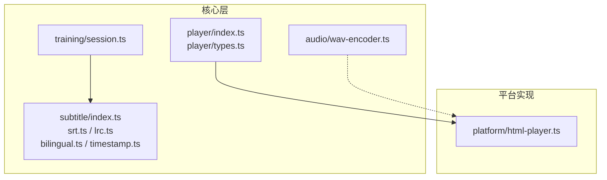
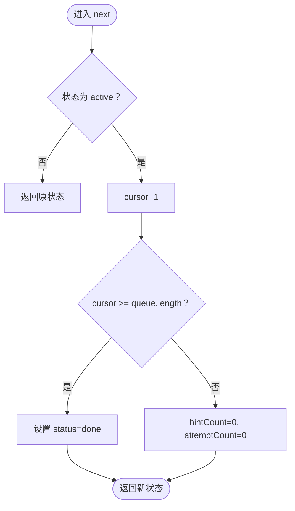
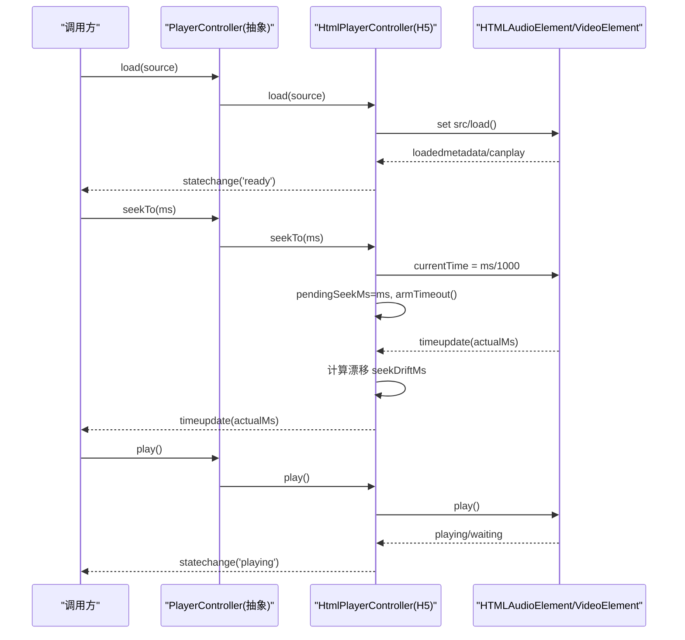
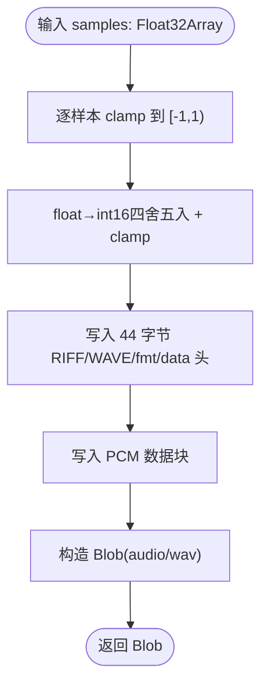
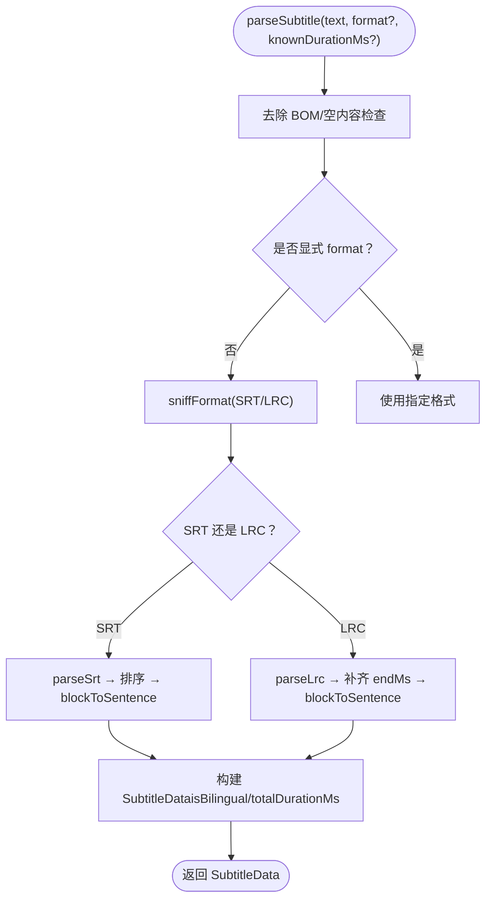
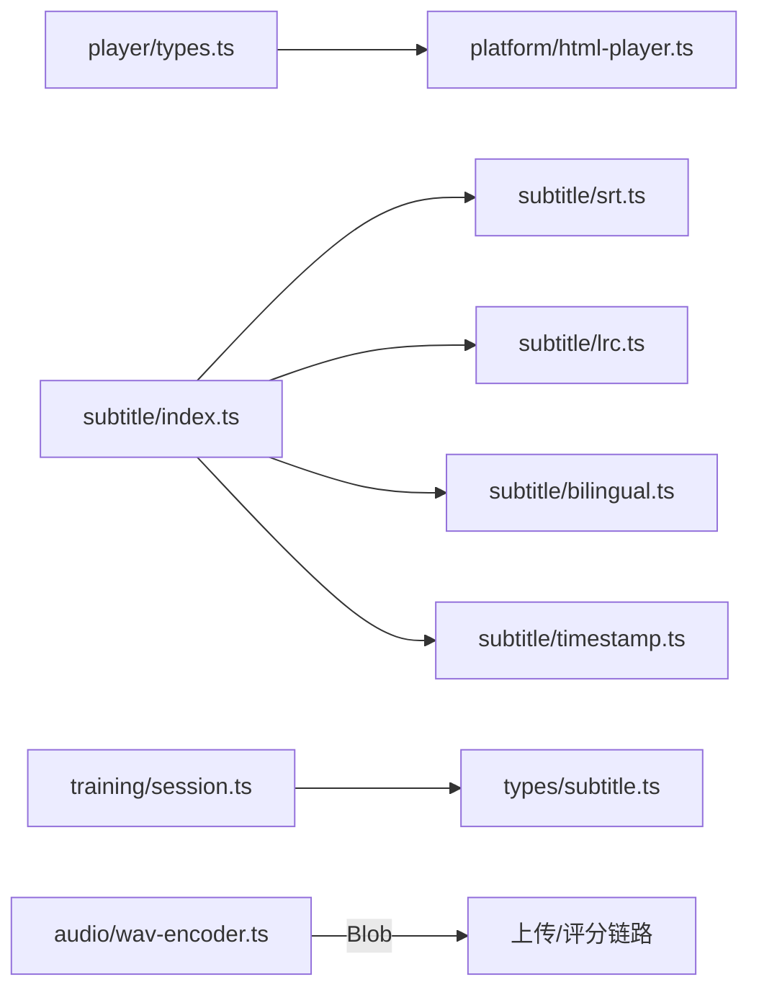

# 核心模块

<cite>
**本文引用的文件**   
- [client/core/training/session.ts](file://client/core/training/session.ts)
- [client/core/player/index.ts](file://client/core/player/index.ts)
- [client/core/player/types.ts](file://client/core/player/types.ts)
- [client/platform/html-player.ts](file://client/platform/html-player.ts)
- [client/core/audio/wav-encoder.ts](file://client/core/audio/wav-encoder.ts)
- [client/core/subtitle/index.ts](file://client/core/subtitle/index.ts)
- [client/core/subtitle/srt.ts](file://client/core/subtitle/srt.ts)
- [client/core/subtitle/lrc.ts](file://client/core/subtitle/lrc.ts)
- [client/core/subtitle/bilingual.ts](file://client/core/subtitle/bilingual.ts)
- [client/core/subtitle/timestamp.ts](file://client/core/subtitle/timestamp.ts)
- [client/core/training/__tests__/session.test.ts](file://client/core/training/__tests__/session.test.ts)
- [client/core/audio/__tests__/wav-encoder.test.ts](file://client/core/audio/__tests__/wav-encoder.test.ts)
- [client/core/subtitle/__tests__/subtitle.test.ts](file://client/core/subtitle/__tests__/subtitle.test.ts)
</cite>

## 目录
1. [引言](#引言)
2. [项目结构](#项目结构)
3. [核心组件](#核心组件)
4. [架构总览](#架构总览)
5. [详细组件分析](#详细组件分析)
6. [依赖关系分析](#依赖关系分析)
7. [性能考量](#性能考量)
8. [故障排查指南](#故障排查指南)
9. [结论](#结论)
10. [附录：API 与使用示例](#附录api-与使用示例)

## 引言
本技术文档聚焦客户端核心模块，覆盖训练会话状态机、句子级播放器（A-B 循环、倍速、seek 校准）、WAV 编码器、字幕解析器（SRT/LRC、双语拆分与时间轴对齐）。文档以纯函数实现为主线，强调确定性、可测试性与错误恢复；同时给出 API 接口说明、使用示例、单元测试覆盖要点与性能基准建议。

## 项目结构
核心代码位于 client/core 下，按功能域划分：
- core/training：训练会话状态机与评分汇总
- core/player：播放器抽象类型与统一导出
- platform/html-player.ts：HTML 媒体元素实现（H5）
- core/audio：WAV 编码与采样率约定
- core/subtitle：SRT/LRC 解析、双语拆分、时间戳工具



图表来源
- [client/core/training/session.ts:1-119](file://client/core/training/session.ts#L1-L119)
- [client/core/player/index.ts:1-5](file://client/core/player/index.ts#L1-L5)
- [client/core/player/types.ts:1-56](file://client/core/player/types.ts#L1-L56)
- [client/platform/html-player.ts:1-272](file://client/platform/html-player.ts#L1-L272)
- [client/core/audio/wav-encoder.ts:1-59](file://client/core/audio/wav-encoder.ts#L1-L59)
- [client/core/subtitle/index.ts:1-80](file://client/core/subtitle/index.ts#L1-L80)

章节来源
- [client/core/training/session.ts:1-119](file://client/core/training/session.ts#L1-L119)
- [client/core/player/index.ts:1-5](file://client/core/player/index.ts#L1-L5)
- [client/core/player/types.ts:1-56](file://client/core/player/types.ts#L1-L56)
- [client/platform/html-player.ts:1-272](file://client/platform/html-player.ts#L1-L272)
- [client/core/audio/wav-encoder.ts:1-59](file://client/core/audio/wav-encoder.ts#L1-L59)
- [client/core/subtitle/index.ts:1-80](file://client/core/subtitle/index.ts#L1-L80)

## 核心组件
- 训练会话状态机：纯函数式状态迁移，支持提交、提示、跳过、下一句、重试等事件，结果收集与小结汇总解耦。
- 播放器抽象与 H5 实现：定义跨平台 PlayerController 接口，H5 实现提供 seek 落点校准、rAF 高频进度补偿、A-B 循环与倍速控制。
- WAV 编码器：将 Float32 PCM 转换为标准 44 字节头 WAV Blob，默认 16kHz 单声道 16bit，确定性输出。
- 字幕解析器：自动嗅探 SRT/LRC，双语启发式拆分，时间轴对齐与 LRC 末句时长回填。

章节来源
- [client/core/training/session.ts:1-119](file://client/core/training/session.ts#L1-L119)
- [client/core/player/types.ts:1-56](file://client/core/player/types.ts#L1-L56)
- [client/platform/html-player.ts:1-272](file://client/platform/html-player.ts#L1-L272)
- [client/core/audio/wav-encoder.ts:1-59](file://client/core/audio/wav-encoder.ts#L1-L59)
- [client/core/subtitle/index.ts:1-80](file://client/core/subtitle/index.ts#L1-L80)

## 架构总览
下图展示各模块之间的职责边界与数据流：训练会话驱动题目队列，播放层负责音频回放与定位，字幕解析为训练与播放提供结构化数据，WAV 编码器服务于录音/上传链路。

```mermaid
graph LR
Sub["字幕解析器<br/>index/srt/lrc/bilingual/timestamp"] --> Train["训练会话<br/>session"]
Sub --> Play["播放器抽象<br/>types + html-player"]
Rec["录音/采样"] --> Enc["WAV 编码器"]
Enc --> |Blob(audio/wav)| Up["上传/评分链路"]
Play --> UI["界面渲染"]
Train --> UI
```

图表来源
- [client/core/subtitle/index.ts:1-80](file://client/core/subtitle/index.ts#L1-L80)
- [client/core/training/session.ts:1-119](file://client/core/training/session.ts#L1-L119)
- [client/core/player/types.ts:1-56](file://client/core/player/types.ts#L1-L56)
- [client/platform/html-player.ts:1-272](file://client/platform/html-player.ts#L1-L272)
- [client/core/audio/wav-encoder.ts:1-59](file://client/core/audio/wav-encoder.ts#L1-L59)

## 详细组件分析

### 训练会话状态机（纯函数）
- 设计要点
  - 无副作用的状态对象，所有事件返回新状态，便于快照与回滚。
  - 范围过滤 sentencesInScope 保证“全文/收藏句”口径一致。
  - submit 同句覆盖、attempt/hint 计数在 next 时重置。
  - skip 记录 0 分并推进；retryAt 支持跳回指定句。
  - makeRecordId 生成零依赖记录 ID。

- 关键流程（next 推进与结束）


图表来源
- [client/core/training/session.ts:92-98](file://client/core/training/session.ts#L92-L98)

- 持久化与错误恢复
  - 持久化：results 数组作为训练结果快照，结合 startedAt 与 mode 可序列化存储。
  - 错误恢复：done 状态下所有事件为空操作；空队列直接 done，避免死循环。
  - 重试：retryAt 通过索引定位队列位置并恢复 active。

- 单元测试覆盖
  - 范围过滤、初始状态、done 行为、submit/attempt/hint 合并逻辑、next/skip/retryAt、makeRecordId 唯一性、scoring.summarize/formatElapsed。

章节来源
- [client/core/training/session.ts:1-119](file://client/core/training/session.ts#L1-L119)
- [client/core/training/__tests__/session.test.ts:1-186](file://client/core/training/__tests__/session.test.ts#L1-L186)

### 句子级播放器（A-B 循环、倍速、seek 校准）
- 抽象接口
  - PlayerController 定义 load/play/pause/seekTo/setRate/setVolume/setLoop/clearLoop/getCurrentTimeMs/getDurationMs/getState/on/off/destroy。
  - 事件 timeupdate/statechange/ended/error 供上层订阅。

- H5 实现要点
  - 进度采样：原生 timeupdate（~4Hz）兜底 + rAF（~60Hz）高频补偿，保证进度条平滑。
  - seek 落点校准：seekTo 后记录目标值，首个 timeupdate 实际落点用于校准 currentMs；偏差 >300ms 记录 drift 供上层修正循环容差。
  - A-B 循环：controller 级 setLoop/clearLoop 维持区间，pushTime 到达 endMs 自动跳转 startMs。
  - 倍速：playbackRate 限制在 0.5~2.0。
  - 资源清理：destroy 停止 rAF、解绑事件、卸载 src、清空监听表。

- 序列图：seek 到播放的完整链路


图表来源
- [client/core/player/types.ts:32-55](file://client/core/player/types.ts#L32-L55)
- [client/platform/html-player.ts:66-113](file://client/platform/html-player.ts#L66-L113)
- [client/platform/html-player.ts:178-216](file://client/platform/html-player.ts#L178-L216)
- [client/platform/html-player.ts:223-251](file://client/platform/html-player.ts#L223-L251)

- 单元测试覆盖
  - 当前仓库未提供 HtmlPlayerController 的单测文件；其正确性由集成与端到端用例保障。

章节来源
- [client/core/player/types.ts:1-56](file://client/core/player/types.ts#L1-L56)
- [client/platform/html-player.ts:1-272](file://client/platform/html-player.ts#L1-L272)

### WAV 编码器（Float32 → 16kHz 单声道 16bit WAV）
- 工作原理
  - 输入 Float32Array 样本，clamp 到 [-1,1)，NaN 归零。
  - 浮点转 int16：正数乘以 0x7fff，负数乘以 0x8000，四舍五入后再 clamp 到 [-32768, 32767]。
  - 写入标准 44 字节 RIFF/WAVE/fmt/data 头（小端序），data 块存放 PCM。
  - 默认采样率 TARGET_SAMPLE_RATE=16000，MIME 类型为 audio/wav。
  - wavDurationMs 根据样本数与采样率换算时长（ms）。

- 流程图：encodeWav 处理路径


图表来源
- [client/core/audio/wav-encoder.ts:19-52](file://client/core/audio/wav-encoder.ts#L19-L52)

- 单元测试覆盖
  - 头部字段校验（RIFF/WAVE/fmt/data、采样率、通道数、位深、ByteRate、BlockAlign）。
  - float→int16 转换与越界 clamp、NaN 归零。
  - 确定性（同输入字节级一致）、空样本合法头、时长换算。

章节来源
- [client/core/audio/wav-encoder.ts:1-59](file://client/core/audio/wav-encoder.ts#L1-L59)
- [client/core/audio/__tests__/wav-encoder.test.ts:1-100](file://client/core/audio/__tests__/wav-encoder.test.ts#L1-L100)

### 字幕解析器（SRT/LRC、双语拆分、时间轴对齐）
- 入口与格式嗅探
  - parseSubtitle(text, format?, knownDurationMs?)：自动嗅探 SRT/LRC，失败抛出带行号的 SubtitleParseError。
  - sniffFormat 基于正则快速判断；显式 format 跳过嗅探。

- SRT 解析
  - 容错：分隔符 ,/. 兼容；块间空行数量不敏感；序号缺失按出现顺序补号。
  - 时间轴行解析 parseSrtTimingLine，内容行保留原文换行。
  - 排序与 index 重排：按 startMs 升序，重建连续 index。

- LRC 解析
  - 一行多时间标签展开为多句；元数据标签自动跳过。
  - endMs 补齐：非末句 endMs=下一句 startMs；末句 endMs=max(knownDurationMs, lastStartMs)。

- 双语拆分与 words
  - isCJK 判定中文行；splitBilingual 支持上英下中/上中下英/单行/多行合并（保留换行）。
  - splitWords 按空白切词并剥离首尾标点（保留内部撇号）。
  - detectBilingual：含 textZh 的句子占比 >30% 判为双语。

- 时间戳工具
  - parseSrtTimestamp/parseLrcTimestamp 将时间字符串转为毫秒。
  - formatSrtTimestamp 用于导出 SRT。
  - extractLrcTimestamp 提取一行全部时间标签。

- 时序图：parseSubtitle 主流程


图表来源
- [client/core/subtitle/index.ts:22-69](file://client/core/subtitle/index.ts#L22-L69)
- [client/core/subtitle/srt.ts:24-59](file://client/core/subtitle/srt.ts#L24-L59)
- [client/core/subtitle/lrc.ts:14-27](file://client/core/subtitle/lrc.ts#L14-L27)
- [client/core/subtitle/bilingual.ts:37-53](file://client/core/subtitle/bilingual.ts#L37-L53)

- 单元测试覆盖
  - 时间戳解析（SRT/LRC）、双语拆分与 words、SRT 基础/乱序/BOM+CRLF/断行往返、LRC 元数据跳过/endMs 回填/knownDurationMs 策略/一行多标签、错误路径（SubtitleParseError 带行号）、防御性（超长输入线性时间）。

章节来源
- [client/core/subtitle/index.ts:1-80](file://client/core/subtitle/index.ts#L1-L80)
- [client/core/subtitle/srt.ts:1-61](file://client/core/subtitle/srt.ts#L1-L61)
- [client/core/subtitle/lrc.ts:1-29](file://client/core/subtitle/lrc.ts#L1-L29)
- [client/core/subtitle/bilingual.ts:1-62](file://client/core/subtitle/bilingual.ts#L1-L62)
- [client/core/subtitle/timestamp.ts:1-53](file://client/core/subtitle/timestamp.ts#L1-L53)
- [client/core/subtitle/__tests__/subtitle.test.ts:1-227](file://client/core/subtitle/__tests__/subtitle.test.ts#L1-L227)

## 依赖关系分析
- 低耦合
  - training/session 仅依赖 types/subtitle 与 scoring，不感知 UI 与 DOM。
  - player 抽象与 platform 实现分离，core 层保持框架无关。
  - subtitle 解析器纯函数，错误通过 SubtitleParseError 携带行号。
  - wav-encoder 零浏览器 API 依赖，Node 可测。

- 外部依赖
  - H5 播放器依赖 HTMLAudioElement/HTMLVideoElement。
  - 上传/评分链路消费 WAV Blob（audio/wav）。



图表来源
- [client/core/player/types.ts:1-56](file://client/core/player/types.ts#L1-L56)
- [client/platform/html-player.ts:1-272](file://client/platform/html-player.ts#L1-L272)
- [client/core/subtitle/index.ts:1-80](file://client/core/subtitle/index.ts#L1-L80)
- [client/core/training/session.ts:1-119](file://client/core/training/session.ts#L1-L119)
- [client/core/audio/wav-encoder.ts:1-59](file://client/core/audio/wav-encoder.ts#L1-L59)

章节来源
- [client/core/player/types.ts:1-56](file://client/core/player/types.ts#L1-L56)
- [client/platform/html-player.ts:1-272](file://client/platform/html-player.ts#L1-L272)
- [client/core/subtitle/index.ts:1-80](file://client/core/subtitle/index.ts#L1-L80)
- [client/core/training/session.ts:1-119](file://client/core/training/session.ts#L1-L119)
- [client/core/audio/wav-encoder.ts:1-59](file://client/core/audio/wav-encoder.ts#L1-L59)

## 性能考量
- 进度刷新
  - rAF 高频采样（~60Hz）弥补原生 timeupdate（~4Hz）不足，减少进度条卡顿。
- Seek 校准
  - 待校准期间静默旧进度，避免 UI 闪烁；漂移阈值 300ms，超时 2s 强制解除静默。
- 字幕解析
  - 线性扫描、正则匹配轻量；对超长输入有防御性测试（<500ms）。
- WAV 编码
  - 纯内存操作，Float32→int16 逐样本转换，O(n) 时间与空间；默认 16kHz 降低体积。

[本节为通用指导，不直接分析具体文件]

## 故障排查指南
- 字幕解析失败
  - 现象：抛出 SubtitleParseError，包含行号。
  - 排查：确认时间轴格式（SRT/LRC）、BOM/CRLF、序号行与时间轴行顺序。
  - 参考：错误抛出处与行号传递。

- 播放 seek 异常
  - 现象：seek 后进度不更新或回跳。
  - 排查：检查 pendingSeekMs 与 SEEK_CALIBRATE_TIMEOUT_MS；确认首个 timeupdate 触发；观察 getSeekDriftMs 漂移量。

- 播放被拦截
  - 现象：play() 抛出 PLAY_BLOCKED。
  - 排查：用户手势要求、页面策略；AbortError 会被静默吞掉以避免 unhandled rejection。

- WAV 上传/评分失败
  - 现象：服务端拒绝或评分异常。
  - 排查：确认 MIME 为 audio/wav、采样率 16kHz、单声道 16bit；检查 wavDurationMs 上报时长。

章节来源
- [client/core/subtitle/index.ts:22-30](file://client/core/subtitle/index.ts#L22-L30)
- [client/platform/html-player.ts:103-113](file://client/platform/html-player.ts#L103-L113)
- [client/platform/html-player.ts:85-97](file://client/platform/html-player.ts#L85-L97)
- [client/core/audio/wav-encoder.ts:1-59](file://client/core/audio/wav-encoder.ts#L1-L59)

## 结论
本核心模块以纯函数与接口抽象为核心，实现了高内聚、低耦合的训练会话、播放器、WAV 编码与字幕解析能力。通过严格的单元测试与防御性设计，确保在复杂输入与边界条件下仍具备确定性与可恢复性。建议在后续迭代中补充播放器单元与性能基准，持续优化 seek 校准与循环容差的自适应策略。

## 附录：API 与使用示例

### 训练会话（session.ts）
- 主要 API
  - createSession(mode, sentences, scope?, now?)
  - currentSentence(state)
  - submit(state, result)
  - attempt(state)
  - hint(state)
  - next(state)
  - skip(state)
  - retryAt(state, sentenceIndex)
  - makeRecordId(now?)

- 使用示例（步骤）
  1) 从字幕解析得到 sentences。
  2) 调用 createSession 初始化会话。
  3) 在交互中依次调用 hint/attempt/submit 收集结果。
  4) 调用 next 推进到下一句；必要时 skip 或 retryAt。
  5) 结束时用 scoring.summarize 汇总统计。

章节来源
- [client/core/training/session.ts:44-118](file://client/core/training/session.ts#L44-L118)
- [client/core/training/__tests__/session.test.ts:46-155](file://client/core/training/__tests__/session.test.ts#L46-L155)

### 播放器（types.ts + html-player.ts）
- 主要 API（PlayerController）
  - load(source): Promise<void>
  - play(): Promise<void>
  - pause(): void
  - seekTo(ms): void
  - setRate(rate): void
  - setVolume(volume): void
  - setLoop(startMs, endMs): void
  - clearLoop(): void
  - getCurrentTimeMs(): number
  - getDurationMs(): number
  - getState(): PlayerState
  - on(event, cb)/off(event, cb)
  - destroy(): void

- 使用示例（步骤）
  1) 通过 createHtmlPlayer('audio'|'video') 创建控制器。
  2) 调用 load 加载媒体源。
  3) 订阅 timeupdate/statechange/ended/error 事件。
  4) 调用 seekTo 定位，setLoop 开启 A-B 循环，setRate 调整倍速。
  5) 使用完毕后调用 destroy 释放资源。

章节来源
- [client/core/player/types.ts:32-55](file://client/core/player/types.ts#L32-L55)
- [client/platform/html-player.ts:24-155](file://client/platform/html-player.ts#L24-L155)

### WAV 编码器（wav-encoder.ts）
- 主要 API
  - encodeWav(samples, sampleRate?): Blob
  - wavDurationMs(sampleCount, sampleRate?): number
  - WAV_MIME: 'audio/wav'
  - TARGET_SAMPLE_RATE: 16000

- 使用示例（步骤）
  1) 采集音频样本为 Float32Array。
  2) 调用 encodeWav 生成 Blob（默认 16kHz）。
  3) 使用 wavDurationMs 计算时长用于上报。
  4) 将 Blob 上传至后端进行识别/评分。

章节来源
- [client/core/audio/wav-encoder.ts:1-59](file://client/core/audio/wav-encoder.ts#L1-L59)
- [client/core/audio/__tests__/wav-encoder.test.ts:18-99](file://client/core/audio/__tests__/wav-encoder.test.ts#L18-L99)

### 字幕解析器（subtitle/index.ts + srt.ts + lrc.ts + bilingual.ts + timestamp.ts）
- 主要 API
  - parseSubtitle(text, format?, knownDurationMs?): SubtitleData
  - parseSrt(text): RawBlock[]
  - parseLrc(text): RawBlock[]
  - parseSrtTimestamp(raw): number | null
  - parseLrcTimestamp(raw): number | null
  - formatSrtTimestamp(ms): string
  - extractLrcTimestamp(line): number[]
  - isCJK(line): boolean
  - splitBilingual(lines): SplitResult
  - splitWords(textEn): string[]
  - detectBilingual(sentences): boolean
  - exportSrt(sentences): string

- 使用示例（步骤）
  1) 读取字幕文本，调用 parseSubtitle 获取结构化句子。
  2) 若需编辑或导出，使用 exportSrt 回写 SRT。
  3) 根据 isBilingual 决定是否显示双语视图。
  4) 将 sentences 传入训练会话或播放器时间轴。

章节来源
- [client/core/subtitle/index.ts:1-80](file://client/core/subtitle/index.ts#L1-L80)
- [client/core/subtitle/srt.ts:1-61](file://client/core/subtitle/srt.ts#L1-L61)
- [client/core/subtitle/lrc.ts:1-29](file://client/core/subtitle/lrc.ts#L1-L29)
- [client/core/subtitle/bilingual.ts:1-62](file://client/core/subtitle/bilingual.ts#L1-L62)
- [client/core/subtitle/timestamp.ts:1-53](file://client/core/subtitle/timestamp.ts#L1-L53)
- [client/core/subtitle/__tests__/subtitle.test.ts:1-227](file://client/core/subtitle/__tests__/subtitle.test.ts#L1-L227)