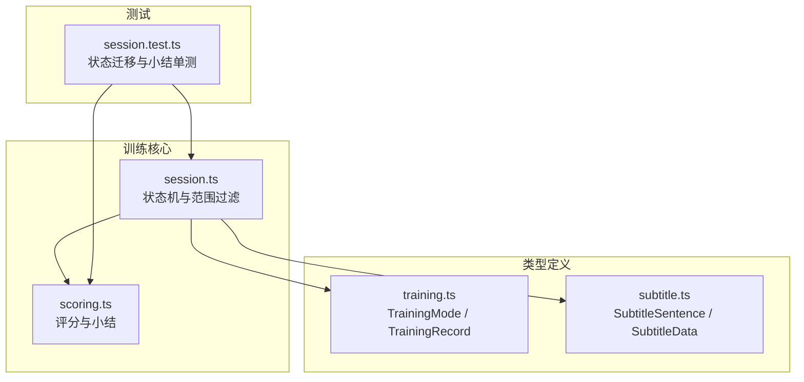
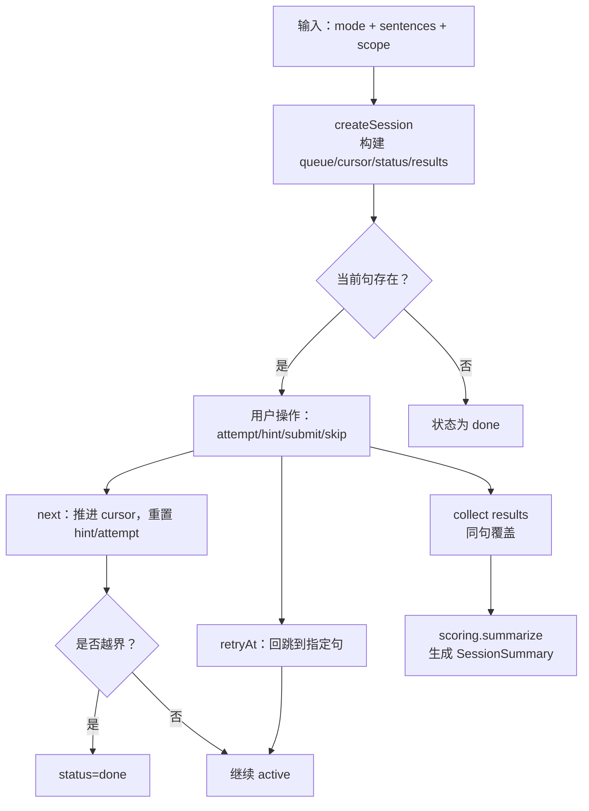
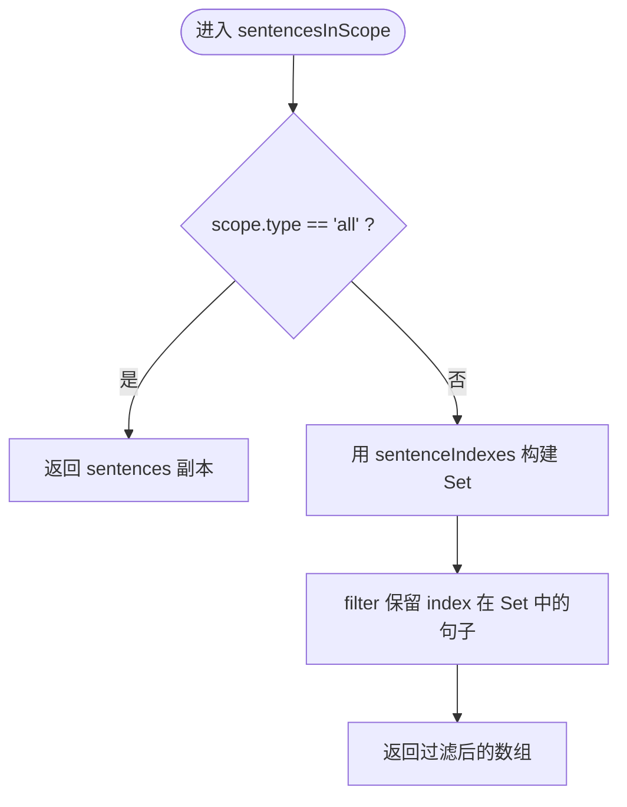
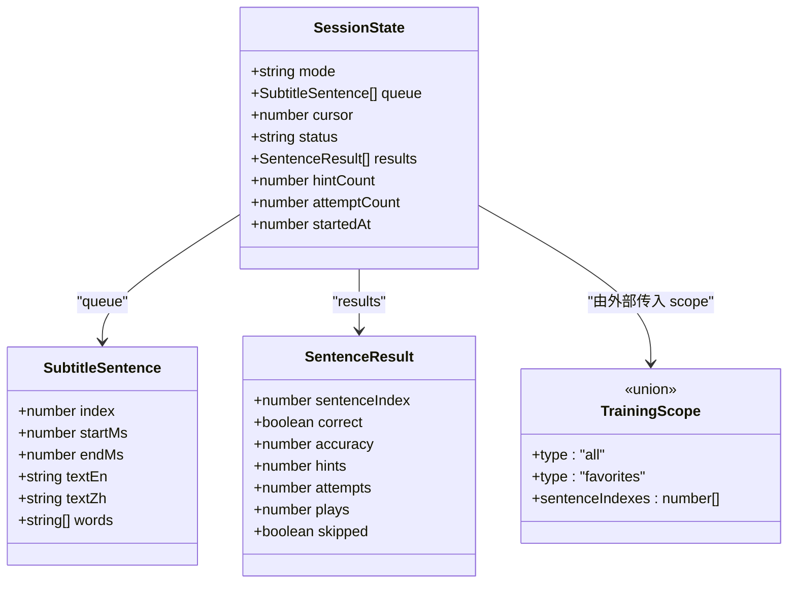
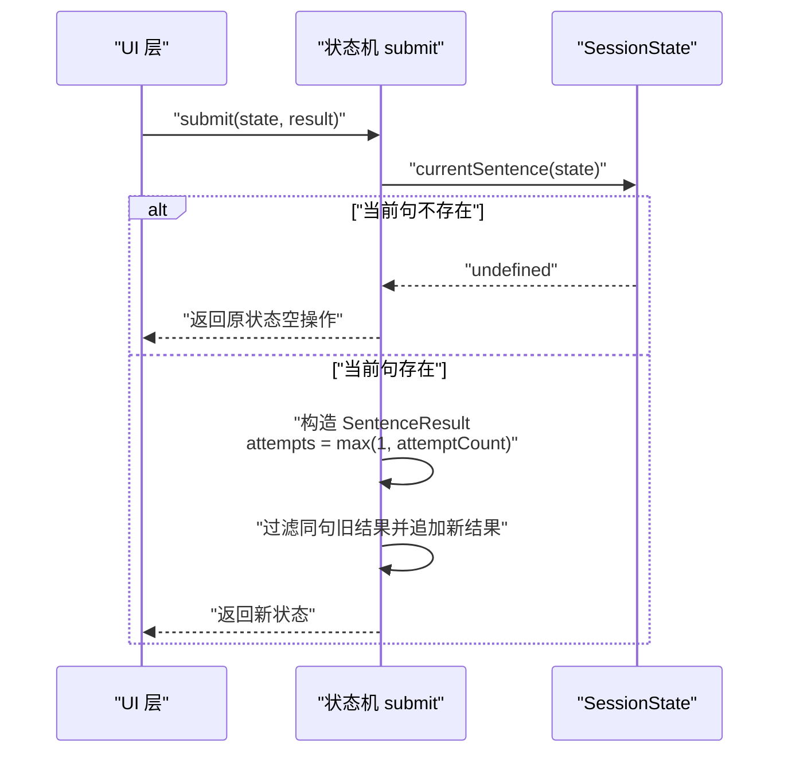
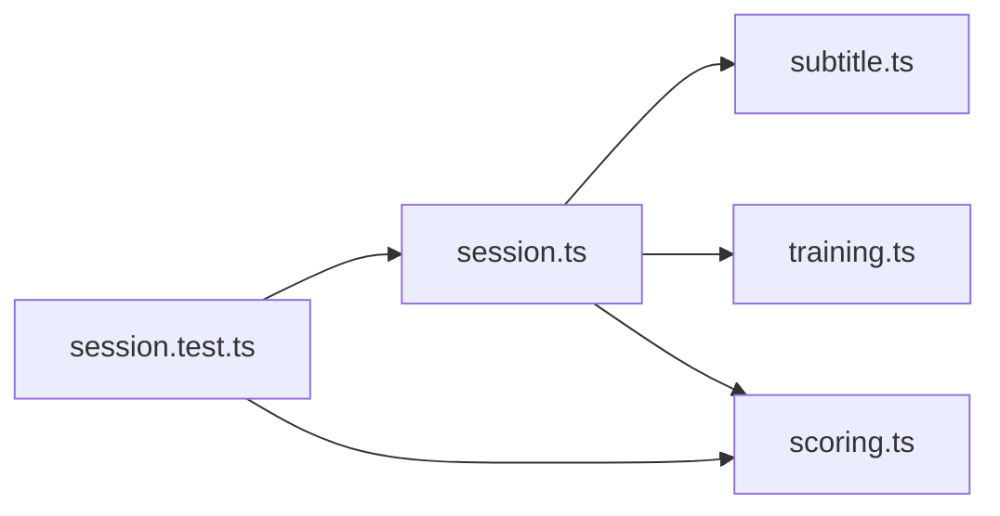

# 训练会话状态机

<cite>
**本文引用的文件**   
- [session.ts](file://client/core/training/session.ts)
- [scoring.ts](file://client/core/training/scoring.ts)
- [training.ts](file://client/types/training.ts)
- [subtitle.ts](file://client/types/subtitle.ts)
- [session.test.ts](file://client/core/training/__tests__/session.test.ts)
</cite>

## 目录
1. [引言](#引言)
2. [项目结构](#项目结构)
3. [核心组件](#核心组件)
4. [架构总览](#架构总览)
5. [详细组件分析](#详细组件分析)
6. [依赖关系分析](#依赖关系分析)
7. [性能与复杂度](#性能与复杂度)
8. [API 接口文档](#api-接口文档)
9. [单元测试用例分析](#单元测试用例分析)
10. [故障排查指南](#故障排查指南)
11. [结论](#结论)

## 引言
本技术文档围绕“训练会话状态机”展开，目标是帮助开发者理解并正确使用纯函数状态机模式来驱动九宫格、听写、跟读、影子跟读、全文背诵等训练流程。该状态机以不可变状态对象为核心，通过 createSession 初始化，并通过 submit/next/hint/skip/retryAt 等事件迁移状态；同时提供 TrainingScope 范围过滤机制，支持“全文”和“收藏句”两种模式。文档将深入解释 SessionState 的状态结构、队列与游标推进策略、结果收集与提示计数、提交计数策略，以及 skip 的零分记录逻辑，并提供完整的 API 说明、测试分析与性能优化建议。

## 项目结构
训练会话状态机位于前端核心模块 client/core/training 下，主要文件如下：
- session.ts：定义 TrainingScope、SessionState 及所有状态迁移函数（createSession、submit、attempt、hint、next、skip、retryAt），并提供 makeRecordId。
- scoring.ts：定义 SentenceResult、SessionSummary，并提供 summarize、formatElapsed。
- types/training.ts：定义 TrainingMode、TrainingRecord 等训练领域模型。
- types/subtitle.ts：定义 SubtitleSentence、SubtitleData 等字幕数据模型。
- __tests__/session.test.ts：覆盖范围过滤、会话创建、提交/提示/跳过/重试等状态迁移与小结汇总。

图表来源
- [session.ts:1-119](file://client/core/training/session.ts#L1-L119)
- [scoring.ts:1-58](file://client/core/training/scoring.ts#L1-L58)
- [training.ts:50-67](file://client/types/training.ts#L50-L67)
- [subtitle.ts:6-31](file://client/types/subtitle.ts#L6-L31)
- [session.test.ts:1-186](file://client/core/training/__tests__/session.test.ts#L1-L186)

章节来源
- [session.ts:1-119](file://client/core/training/session.ts#L1-L119)
- [scoring.ts:1-58](file://client/core/training/scoring.ts#L1-L58)
- [training.ts:50-67](file://client/types/training.ts#L50-L67)
- [subtitle.ts:6-31](file://client/types/subtitle.ts#L6-L31)
- [session.test.ts:1-186](file://client/core/training/__tests__/session.test.ts#L1-L186)

## 核心组件
- 训练范围 TrainingScope：用于控制题目来源，支持“全文”和“收藏句”。
- 会话状态 SessionState：包含 mode、queue、cursor、status、results、hintCount、attemptCount、startedAt。
- 范围过滤 sentencesInScope：按 scope 过滤句子并保持原时间轴顺序。
- 会话生命周期：createSession 初始化 → 多次 submit/attempt/hint → next/skip 推进 → retryAt 回跳 → done 结束。
- 评分与小结：SentenceResult 聚合每句结果，summarize 生成 SessionSummary。

章节来源
- [session.ts:13-32](file://client/core/training/session.ts#L13-L32)
- [session.ts:38-62](file://client/core/training/session.ts#L38-L62)
- [scoring.ts:7-51](file://client/core/training/scoring.ts#L7-L51)

## 架构总览
下图展示状态机的输入、处理与输出关系，以及与评分模块的协作。

图表来源
- [session.ts:44-113](file://client/core/training/session.ts#L44-L113)
- [scoring.ts:39-51](file://client/core/training/scoring.ts#L39-L51)

## 详细组件分析

### 训练范围 TrainingScope 与句子过滤
- TrainingScope 联合类型：
  - { type: 'all' }：使用全部句子。
  - { type: 'favorites'; sentenceIndexes: number[] }：仅使用收藏句集合中的句子。
- sentencesInScope 实现要点：
  - all 模式返回原数组副本，避免共享引用。
  - favorites 模式基于 Set 查找，保持原时间轴顺序。
  - 无匹配时返回空数组，会话直接 done，避免死循环。

图表来源
- [session.ts:38-42](file://client/core/training/session.ts#L38-L42)

章节来源
- [session.ts:13-14](file://client/core/training/session.ts#L13-L14)
- [session.ts:38-42](file://client/core/training/session.ts#L38-L42)
- [session.test.ts:22-44](file://client/core/training/__tests__/session.test.ts#L22-L44)

### 会话状态 SessionState 与初始化 createSession
- SessionState 字段含义：
  - mode：训练模式（puzzle/dictation/read-aloud/shadowing/recitation）。
  - queue：按范围解析后的句子队列，保持原时间轴顺序。
  - cursor：当前题号索引。
  - status：active 或 done。
  - results：已收集结果列表（按提交顺序）。
  - hintCount：当前句已用提示次数。
  - attemptCount：当前句提交计数。
  - startedAt：会话开始时间戳。
- createSession 行为：
  - 先调用 sentencesInScope 得到 queue。
  - 若 queue 为空则 status=done，否则 status=active。
  - cursor 初始为 0，results 初始为空，hintCount/attemptCount 初始为 0。
  - now 可注入，便于测试。

图表来源
- [session.ts:18-32](file://client/core/training/session.ts#L18-L32)
- [subtitle.ts:6-19](file://client/types/subtitle.ts#L6-L19)
- [scoring.ts:7-21](file://client/core/training/scoring.ts#L7-L21)

章节来源
- [session.ts:18-32](file://client/core/training/session.ts#L18-L32)
- [session.ts:44-62](file://client/core/training/session.ts#L44-L62)
- [session.test.ts:46-76](file://client/core/training/__tests__/session.test.ts#L46-L76)

### 状态转换函数

#### submit：提交结果与重试覆盖
- 作用：收集当前句的结果，附带 hints 与 attempts。
- 关键逻辑：
  - 若当前句不存在（done 或队列为空），返回原状态（空操作）。
  - 构造 SentenceResult，其中 attempts 取 Math.max(1, state.attemptCount)，保证至少为 1。
  - 同一句的重试提交会覆盖上一条同句结果（按 sentenceIndex 过滤后追加）。
- 业务意义：允许用户对同一句进行多次尝试，最终只保留最后一次提交结果。

图表来源
- [session.ts:69-78](file://client/core/training/session.ts#L69-L78)

章节来源
- [session.ts:69-78](file://client/core/training/session.ts#L69-L78)
- [session.test.ts:78-105](file://client/core/training/__tests__/session.test.ts#L78-L105)

#### attempt：提交计数策略
- 作用：每次点击提交前先计一次，无论对错。
- 行为：仅在 active 状态下递增 attemptCount；done 状态为空操作。
- 业务意义：驱动“每句最多 N 次提交”的上限控制，并与 submit 的 attempts 字段联动。

章节来源
- [session.ts:80-84](file://client/core/training/session.ts#L80-L84)
- [session.test.ts:78-105](file://client/core/training/__tests__/session.test.ts#L78-L105)

#### hint：提示计数
- 作用：对当前句使用一次提示。
- 行为：仅在 active 状态下递增 hintCount；done 状态为空操作。
- 业务意义：九宫格模式中限制每句提示次数，由 UI 层控制上限。

章节来源
- [session.ts:86-90](file://client/core/training/session.ts#L86-L90)

#### next：推进游标与重置计数
- 作用：推进到下一句。
- 行为：
  - cursor 加 1。
  - 若 cursor >= queue.length，设置 status=done。
  - 否则重置 hintCount 与 attemptCount 为 0。
- 业务意义：确保每句的提示与提交计数独立。

章节来源
- [session.ts:92-98](file://client/core/training/session.ts#L92-L98)
- [session.test.ts:107-126](file://client/core/training/__tests__/session.test.ts#L107-L126)

#### skip：零分记录与推进
- 作用：跳过当前句，记一条 0 分 skipped 结果并推进。
- 行为：
  - 调用 submit 记录 { correct: false, accuracy: 0, skipped: true }。
  - 再调用 next 推进游标。
- 业务意义：明确区分“跳过”与“错误”，便于统计与分析。

章节来源
- [session.ts:100-106](file://client/core/training/session.ts#L100-L106)
- [session.test.ts:128-134](file://client/core/training/__tests__/session.test.ts#L128-L134)

#### retryAt：回跳指定句
- 作用：从“最弱句”或小结中点回某句重新练习。
- 行为：
  - 在 queue 中查找对应 sentenceIndex。
  - 找到则设置 cursor=pos，status=active，并重置 hintCount/attemptCount。
  - 未找到则返回原状态（空操作）。
- 业务意义：支持针对性强化薄弱句。

章节来源
- [session.ts:108-113](file://client/core/training/session.ts#L108-L113)
- [session.test.ts:136-145](file://client/core/training/__tests__/session.test.ts#L136-L145)

### 评分与小结
- SentenceResult：单句结果的最小集，包含正确性、准确率、提示次数、提交次数、播放次数、是否跳过。
- SessionSummary：会话级汇总，包括总数、全对数、平均准确率、用时、最弱句 TOP3、总播放次数。
- summarize：计算句均准确率，筛选非全对句并按准确率升序取前 3 作为 weakest。
- formatElapsed：将毫秒格式化为 mm:ss。

章节来源
- [scoring.ts:7-51](file://client/core/training/scoring.ts#L7-L51)
- [session.test.ts:157-185](file://client/core/training/__tests__/session.test.ts#L157-L185)

## 依赖关系分析
- session.ts 依赖：
  - types/subtitle.ts：SubtitleSentence。
  - types/training.ts：TrainingMode。
  - core/training/scoring.ts：SentenceResult。
- scoring.ts 依赖：
  - 无其他内部依赖，纯函数工具。
- 测试 session.test.ts 依赖：
  - session.ts 的所有导出。
  - scoring.ts 的 summarize 与 formatElapsed。

图表来源
- [session.ts:9-11](file://client/core/training/session.ts#L9-L11)
- [scoring.ts:1-5](file://client/core/training/scoring.ts#L1-L5)
- [session.test.ts:4-6](file://client/core/training/__tests__/session.test.ts#L4-L6)

章节来源
- [session.ts:9-11](file://client/core/training/session.ts#L9-L11)
- [scoring.ts:1-5](file://client/core/training/scoring.ts#L1-L5)
- [session.test.ts:4-6](file://client/core/training/__tests__/session.test.ts#L4-L6)

## 性能与复杂度
- sentencesInScope：
  - all 模式：O(n) 复制数组。
  - favorites 模式：O(n) 遍历 + O(1) 查找（Set），总体 O(n)。
- createSession：O(n) 范围过滤 + 常量初始化。
- submit：
  - 过滤同句旧结果 O(k)，k 为同句提交次数；通常很小。
  - 追加新结果 O(1)。
- next：O(1)。
- skip：O(k) 过滤 + O(1) 追加 + O(1) 推进。
- retryAt：O(n) 查找句位置。
- summarize：O(m) 遍历结果，m 为结果数量；排序 weakest 至多 3 项，近似 O(1)。

优化建议：
- 当同一句频繁重试时，可考虑维护一个以 sentenceIndex 为键的结果映射，避免每次 O(k) 过滤；但需权衡内存与代码复杂度。
- 对于超大材料（n 很大），可在 UI 层分页加载句子，减少一次性过滤开销。
- 使用 immutable 更新时，尽量复用不变部分（如 spread 浅拷贝），避免深层克隆。

[本节为通用性能讨论，不直接分析具体文件]

## API 接口文档

### 类型定义

- TrainingScope
  - 字段：
    - type: 'all' | 'favorites'
    - sentenceIndexes?: number[]（当 type 为 'favorites' 时必填）
  - 用途：控制题目来源范围。

- SessionStatus
  - 值：'active' | 'done'

- SessionState
  - 字段：
    - mode: TrainingMode
    - queue: SubtitleSentence[]
    - cursor: number
    - status: SessionStatus
    - results: SentenceResult[]
    - hintCount: number
    - attemptCount: number
    - startedAt: number

- SentenceResult
  - 字段：
    - sentenceIndex: number
    - correct: boolean
    - accuracy: number（0-100）
    - hints?: number
    - attempts?: number
    - plays?: number
    - skipped?: boolean

- SessionSummary
  - 字段：
    - total: number
    - correctCount: number
    - accuracy: number（句均 0-100）
    - durationMs: number
    - weakest: number[]（TOP3 最弱句 index）
    - totalPlays: number

章节来源
- [session.ts:13-32](file://client/core/training/session.ts#L13-L32)
- [scoring.ts:7-37](file://client/core/training/scoring.ts#L7-L37)
- [training.ts:50-67](file://client/types/training.ts#L50-L67)
- [subtitle.ts:6-19](file://client/types/subtitle.ts#L6-L19)

### 函数 API

- sentencesInScope(sentences, scope?)
  - 参数：
    - sentences: SubtitleSentence[]
    - scope?: TrainingScope（默认 { type: 'all' }）
  - 返回值：SubtitleSentence[]（保持原时间轴顺序）
  - 行为：
    - all：返回副本。
    - favorites：按 sentenceIndexes 过滤。

- createSession(mode, sentences, scope?, now?)
  - 参数：
    - mode: TrainingMode
    - sentences: SubtitleSentence[]
    - scope?: TrainingScope（默认 { type: 'all' }）
    - now?: number（默认 Date.now()）
  - 返回值：SessionState
  - 行为：
    - 初始化 queue/cursor/status/results/hintCount/attemptCount/startedAt。
    - 空队列 → status=done。

- currentSentence(state)
  - 参数：state: SessionState
  - 返回值：SubtitleSentence | undefined
  - 行为：active 且 cursor 有效时返回当前句。

- submit(state, result)
  - 参数：
    - state: SessionState
    - result: Omit<SentenceResult, 'sentenceIndex' | 'hints' | 'attempts'>
  - 返回值：SessionState
  - 行为：
    - 收集结果，附带 hints/attempts。
    - 同句重试覆盖旧结果。
    - attempts 至少为 1。

- attempt(state)
  - 参数：state: SessionState
  - 返回值：SessionState
  - 行为：
    - active 状态下 attemptCount+1。
    - done 状态为空操作。

- hint(state)
  - 参数：state: SessionState
  - 返回值：SessionState
  - 行为：
    - active 状态下 hintCount+1。
    - done 状态为空操作。

- next(state)
  - 参数：state: SessionState
  - 返回值：SessionState
  - 行为：
    - cursor+1。
    - 越界 → status=done。
    - 否则重置 hintCount/attemptCount。

- skip(state)
  - 参数：state: SessionState
  - 返回值：SessionState
  - 行为：
    - 记录 0 分 skipped 结果。
    - 推进到下一句。

- retryAt(state, sentenceIndex)
  - 参数：
    - state: SessionState
    - sentenceIndex: number
  - 返回值：SessionState
  - 行为：
    - 找到则回跳并恢复 active，重置 hintCount/attemptCount。
    - 未找到为空操作。

- makeRecordId(now?)
  - 参数：now?: number（默认 Date.now()）
  - 返回值：string（时间戳 36 进制 + 随机段）

- summarize(results, durationMs)
  - 参数：
    - results: SentenceResult[]
    - durationMs: number
  - 返回值：SessionSummary
  - 行为：
    - 计算句均准确率。
    - 选出 weakest TOP3（排除全对句）。
    - 累计 totalPlays。

- formatElapsed(durationMs)
  - 参数：durationMs: number
  - 返回值：string（mm:ss）

章节来源
- [session.ts:38-118](file://client/core/training/session.ts#L38-L118)
- [scoring.ts:39-57](file://client/core/training/scoring.ts#L39-L57)

### 使用示例（概念性）
- 初始化全文训练会话：
  - 调用 createSession('dictation', sentences, { type: 'all' })。
- 收藏句训练：
  - 调用 createSession('puzzle', sentences, { type: 'favorites', sentenceIndexes: [1, 3] })。
- 提交与推进：
  - 多次 attempt/hint 后 submit，然后 next 推进。
- 跳过与回跳：
  - 使用 skip 记录零分并推进；使用 retryAt 回到薄弱句。
- 生成小结：
  - 使用 summarize(results, durationMs) 获取 SessionSummary。

[本节为概念性示例，不直接分析具体文件]

## 单元测试用例分析
测试覆盖以下关键点：
- sentencesInScope：
  - all 模式返回副本且不共享引用。
  - 省略 scope 时按 all 处理。
  - favorites 模式按 sentenceIndexes 过滤并保持顺序。
  - 无匹配时返回空数组。
- createSession：
  - 初始状态 active、cursor=0、注入 now。
  - 空队列 → done。
  - favorites 范围过滤。
  - 空队列小结不报错。
- submit/attempt/hint：
  - submit 收集结果并附带 hints/attempts。
  - 同句重复提交覆盖。
  - 未 attempt 时 attempts 至少为 1。
  - done 状态下均为空操作。
- next/skip/retryAt：
  - next 推进并重置 hint/attempt。
  - next 越过队尾 → done。
  - skip 记 0 分 skipped 并推进。
  - retryAt 回跳指定句并恢复 active。
- makeRecordId：
  - 带时间戳前缀且两次不同。
- scoring.summarize/formatElapsed：
  - 汇总正确率、用时、weakest TOP3。
  - 空结果返回零值。
  - 时间格式化 mm:ss。

章节来源
- [session.test.ts:22-185](file://client/core/training/__tests__/session.test.ts#L22-L185)

## 故障排查指南
常见问题与定位方法：
- 会话一直 active 不结束：
  - 检查 next 是否被调用，以及 cursor 是否超过 queue.length。
  - 确认 queue 长度是否正确（范围过滤是否正确）。
- 提交结果未覆盖：
  - 检查 submit 是否对同句旧结果进行了过滤。
  - 确认 sentenceIndex 一致。
- attempts 始终为 1：
  - 检查是否在 submit 前调用了 attempt。
- skip 未记录零分：
  - 确认 skip 内部调用了 submit 并传入了 skipped=true。
- 小结 weakest 为空：
  - 检查是否有非全对句；若全部正确，weakest 为空符合预期。
- 时间格式异常：
  - 检查传入 durationMs 是否为负数；formatElapsed 会将其归零。

章节来源
- [session.ts:69-113](file://client/core/training/session.ts#L69-L113)
- [scoring.ts:39-57](file://client/core/training/scoring.ts#L39-L57)
- [session.test.ts:78-185](file://client/core/training/__tests__/session.test.ts#L78-L185)

## 结论
训练会话状态机采用纯函数不可变状态设计，职责清晰、易于测试与推理。通过 TrainingScope 支持全文与收藏句两种范围，SessionState 统一管理队列、游标、结果与计数，submit/next/hint/skip/retryAt 等事件驱动状态迁移，配合 scoring 模块完成结果汇总与可视化。该设计具备良好的扩展性与可维护性，适合在多训练模式中复用。建议在大规模材料场景下结合 UI 层分页与缓存策略进一步优化性能。