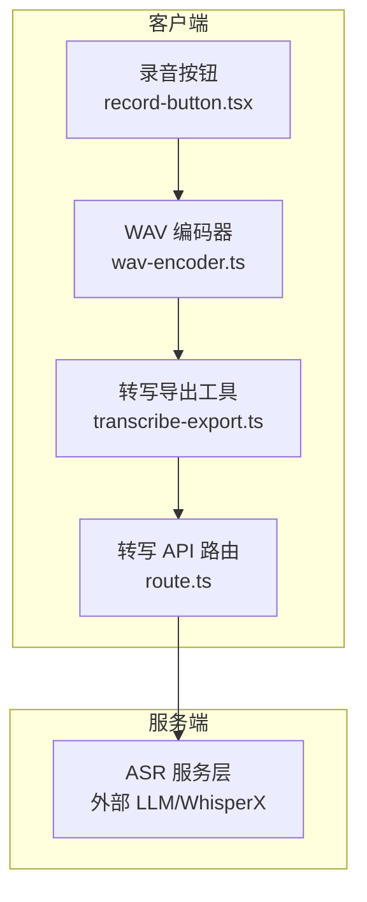
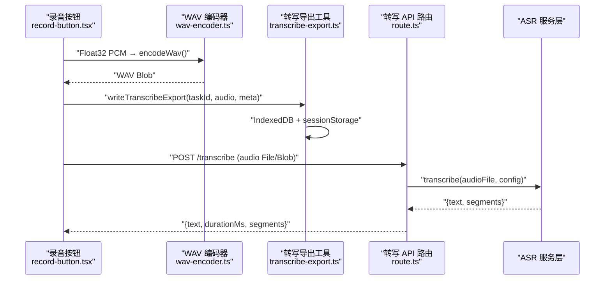
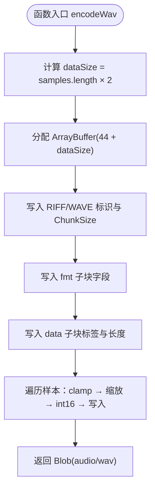
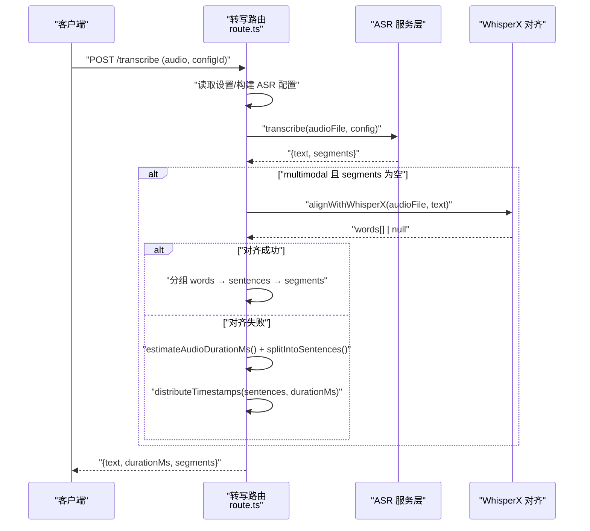
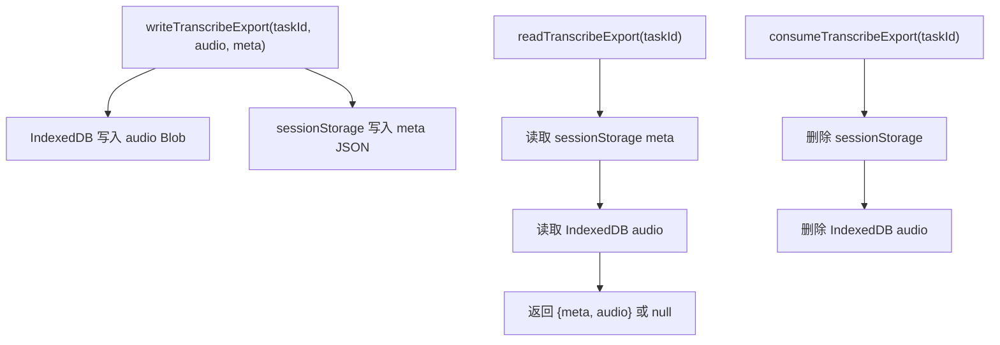
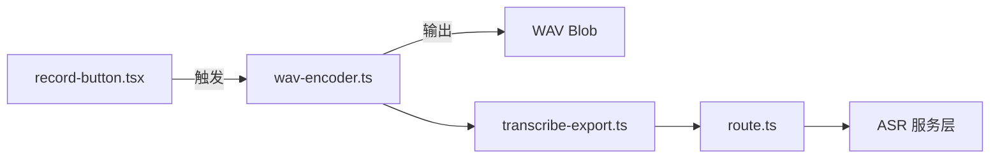

# 音频处理引擎

<cite>
**本文引用的文件**   
- [wav-encoder.ts](file://client/core/audio/wav-encoder.ts)
- [wav-encoder.test.ts](file://client/core/audio/__tests__/wav-encoder.test.ts)
- [route.ts](file://client/app/api/transcribe/route.ts)
- [transcribe-export.ts](file://client/lib/transcribe-export.ts)
- [record-button.tsx](file://client/components/shared/record-button.tsx)
</cite>

## 目录
1. [引言](#引言)
2. [项目结构](#项目结构)
3. [核心组件](#核心组件)
4. [架构总览](#架构总览)
5. [详细组件分析](#详细组件分析)
6. [依赖关系分析](#依赖关系分析)
7. [性能与内存策略](#性能与内存策略)
8. [故障排查指南](#故障排查指南)
9. [结论](#结论)
10. [附录：API 参考与基准建议](#附录api-参考与基准建议)

## 引言
本技术文档聚焦于本项目中的音频处理引擎，重点解释 WAV 编码器的实现原理、WAV 二进制格式构造、采样率转换与位深度处理的数学细节，并梳理从录音到转写服务的数据链路。当前仓库中已实现的音频处理核心位于客户端的 WAV 编码器模块；同时，服务端转写路由提供了对上传 WAV 文件的时长探测与时间戳后处理逻辑。文档将基于这些真实代码进行系统化说明，并给出可操作的优化建议与测试方法。

## 项目结构
围绕音频处理的相关代码主要分布在以下位置：
- 客户端音频工具：`client/core/audio/wav-encoder.ts`
- 客户端单元测试：`client/core/audio/__tests__/wav-encoder.test.ts`
- 客户端转写 API（BFF）：`client/app/api/transcribe/route.ts`
- 转写产物导出工具：`client/lib/transcribe-export.ts`
- 录音 UI 按钮组件：`client/components/shared/record-button.tsx`

**图表来源**
- [record-button.tsx:1-22](file://client/components/shared/record-button.tsx#L1-L22)
- [wav-encoder.ts:1-59](file://client/core/audio/wav-encoder.ts#L1-L59)
- [transcribe-export.ts:1-68](file://client/lib/transcribe-export.ts#L1-L68)
- [route.ts:1-289](file://client/app/api/transcribe/route.ts#L1-L289)

**章节来源**
- [wav-encoder.ts:1-59](file://client/core/audio/wav-encoder.ts#L1-L59)
- [route.ts:1-289](file://client/app/api/transcribe/route.ts#L1-L289)
- [transcribe-export.ts:1-68](file://client/lib/transcribe-export.ts#L1-L68)
- [record-button.tsx:1-22](file://client/components/shared/record-button.tsx#L1-L22)

## 核心组件
- WAV 编码器：提供 `encodeWav(samples, sampleRate?)` 与 `wavDurationMs(sampleCount, sampleRate?)`，将 Float32 PCM 样本转换为标准 44 字节头 WAV Blob，默认目标采样率为 16kHz、单声道、16bit PCM。
- 转写 API 路由：接收前端上传的 WAV 文件，调用统一 ASR 服务层，并在无时间戳时尝试 WhisperX 对齐或回退为比例分配时间戳。
- 转写导出工具：将转写结果与音频 Blob 分别持久化到 IndexedDB 与 sessionStorage，供导入页自动填充。
- 录音按钮：提供开始/停止录音的 UI 交互入口。

**章节来源**
- [wav-encoder.ts:1-59](file://client/core/audio/wav-encoder.ts#L1-L59)
- [route.ts:180-289](file://client/app/api/transcribe/route.ts#L180-L289)
- [transcribe-export.ts:36-67](file://client/lib/transcribe-export.ts#L36-L67)
- [record-button.tsx:6-18](file://client/components/shared/record-button.tsx#L6-L18)

## 架构总览
整体数据流如下：
- 前端通过录音 UI 触发采集（当前仓库未包含 MediaRecorder 实现，但约定输出为 Float32 PCM）。
- 使用 WAV 编码器将 Float32 PCM 转为 16kHz 单声道 16bit WAV Blob。
- 通过转写导出工具将音频与元数据暂存，随后提交给 BFF 转写 API。
- BFF 调用 ASR 服务层，必要时进行 WhisperX 对齐或时间戳回退。

**图表来源**
- [record-button.tsx:6-18](file://client/components/shared/record-button.tsx#L6-L18)
- [wav-encoder.ts:19-52](file://client/core/audio/wav-encoder.ts#L19-L52)
- [transcribe-export.ts:36-67](file://client/lib/transcribe-export.ts#L36-L67)
- [route.ts:180-289](file://client/app/api/transcribe/route.ts#L180-L289)

## 详细组件分析

### WAV 编码器实现原理
WAV 编码器负责将 Float32 PCM 样本序列转换为标准 WAV 文件 Blob。其关键特性包括：
- 输入：Float32Array 样本，值域约定为 [-1, 1)。
- 输出：Blob，MIME 类型为 `audio/wav`。
- 默认参数：采样率 16kHz，单声道，16bit PCM。
- 确定性：相同输入产生相同字节级输出。

#### 采样率与声道处理
- 目标采样率常量 `TARGET_SAMPLE_RATE = 16000`，用于头部写入与时长计算。
- 声道固定为单声道（NumChannels=1），因此无需声道合并逻辑。
- 若上游需要重采样至 16kHz，应在编码器之前完成（例如在浏览器 AudioContext 或离线重采样管线中），编码器仅负责按指定采样率写出 WAV 头。

#### 位深度与数值映射
- 浮点样本到 int16 的映射采用四舍五入：正半轴乘以 `0x7fff`，负半轴乘以 `0x8000`。
- 越界保护：先 clamp 到 [-1, 1)，再 clamp 到 int16 范围 [-32768, 32767]。
- NaN 归零：非有限数被置为 0，避免非法字节。

#### WAV 头部二进制布局
- RIFF 容器：前 4 字节为 `RIFF`，第 5-8 字节为 ChunkSize（小端），第 9-12 字节为 `WAVE`。
- fmt 子块：
  - 偏移 12-15：`fmt `
  - 偏移 16-19：块大小 16（PCM）
  - 偏移 20-21：AudioFormat = 1（PCM）
  - 偏移 22-23：NumChannels = 1（单声道）
  - 偏移 24-27：SampleRate（默认 16000）
  - 偏移 28-31：ByteRate = SampleRate × BlockAlign
  - 偏移 32-33：BlockAlign = NumChannels × BitsPerSample/8 = 2
  - 偏移 34-35：BitsPerSample = 16
- data 子块：
  - 偏移 36-39：`data`
  - 偏移 40-43：DataSize = samples.length × 2

**图表来源**
- [wav-encoder.ts:19-52](file://client/core/audio/wav-encoder.ts#L19-L52)

**章节来源**
- [wav-encoder.ts:1-59](file://client/core/audio/wav-encoder.ts#L1-L59)

### 转写 API 路由与时间戳后处理
转写路由负责：
- 校验请求表单中的音频文件。
- 读取 LLM/ASR 配置并调用统一服务层。
- 当多模态模型未返回时间戳时，尝试 WhisperX 对齐；失败则回退为按句子比例分配时间戳。
- 估算音频时长：优先解析 WAV 头，否则按文件大小与 16kHz 字节率估算。

**图表来源**
- [route.ts:28-73](file://client/app/api/transcribe/route.ts#L28-L73)
- [route.ts:117-174](file://client/app/api/transcribe/route.ts#L117-L174)
- [route.ts:180-289](file://client/app/api/transcribe/route.ts#L180-L289)

**章节来源**
- [route.ts:180-289](file://client/app/api/transcribe/route.ts#L180-L289)

### 转写导出工具
该工具将转写产物分为两层存储：
- 音频 Blob 存入 IndexedDB blobs store，键名为 `transcribe:{taskId}`。
- 索引 JSON 存入 sessionStorage，键名为 `ping-english:transcribe-export:{taskId}`。
- 提供写入、读取与清理接口，确保导入页可自动填充，并在成功后清理临时数据。

**图表来源**
- [transcribe-export.ts:36-67](file://client/lib/transcribe-export.ts#L36-L67)

**章节来源**
- [transcribe-export.ts:1-68](file://client/lib/transcribe-export.ts#L1-L68)

### 录音按钮组件
录音按钮提供简单的开始/停止状态切换，文案随状态变化。实际录音与流处理逻辑不在该组件内，需由上层页面集成 MediaRecorder 或自定义采集管线。

**章节来源**
- [record-button.tsx:6-18](file://client/components/shared/record-button.tsx#L6-L18)

## 依赖关系分析
- WAV 编码器是纯函数模块，不依赖浏览器特有 API（除 Blob/DataView 等基础 Web API），便于测试与 Node 环境验证。
- 转写路由依赖 Next.js 的 Request/Response 与统一 LLM/ASR 服务层。
- 转写导出工具依赖 IndexedDB 与 sessionStorage，具备降级能力（sessionStorage 不可用时仍可继续运行）。
- 录音按钮为纯展示组件，状态由父组件管理。

**图表来源**
- [wav-encoder.ts:1-59](file://client/core/audio/wav-encoder.ts#L1-L59)
- [transcribe-export.ts:1-68](file://client/lib/transcribe-export.ts#L1-L68)
- [route.ts:180-289](file://client/app/api/transcribe/route.ts#L180-L289)
- [record-button.tsx:1-22](file://client/components/shared/record-button.tsx#L1-L22)

**章节来源**
- [wav-encoder.ts:1-59](file://client/core/audio/wav-encoder.ts#L1-L59)
- [transcribe-export.ts:1-68](file://client/lib/transcribe-export.ts#L1-L68)
- [route.ts:180-289](file://client/app/api/transcribe/route.ts#L180-L289)
- [record-button.tsx:1-22](file://client/components/shared/record-button.tsx#L1-L22)

## 性能与内存策略
- 分块处理建议：对于长录音，建议在编码器之前将 Float32 PCM 流切分为固定大小的块（例如每块对应 1-2 秒音频），逐块编码为 WAV 片段，最后拼接或流式上传，以降低单次内存峰值。
- 采样率转换：若上游采样率非 16kHz，应使用高质量的重采样算法（如 sinc 插值或带抗混叠滤波的多相滤波器组），在编码器前完成，以避免引入高频失真。
- 位深度处理：编码器已实现 clamp 与 NaN 归零，保证输出安全；如需动态范围调整，可在 float 阶段应用压缩器或限幅器。
- 噪声抑制：建议在 float 阶段加入频谱减噪或自适应滤波，以减少背景噪声对 ASR 的影响。
- 批量处理管道：可将多个录音任务放入队列，限制并发数，避免阻塞主线程。

[本节为通用指导，不直接分析具体文件]

## 故障排查指南
- WAV 头部校验失败：检查 RIFF/WAVE/fmt/data 标签与长度字段是否一致，确认 ByteRate 与 BlockAlign 计算正确。
- 时长异常：确认 WAV 头中的 SampleRate 与 DataSize 与实际样本数匹配；若无法解析 WAV 头，后端会按文件大小估算时长。
- 时间戳缺失：当多模态模型未返回时间戳时，路由会尝试 WhisperX 对齐；若失败，则回退为按句子比例分配时间戳。
- 存储问题：IndexedDB 或 sessionStorage 不可用时，导出工具会静默降级，不影响主流程；导入页读取失败返回 null，允许用户手动选择文件。

**章节来源**
- [route.ts:140-174](file://client/app/api/transcribe/route.ts#L140-L174)
- [route.ts:211-267](file://client/app/api/transcribe/route.ts#L211-L267)
- [transcribe-export.ts:36-67](file://client/lib/transcribe-export.ts#L36-L67)

## 结论
本项目实现了稳定、确定性的 WAV 编码器，严格遵循 ADR-5 约定的 16kHz 单声道 16bit PCM 格式，并提供完整的 WAV 头部构造与数值映射保护。转写路由在服务端对上传音频进行时长探测与时间戳后处理，增强了鲁棒性。导出工具将音频与元数据分层存储，支持导入页自动填充与清理。未来可在录音与重采样阶段引入更高质量的 DSP 算法与分块处理机制，以进一步提升音频质量与系统性能。

[本节为总结性内容，不直接分析具体文件]

## 附录：API 参考与基准建议

### WAV 编码器 API
- `encodeWav(samples: Float32Array, sampleRate?: number): Blob`
  - 功能：将 Float32 PCM 样本编码为标准 WAV Blob。
  - 默认采样率：16000 Hz。
  - 输出 MIME：`audio/wav`。
- `wavDurationMs(sampleCount: number, sampleRate?: number): number`
  - 功能：根据样本数与采样率计算时长（毫秒）。

**章节来源**
- [wav-encoder.ts:19-58](file://client/core/audio/wav-encoder.ts#L19-L58)

### 转写导出工具 API
- `writeTranscribeExport(taskId: string, audio: File | Blob, meta: Omit<TranscribeExportMeta, 'taskId'>): Promise<void>`
- `readTranscribeExport(taskId: string): Promise<TranscribeExportPayload | null>`
- `consumeTranscribeExport(taskId: string): Promise<void>`

**章节来源**
- [transcribe-export.ts:36-67](file://client/lib/transcribe-export.ts#L36-L67)

### 转写 API 路由行为
- POST `/transcribe`
  - 输入：表单字段 `audio`（File/Blob）、可选 `configId`。
  - 输出：`{text, durationMs, segments}`。
  - 时间戳策略：优先 WhisperX 对齐，失败则按句子比例分配。

**章节来源**
- [route.ts:180-289](file://client/app/api/transcribe/route.ts#L180-L289)

### 单元测试覆盖要点
- 头部字段校验：RIFF/WAVE/fmt/data 标签与长度。
- 自定义采样率写入。
- Float→int16 换算与越界 clamp。
- 溢出防护与 NaN 归零。
- 确定性输出与空样本合法头。
- 时长计算与目标采样率常量。

**章节来源**
- [wav-encoder.test.ts:18-99](file://client/core/audio/__tests__/wav-encoder.test.ts#L18-L99)

### 性能基准建议
- 编码器吞吐：测量不同样本长度下的编码耗时与内存峰值。
- 重采样延迟：对比不同重采样算法在 16kHz 目标下的延迟与音质指标（SNR、PESQ）。
- 端到端时延：从录音开始到转写结果返回的整体时延分布。
- 批量处理：评估队列并发度对 CPU 占用与吞吐的影响。

[本节为通用指导，不直接分析具体文件]