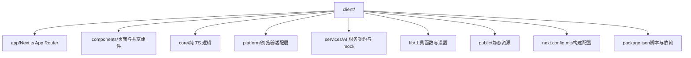
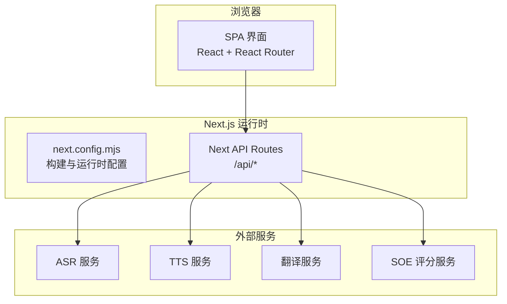
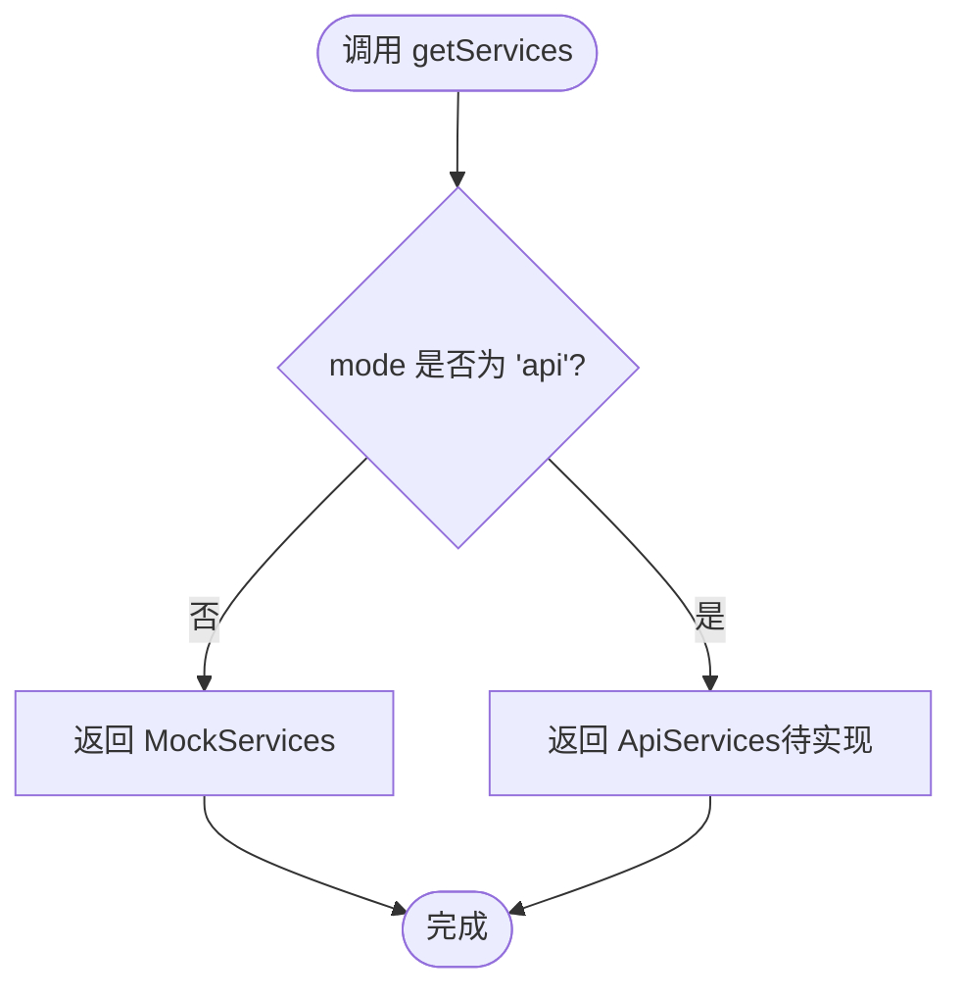
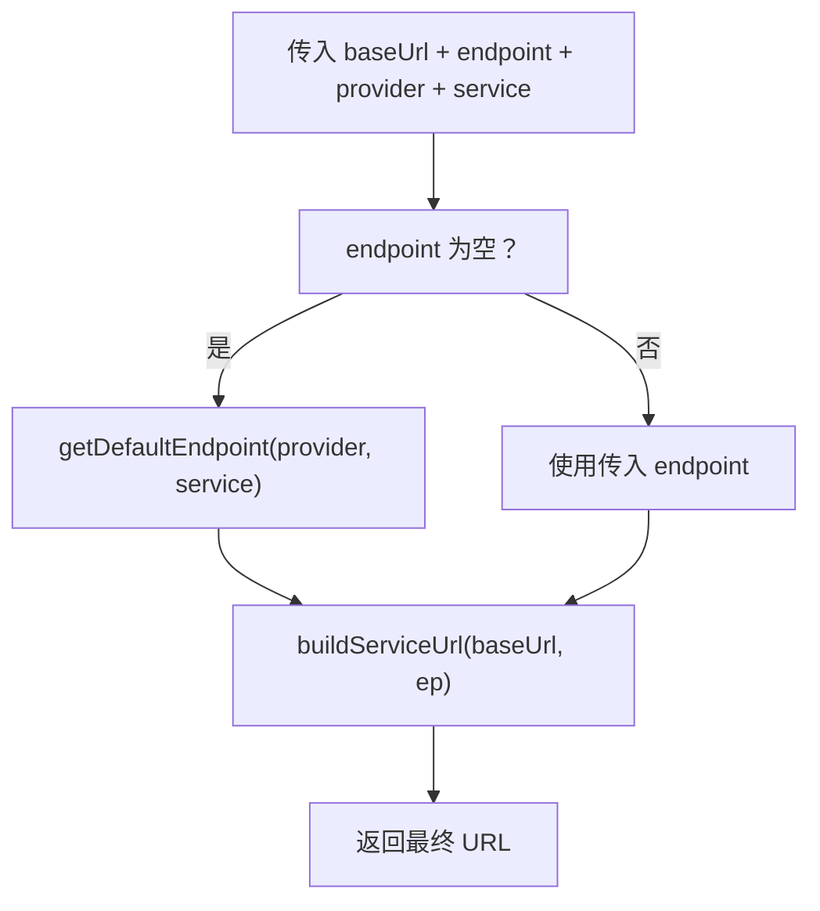
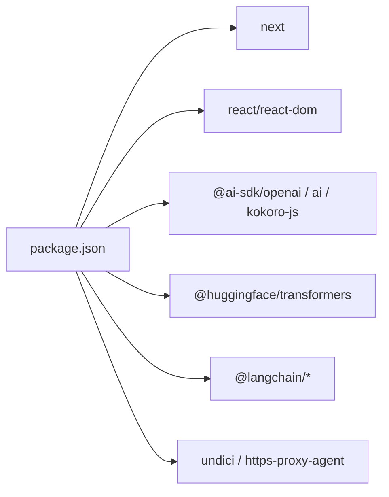

# 前端部署

<cite>
**本文引用的文件**   
- [client/next.config.mjs](file://client/next.config.mjs)
- [client/package.json](file://client/package.json)
- [client/lib/service-endpoints.ts](file://client/lib/service-endpoints.ts)
- [client/lib/server-settings.ts](file://client/lib/server-settings.ts)
- [client/services/index.ts](file://client/services/index.ts)
- [client/README.md](file://client/README.md)
- [README.md](file://README.md)
</cite>

## 目录
1. [简介](#简介)
2. [项目结构](#项目结构)
3. [核心组件](#核心组件)
4. [架构总览](#架构总览)
5. [详细组件分析](#详细组件分析)
6. [依赖关系分析](#依赖关系分析)
7. [性能与构建优化](#性能与构建优化)
8. [环境变量与服务地址配置](#环境变量与服务地址配置)
9. [CDN 与缓存策略](#cdn-与缓存策略)
10. [容器化部署方案](#容器化部署方案)
11. [常见平台部署指南](#常见平台部署指南)
12. [故障排查](#故障排查)
13. [结论](#结论)

## 简介
本文件面向生产环境的前端 Next.js 应用，聚焦以下目标：
- 生产构建配置与输出结构
- 静态资源处理、API 代理与环境变量
- 服务地址与多模型配置
- Docker 容器化与镜像优化
- CDN 缓存与版本管理
- Vercel、Netlify、自建服务器的部署实践

本项目采用 Next.js App Router 作为 SPA Shell，业务逻辑全部在客户端运行；AI 能力通过服务契约抽象，当前默认使用 Mock 实现，预留切换至真实后端的能力。

## 项目结构
前端位于 client 目录，采用 Next.js 16.3.0 + React 19 + TypeScript 5.7.3 + Tailwind CSS 4 + shadcn/ui。根级 README 与 client/README 均描述了整体结构与快速开始命令。

图示来源
- [client/README.md:21-96](file://client/README.md#L21-L96)
- [README.md:23-56](file://README.md#L23-L56)

章节来源
- [client/README.md:21-96](file://client/README.md#L21-L96)
- [README.md:23-56](file://README.md#L23-L56)

## 核心组件
- 构建入口与脚本：package.json 定义 dev/build/start/test 等脚本，基于 next 命令行。
- Next 配置：next.config.mjs 关闭图片优化、忽略构建错误、允许开发跨域访问。
- 服务契约与工厂：services/index.ts 提供统一的服务获取入口，当前返回 mock，预留 NEXT_PUBLIC_SERVICE_MODE 切换。
- 服务地址与默认值：lib/service-endpoints.ts 统一管理 provider 的 endpoint、默认模型与音色，并提供 URL 拼接工具。
- 本地设置持久化：lib/server-settings.ts 负责 LLM 配置、SOE 配置、Kokoro TTS 设置等的读写。

章节来源
- [client/package.json:5-10](file://client/package.json#L5-L10)
- [client/next.config.mjs:1-16](file://client/next.config.mjs#L1-L16)
- [client/services/index.ts:1-68](file://client/services/index.ts#L1-L68)
- [client/lib/service-endpoints.ts:1-161](file://client/lib/service-endpoints.ts#L1-L161)
- [client/lib/server-settings.ts:1-327](file://client/lib/server-settings.ts#L1-L327)

## 架构总览
下图展示前端在生产环境中的关键交互：浏览器请求 Next 静态资源，必要时通过 Next API Routes 或反向代理转发到后端服务。

图示来源
- [client/next.config.mjs:1-16](file://client/next.config.mjs#L1-L16)
- [client/services/index.ts:1-68](file://client/services/index.ts#L1-L68)
- [client/lib/service-endpoints.ts:1-161](file://client/lib/service-endpoints.ts#L1-L161)

## 详细组件分析

### 构建配置与优化（next.config.mjs）
- 类型检查：忽略构建时的 TypeScript 错误，便于快速迭代与 CI 稳定。
- 图片优化：关闭 unoptimized，避免 Next 对图片进行额外处理，适合自有 CDN 托管场景。
- 开发跨域：allowedDevOrigins 允许局域网与本机访问，解决移动端调试白屏问题。

建议在生产中根据实际部署方式补充：
- output: 'standalone'（Vercel 以外自托管时推荐）
- assetPrefix / basePath（配合 CDN 与子路径部署）
- images.remotePatterns（若启用图片优化并直连远端图片）

章节来源
- [client/next.config.mjs:1-16](file://client/next.config.mjs#L1-L16)

### 构建流程与输出（pnpm build）
- 执行命令：pnpm build → next build。
- 产物位置：默认输出到 client/.next。
- 启动命令：pnpm start → next start，用于生产环境运行。

说明
- 当前 package.json 未显式指定 output 模式，默认由 Next 决定。
- 若需独立部署，可在 next.config.mjs 中添加 output: 'standalone'，并在 Docker 中使用 .next/standalone 作为运行目录。

章节来源
- [client/package.json:5-10](file://client/package.json#L5-L10)
- [client/README.md:113-118](file://client/README.md#L113-L118)

### 服务契约与工厂（services/index.ts）
- getServices(mode)：统一入口，当前恒返回 mock 实现。
- getSoeService()：从 /api/settings/soe 读取 SOE 配置，mock 则走本地伪评分，否则创建 ApiSoeService。
- 预留 NEXT_PUBLIC_SERVICE_MODE：注释中明确未来按该环境变量切换 api/mock。

图示来源
- [client/services/index.ts:38-48](file://client/services/index.ts#L38-L48)

章节来源
- [client/services/index.ts:1-68](file://client/services/index.ts#L1-L68)

### 服务地址与默认值（lib/service-endpoints.ts）
- 统一管理 provider（dashscope/qwen/mimo/local）在各 ServiceKind（tts/asr/translate/mnemonic）下的默认 endpoint。
- 提供 buildServiceUrl、getDefaultEndpoint、getDefaultModel、getDefaultVoice、resolveServiceUrl 等工具方法。
- 内置若干本地服务默认地址（WhisperX、faster-whisper、Ollama/vLLM、SOE 代理）。

图示来源
- [client/lib/service-endpoints.ts:113-160](file://client/lib/service-endpoints.ts#L113-L160)

章节来源
- [client/lib/service-endpoints.ts:1-161](file://client/lib/service-endpoints.ts#L1-L161)

### 本地设置持久化（lib/server-settings.ts）
- 存储位置：用户主目录 ~/.ping-eng/settings.json。
- 支持多模型配置（llmConfigs）、默认配置（defaultLlmConfigId）、向后兼容旧 llm 字段。
- 包含 Kokoro TTS 设置（modelId/modelPath）与 SOE 配置（provider/proxyUrl/各厂商密钥）。

注意
- 该模块依赖 Node 文件系统，仅适用于服务端或桌面端渲染；浏览器端不应直接调用。

章节来源
- [client/lib/server-settings.ts:1-327](file://client/lib/server-settings.ts#L1-L327)

## 依赖关系分析
- Next.js 运行时依赖：next、react、react-dom。
- AI 相关依赖：@ai-sdk/openai、ai、kokoro-js、@huggingface/transformers、@langchain/*。
- 工具与网络：undici、https-proxy-agent、fflate。
- pnpm overrides：锁定 hono 版本，减少依赖冲突风险。

图示来源
- [client/package.json:11-33](file://client/package.json#L11-L33)
- [client/package.json:44-58](file://client/package.json#L44-L58)

章节来源
- [client/package.json:1-60](file://client/package.json#L1-L60)

## 性能与构建优化
- 图片优化已关闭（unoptimized: true），适合将静态资源交由 CDN 处理。
- 忽略构建错误（ignoreBuildErrors: true），利于 CI 稳定性，但建议在发布前开启严格检查。
- 建议在生产构建时：
  - 启用 standalone 输出以减小运行体积（非 Vercel 部署）。
  - 使用 assetPrefix/basePath 指向 CDN 域名与子路径。
  - 为静态资源添加版本号或哈希，配合 CDN 强缓存。

[本节为通用指导，不直接分析具体文件]

## 环境变量与服务地址配置

### NEXT_PUBLIC_SERVICE_MODE
- 用途：切换服务来源（mock | api）。
- 现状：services/index.ts 中预留了读取逻辑，当前默认返回 mock。
- 建议：接入真实后端后，在 getServices 中根据该环境变量返回 api 实现。

章节来源
- [client/services/index.ts:6-8](file://client/services/index.ts#L6-L8)
- [client/services/index.ts:41-48](file://client/services/index.ts#L41-L48)

### 服务地址与默认值
- lib/service-endpoints.ts 集中维护各 provider 的 endpoint、默认模型与音色，并通过 resolveServiceUrl 生成最终 URL。
- 本地服务默认地址（WhisperX/faster-whisper/Ollama/SOE 代理）在该文件中定义，便于统一调整。

章节来源
- [client/lib/service-endpoints.ts:22-68](file://client/lib/service-endpoints.ts#L22-L68)
- [client/lib/service-endpoints.ts:113-160](file://client/lib/service-endpoints.ts#L113-L160)

### 本地设置（settings.json）
- 位置：~/.ping-eng/settings.json。
- 内容：LLM 配置（provider/baseUrl/apiKey/各服务 model 与 endpoint）、SOE 配置（provider/proxyUrl/厂商密钥）、Kokoro TTS 设置（modelId/modelPath）。
- 作用：在需要服务端或桌面端渲染的场景下，持久化用户配置。

章节来源
- [client/lib/server-settings.ts:52-70](file://client/lib/server-settings.ts#L52-L70)
- [client/lib/server-settings.ts:121-246](file://client/lib/server-settings.ts#L121-L246)
- [client/lib/server-settings.ts:248-327](file://client/lib/server-settings.ts#L248-L327)

## CDN 与缓存策略

### 静态资源版本管理
- 建议为静态资源（JS/CSS/字体/图片）添加版本号或内容哈希，例如 /assets/app.[hash].js。
- 利用 Next 的 assetPrefix/basePath 将静态资源指向 CDN 域名与子路径。
- 对于 HTML 与路由资源，采用短缓存（如 1 小时）+ 强校验；对带哈希的静态资源采用长期缓存（如 1 年）。

### 缓存策略建议
- HTML：Cache-Control: no-store 或 short-lived cache + ETag。
- JS/CSS：immutable + max-age=31536000（带哈希文件名）。
- 字体：immutable + max-age=31536000。
- 图片：根据业务选择 immutable 或短期缓存 + 版本号。

[本节为通用指导，不直接分析具体文件]

## 容器化部署方案

### 多阶段构建（示例思路）
- 构建阶段：安装依赖并执行 pnpm build，产出 .next 目录。
- 运行阶段：仅复制必要产物（.next、node_modules/.next/standalone 等），最小化镜像体积。
- 端口暴露：默认 3000（Next start）。

提示
- 若启用 output: 'standalone'，运行阶段应基于 .next/standalone 启动。
- 若使用自定义反向代理（Nginx/Traefik），请将 /api/* 转发至后端服务。

[本节为通用指导，不直接分析具体文件]

## 常见平台部署指南

### Vercel
- 自动检测框架为 Next.js，构建命令为 pnpm build。
- 环境变量：在 Vercel 项目中配置 NEXT_PUBLIC_SERVICE_MODE 等。
- 静态资源：默认托管于 Vercel Edge Network，无需额外 CDN 配置。
- 注意事项：
  - 若使用 output: 'standalone'，请确保 Vercel 支持该模式。
  - API Routes 如需转发到后端，请在 Vercel Functions 或边缘函数中处理。

[本节为通用指导，不直接分析具体文件]

### Netlify
- 构建命令：pnpm build。
- 发布目录：client/.next（或根据 Next 配置调整）。
- 重定向：如需 SPA 路由，配置 netlify.toml 将未知路由重定向到 index.html。
- 环境变量：在 Netlify 项目中配置 NEXT_PUBLIC_SERVICE_MODE 等。

[本节为通用指导，不直接分析具体文件]

### 自建服务器（Nginx/Traefik）
- 运行方式：pnpm start 或基于 standalone 运行。
- 反向代理：
  - 静态资源：指向 Next 构建产物或 CDN。
  - API：/api/* 转发至后端服务。
- 缓存：HTML 短缓存，静态资源长缓存（带哈希）。
- 安全：启用 HTTPS、CSP、HSTS 等。

[本节为通用指导，不直接分析具体文件]

## 故障排查

### 移动端局域网访问白屏
- 现象：手机通过局域网 IP 访问时，/_next/* 资源被拦截返回 403。
- 原因：Next 默认限制开发服务器允许的源。
- 解决：在 next.config.mjs 中配置 allowedDevOrigins，覆盖整个网段与本机。

章节来源
- [client/next.config.mjs:9-12](file://client/next.config.mjs#L9-L12)

### 构建失败或类型错误
- 现象：CI 因 TypeScript 错误中断。
- 现状：ignoreBuildErrors: true 会忽略构建错误。
- 建议：在发布分支开启严格类型检查，修复错误后再合并。

章节来源
- [client/next.config.mjs:3-5](file://client/next.config.mjs#L3-L5)

### 服务未连接或接口 404
- 现象：SOE 或其他服务不可用。
- 排查：
  - 确认 /api/settings/soe 是否返回有效配置。
  - 检查 lib/service-endpoints.ts 中默认地址是否正确。
  - 确认后端服务已启动且端口可达。

章节来源
- [client/services/index.ts:50-57](file://client/services/index.ts#L50-L57)
- [client/lib/service-endpoints.ts:61-68](file://client/lib/service-endpoints.ts#L61-L68)

## 结论
- 当前前端以 Next.js 作为 SPA Shell，生产构建产物位于 .next。
- next.config.mjs 已针对开发与图片优化做了基础配置，生产可根据 CDN 与部署方式进一步扩展。
- 服务契约与地址管理集中在 services/index.ts 与 lib/service-endpoints.ts，便于后续接入真实后端与多 provider。
- 环境变量 NEXT_PUBLIC_SERVICE_MODE 预留了 mock/api 切换能力，建议在接入后端后启用。
- 容器化与 CDN 缓存策略可按平台特性灵活配置，确保可观测性与可维护性。