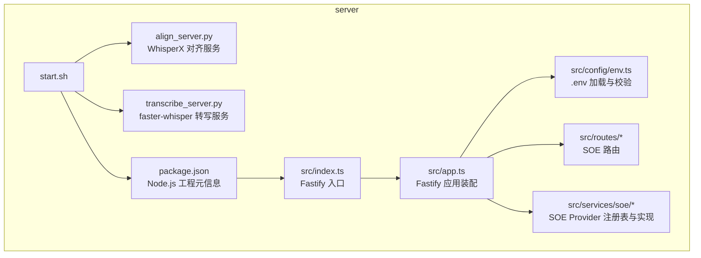
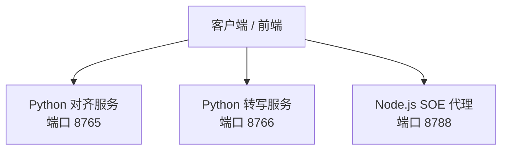
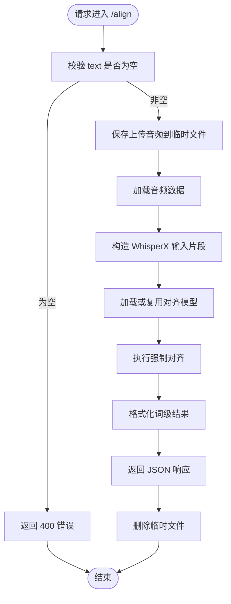
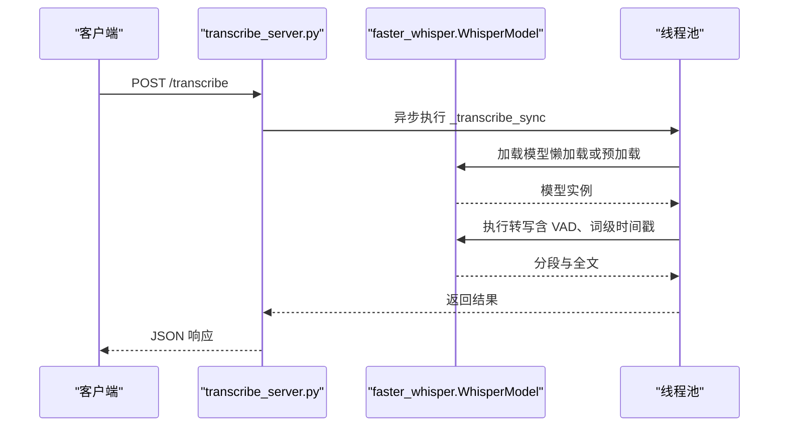
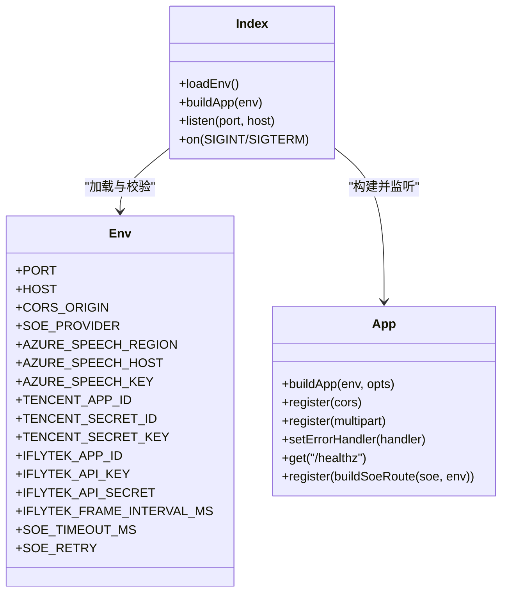
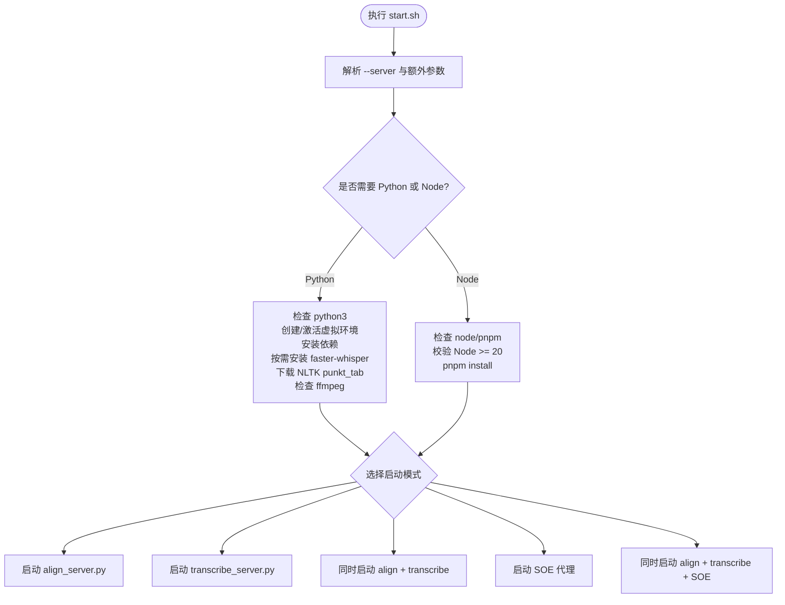

# 后端部署

<cite>
**本文引用的文件**   
- [server/start.sh](file://server/start.sh)
- [server/requirements.txt](file://server/requirements.txt)
- [server/package.json](file://server/package.json)
- [server/src/config/env.ts](file://server/src/config/env.ts)
- [server/src/app.ts](file://server/src/app.ts)
- [server/src/index.ts](file://server/src/index.ts)
- [server/align_server.py](file://server/align_server.py)
- [server/transcribe_server.py](file://server/transcribe_server.py)
</cite>

## 目录
1. [简介](#简介)
2. [项目结构](#项目结构)
3. [核心组件](#核心组件)
4. [架构总览](#架构总览)
5. [详细组件分析](#详细组件分析)
6. [依赖与环境要求](#依赖与环境要求)
7. [启动脚本与运行模式](#启动脚本与运行模式)
8. [GPU 与 CUDA 配置](#gpu-与-cuda-配置)
9. [端口、防火墙与反向代理](#端口防火墙与反向代理)
10. [进程守护与 systemd 服务](#进程守护与-systemd-服务)
11. [错误日志与故障排查](#错误日志与故障排查)
12. [性能与容量规划](#性能与容量规划)
13. [结论](#结论)

## 简介
本部署文档面向后端服务，覆盖以下三类能力：
- Python FastAPI 对齐服务：基于 WhisperX 的强制对齐。
- Python FastAPI 转写服务：基于 faster-whisper 的语音转文本。
- Node.js Fastify SOE 评分代理：对接 Azure / 腾讯云 / 科大讯飞或 Mock 的口语评测上游。

目标读者包括运维工程师、后端开发者以及需要本地或服务器部署该服务的用户。文档重点说明环境准备、虚拟环境管理、NLTK 数据下载、GPU/CUDA 配置、systemd 守护、端口与反向代理、以及常见问题的定位方法。

## 项目结构
后端相关代码集中在 server 目录，包含：
- Python 服务：align_server.py、transcribe_server.py。
- Node.js SOE 代理：src/index.ts、src/app.ts、src/config/env.ts、src/routes/*、src/services/soe/*。
- 启动脚本：start.sh。
- Python 依赖：requirements.txt。
- Node.js 依赖与脚本：package.json。

**图表来源**
- [server/start.sh:1-200](file://server/start.sh#L1-L200)
- [server/align_server.py:1-247](file://server/align_server.py#L1-L247)
- [server/transcribe_server.py:1-260](file://server/transcribe_server.py#L1-L260)
- [server/package.json:1-31](file://server/package.json#L1-L31)
- [server/src/index.ts:1-19](file://server/src/index.ts#L1-L19)
- [server/src/app.ts:1-47](file://server/src/app.ts#L1-L47)
- [server/src/config/env.ts:1-116](file://server/src/config/env.ts#L1-L116)

**章节来源**
- [server/start.sh:1-200](file://server/start.sh#L1-L200)
- [server/align_server.py:1-247](file://server/align_server.py#L1-L247)
- [server/transcribe_server.py:1-260](file://server/transcribe_server.py#L1-L260)
- [server/package.json:1-31](file://server/package.json#L1-L31)
- [server/src/index.ts:1-19](file://server/src/index.ts#L1-L19)
- [server/src/app.ts:1-47](file://server/src/app.ts#L1-L47)
- [server/src/config/env.ts:1-116](file://server/src/config/env.ts#L1-L116)

## 核心组件
- Python 对齐服务（WhisperX）：提供音频 + 已有文本的对齐接口，返回词级时间戳。
- Python 转写服务（faster-whisper）：提供音频转文本接口，支持自动语言检测与分段输出。
- Node.js SOE 评分代理：统一对外暴露口语评测能力，内部可切换不同上游 Provider。

关键职责划分：
- start.sh：负责环境检查、虚拟环境创建、依赖安装、NLTK 数据下载、ffmpeg 检查、按模式启动 Python 或 Node 服务。
- align_server.py：FastAPI 服务，处理 /health、/models、/align。
- transcribe_server.py：FastAPI 服务，处理 /health、/transcribe。
- src/index.ts：加载环境变量、构建 Fastify 应用、监听端口、优雅关闭。
- src/app.ts：注册 CORS、multipart、统一错误处理、健康端点、SOE 路由。
- src/config/env.ts：读取 .env、校验环境变量、Provider 凭据校验。

**章节来源**
- [server/start.sh:1-200](file://server/start.sh#L1-L200)
- [server/align_server.py:1-247](file://server/align_server.py#L1-L247)
- [server/transcribe_server.py:1-260](file://server/transcribe_server.py#L1-L260)
- [server/src/index.ts:1-19](file://server/src/index.ts#L1-L19)
- [server/src/app.ts:1-47](file://server/src/app.ts#L1-L47)
- [server/src/config/env.ts:1-116](file://server/src/config/env.ts#L1-L116)

## 架构总览
后端由两类运行时组成：
- Python 运行时：对齐服务与转写服务各自独立运行，默认绑定不同端口。
- Node.js 运行时：SOE 评分代理，作为前端调用口语评测的统一入口。

**图表来源**
- [server/start.sh:156-191](file://server/start.sh#L156-L191)
- [server/align_server.py:214-242](file://server/align_server.py#L214-L242)
- [server/transcribe_server.py:195-255](file://server/transcribe_server.py#L195-L255)
- [server/src/index.ts:8-11](file://server/src/index.ts#L8-L11)

## 详细组件分析

### Python 对齐服务（WhisperX）
- 功能：接收音频与已有文本，返回词级时间戳与段落信息。
- 主要端点：
  - GET /health：返回设备、计算类型等状态。
  - GET /models：列出已加载模型与支持的语言模型映射。
  - POST /align：执行强制对齐。
- 参数与行为：
  - --port：服务端口，默认 8765。
  - --host：绑定地址，默认 127.0.0.1。
  - --device：cpu/cuda/auto，auto 时根据 torch.cuda.is_available() 选择。
  - --compute-type：int8/float16/float32。
- 模型缓存：按语言缓存对齐模型，避免重复加载。
- 错误处理：异常捕获后返回 HTTP 500，并记录日志。

**图表来源**
- [server/align_server.py:131-207](file://server/align_server.py#L131-L207)

**章节来源**
- [server/align_server.py:1-247](file://server/align_server.py#L1-L247)

### Python 转写服务（faster-whisper）
- 功能：接收音频，返回完整文本、时长与分段时间戳。
- 主要端点：
  - GET /health：返回设备、计算类型、模型大小、是否加载、CUDA 可用性等。
  - POST /transcribe：执行转写。
- 参数与行为：
  - --port：服务端口，默认 8766。
  - --host：绑定地址，默认 127.0.0.1。
  - --device：cpu/cuda/auto，auto 优先 CUDA；若请求 CUDA 但不可用则回退 CPU。
  - --compute-type：int8/float16/float32；未指定时根据设备选择默认值。
  - --model-size：tiny/base/small/medium/large-v2/large-v3。
  - --preload：启动时预加载模型。
- 并发与阻塞：使用线程池执行模型加载与转写，避免阻塞事件循环。
- 错误处理：异常捕获后返回 HTTP 500，并记录日志。

**图表来源**
- [server/transcribe_server.py:48-116](file://server/transcribe_server.py#L48-L116)
- [server/transcribe_server.py:136-188](file://server/transcribe_server.py#L136-L188)
- [server/transcribe_server.py:195-255](file://server/transcribe_server.py#L195-L255)

**章节来源**
- [server/transcribe_server.py:1-260](file://server/transcribe_server.py#L1-L260)

### Node.js SOE 评分代理
- 功能：对外暴露口语评测能力，内部通过 Provider 注册表切换 Azure、腾讯、讯飞或 Mock。
- 入口流程：
  - 加载 .env 与系统环境变量。
  - 构建 Fastify 应用，注册 CORS、multipart、统一错误处理。
  - 注册 SOE 路由与健康端点。
  - 监听端口与主机，支持 SIGINT/SIGTERM 优雅关闭。
- 环境变量：
  - PORT/HOST：服务监听端口与主机。
  - CORS_ORIGIN：允许的前端来源。
  - SOE_PROVIDER：mock/azure/tencent/iflytek。
  - 各 Provider 凭据字段（Azure/Tencent/Iflytek）。
  - SOE_TIMEOUT_MS/SOE_RETRY：上游超时与重试次数。
- 健康端点：/healthz 返回默认 Provider 与已注册 Provider 列表。

**图表来源**
- [server/src/config/env.ts:9-32](file://server/src/config/env.ts#L9-L32)
- [server/src/app.ts:14-45](file://server/src/app.ts#L14-L45)
- [server/src/index.ts:8-18](file://server/src/index.ts#L8-L18)

**章节来源**
- [server/src/config/env.ts:1-116](file://server/src/config/env.ts#L1-L116)
- [server/src/app.ts:1-47](file://server/src/app.ts#L1-L47)
- [server/src/index.ts:1-19](file://server/src/index.ts#L1-L19)

## 依赖与环境要求
- Python 环境：
  - 版本：Python 3.9+。
  - 依赖包：whisperx、torch、fastapi、uvicorn、python-multipart、numpy、faster-whisper。
- Node.js 环境：
  - 版本：Node.js >= 20。
  - 包管理器：pnpm。
  - 依赖包：fastify、@fastify/cors、@fastify/multipart、ws、zod 等。
- 系统工具：
  - ffmpeg：用于音频解码，缺失会警告但不阻断启动。
  - unzip：NLTK punkt_tab 分词器手动下载时需要。

**章节来源**
- [server/start.sh:58-127](file://server/start.sh#L58-L127)
- [server/start.sh:131-151](file://server/start.sh#L131-L151)
- [server/requirements.txt:1-8](file://server/requirements.txt#L1-L8)
- [server/package.json:1-31](file://server/package.json#L1-L31)

## 启动脚本与运行模式
start.sh 是统一的启动入口，支持多种运行模式：
- --server align：启动对齐服务（默认，向后兼容）。
- --server transcribe：启动转写服务。
- --server both：同时启动对齐与转写服务。
- --server soe：启动 SOE 评分代理（Node.js）。
- --server all：同时启动对齐、转写与 SOE 代理。
- 额外参数（如 --device、--compute-type）透传给 Python 服务；SOE 代理通过 server/.env 配置。

启动流程要点：
- 解析 --server 参数并校验取值。
- 根据模式决定是否需要 Python 或 Node 环境。
- Python 模式：
  - 检查 python3。
  - 创建并激活虚拟环境（server/.venv）。
  - 安装 requirements.txt 中的依赖。
  - 按需安装 faster-whisper。
  - 按需下载 NLTK punkt_tab 分词器。
  - 检查 ffmpeg。
- Node 模式：
  - 检查 node 与 pnpm。
  - 校验 Node.js 主版本 >= 20。
  - 安装 Node.js 依赖（pnpm install）。
- 启动对应服务：
  - align_server.py 默认端口 8765。
  - transcribe_server.py 默认端口 8766。
  - SOE 代理默认端口 8788。

**图表来源**
- [server/start.sh:23-56](file://server/start.sh#L23-L56)
- [server/start.sh:58-127](file://server/start.sh#L58-L127)
- [server/start.sh:131-151](file://server/start.sh#L131-L151)
- [server/start.sh:156-191](file://server/start.sh#L156-L191)

**章节来源**
- [server/start.sh:1-200](file://server/start.sh#L1-L200)

## GPU 与 CUDA 配置
- 对齐服务：
  - --device cpu/cuda/auto：auto 时根据 torch.cuda.is_available() 选择。
  - --compute-type int8/float16/float32。
- 转写服务：
  - --device auto 默认优先 CUDA；若请求 CUDA 但不可用则回退 CPU。
  - --compute-type 未指定时，CUDA 默认 float16，CPU 默认 int8。
  - --model-size 可选 tiny/base/small/medium/large-v2/large-v3。
  - --preload 可在启动时预加载模型。
- CUDA 环境搭建建议：
  - 确保系统安装 NVIDIA 驱动与 CUDA Toolkit。
  - 安装与 PyTorch 匹配的 CUDA 版本（pip install torch 时选择对应 CUDA wheel）。
  - 验证 torch.cuda.is_available() 返回 True。
  - 若出现内存不足，可降低 compute_type 或选择更小 model-size。

**章节来源**
- [server/align_server.py:214-242](file://server/align_server.py#L214-L242)
- [server/transcribe_server.py:195-255](file://server/transcribe_server.py#L195-L255)

## 端口、防火墙与反向代理
- 默认端口：
  - 对齐服务：8765。
  - 转写服务：8766。
  - SOE 代理：8788。
- 防火墙设置：
  - 如需从外部访问，需在防火墙放行对应端口。
  - 生产环境建议仅开放必要端口，并通过反向代理统一入口。
- 反向代理示例（Nginx）：
  - 将 /align、/transcribe 转发至 Python 服务。
  - 将 /soe 或 /api/soe 转发至 Node.js SOE 代理。
  - 注意 WebSocket 场景（如讯飞流式）需启用 ws 转发。
- CORS 配置：
  - SOE 代理支持多来源 CORS，通过 CORS_ORIGIN 配置逗号分隔的来源列表。
  - 开发环境默认允许 http://localhost:3000。

**章节来源**
- [server/start.sh:156-191](file://server/start.sh#L156-L191)
- [server/src/config/env.ts:9-13](file://server/src/config/env.ts#L9-L13)
- [server/src/app.ts:18-21](file://server/src/app.ts#L18-L21)

## 进程守护与 systemd 服务
建议使用 systemd 守护 Python 与 Node 服务，保证崩溃重启与开机自启。

- Python 对齐服务示例单元：
  - ExecStart：指向 venv 中的 Python 解释器与 align_server.py。
  - WorkingDirectory：server 目录。
  - Environment：PATH 指向 venv/bin。
  - Restart：always。
- Python 转写服务示例单元：
  - 同上，但命令指向 transcribe_server.py。
- Node.js SOE 代理示例单元：
  - ExecStart：指向 pnpm 或 tsx 启动命令。
  - WorkingDirectory：server 目录。
  - Environment：PATH 包含全局 pnpm。
  - Restart：always。

注意事项：
- 确保 venv 路径与系统用户一致。
- 如需 GPU，确认 systemd 用户具备访问 GPU 设备的权限。
- 日志可通过 journalctl 查看。

[本节为通用指导，不直接分析具体文件]

## 错误日志与故障排查
- Python 服务日志：
  - align_server.py 与 transcribe_server.py 均使用 logging 模块，默认 INFO 级别。
  - 可通过 uvicorn 的 log_level 调整日志级别。
  - 常见错误：
    - NLTK punkt_tab 下载失败：检查网络与 GitHub 可达性，或手动放置 punkt_tab。
    - ffmpeg 缺失：部分音频格式无法解码，安装 ffmpeg。
    - CUDA 不可用：检查驱动与 PyTorch CUDA 版本匹配。
    - 模型加载失败：检查磁盘空间与模型大小，必要时降低 compute_type 或 model-size。
- Node.js SOE 代理日志：
  - Fastify 默认开启 logger，可通过 buildApp(opts?.logger) 控制。
  - 环境变量校验失败：检查 .env 或系统环境变量是否符合 schema。
  - Provider 凭据缺失：根据 SOE_PROVIDER 配置补齐相应凭据。
  - 上游超时或不可达：调整 SOE_TIMEOUT_MS 与 SOE_RETRY。

排查步骤建议：
- 先检查服务健康端点：
  - Python 对齐服务：GET /health。
  - Python 转写服务：GET /health。
  - Node.js SOE 代理：GET /healthz。
- 查看系统日志：
  - journalctl -u <service-name>。
  - 或直接查看终端输出（前台启动）。
- 检查依赖与数据：
  - Python 虚拟环境是否存在且依赖已安装。
  - NLTK punkt_tab 是否已下载到 $HOME/nltk_data/tokenizers/punkt_tab/english。
  - Node.js 依赖是否已安装（node_modules 存在）。

**章节来源**
- [server/align_server.py:30-31](file://server/align_server.py#L30-L31)
- [server/transcribe_server.py:29-30](file://server/transcribe_server.py#L29-L30)
- [server/src/app.ts:23-35](file://server/src/app.ts#L23-L35)
- [server/src/config/env.ts:85-115](file://server/src/config/env.ts#L85-L115)
- [server/start.sh:93-127](file://server/start.sh#L93-L127)

## 性能与容量规划
- 模型加载：
  - 转写服务支持 --preload 在启动时加载模型，减少首请求延迟。
  - 对齐服务按语言缓存模型，避免重复加载。
- 计算资源：
  - CUDA 下推荐使用 float16；CPU 下推荐 int8。
  - 大模型（large-v3）对内存与显存要求较高，可根据硬件选择 smaller 模型。
- 并发与阻塞：
  - 转写服务使用线程池执行阻塞操作，避免阻塞事件循环。
- 文件大小限制：
  - SOE 代理 multipart 限制单文件 25MB，可根据业务调整。

[本节为通用指导，不直接分析具体文件]

## 结论
本部署文档覆盖了后端服务的三种运行模式与关键部署要点：
- 环境准备：Python 3.9+、Node.js 20+、pnpm、ffmpeg。
- 启动脚本：start.sh 统一管理依赖安装、NLTK 数据下载与服务启动。
- GPU/CUDA：对齐与转写服务支持 CUDA 加速，需正确安装驱动与 PyTorch CUDA 版本。
- 进程守护：建议使用 systemd 守护服务，确保稳定运行。
- 端口与代理：默认端口 8765/8766/8788，生产环境建议通过反向代理统一入口。
- 故障排查：通过健康端点、日志与依赖检查快速定位问题。