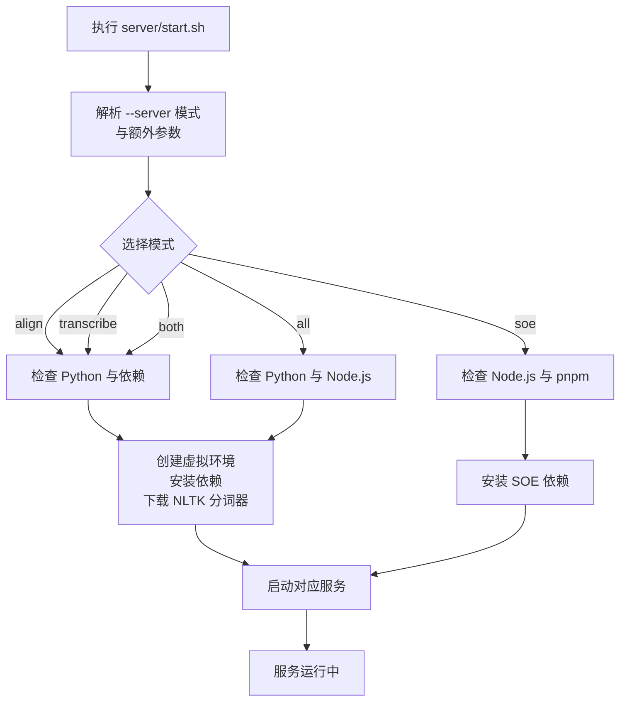
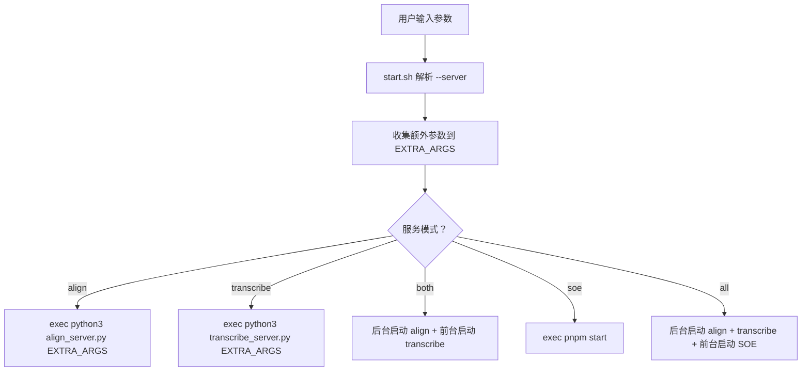
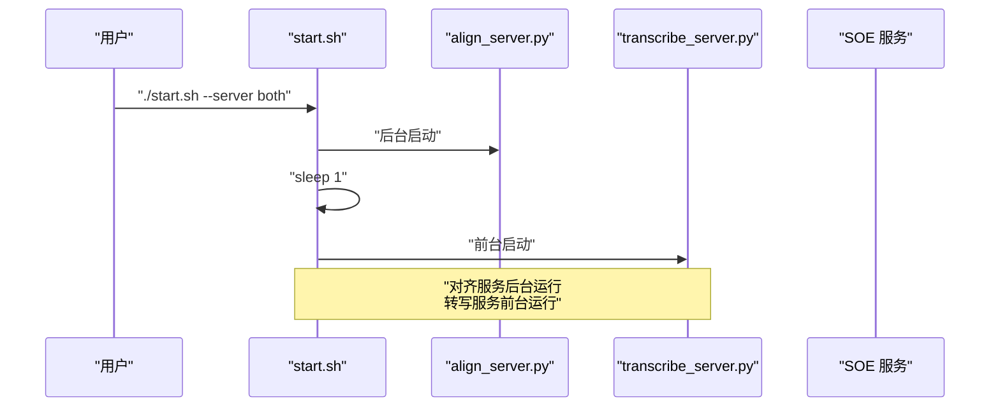
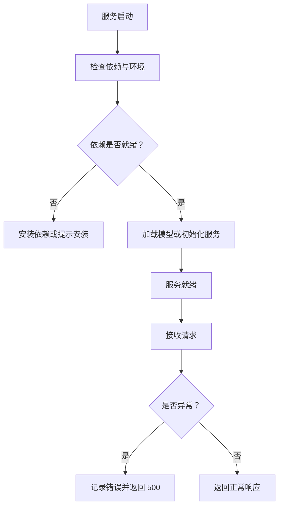
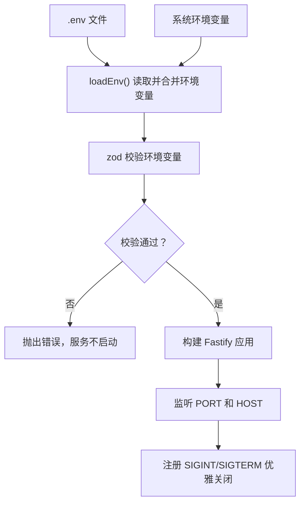

# 服务启动

<cite>
**本文引用的文件**   
- [server/start.sh](file://server/start.sh)
- [server/align_server.py](file://server/align_server.py)
- [server/transcribe_server.py](file://server/transcribe_server.py)
- [server/package.json](file://server/package.json)
- [server/src/index.ts](file://server/src/index.ts)
- [server/src/config/env.ts](file://server/src/config/env.ts)
</cite>

## 目录
1. [简介](#简介)
2. [项目结构与启动入口](#项目结构与启动入口)
3. [启动模式总览](#启动模式总览)
4. [命令行参数与透传机制](#命令行参数与透传机制)
5. [GPU、计算精度与模型大小配置](#gpu计算精度与模型大小配置)
6. [默认端口与服务绑定](#默认端口与服务绑定)
7. [进程管理与后台运行](#进程管理与后台运行)
8. [日志输出与错误处理](#日志输出与错误处理)
9. [SOE 评分代理启动说明](#soe-评分代理启动说明)
10. [常见部署场景与启动命令示例](#常见部署场景与启动命令示例)
11. [故障排查清单](#故障排查清单)
12. [结论](#结论)

## 简介
本文件面向后端服务的本地与服务器部署，围绕 `server/start.sh` 脚本展开，详细说明以下能力：
- 五种启动模式：对齐服务、转写服务、同时启动、SOE 评分代理、全部服务。
- 命令行参数的解析与透传方式。
- GPU 设备、计算精度、Whisper 模型大小的配置方法。
- 各服务的默认端口、监听地址与进程管理策略。
- 后台运行、日志输出、依赖检查与环境准备。
- SOE 评分代理的环境变量与端口来源。
- 不同部署场景下的推荐启动命令。

## 项目结构与启动入口
后端服务位于 `server/` 目录，包含两类运行时：
- Python 服务：对齐服务 `align_server.py`、转写服务 `transcribe_server.py`。
- Node.js 服务：SOE 评分代理，通过 `pnpm start` 启动，入口为 `src/index.ts`。

统一入口是 `server/start.sh`。它负责：
- 校验并解析 `--server` 模式。
- 按需检查 Python、Node.js、pnpm、ffmpeg 等依赖。
- 创建或激活 Python 虚拟环境，安装 Python 依赖。
- 下载对齐服务所需的 NLTK punkt_tab 分词器。
- 根据模式启动一个或多个服务。



**图表来源**
- [server/start.sh:23-56](file://server/start.sh#L23-L56)
- [server/start.sh:58-153](file://server/start.sh#L58-L153)
- [server/start.sh:155-199](file://server/start.sh#L155-L199)

**章节来源**
- [server/start.sh:1-20](file://server/start.sh#L1-L20)
- [server/start.sh:23-56](file://server/start.sh#L23-L56)
- [server/start.sh:155-199](file://server/start.sh#L155-L199)

## 启动模式总览
`start.sh` 支持以下 `--server` 取值：

| 模式 | 含义 | 启动的服务 | 默认端口 | 备注 |
|---|---|---|---:|---|
| `align` | 对齐服务 | `align_server.py` | 8765 | 默认模式，向后兼容 |
| `transcribe` | 转写服务 | `transcribe_server.py` | 8766 | 使用 faster-whisper |
| `both` | 同时启动对齐与转写 | `align_server.py` 与 `transcribe_server.py` | 8765、8766 | 对齐服务后台运行 |
| `soe` | SOE 评分代理 | Node.js 服务 | 8788 | 通过 `pnpm start` 启动 |
| `all` | 全部服务 | 对齐、转写、SOE | 8765、8766、8788 | 前两个后台运行，SOE 前台运行 |

关键行为：
- 未显式传入 `--server` 时，默认模式为 `align`。
- `soe` 模式不需要 Python 环境；Python 模式不需要 Node.js。
- `all` 模式会同时拉起 Python 服务和 Node.js 服务。

**章节来源**
- [server/start.sh:4-14](file://server/start.sh#L4-L14)
- [server/start.sh:23-56](file://server/start.sh#L23-L56)
- [server/start.sh:155-199](file://server/start.sh#L155-L199)

## 命令行参数与透传机制
`start.sh` 的命令行结构如下：
- `--server <模式>`：指定启动模式。
- 其他参数：作为“额外参数”透传给 Python 服务。

透传规则：
- `--server` 之后的所有非 `--server` 参数会被收集到 `EXTRA_ARGS`。
- Python 服务启动时，使用 `python3 align_server.py "${EXTRA_ARGS[@]}"` 或 `python3 transcribe_server.py "${EXTRA_ARGS[@]}"`。
- SOE 服务通过 `pnpm start` 启动，不接收这些额外参数；SOE 的配置来自环境变量和 `.env`。

这意味着：
- `./start.sh --device cuda --compute-type float16` 会把 `--device cuda --compute-type float16` 传给 Python 服务。
- `./start.sh --server transcribe --model-size small` 会把 `--model-size small` 传给转写服务。
- `./start.sh --server soe --device cuda` 中的 `--device cuda` 不会生效于 SOE，因为 SOE 不使用 Python 参数。



**图表来源**
- [server/start.sh:27-38](file://server/start.sh#L27-L38)
- [server/start.sh:155-199](file://server/start.sh#L155-L199)

**章节来源**
- [server/start.sh:27-38](file://server/start.sh#L27-L38)
- [server/start.sh:155-199](file://server/start.sh#L155-L199)

## GPU、计算精度与模型大小配置
### 对齐服务
对齐服务接受以下关键参数：
- `--device`：可选 `cpu`、`cuda`、`auto`。
- `--compute-type`：可选 `int8`、`float16`、`float32`，默认 `int8`。
- `--port`：默认 8765。
- `--host`：默认 `127.0.0.1`。

当 `--device auto` 时，若检测到 CUDA 可用则使用 `cuda`，否则回退到 `cpu`。

### 转写服务
转写服务接受以下关键参数：
- `--device`：可选 `cpu`、`cuda`、`auto`，默认 `auto`。
- `--compute-type`：可选 `int8`、`float16`、`float32`；未指定时，CUDA 默认 `float16`，CPU 默认 `int8`。
- `--model-size`：可选 `tiny`、`base`、`small`、`medium`、`large-v2`、`large-v3`，默认 `large-v3`。
- `--port`：默认 8766。
- `--host`：默认 `127.0.0.1`。
- `--preload`：启动时预加载模型。

当 `--device auto` 时，优先使用 CUDA；如果请求了 CUDA 但不可用，会降级为 CPU，并在未指定 `--compute-type` 时回退为 `int8`。

### 推荐配置组合
- GPU 加速：`--device cuda --compute-type float16`。
- 小模型快速体验：`--model-size small`。
- CPU 环境：不传 `--device`，或使用 `--device cpu`。
- 生产环境建议固定 `--compute-type`，避免首次请求时的动态推断差异。

**章节来源**
- [server/align_server.py:214-242](file://server/align_server.py#L214-L242)
- [server/transcribe_server.py:195-255](file://server/transcribe_server.py#L195-L255)

## 默认端口与服务绑定
| 服务 | 默认端口 | 默认主机 | 健康检查路径 | 主要用途 |
|---|---:|---|---|---|
| 对齐服务 | 8765 | `127.0.0.1` | `/health` | WhisperX 强制对齐，返回词级时间戳 |
| 转写服务 | 8766 | `127.0.0.1` | `/health` | faster-whisper 语音转文本 |
| SOE 评分代理 | 8788 | `0.0.0.0` | 由 Fastify 应用暴露 | 发音评分代理，支持 mock、Azure、腾讯云、讯飞 |

注意：
- Python 服务默认绑定 `127.0.0.1`，适合本机调用。
- SOE 服务默认绑定 `0.0.0.0`，便于容器或局域网访问。
- 如需对外暴露 Python 服务，可通过 `--host 0.0.0.0` 覆盖默认绑定地址。

**章节来源**
- [server/align_server.py:214-242](file://server/align_server.py#L214-L242)
- [server/transcribe_server.py:195-255](file://server/transcribe_server.py#L195-L255)
- [server/src/config/env.ts:9-11](file://server/src/config/env.ts#L9-L11)

## 进程管理与后台运行
`start.sh` 对多进程启动做了简单编排：

- `align`：前台启动 `align_server.py`，使用 `exec` 替换当前 shell 进程。
- `transcribe`：前台启动 `transcribe_server.py`，使用 `exec` 替换当前 shell 进程。
- `both`：后台启动 `align_server.py`，等待 1 秒后前台启动 `transcribe_server.py`。
- `soe`：前台启动 `pnpm start`，即 SOE 服务。
- `all`：后台启动 `align_server.py`，等待 1 秒后后台启动 `transcribe_server.py`，再等待 1 秒后前台启动 SOE。

重要细节：
- 后台服务使用 `&` 启动。
- 服务间通过固定间隔 `sleep 1` 等待端口绑定。
- 前台服务使用 `exec`，使脚本退出信号直接传递给服务进程。
- 如果需要更稳定的进程管理（自动重启、资源限制、日志轮转），建议在容器编排平台或 systemd 中管理这些进程。



**图表来源**
- [server/start.sh:166-174](file://server/start.sh#L166-L174)

**章节来源**
- [server/start.sh:155-199](file://server/start.sh#L155-L199)

## 日志输出与错误处理
### 日志输出
- Python 服务使用标准 logging，默认级别为 INFO，格式包含时间、级别和消息。
- `start.sh` 在启动时会打印 `[setup]` 和 `[start]` 前缀日志，用于区分环境准备和服务启动阶段。
- SOE 服务通过 Fastify 日志记录，并在收到 `SIGINT`、`SIGTERM` 时优雅关闭。

### 错误处理
- `start.sh` 使用 `set -euo pipefail`，遇到命令失败立即退出。
- `--server` 值非法时会报错并退出。
- Python 依赖缺失时自动安装；faster-whisper 仅在需要时安装。
- NLTK punkt_tab 分词器缺失时自动下载，并提供 GitHub 兜底方案。
- ffmpeg 缺失时给出警告，不影响服务启动，但可能影响部分音频格式解码。
- Python 服务接口异常会返回 HTTP 500，并记录详细日志。
- SOE 服务在环境变量校验失败时直接抛出错误，阻止服务启动。



**图表来源**
- [server/start.sh:16-17](file://server/start.sh#L16-L17)
- [server/start.sh:40-47](file://server/start.sh#L40-L47)
- [server/start.sh:76-91](file://server/start.sh#L76-L91)
- [server/start.sh:93-127](file://server/start.sh#L93-L127)
- [server/align_server.py:203-207](file://server/align_server.py#L203-L207)
- [server/transcribe_server.py:184-188](file://server/transcribe_server.py#L184-L188)
- [server/src/index.ts:13-18](file://server/src/index.ts#L13-L18)

**章节来源**
- [server/start.sh:16-17](file://server/start.sh#L16-L17)
- [server/start.sh:40-47](file://server/start.sh#L40-L47)
- [server/start.sh:76-91](file://server/start.sh#L76-L91)
- [server/start.sh:93-127](file://server/start.sh#L93-L127)
- [server/align_server.py:203-207](file://server/align_server.py#L203-L207)
- [server/transcribe_server.py:184-188](file://server/transcribe_server.py#L184-L188)
- [server/src/index.ts:13-18](file://server/src/index.ts#L13-L18)

## SOE 评分代理启动说明
SOE 评分代理是 Node.js 服务，由 `pnpm start` 启动，入口为 `src/index.ts`。其核心特性：
- 从 `server/.env` 加载环境变量，若存在同名环境变量则不覆盖。
- 使用 zod 校验环境变量，包括端口、主机、CORS、SOE provider 及第三方凭据。
- 默认端口为 8788，默认主机为 `0.0.0.0`。
- 支持 `mock`、`azure`、`tencent`、`iflytek` 四种 provider。
- 收到 `SIGINT`、`SIGTERM` 时优雅关闭服务。

关键环境变量：
- `PORT`：服务端口，默认 8788。
- `HOST`：监听地址，默认 `0.0.0.0`。
- `CORS_ORIGIN`：前端来源，逗号分隔。
- `SOE_PROVIDER`：默认 provider。
- Azure、腾讯云、讯飞相关凭据按 provider 要求配置。
- `SOE_TIMEOUT_MS`、`SOE_RETRY`：上游超时与重试配置。



**图表来源**
- [server/src/config/env.ts:36-54](file://server/src/config/env.ts#L36-L54)
- [server/src/config/env.ts:85-115](file://server/src/config/env.ts#L85-L115)
- [server/src/index.ts:5-18](file://server/src/index.ts#L5-L18)

**章节来源**
- [server/package.json:10-14](file://server/package.json#L10-L14)
- [server/src/index.ts:1-18](file://server/src/index.ts#L1-L18)
- [server/src/config/env.ts:9-32](file://server/src/config/env.ts#L9-L32)
- [server/src/config/env.ts:85-115](file://server/src/config/env.ts#L85-L115)

## 常见部署场景与启动命令示例
以下为常用启动命令示例。请根据实际环境调整参数。

### 仅启动对齐服务
适用于已有转写结果，只需要词级时间戳的场景。
```bash
cd server
./start.sh --server align
```

### 仅启动转写服务
适用于语音转文本场景。
```bash
cd server
./start.sh --server transcribe
```

### 同时启动对齐与转写
适用于完整工作流：先转写，再对齐。
```bash
cd server
./start.sh --server both
```

### 启动 SOE 评分代理
适用于发音评分功能。需确保 `server/.env` 已配置 provider 凭据。
```bash
cd server
./start.sh --server soe
```

### 启动全部服务
适用于本地开发或一体化部署。
```bash
cd server
./start.sh --server all
```

### GPU 加速启动
```bash
cd server
./start.sh --server both --device cuda --compute-type float16
```

### 使用小模型降低内存占用
```bash
cd server
./start.sh --server transcribe --model-size small
```

### 自定义端口与主机
```bash
cd server
python3 align_server.py --port 8765 --host 0.0.0.0
python3 transcribe_server.py --port 8766 --host 0.0.0.0
```

### 容器化建议
- Python 服务建议使用固定 `--host 0.0.0.0`，并通过端口映射暴露。
- SOE 服务默认监听 `0.0.0.0:8788`，可直接暴露。
- 建议使用进程管理器或容器编排平台管理生命周期，而不是依赖 shell 后台进程。

**章节来源**
- [server/start.sh:4-14](file://server/start.sh#L4-L14)
- [server/start.sh:155-199](file://server/start.sh#L155-L199)
- [server/align_server.py:214-242](file://server/align_server.py#L214-L242)
- [server/transcribe_server.py:195-255](file://server/transcribe_server.py#L195-L255)
- [server/src/config/env.ts:9-11](file://server/src/config/env.ts#L9-L11)

## 故障排查清单
| 现象 | 可能原因 | 排查与解决 |
|---|---|---|
| 启动时报错未找到 Python | 未安装 Python 3.9+ | 安装 Python 3.9+，并确保 `python3` 可执行 |
| 启动时报错未找到 Node.js 或 pnpm | SOE 模式缺少 Node.js 20+ 或 pnpm | 安装 Node.js 20+ 和 pnpm |
| 对齐服务无法获取 punkt_tab | 网络拦截或 NLTK 下载失败 | 检查网络，脚本已提供 GitHub 兜底下载 |
| 音频格式解码失败 | 未安装 ffmpeg | 安装 ffmpeg，如 `apt install ffmpeg` 或 `brew install ffmpeg` |
| CUDA 请求但不可用 | 驱动或 CUDA 环境未配置 | 检查 CUDA 可用性，或改用 `--device cpu` |
| 首次转写慢 | 模型懒加载 | 使用 `--preload` 预加载模型，或提前启动服务 |
| SOE 启动失败 | 环境变量缺失或校验失败 | 检查 `server/.env` 中 `SOE_PROVIDER` 及对应凭据 |
| 端口被占用 | 已有服务占用 8765、8766、8788 | 更换端口或停止占用进程 |
| 前端无法访问 SOE | CORS 或主机绑定问题 | 检查 `CORS_ORIGIN` 和 `HOST`，必要时改为 `0.0.0.0` |

**章节来源**
- [server/start.sh:60-64](file://server/start.sh#L60-L64)
- [server/start.sh:131-151](file://server/start.sh#L131-L151)
- [server/start.sh:93-127](file://server/start.sh#L93-L127)
- [server/transcribe_server.py:246-251](file://server/transcribe_server.py#L246-L251)
- [server/src/config/env.ts:85-115](file://server/src/config/env.ts#L85-L115)

## 结论
`server/start.sh` 是一个轻量但完整的后端服务启动入口，能够根据模式自动准备依赖并启动 Python 或 Node.js 服务。对于本地开发和小型部署，它提供了开箱即用的体验；对于生产环境，建议结合容器编排、进程管理和环境变量配置，以获得更强的稳定性、可观测性和可维护性。

在实际使用中，请重点关注：
- 明确选择启动模式。
- 合理配置 GPU、计算精度和模型大小。
- 确认端口与主机绑定符合网络需求。
- 为 SOE 服务准备好 `.env` 和 provider 凭据。
- 使用日志和健康检查接口进行监控与排障。