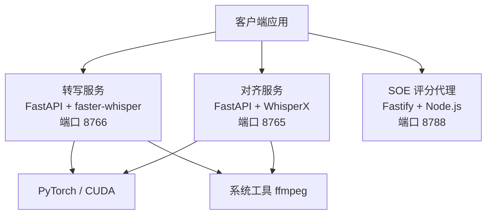
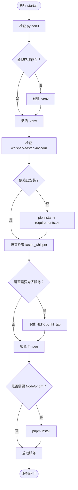
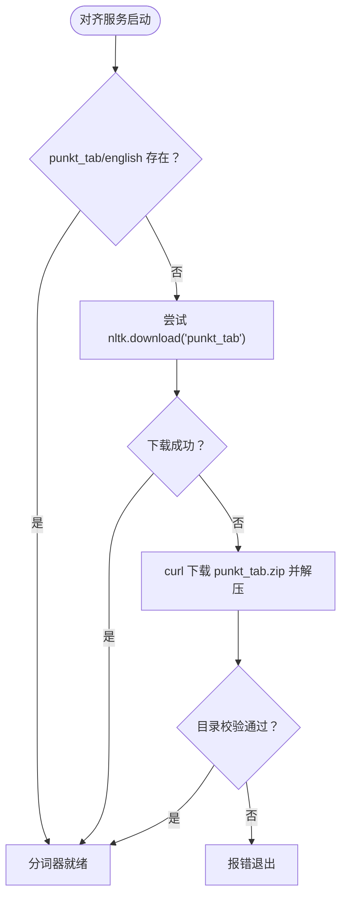
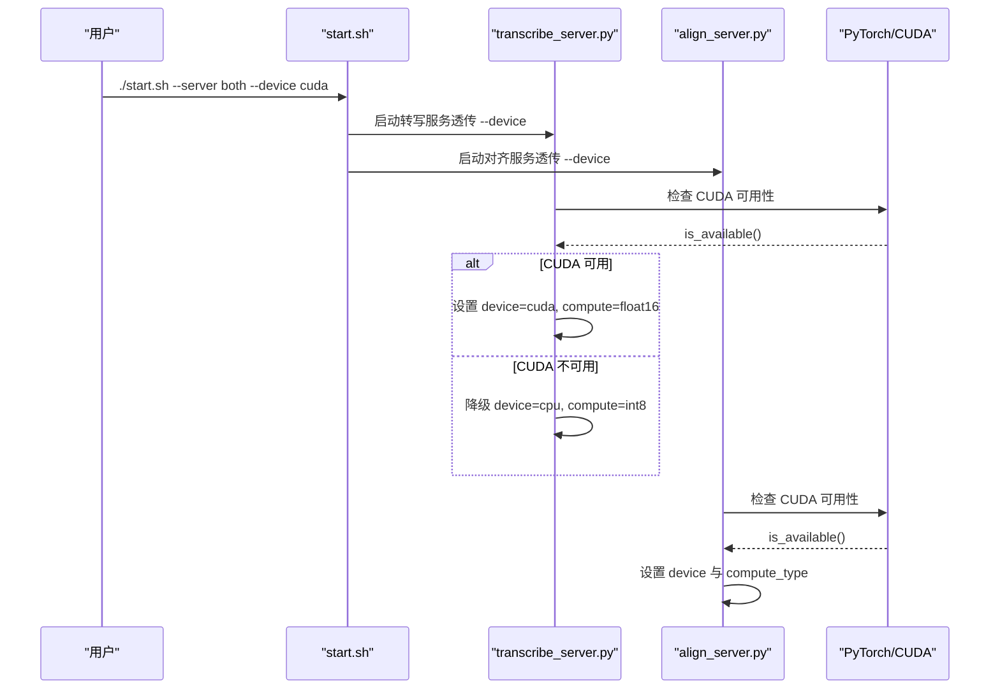

# 环境准备

<cite>
**本文引用的文件**   
- [README.md](file://README.md)
- [server/start.sh](file://server/start.sh)
- [server/requirements.txt](file://server/requirements.txt)
- [server/transcribe_server.py](file://server/transcribe_server.py)
- [server/align_server.py](file://server/align_server.py)
- [server/package.json](file://server/package.json)
</cite>

## 目录
1. [引言](#引言)
2. [项目结构与运行边界](#项目结构与运行边界)
3. [Python 环境要求与依赖](#python-环境要求与依赖)
4. [Node.js 环境要求与依赖](#nodejs-环境要求与依赖)
5. [虚拟环境与依赖安装流程](#虚拟环境与依赖安装流程)
6. [系统依赖：ffmpeg、CUDA 与 GPU](#系统依赖ffmpegcuda-与-gpu)
7. [NLTK punkt_tab 分词器机制](#nltk-punkt_tab-分词器机制)
8. [GPU 支持配置与 CUDA 环境搭建](#gpu-支持配置与-cuda-环境搭建)
9. [常见环境问题排查](#常见环境问题排查)
10. [环境就绪检查清单](#环境就绪检查清单)
11. [结论](#结论)

## 引言
本文面向后端服务的环境准备，覆盖 Python 3.9+ 与 Node.js 20+ 的安装要求、系统依赖（如 ffmpeg、CUDA）、虚拟环境创建与管理、Python 与 Node.js 依赖安装、GPU 与 CUDA 配置、NLTK punkt_tab 分词器的自动下载与手动安装方法，以及权限、网络代理、包管理器等常见问题排查。文档内容严格基于仓库中的启动脚本、Python 服务代码与依赖声明整理而成。

## 项目结构与运行边界
本项目包含前端 SPA、原型沙箱、设计文档，以及后端服务。后端服务由两个 Python FastAPI 服务组成：
- 转写服务：使用 faster-whisper，默认端口 8766。
- 对齐服务：使用 WhisperX，默认端口 8765。

此外，SOE 评分代理为 Node.js 服务，需要 Node.js 20+ 与 pnpm。

**图表来源**
- [README.md:128-134](file://README.md#L128-L134)
- [server/transcribe_server.py:123-133](file://server/transcribe_server.py#L123-L133)
- [server/align_server.py:118-128](file://server/align_server.py#L118-L128)
- [server/start.sh:156-191](file://server/start.sh#L156-L191)

**章节来源**
- [README.md:23-57](file://README.md#L23-L57)
- [README.md:128-134](file://README.md#L128-L134)

## Python 环境要求与依赖
- Python 版本：启动脚本要求 Python 3.9+。
- 核心依赖：whisperx、torch、fastapi、uvicorn、python-multipart、numpy、faster-whisper。
- 运行时组件：
  - 转写服务：faster-whisper，支持自动语言检测与分段时间戳。
  - 对齐服务：WhisperX，用于强制对齐并生成词级时间戳。

依赖声明位于 requirements.txt，其中 torch>=2.0.0 是 CUDA/GPU 能力的基础；whisperx>=3.3.0 提供对齐模型加载与对齐逻辑；faster-whisper>=1.1.0 提供高性能语音转写。

**章节来源**
- [server/start.sh:60-64](file://server/start.sh#L60-L64)
- [server/requirements.txt:1-8](file://server/requirements.txt#L1-L8)
- [server/transcribe_server.py:24-27](file://server/transcribe_server.py#L24-L27)
- [server/align_server.py:24-28](file://server/align_server.py#L24-L28)

## Node.js 环境要求与依赖
- Node.js 版本：server/package.json 中 engines.node >= 20，启动脚本会校验 Node 主版本是否小于 20。
- 包管理器：pnpm。若未安装，启动脚本会提示通过 npm 全局安装 pnpm。
- SOE 评分代理依赖：fastify、@fastify/cors、@fastify/multipart、ws、zod，以及开发依赖 tsx、typescript、vitest。

**章节来源**
- [server/package.json:7-9](file://server/package.json#L7-L9)
- [server/start.sh:131-151](file://server/start.sh#L131-L151)

## 虚拟环境与依赖安装流程
推荐通过 server/start.sh 一键完成环境准备与服务启动。该脚本会：
1. 检查 python3 是否存在。
2. 在 server/.venv 下创建虚拟环境（若不存在）。
3. 激活虚拟环境。
4. 检查 whisperx、fastapi、uvicorn 是否可导入；若不可用则升级 pip 并安装 requirements.txt。
5. 按需安装 faster-whisper（当选择 transcribe 或 both/all 模式时）。
6. 如需对齐服务，自动下载 NLTK punkt_tab 分词器。
7. 检查 ffmpeg 是否可用，若缺失给出警告与安装建议。
8. 根据 --server 参数启动 align、transcribe、both、soe 或 all 模式。

**图表来源**
- [server/start.sh:58-129](file://server/start.sh#L58-L129)
- [server/start.sh:131-151](file://server/start.sh#L131-L151)
- [server/start.sh:156-191](file://server/start.sh#L156-L191)

**章节来源**
- [server/start.sh:58-129](file://server/start.sh#L58-L129)
- [server/start.sh:131-151](file://server/start.sh#L131-L151)
- [server/start.sh:156-191](file://server/start.sh#L156-L191)

## 系统依赖：ffmpeg、CUDA 与 GPU
- ffmpeg：音频解码与格式处理的关键外部工具。若未安装，启动脚本会输出警告并提示安装方式（apt/brew）。
- CUDA/GPU：
  - 转写服务支持 --device auto/cuda/cpu 与 --compute-type int8/float16/float32。
  - 对齐服务支持 --device auto/cuda/cpu 与 --compute-type int8/float16/float32。
  - 当设备为 cuda 且 PyTorch 检测到 CUDA 不可用时，转写服务会降级到 CPU 并调整 compute_type。

注意：CUDA 驱动与 cuDNN 需与 PyTorch 构建匹配。仓库未内置 CUDA 二进制，需按 PyTorch 官方说明安装对应版本的 CUDA Toolkit 与驱动。

**章节来源**
- [server/start.sh:123-127](file://server/start.sh#L123-L127)
- [server/transcribe_server.py:198-255](file://server/transcribe_server.py#L198-L255)
- [server/align_server.py:214-242](file://server/align_server.py#L214-L242)

## NLTK punkt_tab 分词器机制
对齐服务依赖 NLTK punkt_tab 分词器。start.sh 会在以下路径检查：
- ~/nltk_data/tokenizers/punkt_tab/english

如果目录不存在，脚本优先尝试通过 nltk.download('punkt_tab') 下载；若被拦截，则从 GitHub 的 nltk_data gh-pages 拉取 punkt_tab.zip 并解压到目标目录。完成后进行存在性校验，失败则退出。

**图表来源**
- [server/start.sh:93-121](file://server/start.sh#L93-L121)

**章节来源**
- [server/start.sh:93-121](file://server/start.sh#L93-L121)

## GPU 支持配置与 CUDA 环境搭建
### 设备与计算精度
- 转写服务：
  - --device auto：若 torch.cuda.is_available() 为真则使用 cuda，否则回退 cpu。
  - --device cuda：显式使用 CUDA。
  - --device cpu：显式使用 CPU。
  - --compute-type float16：CUDA 默认精度。
  - --compute-type int8：CPU 默认精度。
  - 若请求 cuda 但不可用，服务会记录警告并回退到 cpu，同时重置 compute_type 为 int8。
- 对齐服务：
  - --device auto：若 torch.cuda.is_available() 为真则使用 cuda，否则 cpu。
  - --device cuda/cpu/auto：显式指定设备。
  - --compute-type int8/float16/float32：默认 int8。

### CUDA 环境搭建要点
- 确保系统安装了与 PyTorch 匹配的 CUDA 驱动与 CUDA Toolkit。
- 确认 torch.cuda.is_available() 返回 True。
- 若使用 Docker 或云 GPU 实例，请确保容器内可见 NVIDIA 驱动与 nvidia-container-toolkit。
- 若出现“CUDA requested but not available”，请检查驱动版本、CUDA 版本与 PyTorch 构建是否一致。

**图表来源**
- [server/start.sh:156-191](file://server/start.sh#L156-L191)
- [server/transcribe_server.py:226-255](file://server/transcribe_server.py#L226-L255)
- [server/align_server.py:232-242](file://server/align_server.py#L232-L242)

**章节来源**
- [server/transcribe_server.py:198-255](file://server/transcribe_server.py#L198-L255)
- [server/align_server.py:214-242](file://server/align_server.py#L214-L242)

## 常见环境问题排查
- 权限问题
  - 虚拟环境创建失败：确认当前用户对 server 目录有写入权限。
  - NLTK 数据写入失败：确认 ~/nltk_data 目录存在且可写。
  - pip 安装失败：避免使用 sudo 安装，尽量在虚拟环境中操作。
- 网络代理与镜像
  - pip 安装缓慢或失败：配置国内镜像源或使用代理环境变量（HTTP_PROXY/HTTPS_PROXY）。
  - NLTK punkt_tab 下载失败：脚本会自动尝试从 GitHub 拉取 punkt_tab.zip；若仍失败，请检查网络连通性与防火墙策略。
  - HuggingFace/Torch 缓存目录空间不足：清理 ~/.cache/huggingface/hub 与 ~/.cache/torch。
- 包管理器配置
  - pnpm 未安装：通过 npm install -g pnpm 安装。
  - Node 版本过低：确保 Node.js >= 20。
- ffmpeg 缺失
  - 部分音频格式无法解码：安装 ffmpeg（apt install ffmpeg 或 brew install ffmpeg）。
- CUDA/GPU 异常
  - CUDA 不可用：检查驱动与 CUDA Toolkit 版本是否与 PyTorch 匹配。
  - 显存不足：降低模型大小或切换 compute_type 为 int8。
  - 容器内无 GPU：确认 nvidia-container-toolkit 与驱动挂载正确。

**章节来源**
- [server/start.sh:60-127](file://server/start.sh#L60-L127)
- [server/start.sh:131-151](file://server/start.sh#L131-L151)
- [server/transcribe_server.py:246-255](file://server/transcribe_server.py#L246-L255)

## 环境就绪检查清单
- Python 3.9+ 已安装并可调用 python3。
- server/.venv 虚拟环境存在且已激活。
- whisperx、fastapi、uvicorn、faster-whisper 可正常导入。
- ffmpeg 已安装（可选但强烈建议）。
- Node.js >= 20 与 pnpm 已安装（若启用 SOE 评分代理）。
- NLTK punkt_tab 分词器存在于 ~/nltk_data/tokenizers/punkt_tab/english。
- CUDA 驱动与 PyTorch 匹配（若启用 GPU），torch.cuda.is_available() 返回 True。
- 服务端口未被占用：8765（对齐）、8766（转写）、8788（SOE）。

**章节来源**
- [server/start.sh:58-129](file://server/start.sh#L58-L129)
- [server/start.sh:131-151](file://server/start.sh#L131-L151)
- [server/transcribe_server.py:123-133](file://server/transcribe_server.py#L123-L133)
- [server/align_server.py:118-128](file://server/align_server.py#L118-L128)

## 结论
本环境准备文档基于仓库中的启动脚本、Python 服务实现与依赖声明，明确了 Python 3.9+ 与 Node.js 20+ 的安装要求、虚拟环境管理流程、系统依赖（ffmpeg、CUDA）与 NLTK punkt_tab 分词器的自动下载机制。按照本文步骤与环境检查清单操作，可快速搭建稳定可用的后端服务环境，并在具备 GPU 的情况下获得更好的性能表现。