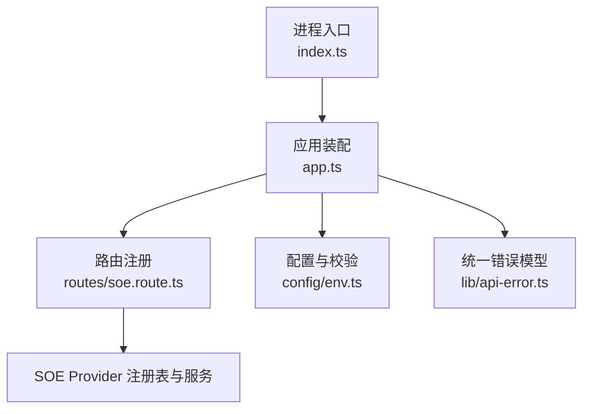
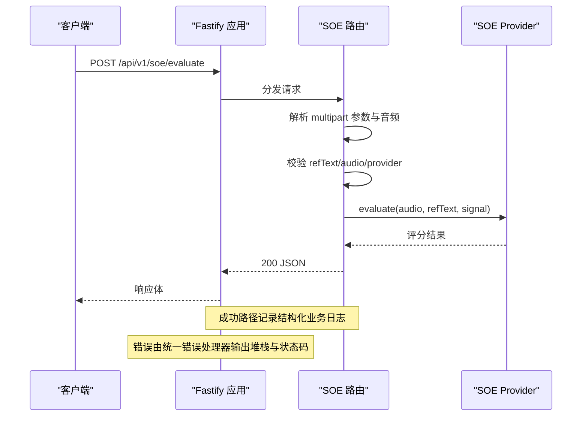
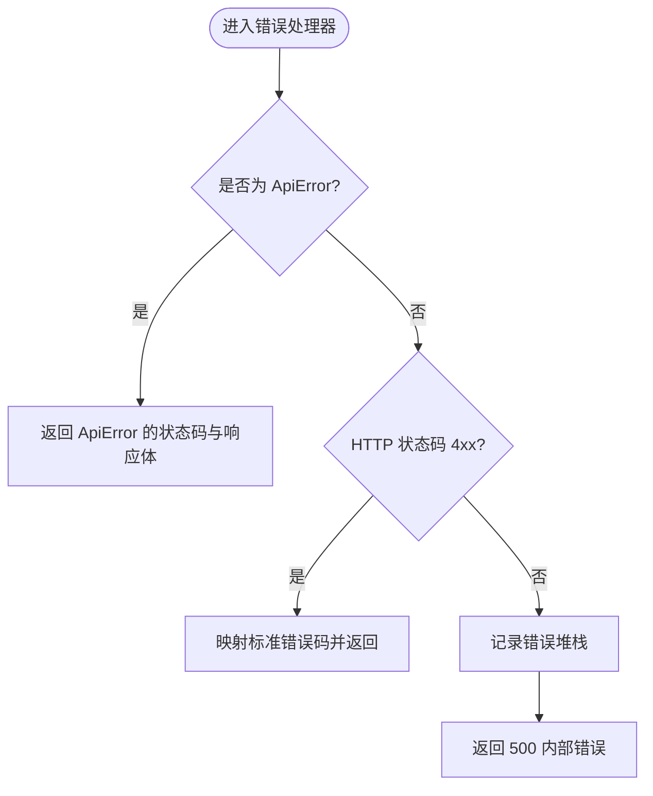
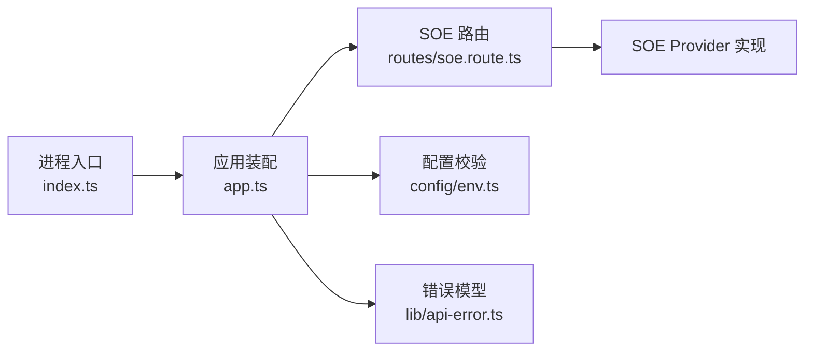

# 监控与日志

<cite>
**本文引用的文件**   
- [server/src/app.ts](file://server/src/app.ts)
- [server/src/index.ts](file://server/src/index.ts)
- [server/src/config/env.ts](file://server/src/config/env.ts)
- [server/src/routes/soe.route.ts](file://server/src/routes/soe.route.ts)
- [server/src/lib/api-error.ts](file://server/src/lib/api-error.ts)
- [server/package.json](file://server/package.json)
</cite>

## 目录
1. [引言](#引言)
2. [项目结构](#项目结构)
3. [核心组件](#核心组件)
4. [架构总览](#架构总览)
5. [详细组件分析](#详细组件分析)
6. [依赖关系分析](#依赖关系分析)
7. [性能考虑](#性能考虑)
8. [故障排查指南](#故障排查指南)
9. [结论](#结论)
10. [附录](#附录)

## 引言
本文面向后端服务的可观测性建设，聚焦以下目标：
- 日志级别配置、结构化日志格式与日志文件组织方式
- 性能监控指标收集（CPU、内存、GPU）
- 错误日志记录、异常堆栈跟踪与业务埋点
- 告警规则与监控面板搭建（Prometheus + Grafana）
- 分布式追踪与请求链路追踪
- 日志分析工具使用、性能瓶颈定位方法与常见问题诊断技巧

当前后端基于 Fastify 构建，默认启用内置日志能力；尚未集成第三方指标采集、分布式追踪或 GPU 监控。因此，本文在“现状说明”的基础上给出“落地方案”，帮助你在不改变现有代码结构的前提下逐步补齐可观测性能力。

## 项目结构
后端服务位于 server 目录，关键入口与装配逻辑如下：
- 应用装配：Fastify 实例创建、CORS、Multipart、统一错误处理、健康检查与路由注册
- 进程入口：加载环境变量、启动服务、优雅关闭
- 配置校验：环境变量读取与校验、Provider 凭据校验
- 路由层：SOE 发音评分接口实现
- 错误模型：统一 API 错误类型与错误码映射

图示来源
- [server/src/index.ts:1-19](file://server/src/index.ts#L1-L19)
- [server/src/app.ts:14-45](file://server/src/app.ts#L14-L45)
- [server/src/routes/soe.route.ts:64-109](file://server/src/routes/soe.route.ts#L64-L109)
- [server/src/config/env.ts:85-115](file://server/src/config/env.ts#L85-L115)
- [server/src/lib/api-error.ts:6-35](file://server/src/lib/api-error.ts#L6-L35)

章节来源
- [server/src/index.ts:1-19](file://server/src/index.ts#L1-L19)
- [server/src/app.ts:14-45](file://server/src/app.ts#L14-L45)
- [server/src/config/env.ts:85-115](file://server/src/config/env.ts#L85-L115)
- [server/src/routes/soe.route.ts:64-109](file://server/src/routes/soe.route.ts#L64-L109)
- [server/src/lib/api-error.ts:6-35](file://server/src/lib/api-error.ts#L6-L35)

## 核心组件
- 应用装配器：创建 Fastify 实例并开启内置 logger；注册 CORS、Multipart；定义统一错误处理器；暴露 /healthz；注册 SOE 路由
- 进程入口：加载 .env 与环境变量校验；监听端口；捕获 SIGINT/SIGTERM 执行优雅关闭
- 配置模块：读取 .env，使用 schema 校验必填字段与跨字段约束；提供 provider 凭据是否齐备的判定函数
- 路由模块：解析 multipart 表单，校验音频大小与文本长度；选择 provider；调用上游 SOE 服务；记录结构化业务日志
- 错误模型：ApiError 类与 ERR 错误码常量，统一响应体 { code, message, detail? }

章节来源
- [server/src/app.ts:14-45](file://server/src/app.ts#L14-L45)
- [server/src/index.ts:8-18](file://server/src/index.ts#L8-L18)
- [server/src/config/env.ts:9-32](file://server/src/config/env.ts#L9-L32)
- [server/src/routes/soe.route.ts:64-109](file://server/src/routes/soe.route.ts#L64-L109)
- [server/src/lib/api-error.ts:6-35](file://server/src/lib/api-error.ts#L6-L35)

## 架构总览
下图展示请求从进入 Fastify 到返回响应的完整流程，以及日志与错误的落点。

图示来源
- [server/src/routes/soe.route.ts:66-106](file://server/src/routes/soe.route.ts#L66-L106)
- [server/src/app.ts:24-35](file://server/src/app.ts#L24-L35)

## 详细组件分析

### 日志体系现状与建议

- 日志级别与开关
  - Fastify 默认启用内置 logger，可通过构造参数控制；测试中通过选项关闭以抑制控制台输出
  - 建议在生产环境保持开启，并通过容器/系统日志采集 stdout/stderr

- 结构化日志格式
  - 业务埋点：SOE 路由在发起评估前记录结构化信息，包含 provider、是否携带请求级密钥、音频字节数、参考文本前缀等
  - 系统事件：进程优雅关闭时记录信号名与关闭动作
  - 错误日志：统一错误处理器对非预期异常调用 req.log.error 输出堆栈

- 日志文件组织
  - 当前未显式配置日志文件输出；建议将 stdout/stderr 交由容器运行时或日志代理（如 Fluent Bit、Filebeat）按时间滚动归档
  - 建议在容器编排中为不同环境（dev/staging/prod）设置不同日志级别与采样策略

- 建议增强
  - 增加请求耗时、上游超时/重试次数、provider 名称等维度
  - 对敏感字段（如 creds）进行脱敏后再记录
  - 引入 OpenTelemetry 日志关联 traceId/spanId，便于链路追踪

章节来源
- [server/src/app.ts:14-15](file://server/src/app.ts#L14-L15)
- [server/src/routes/soe.route.ts:104-105](file://server/src/routes/soe.route.ts#L104-L105)
- [server/src/index.ts:13-17](file://server/src/index.ts#L13-L17)
- [server/src/app.ts:24-35](file://server/src/app.ts#L24-L35)

### 错误处理与异常堆栈

- 统一错误模型
  - ApiError 承载 code、message、httpStatus、detail
  - ERR 常量集中管理错误码与 HTTP 状态语义映射（400/413/429/502/503/504/500）

- 错误处理流程
  - 路由层抛出 ApiError 时直接返回对应状态码与结构化响应体
  - 其他异常进入统一错误处理器：4xx 归一化返回；5xx 记录堆栈后返回 500

- 典型场景
  - 缺少音频文件或 refText 为空 → BAD_REQUEST
  - 音频超过 25MB → PAYLOAD_TOO_LARGE
  - 指定 provider 未配置 → PROVIDER_UNAVAILABLE
  - 上游失败/超时 → UPSTREAM_ERROR/UPSTREAM_TIMEOUT（由 Provider 层抛错）

图示来源
- [server/src/app.ts:24-35](file://server/src/app.ts#L24-L35)
- [server/src/lib/api-error.ts:6-35](file://server/src/lib/api-error.ts#L6-L35)

章节来源
- [server/src/lib/api-error.ts:6-35](file://server/src/lib/api-error.ts#L6-L35)
- [server/src/app.ts:24-35](file://server/src/app.ts#L24-L35)

### 性能监控指标（现状与落地方案）

- 现状
  - 未集成 Prometheus 客户端或自定义指标采集
  - 未采集 CPU、内存、GPU 使用率
  - 未暴露 /metrics 端点

- 推荐方案
  - Node.js 进程指标：使用 prom-client 暴露 /metrics，采集 process_cpu_usage_percent、process_resident_memory_bytes、event_loop_lag_seconds 等
  - Fastify 指标：使用 fastify-metrics 或 prom-client 中间件统计请求速率、延迟分位、错误率、并发连接数
  - GPU 指标：若运行在 GPU 节点，使用 node-gpu-stats 或 nvidia-ml 绑定采集 GPU 利用率、显存占用；或通过宿主机 exporter（如 node-exporter + dmesg 解析）间接获取
  - 指标导出：Prometheus 定期抓取 /metrics；Grafana 对接 Prometheus 数据源

- 关键指标建议
  - 请求级：rate、latency_p50/p95/p99、error_rate、status_code_distribution
  - 资源级：CPU、内存、句柄数、事件循环延迟、磁盘 IO、网络 IO
  - 业务级：SOE 成功率、上游超时率、provider 切换比例、音频大小分布

[本节为概念性方案，不涉及具体源码行号]

### 告警规则与监控面板

- 告警规则（Prometheus Alertmanager）
  - 高错误率：SOE 接口 5xx 比率 > 阈值（如 5%）持续 5 分钟
  - 高延迟：p95 延迟 > 阈值（如 2s）持续 5 分钟
  - 资源告警：CPU > 80%、内存 > 85%、事件循环延迟 > 200ms
  - 上游异常：UPSTREAM_TIMEOUT/UPSTREAM_RATE_LIMIT 比率升高
  - Provider 不可用：PROVIDER_UNAVAILABLE 出现频率异常

- 监控面板（Grafana）
  - 概览：QPS、P95/P99 延迟、错误率、活跃连接数
  - 资源：CPU、内存、事件循环延迟、磁盘/网络
  - 业务：SOE 成功率、上游超时/限流、Provider 分布、音频大小分布
  - 链路：Trace 列表与详情（见下一节）

[本节为概念性方案，不涉及具体源码行号]

### 分布式追踪与请求链路追踪

- 现状
  - 未集成 OpenTelemetry 或 Jaeger/Zipkin 等追踪系统
  - 无 traceId/spanId 贯穿请求链路

- 推荐方案
  - 接入 OpenTelemetry：初始化 TracerProvider、MeterProvider、LoggerProvider
  - 注入 traceId 到日志上下文，使日志与 Trace 关联
  - 为每个 HTTP 请求创建 span，标记上游调用（SOE Provider）
  - 将 Trace 数据导出至 Jaeger/Zipkin 或云厂商 APM

- 链路关键点
  - 入站请求 span：POST /api/v1/soe/evaluate
  - 上游调用 span：Provider.evaluate(...)
  - 异常分支：span.status=Error，附加错误信息与堆栈

[本节为概念性方案，不涉及具体源码行号]

### 业务埋点与日志规范

- 已实现埋点
  - SOE 路由在发起评估前记录结构化日志，包含 provider、是否携带请求级密钥、音频字节数、参考文本前缀

- 建议补充
  - 请求 ID：为每次请求生成唯一 ID，贯穿日志与 Trace
  - 耗时统计：记录解析参数、上游调用、序列化响应各阶段耗时
  - 上游指标：记录上游状态码、重试次数、超时标志
  - 安全脱敏：避免记录 creds、用户隐私等敏感信息

章节来源
- [server/src/routes/soe.route.ts:104-105](file://server/src/routes/soe.route.ts#L104-L105)

## 依赖关系分析

图示来源
- [server/src/index.ts:1-19](file://server/src/index.ts#L1-L19)
- [server/src/app.ts:14-45](file://server/src/app.ts#L14-L45)
- [server/src/routes/soe.route.ts:64-109](file://server/src/routes/soe.route.ts#L64-L109)
- [server/src/config/env.ts:85-115](file://server/src/config/env.ts#L85-L115)
- [server/src/lib/api-error.ts:6-35](file://server/src/lib/api-error.ts#L6-L35)

章节来源
- [server/src/index.ts:1-19](file://server/src/index.ts#L1-L19)
- [server/src/app.ts:14-45](file://server/src/app.ts#L14-L45)
- [server/src/routes/soe.route.ts:64-109](file://server/src/routes/soe.route.ts#L64-L109)
- [server/src/config/env.ts:85-115](file://server/src/config/env.ts#L85-L115)
- [server/src/lib/api-error.ts:6-35](file://server/src/lib/api-error.ts#L6-L35)

## 性能考虑
- 输入限制：multipart 插件限制单文件 25MB，防止大音频导致内存峰值过高
- 超时与重试：通过环境变量控制上游超时与重试次数，避免雪崩
- 事件循环：在高并发下关注事件循环延迟，必要时拆分重型任务或使用 worker threads
- 资源隔离：容器化部署并设置 CPU/内存限额，结合 OOM Kill 保护集群稳定性
- 缓存与批处理：对热点配置（如 Provider 元信息）做短生命周期缓存，减少重复计算

[本节为通用指导，不涉及具体源码行号]

## 故障排查指南

- 常见错误与定位
  - 400 参数错误：检查 refText、evalMode、audio 字段是否存在且合法
  - 413 负载过大：确认音频大小不超过 25MB
  - 503 Provider 不可用：检查环境变量或请求级 creds 是否齐全
  - 502/504 上游错误：查看上游状态码与超时/限流日志
  - 500 内部错误：查看统一错误处理器记录的堆栈

- 日志检索要点
  - 关键字：soe evaluate、shutting down、ERROR
  - 字段：soe、requestCreds、bytes、refText、signal
  - 关联：结合 traceId（接入追踪后）快速定位一次请求的全链路日志

- 性能问题定位
  - 观察 p95/p99 延迟与错误率曲线
  - 对比不同 Provider 的性能差异
  - 分析音频大小分布与上游超时相关性
  - 检查事件循环延迟与 CPU/内存使用率

章节来源
- [server/src/routes/soe.route.ts:66-106](file://server/src/routes/soe.route.ts#L66-L106)
- [server/src/app.ts:24-35](file://server/src/app.ts#L24-L35)
- [server/src/lib/api-error.ts:18-29](file://server/src/lib/api-error.ts#L18-L29)

## 结论
当前后端已具备基础的结构化日志与统一错误处理能力，但尚未集成指标采集、分布式追踪与 GPU 监控。建议优先补齐指标与追踪能力，再逐步完善告警与可视化面板，最终形成完整的可观测性闭环。

[本节为总结性内容，不涉及具体源码行号]

## 附录

### 环境变量与配置项（与可观测性相关）
- PORT/HOST：服务监听地址
- CORS_ORIGIN：前端来源白名单
- SOE_PROVIDER：默认 Provider
- AZURE/TENCENT/IFLYTEK_*：Provider 凭据
- SOE_TIMEOUT_MS/SOE_RETRY：上游超时与重试

章节来源
- [server/src/config/env.ts:9-32](file://server/src/config/env.ts#L9-L32)

### 包依赖与脚本
- 依赖：fastify、@fastify/cors、@fastify/multipart、ws、zod
- 脚本：dev/start/test/check

章节来源
- [server/package.json:10-29](file://server/package.json#L10-L29)