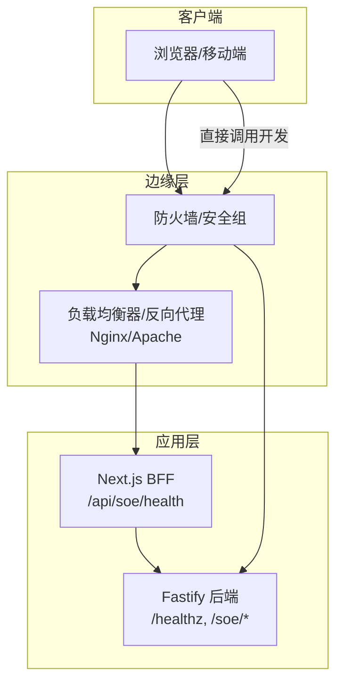
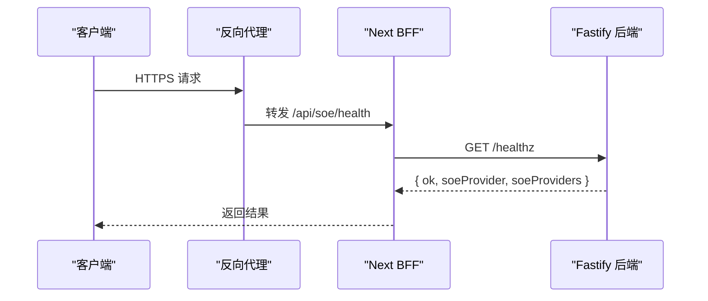
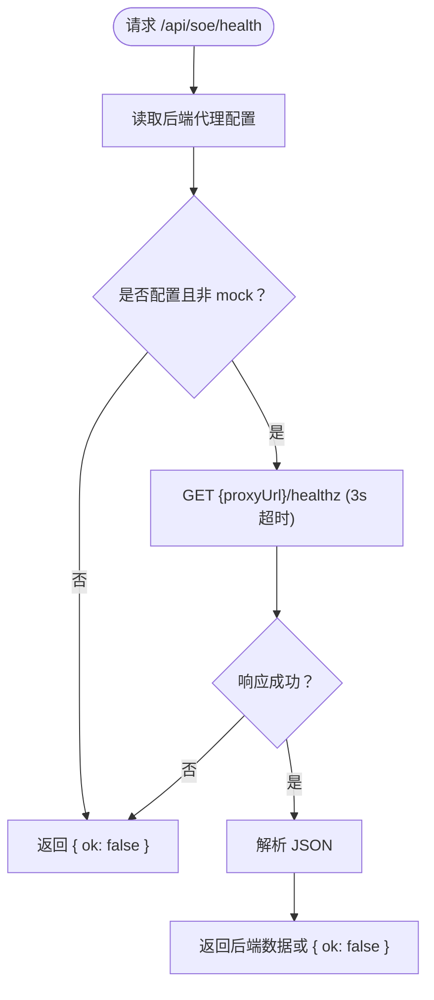
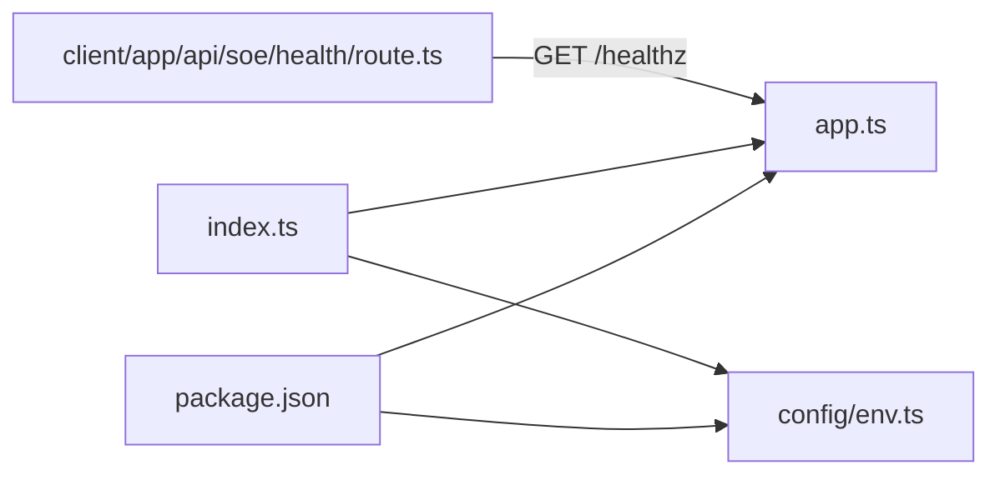

# 网络配置

<cite>
**本文引用的文件**   
- [server/src/app.ts](file://server/src/app.ts)
- [server/src/index.ts](file://server/src/index.ts)
- [server/src/config/env.ts](file://server/src/config/env.ts)
- [server/package.json](file://server/package.json)
- [client/app/api/soe/health/route.ts](file://client/app/api/soe/health/route.ts)
</cite>

## 目录
1. [简介](#简介)
2. [项目结构](#项目结构)
3. [核心组件](#核心组件)
4. [架构总览](#架构总览)
5. [详细组件分析](#详细组件分析)
6. [依赖关系分析](#依赖关系分析)
7. [性能与容量规划](#性能与容量规划)
8. [故障排查指南](#故障排查指南)
9. [结论](#结论)
10. [附录：部署与运维清单](#附录部署与运维清单)

## 简介
本文件面向后端服务的网络配置与部署安全，覆盖端口与监听、反向代理（Nginx/Apache）、SSL/TLS、跨域（CORS）、负载均衡与健康检查、环境变量与敏感信息管理，以及访问控制、请求限流与 DDoS 防护等最佳实践。文档基于仓库中 Fastify 后端与 Next.js BFF 的实际实现进行说明，确保建议与代码行为一致。

## 项目结构
后端服务使用 Fastify，通过环境变量加载与校验，注册 CORS、多部分上传插件，暴露健康检查端点，并挂载业务路由。Next.js 前端提供 BFF 接口转发到后端 /healthz，用于连接状态探测。

图示来源
- [server/src/app.ts:14-45](file://server/src/app.ts#L14-L45)
- [client/app/api/soe/health/route.ts:9-22](file://client/app/api/soe/health/route.ts#L9-L22)

章节来源
- [server/src/app.ts:1-47](file://server/src/app.ts#L1-L47)
- [client/app/api/soe/health/route.ts:1-23](file://client/app/api/soe/health/route.ts#L1-L23)

## 核心组件
- 环境变量与校验：集中定义端口、主机、CORS、第三方凭据、超时重试等，启动时严格校验。
- 应用装配：注册 CORS、multipart、统一错误处理、健康检查与业务路由。
- 进程入口：加载环境、装配应用、监听端口、优雅关闭。
- BFF 健康检查：同源转发后端 /healthz，供前端连接徽标显示。

章节来源
- [server/src/config/env.ts:9-32](file://server/src/config/env.ts#L9-L32)
- [server/src/app.ts:14-45](file://server/src/app.ts#L14-L45)
- [server/src/index.ts:8-18](file://server/src/index.ts#L8-L18)
- [client/app/api/soe/health/route.ts:9-22](file://client/app/api/soe/health/route.ts#L9-L22)

## 架构总览
后端以 Fastify 为核心，BFF 作为同域代理屏蔽跨域问题；外部流量经防火墙与安全组进入负载均衡/反向代理，再转发至后端。健康检查由后端 /healthz 提供，BFF 将其封装为 /api/soe/health。

图示来源
- [client/app/api/soe/health/route.ts:9-22](file://client/app/api/soe/health/route.ts#L9-L22)
- [server/src/app.ts:38-42](file://server/src/app.ts#L38-L42)

## 详细组件分析

### 端口与监听配置
- 默认监听端口与环境变量：PORT 默认 8788，HOST 默认 0.0.0.0。
- 进程启动：读取环境变量后调用 Fastify 的 listen，绑定 HOST 与 PORT。
- 生产建议：
  - 容器/云原生：将 PORT 暴露给编排系统，由 Ingress/Service 管理对外端口。
  - 传统服务器：仅监听 127.0.0.1，由 Nginx/Apache 反代对外暴露 443/80。

章节来源
- [server/src/config/env.ts:9-11](file://server/src/config/env.ts#L9-L11)
- [server/src/index.ts:8-11](file://server/src/index.ts#L8-L11)

### 跨域请求（CORS）
- 实现位置：Fastify 注册 @fastify/cors，origin 来自环境变量 CORS_ORIGIN，支持逗号分隔的多源。
- 默认值：http://localhost:3000，便于 Next 开发调试。
- 生产建议：
  - 明确列出受信任的前端域名，避免使用通配符。
  - 若通过反向代理统一出口，可考虑在代理层设置 CORS，后端保持最小化策略。

章节来源
- [server/src/app.ts:7-8](file://server/src/app.ts#L7-L8)
- [server/src/app.ts:18-18](file://server/src/app.ts#L18-L18)
- [server/src/config/env.ts:12-13](file://server/src/config/env.ts#L12-L13)

### 健康检查端点
- 后端端点：GET /healthz，返回服务可用性与已注册的 SOE provider 列表。
- BFF 端点：GET /api/soe/health，同源转发后端 /healthz，失败或不可达时返回 { ok: false }。
- 用途：负载均衡健康检查、前端连接状态指示。

图示来源
- [client/app/api/soe/health/route.ts:9-22](file://client/app/api/soe/health/route.ts#L9-L22)
- [server/src/app.ts:38-42](file://server/src/app.ts#L38-L42)

章节来源
- [server/src/app.ts:38-42](file://server/src/app.ts#L38-L42)
- [client/app/api/soe/health/route.ts:1-23](file://client/app/api/soe/health/route.ts#L1-L23)

### 环境变量与敏感信息管理
- 加载机制：从 server/.env 读取 KEY=VALUE，忽略注释行；若同名环境变量已存在则不覆盖。
- 校验与约束：使用 zod 对类型、范围、必填项进行强校验；缺失关键凭据会抛出明确错误。
- 第三方凭据：Azure、腾讯云、科大讯飞三套凭据分别有“齐备性”判断函数，并在默认 provider 缺失时阻止启动。
- 上游参数：SOE_TIMEOUT_MS、SOE_RETRY 控制上游调用超时与重试次数。
- 安全建议：
  - 生产环境优先使用平台密钥管理服务（如 KMS、Secrets Manager、Vault）。
  - .env 仅用于本地开发；CI/CD 注入环境变量，禁止提交敏感信息。
  - 对 AZURE_SPEECH_HOST 等外部地址进行协议白名单校验（已内置 http(s) 前缀校验）。

章节来源
- [server/src/config/env.ts:36-54](file://server/src/config/env.ts#L36-L54)
- [server/src/config/env.ts:56-83](file://server/src/config/env.ts#L56-L83)
- [server/src/config/env.ts:85-115](file://server/src/config/env.ts#L85-L115)

### 多部分上传与请求体限制
- 插件：@fastify/multipart，限制单文件数、文件大小与字段数。
- 默认大小：音频 ≤25MB，整体请求体上限 32MB。
- 生产建议：
  - 根据业务调整 fileSize，结合网关层 body size 限制保持一致。
  - 对大文件上传启用分片/断点续传，降低超时风险。

章节来源
- [server/src/app.ts:19-21](file://server/src/app.ts#L19-L21)

### 统一错误处理
- 自定义 ApiError 携带 HTTP 状态码与结构化 code/message/detail。
- 4xx 错误映射为对应 code（如 413 → PAYLOAD_TOO_LARGE），其余归一为 500 内部错误。
- 建议：网关层透传结构化错误，前端按 code 分类提示。

章节来源
- [server/src/app.ts:23-35](file://server/src/app.ts#L23-L35)

### 反向代理与 SSL/TLS
- 推荐模式：
  - 后端仅监听内网（127.0.0.1:8788），由 Nginx/Apache 终止 TLS 并反代到后端。
  - 所有外部流量走 HTTPS，HTTP 自动 301 到 HTTPS。
- Nginx 要点：
  - 开启 gzip/brotli、HTTP/2、TLS 1.2+、现代密码套件。
  - 设置 proxy_set_header Host/Origin/X-Forwarded-* 以正确传递来源。
  - 限制 request body 大小与速率，配合 upstream keepalive。
- Apache 要点：
  - 启用 mod_ssl、mod_proxy、mod_headers、mod_ratelimit/mod_evasive。
  - 配置 SSLProtocol/SSLCipherSuite，禁用弱加密套件。
- 证书管理：
  - 使用自动化证书（如 Let’s Encrypt/Certbot），定期轮换。
  - 证书私钥权限最小化，仅 root 或专用用户可读。

本节为通用部署建议，不直接分析具体源码文件。

### 负载均衡与健康检查
- 后端健康检查：/healthz 返回服务状态与 provider 列表。
- BFF 健康检查：/api/soe/health 封装后端 /healthz，适合前端展示连接状态。
- 负载均衡策略：
  - 基于健康检查剔除异常实例。
  - 会话保持（如需）结合 Redis 存储会话。
  - 灰度发布与蓝绿部署结合健康检查切换流量。

章节来源
- [server/src/app.ts:38-42](file://server/src/app.ts#L38-L42)
- [client/app/api/soe/health/route.ts:9-22](file://client/app/api/soe/health/route.ts#L9-L22)

### 访问控制与请求限流
- 访问控制：
  - 仅开放必要端口（443/80），后端端口对内。
  - 使用 IP 白名单限制管理接口访问。
  - 鉴权与授权在业务层实现，网关层做基础认证（如 mTLS、API Key）。
- 请求限流：
  - 网关层按 IP/路径/用户维度限速，防刷与防滥用。
  - 针对上传接口单独限速与配额。
- DDoS 防护：
  - 接入云厂商 DDoS 高防/清洗服务。
  - 启用连接数限制、SYN Flood 防护、CC 攻击防护。
  - 对异常 UA/Referer/Geo 进行拦截或验证码挑战。

本节为通用安全建议，不直接分析具体源码文件。

## 依赖关系分析
后端依赖 Fastify 生态：cors、multipart、ws、zod。Next BFF 负责同源转发与连接状态展示。

图示来源
- [server/package.json:16-21](file://server/package.json#L16-L21)
- [server/src/app.ts:6-12](file://server/src/app.ts#L6-L12)
- [server/src/index.ts:5-11](file://server/src/index.ts#L5-L11)
- [client/app/api/soe/health/route.ts:5-8](file://client/app/api/soe/health/route.ts#L5-L8)

章节来源
- [server/package.json:1-31](file://server/package.json#L1-L31)
- [server/src/app.ts:1-47](file://server/src/app.ts#L1-L47)
- [server/src/index.ts:1-19](file://server/src/index.ts#L1-L19)
- [client/app/api/soe/health/route.ts:1-23](file://client/app/api/soe/health/route.ts#L1-L23)

## 性能与容量规划
- 并发与线程：Node.js 单进程事件循环，结合 PM2/容器副本提升吞吐。
- 上传优化：
  - 合理设置 multipart 限制，避免过大请求阻塞。
  - 使用对象存储直传，减少后端带宽压力。
- 缓存与压缩：
  - 反向代理层启用 gzip/brotli、静态资源缓存。
  - 上游 API 调用增加缓存与降级策略。
- 监控与告警：
  - 采集 QPS、延迟、错误率、CPU/内存、连接数。
  - 对 /healthz 与 /api/soe/health 设置可用性告警。

本节为通用性能建议，不直接分析具体源码文件。

## 故障排查指南
- 无法启动：
  - 检查环境变量校验错误（端口、HOST、CORS_ORIGIN、第三方凭据）。
  - 确认默认 provider 的凭据齐全。
- 跨域报错：
  - 核对 CORS_ORIGIN 是否包含前端域名。
  - 检查反向代理是否正确透传 Origin/Host。
- 上传失败：
  - 检查 multipart 限制与网关 body size 限制是否一致。
  - 确认文件大小不超过 25MB。
- 健康检查不稳定：
  - 检查 BFF 到后端的连通性与超时时间。
  - 查看后端日志与上游 provider 状态。

章节来源
- [server/src/config/env.ts:85-115](file://server/src/config/env.ts#L85-L115)
- [server/src/app.ts:18-21](file://server/src/app.ts#L18-L21)
- [client/app/api/soe/health/route.ts:9-22](file://client/app/api/soe/health/route.ts#L9-L22)

## 结论
本项目后端采用 Fastify + 环境变量强校验，CORS 与 multipart 按需启用，并提供 /healthz 健康检查。通过 Next BFF 封装 /api/soe/health，前端可安全探测后端连接状态。生产部署建议由反向代理终止 TLS、统一入口、实施访问控制与限流，并结合云平台 DDoS 防护能力，保障服务稳定与安全。

## 附录：部署与运维清单
- 端口与监听
  - 设置 PORT/HOST，生产建议监听 127.0.0.1。
- 反向代理
  - Nginx/Apache 配置 HTTPS、HTTP/2、TLS 1.2+、现代密码套件。
  - 设置 proxy headers、body size、rate limit。
- 证书
  - 使用自动化证书工具，私钥最小权限。
- 环境变量
  - 使用平台密钥管理，避免明文 .env。
  - 校验失败即停止启动，防止半配置运行。
- 健康检查
  - 使用 /healthz 与 /api/soe/health 作为探针。
- 安全加固
  - 访问控制、IP 白名单、WAF、DDoS 防护。
  - 上传限流、异常 UA/Referer 拦截。

本节为通用运维建议，不直接分析具体源码文件。