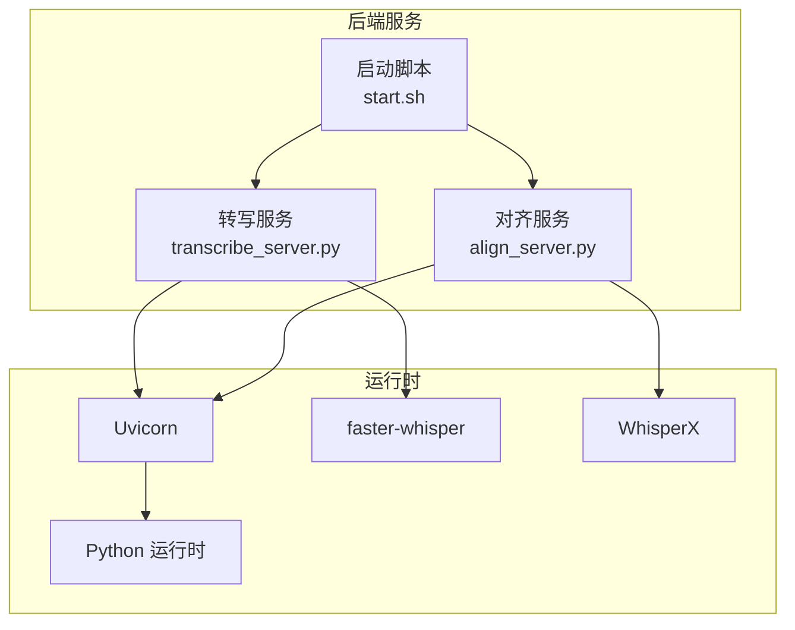
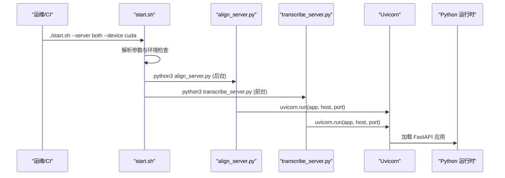
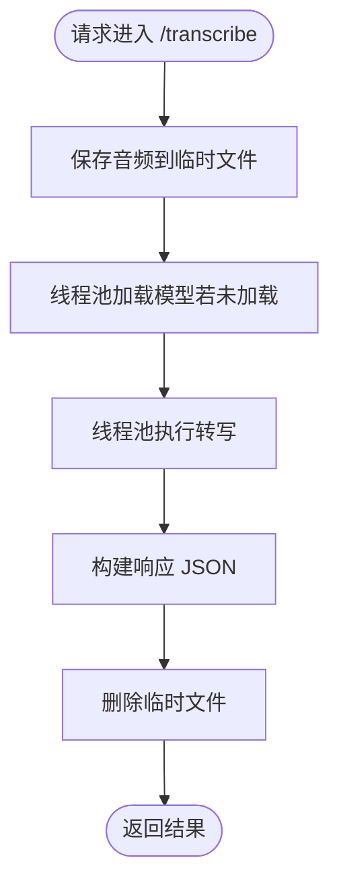
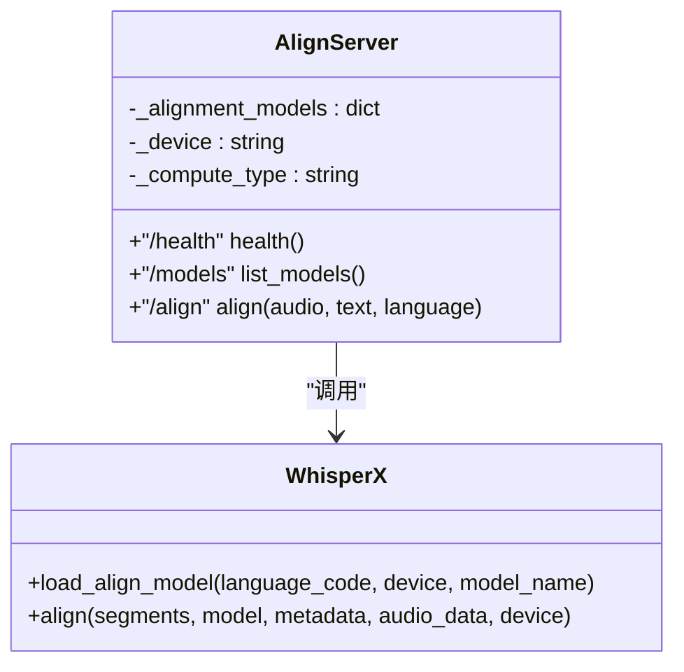
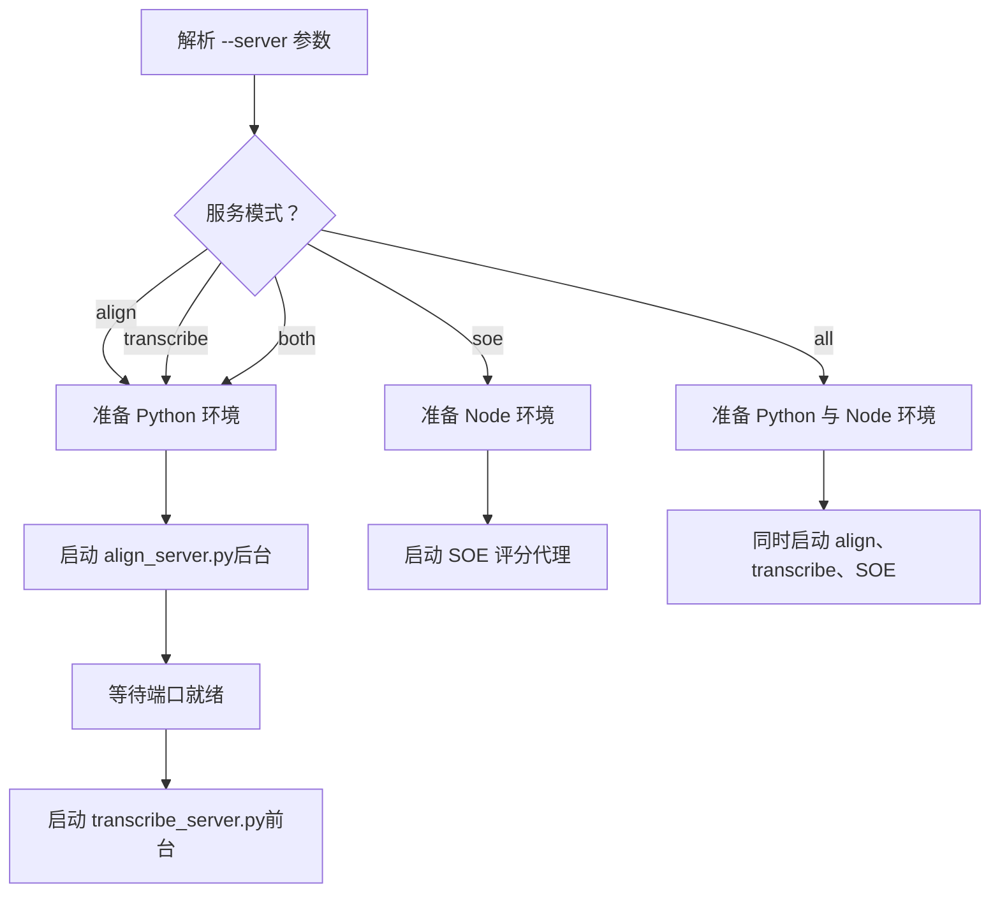
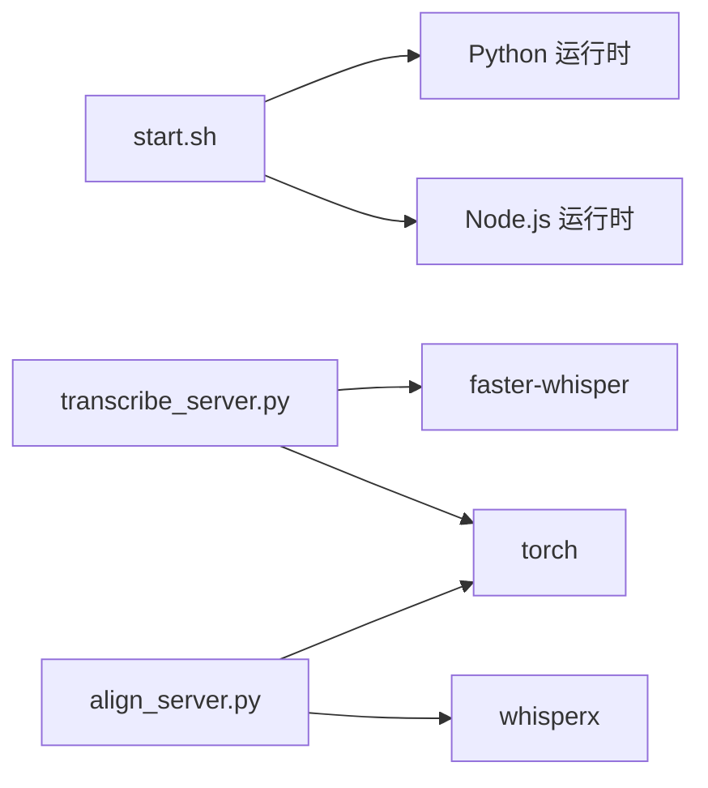
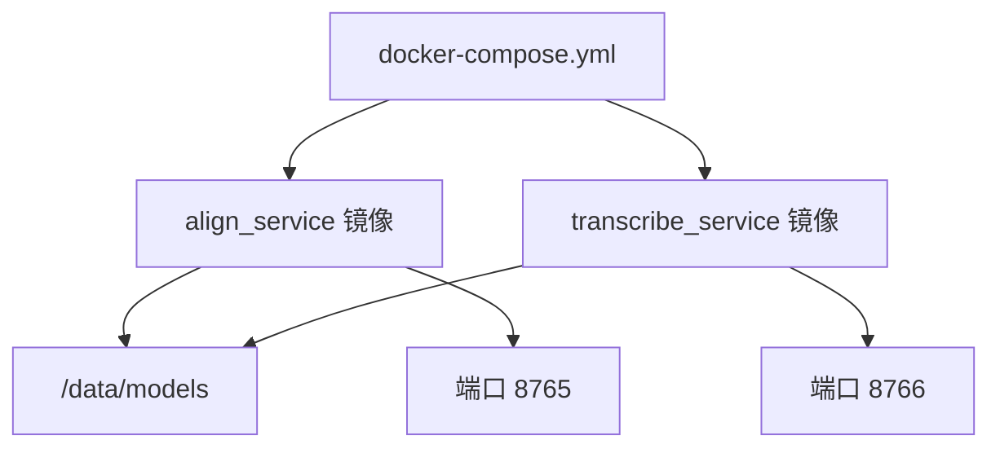
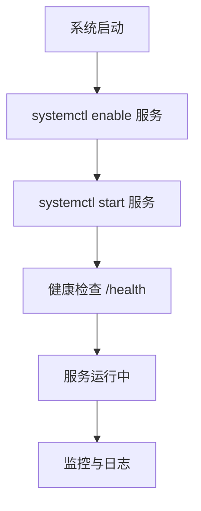

# 进程管理

<cite>
**本文引用的文件**   
- [README.md](file://README.md)
- [start.sh](file://server/start.sh)
- [transcribe_server.py](file://server/transcribe_server.py)
- [align_server.py](file://server/align_server.py)
</cite>

## 目录
1. [引言](#引言)
2. [项目结构](#项目结构)
3. [核心组件](#核心组件)
4. [架构总览](#架构总览)
5. [详细组件分析](#详细组件分析)
6. [依赖关系分析](#依赖关系分析)
7. [性能与资源限制](#性能与资源限制)
8. [故障恢复与重启策略](#故障恢复与重启策略)
9. [日志与可观测性](#日志与可观测性)
10. [Docker 容器化部署](#docker-容器化部署)
11. [systemd 服务守护与开机自启](#systemd-服务守护与开机自启)
12. [生产环境最佳实践](#生产环境最佳实践)
13. [排障指南](#排障指南)
14. [结论](#结论)

## 引言
本文件面向后端服务的进程管理，覆盖 systemd 守护进程配置、Docker 容器化与编排、进程监控与健康检查、日志轮转、重启与故障恢复、资源限制，以及生产环境的负载均衡与优雅关闭等最佳实践。文档基于仓库中的 Python FastAPI 后端服务（转写服务与对齐服务）及其启动脚本进行分析与扩展说明。

## 项目结构
后端服务位于 server 目录，包含两个独立的 FastAPI 服务：
- 转写服务：faster-whisper ASR，默认端口 8766
- 对齐服务：WhisperX 强制对齐，默认端口 8765
- 统一启动脚本 start.sh 负责环境准备与多服务并发启动

图示来源
- [start.sh:156-191](file://server/start.sh#L156-L191)
- [transcribe_server.py:255-255](file://server/transcribe_server.py#L255-L255)
- [align_server.py:242-242](file://server/align_server.py#L242-L242)

章节来源
- [README.md:49-57](file://README.md#L49-L57)
- [README.md:128-134](file://README.md#L128-L134)
- [start.sh:1-15](file://server/start.sh#L1-L15)

## 核心组件
- 转写服务（transcribe_server.py）
  - 提供 /health 健康检查与 /transcribe 音频转写接口
  - 支持设备自动选择（CUDA/CPU）、计算精度（int8/float16/float32）、模型大小参数
  - 使用线程池执行阻塞的模型加载与推理，避免阻塞事件循环
- 对齐服务（align_server.py）
  - 提供 /health、/models、/align 接口
  - 按语言缓存对齐模型，支持多种语言默认模型映射
  - 将文本与音频进行词级时间戳对齐
- 启动脚本（start.sh）
  - 解析 --server 参数，决定启动 align、transcribe、both、soe、all
  - 自动创建并激活 Python 虚拟环境，安装依赖，下载必要数据（如 NLTK punkt_tab）
  - 并发启动多个服务，等待端口就绪后继续

章节来源
- [transcribe_server.py:123-188](file://server/transcribe_server.py#L123-L188)
- [transcribe_server.py:195-255](file://server/transcribe_server.py#L195-L255)
- [align_server.py:118-207](file://server/align_server.py#L118-L207)
- [align_server.py:214-242](file://server/align_server.py#L214-L242)
- [start.sh:23-56](file://server/start.sh#L23-L56)
- [start.sh:58-129](file://server/start.sh#L58-L129)
- [start.sh:156-191](file://server/start.sh#L156-L191)

## 架构总览
后端由两个独立的服务组成，均通过 Uvicorn 运行在 FastAPI 之上。启动脚本根据模式启动一个或多个服务，并通过命令行参数透传给 Python 服务。

图示来源
- [start.sh:156-191](file://server/start.sh#L156-L191)
- [align_server.py:242-242](file://server/align_server.py#L242-L242)
- [transcribe_server.py:255-255](file://server/transcribe_server.py#L255-L255)

## 详细组件分析

### 转写服务（transcribe_server.py）
- 健康检查
  - GET /health 返回状态、设备、计算类型、模型大小、是否已加载、CUDA 可用性等
- 转写接口
  - POST /transcribe 接收音频与语言参数，返回全文、时长与分段信息
  - 使用临时文件保存上传音频，调用 faster-whisper 进行转写
  - 通过线程池执行阻塞操作，避免阻塞异步事件循环
- 启动参数
  - --port、--host、--device、--compute-type、--model-size、--preload
  - 自动设备选择与计算类型默认值（CUDA 用 float16，CPU 用 int8）

图示来源
- [transcribe_server.py:136-188](file://server/transcribe_server.py#L136-L188)
- [transcribe_server.py:48-83](file://server/transcribe_server.py#L48-L83)

章节来源
- [transcribe_server.py:123-188](file://server/transcribe_server.py#L123-L188)
- [transcribe_server.py:195-255](file://server/transcribe_server.py#L195-L255)

### 对齐服务（align_server.py）
- 健康检查
  - GET /health 返回状态、设备、计算类型
- 模型列表
  - GET /models 返回已加载模型与支持的默认模型集合
- 对齐接口
  - POST /align 接收音频与文本，返回词级时间戳与分段
  - 按语言加载并缓存对齐模型，支持多种语言的默认模型映射
  - 将输入文本作为整段传入 WhisperX，生成词级对齐结果

图示来源
- [align_server.py:118-207](file://server/align_server.py#L118-L207)
- [align_server.py:88-111](file://server/align_server.py#L88-L111)

章节来源
- [align_server.py:118-207](file://server/align_server.py#L118-L207)
- [align_server.py:214-242](file://server/align_server.py#L214-L242)

### 启动脚本（start.sh）
- 参数解析
  - --server 取值：align、transcribe、both、soe、all
  - 其他参数透传给 Python 服务
- 环境准备
  - 检查并创建 Python 虚拟环境，安装依赖
  - 按需安装 faster-whisper
  - 下载 NLTK punkt_tab 分词器（对齐服务需要）
  - 检查 ffmpeg 可用性
- 服务启动
  - 后台启动 align_server.py，等待端口绑定后再启动 transcribe_server.py
  - SOE 代理通过 pnpm start 启动（Node.js）

图示来源
- [start.sh:23-56](file://server/start.sh#L23-L56)
- [start.sh:58-129](file://server/start.sh#L58-L129)
- [start.sh:156-191](file://server/start.sh#L156-L191)

章节来源
- [start.sh:1-15](file://server/start.sh#L1-L15)
- [start.sh:23-56](file://server/start.sh#L23-L56)
- [start.sh:58-129](file://server/start.sh#L58-L129)
- [start.sh:156-191](file://server/start.sh#L156-L191)

## 依赖关系分析
- 外部依赖
  - Python：FastAPI、Uvicorn、torch、whisperx、faster_whisper
  - Node.js（可选）：SOE 评分代理
  - 系统工具：ffmpeg、unzip、curl（用于下载 NLTK 数据）
- 内部依赖
  - start.sh 依赖 Python 与 Node.js 运行时
  - 转写服务依赖 faster-whisper 与 torch
  - 对齐服务依赖 whisperx 与 torch

图示来源
- [start.sh:58-129](file://server/start.sh#L58-L129)
- [transcribe_server.py:24-26](file://server/transcribe_server.py#L24-L26)
- [align_server.py:24-27](file://server/align_server.py#L24-L27)

章节来源
- [start.sh:58-129](file://server/start.sh#L58-L129)
- [transcribe_server.py:24-26](file://server/transcribe_server.py#L24-L26)
- [align_server.py:24-27](file://server/align_server.py#L24-L27)

## 性能与资源限制
- 设备与计算类型
  - 转写服务默认优先 CUDA，回退 CPU；计算类型默认 CUDA 为 float16，CPU 为 int8
  - 可通过 --device 与 --compute-type 调整
- 模型预热
  - 转写服务支持 --preload 在启动时加载模型，减少首请求延迟
- 线程池
  - 使用 ThreadPoolExecutor(max_workers=1) 隔离阻塞操作，避免阻塞事件循环
- 资源限制建议
  - 在 systemd 中设置 MemoryMax、CPUQuota、TasksMax
  - 在 Docker 中设置 --memory、--cpus、--pids-limit
  - 在生产环境中结合 cgroup v2 或容器运行时限制

章节来源
- [transcribe_server.py:44-46](file://server/transcribe_server.py#L44-L46)
- [transcribe_server.py:226-255](file://server/transcribe_server.py#L226-L255)

## 故障恢复与重启策略
- 健康检查
  - 两个服务均暴露 /health 端点，可用于进程管理器或负载均衡器的存活探测
- 重启策略
  - systemd：Restart=always、RestartSec、StartLimitBurst/Interval
  - Docker：restart=unless-stopped 或 restart=on-failure
- 失败处理
  - 转写服务在异常时记录日志并返回 HTTP 500
  - 对齐服务在异常时记录日志并返回 HTTP 500
- 优雅关闭
  - 建议使用 SIGTERM 触发 Uvicorn 优雅关闭（默认行为）
  - 在 systemd 中设置 TimeoutStopSec 以允许完成中的请求

章节来源
- [transcribe_server.py:123-133](file://server/transcribe_server.py#L123-L133)
- [align_server.py:118-120](file://server/align_server.py#L118-L120)
- [transcribe_server.py:184-188](file://server/transcribe_server.py#L184-L188)
- [align_server.py:203-207](file://server/align_server.py#L203-L207)

## 日志与可观测性
- 日志级别
  - 默认 INFO，格式包含时间与级别
- 关键日志点
  - 模型加载、转写完成、对齐完成、错误堆栈
- 日志轮转建议
  - systemd：配合 journald 或 rsyslog 进行轮转
  - Docker：使用驱动 json-file 或 gelf/syslog，并配置 max-size/max-file
- 指标采集
  - 可集成 Prometheus 客户端暴露 metrics 端点
  - 或使用 OpenTelemetry 进行链路追踪

章节来源
- [transcribe_server.py:29-30](file://server/transcribe_server.py#L29-L30)
- [align_server.py:30-31](file://server/align_server.py#L30-L31)
- [transcribe_server.py:170-176](file://server/transcribe_server.py#L170-L176)
- [align_server.py:194-195](file://server/align_server.py#L194-L195)

## Docker 容器化部署
- 基础镜像
  - Python 官方镜像（例如 python:3.11-slim），预装系统依赖（ffmpeg）
- 应用镜像
  - 复制 server 目录，创建虚拟环境，安装 requirements.txt
  - 暴露端口 8765、8766
- 启动命令
  - 直接运行 start.sh 或分别运行两个服务
- docker-compose 编排
  - 定义 align_service 与 transcribe_service
  - 配置环境变量（设备、计算类型、模型大小）
  - 挂载卷持久化模型与数据
  - 配置健康检查与重启策略

[此图为概念性编排示意，不直接映射具体源码文件]

## systemd 服务守护与开机自启
- 服务单元模板
  - 为每个服务创建 .service 文件（align.service、transcribe.service）
  - 指定 ExecStart、WorkingDirectory、User、Group
  - 配置 Restart、RestartSec、StartLimitBurst、StartLimitIntervalSec
  - 配置 EnvironmentFile 读取 .env 配置
- 开机自启动
  - systemctl enable align.service transcribe.service
- 资源限制
  - MemoryMax、CPUQuota、TasksMax
- 日志
  - 使用 journald 收集标准输出与错误输出
  - 可配置 Systemd journal 轮转策略

[此图为概念性流程示意，不直接映射具体源码文件]

## 生产环境最佳实践
- 多实例负载均衡
  - 使用反向代理（Nginx/Traefik）对多个实例进行负载均衡
  - 针对长耗时任务（转写/对齐）启用连接超时与重试策略
- 优雅关闭处理
  - 确保 Uvicorn 正确处理 SIGTERM，停止接受新请求并完成进行中请求
  - 在 systemd 中设置 TimeoutStopSec，在 Docker 中设置 stop_grace_period
- 灰度发布与滚动更新
  - 逐步替换实例，确保健康检查通过后再切换流量
- 安全加固
  - 仅监听内网地址（127.0.0.1），通过反向代理暴露
  - 使用 TLS 终止于反向代理层
- 容量规划
  - 根据 GPU/CPU 资源与模型大小估算内存与显存占用
  - 设置合理的并发与队列长度，避免过载

[本节为通用实践指导，不直接分析具体源码文件]

## 排障指南
- 常见问题
  - CUDA 不可用：服务自动回退 CPU，检查 --device 与 compute type
  - NLTK punkt_tab 缺失：启动脚本会自动下载，网络受限时可手动放置
  - ffmpeg 缺失：部分音频格式解码失败，需安装系统包
- 诊断步骤
  - 检查 /health 端点返回的设备与模型状态
  - 查看服务日志中的错误堆栈
  - 验证端口占用与防火墙规则
- 恢复措施
  - 重启服务或实例
  - 清理临时文件与缓存
  - 调整资源限制与并发参数

章节来源
- [transcribe_server.py:246-251](file://server/transcribe_server.py#L246-L251)
- [start.sh:93-121](file://server/start.sh#L93-L121)
- [start.sh:123-127](file://server/start.sh#L123-L127)

## 结论
通过对仓库中后端服务的分析，我们明确了转写服务与对齐服务的职责边界、启动流程与健康检查机制。结合 systemd 与 Docker 的进程管理能力，可实现高可用的生产部署。建议在系统中引入统一的日志与指标采集，完善资源限制与优雅关闭策略，并通过反向代理实现多实例负载均衡与灰度发布。