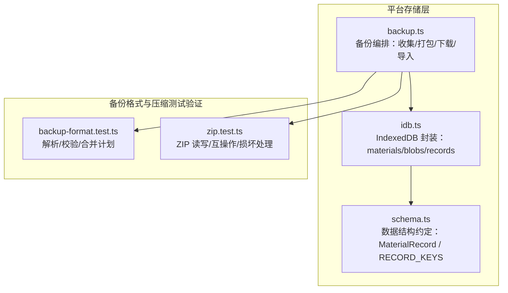
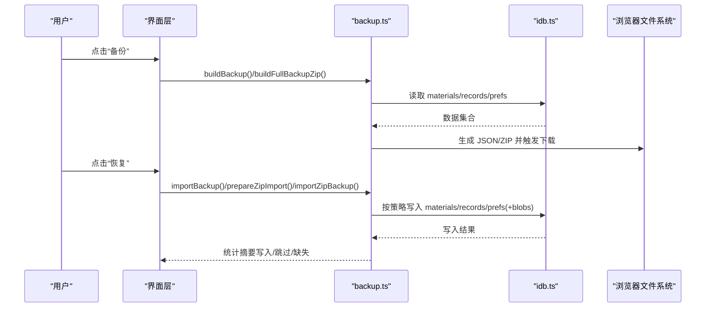
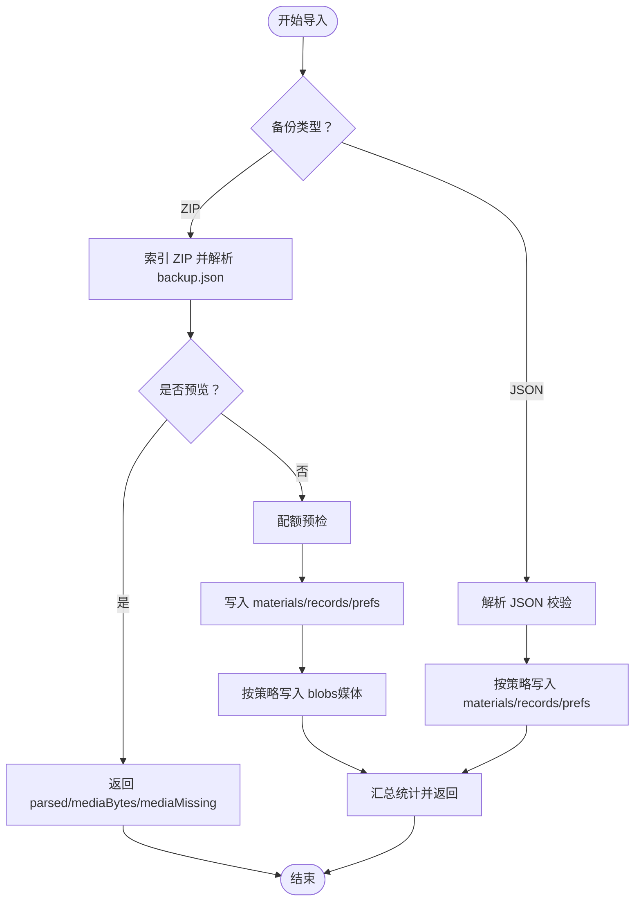
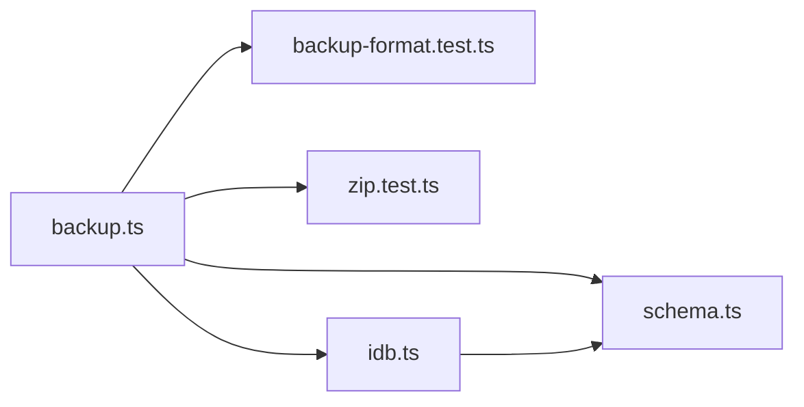

# 备份与恢复

<cite>
**本文引用的文件**   
- [client/platform/storage/backup.ts](file://client/platform/storage/backup.ts)
- [client/platform/storage/idb.ts](file://client/platform/storage/idb.ts)
- [client/platform/storage/schema.ts](file://client/platform/storage/schema.ts)
- [client/core/backup/__tests__/backup-format.test.ts](file://client/core/backup/__tests__/backup-format.test.ts)
- [client/core/backup/__tests__/zip.test.ts](file://client/core/backup/__tests__/zip.test.ts)
</cite>

## 目录
1. [简介](#简介)
2. [项目结构](#项目结构)
3. [核心组件](#核心组件)
4. [架构总览](#架构总览)
5. [详细组件分析](#详细组件分析)
6. [依赖关系分析](#依赖关系分析)
7. [性能考虑](#性能考虑)
8. [故障排查指南](#故障排查指南)
9. [结论](#结论)
10. [附录：操作手册](#附录操作手册)

## 简介
本文件面向用户与开发者，说明浏览器端 IndexedDB 数据的备份与恢复机制。系统支持两类备份格式：轻量 JSON（不含媒体）和完整 ZIP（含媒体清单与媒体数据）。备份内容覆盖材料库、学习进度、收藏数据、笔记、训练记录、生词本、记忆卡片、收藏夹等；同时导出本地偏好设置。导入时提供冲突策略控制，自动识别备份类型，并进行配额预检与错误提示。ZIP 容器采用自实现压缩原语，媒体条目默认零压缩以提升写入与回放性能。

## 项目结构
与备份恢复直接相关的代码位于以下路径：
- 平台存储层：`client/platform/storage/backup.ts`、`client/platform/storage/idb.ts`、`client/platform/storage/schema.ts`
- 备份格式与压缩原语测试：`client/core/backup/__tests__/backup-format.test.ts`、`client/core/backup/__tests__/zip.test.ts`

图示来源
- [client/platform/storage/backup.ts:1-243](file://client/platform/storage/backup.ts#L1-L243)
- [client/platform/storage/idb.ts:1-117](file://client/platform/storage/idb.ts#L1-L117)
- [client/platform/storage/schema.ts:1-27](file://client/platform/storage/schema.ts#L1-L27)
- [client/core/backup/__tests__/backup-format.test.ts:1-136](file://client/core/backup/__tests__/backup-format.test.ts#L1-L136)
- [client/core/backup/__tests__/zip.test.ts:1-190](file://client/core/backup/__tests__/zip.test.ts#L1-L190)

章节来源
- [client/platform/storage/backup.ts:1-243](file://client/platform/storage/backup.ts#L1-L243)
- [client/platform/storage/idb.ts:1-117](file://client/platform/storage/idb.ts#L1-L117)
- [client/platform/storage/schema.ts:1-27](file://client/platform/storage/schema.ts#L1-L27)

## 核心组件
- 备份编排器（backup.ts）
  - 轻量备份构建与下载：收集 materials、records、prefs，输出 JSON 文件。
  - 完整备份构建与下载：在轻量基础上增加 media 清单，并打包媒体为 ZIP。
  - 导入流程：轻量 JSON 导入、ZIP 预览与导入、配额预检、冲突策略应用。
- IndexedDB 封装（idb.ts）
  - 三个对象仓库：materials（材料元数据）、blobs（媒体 Blob）、records（训练/收藏/进度等）。
  - 内存降级：SSR/隐私模式或打开失败时回退到内存 Map，保证不崩溃。
  - 容量估算：estimateUsage 返回已用与配额，供导入前空间检查。
- 数据模型约定（schema.ts）
  - MaterialRecord：材料元数据 + 解析后的字幕数据。
  - RECORD_KEYS：统一 key 前缀规范（progress/fav/note/train/vocabbook/vocabentry/mnemonic/collection）。

章节来源
- [client/platform/storage/backup.ts:1-243](file://client/platform/storage/backup.ts#L1-L243)
- [client/platform/storage/idb.ts:1-117](file://client/platform/storage/idb.ts#L1-L117)
- [client/platform/storage/schema.ts:1-27](file://client/platform/storage/schema.ts#L1-L27)

## 架构总览
备份与恢复的整体流程如下：

图示来源
- [client/platform/storage/backup.ts:62-136](file://client/platform/storage/backup.ts#L62-L136)
- [client/platform/storage/backup.ts:176-242](file://client/platform/storage/backup.ts#L176-L242)
- [client/platform/storage/idb.ts:89-113](file://client/platform/storage/idb.ts#L89-L113)

## 详细组件分析

### 备份格式与兼容性
- 轻量 JSON
  - 包含字段：app、formatVersion、exportedAt、materials、records、prefs。
  - 不包含媒体；适合跨设备迁移元数据与进度。
- 完整 ZIP
  - 根目录 backup.json（同轻量结构），media/{materialId} 存放媒体。
  - 媒体清单 media[] 描述 id、fileName、mediaType、mime、size。
  - 兼容历史版本：当前解析器接受 formatVersion=1，并拒绝未来版本。
- 解析与校验
  - 对 app、formatVersion、materials、records、prefs、media 进行严格校验。
  - 剔除无效 media 条目，重复 id 去重取首次出现。
  - exportedAt 非数字时降级为 0，避免崩溃。
- 合并策略 planImport
  - overwrite：全部写入，忽略已有键。
  - skipExisting：已有键跳过，仅写入新键。

章节来源
- [client/core/backup/__tests__/backup-format.test.ts:1-136](file://client/core/backup/__tests__/backup-format.test.ts#L1-L136)
- [client/platform/storage/backup.ts:62-121](file://client/platform/storage/backup.ts#L62-L121)
- [client/platform/storage/backup.ts:176-199](file://client/platform/storage/backup.ts#L176-L199)

### ZIP 压缩与原语
- 写器 createZipWriter
  - 支持 deflate 压缩与 store（零压缩）两种方法；媒体默认 store。
  - sink 分片累积，定期将已完成分片转为 Blob，降低 JS 堆峰值。
  - 累计字节限制（约 4GB），超过则抛出上限错误。
- 索引与读取 indexZip/readEntry
  - 解析中央目录，建立 byName 索引；支持重名条目（byName 取首个）。
  - STORE 条目可通过 dataOffset 零拷贝切片，减少内存复制。
  - 与 fflate 双向互操作：可被 unzipSync 解开，也可读取其产物。
- 损坏与异常
  - EOCD 缺失、截尾、本地头签名篡改、中央目录越界、大小不符、zip64 哨兵值等均有明确错误信息。

章节来源
- [client/core/backup/__tests__/zip.test.ts:1-190](file://client/core/backup/__tests__/zip.test.ts#L1-L190)
- [client/platform/storage/backup.ts:77-121](file://client/platform/storage/backup.ts#L77-L121)

### IndexedDB 存储与降级
- 对象仓库
  - materials：材料元数据与解析后字幕。
  - blobs：媒体 Blob，key 与 material.id 对应。
  - records：以类型前缀区分业务数据（如 progress:/fav:/note:/train:/vocabbook:/vocabentry:/mnemonic:/collection:）。
- 降级策略
  - SSR/隐私模式或打开失败时切换至内存 Map，所有 KV 操作仍可用但不持久化。
  - guarded 包装确保调用方不因存储层异常而崩溃。
- 容量估算
  - estimateUsage 返回 usage/quota；导入 ZIP 前用于空间预检。

章节来源
- [client/platform/storage/idb.ts:1-117](file://client/platform/storage/idb.ts#L1-L117)
- [client/platform/storage/schema.ts:9-26](file://client/platform/storage/schema.ts#L9-L26)

### 导入流程与冲突策略
- 轻量 JSON 导入
  - 解析校验 → applyParsedBackup（按策略写入 materials/records/prefs）→ 返回统计。
- ZIP 导入
  - openBackupZip：索引 zip、解析 backup.json、统计媒体体积与缺失数。
  - prepareZipImport：预览（不写入），返回 parsed、mediaBytes、mediaMissing。
  - importZipBackup：配额预检 → 先写 materials/records/prefs → 再写 blobs（按策略）。
  - 媒体缺失计数：清单存在但 zip 中无对应条目时计入 mediaMissing。

图示来源
- [client/platform/storage/backup.ts:138-199](file://client/platform/storage/backup.ts#L138-L199)
- [client/platform/storage/backup.ts:201-242](file://client/platform/storage/backup.ts#L201-L242)

章节来源
- [client/platform/storage/backup.ts:138-242](file://client/platform/storage/backup.ts#L138-L242)

## 依赖关系分析
- backup.ts 依赖
  - core/backup/backup-format：备份格式常量、解析、合并计划。
  - core/backup/zip：ZIP 写器、索引、读取。
  - platform/storage/idb：materials/records/blobs 存取与容量估算。
  - platform/storage/prefs：偏好设置导出/写入。
  - platform/storage/schema：MaterialRecord 类型。
- idb.ts 依赖
  - 浏览器原生 indexedDB 与 navigator.storage.estimate。
- schema.ts 依赖
  - types/material、types/subtitle（类型定义）。

图示来源
- [client/platform/storage/backup.ts:13-17](file://client/platform/storage/backup.ts#L13-L17)
- [client/platform/storage/idb.ts:1-117](file://client/platform/storage/idb.ts#L1-L117)
- [client/platform/storage/schema.ts:1-27](file://client/platform/storage/schema.ts#L1-L27)

章节来源
- [client/platform/storage/backup.ts:1-243](file://client/platform/storage/backup.ts#L1-L243)
- [client/platform/storage/idb.ts:1-117](file://client/platform/storage/idb.ts#L1-L117)
- [client/platform/storage/schema.ts:1-27](file://client/platform/storage/schema.ts#L1-L27)

## 性能考虑
- 内存占用
  - 完整备份构建时，sink 每累积 32MB 即合并为 Blob，JS 堆峰值≈单个最大媒体+32MB。
  - 媒体写入优先使用 STORE（零压缩），避免 CPU 压缩开销。
- I/O 优化
  - ZIP 索引阶段只遍历 material ids，不读取媒体内容；媒体通过 dataOffset 零拷贝切片。
- 配额预检
  - 导入 ZIP 前基于 Central Directory 的 uncompressedSize 估算写入量，并乘以 1.2 余量，不足则提前报错。

章节来源
- [client/platform/storage/backup.ts:77-121](file://client/platform/storage/backup.ts#L77-L121)
- [client/platform/storage/backup.ts:211-223](file://client/platform/storage/backup.ts#L211-L223)

## 故障排查指南
- 无法打开 IndexedDB
  - 现象：控制台打印降级日志，isMemoryFallback 为真。
  - 原因：SSR、隐私模式、权限受限或连接被阻塞。
  - 处理：确认运行环境允许持久化存储；必要时清理旧标签页连接。
- 导入时报存储空间不足
  - 现象：提示需写入约若干 MB 媒体，建议清理空间或改用轻量备份。
  - 原因：预估写入量超出配额。
  - 处理：删除不必要媒体或选择轻量 JSON 导入。
- ZIP 损坏或不完整
  - 现象：报“zip 相关错误”“本地头缺失”“大小不符”“4GB/zip64 不支持”等。
  - 原因：文件截尾、EOCD 缺失、中央目录越界、外部工具重打包导致 method 变化。
  - 处理：重新导出；若由外部工具生成，请确保保留 STORE 条目或使用 readEntry 兜底路径。
- 导入后媒体不可播放
  - 现象：清单有媒体但播放器无法播放。
  - 原因：blob.type 未正确设置或媒体缺失。
  - 处理：检查 media.mime 与 fileName；确认 zip 中存在对应 media/{id} 条目。

章节来源
- [client/platform/storage/idb.ts:27-50](file://client/platform/storage/idb.ts#L27-L50)
- [client/platform/storage/backup.ts:211-242](file://client/platform/storage/backup.ts#L211-L242)
- [client/core/backup/__tests__/zip.test.ts:126-173](file://client/core/backup/__tests__/zip.test.ts#L126-L173)

## 结论
本方案以轻量 JSON 与完整 ZIP 双格式满足跨设备迁移与本地归档需求；通过严格的格式校验、合并策略与配额预检保障导入安全；ZIP 原语提供稳定可靠的压缩与读取能力，并对常见损坏场景给出明确错误提示。IndexedDB 封装在异常环境下优雅降级，确保应用可用性。

## 附录：操作手册

### 支持的备份数据范围
- 材料库：材料元数据与解析后的字幕数据。
- 学习进度：以 `progress:` 前缀的记录。
- 收藏数据：以 `fav:` 前缀的记录。
- 笔记：以 `note:` 前缀的记录。
- 训练记录：以 `train:` 前缀的记录。
- 生词本与词条：以 `vocabbook:`、`vocabentry:` 前缀的记录。
- 记忆卡片：以 `mnemonic:` 前缀的记录。
- 收藏夹：以 `collection:` 前缀的记录。
- 偏好设置：从 localStorage 导出的键值对。

章节来源
- [client/platform/storage/schema.ts:16-26](file://client/platform/storage/schema.ts#L16-L26)
- [client/platform/storage/backup.ts:50-59](file://client/platform/storage/backup.ts#L50-L59)

### 备份文件格式
- 轻量 JSON
  - 文件名：ping-english-backup-YYYYMMDD-HHmm.json
  - 字段：app、formatVersion、exportedAt、materials、records、prefs
  - 特点：不含媒体，体积小，适合快速迁移。
- 完整 ZIP
  - 文件名：ping-english-full-backup-YYYYMMDD-HHmm.zip
  - 结构：
    - backup.json：同轻量 JSON 结构，另含 media 清单
    - media/{materialId}：媒体二进制（默认 STORE 零压缩）
  - 特点：含媒体，导入后可直接播放。

章节来源
- [client/platform/storage/backup.ts:40-48](file://client/platform/storage/backup.ts#L40-L48)
- [client/platform/storage/backup.ts:62-121](file://client/platform/storage/backup.ts#L62-L121)

### 压缩算法与加密选项
- 压缩算法
  - ZIP 内部条目支持 deflate 与 store（零压缩）。
  - 媒体条目默认 store，以减少 CPU 消耗并提升回放性能。
- 加密选项
  - 当前实现未内置加密；如需加密，请在导出后使用外部工具对 ZIP 进行加密保护。

章节来源
- [client/core/backup/__tests__/zip.test.ts:48-80](file://client/core/backup/__tests__/zip.test.ts#L48-L80)
- [client/platform/storage/backup.ts:116-118](file://client/platform/storage/backup.ts#L116-L118)

### 手动备份步骤
- 轻量备份
  1. 进入“设置”或“备份”页面。
  2. 点击“导出轻量备份”。
  3. 浏览器下载 ping-english-backup-YYYYMMDD-HHmm.json。
- 完整备份
  1. 进入“设置”或“备份”页面。
  2. 点击“导出完整备份”。
  3. 浏览器下载 ping-english-full-backup-YYYYMMDD-HHmm.zip。

章节来源
- [client/platform/storage/backup.ts:62-136](file://client/platform/storage/backup.ts#L62-L136)

### 自动备份配置
- 当前仓库未提供定时自动备份实现。
- 建议方案
  - 使用浏览器扩展或操作系统任务调度，周期性触发页面执行导出逻辑。
  - 或在应用内集成定时器，结合用户授权与最小化频率策略执行导出。

[本节为通用建议，不直接分析具体源码]

### 数据恢复流程
- 轻量 JSON 恢复
  1. 选择 JSON 文件。
  2. 选择冲突策略：覆盖或跳过已有。
  3. 确认导入；完成后刷新页面使各 Store 重新加载。
- ZIP 恢复
  1. 选择 ZIP 文件。
  2. 预览：查看解析结果、媒体总体积、缺失媒体数量。
  3. 空间预检：若不足，清理空间或改用轻量备份。
  4. 确认导入；完成后刷新页面。

章节来源
- [client/platform/storage/backup.ts:176-242](file://client/platform/storage/backup.ts#L176-L242)

### 版本兼容性与数据迁移
- 向前兼容
  - 解析器接受 formatVersion=1 的历史备份。
- 向后保护
  - 拒绝未来版本，提示升级应用。
- 迁移建议
  - 低版本导出 → 高版本导入：可直接导入。
  - 高版本导出 → 低版本导入：可能因格式不兼容失败，请先升级目标应用。

章节来源
- [client/core/backup/__tests__/backup-format.test.ts:28-35](file://client/core/backup/__tests__/backup-format.test.ts#L28-L35)

### 灾难恢复预案
- 数据丢失场景
  - 浏览器缓存/站点数据被清空：使用最近一次备份恢复。
  - 设备更换：在新设备上导入轻量 JSON 或完整 ZIP。
  - 媒体缺失：ZIP 导入后若 mediaMissing>0，需单独补传对应媒体。
- 恢复顺序建议
  1. 先恢复轻量 JSON（材料与进度）。
  2. 再恢复完整 ZIP（媒体）。
  3. 刷新页面并验证关键功能（播放、收藏、训练记录）。

章节来源
- [client/platform/storage/backup.ts:201-242](file://client/platform/storage/backup.ts#L201-L242)

### 批量数据处理工具
- 当前仓库未提供独立批量处理脚本。
- 建议用法
  - 在控制台或自定义脚本中调用 backup.ts 暴露的函数：
    - buildBackup/buildFullBackupZip：批量导出。
    - importBackup/importZipBackup：批量导入。
  - 注意：下载操作需在用户交互回调中触发；批量导入前应做好配额预检与错误处理。

章节来源
- [client/platform/storage/backup.ts:62-136](file://client/platform/storage/backup.ts#L62-L136)
- [client/platform/storage/backup.ts:211-242](file://client/platform/storage/backup.ts#L211-L242)