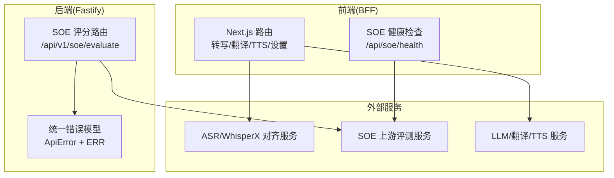
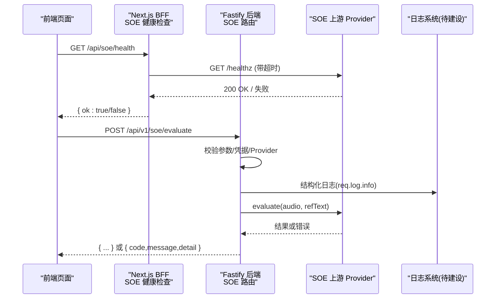
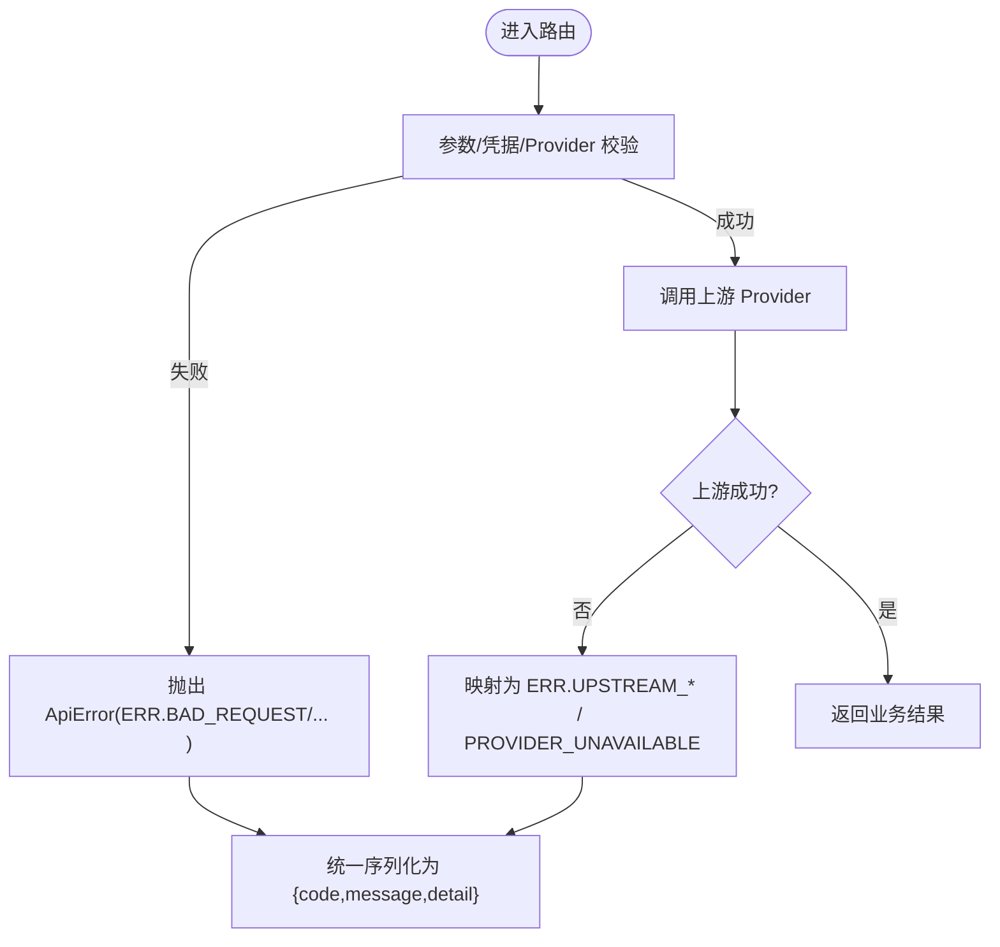
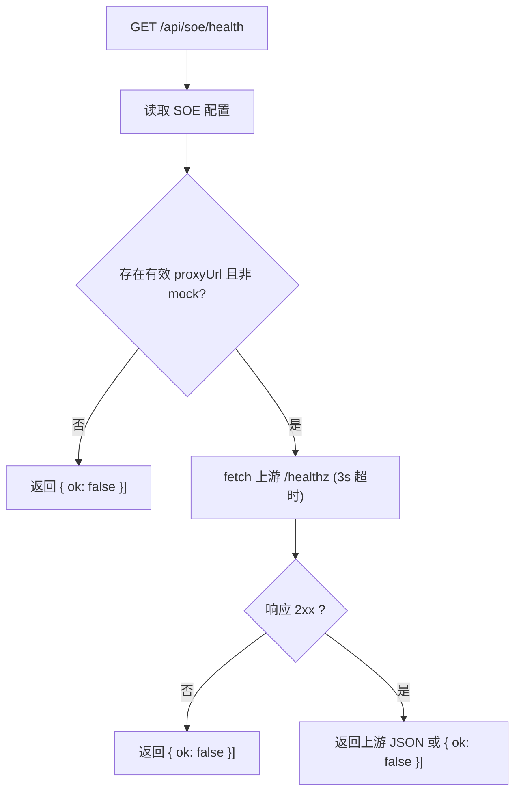
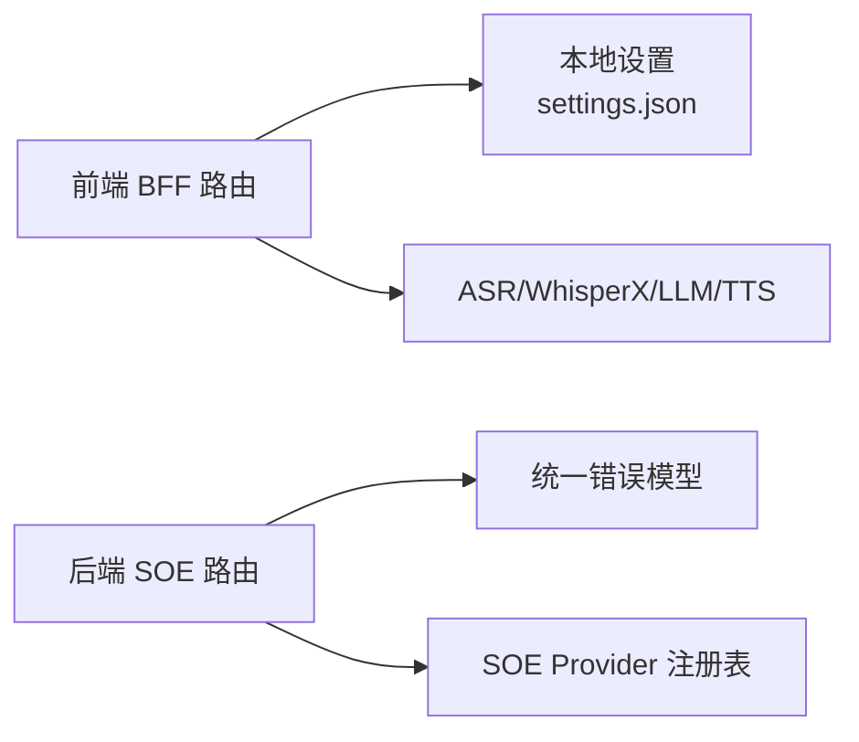

# 监控与日志

<cite>
**本文引用的文件**   
- [README.md](file://README.md)
- [client/app/api/soe/health/route.ts](file://client/app/api/soe/health/route.ts)
- [server/src/lib/api-error.ts](file://server/src/lib/api-error.ts)
- [server/src/routes/soe.route.ts](file://server/src/routes/soe.route.ts)
- [client/app/api/transcribe/route.ts](file://client/app/api/transcribe/route.ts)
- [client/lib/server-settings.ts](file://client/lib/server-settings.ts)
</cite>

## 目录
1. [引言](#引言)
2. [项目结构](#项目结构)
3. [核心组件](#核心组件)
4. [架构总览](#架构总览)
5. [详细组件分析](#详细组件分析)
6. [依赖关系分析](#依赖关系分析)
7. [性能与可观测性建议](#性能与可观测性建议)
8. [故障诊断指南](#故障诊断指南)
9. [结论](#结论)

## 引言
本运维文档聚焦于当前仓库中的“监控与日志”能力现状，并给出面向生产环境的扩展建议。现有代码已具备：
- 前端 BFF 健康检查接口（SOE 代理可达性探测）
- 后端统一 API 错误模型与结构化错误码
- 关键路由的 console 日志记录（含请求参数、上游状态、耗时等片段）
- 本地设置持久化（用于服务地址、密钥等配置）

同时，当前仓库尚未实现集中式日志系统、前端错误追踪 SDK、APM 指标采集与告警规则。本文在尊重现有实现的基础上，提供落地方案与集成指引。

## 项目结构
从可观测性视角，本项目涉及以下关键位置：
- 前端 Next.js BFF 路由：负责转发、校验、调用上游 ASR/SOE/TTS 等服务，并输出 console 日志
- 后端 Fastify SOE 路由：承载契约②评分接口，使用统一错误模型与结构化日志
- 客户端设置持久化：保存 LLM、SOE、Kokoro、本地服务等配置

图示来源
- [client/app/api/transcribe/route.ts:180-289](file://client/app/api/transcribe/route.ts#L180-L289)
- [client/app/api/soe/health/route.ts:9-22](file://client/app/api/soe/health/route.ts#L9-L22)
- [server/src/routes/soe.route.ts:64-107](file://server/src/routes/soe.route.ts#L64-L107)
- [server/src/lib/api-error.ts:6-35](file://server/src/lib/api-error.ts#L6-L35)

章节来源
- [README.md:92-134](file://README.md#L92-L134)

## 核心组件
- 统一 API 错误模型（后端）
  - 定义 ApiError 类与 ERR 常量映射，约定 { code, message, detail? } 响应体与 HTTP 语义
- SOE 评分路由（后端）
  - 解析 multipart/form-data，校验 refText/audio/provider/creds，构造 provider 并调用上游
  - 使用 req.log.info 输出结构化日志（包含 provider、是否携带请求级凭据、音频大小、参考文本前缀）
- 转写 BFF 路由（前端）
  - 调用 LLM 服务层进行 ASR，若返回无时间戳则尝试 WhisperX 对齐或回退比例分配
  - 捕获 LlmError 并输出带 code/message 的错误日志
- SOE 健康检查（前端）
  - 读取 SOE 配置，代理到上游 /healthz，超时/不可达时返回 ok=false
- 本地设置持久化
  - 读写 settings.json，支持多模型配置、SOE 代理地址、Kokoro 模型路径等

章节来源
- [server/src/lib/api-error.ts:1-36](file://server/src/lib/api-error.ts#L1-L36)
- [server/src/routes/soe.route.ts:1-110](file://server/src/routes/soe.route.ts#L1-L110)
- [client/app/api/transcribe/route.ts:1-289](file://client/app/api/transcribe/route.ts#L1-L289)
- [client/app/api/soe/health/route.ts:1-23](file://client/app/api/soe/health/route.ts#L1-L23)
- [client/lib/server-settings.ts:1-327](file://client/lib/server-settings.ts#L1-L327)

## 架构总览
下图展示一次 SOE 评分请求的关键链路，包括错误处理与日志落点：

图示来源
- [client/app/api/soe/health/route.ts:9-22](file://client/app/api/soe/health/route.ts#L9-L22)
- [server/src/routes/soe.route.ts:64-107](file://server/src/routes/soe.route.ts#L64-L107)
- [server/src/lib/api-error.ts:6-35](file://server/src/lib/api-error.ts#L6-L35)

## 详细组件分析

### 后端 API 错误处理机制
- 统一错误类型与错误码
  - ApiError 封装 code、message、httpStatus、detail
  - ERR 常量集中管理常见错误码与 HTTP 状态映射（如 BAD_REQUEST、PAYLOAD_TOO_LARGE、UPSTREAM_RATE_LIMIT、UPSTREAM_TIMEOUT、SOE_UPSTREAM_ERROR、PROVIDER_UNAVAILABLE、INTERNAL）
- 路由层使用
  - SOE 路由通过 apiError(ERR.XXX, message, detail?) 抛出标准错误，便于上层统一序列化
- 前端转写路由
  - 捕获 LlmError，输出带 code/message 的错误日志，并以 JSON 形式返回给前端

图示来源
- [server/src/lib/api-error.ts:6-35](file://server/src/lib/api-error.ts#L6-L35)
- [server/src/routes/soe.route.ts:64-107](file://server/src/routes/soe.route.ts#L64-L107)
- [client/app/api/transcribe/route.ts:277-287](file://client/app/api/transcribe/route.ts#L277-L287)

章节来源
- [server/src/lib/api-error.ts:1-36](file://server/src/lib/api-error.ts#L1-L36)
- [server/src/routes/soe.route.ts:1-110](file://server/src/routes/soe.route.ts#L1-L110)
- [client/app/api/transcribe/route.ts:277-287](file://client/app/api/transcribe/route.ts#L277-L287)

### 日志记录格式与结构化日志输出
- 后端 SOE 路由
  - 使用 req.log.info 输出结构化日志，字段包含 soe(provider)、requestCreds(布尔)、bytes(音频大小)、refText(截断前缀)，消息为固定事件名
- 前端 BFF 路由
  - 多处 console.warn/console.error 记录上游状态、超时、空结果、LlmError 等
- 建议
  - 将 console 日志迁移至统一 logger（如 pino），以 JSON 行输出，便于集中收集
  - 增加 traceId、spanId、userId、sessionId 等上下文字段，支撑端到端追踪

章节来源
- [server/src/routes/soe.route.ts:104-106](file://server/src/routes/soe.route.ts#L104-L106)
- [client/app/api/transcribe/route.ts:50-70](file://client/app/api/transcribe/route.ts#L50-L70)
- [client/app/api/transcribe/route.ts:257-267](file://client/app/api/transcribe/route.ts#L257-L267)
- [client/app/api/transcribe/route.ts:277-287](file://client/app/api/transcribe/route.ts#L277-L287)

### 健康检查接口与服务状态监控
- 前端 SOE 健康检查
  - 读取 SOE 配置，若未配置或 mock 模式直接返回 ok=false
  - 否则代理到上游 /healthz，设置 3s 超时；上游非 2xx 或异常均返回 ok=false
- 服务状态监控建议
  - 在前端仪表盘轮询 /api/soe/health，结合历史数据绘制可用性曲线
  - 在后端暴露通用 /healthz 与 /readyz，分别表示进程存活与依赖就绪

图示来源
- [client/app/api/soe/health/route.ts:9-22](file://client/app/api/soe/health/route.ts#L9-L22)
- [client/lib/server-settings.ts:311-320](file://client/lib/server-settings.ts#L311-L320)

章节来源
- [client/app/api/soe/health/route.ts:1-23](file://client/app/api/soe/health/route.ts#L1-L23)
- [client/lib/server-settings.ts:300-327](file://client/lib/server-settings.ts#L300-L327)

### 用户行为监控与前端错误追踪（待建设）
- 现状
  - 未发现前端错误追踪 SDK 或埋点库集成
- 建议方案
  - 前端错误追踪：接入 Sentry/Bugsnag，捕获全局异常、Promise 拒绝、资源加载失败、网络请求失败
  - 用户行为埋点：基于自定义事件上报 key 操作（录音、转写、评测、TTS、导入、设置变更），附带版本、设备、语言、会话 ID
  - 隐私合规：对敏感字段脱敏，限制上报频率与采样率

[本节为概念性建议，不直接分析具体文件]

### 性能指标收集与 APM（待建设）
- 现状
  - 未发现 metrics 采集与 APM 集成
- 建议方案
  - 浏览器侧：使用 Web Vitals（FCP/LCP/CLS/FID/INP）+ 自定义业务指标（录音时长、转写耗时、评测耗时）
  - 服务端：引入 APM（如 OpenTelemetry + Jaeger/Zipkin，或商业方案 Datadog/New Relic），采集 HTTP 请求耗时、错误率、上游延迟、队列长度等
  - 指标存储：Prometheus/Grafana 或云厂商监控平台

[本节为概念性建议，不直接分析具体文件]

### 日志收集方案（文件日志与集中式日志系统）
- 现状
  - 前端 BFF 使用 console 日志；后端 Fastify 使用 req.log.info 结构化日志
- 建议方案
  - 文件日志：Node 端使用 pino 输出 JSON 行到 stdout/stderr，由容器运行时写入文件；Python 端使用 structlog/loguru 输出结构化日志
  - 集中式日志：Filebeat/Fluent Bit/Vector 采集 → Kafka/Logstash → Elasticsearch/OpenSearch；或使用云厂商日志服务（SLS/CloudWatch Logs/Stackdriver）
  - 索引策略：按 service、env、traceId、level 分片；保留策略与冷热分层

[本节为概念性建议，不直接分析具体文件]

### 告警规则配置（建议）
- 可用性告警
  - /api/soe/health 连续 N 次返回 ok=false
  - 后端 /healthz 或 /readyz 不可用
- 错误率告警
  - 任意接口 5xx 比率超过阈值（如 5%）
  - 特定错误码突增（如 UPSTREAM_RATE_LIMIT、PROVIDER_UNAVAILABLE）
- 性能告警
  - P95/P99 延迟超阈值
  - 上游服务超时/限流比例升高
- 业务告警
  - 转写成功率下降、评测失败率上升、TTS 失败率上升

[本节为概念性建议，不直接分析具体文件]

## 依赖关系分析
- 前端 BFF 依赖
  - 本地设置读取（settings.json）→ 决定上游服务地址与模型
  - 上游 ASR/WhisperX/LLM/TTS 服务
- 后端 Fastify 依赖
  - 统一错误模型（ApiError/ERR）
  - SOE Provider 注册表与凭据解析
  - Fastify 内置 logger（req.log）

图示来源
- [client/app/api/transcribe/route.ts:180-289](file://client/app/api/transcribe/route.ts#L180-L289)
- [client/lib/server-settings.ts:1-327](file://client/lib/server-settings.ts#L1-L327)
- [server/src/routes/soe.route.ts:64-107](file://server/src/routes/soe.route.ts#L64-L107)
- [server/src/lib/api-error.ts:6-35](file://server/src/lib/api-error.ts#L6-L35)

章节来源
- [client/app/api/transcribe/route.ts:180-289](file://client/app/api/transcribe/route.ts#L180-L289)
- [client/lib/server-settings.ts:1-327](file://client/lib/server-settings.ts#L1-L327)
- [server/src/routes/soe.route.ts:1-110](file://server/src/routes/soe.route.ts#L1-L110)
- [server/src/lib/api-error.ts:1-36](file://server/src/lib/api-error.ts#L1-L36)

## 性能与可观测性建议
- 前端
  - 接入错误追踪 SDK，开启 Source Map 与用户上下文
  - 上报关键业务事件与性能指标（Web Vitals + 自定义指标）
  - 对长耗时任务（录音、转写、评测）增加进度与取消逻辑，避免资源泄漏
- 后端
  - 引入 APM，采集请求链路、数据库/缓存/HTTP 调用耗时
  - 统一日志格式（JSON 行），增加 traceId/spanId/userId/sessionId
  - 对上游调用增加熔断/重试/降级策略，避免雪崩
- 基础设施
  - 日志采集与索引优化（按维度分片、冷热分层、保留策略）
  - 指标可视化（Grafana）与告警联动（邮件/短信/IM）

[本节为概念性建议，不直接分析具体文件]

## 故障诊断指南
- 常见问题定位
  - SOE 健康检查失败
    - 检查 SOE 配置是否存在有效 proxyUrl 且非 mock
    - 确认上游 /healthz 可达性与响应内容
  - 转写失败
    - 查看 console.warn/console.error 中 WhisperX 对齐失败、超时、空结果等提示
    - 检查 LlmError 的 code/message，确认上游限流/超时/未配置
  - 后端 SOE 评分报错
    - 根据 ERR 错误码定位问题：参数错误、负载过大、上游限流/超时、Provider 未配置
    - 查看结构化日志中的 provider、bytes、refText 前缀，辅助复现
- 排查步骤
  - 前端：打开控制台，过滤关键字（Transcribe、WhisperX、LlmError）
  - 后端：检索结构化日志关键词（soe evaluate、UPSTREAM_*、PROVIDER_UNAVAILABLE）
  - 上游：核对上游服务健康状态、配额与密钥配置
  - 配置：核对 settings.json 中各服务地址与模型参数

章节来源
- [client/app/api/soe/health/route.ts:9-22](file://client/app/api/soe/health/route.ts#L9-L22)
- [client/app/api/transcribe/route.ts:50-70](file://client/app/api/transcribe/route.ts#L50-L70)
- [client/app/api/transcribe/route.ts:257-267](file://client/app/api/transcribe/route.ts#L257-L267)
- [client/app/api/transcribe/route.ts:277-287](file://client/app/api/transcribe/route.ts#L277-L287)
- [server/src/routes/soe.route.ts:64-107](file://server/src/routes/soe.route.ts#L64-L107)
- [server/src/lib/api-error.ts:18-35](file://server/src/lib/api-error.ts#L18-L35)

## 结论
当前仓库已具备基础的可观测性骨架：后端统一错误模型与结构化日志、前端 BFF 健康检查与关键日志输出。为实现生产级监控与日志体系，建议优先完成：
- 前端错误追踪与用户行为埋点
- 后端日志标准化与集中式采集
- APM 指标采集与可视化
- 健康检查与告警规则完善

这些改进将显著提升问题定位效率与系统稳定性。