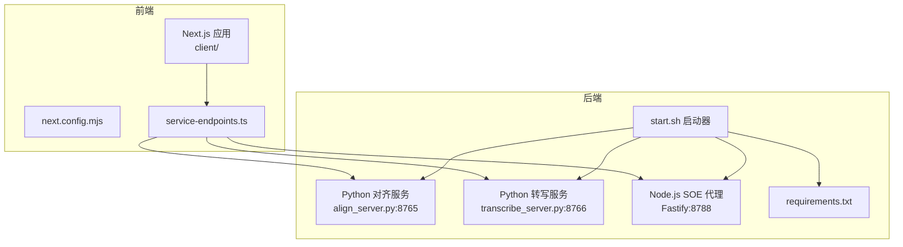
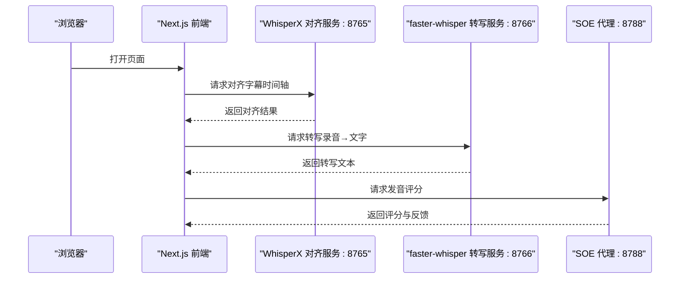
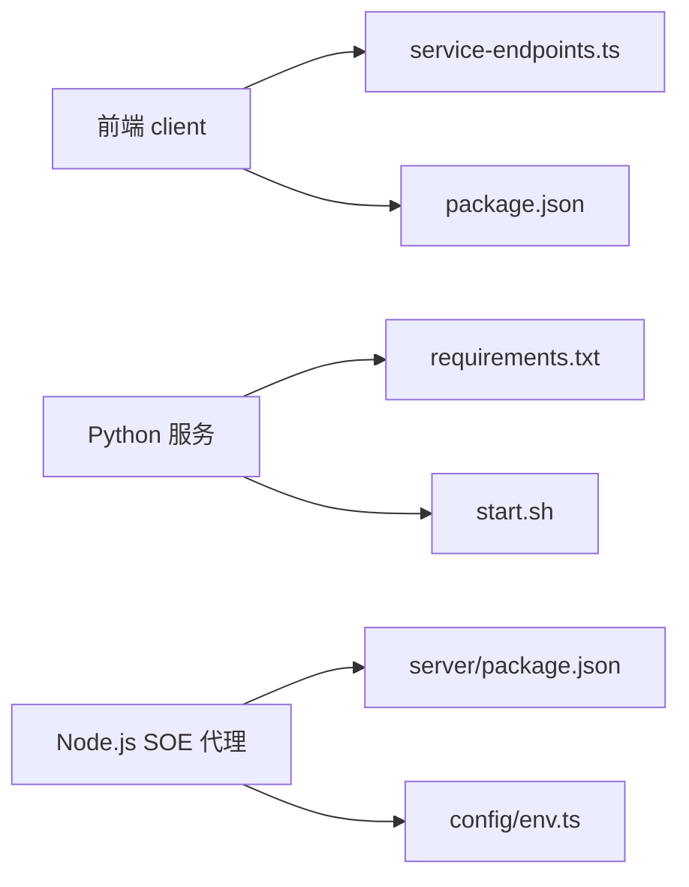

# 部署运维

<cite>
**本文引用的文件**   
- [README.md](file://README.md)
- [client/package.json](file://client/package.json)
- [client/next.config.mjs](file://client/next.config.mjs)
- [client/lib/service-endpoints.ts](file://client/lib/service-endpoints.ts)
- [client/lib/server-settings.ts](file://client/lib/server-settings.ts)
- [server/start.sh](file://server/start.sh)
- [server/requirements.txt](file://server/requirements.txt)
- [server/src/index.ts](file://server/src/index.ts)
- [server/src/app.ts](file://server/src/app.ts)
- [server/src/config/env.ts](file://server/src/config/env.ts)
</cite>

## 目录
1. [简介](#简介)
2. [项目结构](#项目结构)
3. [核心组件](#核心组件)
4. [架构总览](#架构总览)
5. [详细组件分析](#详细组件分析)
6. [依赖关系分析](#依赖关系分析)
7. [性能与容量规划](#性能与容量规划)
8. [监控、日志与可观测性](#监控日志与可观测性)
9. [故障排查指南](#故障排查指南)
10. [备份与恢复](#备份与恢复)
11. [结论](#结论)

## 简介
本操作手册面向生产环境的部署与运维，覆盖服务器规格建议、端口与防火墙配置、前端 Next.js 应用构建与部署、后端 Python FastAPI 服务与 Node.js SOE 代理的进程守护、环境变量与服务地址配置、第三方 API 密钥管理、监控与日志收集、错误追踪与性能监控、故障排查以及备份恢复流程。

本项目采用“本地优先”的前端 SPA（Next.js App Router 仅作为壳）+ 多后端服务的架构：
- 前端：Next.js + React + TypeScript，静态资源由 Web 服务器或 CDN 托管。
- 后端：Python FastAPI 提供转写和对齐能力；Node.js Fastify 提供 SOE 发音评分代理；另有可选的本地模型推理服务。

## 项目结构
仓库包含前端 client、后端 server、文档 docs 等目录。关键部署相关路径如下：
- 前端构建产物位于 client 目录，通过 Next.js 脚本构建与启动。
- 后端 Python 服务通过 start.sh 统一拉起，支持 align、transcribe、both、soe、all 多种模式。
- Node.js SOE 代理使用 Fastify，监听默认端口 8788。
- 前端通过 service-endpoints.ts 集中管理各服务默认地址。

图示来源
- [client/next.config.mjs:1-16](file://client/next.config.mjs#L1-L16)
- [client/lib/service-endpoints.ts:58-68](file://client/lib/service-endpoints.ts#L58-L68)
- [server/start.sh:156-191](file://server/start.sh#L156-L191)
- [server/requirements.txt:1-8](file://server/requirements.txt#L1-L8)

章节来源
- [README.md:23-57](file://README.md#L23-L57)
- [README.md:92-134](file://README.md#L92-L134)

## 核心组件
- 前端 Next.js 应用：负责 UI 渲染、用户交互、音频采集与编码、调用后端服务。
- Python 转写服务：基于 faster-whisper 的 ASR 能力，默认端口 8766。
- Python 对齐服务：基于 WhisperX 的词级时间戳对齐，默认端口 8765。
- Node.js SOE 代理：Fastify 无状态代理，聚合第三方口语评测服务，默认端口 8788。
- 启动脚本 start.sh：统一检查环境、安装依赖、下载分词器、拉起多个服务。

章节来源
- [README.md:92-134](file://README.md#L92-L134)
- [server/start.sh:1-20](file://server/start.sh#L1-L20)

## 架构总览
系统由前端 SPA 与三类后端服务组成。前端通过 service-endpoints.ts 中的默认地址访问后端；后端服务可通过 start.sh 一键启动，SOE 代理通过环境变量加载第三方凭据并转发请求。

图示来源
- [client/lib/service-endpoints.ts:58-68](file://client/lib/service-endpoints.ts#L58-L68)
- [server/start.sh:156-191](file://server/start.sh#L156-L191)

## 详细组件分析

### 前端 Next.js 应用部署
- 构建与运行
  - 开发：pnpm dev 启动开发服务器，默认监听 3000 端口。
  - 生产：pnpm build 生成静态资源，pnpm start 启动静态服务器。
- 静态资源优化
  - next.config.mjs 中 images.unoptimized=true，适合在反向代理或 CDN 场景下自行优化图片。
  - allowedDevOrigins 允许局域网 IP 访问，避免开发阶段跨源拦截导致白屏。
- CDN 与缓存策略
  - 将 /_next/static 等静态资源交由 Nginx/Apache/CDN 托管，开启长期缓存与版本化文件名。
  - 对 HTML 入口设置短缓存或 no-store，确保更新及时生效。
- 环境变量与服务地址
  - 前端通过 client/lib/service-endpoints.ts 统一管理默认服务地址：
    - WhisperX 对齐服务：http://127.0.0.1:8765
    - faster-whisper 转写服务：http://127.0.0.1:8766
    - SOE 代理：http://127.0.0.1:8788
  - 生产环境需将这些地址替换为实际域名或内网地址，并通过前端配置界面或构建时注入。

章节来源
- [client/package.json:5-10](file://client/package.json#L5-L10)
- [client/next.config.mjs:1-16](file://client/next.config.mjs#L1-L16)
- [client/lib/service-endpoints.ts:58-68](file://client/lib/service-endpoints.ts#L58-L68)

### 后端 Python FastAPI 服务部署
- 虚拟环境与依赖
  - start.sh 自动检测 python3，创建 .venv，安装 requirements.txt 依赖。
  - 按需安装 faster-whisper（转写模式）。
  - 对齐模式需要 NLTK punkt_tab 分词器，脚本会自动下载或从 GitHub 兜底。
- 服务启动
  - align_server.py：对齐服务，默认端口 8765。
  - transcribe_server.py：转写服务，默认端口 8766。
  - 支持 --device cuda 等参数透传给 Python 服务。
- 进程守护
  - 建议使用 systemd 或 Docker 容器进行进程守护与重启。
  - 如需同时启动多个服务，可使用 start.sh --server both/all。

章节来源
- [server/start.sh:58-127](file://server/start.sh#L58-L127)
- [server/start.sh:156-191](file://server/start.sh#L156-L191)
- [server/requirements.txt:1-8](file://server/requirements.txt#L1-L8)

### Node.js SOE 代理部署
- 运行时要求
  - Node.js >= 20，pnpm 包管理器。
- 启动方式
  - start.sh --server soe 或 all 拉起 SOE 代理，默认端口 8788。
- 环境变量与凭据
  - server/src/config/env.ts 定义并校验环境变量，包括 CORS_ORIGIN、SOE_PROVIDER 及第三方凭据。
  - 支持 mock、azure、tencent、iflytek 四种 provider。
  - Azure 需要 AZURE_SPEECH_KEY 与 REGION/HOST；腾讯需要三件套；讯飞需要三件套。
- 健康检查
  - /healthz 返回 soeProvider 与已注册的 providers 列表。

章节来源
- [server/start.sh:131-153](file://server/start.sh#L131-L153)
- [server/src/config/env.ts:9-32](file://server/src/config/env.ts#L9-L32)
- [server/src/app.ts:37-44](file://server/src/app.ts#L37-L44)

### 环境变量与服务地址配置
- 前端服务地址
  - 通过 client/lib/service-endpoints.ts 修改默认地址，或通过前端设置持久化到 settings.json。
- 后端服务地址
  - Python 服务通过命令行参数与环境变量控制设备与模型大小。
  - Node.js SOE 代理通过 server/.env 或环境变量配置 CORS、provider 与凭据。
- 第三方 API 密钥管理
  - Azure：AZURE_SPEECH_KEY、AZURE_SPEECH_REGION 或 AZURE_SPEECH_HOST。
  - 腾讯云：TENCENT_APP_ID、TENCENT_SECRET_ID、TENCENT_SECRET_KEY。
  - 科大讯飞：IFLYTEK_APP_ID、IFLYTEK_API_KEY、IFLYTEK_API_SECRET。
  - 建议在容器编排平台（如 Kubernetes Secrets）或系统环境变量中注入，避免写入代码库。

章节来源
- [client/lib/service-endpoints.ts:58-68](file://client/lib/service-endpoints.ts#L58-L68)
- [client/lib/server-settings.ts:300-326](file://client/lib/server-settings.ts#L300-L326)
- [server/src/config/env.ts:9-32](file://server/src/config/env.ts#L9-L32)

### 前端构建与部署流程
- 构建步骤
  - pnpm install → pnpm build → 输出静态资源。
- 部署步骤
  - 将构建产物部署至 Nginx/Apache/CDN。
  - 配置反向代理转发 /api 或 AI 服务接口到后端。
  - 配置静态资源缓存策略与 HTTPS。
- 注意事项
  - images.unoptimized=true，需在反向代理层启用图片优化或使用 CDN 的图片处理功能。
  - allowedDevOrigins 仅在开发阶段有效，生产环境应通过反向代理与 CORS 控制跨域。

章节来源
- [client/package.json:5-10](file://client/package.json#L5-L10)
- [client/next.config.mjs:1-16](file://client/next.config.mjs#L1-L16)

### 后端进程守护与高可用
- systemd 示例思路
  - 为 align_server.py、transcribe_server.py、SOE 代理分别创建 service 单元。
  - 设置 Restart=always、RestartSec、User、WorkingDirectory、EnvironmentFile。
- Docker 思路
  - 为 Python 服务与 Node.js 代理分别构建镜像，使用 docker-compose 编排。
  - 通过环境变量注入第三方凭据与服务地址。

[本节为通用实践说明，不直接分析具体文件]

## 依赖关系分析
- 前端依赖 Next.js、React、TypeScript、Tailwind CSS、shadcn/ui 等。
- 后端 Python 依赖 whisperx、torch、fastapi、uvicorn、python-multipart、numpy、faster-whisper。
- Node.js SOE 代理依赖 fastify、@fastify/cors、@fastify/multipart、ws、zod。

图示来源
- [client/package.json:11-33](file://client/package.json#L11-L33)
- [server/requirements.txt:1-8](file://server/requirements.txt#L1-L8)
- [server/package.json:16-22](file://server/package.json#L16-L22)
- [client/lib/service-endpoints.ts:58-68](file://client/lib/service-endpoints.ts#L58-L68)
- [server/src/config/env.ts:9-32](file://server/src/config/env.ts#L9-L32)

章节来源
- [client/package.json:11-33](file://client/package.json#L11-L33)
- [server/requirements.txt:1-8](file://server/requirements.txt#L1-L8)
- [server/package.json:16-22](file://server/package.json#L16-L22)

## 性能与容量规划
- 服务器规格建议
  - CPU 转写服务：4 核以上，内存 8GB+，SSD 用于模型与临时音频文件。
  - GPU 对齐服务：推荐 NVIDIA GPU（CUDA），显存 8GB+，内存 16GB+。
  - Node.js SOE 代理：轻量级，1-2 核，内存 1-2GB。
- 网络与带宽
  - 音频上传与转写对带宽有一定要求，建议内网低延迟访问后端。
- 并发与限流
  - 前端限制并发录音与转写请求。
  - 后端通过 Fastify bodyLimit 与 multipart limits 控制请求体大小。
- 缓存与优化
  - 前端静态资源 CDN 缓存；HTML 短缓存。
  - 后端对频繁调用的第三方 API 做短期缓存（按业务需求实现）。

[本节为通用指导，不直接分析具体文件]

## 监控、日志与可观测性
- 日志收集
  - Python 服务：记录 Uvicorn 日志与应用日志，建议接入 journald 或 Filebeat。
  - Node.js SOE 代理：Fastify 默认 logger，建议接入 stdout 并由容器平台收集。
  - 前端：浏览器控制台与错误上报（如 Sentry）。
- 指标与告警
  - 使用 Prometheus + Grafana 收集系统指标（CPU、内存、磁盘、网络）。
  - 针对后端健康检查 /healthz 设置可用性告警。
- 错误追踪
  - 前端集成错误追踪 SDK，捕获未处理异常与网络错误。
  - 后端统一错误处理器返回标准化错误结构 {code, message, detail?}。

章节来源
- [server/src/app.ts:23-35](file://server/src/app.ts#L23-L35)
- [server/src/app.ts:37-44](file://server/src/app.ts#L37-L44)

## 故障排查指南
- 常见问题
  - 前端白屏：检查 allowedDevOrigins 与反向代理跨域配置。
  - 服务不可达：确认端口是否开放（8765、8766、8788），防火墙与安全组规则。
  - 第三方凭据缺失：SOE_PROVIDER 对应的凭据未配置或格式错误。
  - NLTK punkt_tab 下载失败：检查网络连通性或手动放置分词器。
  - ffmpeg 缺失：部分音频格式解码失败，请安装 ffmpeg。
- 诊断步骤
  - 查看服务日志与 /healthz 响应。
  - 验证环境变量是否正确注入。
  - 使用 curl 或浏览器测试各服务接口。
  - 检查系统资源与磁盘空间。

章节来源
- [server/start.sh:93-127](file://server/start.sh#L93-L127)
- [server/src/config/env.ts:85-115](file://server/src/config/env.ts#L85-L115)
- [client/next.config.mjs:9-13](file://client/next.config.mjs#L9-L13)

## 备份与恢复
- 数据范围
  - 前端用户设置与本地存储：settings.json（~/.ping-eng/settings.json）、IndexedDB（浏览器侧）。
  - 后端模型与临时文件：Python 虚拟环境、NLTK 数据、模型缓存。
- 备份策略
  - 定期备份 settings.json 与重要配置。
  - 对 Python 虚拟环境与模型缓存进行快照或归档。
- 恢复流程
  - 恢复 settings.json 到目标主机。
  - 重建 Python 虚拟环境并安装依赖。
  - 重新下载必要模型与分词器。
  - 重启服务并验证 /healthz 与各接口。

章节来源
- [client/lib/server-settings.ts:52-70](file://client/lib/server-settings.ts#L52-L70)
- [server/start.sh:93-121](file://server/start.sh#L93-L121)

## 结论
本手册提供了从服务器准备、前端构建部署、后端服务启动、环境变量与密钥管理、监控日志到故障排查与备份恢复的全流程指导。生产环境建议结合容器编排与 CI/CD 自动化部署，严格管理环境变量与凭据，完善监控与告警体系，确保系统稳定与可观测。