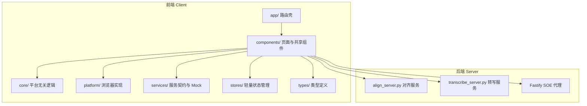
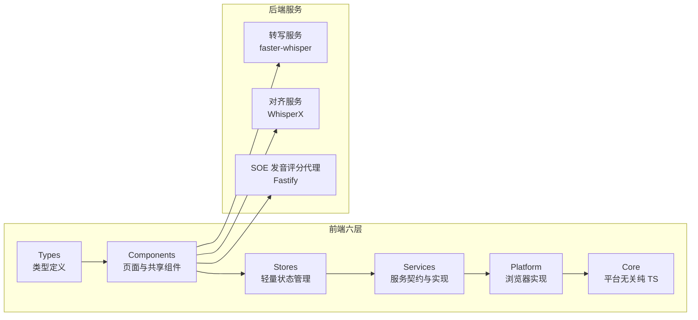
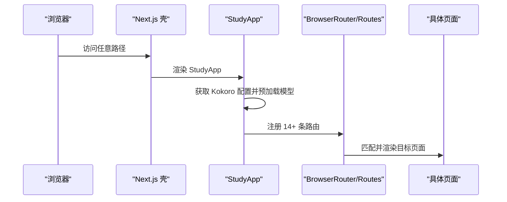
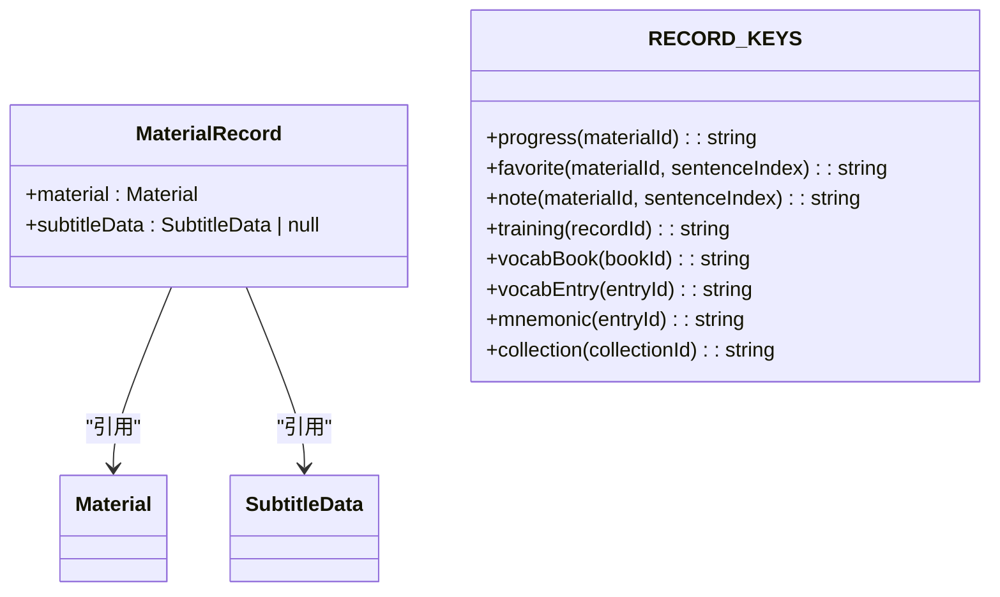
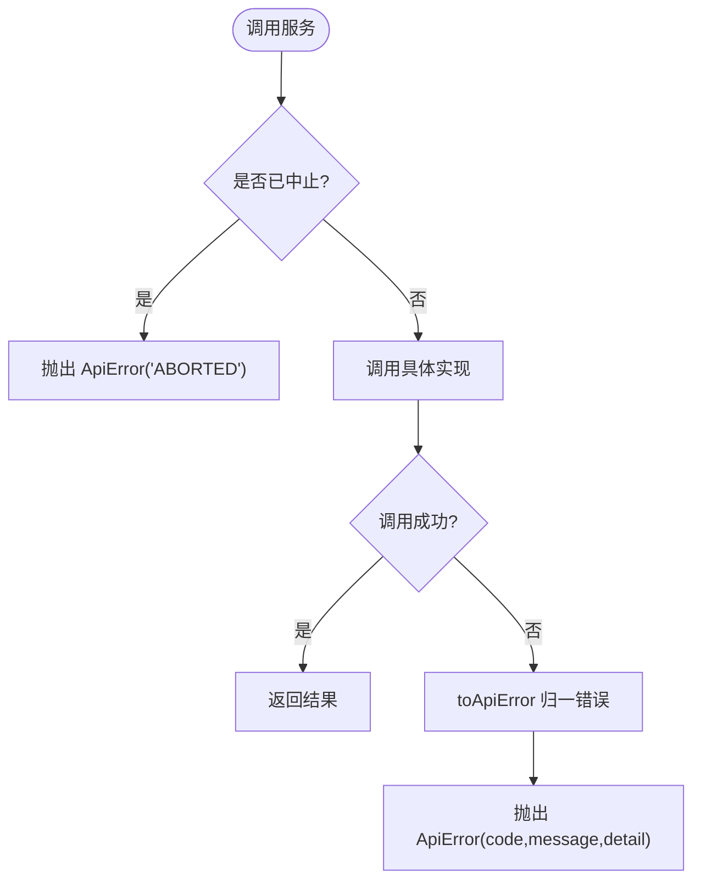
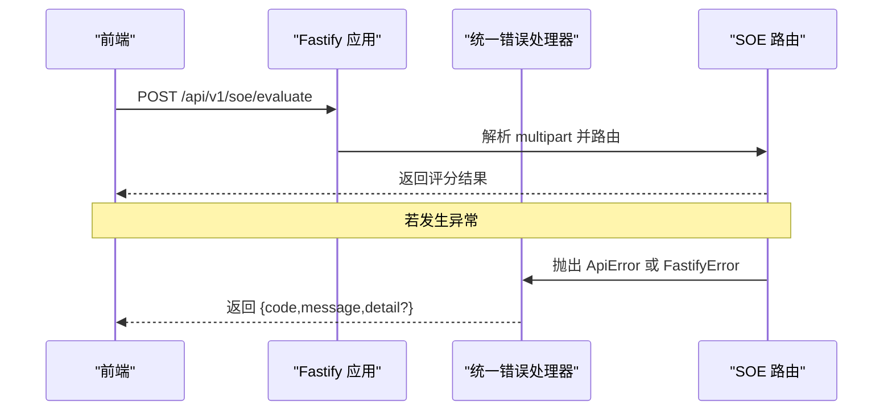
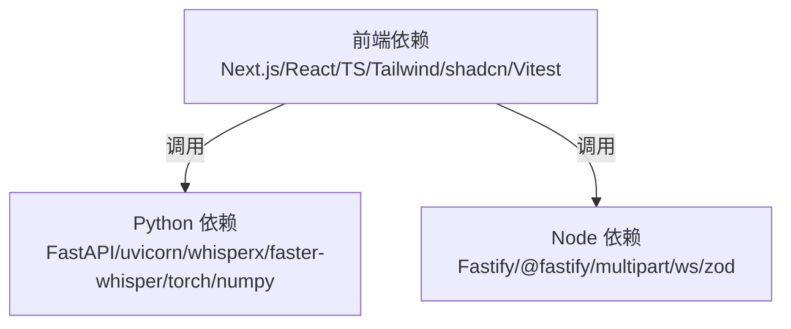

# 项目概述

<cite>
**本文引用的文件**   
- [README.md](file://README.md)
- [client/README.md](file://client/README.md)
- [server/README.md](file://server/README.md)
- [client/package.json](file://client/package.json)
- [server/package.json](file://server/package.json)
- [server/requirements.txt](file://server/requirements.txt)
- [client/components/study-app.tsx](file://client/components/study-app.tsx)
- [client/core/training/index.ts](file://client/core/training/index.ts)
- [client/platform/storage/schema.ts](file://client/platform/storage/schema.ts)
- [client/services/contracts.ts](file://client/services/contracts.ts)
- [server/src/app.ts](file://server/src/app.ts)
- [server/start.sh](file://server/start.sh)
</cite>

## 目录
1. [引言](#引言)
2. [项目结构](#项目结构)
3. [核心组件](#核心组件)
4. [架构总览](#架构总览)
5. [详细组件分析](#详细组件分析)
6. [依赖关系分析](#依赖关系分析)
7. [性能与部署要点](#性能与部署要点)
8. [快速开始指南](#快速开始指南)
9. [常见问题排查](#常见问题排查)
10. [结语](#结语)

## 引言
英语精听助手是一个面向“听懂、会说、能写”的本地优先学习工具，围绕多感官协同训练展开：耳朵听音、嘴巴跟读、手写听写、脑子理解。项目采用前后端分离架构：前端为基于 Next.js 的单页应用（SPA），后端提供 Python FastAPI 转写与对齐服务，以及 Node.js Fastify SOE 发音评分代理。设计理念强调“眼耳手嘴脑共用记住 80%”，通过多种训练模式（影子跟读、背诵、朗读、听写、九宫格等）提升听力、口语与写作能力。

**章节来源**
- [README.md:1-200](file://README.md#L1-L200)

## 项目结构
仓库由三大部分组成：
- client：前端 SPA（Next.js + React + TypeScript），包含页面、共享组件、平台适配层、纯逻辑 core、服务契约与状态管理。
- server：Python FastAPI 微服务（转写、对齐）与 Node.js Fastify SOE 发音评分代理。
- docs、page-prototype：设计文档与原型沙箱。



**图表来源**
- [client/components/study-app.tsx:42-62](file://client/components/study-app.tsx#L42-L62)
- [server/start.sh:156-191](file://server/start.sh#L156-L191)

**章节来源**
- [README.md:23-57](file://README.md#L23-L57)
- [client/README.md:21-96](file://client/README.md#L21-L96)

## 核心组件
- 前端入口与路由：StudyApp 使用 BrowserRouter 注册 14+ 条客户端路由，覆盖材料库、导入、播放器、训练中心、九宫格、听写、录音转写、影子跟读、背诵、朗读、报告、设置、TTS、词汇与助记等页面。
- 本地优先存储：MaterialRecord 将材料与解析后的字幕数据持久化到 IndexedDB，避免重复解析；统一 key 前缀规范便于扩展。
- 服务契约：SOE/TTS/Mnemonic 等服务以接口形式抽象，当前默认返回 Mock 实现，未来可切换真实 API。
- 纯逻辑 Core：training 模块导出九宫格、听写差异、评分与会话等零 React 的纯 TS 逻辑，便于在 Node 中测试。

**章节来源**
- [client/components/study-app.tsx:24-62](file://client/components/study-app.tsx#L24-L62)
- [client/platform/storage/schema.ts:9-26](file://client/platform/storage/schema.ts#L9-L26)
- [client/services/contracts.ts:92-143](file://client/services/contracts.ts#L92-L143)
- [client/core/training/index.ts:1-6](file://client/core/training/index.ts#L1-L6)

## 架构总览
系统采用六层架构：Core → Platform → Services → Stores → Components → Types。前端 SPA 仅作为壳，业务逻辑集中在 components 与 stores，平台相关能力下沉至 platform，AI 能力通过 services 契约解耦。后端提供语音转写、时间戳对齐与发音评分能力。



**图表来源**
- [README.md:102-117](file://README.md#L102-L117)
- [client/services/contracts.ts:138-143](file://client/services/contracts.ts#L138-L143)
- [server/src/app.ts:14-45](file://server/src/app.ts#L14-L45)

**章节来源**
- [README.md:92-127](file://README.md#L92-L127)

## 详细组件分析

### 前端 SPA 与路由
- StudyApp 在启动时预加载 Kokoro TTS 配置并初始化模型，随后渲染 BrowserRouter 与 Routes。
- 所有页面均为 'use client' 组件，Next.js App Router 仅作为壳，无 SSR 业务逻辑。



**图表来源**
- [client/components/study-app.tsx:24-62](file://client/components/study-app.tsx#L24-L62)

**章节来源**
- [client/components/study-app.tsx:1-65](file://client/components/study-app.tsx#L1-L65)
- [README.md:94-101](file://README.md#L94-L101)

### 本地优先存储与数据模型
- MaterialRecord 将材料与解析后的字幕 JSON 一起持久化，减少重复解析开销。
- RECORD_KEYS 统一了进度、收藏、笔记、训练记录、词汇本、助记卡片、合集等 key 前缀，便于扩展与维护。



**图表来源**
- [client/platform/storage/schema.ts:9-26](file://client/platform/storage/schema.ts#L9-L26)

**章节来源**
- [client/platform/storage/schema.ts:1-27](file://client/platform/storage/schema.ts#L1-L27)

### AI 服务契约与错误处理
- SoeService、TtsService、MnemonicService 定义了统一的接口，支持 AbortSignal 中止与流式 SSE。
- ApiError 与 toApiError 统一错误形态，AbortError 归一为 ABORTED，其他异常归一为 INTERNAL。



**图表来源**
- [client/services/contracts.ts:33-59](file://client/services/contracts.ts#L33-L59)
- [client/services/contracts.ts:92-143](file://client/services/contracts.ts#L92-L143)

**章节来源**
- [client/services/contracts.ts:1-144](file://client/services/contracts.ts#L1-L144)

### 后端 Fastify SOE 代理
- 构建 Fastify 实例，启用 CORS 与 multipart，限制文件大小为 25MB。
- 统一错误处理器将 ApiError 映射为带 code/message/detail 的响应，非 ApiError 的错误按 HTTP 状态码或 500 返回。
- /healthz 探活返回默认 provider 与全部已注册 provider。



**图表来源**
- [server/src/app.ts:14-45](file://server/src/app.ts#L14-L45)

**章节来源**
- [server/src/app.ts:1-47](file://server/src/app.ts#L1-L47)

## 依赖关系分析
- 前端依赖 Next.js 16.3.0、React 19、TypeScript 5.7.3、react-router-dom 7.x、Tailwind CSS 4、shadcn/ui、Vitest 4.x 等。
- Python 后端依赖 FastAPI、uvicorn、whisperx、faster-whisper、torch、numpy 等。
- Node.js SOE 代理依赖 Fastify 5.x、@fastify/multipart、ws、zod 等。



**图表来源**
- [client/package.json:11-42](file://client/package.json#L11-L42)
- [server/requirements.txt:1-8](file://server/requirements.txt#L1-L8)
- [server/package.json:16-28](file://server/package.json#L16-L28)

**章节来源**
- [client/package.json:1-60](file://client/package.json#L1-L60)
- [server/requirements.txt:1-8](file://server/requirements.txt#L1-L8)
- [server/package.json:1-31](file://server/package.json#L1-L31)

## 性能与部署要点
- 本地优先：用户数据存储在 IndexedDB，首次启动自动注入种子数据，降低对后端的依赖。
- 录音链路：getUserMedia → MediaRecorder → OfflineAudioContext（16kHz 单声道重采样）→ WAV Blob，专为 ASR/SOE 兼容性优化。
- 播放器 Seek 校准：seek 后静默旧进度，等待原生 timeupdate 到达实际落点，避免进度抖动。
- 后端设备选择：CPU 模式 int8，GPU 模式 float16；显存不足可选 small 模型，显存充足可选 large-v3。
- 模型缓存：NLTK punkt_tab、HuggingFace 模型与 PyTorch 预训练模型按需下载与缓存，首次请求可能较慢，可使用 --preload 预热。

**章节来源**
- [README.md:119-127](file://README.md#L119-L127)
- [client/README.md:144-166](file://client/README.md#L144-L166)
- [server/README.md:231-251](file://server/README.md#L231-L251)

## 快速开始指南

### 前端（Next.js + React）
- 进入 client 目录，安装依赖并启动开发服务器。
- 构建与测试命令见下方脚本说明。

```bash
cd client
pnpm install
pnpm dev          # 启动开发服务器 http://localhost:3000
pnpm build        # 生产构建
pnpm test         # 运行单元测试
npx tsc --noEmit  # 类型检查
```

**章节来源**
- [README.md:59-70](file://README.md#L59-L70)
- [client/README.md:98-124](file://client/README.md#L98-L124)

### 后端（Python FastAPI 服务）
- 创建虚拟环境并安装依赖。
- 使用 start.sh 一键启动对齐服务、转写服务或同时启动两者。
- 默认端口：对齐服务 8765，转写服务 8766。

```bash
cd server
python3 -m venv .venv
source .venv/bin/activate
pip install -r requirements.txt

./start.sh                          # 启动对齐服务（端口 8765）
./start.sh --server transcribe      # 启动转写服务（端口 8766）
./start.sh --server both            # 同时启动两个服务
./start.sh --server both --device auto  # GPU 自动检测
```

**章节来源**
- [README.md:72-90](file://README.md#L72-L90)
- [server/README.md:59-107](file://server/README.md#L59-L107)
- [server/start.sh:156-191](file://server/start.sh#L156-L191)

### 技术栈概览
- 前端框架：Next.js 16.3.0（App Router，仅作 SPA shell）
- UI 库：React 19
- 语言：TypeScript 5.7.3
- 路由：React Router DOM 7.18.2
- 样式：Tailwind CSS 4.3.3
- 组件库：shadcn/ui (base-nova) 4.8.0
- 图标：Lucide React 1.16.0
- 状态管理：useSyncExternalStore（自研轻量 store）
- 本地存储：IndexedDB（Promise wrapper）
- 测试：Vitest 4.1.11
- 包管理：pnpm
- 转写服务：Python FastAPI + faster-whisper
- 对齐服务：Python FastAPI + WhisperX
- SOE 代理：Node.js Fastify 5.x

**章节来源**
- [README.md:5-22](file://README.md#L5-L22)
- [client/package.json:11-42](file://client/package.json#L11-L42)
- [server/requirements.txt:1-8](file://server/requirements.txt#L1-L8)
- [server/package.json:16-28](file://server/package.json#L16-L28)

## 常见问题排查
- 首次请求慢：模型按需加载，可使用 --preload 预热。
- CUDA 不可用：检查 NVIDIA 驱动与 PyTorch CUDA 支持。
- ffmpeg 相关错误：安装 ffmpeg。
- NLTK 数据下载失败：手动下载 punkt_tab 分词器。
- 端口被占用：查看占用进程或使用不同端口启动。

**章节来源**
- [server/README.md:275-327](file://server/README.md#L275-L327)

## 结语
英语精听助手以本地优先的 SPA 为核心，结合多感官协同训练理念，帮助学习者从“看懂”走向“听懂、会说、能写”。通过清晰的六层架构与前后端分离的技术选型，项目在可维护性、可扩展性与用户体验之间取得平衡。建议初学者先从前端快速开始，逐步接入后端服务，体验完整的录音转写、对齐与发音评分流程。